# Design Document

**HAMR-DAHN: an IronOxide back end for HAMR**

Status: Draft 0.1 (design phase). Implements requirements.md Draft 0.2, which the user approved on 2026-11-12 together with the decisions UD-01 to UD-34. Spec: `hamr-ironoxide-backend`. Facts are checked against IronOxide revision PAR-01 (`423a366881d744034282bd99cb2d6d057e405f17`) and Sireum kekinian revision PAR-02 (`e459583680c261d772f6ae87987073b9fd0c7c0b`, `hamr/codegen` at `954bf4c0d50838badf4dda16f94bf60785aa492b`). Requirement references (Rn.m, MAP-nn, DEV-nn, CK-nn, EX-nn, CT-nn, SM-nn, CR-nn, PM-nn, TH-nn, CN-nn, RM-nn, PAR-nn, ASM-nn, NG-nn, UD-nn, ORQ-nn, IOP-nn, F-n) point into requirements.md and its companion documents `docs/hamr_study.md` and `docs/ironoxide_proposals.md`. This document numbers its own items as follows: design decisions DD-nn, conflicts with requirements C-nn, risks that may become conflicts RC-nn, spikes S-nn and measurements M-nn that settle deferred points, facts checked for this design F-Sn, dependency rules DR-n, rows DT-nn of the diagnostic table, and Correctness Properties by number ("Property n"). It also numbers, in its appendix, the places where requirements.md defers content to it (DM-nn) and the places that requirements.md marks "DD candidate" (DC-nn).

Every choice that requirements.md marks "DD candidate" is recorded here as a design decision or as a deferral with the item that settles it: "Settled DD candidates" in the Overview lists each of DC-01 to DC-45 with its decision and the section that designs it (DM-02, DC-01), and "Appendix: Design obligations and DD candidates" lists each of DM-01 to DM-69 and DC-01 to DC-45 with the section or decision that settles it.

## Overview

The Backend turns one AIR_Model, the instance model that HAMR's Front_End writes from AADL or SysML v2 text, into an IronOxide Application, or refuses the model with diagnostics that name the model element, the Table M-1 row and the rule. It keeps HAMR's front ends and IronOxide's runtime and tools as they are, and adds four things:

1. **A separate back end on HAMR's own reader.** `hamr-rsk` loads Sireum's `sireum.jar` at PAR-02 as a library. It reads AIR with HAMR's reader, types GUMBO with HAMR's resolver, and is not registered in HAMR's CLI (DD-01 to DD-03). It reads only the IronOxide_Processor's side of the model (R1.2) and evaluates every refusal condition in one run (R3.2).
2. **IronOxide's own tools judge the output.** Each generated Application is built against a workspace-local extraction of IronOxide at PAR-01 that differs from the commit in one recorded file, and must pass the IronOxide_Generator, the Profile_Lint, the Link_Checker, the Config_Checker and the Analyzer unchanged (DD-06, DD-12, R18.2). Each Backend check that duplicates an IronOxide_Generator check is compared with the IronOxide_Generator itself on an App_Declaration written with the check suspended (DD-18; Properties 3 and 4).
3. **Translation validation instead of a verified generator.** A Semantic_Model_Extractor, written independently of the Backend's mapping code, records the relevant part of the AIR_Model, and a TV_Checker whose core is proven in Verus accepts a Task_Model only if the Mapping_Relation holds. From Phase P4 no IronOxide tool that judges or runs the binary runs on an Application that the TV_Checker has not accepted (DD-04, DD-07, DD-34, DD-35).
4. **Contracts proven by IronOxide's App_Prover.** GUMBO clauses become Creusot contracts, executable twins, Validation_Functions and Connection_Obligations, compiled under `cfg(creusot)` so that Flight_Builds keep rustc 1.95.0 and no Creusot crate (DD-08, DD-30, DD-31).

The robot case study adds a two-processor path: the Deployment_Splitter cuts the model at the serial link, the Backend generates the nRF52840 side, an existing HAMR platform generates the Raspberry Pi 5 side, and a generated Serial_Bridge with a CRC-checked frame grammar carries the cross-processor connections (DD-39 to DD-42).

### Design decisions

| ID | Decision | Rationale | Alternatives considered, and why rejected | Serves | Resolves | Settles |
|---|---|---|---|---|---|---|
| DD-01 | The Backend is a separate command-line tool, `hamr-rsk`, that loads Sireum's `bin/sireum.jar` at PAR-02 unmodified as a library. It calls HAMR's AIR JSON reader (`org.sireum.hamr.ir.JSON.toAadl`), HAMR's SysML v2 front end (to write an AIR_Model without code generation, `hamr-rsk sysml-air`), and HAMR's type and symbol resolution (DD-03). HAMR's CLI and `CodeGen.scala` are not changed and no plug-in is registered with the stock CLI. | Table 42-1 rows 2 to 4 require clean clones (`git status --porcelain` lists no path); NG-07 excludes changes to HAMR; HAMR's platforms are a closed enumeration (study section 8). Calling HAMR's own reader keeps R1.1 and R1.6's definition of acceptance. | (a) A new platform in HAMR's CLI and `CodeGen.scala`: changes the pinned clone and needs an upstream release. (b) A plug-in jar for the stock CLI: the study found no confirmed way to load one, and `codeGen` takes plug-ins as a code argument. | R1.1, R1.6, R18.1, R31.8, R42.1, R42.3 | ORQ-01 | — |
| DD-02 | The Backend, the Semantic_Model_Extractor and the Deployment_Splitter are written in Scala 2.13.18 (Table 42-1 row 6), run on the JDK of row 5, and are built by Sireum's `proyek` against `sireum.jar` (Backend) or the `hamr-air.jar` slice (DD-04, DD-05). The Backend types GUMBO expressions with HAMR's `GclResolver` and reads AADL types through HAMR's `TypeResolver`; HAMR code adapted into this project keeps its BSD-2-Clause notice (R42.8). | GUMBO typing is HAMR's Slang type checker, a trusted step of Table 23-1 (CT-02), and Table 22-2 is stated over expressions "after HAMR's resolution". Reuse avoids a second, unchecked GUMBO typer. R28.2 independence comes from the Extractor's separate reading of raw AIR (DD-04) and from the Verus TV_Checker (DD-07), not from a second language. | (a) Slang: the Backend is not verified (NG-02; translation validation instead), so Slang's restrictions cost effort and give no evidence. (b) Rust over AIR JSON: one language with IronOxide, but it re-implements Slang name resolution and GUMBO typing and needs its own AIR reader, while R1.1, R1.6, CT-02 and CT-03 name HAMR's reader and resolver. | R1, R3.2, R22, R23.6, R28.2 | ORQ-02 | — |
| DD-03 | Two analysis layers. Layer 1 (AIR view): the Backend builds its own indexed view of the `ir.Aadl` value (instance paths, positions, properties decoded by its own exact readers, DD-19) and evaluates on it R1.2's scope and every refusal condition of Table M-1 and of the criteria, so that R3.2 holds whether or not HAMR's resolution succeeds. Layer 2 (HAMR resolution): on a model without input refusal, the Backend runs the steps of HAMR's `ModelUtil.resolve` up to and including `SymbolResolver.resolve` with `GclResolver` (F-S8), and not `Linter.lint`. Layer 2 results are used only for GUMBO translation and for the application types of Table 14-1. A HAMR resolution error has no MAP row in table version 2; the design does not invent one (C-01). | R3.2 requires every condition in one run; HAMR's resolution stops at structural errors, and its linter applies Microkit and cross-platform rules that Table M-1 does not state, with no MAP row (R3.1). | Run HAMR's whole `ModelUtil.resolve`: reports HAMR rules without MAP rows and stops before the Backend's checks. | R3.1, R3.2, R4.2, R14.4, R22.4 | — | — |
| DD-04 | The Semantic_Model_Extractor is the program `hamr-rsk-extract` in proyek module `jvm/extractor`, compiled against `target/jvm/hamr-air.jar` only. `hamr-air.jar` is the bytecode closure of the package `org.sireum.hamr.ir` (including `JSON.toAadl`) inside `sireum.jar`, which the Build_System computes and refuses to write when it contains a class outside `org.sireum.hamr.ir`, the Slang runtime and the Slang AST (S-02, RC-03). The Extractor reads time and size values by R28.3 with its own code, applies no default, and prints JSON with its own deterministic printer (DD-34). | R28.2 (b) limits the Extractor's closure to `hamr/air` and the libraries it needs; R28.7's first condition and CT-03 require HAMR's reader. A class-level slice makes the closure visible in the build file that `check-extractor-independence` reads. | (a) Depend on all of `sireum.jar`: the build-file closure then includes `hamr/codegen`. (b) Rust with its own AIR reader: R28.7 and CT-03 require HAMR's reader; a second reader stays the ORQ-18 option. (c) Compile `hamr/air` from the clone's sources: duplicates `sireum.jar` and risks build outputs inside the clone (row 2 check). | R28.1 to R28.7 | (ORQ-18 deferred) | — |
| DD-05 | The Deployment_Splitter is the program `hamr-rsk-split` in proyek module `jvm/splitter`, on `hamr-air.jar`. It reads with `JSON.toAadl` and prints with `JSON.fromAadl` (R34.6), and inserts declared connections and connection instances in the way of HAMR's `MonitorInjector` (its pattern, not its code). The recomposition tool is the Rust crate `hamr-rsk-recompose`; it reads the original and both sub-models as generic JSON (vendored `serde_json`), merges by instance path and compares (R34.7). It shares no code with the Splitter. | R34.6 names HAMR's printer; R34.7 allows the checker to share at most HAMR's reader. A different language and a generic JSON reading make the two independent by construction. | Recomposition in Scala on HAMR's reader: allowed, but it shares the language, the AIR data types and their equality with the Splitter. | R34.1 to R34.8 | — | UD-15 (with DD-39) |
| DD-06 | The other tools are Rust host crates in one Cargo workspace at the workspace root, built with rustc 1.95.0 (row 11) and only third-party crates from the IronOxide extraction's `vendor/` (F-S1; source replacement, Cargo offline). Path dependencies into the extraction are allowed only on `rsk-model`, `rsk-elf` and `rsk-digest`, and not from the TV_Checker. The Build_System's entry `xtask` is a separate Cargo workspace with no dependency at all (standard library only), reached by the alias `cargo xtask` = `run --manifest-path xtask/Cargo.toml --`, so that it builds before the extraction exists; it runs `check-pins` and the extraction (DD-12, DD-15) and then builds and runs `hamr-rsk-build`, which holds every other Build_System step. Members of the root workspace: `hamr-rsk-build` (Build_System steps), `hamr-rsk-report` (the Verdict_Reporter and the IronOxide-diagnostic back-mapper of R3.4), `hamr-rsk-trace-compare` (Trace_Comparator), `hamr-rsk-modelgen` (Model_Generator), `hamr-rsk-recompose`, `hamr-rsk-jsonschema` (a validator for exactly the keywords of F-S2, which include `oneOf`, `$ref` into `$defs` and type arrays, and for the annotations `$schema`, `$id`, `title`, `description` and `examples`, which it ignores, as IronOxide's own validator does (`crates/rsk-model/src/schema.rs` `KNOWN`, lines 26 to 47 at PAR-01); it refuses a schema with any other keyword and parses JSON with its own RFC 8259 parser, not with `serde_json` (DD-96)) and, from P5, `hamr-rsk-pi-stand-in`. Every `pbt-` item is driven by `proptest` 1.12.0 in Rust, which does the generation and the value-level shrinking; model-level shrinking is the loop of DD-63, and each model's seed follows DD-62's per-model seed; a JVM component under test runs as a child process in batch mode. | R42.5 forbids unlisted libraries, and IronOxide's vendor set is the only pinned source of Rust crates. `proptest` gives seeded generation and value-level shrinking; R31.6's candidate set and stop record and R31.7's per-model seed need the project's own loop and seed rule (DD-62, DD-63). IronOxide's reports are serde types of `rsk-model`. | (a) JVM for these tools: no pinned JVM property-testing library with shrinking. (b) Python or shell: not pinned (R42.5). (c) Any crate from crates.io: needs a Table 42-1 row. | R3.4, R27, R31, R32, R34.7, R39.2, R42.5 | — | UD-25 (with DD-37) |
| DD-07 | Verus code lives in a second Cargo workspace `verus/` with rustc 1.98.1 and the Verus release of Table 42-1 row 12 (installed under `external/verus/` after the user's approval, R42.5), with `vstd` and `verus_builtin*` from the extraction's vendor, built and verified by `cargo verus`. Crates: `hamr-rsk-sampling` (the lemma of R12.2 and its R11.6 extension, from P2), `hamr-rsk-tv` (the TV_Checker: `core` in `verus!`, a reader per schema, a report printer, the entry point; P4) and `hamr-rsk-correspondence` (R23.4's mechanized proof, P4). `hamr-rsk-tv` depends on no `rsk-*` crate and on no Backend code. Its readers validate with `hamr-rsk-jsonschema`, parse integers exactly (never through `f64`), hold time and size fields as `i128` (spec view `int`), and convert every identifier and instance-path segment to `Vec<char>` (view `Seq<char>`) before the core sees it; the Trust_Base_Register lists that conversion (R29.6). No `verus/` crate is a dependency of a root-workspace crate or of a generated crate. | R21.4 and R29.3 fix Verus, its rustc and Z3, and keep Verus crates host-only. Code-point sequences avoid relying on `vstd` support for `String` at the pinned release, which is unconfirmed (ORQ-72). `i128` covers the ±2^80 ranges of DD-34. | (a) Readers over Verus `String`: rests on an unconfirmed capability. (b) Reading the Task_Model through `rsk-model`: removes the independence that `diff-task-model-reader` measures. (c) TV core in the root workspace: puts `vstd` next to rustc 1.95.0 crates. | R12.2, R21.4, R23.4, R29.1 to R29.10 | ORQ-72 | — |
| DD-08 | The App_Prover is Creusot at IronOxide's pins (R21.2), IronOxide's single application prover (IronOxide DD-13). Contracts are attributes `#[cfg_attr(creusot, …)]` with the macros of `rsk::creusot_std::macros`; logic functions and predicates are items under `#[cfg(creusot)]`; executable twins, Validation_Functions, Wire_Type codecs and the Port_Glue are compiled in both configurations. Each generated Application carries a proof workspace `proofs/creusot/` with one member per Partition crate, and one for the payload-type crate `hamr-app-types` so that the Wire_Type codecs are proven, each compiling its crate's source through `[lib] path` with `rsk`'s `creusot` feature (F-S6); DD-89 fixes the members per IronOxide_Target and feature set. The Backend emits no item under `cfg(not(creusot))`; the list of DM-18 is therefore the IronOxide_Generator's `cfg(not(creusot))` glue and the second statements of DD-83's closure pairs. | R21.1's facts: HAMR's Verus output needs `#![feature]`, `RUSTC_BOOTSTRAP`, rustc 1.99.1 and another `vstd`, which PR-36 and R21.4 exclude; Creusot is gated so that Flight_Builds keep rustc 1.95.0 and no `creusot-std`. A separate proof workspace keeps Creusot's nightly out of the Flight_Build graph. | (a) Verus for application code, as HAMR's Microkit back end does: the facts above. (b) Prusti or Aeneas: not IronOxide's App_Prover. (c) Contracts in the main workspace under a feature: unifies `creusot-std` into Flight_Build resolution. | R21.1, R21.2, R21.4, R22 (Table 22-1 gating), R23.6 (CT-08) | ORQ-41 (partly: S-06) | DC-15, DC-17, DM-18 |
| DD-09 | The sanitization rule of R8.6 is the injective encoding of "The sanitization rule": a kind tag, then each instance-path segment after the root system instance, each prefixed by `_s` and escaped so that the name uses only `a`-`z`, `0`-`9` and single underscores. | One rule for every kind gives distinct names within and across kinds, Rust and Cargo identifiers that are snake case, never keywords, and unique on case-insensitive file systems, and a function that a Verus spec states in a few lines over `Seq<char>` (R29.2). | (a) HAMR's `StringUtil.sanitizeName`: not injective (it maps several characters to `_`). (b) Keeping letter case: collides on macOS file systems for crate directories and fails `non_snake_case`. (c) A hash suffix: injective only with high probability, and unreadable. | R8.6, R8.7, R18.1, R29.2 | (ORQ-72 with DD-07) | DM-07 |
| DD-10 | Developer regions and ownership (UD-14). The Backend owns every line of a generated file outside developer regions, the marker lines included; the developer owns the lines strictly inside each region and every developer-owned file. Markers follow HAMR's `BlockMarker` form (F-S9) with `invertMarkers` semantics: `// BEGIN HAMR-RSK DEVELOPER REGION <id>` and `// END HAMR-RSK DEVELOPER REGION <id>`, `<id>` as "Developer regions and region identifiers" defines it. The generation report records, for each generated file, the SHA-256 digest of its skeleton (the file with the content of every region removed); R18.7's check "lines the Backend last wrote" compares the present file's skeleton digest with that record. A function whose body the developer writes has its signature and every generated contract attribute outside the region and only its body inside ("Developer regions and region identifiers"). The merge is implemented in the Backend with HAMR's form and is tested against HAMR's `StringUtil` merge with `invertMarkers` on fixtures. | R18.5 and R18.7 need a record of what the Backend last wrote; a skeleton digest is deterministic (R18.4) and needs no copy of earlier files. Keeping signatures and contracts outside regions satisfies R18.8 (no generated contract in a region) together with R22.1 and R20.4. | (a) HAMR Microkit's convention (code outside markers): rejected by UD-14. (b) A separate manifest file: one more artefact to keep consistent; the generation report already lists regions (R18.5). (c) Calling HAMR's `StringUtil.replaceSections` directly: its behaviour on the conditions of R18.7 is not specified, so the Backend could not report them as R18.7 requires. | R18.4, R18.5, R18.7, R18.8 | — | UD-14 |
| DD-11 | Layout of a generated Application ("The generated Application and regeneration"): crates `hamr-app-decl`, `hamr-app-types` (the payload-type crate), `hamr-app-system`, `hamr-app-bin`, and one Partition crate per Partition named by DD-09; the proof workspace `proofs/creusot/`; the reports directory `hamr-rsk/`. The function that `IronOxide::Safe_State` names lies in the system crate, in its developer-owned file `src/developer.rs`, as the P1 demo's safe state does (F-S5); Table 2-1's "safe-state crate" is the system crate. Fixed crate names let the IronOxide extraction bind every generated Application with one constant change (DD-12). | R18.1 copies `apps/p1-demo`; IronOxide's Kernel calls the safe state from the system crate's manifest. | (a) Safe state in the payload-type crate: the system manifest would call into shared code that the Kernel does not otherwise use, and R18.8 would need a developer-owned file there. (b) Model-derived crate names for decl, types, system and bin: the extraction's binding would then change per model. | R18.1, R18.8, R2 (Table 2-1 `Safe_State`) | — | DC-02, DM-16 |
| DD-12 | IronOxide extraction and binding (UD-01, UD-02; "The IronOxide extraction"). The extraction is `git archive` of `IronOxide/` at PAR-01 into `target/ironoxide/`. The Build_System first builds IronOxide's host tools from the unchanged extraction with `--locked --offline` into `target/ironoxide-tools/`, then makes the one change of "The IronOxide extraction" to `crates/rsk-entry/Cargo.toml`, and from then on runs those tools as binaries and never runs Cargo with the extraction as its workspace. Each generated workspace binds itself through `[patch.crates-io] hamr-app-system = { path = "system" }` (F-S4 (b)). The workspace membership is not changed. | F-S4 shows that the patch binding works offline with vendored sources and writes nothing in the extraction, and that the changed extraction workspace no longer resolves (F-S4 (c)); building the tools first keeps the extraction's `Cargo.lock` byte-identical, which R18.9 and R42.1 compare. One constant change makes the Trust_Base_Register entry exact. | (a) A path from `rsk-entry` to a symlinked "bound application": Cargo may see one package at two paths, and the symlink must be switched per build. (b) Copy each Application into a fixed build slot: serial builds and copies. (c) Change `members`: unnecessary, and the extraction's `Cargo.lock` would change. (d) Wait for IOP-07. | R18.1, R18.9, R42.1 to R42.4 | ORQ-37 (partly: S-03) | UD-01, UD-02, DM-17 |
| DD-13 | AIR normalizer (R42.6): a step of `hamr-rsk-build` that rewrites only JSON string tokens that are source-position file references (a `file:` URI or an absolute path), byte for byte, and leaves every other byte. Each reference under one of the roots below is replaced by the root's fixed name followed by the path relative to that root; the most specific root wins. Roots and names: `external/kekinian` as `hamr-dahn:kekinian/`, `external/INSPECTA-models` as `hamr-dahn:inspecta-models/`, `external/sysml-aadl-libraries` as `hamr-dahn:sysml-aadl-libraries/`, the FMIDE installation of row 10 as `hamr-dahn:fmide/`, the `IronOxide/` directory as `hamr-dahn:ironoxide/`, and the workspace as `hamr-dahn:workspace/`. The step fails as R42.6 states. The normalized file is `target/apps/<model>/air.json` ("Module boundaries"). | R42.6 asks for fixed root names (DM-65); a token-level rewrite meets "every other byte stays unchanged". | (a) Re-serialize the JSON: changes other bytes. (b) Strip positions: R3.1 needs them. | R1.5, R3.1, R18.4, R42.4, R42.6 | ORQ-24 (partly: S-05) | DC-43, DM-65 |
| DD-14 | Every Rust build of a generated Application maps source roots to fixed paths with `--remap-path-prefix`, passed by the Build_System in `RUSTFLAGS` as IronOxide's builds pass it: the generated workspace to `/hamr-dahn/app`, the extraction to `/hamr-dahn/ironoxide`, `CARGO_HOME` to `/hamr-dahn/cargo-home`, and the workspace to `/hamr-dahn/workspace`, most specific last. The extraction is mapped both at `target/ironoxide/` and at the `../ironoxide` link path beside the output directory, through which Cargo reaches it, the link's mapping last. `check-rebuild-<model>` confirms byte-identical binaries. | R42.4's rebuild runs at another absolute path. rustc applies the last matching `--remap-path-prefix` ([rustc book, "Remap source paths"](https://doc.rust-lang.org/rustc/remap-source-paths.html)), and the roots nest (the generated workspace and the extraction lie inside the workspace), so the most specific root must come last. | Relying on relative paths in debug information: not guaranteed by rustc. | R42.4 | — | DC-42 |
| DD-15 | The Build_System computes the git blob identifier of each extracted file itself, as SHA-1 over `blob <size>\0<content>`, and the mode from the file kind and executable bit, and compares both with `git ls-tree -r <PAR-01> -- IronOxide` (R42.1). The implementation checks itself on every run by recomputing the identifiers of the unchanged files of the fresh extraction. | R42.3 allows only read-only git subcommands, and `git hash-object` is not among them; the formula needs no repository write. | `git hash-object` without `-w`: not in R42.3's list. | R42.1, R42.3 | — | DC-41 |
| DD-16 | Phase builds (UD-09): the Phase for which the Backend is built is a resource file `hamr-rsk-phase.properties` inside the Backend jar, written when the Build_System assembles `target/jvm/p<n>/hamr-rsk.jar`. The Build_System refuses to assemble the jar of Phase Pn+1 before the checkpoint of Pn is closed (R41.6). The Backend reads the Phase at start and applies R16.8. | R16.8 speaks of a Backend "built for Phase Pn"; a resource inside the jar makes the Phase part of the built artefact, not a run-time option. | A command-line `--phase` flag: any run could claim a later Phase. | R3.2, R16.8, R39.2, R41.6 | — | UD-09 |
| DD-17 | Diagnostics. The Backend writes `hamr-rsk/diagnostics.json` (`hamr-rsk-diagnostics/1`) and `hamr-rsk/diagnostics.txt` with the same diagnostics in R3.2's order. design.md holds the diagnostic table of R16.3 ("Diagnostics, mapping tables and the diagnostic table"): one row per label of MAP-24 (a) to (c), (e) to (g), (i) and (j), per annex language of R16.7 and per element kind of R4.2, each with its rule (an IronOxide rule, or "Backend restriction" with the item it rests on). Empty non-GUMBO annex subclauses are ignored without diagnostic (UD-16). IronOxide tool diagnostics are back-mapped by `hamr-rsk-report backmap` from the generation report's `items` and `symbols` sections: Generator and Config_Checker items and Analyzer input rejections by their Task_Model item, Profile_Lint findings by file and line through the generated-file map, Link_Checker violations by the demangled function path named in the message; anything else is reported unchanged as untraced (R3.8). | R3.1 and R16.3 defer the rules of the unlabelled-by-IronOxide cases to design.md; back-mapping needs a stable item and symbol map, which the Backend already knows when it writes the files. | Parsing IronOxide's message text for every tool: fragile; IOP-12 proposes structured output instead. | R3, R4.2, R4.5, R16.3, R16.7, R16.10 | ORQ-25 (partly) | UD-16, DM-04, DM-09 to DM-14 |
| DD-18 | Every test-only behaviour of the Backend exists only in a separate jar, `target/jvm/hamr-rsk-test.jar` (module `jvm/backend-test`), whose entry point takes the options of `hamr-rsk codegen` and a closed set of three more: `--suspend-refusals <criterion list>` (the test-only suspension of R17.1, DM-15, with R6.7 among the criteria), `--test-name-substitute <file>` (the substitute naming rule of `test-name-collision`, R8.7) and `--test-end-to-end-flows <file>` (DD-93). Each marks every file it writes with its statement in the provenance block, for example "refusals suspended (test only)". The production jar has none of these options; the Build_System uses the test jar only for the Evidence_Items that "IronOxide limits and the test-only suspension" lists for each option. | A test switch in the production Backend could be used by mistake on a real model. | A command-line flag of the production jar: same risk. | R6.7, R8.7, R17.1, R17.4, R26 | — | DM-15 |
| DD-19 | Time values. The Backend reads each time value by R28.3's exact decimal rule with its own code (not `PropertyUtil.toPicoseconds`, and not the Extractor's code, R28.2), refuses `fractional` values under MAP-04 (b) (R6.3), writes each value in the largest of ns, us, ms and s that represents it exactly (R6.2), and ranks deadline-monotonic Priorities on picosecond deadlines (UD-22). | R6.10 and R28.3 fix the reading; R28.2 forbids shared code with the Extractor. | Use HAMR's `PropertyUtil`: floating-point scaling (R28.3's `noise` case) and a shared dependency. | R6.1 to R6.10, R7.2 | — | UD-22 |
| DD-20 | Priorities are assigned as R7 states; Table 2-1 version 1 has no property that inverts the direction of `Thread_Properties::Priority` (ASM-02). Equal Priorities start in instance-path order (DEV-07). | ASM-02 stands until the survey of S-05 finds a model that uses the other direction. | An inversion property: a Table 2-1 change with no model that needs it yet. | R7 | ORQ-04 (partly: S-05) | — |
| DD-21 | Partition sizes: `code` from `Memory_Properties::Code_Size` and `ram` = `Data_Size` + `Stack_Size` of the process (UD-06), `stack` from `Stack_Size`, converted with the size factors of Table 28-1's text (HAMR's `PropertyUtil.scala` units). The SysML library's lack of `Stack_Size` on processes stays open. | R2.2, UD-06 and Table 28-1 already fix these; the design adds no source. | Derive the stack from the threads' `Stack_Size`: changes R2.2. | R2.2, R8.8, R17.7 | ORQ-23 (partly) | UD-06 |
| DD-22 | Resource initial values (R9.6, DM-08): the Backend accepts `Data_Model::Initial_Value` only as one value string that is, for a type of Table 14-1: a decimal integer literal within the type's range (integer types), `true` or `false` (`Base_Types::Boolean`), or the name of an enumeration literal (enumerations); every other value or type (records, arrays, strings, more than one list element) is refused under R9.8. Without the property, the initial value is the developer `const fn` of R9.6. | The smallest rule that covers the scalar cases; R9.8 already refuses what it does not parse. Whether IronOxide loads non-zero initial values is RC-04. | Parse Slang or AADL aggregate syntax: no confirmed AIR form (ORQ-29). | R9.6, R9.8 | ORQ-29 (partly: S-05) | DM-08 |
| DD-23 | Initialization by a first-Job step (R20.5, UD-12). Each Task has a generated per-Task state item, `sg_s<thread path>_sinitialized: bool = false` (DD-09 tag `sg`). The Port_Glue of a Job that finds it `false` writes the results of the `const fn` functions of R20.1 into the Task's GUMBO state items and sets the flag; for an input data port to which no value has arrived (the zero state of its cell or drain), Receive Input presents the source port's `const fn` result of R20.2, as R20.5 states. A RESTART_PARTITION re-zeroes the flag and the cells with the Partition's RAM, so R20.6 follows. The destination evaluates the source port's `const fn` in a `const` item at compile time, so no Job calls code of another Partition (IronOxide R16.3); whether IronOxide's crate policy accepts the resulting dependency of one Partition crate on another is checked by S-04, and a refusal there is raised as a conflict with R18.8. The App_Declaration still declares each `INIT` as the `const fn` call that R20.1 requires. | Zero is the only initial value whose load does not depend on ORQ-40 (IronOxide zeroes Partition RAM at reset and restart); the step works whether or not IronOxide loads non-zero `INIT`s. | Rely on IronOxide loading `INIT`: unconfirmed (ORQ-40, IOP-08). | R20.1, R20.2, R20.5, R20.6 | ORQ-16 (partly); ORQ-40 stays deferred (S-08), DD-23 removes the dependency for per-Task state and Port_Cells | UD-12, DC-14 |
| DD-24 | Port_API and run-time services (R19). Get Value and Put Value have the names and types of R19.8. Within one Job, the latest Put Value on a port wins, an event is raised or sent at most once, and Send Output sends what the latest put left (ORQ-39). Every output port's model value is absent when the compute code starts. A Dispatch trigger released by a Release_Signal or an interrupt shows a frozen event count of exactly 1 (DEV-04, DEV-09). Counts are `u32` for R13.9 and `u64` otherwise, saturating. Freshness and counts are read through `is_fresh_<port>()`, `num_undelivered_<port>()`, `num_peer_changed_<port>()`, `num_rejected_<port>()` and `get_<port>_num_invalid()`. An unconnected in event or event data port is absent with count 0 in every Job (UD-31). A Job whose trigger message was rejected still runs the compute code with the input absent (UD-21). The Port_API does not wrap peripheral access; developer code uses `rsk::mmio`, `rsk::dma_write` and `rsk::dma_request` in developer regions (ORQ-32), and reaches an EasyDMA buffer, which IronOxide R17.1 requires in per-Task state, through `with_st_<v>` (DD-104). | R19.1, R19.3, R19.7 and ORQ-39 assume one value per port and one send per Job; HAMR's Verus model of the Port_API keeps one value. IronOxide's API already enforces peripheral ownership. | (a) Queue every put (HAMR's C runtime): contradicts R19.3. (b) Wrap peripheral access in the Port_API: duplicates IronOxide's API and leaves HAMR's API shape (R19.8). | R10, R11, R15.9, R19 | ORQ-32, ORQ-39 | UD-21, UD-31, DC-08, DC-09, DC-10, DC-11, DC-12, DC-44 |
| DD-25 | Port_Cells (R10): a Port_Cell is a Resource of its Partition whose accessors are the connection's two Tasks (R10.7), named by DD-09 (tag `c`), of a generated type: an event count saturating at the destination port's `Queue_Size` (UD-30), a FIFO of capacity `Queue_Size`, or a latest value with a freshness flag. In a FIFO cell, `Overflow_Handling_Protocol => Error` behaves as DropNewest and counts the discard in the source's Port_API (R10.9); no fault is raised. Each Port_Cell's declared invariant is the one of DD-31. | R10.9 states the counting; IronOxide has no Application-level error response other than a panic, which R19.4 forbids in the Port_Glue. | `Error` as a panic or a fault response: violates R19.4. | R10.2 to R10.9 | — | UD-30, DC-03 |
| DD-26 | Cross-Partition connections (R11, R12). One plain Endpoint per connection (MAP-15, MAP-16); no multiplexing (ORQ-08 deferred). C_sample is R12.2's formula unchanged. The DropOldest bound B of R11.6 is computed by the closed form of "The DropOldest bound B", `B = 1 + ⌊(D_R − 1 + max(T_R + D_S, O_R − O_S)) / T_S⌋` where `T_R ≤ n_recv × T_S`, and unbounded otherwise. Both are stated as Verus spec functions in `hamr-rsk-sampling`, whose lemma (`proof-tv-sampling-capacity`) proves R12.2's occupancy bound and, for B, that the closed form equals R11.6's maximum; `test-dropoldest-bound` also compares the closed form with direct enumeration of R11.6's definition on small parameters. The drain keeps the newest message that both the decoder and the Validation_Function accept (UD-13). Cross-Partition data connections to Sporadic destinations are refused (UD-07). | R12.2 gives C_sample; R11.6 leaves the method for B to design. The closed form needs no enumeration over hyperperiods, whose length can exceed 10^9 ticks, and the Verus lemma covers it. | (a) Enumerate R11.6's maximum over a hyperperiod: cost grows with the lcm of the periods. (b) A safe over-approximation of B: refuses connections that meet R11.6's condition. | R11.2, R11.6, R12.1 to R12.3 | ORQ-06 (partly: M-02), ORQ-30 | UD-07, UD-13, DC-04, DC-05 |
| DD-27 | Validation_Functions (R13). Each generated Validation_Function implements `rsk::Validate<W>` for the receiving role's Wire_Type W: it decodes (R14.2) and returns true exactly when the executable twin (DD-31) of each of the destination port's integration assume clauses returns `Some(true)`. `IronOxide::Validation_Function` is accepted only on the destination port of an Upward connection (UD-29). Its rejection count is the `u32` of DD-24. | R13.1 and R13.4 require D(e) ∧ e computed through the twin; IronOxide's `Validate` trait is the receiving role's hook. | Inline the clause in the Validation_Function without the twin: two translations of one clause. | R13 | — | UD-29 |
| DD-28 | Data types and Wire_Types (R14). Application types follow Table 14-1. A `HAMR::Default_Bit_Width` or `HAMR::Max_String_Size` set on the thread or on an enclosing component applies, the nearest setting taking precedence (DC-06); the Backend reads both properties itself and ignores HAMR's CLI defaults. A bounded string's values are the UTF-8 encodings of 0 to n bytes; the decoder rejects a byte sequence that is not valid UTF-8 (DC-07). Wire_Types are `#[repr(C)]` `Plain` structs laid out little-endian as the IronOxide_Target stores them, padded to a multiple of 4 bytes. Loops over fixed-size arrays carry `#[rsk::bounds]` (UD-28). | Slang strings are Unicode, so UTF-8 bytes are the faithful bounded form; little-endian is the nRF52840's and the QEMU target's memory order. | (a) Latin-1 or raw bytes for strings: loses the correspondence with Slang `String`. (b) Unrolled array loops: rejected by UD-28. | R14.1 to R14.9 | (ORQ-31 deferred) | UD-28, DC-06, DC-07 |
| DD-29 | Devices and interrupts (R15): a device out event port connected to a Sporadic thread's Dispatch trigger binds the thread's Task to the device's peripheral with `mit_policy = defer` only (IronOxide DD-06); events latched while the line is masked coalesce into one Release (DEV-09), and Get Value shows a count of 1 (DD-24). Peripheral ownership follows R15.1; the robot's ownership is UD-20 (DD-42). | IronOxide offers only deferral for interrupts (IOP-06 records the missing Generator check). | `discard` on interrupts: refused by R15.6. | R15 | — | DC-08 (with DD-24), DM-05 |
| DD-30 | Contract semantics (R22.3, R23.3). Bounded-integer arithmetic is the stricter meaning of UD-04: an out-of-range result is undefined. Floating-point forms are refused (UD-08). Integer `/` and `%` are the logic functions `trunc_div` and `trunc_rem` that the payload-type crate defines under `cfg(creusot)` by Slang's truncation rule, not Pearlite's `Int` division (DC-21). A range of EX-12 is accepted when `hi − lo + 1` is a constant expression built from integer literals, `size` and `lastIndex` of fixed-size array types, `+` and `−`; K is its value (DC-22). A compute or handler clause without `modifies` has no frame condition, and ports in a `modifies` list are ignored for framing because the Port_API model already frames every port (ORQ-44). The Contract_Translator reads every integration clause of a port from the `GclSubclause` (not HAMR's `integrationMap`) and uses their conjunction (ORQ-76). Integration clauses on event ports are refused by CK-06 (ORQ-46). | R22.3 and Table 22-2 leave these choices to design; reading the subclause avoids the "last clause wins" of `integrationMap`. | (a) Wrapping arithmetic: rejected by UD-04. (b) Pearlite `Int` division: rounds toward negative infinity, not Slang's truncation. | R22.1 to R22.9, R23.3 | ORQ-44, ORQ-46, ORQ-76 | UD-04, UD-08, DC-21, DC-22 |
| DD-31 | Contract artifacts (R21 to R24). Executable twin form (R23.8): `fn twin_<clause>(…) -> Option<bool>`, `None` meaning undefined, with the Creusot contract `match result { None => !D(e), Some(b) => D(e) && b == e }`; D(e) ∧ e is `== Some(true)`. GUMBO library functions are generated into each Partition crate whose clauses call them (CK-04 as stated; DC-19). An initialize guarantee that names several state variables or ports becomes a `#[cfg(creusot)]` checker function that calls each named `const fn` and asserts the clause with `proof_assert!` (DC-20). Each Port_Cell's Resource invariant is, over every value the cell holds, the conjunction G_s ∧ A_d ∧ inv_T of the source port's integration guarantee clauses, the destination port's integration assume clauses and the data type's invariant (R24.4, DC-23). Generated code is proven at every Criticality_Level; developer functions marked trusted are admitted only at C to E and only where no Validation_Function calls them (UD-19). The defaults of CK-03 are not chosen (C-02). | R23.8 requires one twin form with an undefined indication; `Option<bool>` is a `core` type that Creusot models. | (a) A three-valued enum: one more generated type per crate with no gain. (b) A shared crate for library functions: R18.1 fixes the crate set. | R13.4, R21.3, R21.5, R21.7, R22.2, R22.9, R23.8, R24.4 | — | UD-19, DC-19, DC-20, DC-23 |
| DD-32 | The check that no `vstd` symbol is linked (R21.4) is a `hamr-rsk-build` step of `check-link-<model>` that reads the ELF symbol table with `rsk-elf` and fails on every symbol of any type whose demangled path has a segment `vstd`, `verus_builtin` or `verus_builtin_macros`, in addition to IronOxide's Link_Checker. | IronOxide's Link_Checker reports only executable `vstd` symbols (R21.4). | Scan DWARF too: type names in debug information are not linked code; the criterion speaks of symbols. | R21.4 | — | DC-16 |
| DD-33 | Timing (R25 to R27). The Build_System runs IronOxide's Analyzer on every built Application, with placeholder WCET_Records until measured ones exist, and labels each run as R25.5 states. The Verdict_Reporter (`hamr-rsk-report verdict`) reads the Analyzer report through `rsk-model` and the generation report's `items`, and writes the Verdict_Report (`hamr-rsk-verdict/1`, R27.1). End-to-end flows map to Chains (UD-03); AIR at PAR-02 records none, so R26.7 reports zero flows. How the Port_Glue's WCET of R6.9 is obtained stays open (ORQ-28, RC-05). | UD-03 keeps the mapping without a new property; the report types are IronOxide's own. | Declare flows through an IronOxide property: the alternative that UD-03 rejected. | R6.9, R25, R26, R27 | ORQ-48 | UD-03 |
| DD-34 | Semantic_Model ranges and printing (DC-24, DM-19). Every time field (picoseconds) and size field (bits) of `hamr-rsk-semantic-model/1` has `minimum` −2^80 and `maximum` 2^80 (±1,208,925,819,614,629,174,706,176); counts, Priorities, `Queue_Size`, `Dequeued_Items`, `Log_Capacity` and `MIT_Violation_Threshold` are integers from 0 to 2^64 − 1; every integer is a JSON integer, never a float or a string. The Extractor prints UTF-8 JSON with object members in the schema's order, no insignificant white space except one newline at the end, and strings escaped minimally (only `"`, `\` and U+0000 to U+001F). | ±2^80 holds R28.4's 2^80 and the largest `Operating_Duration` (below 2^78 ps); a fixed printing makes R28.6's byte identity checkable. | Strings for large integers: two encodings of one number. | R28.1, R28.4, R28.6, R28.7, R29.9 | — | DC-24, DM-19 |
| DD-35 | Translation-validation gate (R29.5, R29.9, R29.11): after the IronOxide_Generator writes the Task_Model, `hamr-rsk-build` checks the Semantic_Model's AIR digest against the Application's source AIR_Model (for an IronOxide sub-model, the two-processor AIR_Model), then runs `hamr-rsk-tv`; only on exit status 0 does it run the Profile_Lint, the Link_Checker, the Config_Checker, the Analyzer, the WCET_Harness, QEMU or the HIL_Rig. Before Phase P4 the gate is absent and every record says so. | R29.5 fixes the order; one place in `hamr-rsk-build` enforces it. | Run the TV_Checker after the IronOxide tools: contradicts R29.5. | R29.5, R29.9, R29.11, R34.5 | — | — |
| DD-36 | Translation mutations (R30): mutants are applied in `target/work/<mutant id>/` copies, never in place; kinds and fields follow Table 30-1 and `docs/translation_mutations.toml` (format of IronOxide's `docs/config_mutations.toml`). | R30.9 and R42.3 require work directories inside the workspace. | In-place mutation: leaves the tree dirty after a crash. | R30 | — | — |
| DD-37 | Model_Generator (R31): Rust crate `hamr-rsk-modelgen` on `proptest`. It derives each model from the run seed and the model's index (R31.7), writes SysML v2 text for the SysML path or AIR JSON in HAMR's AIR JSON format for the AIR path (R31.8), and writes a record `hamr-rsk-modelgen-record/1` with the Table M-1 rows, alternatives and refused cases it exercises. It depends on no Backend, Extractor or TV_Checker code, so the refusal oracle of R31.9 is independent. The metamorphic timing property is restricted as UD-23 states; the generator starts in P1 (UD-25). | R31.9's oracle must not share the Backend's decisions. | Scala generator next to the Backend: shares types and invites shared code. | R31 | ORQ-51 (partly, with DD-62 and DD-67) | UD-23, UD-25 |
| DD-38 | Differential tests (R32). The Backend writes both Trace_Bodies (`hamr-rsk trace-bodies`): the Slang one into the component files of HAMR's JVM output, the Rust one into the developer regions and developer-owned files of a trace variant written to `target/apps/<model>.trace/`, which differs from the Application in no other file (DC-25). The Trace_Body function is: put on output port p in Job n exactly when `(n + h(p)) mod 2 = 0`, where h(p) is the index of p in the thread's sorted port list; event data values and the provenance component carry n; data values are a fixed function of n, the frozen inputs and the Trace_Body state. Where a port has integration guarantee clauses or its type has invariants, the Trace_Body puts the first value of a fixed candidate enumeration (derived from n and the port for event data ports, and also from the inputs and state for data ports) that the executable twins accept; a model for which the enumeration finds no value is not in the differential corpus and R32.6 lists it. "Trace_Bodies, Trace_Comparator and differential tests" states the enumeration per Table 14-1 type (DM-20). Job records go through ART's `logInfo` on the JVM and through `rsk::debug` under QEMU (DC-26, ORQ-13); on the rig they go to a ring held in a GUMBO state variable and read by the probe during the run, which stays open, settled by S-11 (ORQ-53). The JVM_Schedule places a Sporadic slot as R32.2 states (DC-27). The comparison relation is Table 32-1 with no narrowing (DC-28, ORQ-12); CR-08 uses R32's formula with `delta_stamp_cycles` (DC-29). UD-26's two pass rules stay distinct. | R32.1 requires one documented function; a parity rule exercises both "put" and "no put" in every hyperperiod. Narrowing waits for measurements. | (a) The HAMR Inspector for JVM traces: unconfirmed (ORQ-13). (b) Semihosting on the rig: halts the core and logs `EV_DEBUGGER`. | R32 | ORQ-12, ORQ-13, ORQ-53 (partly) | UD-26, DC-25 to DC-29, DM-20 to DM-24 |
| DD-39 | Two-processor insertion names (R34). The marker property is `HAMR_DAHN::Bridge_Path`, an AIR `RecordProp` with the fields `connection` (the instance path of c, as a `ValueProp` string of its segments joined by `.`) and `bus` (a `ReferenceProp` to the bus) (DC-30, DM-25). An integration clause moved onto an inserted port gets the identifier `<original identifier>_bridge_<E>` where E is DD-09's encoding of c's instance path without kind tag (DC-31, DM-26). The model declares the Serial_Bridge threads (UD-15). | A namespace outside `IronOxide` keeps Table 2-1 unchanged; HAMR's back ends ignore unknown properties (to be confirmed by `test-splitter-peer-codegen`). | A property of the IronOxide_Property_Set: changes Table 2-1. | R34.1, R34.3, R34.5, R34.8 | — | UD-15, DC-30, DC-31, DM-25, DM-26 |
| DD-40 | Frame grammar (R35.1, "Frame grammar details"): unstuffed frame = frame type (1 byte), sequence number (2 bytes, little-endian, w = 16), payload length (1 byte), payload, CRC (4 bytes, little-endian); CRC-32C over the first four fields (polynomial 0x1EDC6F41, reflected input and output, initial value 0xFFFFFFFF, final XOR 0xFFFFFFFF); byte stuffing as in RFC 1662 (delimiter 0x7E, escape 0x7D followed by the byte XOR 0x20, only 0x7D and 0x7E escaped); one delimiter after each frame; L_max = 144 bytes. | A single bit error on the line either changes one unstuffed byte or changes the unstuffed length, so every single-bit error is detected deterministically ("Frame grammar details"); CRC-32C keeps HD 6 at the 544-bit data word (F-S10). | (a) COBS: a flipped code byte can move a zero byte without changing the length, leaving detection to the CRC alone. (b) CRC-16: HD 6 only to 135 bits (Koopman HD=6 table). (c) ASCII hex: doubles every frame and is not a byte stuffing. | R24.6, R35.1 to R35.4, R35.9 | ORQ-59 | DC-32, DC-33, DM-27 |
| DD-41 | Serial_Bridge (R35). MCU_Side: two Tasks in the Serial_Bridge's own Partition (UD-33): a Sporadic receive Task released by UARTE0's interrupt with `defer`, which restarts EasyDMA through `rsk::dma_request`, and a Periodic transmit Task, which also detects link loss (UD-10). Receive buffers complete because the Pi_Side fills idle line time with delimiters (zero-byte candidates are ignored, R35.4); a silent peer then delays frames, and link loss after PAR-14 drives the safe reaction (ORQ-58); a peer that pauses after a frame and then resumes delays that frame's delivery, which conflict C-20 raises. Buffer size, MIT and t_rx follow the formulas of "Frame grammar details", with numbers from M-05 (DM-28 to DM-30). There is no heartbeat frame type (R35.4 (iv), R35.6); the Robot_Model's periodic velocity commands (UD-34) keep the link alive, and the link-loss report reaches TH-01 over CN-03 (ORQ-60). The MCU_Side Frame_Codec is generated Rust in the Serial_Bridge's Partition crate (module `frame`), proven by the App_Prover (`proof-frame-parser`), and compiled for the host as part of the Pi_Stand_In. The Pi_Side runs on an Arsit platform, JVM or Linux, so its Serial_Bridge and Frame_Codec are Slang, written by `hamr-rsk peer-bridge` outside HAMR's markers, in the text that HAMR keeps on regeneration (DD-106; ORQ-09). | IronOxide's UARTE0 window is read-only and PPI is Kernel-owned (IronOxide DD-08), so a Partition cannot count received bytes (IOP-15). Choosing Arsit platforms gives one peer codec language. | (a) Periodic STOPRX flush: ruled out by R36.9's 5 ms budget (ORQ-58). (b) ros2 Pi_Side: a third codec language and middleware. (c) A heartbeat frame type: counted as invalid under R35.4 (iv). | R35, R36.9, R36.12 | ORQ-09 (partly: S-13), ORQ-58 (partly: M-05), ORQ-60 (partly) | UD-10, UD-33, DM-28, DM-29, DM-30, DM-66 |
| DD-42 | Robot_Model (R36): 5 Tasks in 3 Partitions as UD-20 states, peripheral ownership recorded as the resolution of ORQ-11 with R36's reasons (DM-36), planning period of at least 2 × T_sup (UD-34). "Robot_Model, the MCU side on the HIL_Rig, and robot integration" checks, thread by thread, that constant initial values suffice for Table 36-1 and raises any thread that needs more as a conflict (ORQ-16). The `MIT_Violation_Threshold` values and `Memory_Properties` sizes are set by M-04 (DC-34). | UD-20 and UD-34 were approved. | Other ownerships: rejected by UD-20. | R36 | ORQ-11, ORQ-16 (partly) | UD-20, UD-34, DM-31 to DM-41 |
| DD-43 | HIL runs (R37). Rig runs use the HIL build (UD-11). Per-Job records are required only where the Task_Model declares a Chain (UD-24). Fault-injection variants for cases (a) and (e) replace only the developer-owned file `src/developer.rs` of the Serial_Bridge's or the motor control Partition crate with an injection version selected by no cargo feature, so no other crate and no App_Declaration changes and the checksums stay equal (DC-35, DC-36, DM-45, DM-46). Case (g) injects a panic, as R37.4 (g) states: in the safety Partition's injection version, a Task of the safety crate calls `panic!()` when a stimulus input that the safety Partition owns on P0 goes high; IronOxide's panic handler turns it into SVC 5, a fault of the running Job's Partition (`crates/rsk-entry/src/lib.rs` lines 213 to 228 at PAR-01). The input pin is chosen with the rig wiring (ORQ-63) and mirrored on D6 (DC-37). The alternative is a MemManage fault (a read outside the Partition's MPU view), which the Kernel also answers with the Partition's Fault_Response. The Kernel's response instant is timed on the capture by IronOxide's trace pins (Kernel flag on D4) (ORQ-79). UD-32's tolerated entries apply. | Changing one developer-owned file is the smallest variant that keeps the Task_Model and Generated_Config checksums. | A cargo feature for injection: changes the binary crate's feature set. | R36.10, R37 | ORQ-64, ORQ-79 (partly: S-12) | UD-11, UD-24, UD-32, DC-35, DC-36, DC-37, DM-42 to DM-53 |
| DD-44 | Evidence and registers (R39 to R41). The evidence store is `target/evidence/`, one record per run at `target/evidence/<item>/<YYYYMMDDTHHMMSSZ>-<job>.json`, in `hamr-rsk-evidence/1`: every `rsk-evidence/1` field (F-S7) unchanged, plus `outcome` (passed, failed, not run, not compared), `condition`, `inputs` (path and SHA-256), `commands` (line and exit status), `pins`, `phase`, `labels`, `runs` and `logs` (DC-38). A `review-` record is `docs/reviews/<item>/<YYYY-MM-DD>-<commit>.toml` with `reviewer`, `date`, `commit` and `[[finding]]` entries with `status`; it passes only with all three fields and no `status = "open"` (DC-39). Every proof mutation runs in every verification job (UD-17); freshness follows each item's frequency (UD-18). A measurement record must cite a criterion or a DD-nn that design.md's table holds (DM-55, DM-56). Each register's `[[orq]]` status equals the status that "Open Research Question Dispositions" records (DM-57, DM-61). design.md marks every section to which a criterion defers with an anchor `unit-<name>` so that Table 41-1 can name it if the user decides so (ORQ-74). | Extending IronOxide's format keeps its tools' fields; anchors make ORQ-74's choice cheap either way. | A new format: loses IronOxide compatibility. | R39, R40, R41 | (ORQ-73, ORQ-74 deferred) | UD-17, UD-18, DC-38, DC-39, DM-55 to DM-64 |
| DD-45 | IronOxide tool acceptance and QEMU runs. The Analyzer may exit with PASS or FAIL (UD-27). The QEMU pass rule is R18.6's (UD-26). The Kernel event log of a QEMU run is printed by the initial content of the system crate's developer-owned file: the safe-state function, under the `qemu-mps2` feature only, reads the log through `Sys::kernel()`, prints it with its overflow count over semihosting and exits, as the P1 demo's `report_and_exit` does (F-S5; ORQ-38, S-04). | Reads the log without changing the App_Declaration header, whose `safe_state` must equal the property (MAP-27). | (a) A generated wrapper safe state: the header would no longer be the property's value. (b) QEMU's gdb stub: needs a GDB client that is not pinned. | R18.2, R18.6, R31.2 | ORQ-38 | UD-26, UD-27 |
| DD-46 | The Robot_Model is AADL instantiated through FMIDE installed inside the workspace after the user's approval (UD-05); the SysML path stays for the Model_Generator and the corpus. | UD-05, because HAMR's SysML path drops `Actual_Connection_Binding` (ORQ-57). | SysML v2 with an inferred bus: rejected by UD-05. | R1.1, R34.4, R36.1 | ORQ-10, ORQ-57 | UD-05 |
| DD-50 | `xtask` unpacks the IronOxide extraction itself from the stream of `git --no-optional-locks archive --format=tar <PAR-01> IronOxide`, read from a pipe. Its reader accepts exactly the pax global header (whose `comment` must equal PAR-01), pax extended headers, directories and regular files, fails on any other entry type, on a path outside `IronOxide/` or containing `..`, and on a short read, and strips the first path component. | No row of Table 42-1 lists a `tar` program (R42.5), IronOxide's own rebuild extracts with `tar -xf` (`xtask/src/rebuild.rs`), and the tree at PAR-01 holds only regular files with modes 100644 and 100755 and no link or submodule, so a reader of four entry types suffices; the pax comment checks the commit that was archived. | (a) The system `tar`: an unlisted tool. (b) `git archive -o <file>` and then extraction: the same tool, plus an archive file. (c) A git worktree or checkout: writes the index or refs, which R42.3 forbids. | R18.9, R42.1, R42.3, R42.5 | — | — |
| DD-51 | Property set names, property names (the last segment of a property's AIR `Name`) and the enumeration literals of Table 2-1 and Table M-1 are compared without regard to ASCII letter case; string values (Rust paths, peripheral names, device paths) are compared exactly. | AADL identifiers are case-insensitive and SysML v2 identifiers are not; one rule makes the AIR of both Front_Ends read alike (R2.6) and agrees with R16.4's comparison of `Timing`. The literals of Table 2-1 differ in more than letter case, so no two collide. | (a) Exact comparison: an AADL model that writes a literal in another case would be read unlike its SysML twin. (b) Case-insensitive strings too: IronOxide's peripheral table (`target.rs`) is case-sensitive. | R2.4, R2.6, R4.1, R16.4 | — | — |
| DD-52 | Layer 2 (HAMR's `TypeResolver` and `SymbolResolver` with `GclResolver`) runs on an `ir.Aadl` value pruned to the scope of R1.2: the IronOxide_Processor, the in-scope processes with their contents and the devices of MAP-20 in full; their ancestors with only identifier, category, classifier, `uriFrag` and modes; the in-scope connection instances; and the referenced data classifiers and GUMBO libraries. | R1.2 requires that elements outside its list change no output; on the whole model HAMR's resolution could report errors in out-of-scope components (for example on the Peer_Processor), which would refuse an otherwise accepted model (C-01). On the pruned value Property 1 holds for layer 2 by construction. That HAMR's resolution accepts every pruned model whose unpruned form it accepts is not confirmed; layer 2 first runs in P2, and `pbt-processor-scope` covers it from then on. | (a) Resolve the whole model and drop out-of-scope errors: HAMR's resolution stops at the first structural error, so in-scope results could be missing. (b) Resolve the whole model and refuse on any error: violates R1.2. | R1.2, R3.2, R14, R22 | — | — |
| DD-53 | Every rule entry of a refusal comes from one of two resources in the Backend jar, `table-m1.tsv` (Table M-1 version 2, one line per row and label) and `diagnostic-table.tsv` (the diagnostic table DT-01 to DT-19 of "Diagnostics, mapping tables and the diagnostic table"), never from a string in a check's code. `test-refusal-diagnostics` compares both resources with Table M-1 in requirements.md and with the diagnostic table between its anchors `unit-diagnostic-table-begin` and `unit-diagnostic-table-end`. | R4.5 and R16.3 make each rule a copy of a table cell; one source per table and one comparison keep every copy equal, make a new table version a data change (R4.4), and give Table 41-1 a unit to name if the user so decides (ORQ-74). | (a) Rule strings in each check: many copies and no single test against the tables. (b) The Backend reads requirements.md at run time: the output would depend on a file outside the jar. | R3.1, R4.4, R4.5, R10.8, R16.3 | (ORQ-74 deferred) | DM-04, DM-09, DM-10, DM-11, DM-12, DM-13, DM-14 |
| DD-54 | The back-mapper traces Profile_Lint findings and compile errors through skeleton line numbers: a line inside a developer region traces to the region's thread as developer code, and any other line is converted to its line in the skeleton (DD-10) and traced through the spans that the generation report records per file. It traces IronOxide_Generator, Config_Checker and Analyzer items through the DD-09 names found in the item or message text (and the Task_Model's index forms such as `tasks[i]`), and Link_Checker messages through the longest generated function path they contain. | R3.4 needs the element of a line in a file that the developer edits; skeleton lines do not move when the developer writes into regions. DD-09 names are distinct across kinds and contain no `.` (Property 10), so one name token identifies one item, and `task <p>.<t>` splits uniquely. | (a) Line numbers recorded at generation: wrong after the first edit inside a region. (b) A grammar per tool message: fragile; IOP-12 proposes structured output instead. | R3.4, R3.8, R17.4 | ORQ-25 (partly: S-04) | — |
| DD-55 | `cargo xtask` fails before any other step unless its own environment already sets `CARGO_HOME` to `<workspace>/external/.cache/cargo`, giving the command line to use; it also fails when the absolute path of the workspace, of the extraction or of `CARGO_HOME` contains white space. | Cargo builds `xtask` before any code of this project runs, so only the environment the user starts it with can keep that first Cargo process inside the workspace (R42.3); whether Cargo writes into `CARGO_HOME` for a package without dependencies is not confirmed, so the check is defensive. `RUSTFLAGS` splits at white space, so DD-14's mappings need paths without it. | (a) Set `CARGO_HOME` only for child processes: leaves the first Cargo run on `~/.cargo`. (b) A shell wrapper: a further tool that no row of Table 42-1 lists. (c) `CARGO_ENCODED_RUSTFLAGS` for paths with spaces: departs from the `RUSTFLAGS` form of IronOxide's builds that DD-14 follows. | R42.3, R42.4 | — | — |
| DD-56 | `check-licenses` identifies content by git blob identifiers: `git ls-files -s` for this project's tracked files, `git ls-tree -r HEAD` in each clone and submodule of rows 2 to 4, 8 and 9. It compares tracked files with the entries of the `hamr-sysml-parser` jar by the CRC-32 and uncompressed size that the jar's ZIP central directory records, a match counting as identical. | Read-only git already gives every identifier without reading the clones' files, and equal identifiers mean equal bytes; the central directory gives CRC and size without decompression, for which no vendored crate exists (F-S1), and a false match can only fail the job, never miss a copy. | (a) Hash every clone file: the same result at the cost of reading every file. (b) Inflate the jar's entries: needs a deflate implementation outside the vendored set. | R42.8 | — | — |
| DD-57 | The Backend judges the input's JSON syntax with its own RFC 8259 checker (UTF-8 without a byte-order mark) before HAMR's reader runs; R1.6's line and column come from this checker, and an unreadable file is reported under "not valid JSON" with the reason. | R1.6 distinguishes a file that is not valid JSON from one that HAMR's reader does not read; HAMR's `JSON.toAadl` reports both through one `Json.ErrorMsg`, so a separate check makes the condition exact and its position deterministic. | (a) Slang's generic `Json.parseAst`: its grammar, not RFC 8259, would decide validity. (b) HAMR's reader alone: cannot tell the two conditions apart. | R1.1, R1.6 | — | — |
| DD-58 | Withdrawn: replaced by DD-66. | — | — | — | — | — |
| DD-59 | The tick bounds of `IronOxide::Operating_Duration` (Table 2-1) and the limits of Requirement 17, R17.7's memory ends included, are checked for every IronOxide_Target for which R18.2 requires IronOxide's tools to accept the Application, as R6.7 states for thread time values. | The declaration crate holds an App_Declaration for each such target (R18.1), and the IronOxide_Generator would reject the one whose conversion or layout leaves its range, a Backend defect under R17.4; Table 2-1 itself gives the minimum for both targets. | Check only the target that `IronOxide::Target` names: accepts models whose other App_Declaration the IronOxide_Generator rejects. | R2.4, R17.1, R17.7, R18.1, R18.2 | — | — |
| DD-60 | Segments for DD-09 names. The AIR `Name` segments of an element are taken without the first segment only when that segment equals the root system instance's identifier R. A connection instance whose Name is one segment of the form `R.s -> R.d` (the form of HAMR's SysML v2 front end at PAR-02) uses the single segment `s -> d`. Every other Name keeps all its segments. Then the port, state-variable or glue item name is appended (see "The sanitization rule (DD-09, R8.6)"). | INSPECTA's committed AIR records a connection instance as `[R, "s -> d"]` from OSATE and as `["R.s -> R.d"]` from HAMR's SysML front end. Dropping the first segment unconditionally would map every SysML connection instance to the empty sequence, so all Release_Signals, Port_Cells and Endpoints of a SysML-path model would collide. The rule keeps DD-09 injective and gives both Front_Ends the same names, as R2.6 compares them. | (a) Drop the first segment always (DD-09's text): collides on the SysML path. (b) Derive connection names from the two end features instead of the Name: R8.6 derives them from the connection instance's path. (c) Keep all segments always: injective, but the AADL and SysML forms of one model differ in every connection-derived name. | R8.6, R8.7, R2.6, R29.2 | (ORQ-24 with S-05: other Front_End-specific Name forms) | DM-07 (with DD-09) |
| DD-61 | Cargo.lock of a generated Application. The Backend writes `Cargo.lock` and `proofs/creusot/Cargo.lock` itself, from two lock templates that the Build_System derives once per Backend build from the extraction at PAR-01 and puts into the Backend jar. A template holds the third-party entries and the entries of the extraction's path crates; the Backend adds one entry per generated crate and sorts as Cargo does. Every Cargo command on a generated workspace runs with `--locked` or `--frozen`. | R18.1 requires the Backend to write a lock file whose third-party versions are IronOxide's, and R18.4 requires the output to depend only on the AIR_Model, the Backend version and the invocation. With `--locked`, a template that differs from Cargo's resolution fails the build instead of being rewritten silently. | (a) Run `cargo generate-lockfile` after generation: Cargo is not the Backend, and the result would depend on the environment at generation time. (b) Copy IronOxide's whole `Cargo.lock`: it holds the P1 demo, `xtask` and host-tool entries, which Cargo would remove, so `--locked` fails. | R18.1, R18.4, R42.4 | (ORQ-37 with S-03) | — |
| DD-62 | Model_Generator draw plan. Model i of run seed s has the per-model seed `<s>-<i>`; its ChaCha key is SHA-256 of `"hamr-rsk-modelgen/1"`, a zero byte, s and i (8 bytes big-endian each), fed to `TestRng::from_seed(RngAlgorithm::ChaCha, …)`. The Target alternates with i; one model in four per Target takes the SysML path; accepted-focus and refused-focus models alternate within each (Target, path). Focus items are assigned from the catalogue by rank so that the first PAR-08 models cover every item. The Phase is part of the generator's version (`<version>+p<n>`). | R31.7 requires each model to depend on the run seed and its index alone; proptest's `TestRunner::run` draws all cases from one RNG stream, so case i would depend on cases 0 to i − 1. A rank-based focus schedule makes R31.1's coverage hold by construction, so a 0 count signals a defect, not bad luck. | (a) One proptest run per test with its default RNG: models depend on draw history, and one model cannot be regenerated alone. (b) Purely random construct choice: coverage of rare refused cases would need many more than PAR-08 models. (c) A SysML share of one half: the front end's per-model cost is not yet measured (M-01). | R31.1, R31.7, R31.8, R32.7 | ORQ-51 (partly: the counts per path answer it) | UD-25 (with DD-37) |
| DD-63 | Model-level shrinking is a loop of the pbt driver over the Model_Generator's candidate function (remove one component, connection, feature, property association or GUMBO clause; halve one numeric value's distance to its range's lower end). A candidate replaces the input only when it violates the same part of the pass condition, compared by a per-test signature. The loop stops at no accepted candidate or at 200 candidates or 2 h, and records which. Value-level inputs use proptest's shrinking. | R31.6 fixes the candidate set, the acceptance rule and the record of why shrinking ended. proptest's `TestRunner::run_one` returns only the final value, and its budget path calls `complicate` repeatedly, so a custom value tree could not tell exhaustion from budget. | (a) proptest's shrinker over a custom `ValueTree`: cannot report the stop reason. (b) proptest's default shrinking of the generated structure: shrinks numbers and vectors, not "remove one connection with its instances", and can produce AIR that no Front_End writes. | R31.6 | — | — |
| DD-64 | Report printing and self-check. The generation report, the diagnostics documents and the Model_Generator's documents are printed by one deterministic printer: UTF-8, members in schema order, two-space indentation, minimal string escaping as DD-34, one final LF. The generation report carries `self_sha256`, the SHA-256 of its printing with that value replaced by 64 zeros. A previous report counts as the record of R18.7 only if its self digest matches. | R18.4 needs byte identity. R18.7 needs to know what the Backend last wrote, including for the report itself, which cannot list its own skeleton digest; a self digest detects any edit of the report. | (a) DD-34's compact printing: deterministic but unreadable in reviews of tracked `apps/`. (b) No self-check: an edited report would make R18.7 compare against forged records. | R18.4, R18.5, R18.7 | — | DM-03 |
| DD-65 | Per-line skeleton digests. Besides DD-10's skeleton digest, the generation report records for each generated file the first 8 bytes of the SHA-256 of each skeleton line (`files[].skeleton_lines`). R18.7's first differing line is the first skeleton line whose recorded digest differs, or the first line past the shorter sequence. | R18.7 requires the line number of the first differing line. DD-10's whole-file digest detects a difference but cannot locate it when the model changed since the last generation, because the new skeleton is then no longer the last-written one. Per-line digests locate it without keeping copies of earlier files, as DD-10 requires. A false match of two different lines has probability 2^−64 per line, and the whole-file digest still detects the difference. | (a) Keep a copy of each skeleton under `hamr-rsk/`: exact, but doubles the tracked output and is the copy DD-10 avoids. (b) Report line 1 when the digest differs: does not meet R18.7. | R18.7 | — | DM-03 (with DD-10) |
| DD-66 | Safe_State and Validation_Function placement. The system crate's root and each Partition crate's root declare `mod developer; pub use developer::*;`. The initial content of `src/developer.rs` defines the function that `IronOxide::Safe_State` (system crate) or `IronOxide::Validation_Function` (destination Partition crate) names, at the module path the property gives relative to the crate root. The safe state's initial body prints the Kernel event log under `qemu-mps2` and calls `hw::semihosting_exit(0)` (DD-45). | The IronOxide_Generator calls the safe state as `<path>()` from the system crate's root (`crates/rsk-gen/src/emit.rs` at PAR-01). A glob re-export lets `crate::f`, `self::f`, `f` and `crate::developer::f` all resolve, so the Application compiles as generated (R18.2) for every path form that can resolve from the crate root. | (a) Require the path `crate::developer::<f>`: narrows Table 2-1's type. (b) Write the function into the generated root: R18.8 places developer functions in developer-owned files. | R18.2, R18.8, R2 (Table 2-1 `Safe_State`, `Validation_Function`) | ORQ-38 (with DD-45, S-04) | DM-16 (with DD-11) |
| DD-67 | Coverage catalogue and records. `crates/hamr-rsk-modelgen/catalogue.toml` lists every item of R31.1 once (alternatives counted as R4.1 counts them, labelled refused cases, refusals stated outside the labels, MAP-25 properties, MAP-26 limits at and past), with its row, Phase, SysML expressibility and the generator hook. Each run checks the catalogue against Table M-1's rows and labels parsed from requirements.md and against the Backend's table version. Records name elements by structural keys, which the driver resolves against the delivered AIR. | R31.1's items need one machine-readable list that the draw plan, the coverage report and the `test-map-` items share. On the SysML path the front end decides the AIR Names, so the generator cannot predict them exactly; resolving by key keeps R31.9's comparison exact. | (a) Derive items from the Backend's tables: makes the oracle depend on the Backend (R31.9, DR-5). (b) Predict SysML Names in the generator: rests on unconfirmed front-end conventions (S-05). | R31.1, R31.8, R31.9, R4.1 | ORQ-51 (partly) | — |
| DD-70 | Port_API surface and protection. Each Task's `PortApi` (in `api::<t>`) has private fields and one constructor that takes a `glue::Token`, a struct whose field is private to the module `glue`, so code outside `glue` can neither build a `PortApi` nor overwrite one; it implements neither `Clone` nor `Default`. Operations: those of R19.8 and DD-24, plus `count_<port>() -> u64` (the frozen count of an event port), `queue_<port>() -> &Frozen<T, N>` (every frozen message of an event data port, oldest first; `get_<port>` then returns the oldest), `st_<v>()` and `set_st_<v>(x)` (the GUMBO state variables, copied in by Receive Input and back to per-Task state after the compute code), and read-only output-slot readers `out_<port>()` for Send Output; DD-104 adds `with_st_<v>(f)` for the GUMBO state variables of threads whose Partition owns an EasyDMA-capable peripheral; the added prefixes are ones that no HAMR-shaped name starts with. The compute function is `compute(api: &mut PortApi)`, and `PortApi`'s Creusot view has the fields `in_<p>`, `out_<p>` and `st_<v>` of the Contract_Translator's vocabulary. Input ports are frozen in ascending identifier order, output ports and their connections handled in ascending order. The Get Value postcondition (R19.7, R24.4) is a Creusot type invariant of `PortApi` over its inputs, so the unproven step of R24.5 lies at the one call of `PortApi::new` per Endpoint-fed port. | R19.1 requires the frozen event count and every frozen message, which the HAMR shapes of R19.8 (`bool`, `Option<T>`) do not carry; the token makes R19.1's write ban a compile-time fact; one location per port for the step keeps the Proof_Assumption_Register entries exact. | (a) `get_<port>` returning the whole queue for MultipleItems and AllItems: breaks R19.8, since HAMR's getter is `Option<T>` whatever the `Dequeue_Protocol`. (b) A consuming `get_<port>`: R19.7 says Get Value changes no model value. (c) Glue as a child module of `api`: changes the file layout (see "Layout (R18.1, DD-11)"). (d) The step in every getter: several unproven steps per port. | R19.1, R19.7, R19.8, R10, R11, R12 | — | DC-09, DC-10, DC-12 (with DD-24); DC-13 (location of the step; the construct by S-06) |
| DD-71 | Port_Cell layouts (`src/glue/cells.rs`): `CountCell { n: u32 }`; `DataCell<T> { flags: u32, value: T }` with flags WRITTEN and FRESH; `Fifo<T, Q> { head: u16, len: u16, items: [T; Q] }`, a ring with 1 ≤ Q ≤ 65,535. Every initial value is all-zero (`ZERO`), which is DD-23's zero state. Every operation is total over every bit pattern of its cell (`head` taken modulo Q, `len` clamped to Q). A cross-Partition data port holds its frozen value and freshness in the per-Task items `frozen_<port>: T` and `fresh_<port>: bool`, which the first-Job step sets to the source's `const fn` value and `false` (DD-23). | All-zero values need no load image (ORQ-40); totality keeps Property 21 true even when a Health_Monitor action ends a Job inside a Critical_Section (IronOxide R8.9); a ring gives enqueue and dequeue of one item without a loop (R19.4). | (a) A shifting array FIFO: a loop per enqueue, not in R19.4's list. (b) `Option<T>` for the latest value: its all-zero pattern is `Some` for types with a niche (`None` of `Option<bool>` is the byte 2), so it is not the zero state. (c) Two slots with a commit word, to survive a forced end: needs a compiler fence, and `profile/core_subset.toml` at PAR-01 lists no `core::sync::atomic` item for applications. | R10.2 to R10.4, R10.7, R10.9, R12.1, R12.4, R19.4, R20.5 | — | DC-03 (with DD-25) |
| DD-72 | Proof structure of `proof-app-glue`. Generic wrappers `recv_logged`, `send_logged` and `raise_logged` in `glue/mod.rs` call the `rsk` operation and, under `cfg(creusot)` only, append its argument and result to a `Snapshot<Seq<Op>>` held in a `Log`, zero-sized in Flight_Builds. `receive_input` stores the record in the `PortApi` and ensures each input field equals `spec::freeze_<kind>(record, held state)`; `send_output` returns a `Sent` record and ensures it equals `spec::send_ops(api)`. The closures passed to `Shared::lock` carry Creusot postconditions (the form by S-06); `bump32` and `bump64` carry the saturating increment. | The trusted `rsk` contracts of `send` and `recv` state nothing about the values passed (R24.5), so R19.5's two properties need a record tied to each call; recording inside one generic wrapper ties record and argument, so `mut-proof-glue`'s planted defects in the call also change the record. | (a) Snapshot statements beside each call site: a defect in the call could leave the record unchanged. (b) Testing only: R19.5 requires a proof. | R19.5, R19.9, R13.5, R13.8, R13.9, R14.6, R14.7 | — | — |
| DD-73 | Wire_Type layout and Rust names. Wire_Types per Table 14-1 kind with the sizes and alignments of section "Data types and Wire_Types"; a record pads before each field whose offset is not a multiple of its alignment and pads its end to a multiple of max(4, A), A its largest field alignment (at most 8); padding fields are `_pad0`, `_pad1`, …; each Wire_Type has a compile-time assertion of its size and alignment. A bounded string of bound n has the types `app::str_n<n>` and `wire::str_n<n>`. Application enumerations are `#[repr(u32)]` with discriminants 0 to k − 1; every application type is `Copy` with an all-zero `ZERO`. Field and enumerator names are the AADL identifier where it has AADL's identifier syntax, does not start with `f_s` or `v_s` and is not `self`, `Self`, `super` or `crate` (other keywords as `r#…`); otherwise `f_s` or `v_s` followed by DD-09's E of the identifier. | R14.1 requires explicit padding and a multiple of 4; `rsk::Endpoint` requires alignment at most 8 (`Words::fits`); per-bound string types avoid array lengths computed from const generics, which need the unstable `generic_const_exprs`; developer code reads fields by their model names. | (a) `#[repr(C, packed)]`: unaligned fields, and the Kernel's word buffer is 8-byte aligned anyway. (b) One byte array per Wire_Type with offsets in code: loses field names and the `rsk::Plain` derive. (c) DD-09 names for fields: unreadable in developer code. | R14.1, R14.2, R14.3, R14.9, R11.1 | — | DC-07 (layout; the UTF-8 check stays open, C-09) |
| DD-74 | Harness of `pbt-wire-round-trip`. The payload-type crate has a cargo feature `wire-pbt`, off in every Flight_Build and HIL build, that adds `from_bytes` and `to_bytes` per Wire_Type, `same` per application type (field equality, floats by `to_bits`) and the list macro `wire_types!`. The generation report gains the member `wire_types` (one layout description per Wire_Type). `hamr-rsk-build` writes the harness crate `target/apps/<model>/wire-pbt/` from a fixed template; it checks `size_of`, `align_of` and `offset_of!` against the description, evaluates Table 14-1's rejections with its own interpreter of the description, and draws byte patterns and valid patterns with `proptest`. | R31's table asks for byte patterns and special values per Wire_Type of every accepted model; an oracle that interprets the layout shares no code with the generated decoder; with the feature off, Flight_Builds compile the same code as without it. | (a) `proptest` as a dev-dependency of generated crates: adds it to the generated workspace's lock file and dependency graph, which `check-deps` reads. (b) An oracle generated by the Backend: the same generator as the decoder it judges. | R14.2, R14.3, R31 | — | — |
| DD-80 | Out data ports in GUMBO clauses (ORQ-45). An out data port that a clause names is read on the value put in the Job; where the Job put none, the clause must hold for every value of the port's type in an `ensures` (`forall<h: T>`) and for some value in a `requires` (`exists<h: T>`). The reference semantics of R23.1 reads the port's held value (the latest put since instant 0 or the last restart, else the R20.2 `const fn` value). | R19.7 makes every output's model value absent at the compute function's start, while Table 22-2 row EX-02 reads an out data port as the value it holds and adds nothing to D. The `forall` and `exists` forms need no per-Task state and imply HAMR's meaning for whatever the held value is, so R23.4's correspondence holds; a guarantee on the port is provable only by code that puts it. | (a) Track the held value as glue state: one more state item per port, and the first-Job value of an unconnected port is undefined. (b) Treat an absent value as undefined: adds to D, contrary to EX-02. (c) Read "no put" as vacuously true: weaker than HAMR's meaning. | R19.7, R22.1, R22.3, R23.1, R23.4 | ORQ-45 (VP answer) | — |
| DD-81 | Arithmetic in executable twins. Bounded-type operations use `checked_add`, `checked_sub`, `checked_mul`, `checked_neg`, `checked_div` and `try_from` of the operand type, whose `None` is exactly EX-07's and EX-09's D; signed `%` returns `Some(0)` for divisor −1 and `None` for 0. `Z` sub-expressions get static intervals (literals, type ranges of `toZ`, constant quantifier ranges, `Z` function parameters over the acyclic call graph) and are computed in `i128` when every interval fits, otherwise in a generated multi-limb type `zint::Z<N>` with contracts over an `Int` view. If S-06 finds no `creusot-std` specification for the `checked_*` functions, twins compute in the next wider primitive type and compare with the range. | R22.9 requires a twin that never panics and returns the exact truth value; `checked_*` matches D without a range formula; `Z` values have no fixed width, and every `Z` leaf of an accepted clause is bounded. Rust's `checked_rem` returns `None` for `MIN % -1`, whose mathematical result 0 is defined in Table 22-2. | (a) `i128` for everything: wrong for `u64 × u64` and for nested `Z` products. (b) Refuse wide `Z` expressions: a refusal that R22.4 does not list. (c) Saturating arithmetic: gives wrong values. | R22.3, R22.9, R23.8 | — | — |
| DD-82 | Clause predicates and total function twins. Each translated clause k of owner o has two open logic functions `def_<o>_n<k>` (D) and `val_<o>_n<k>` (the value), used alike by the compute contract, the twin's contract, the Get Value and Put Value contracts and the Validation_Functions. Each CK-02 or CK-04 function has, besides CK-02's twin `twin_…` (`requires` D_f), a total twin `opt_…` returning `Option<R>`, which clause twins call; a CK-03 function's developer twin has the total form itself. | R23.8 ties the twin to "the clause's Pearlite translation"; one pair of predicates makes that translation a single item. A clause twin must return the undefined indication where a called function is undefined, which a `requires`-carrying twin cannot report. | (a) Inline D ∧ e in each attribute: several copies of one translation. (b) Only `opt_…`: departs from CK-02's stated twin form. | R22.2, R22.9, R23.8, R13.1 | — | — |
| DD-83 | The source the App_Prover proves (CT-08). The Backend emits no item under `cfg(not(creusot))`; where generated code needs a closure with a postcondition, it writes IronOxide's statement pair (`#[cfg(creusot)] let f = #[ensures(…)] \|v\| body;` and `#[cfg(not(creusot))] let f = \|v\| body;`), and `check-generated-<model>` fails when the two bodies differ token for token. design.md lists every item compiled only outside `cfg(creusot)`: the IronOxide_Generator's `rsk_resources`, `rsk_state`, `rsk_jobs` and role `Drop` impls, and the second statements of these pairs. | CT-08 needs the list; stable rustc 1.95.0 rejects attributes on closure expressions, which IronOxide's Task bodies work around with the same pair (`apps/p1-demo/part0/src/lib.rs` lines 263 to 266 at PAR-01). | (a) Closures without postconditions: a Critical_Section could not be shown to preserve the Resource invariant. (b) Named functions instead of closures: `Shared::lock` takes a closure. | R21.1, R21.2, R21.5 | — | DM-18 |
| DD-84 | Allocation identifiers. Row P-n of the Verification_Plan's property allocation table, for n from 01 to 46, is design.md's Correctness Property n with its Validates criteria; rows P-47 to P-67 cover the guarantees that R39.1 names and no single property states, and every other criterion except those of R39 to R41, which § 3.2 lists. | R39.1 and R40.5 resolve P-nn against the allocation table, and design.md already cites properties by P-nn; one numbering avoids two meanings of one identifier. | (a) A separate numbering for the allocation: P-22 would mean two things. (b) One row per R39.1 guarantee only: properties would have no row of their own for the Trust_Base_Register's `properties` field. | R39.1, R40.2, R40.5 | — | — |
| DD-85 | Trust_Base_Register layout: entries TBR-01 to TBR-31 as section "Trust-Base Analysis" lists them, ordered along the chain from model text to verdict, each covering the R40.2 items and Table 23-1 rows named there; the normalizer (TBR-20), HAMR's JVM simulation (TBR-23) and the CRC residual (TBR-27) have entries without an R40.2 item. | Fixed identifiers let the allocation table's "Depends on" column and the registers' `properties` fields cite entries before the register is written. | Assign identifiers when the register is written: the allocation rows could not name their entries. | R23.6, R39.1, R40.2 | — | — |
| DD-86 | Evidence record details. `hamr-rsk-evidence/1` keeps every `rsk-evidence/1` member; `verdict` is derived from `outcome` (passed → `pass`, failed → `fail`, not run and not compared → `inconclusive`); `kind` also takes `document`; the added members are DD-44's plus `tools` (every tool with back-end and solver versions), `parameters` (the PAR values applied, Table 41-1's "Applied parameter") and `review` (the review record or document with its digest, reviewer, date and commit). Records live at `target/evidence/<item>/<YYYYMMDDTHHMMSSZ>-<job>.json` and are never rewritten; a measurement record whose `covers` names neither an existing criterion nor a DD-nn of design.md is moved to `target/evidence/refused/` and fails the job. | R39.2 needs several tools, the review fields and the applied parameters, which `rsk-evidence/1`'s single `tool` member does not hold; deriving `verdict` keeps IronOxide's readers correct. | (a) Overload `tool` and `notes`: not machine-checkable. (b) A new format: loses IronOxide compatibility (DD-44). | R39.2, R39.4, R41.3 | — | DC-38, DM-55, DM-56 |
| DD-87 | Machine-read parts of the Verification_Plan. The change log (§ 14) is one fenced ` ```toml change-log ` block of `[[change]]` tables; each checkpoint record (§ 1.n) is written by `cargo xtask checkpoint P<n>` between `BEGIN CHECKPOINT` and `END CHECKPOINT` markers with one fenced ` ```toml checkpoint-p<n> ` block holding the item lines, questions, answers, verdict and closing decision; `cargo xtask trace` regenerates the allocation table's status column and the Evidence_Item table's "Newest record" column, which `check-trace` compares. | R41.2 requires a form that the Build_System reads, and R41.4 requires the plan to hold the records; generated columns keep R39.1's status and R39.6's newest-record fields equal to the store. | (a) Separate TOML files: R41.2 and R41.4 place the log and records in the plan. (b) Hand-maintained status columns: drift from the store. | R39.1, R39.6, R41.1, R41.2, R41.4 | (ORQ-73 deferred) | DM-62, DM-63, DM-68 |
| DD-88 | The `vstd` symbol scan of `check-link-<model>` (refines DD-32) matches, in the names of all symbols of every type, the length-prefixed identifiers `4vstd`, `13verus_builtin` and `20verus_builtin_macros` where no ASCII digit precedes them, the form in which both rustc manglings (legacy and v0, RFC 2603) write a path segment. | No demangler is vendored (F-S1), and IronOxide's demangler lives in `rsk-link`, outside DD-06's allowed path dependencies; the digit rule excludes longer identifiers that merely start with `vstd`. | Demangle every symbol: needs a crate outside the vendor or a copy of IronOxide's demangler. | R21.4 | — | DC-16 |
| DD-89 | Proof workspace of a generated Application: one member of `proofs/creusot/` per Partition crate, IronOxide_Target and feature set the Build_System builds, and one per IronOxide_Target for `hamr-app-types`, so that the Wire_Type codecs are proven (DD-08); `[lib] path` to the crate's own `src/lib.rs`, `rsk` with feature `creusot`, `creusot-std` from IronOxide's pinned git source replaced by `../../../ironoxide/vendor` (IOP-17 would make the replacement of the git source unnecessary), and a copy of IronOxide's `why3find.json` whose settings the Build_System compares before every run; `check-proof-sources-<model>` compares the `[lib] path` file identity and the Flight_Build's and proof build's dep-info source sets. | R21.2 asks for one run per target and feature set on the same source files with IronOxide's prover settings; IronOxide's proof workspace has this shape at PAR-01 (F-S6). | One member per Partition crate with every feature: the target features exclude each other, as in IronOxide's members. | R14.3, R21.2, R21.6 | — | DC-15 |
| DD-90 | A Task_Model integer field without `maximum` whose token does not fit `i128` stops the TV_Checker's reader with exit status 3 (internal error); the core does not run and nothing is accepted. | R29.9 covers only integers outside the range the schema states, and IronOxide's schema bounds few fields above. No pair with such an integer satisfies the Mapping_Relation (every required value is below 2^90), so stopping costs no completeness and keeps soundness. The reader's trusted claim that the view equals the content stays exact. | (a) Input_Rejected with status 2: R29.6 reserves 2 for R29.9's conditions. (b) A saturated value: the view would no longer equal the content. (c) Arbitrary-precision integers in the core: more trusted and proven code for values that can never satisfy the relation. | R29.6, R29.8, R29.9 | — | — |
| DD-91 | Semantic_Model_Extractor decoding forms. Decimal grammar of R28.3: `[+-]?[0-9]+(\.[0-9]+)?([Ee][+-]?[0-9]+)?`, read exactly with `BigDecimal`. An integer is one `UnitProp` without unit or one `ValueProp` whose text reads as an exact integer; an enumeration literal, string or Boolean is one `ValueProp` (Booleans `true`, `false`); instance paths are `ReferenceProp`s that name AIR elements; a property's values are those of every entry with that qualified name, in AIR order. The Extractor checks no enumeration literal against a set. | R28.3 names the grammar's parts but not its exact tokens. The AIR forms follow HAMR's reading at PAR-02 (`PropertyUtil.scala` `getUnitPropZ`, `getDispatchProtocol`, `getPropertyValues`), implemented independently (R28.2). Checking literal sets is a refusal decision, which R28.2 keeps out of the Extractor. | (a) Also accept `.5` and `1.`: not "digits with an optional fraction". (b) Integers only as `UnitProp`: would reject a Front_End that writes them as `ValueProp` (the SysML path's form is surveyed by S-05). | R28.1, R28.3, R28.7, R6.10 | — | — |
| DD-92 | Semantic_Model document shape (`hamr-rsk-semantic-model/1`): one top-level list per Table 28-1 row; one object shape per object kind, every member required and `null` where the item is absent or does not apply; raw property values in one shape with a `kind` tag; a position as `{uri, line, column}` or `null`; `$defs` with `$ref`; no `oneOf`. Properties with one qualified name are ordered by their printed bytes; strings by code points. | Keeps the schema to a subset of F-S2's keywords without `oneOf`, makes the printing unique (no choice between an absent member and `null`) for R28.6's byte identity, and lets the reader's structure mirror every schema-valid document, as R28.4's round trip needs. | (a) `oneOf` unions per value kind: several shapes per kind, which the reader's structure would have to tell apart. (b) Optional members: two encodings of "absent". (c) One element list with a row tag: R28.6 orders per row. | R28.1, R28.4, R28.6 | — | — |
| DD-93 | End-to-end flows for tests: the production AIR view yields no end-to-end flow (AIR at PAR-02 has no data type for one); the test jar `hamr-rsk-test.jar` (DD-18) also takes `--test-end-to-end-flows <file>`, a TOML list of flows by instance paths, and marks every file it writes so with "end-to-end flows injected (test only)" in the provenance block. | `test-map-21`, `test-verdict-report` and the R26.3 refusal fixtures need flows, and DD-18's test jar already keeps test-only behaviour out of the production jar. | (a) A production option: a real run could declare Chains that the AIR_Model does not record and that the TV_Checker cannot check (SM-09). (b) No R26 tests until ORQ-48 is answered: R26's Evidence could not run. | R26.1 to R26.8, R27.5 | — | — |
| DD-94 | Verdict_Reporter inputs: `hamr-rsk-report verdict` takes, beyond `--generation-report`, `--analysis-report` and `--out`, the options `--task-model`, `--wcet`, `--timing`, `--build-manifest`, `--analyzer-exit`, `--analyzer-stderr`, `--run-record` and `--coverage-threshold`. One function `hamr_rsk_report::label::classify` computes R25.5's label for both the Build_System's evidence record and the Verdict_Report. The upper bound U of R25.2 comes from the generation report's Task items. Values the Verdict_Reporter computes are in members named `*_computed`. | R25.2 needs W and f, R25.5 the records' methods, runs, margins and coverage, R27.2 the Build_Manifest's hashes, R27.6 the exit status and standard error, and R27.1 the run records. DR-1 forbids reading the Semantic_Model. One function gives "the same label" by construction, and the member names give R27.2's marking. | (a) A label file written by the Build_System: two writers of one fact. (b) U from the Semantic_Model: forbidden by R28.2 (c). | R25.2, R25.5, R27.1, R27.2, R27.4, R27.6 | — | — |
| DD-95 | Mapping_Relation structure: the 29 conjuncts of the TV_Checker section, each identified by its specification function's name and listed in the constant `CONJUNCTS` with its citations; `conj_partition_crate` and `regions.init_arena` = 0 constrain two declared fields beyond R29.2's minimum. One executable check per conjunct with `ensures ok ==> conj(..)`; the entry runs every check and conjoins the results; the core has no precondition and tests its own `i128` bounds; elements are related to items by name equality; the core's input holds no position, no URI, and not the value string and unit kept beside a picosecond or bit value. | R29.4 and R30.10 need reports that name single conjuncts; PM-01 needs each planted defect in executable code to break one proof conjunct; without a precondition, soundness does not rest on the readers; R29.2's "reads no source position" holds by construction; R30.7 needs every declared Task_Model field constrained. | (a) One check for the whole relation: a defect could not be traced to a conjunct. (b) A precondition that values are in range: soundness would rest on the readers. (c) Pairing by list position: depends on IronOxide's list order. | R29.1, R29.2, R29.4, R29.10, R30.1, R30.7, R33.5 | — | — |
| DD-96 | `hamr-rsk-jsonschema` parses JSON with its own RFC 8259 parser: every number is kept as its token text, member order is kept, a duplicate member name is "not valid JSON". An integer is a token without fraction or exponent, and `minimum` and `maximum` are compared exactly on the token text. The TV_Checker's readers and `check-semantic-model-schema` use this parser; neither uses `serde_json` for parsing. | ±2^80 bounds and integers above 2^53 must be exact (R28.4, R29.9). `serde_json` without `arbitrary_precision` reads numbers above `u64` as `f64`. Enabling the feature unifies across a Cargo workspace and changes what serde's untagged enums see for numbers, and `rsk-model` reads `source` through an untagged enum (`crates/rsk-model/src/task_model.rs` line 141 at PAR-01), so `pbt-task-model-reader-round-trip` could fail for the wrong reason. With duplicate names, "the view equals the content" has no meaning. | (a) `serde_json` with `arbitrary_precision`: the unification risk above. (b) `serde_json` as it is: inexact above 2^53. | R28.4, R29.6, R29.9 | — | — |
| DD-97 | Each Reject that `pbt-tv-complete` finds is added to `tests/regressions/pbt-tv-complete/` with a field `classification`, `unclassified` until the developer who triages it sets `backend` or `tv-completeness`; the run's evidence record lists each classification. | R29.8 asks for the classification, and no independent oracle of the Mapping_Relation exists that could decide which side is wrong. | (a) A third implementation of Table M-1 as oracle: one more unverified mapping. (b) Compare with the Backend's generation report: that is the Backend's own view. | R29.8, R31.6 | — | — |
| DD-98 | Translation mutation runner: per mutant a cleared `target/work/<id>/`, the judging pipeline per kind of the Translation mutations section, base validity cached by digest, and the required item lists computed from their sources (`CONJUNCTS`, Table M-1 and the criteria in requirements.md, both schemas, with a recursive `$defs` entry listed once) into `target/registers/mutation-items.json`, which `review-translation-mutations` reviews; the Task_Model fields classified as that section's table states. | R30.3 needs the item lists, and lists derived from their sources cannot drift from Table M-1 or the schemas. | A hand-kept item list: drifts. | R30.1 to R30.15 | — | — |
| DD-100 | Bridge-path insertion form (R34.1, R34.3). For each cross-processor connection instance c, with E = DD-09's encoding of c's instance path without kind tag: the inserted ports are named `bridge` ++ E on the Serial_Bridge thread and, where the other end's thread lies in another process, on the bridge's process; the inserted declared connections are `hb_out` ++ E (in the context of the first reference of c that leaves the side) and `hb_in` ++ E (inside the bridge's process), and the references of c on the kept side stay; the inserted connection instance is named `[root, "<src path> -> <dst path>"]` as OSATE names instances, lies where c lies, has c's properties without `Actual_Connection_Binding`, and inserted declared connections have an empty `connectionInstances` list as `MonitorInjector`'s do. The marker `HAMR_DAHN::Bridge_Path` is an `ir.Property` named `[<element path>, "HAMR_DAHN::Bridge_Path"]` with one `RecordProp` whose fields are named `[<element path>, "HAMR_DAHN::Bridge_Path.connection"]` and `[<element path>, "HAMR_DAHN::Bridge_Path.bus"]`, following OSATE's record properties. Inserted elements are appended in ascending c instance path. | Names derived only from c are distinct per bridge path and reproducible by the recomposition tool and the TV_Checker without the Splitter's code; reusing c's own references keeps the kept declared connections' AIR values unchanged (R34.6). | (a) Short names with a counter: depend on iteration order and cannot be recomputed from c. (b) New declared connections for the whole path: duplicates connections that R34.6 keeps. | R34.1, R34.3, R34.6, R34.7 | — | DM-25 (with DD-39) |
| DD-101 | Trace_Body state, provenance and choice (R32.1). Every thread of every differential-corpus candidate declares the GUMBO state variables `trace_n: Base_Types::Unsigned_32` and `trace_s: Base_Types::Unsigned_64`, which no clause reads; the provenance component of a type is the type itself (integer of at least 32 bits), the record field `prov` or else the first field with one, or element 0 of an array. The value put is the first of 64 candidates `val_T(mix(seed, k))` (SplitMix64 finalizer, small magnitudes per Table 14-1 kind) that every executable twin (Rust) or GUMBOX function (Slang) of the port's guarantees and type invariants accepts; a Job without such a candidate puts nothing, is marked `no_choice`, and takes the model out of the corpus. Initial values of output data ports are chosen once by the generated GUMBOX checker and written as literals into both sides. | Developer code reaches no other persistent per-Task storage than GUMBO state variables (DD-70), and the trace variant may not change the App_Declaration; a `const fn` cannot call a twin, so the initial value is chosen at generation time; small magnitudes avoid the wrap-versus-undefined difference (UD-04, DEV-11). | (a) A Backend-generated Job counter in every Application: changes every Task_Model and the Mapping_Relation for a test need. (b) A time-based index: forbidden by R32.1. (c) The first candidate without a clause check: breaks R32.1's guarantee condition. | R32.1, R32.6, R32.7 | — | DM-20, DM-21 |
| DD-102 | JVM_Schedule and JVM run (R32.2). `hamr-rsk-build` computes the JVM_Schedule from the trace variant's Task_Model (`rsk-model`) and the generation report: Periodic slots by (instant, Priority descending, instance path), each Sporadic slot inserted after each slot of its trigger's source by the same key; it writes it as an ART `DScheduleSpec` with one domain per thread in instance-path order, every slot of length 1 and `hyperPeriod` equal to the slot count, into a generated system test `HamrRskDiffTest.scala` that calls `Schedulers.getStaticSchedulerH(MSome((schedule, domainToBridgeIdMap, threadNickNames, ISZCommandProvider(ISZ(Hstep(N_run), Stop())))))`. Records leave the JVM through `logInfo` and are ordered by log line. | R32.2 defines H in Kernel ticks of the Task_Model, which exists only after the IronOxide_Generator; ART uses slot lengths only in `checkHyperPeriodTicks`; the log order is the run's single sequence of Jobs. | (a) Computing the schedule in the Backend from picoseconds: tick rounding could differ from the Task_Model. (b) A global sequence counter shared by components: Slang components share no state. | R32.2, R32.7 | ORQ-12 (with DD-38) | DC-27, DM-22 |
| DD-103 | MCU_Side Serial_Bridge run time (R35.6, R35.7, R35.10). TH-04 receives into two 128-byte buffers (B_rx, proposal; M-05) in its per-Task state with the `ENDRX_STARTRX` shortcut and the double-buffered `RXD.PTR`, one ENDRX per Release; MIT_rx is the largest T_sup / k not above B_rx × τ_min − Δ_stamp (1,000 µs with the proposals), deadline equal; TH-05's first Job configures UARTE0 and sends one 0x7E whose ENDTX starts TH-04, which then disables ENDTX and enables ENDRX. The two Tasks share a Resource `link` (`accepted`, `last_accept`, `loss_reports`) that the model declares; TH-05 reports link loss when its Release instant r ≥ max(epoch, last_accept) + PAR-14, epoch the Release of its first Job since instant 0 or a restart. The generated compute functions call `developer::inject_rx` and `inject_tx` once outside and once inside the `link` Critical_Section. | IronOxide's UARTE0 window is read-only and PPI Kernel-owned (IronOxide DD-08), so the buffer must complete by itself and the Task can only re-arm it; the condition Δ_stamp + MIT_rx ≤ B_rx × τ_min with WCRT_rx ≤ D_rx keeps every buffer read before the hardware reuses it; MITs dividing T_sup keep H at 10 ms (PAR-10 one hour); the Resource gives R37.4 (a) a Critical_Section in the Tasks' own code. | (a) One buffer restarted per Job: bytes arrive during the restart. (b) Port_Cells between the Tasks: no Critical_Section reachable by an injection in `src/developer.rs`. (c) A link-loss rule on `now()`: misses R35.6's first-Job rule by up to one period after a restart. | R35.6, R35.7, R35.9, R35.10, R36.9, R37.4 | ORQ-58 (partly, with DD-41; M-05), ORQ-60 (CN-03 as one data port) | DM-28, DM-29, DM-30 |
| DD-104 | In-place access to a GUMBO state variable for EasyDMA, part of the Port_API surface (section "Port_Glue and Port_API"). For each GUMBO state variable of a thread whose Partition owns an EasyDMA-capable peripheral, the Port_API offers `with_st_<v>(&mut self, f: impl FnOnce(&mut T))`, which runs f on the per-Task item itself through IronOxide's `PerTask::with` (`crates/rsk/src/lib.rs` line 164 at PAR-01) and refreshes the `PortApi` copy afterwards, so that developer code can pass the item to `rsk::dma_request`. The Robot_Model's supervisor uses it for `pwm_seq`. | IronOxide R17.1 requires DMA buffers in per-Task state, while the Port_API copies GUMBO state onto the Job's stack; PWM0's duty comes only from RAM by EasyDMA. | (a) Generated PWM driver code: no criterion asks for it and it fixes one peripheral's use. (b) DMA from the stack copy: refused by the Kernel as a spatial violation (IronOxide R17.2). | R15, R36.3, R36.9 | ORQ-62 (partly) | — |
| DD-105 | HIL_Rig plan for the Robot_Model (R37). `hil/robot-rig.toml` keeps IronOxide's `[boards]` and `[analyzer]` and assigns analyzer D0 and D5 to the motor PWM outputs (target P1.10, P1.15), D7 to the Pi_Stand_In's transmit line (a USB-UART adapter driven by the host program `hamr-rsk-pi-stand-in`), D6 to the stimulus mirror; new wires for the right encoder's B line (P1.07), the case (g) injection line (P1.08) and the UART (P0.26, P0.27). The Pi_Stand_In sends each frame as a burst, 100 µs idle, then at least 127 delimiter bytes (which complete the MCU_Side's receive buffer), then fill until the next frame, or an idle line in R37.6's idle gaps. Case (g) injects per DD-43 by `panic!()` in a Task of the safety crate when P1.08 is high. | Table 37-1 leaves D0, D5 and D7; a host program with termios is the Pi_Stand_In of section "Module boundaries" (`crates/hamr-rsk-pi-stand-in/`); delimiter fill is what DD-41's receive path needs, and judging on the capture makes the result independent of the boards' clocks. | (a) The J-Link virtual COM port: full-rate back-to-back traffic at PAR-12 unconfirmed. (b) The stimulus board as Pi_Stand_In: a second rsk Application with the Frame_Codec and the stimulus program. | R37.1, R37.2, R37.4, R37.6, Table 37-1 | ORQ-20 deferred (proposal in DD-105; S-12), ORQ-63 deferred (proposal in DD-105; S-12), ORQ-79 (partly) | DM-42, DM-47, DM-49, DM-50, DM-53, DM-69 |
| DD-106 | Pi_Side Serial_Bridge (R35.2). `hamr-rsk peer-bridge` writes the bodies of the Pi_Side Serial_Bridge thread's entry points outside HAMR's markers of its component file (the text HAMR keeps), and new files `hamr_rsk/HamrRskFrame.scala` and `HamrRskSerialPort.scala` (`@ext`), with `HamrRskSerialPort_Ext.scala` (JVM: `stty`, `RandomAccessFile`) and `src/c/ext-c/hamr_rsk_serial_port.c` (Linux: `termios`); one Periodic thread with `Receive_And_Send` and a period of 10 ms writes frames and then 0x7E fill up to 1,000 bytes per Job. The codec's layouts come from the Backend's `.types` package. | Arsit writes component files with `overwrite = F` and `invertMarkers = F`, so text outside its markers survives regeneration; one Slang source serves both Arsit platforms of ORQ-09; the fill makes MCU_Side buffers complete (DD-41). | (a) Writing inside HAMR's markers: HAMR replaces that text on every run. (b) A ros2 Pi_Side: excluded by DD-41. | R35.2, R35.3, R36.7 | ORQ-09 (partly, with DD-41; S-13) | DM-66 |
| DD-107 | Recomposition tool (R34.7). `hamr-rsk-recompose` identifies inserted elements by the marker property and the `_bridge_` ++ E identifiers, merges the two sub-models by instance path, computes the cross-processor instances itself from `Actual_Processor_Binding`, sorts every list of elements with an instance path, compares JSON values with numbers as text, checks (ii) per instance, and writes `hamr-rsk-recompose-report/1` with a separate `kept_inner_connections` list. | Generic JSON over HAMR's member names shares no code with the Splitter (DR-4) and none with HAMR's reader; the separate list exposes the R34.6/R34.7 (i) conflict (C-18) without choosing an option. | Comparing `ir.Aadl` values on HAMR's reader: allowed by R34.7, but shares the data types and equality with the Splitter. | R34.7 | — | — |
| DD-108 | Differential test report and GUMBOX evaluation (R32.4, R32.5). `hamr-rsk-trace-compare` writes `hamr-rsk-diff-report/1`; a generated Slang program `HamrRskGumboxCheck` in the test directory of HAMR's JVM output evaluates every GUMBOX function on every record of a trace and also selects the initial values of DD-101. | The GUMBOX executables are Slang in HAMR's output, so they run on the JVM; one report document per run carries R32.4's and R32.5's fields. | Evaluating the clauses in Rust through the twins: R32.5 names HAMR's GUMBOX. | R32.4, R32.5 | — | DM-23 |
| DD-109 | Robot_Model realization (R36). CN-03 is one data port `Link_Status.i` C → A with an assume clause that every value satisfies; CN-06 has `Queue_Size => 3` and DropOldest (B = 3 by "The DropOldest bound B (DD-26, R11.6)"); MIT_enc = 625 µs (T_sup / 16) from a stimulus encoder of 48 edges per revolution per signal on a 65 mm wheel; all offsets 0, so TH-05 freezes every TH-01 telemetry message; PWM0 at 1 kHz (`COUNTERTOP` 16,000, a duty step is 1 µs = 2 × T_s); e-stop asserted high with a normally closed contact on the robot; encoder counts signed by B's level at each A edge; `MIT_Violation_Threshold` 0; sizes by M-04's power-of-two rule with a 1.25 margin. | Each choice is the smallest that meets R36's criteria with Table 36-1's numbers: B ≤ capacity for CN-06, the direction read before B changes, one telemetry message per supervisor Job for R37.2 (g), PWM resolution for R37.6. | (a) CN-06 DropNewest with capacity 1: can fill when TH-03 ends late then early. (b) PWM at 20 kHz: a 0.1 % step is 50 ns, below 2 × T_s. (c) Counting A and B edges: doubles the interrupt rate. | R36.1 to R36.12, R37.6, R37.9 | ORQ-16 (check done), ORQ-60 (partly), ORQ-61 (rig values only) | DC-34, DM-31 to DM-41, DM-43, DM-48, DM-51, DM-52 |

The rest of this document follows the structure of IronOxide's design.md: architecture and data flow, components and interfaces, data models, the Port_Glue Job state machine, the Correctness Properties, error handling, the testing strategy, the trust-base analysis, a comparison with HAMR's own back ends, the reuse record, the dispositions of the open research questions and of the conflicts with requirements, and an appendix that lists the design obligations DM-01 to DM-69 and the DD candidates DC-01 to DC-45 with the sections that settle them. Each section names the criteria it implements. The subsections below hold the details that several decisions share.

### The sanitization rule (DD-09, R8.6)

Input: the item's kind and a sequence of segments. The segments are those of the AADL element's instance path (the AIR `Name` segments of R3.1) without the first one, the root system instance, which every element of a model shares. For a per-Task state item or a developer `const fn` that belongs to a port or a GUMBO state variable, the port's or variable's name is appended as one more segment. For a generated glue state item, a fixed item name from the list of generated glue state items (see "Shared names") is appended.

Output: `name = tag(kind) ++ "_s" ++ E(seg_1) ++ "_s" ++ E(seg_2) ++ … ++ "_s" ++ E(seg_m)`, where E maps each Unicode code point c of a segment, in order, to:

- c itself, if c is `a`-`z` or `0`-`9`;
- `_u` followed by the lowercase letter, if c is `A`-`Z`;
- `_x` followed by two lowercase hexadecimal digits, if c is any other code point up to U+00FF (this includes `_`, `.`, `-`, space and `>`);
- `_y` followed by six lowercase hexadecimal digits, for every code point from U+0100.

| Kind (R8.6 and the generated item names) | Tag |
|---|---|
| Partition (App_Declaration identifier) | `p` |
| Partition crate (Cargo package and library name) | `pc` |
| Task | `t` |
| Resource of a data subcomponent | `r` |
| Port_Cell (a Resource) | `c` |
| Release_Signal | `s` |
| Endpoint | `e` |
| Chain | `ch` |
| per-Task state item of a port | `sp` |
| per-Task state item of a GUMBO state variable | `sv` |
| generated glue state item of a Task | `sg` |
| developer `const fn` of a port | `ip` |
| developer `const fn` of a GUMBO state variable | `iv` |
| developer `const fn` of a data subcomponent | `ir` |
| application type or Wire_Type of a data classifier (segments: the classifier's qualified name split at `::` only; a `.` inside a segment is escaped by E) | `ty` |
| GUMBO library package (owner of CK-04 functions; segments: the package name split at `::`) | `lib` |

Generated type items carry snake-case names; "Data types and Wire_Types" checks with the Profile_Lint whether `#[allow(non_camel_case_types)]` on them is accepted, and otherwise leaves the rustc warning, which does not fail R18.2.

Properties that "Mapping pipeline: threads, timing properties, priorities, processes and names" states and `pbt-names-injective` tests (Property 10): every name matches `^[a-z]+(_s([a-z0-9]|_u[a-z]|_x[0-9a-f]{2}|_y[0-9a-f]{6})*)+$`; the tag is the text before the first `_`, and every later `_` begins a token whose second character (`s`, `u`, `x` or `y`) fixes its length, so the decoding is unique and the map from (kind, segments) to names is injective within and across kinds; names contain no uppercase letter, no `__`, and neither start nor end with `_`, so they are snake case, are never Rust keywords (every name contains `_s`) and are distinct on case-insensitive file systems. R8.7's guard stays, with its test-only substitute rule (`test-name-collision`).

### Developer regions and region identifiers (DD-10)

A region identifier is `<purpose>.<name>`, where `<name>` is the DD-09 name of the item the region belongs to and `<purpose>` is one of: `compute` (the body of a Task's compute function, R19.1), `init` (the body of a developer `const fn` of R9.6, R20.1 or R20.2), `logic` and `twin` (the bodies of a CK-03 spec function's logic function and executable twin). The purpose `trace` is reserved and not used, because a `trace.<name>` region would add marker lines that R32.1 forbids; the Trace_Bodies use the `compute` and `init` regions and `src/developer.rs` (see "Trace_Bodies, Trace_Comparator and differential tests"). Developer-owned files: `src/developer.rs` of every Partition crate and of the system crate (the safe state, DD-11, DD-45), each included by its crate root. A Validation_Function that `IronOxide::Validation_Function` names, and helper code, live in a developer-owned file. Reading of R18.8 that this design follows: "write the compute-code skeleton and the `const fn` functions only inside developer regions" means the developer-written body lies inside the region, while the function's signature and every generated contract attribute (R22.1, R20.4) lie outside it, because R18.8 also forbids generated contracts inside regions.

### The IronOxide extraction (DD-12, ORQ-37)

Lifecycle, run by `cargo xtask extract` and at the start of any command when no extraction exists (R42.1):

1. `git --no-optional-locks archive 423a366881d744034282bd99cb2d6d057e405f17 IronOxide` into `target/ironoxide/` (the IronOxide tree root).
2. Compare every file's blob identifier and mode with `git ls-tree -r <PAR-01> -- IronOxide` (DD-15).
3. Build IronOxide's host tools from the unchanged tree with `cargo +1.95.0 build --release --locked --offline` and `CARGO_TARGET_DIR=target/ironoxide-tools`: `rsk-gen`, `rsk-lint`, `rsk-link`, `rsk-confcheck`, `rsk-analyzer`, `rsk-hil` and IronOxide's `xtask`.
4. Apply the single change, to `crates/rsk-entry/Cargo.toml`: the `rsk-system` dependency becomes `rsk-system = { version = "=0.0.0", package = "hamr-app-system", default-features = false, optional = true }`; the `hil-stimulus-system` dependency and every `hil-stimulus-system?/…` feature entry are removed; the feature `app-hil-stimulus` stays declared and empty, so that enabling it fails to compile (`src/lib.rs` is unchanged). The root `Cargo.toml` is not changed. The Trust_Base_Register entry `ironoxide-extraction` lists this change as the exact text difference.
5. From then on, the tools of step 3 run as binaries; no Cargo command uses the extraction as its workspace.

Each generated workspace's root manifest declares `[patch.crates-io] hamr-app-system = { path = "system" }`, and its path dependencies on IronOxide's crates (`rsk`, `rsk-kernel`, `rsk-entry`, `rsk-macros`) are written relative to the output directory as `../ironoxide/crates/<crate>`, with `[source.vendored-sources] directory = "../ironoxide/vendor"` in its `.cargo/config.toml`. The Build_System provides `<parent>/ironoxide` as a link to `target/ironoxide/` beside every output directory ("Module boundaries"), so the Backend's output does not depend on absolute paths (R18.4). The generated system crate declares every feature that `rsk-entry` forwards to `rsk-system` (F-S3), empty where it has no use, because a missing one fails resolution (F-S4 (d)). Confirmation on the real extraction is S-03; RC-01 records what happens if it fails.

### The DropOldest bound B (DD-26, R11.6)

Design argument, which `proof-tv-sampling-capacity` turns into a Verus lemma (Property 22) and `test-dropoldest-bound` cross-checks by enumeration. N_S(s, t) depends on s and t only through the length t − L. For each m ≥ 0, the windows with N_R(s, t) = m have t − L at most W(m) = m × T_R + D_R − 1 + max(T_R + D_S, O_R − O_S): with s at the instant O_R + (j − 1) × T_R that just excludes destination Job j − 1, and t one tick before the deadline of Job j + m. Hence B = max over m ≥ 0 of ⌊W(m) / T_S⌋ + 1 − n_recv × m = max over m of ⌊(K − m × (n_recv × T_S − T_R)) / T_S⌋ + 1 with K = W(0). Where T_R ≤ n_recv × T_S the term in m does not increase, so the maximum is at m = 0: B = 1 + ⌊(D_R − 1 + max(T_R + D_S, O_R − O_S)) / T_S⌋. Where T_R > n_recv × T_S it grows without bound, as R11.6 states. All quantities are Kernel ticks from the Task_Model. "Cross-Partition connections and data-port sampling" states this argument; until the lemma is proven, this document calls it a design argument, not a proof.

### Frame grammar details (DD-40, DD-41)

- Unstuffed frame: `type` (u8, the index of the bridge path in its direction, ordered by the instance path of the connection instance, compared as R7.5 compares paths), `seq` (u16 little-endian), `len` (u8, 0 to the payload bound of the bus's `IronOxide::Serial_Link`, at most PAR-13), `payload` (`len` bytes), `crc` (u32 little-endian). The data word that the CRC covers is at most 1 + 2 + 1 + 64 = 68 bytes (544 bits).
- Stuffing: each 0x7E or 0x7D of the unstuffed frame is sent as 0x7D followed by the byte XOR 0x20; no other byte is escaped; the frame is followed by one 0x7E. A candidate is valid stuffing only when every 0x7D is followed by 0x5E or 0x5D and the unstuffed length equals 8 + `len`; the frame grammar defines the stuffed form of a frame as the stuffing of exactly 8 + `len` bytes, so a candidate of another unstuffed length is "invalid byte stuffing", reason (ii) of R35.4. L_max = 2 × 72 = 144 bytes.
- Single-bit argument for the Verification_Plan ("Serial_Bridge and Frame_Codec"): a flipped bit in an ordinary byte changes one unstuffed byte (the CRC detects every 1-bit error); a flip that creates or removes a 0x7D or a 0x7E changes the unstuffed length or splits the candidate (reason (i) or (ii), or both halves fail). Bursts that change the escape structure without changing the length are detected only with the CRC's residual probability; the Verification_Plan states it with ASM-06 (ORQ-59).
- Receive timing obligations (DM-28 to DM-30): with byte time τ = 10 bits / PAR-12 = 10 µs and an EasyDMA buffer of B_rx bytes, buffers complete every B_rx × τ while the line is busy; the receive Task's MIT is at most B_rx × τ reduced by the UART clock tolerance that the Verification_Plan states; t_rx ≤ B_rx × τ plus the interrupt intake bound, while the peer keeps the line busy after the frame (conflict C-20). B_rx is chosen by M-05 so that R36.9's bound holds; "Serial_Bridge and Frame_Codec" states the exact bounds.

### Settled DD candidates

requirements.md marks 45 places "DD candidate". This table lists each place (DC-01 to DC-45, in document order), the decision or deferral that settles it, and the section of this document that designs it. Every DC is settled by a row of "Design decisions" or deferred with the item that settles it; none is left open without a settling item (DC-01).

| DC | Place in requirements.md | Settled by | Designed in |
|---|---|---|---|
| DC-01 | header: choices marked "DD candidate" | Resolved: this table | "Settled DD candidates" |
| DC-02 | Table 2-1 `Safe_State`: which crate | DD-11 (the system crate), DD-66 | "IronOxide_Property_Set"; "The generated Application and regeneration" |
| DC-03 | R10.9: `Overflow_Handling_Protocol => Error` in a Port_Cell FIFO | DD-25 | "Port_Glue and Port_API" |
| DC-04 | R11.6: the method that computes B | DD-26, "The DropOldest bound B" | "Cross-Partition connections and data-port sampling" |
| DC-05 | R12.2: C_sample | DD-26 (formula unchanged; tightness by M-02) | "Cross-Partition connections and data-port sampling" |
| DC-06 | R14.1: precedence of `HAMR::Default_Bit_Width` and `HAMR::Max_String_Size` | DD-28 | "Data types and Wire_Types" |
| DC-07 | Table 14-1 (`Base_Types::String`): character encoding of bounded strings | DD-28 (UTF-8) | "Data types and Wire_Types" |
| DC-08 | R15.9: event count 1 for an interrupt-released Task | DD-24, DD-29 | "Devices, peripherals and interrupts" |
| DC-09 | R19.1: event count 1 for a Release_Signal or interrupt trigger | DD-24 | "Port_Glue and Port_API" |
| DC-10 | R19.1: widths of the counts | DD-24 (`u32` for R13.9, `u64` otherwise) | "Port_Glue and Port_API" |
| DC-11 | R19.3: latest Put Value wins | DD-24 | "Port_Glue and Port_API" |
| DC-12 | R19.7: output model values absent when the compute code starts | DD-24 | "Port_Glue and Port_API" |
| DC-13 | R19.7: how the App_Prover takes the step without a proof | DD-70 fixes the location; the construct is deferred to S-06, checked against R21.5 (RC-02) | "Port_Glue and Port_API" |
| DC-14 | R20.5: run-time work of initialization | DD-23 | "Initialization" |
| DC-15 | R21.1: contracts under `cfg(creusot)` | DD-08 | "Contract_Translator and the App_Prover" |
| DC-16 | R21.4: non-executable `vstd` symbols | DD-32 | "Contract_Translator and the App_Prover" |
| DC-17 | R22.9 (Table 22-1): gating of logic items | DD-08 | "Contract_Translator and the App_Prover" |
| DC-18 | CK-03: no generated default for developer-supplied spec functions | Deferred: conflict C-02, decided by the user at the P1 checkpoint, with S-06 confirming option (1)'s opaque logic function | "Conflicts with Requirements" |
| DC-19 | CK-04: placement of GUMBO library functions | DD-31 (per Partition crate) | "Contract_Translator and the App_Prover" |
| DC-20 | CK-08: initialize clause naming several items | DD-31 | "Contract_Translator and the App_Prover" |
| DC-21 | EX-06: integer `/` and `%` | DD-30 | "Contract_Translator and the App_Prover" |
| DC-22 | EX-12: derivation of K | DD-30 | "Contract_Translator and the App_Prover" |
| DC-23 | R24.4: Port_Cell invariant | DD-31 | "Connection_Obligations" |
| DC-24 | Table 28-1 (introduction): ranges of time and size fields | DD-34 | "Semantic_Model_Extractor" |
| DC-25 | R32.1: trace variant | DD-38 | "Trace_Bodies, Trace_Comparator and differential tests" |
| DC-26 | R32.1: Job records through `rsk::debug` | DD-38 (acceptance by IronOxide's tools: S-09) | "Trace_Bodies, Trace_Comparator and differential tests" |
| DC-27 | R32.2: Sporadic slots of the JVM_Schedule | DD-38 | "Trace_Bodies, Trace_Comparator and differential tests" |
| DC-28 | R32.3: comparison relation | DD-38 | "Trace_Bodies, Trace_Comparator and differential tests" |
| DC-29 | CR-08: formula with `delta_stamp_cycles` | DD-38 | "Trace_Bodies, Trace_Comparator and differential tests" |
| DC-30 | R34.1: marker property | DD-39 | "Deployment_Splitter and recomposition tool" |
| DC-31 | R34.3: identifier of a moved clause | DD-39 | "Deployment_Splitter and recomposition tool" |
| DC-32 | R35.1: frame grammar | DD-40, "Frame grammar details" | "Serial_Bridge and Frame_Codec" |
| DC-33 | R35.9: sequence-number width w | DD-40 (w = 16) | "Serial_Bridge and Frame_Codec" |
| DC-34 | Table 36-1 (TH-05): `MIT_Violation_Threshold` values and `Memory_Properties` sizes | Deferred to M-04 (P5) | "Robot_Model, the MCU side on the HIL_Rig, and robot integration" |
| DC-35 | R37.4 (a): fault-injection variant | DD-43 | "Robot_Model, the MCU side on the HIL_Rig, and robot integration" |
| DC-36 | R37.4 (e): fault-injection variant | DD-43 | "Robot_Model, the MCU side on the HIL_Rig, and robot integration" |
| DC-37 | R37.4 (g): injection method | DD-43 (method); the input pin with ORQ-63 (S-12) | "Robot_Model, the MCU side on the HIL_Rig, and robot integration" |
| DC-38 | R39.2: evidence format | DD-44 | "Verification_Plan, evidence, registers and checkpoints" |
| DC-39 | R39.2: outcome of a review item | DD-44 | "Verification_Plan, evidence, registers and checkpoints" |
| DC-40 | Table 41-1 (caption): whether deferred-to content is a unit of Table 41-1 | Deferred: the user decides at the P1 checkpoint (ORQ-74); DD-44's anchors make either answer cheap | "Verification_Plan, evidence, registers and checkpoints" |
| DC-41 | R42.1: blob identifiers without a repository write | DD-15 | "Build_System, pins and the IronOxide extraction" |
| DC-42 | R42.4: path remapping | DD-14 | "Build_System, pins and the IronOxide extraction" |
| DC-43 | R42.6: the AIR normalizer | DD-13 | "Front_End, AIR normalization and input acceptance" |
| DC-44 | ORQ-39: one value and one send per port and Job | DD-24 | "Port_Glue and Port_API" |
| DC-45 | ORQ-74 | As DC-40 | "Verification_Plan, evidence, registers and checkpoints" |

The approved decisions UD-01 to UD-34 are recorded by these rows: UD-01 and UD-02 by DD-12; UD-03 DD-33; UD-04 DD-30; UD-05 DD-46; UD-06 DD-21; UD-07 DD-26; UD-08 DD-30; UD-09 DD-16; UD-10 DD-41; UD-11 DD-43; UD-12 DD-23; UD-13 DD-26; UD-14 DD-10; UD-15 DD-05 and DD-39; UD-16 DD-17; UD-17 DD-44; UD-18 DD-44; UD-19 DD-31; UD-20 DD-42; UD-21 DD-24; UD-22 DD-19; UD-23 DD-37; UD-24 DD-43; UD-25 DD-37 and DD-06; UD-26 DD-45 and DD-38; UD-27 DD-45; UD-28 DD-28; UD-29 DD-27; UD-30 DD-25; UD-31 DD-24; UD-32 DD-43; UD-33 DD-41; UD-34 DD-42.

### Facts checked for this design

These facts were checked while this design was written, beyond those that requirements.md and `docs/hamr_study.md` record. Sections cite them as F-Sn.

| ID | Fact | Source |
|---|---|---|
| F-S1 | IronOxide's `vendor/` is tracked at PAR-01 (127 crates). It holds, among others, `serde_json` 1.0.151, `proptest` 1.12.0, `toml` 1.1.7, `libc` 0.2.191, `regex-automata` 0.4.18, `vstd` 0.0.0-2026-10-04-0306, `verus_builtin` 0.0.0-2026-09-16-0054, `verus_builtin_macros` 0.0.0-2026-09-20-0158 and `creusot-std` 0.15.0-dev. It holds no JSON Schema validator and no CRC crate. | `git ls-tree --name-only 423a366 IronOxide/vendor/` |
| F-S2 | IronOxide's Task_Model schema uses the validation keywords `type` (a type name, or an array of type names that may include `null`, for example `"type": ["integer", "null"]` at line 182), `properties`, `required`, `additionalProperties`, `items`, `$ref` (only to `#/$defs/<name>`), `enum`, `const`, `minimum`, `maximum`, `minItems`, `maxItems`, `pattern` and `oneOf` (once, at line 141), the annotations `$schema`, `$id`, `title` and `description`, and `$defs` as the container of its definitions. A validator for this schema therefore needs `oneOf` and type arrays. | `crates/rsk-model/schemas/task_model.json` at PAR-01 (read with `git --no-optional-locks show`) |
| F-S3 | `crates/rsk-entry/Cargo.toml` at PAR-01 has two optional path dependencies, `rsk-system` (`../../apps/p1-demo/system`) and `hil-stimulus-system` (`../../apps/hil-stimulus/system`), and forwards its board and test features as `rsk-system?/<feature>` and `hil-stimulus-system?/<feature>`. PAR-01's `Cargo.lock` records `rsk-system` with the dependencies `p1-demo-decl`, `p1-demo-part0` to `p1-demo-part2`, `rsk` and `rsk-kernel`. | the two files at PAR-01 |
| F-S4 | Cargo spikes run while this design was written, with cargo 1.95.0 (and 1.98.1 for the first), offline, under `external/.cache` (deleted afterwards). (a) A binary of workspace G depends by path on a crate E of another workspace X; E inherits `version` and `edition` from X's `[workspace.package]`; G builds. (b) E declares `rsk-system = { version = "=0.0.0", package = "hamr-app-system", optional = true }`, G's root manifest has `[patch.crates-io] hamr-app-system = { path = "sys" }`, and G uses a vendored `replace-with` source; G builds, E binds G's crate, and no `Cargo.lock` is written in X. (c) After change (b), X's own workspace no longer resolves (`hamr-app-system` is not in X's vendored source). (d) If E forwards a feature `rsk-system?/f` that the bound crate does not declare, resolution fails. | spike runs made while this design was written |
| F-S5 | The P1 demo's safe state is `crate::report_and_exit` in its system crate; it reads the Kernel through `Sys::kernel()` and writes over semihosting, then exits. | `apps/p1-demo/decl/src/lib.rs` line 101; `apps/p1-demo/system/src/lib.rs` line 119 |
| F-S6 | IronOxide's App_Prover runs on a separate proof workspace `proofs/creusot`, whose members compile the Partition crates' real sources through `[lib] path`, with `rsk`'s `creusot` feature. | `proofs/creusot/Cargo.toml` at PAR-01 |
| F-S7 | IronOxide's evidence store defaults to `<target dir>/evidence`. Its `rsk-evidence/1` record has `schema`, `id`, `kind`, `name`, `covers`, `verdict` (`pass`, `fail`, `inconclusive`), `source_revision`, `source_dirty`, `profile_version`, `tool`, `command_lines`, `build_manifest`, `artifacts`, `notes` and `produced_at`. | `xtask/src/verify.rs` line 403; `xtask/src/evidence.rs` lines 1 to 34 |
| F-S8 | HAMR's `ModelUtil.resolve` runs `MissingTypeRewriter`, `BTSMTransform`, `TypeResolver.processDataTypes`, `SymbolResolver.resolve` with the annex visitors `GclResolver` and `BTSResolver`, and then `Linter.lint`. | `hamr/codegen/shared/.../common/util/ModelUtil.scala` lines 21 to 64; `common/symbols/SymbolResolver.scala` line 21 |
| F-S9 | HAMR's `BlockMarker` prints a begin line `<beginPrefix> <id>[ <suffix>]` and an end line `<endPrefix> <id>[ <suffix>]`. | `hamr/codegen/shared/.../common/containers/Containers.scala` lines 101 to 111 |
| F-S10 | CRC-32C (Castagnoli; normal polynomial 0x1EDC6F41, Koopman notation 0x8f6e37a0) has Hamming distance 6 for data words of up to 5,243 bits and 8 for up to 177 bits. | [Koopman, CRC polynomial zoo, 0x8f6e37a0](https://users.ece.cmu.edu/~koopman/crc/c32/0x8f6e37a0_len.txt) |

### Spikes and measurements that settle deferred points

tasks.md turns each into a task of the Phase named. Each records its result in the Verification_Plan and updates the ORQ's register status.

| ID | Phase | Question | Settles |
|---|---|---|---|
| S-01 | P1 | Which library entry of HAMR's SysML v2 front end writes an AIR_Model without code generation, called from `hamr-rsk sysml-air` | ORQ-01 |
| S-02 | P1 | The bytecode closure of `org.sireum.hamr.ir` inside `sireum.jar`: does it stay within `hamr/air`, the Slang runtime and the Slang AST | DD-04, RC-03 |
| S-03 | P1 | The extraction procedure (see "The IronOxide extraction (DD-12, ORQ-37)") on the real extraction: tools built before the change, a generated Application built and linked with the patch binding, the extraction's `Cargo.lock` and every other file byte-identical, IronOxide's `xtask check --root` usable as a binary; whether Cargo accepts the `file://` source replacement of `creusot-std`'s git source in a generated workspace, and whether R18.4 counts that URL as an absolute path (IOP-17) | ORQ-37, RC-01 |
| S-04 | P1 | DD-45's safe-state content under QEMU with the Profile_Lint and Link_Checker; the installed `qemu-system-arm` version; back-map fixtures of every tool; a dependency of one Partition crate on another used only for a compile-time `const` (DD-23) under IronOxide's crate policy and Link_Checker | ORQ-25, ORQ-38, ORQ-70, RC-06 |
| S-05 | P1 | AIR survey of the committed INSPECTA AIR, the SysML path and, once installed, FMIDE: positions and URIs, entry points, Priority direction, `Initial_Value`, floating-point extension, modes, calls, annexes, writes outside the installation, and whether any AIR property entry carries a non-empty `appliesTo` (see "Semantic_Model_Extractor") | ORQ-04, 10, 22, 23, 24, 27, 29, 34, 35, 36, 71, 78 |
| S-06 | P2 | Creusot at its pin: `ensures` on `const fn`, `f32`/`f64` bit-pattern equality, constructs that admit unproven facts, opaque logic functions, goal naming in failures | ORQ-41, 43, 56, 69; DC-13; RC-02; C-02 options |
| S-07 | P2 | AIR of shared data and of SysML devices | ORQ-03, ORQ-33 |
| S-08 | P2 | QEMU test of non-zero `INIT` of a Resource and of per-Task state at reset and after RESTART_PARTITION | ORQ-40, RC-04 |
| S-09 | P3 | `rsk::debug` in Task code of a QEMU build under the Profile_Lint and Link_Checker; the event log's identification of Endpoints and Release_Signals | ORQ-53 (QEMU), ORQ-54 |
| S-10 | P3 | IronOxide's HIL and WCET code run from the extraction on a generated Application; the method for the Port_Glue's WCET | ORQ-28, ORQ-47 |
| S-11 | P4 | Job records on the rig through a ring held in a GUMBO state variable and read by `probe-rs` during the run (DD-38); since R32.2's Job record holds every GUMBO state variable, also whether the ring needs a change of R32.2 through R41 | ORQ-53 (rig) |
| S-12 | P5 | Robot rig: wiring and analyzer channels, Pi_Stand_In channel, UARTE0 receive restart, PWM0 levels, stimulus program and time base, injection pin of case (g) | ORQ-20, 62, 63, 65, 79 |
| S-13 | P5 | Pi_Side platform, JVM or Linux, with the Raspberry Pi 5 image | ORQ-09 |
| S-14 | P2 | Re-derivation of AIR-path Model_Generator models through the SysML path | ORQ-52 |
| M-01 | P1 | Wall time per model of the PBT pipeline (Backend, Extractor, IronOxide tools); sets each `pbt-` item's frequency in the Verification_Plan (UD-18) | R31.7, R39.6 |
| M-02 | P3 | Largest channel occupancy in simulated executions against C_sample and B on the corpus | ORQ-06 |
| M-03 | P3 | MIT_Violations of Sporadic releases against an Analyzer-based jitter check | ORQ-26 |
| M-04 | P5 | Robot Partition sizes and MIT thresholds | DC-34 |
| M-05 | P5 | UARTE0 buffer size B_rx, receive MIT and t_rx | ORQ-58, DM-28 to DM-30 |
| M-06 | P5 | Encoder MIT at PAR-19 accepted by the Analyzer | ORQ-61 |

## Architecture

### Build-time data flow

Implements R1.5 and R42.6, and places every other component in the pipeline.

One AIR_Model feeds every artefact. The TV gate (P4 onward) stands between the IronOxide_Generator and every tool that judges or runs the binary (R29.5).

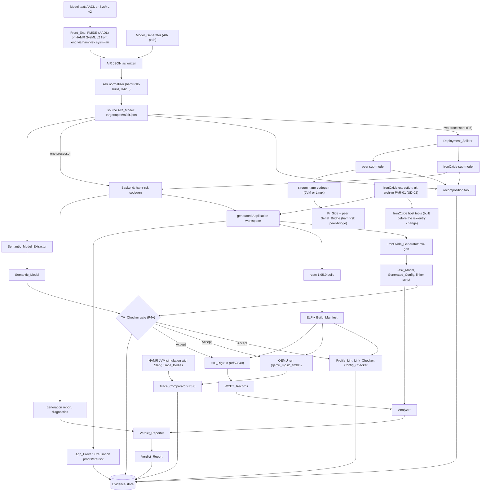

The two-processor path (R34, P5; "Two-processor path" designs it): FMIDE instantiates the Robot_Model; the normalizer rewrites the AIR; the Deployment_Splitter writes both sub-models; the recomposition tool checks them (R34.7); the Backend generates the MCU_Side from the IronOxide sub-model, with R1.9's provenance; HAMR's codegen generates the Pi_Side from the peer sub-model; `hamr-rsk peer-bridge` writes the Pi_Side Serial_Bridge and Frame_Codec outside HAMR's markers, in the text that HAMR keeps (DD-106); the Extractor runs on the original two-processor AIR_Model, and the TV_Checker checks the MCU_Side's Task_Model against it with the Serial_Bridge substitution (R34.5, R29.11). Before P4 the gate is absent (DD-35). The Analyzer runs from P1 as one of IronOxide's tools that must accept the Application (R18.2, UD-27); its results become timing evidence and Verdict_Reports from P3 (R25 to R27).

#### Steps of one generation

`cargo xtask gen <model>` (see "Shared names", which lists every command) runs these steps for a one-processor model. Each step reads only the outputs of earlier steps, and a failing step ends the command.

| Step | Program | Reads | Writes | Criteria |
|---|---|---|---|---|
| 1 | Front_End (`hamr-rsk sysml-air` for SysML v2; FMIDE for AADL; for a committed AIR file of the corpus, a byte copy) | model text, or the committed AIR file | `target/apps/<model>/air.raw.json` | R1.1 |
| 2 | AIR normalizer (`hamr-rsk-build normalize-air`) | `air.raw.json` | `target/apps/<model>/air.json` | R42.6 |
| 3 | Backend (`hamr-rsk codegen`) | `air.json`, the invocation's Front_End name and version | the Application in `apps/<model>/` (corpus, robot) or `target/apps/<seed>-<index>/` (Model_Generator), its `hamr-rsk/generation-report.json` and `hamr-rsk/diagnostics.{json,txt}` | R1 to R20 |
| 4 | Semantic_Model_Extractor (`hamr-rsk-extract`) | `air.json` | `target/apps/<model>/semantic-model.json` | R28 |
| 5 | IronOxide_Generator (`rsk-gen` from `target/ironoxide-tools/`) | each App_Declaration of the decl crate | `gen-<target>/` in the Application: Generated_Config, Task_Model, linker script | R17.4, R18.2 |
| 6 | Generator check (`hamr-rsk-build`) | the Task_Model, the generation report | a Backend-defect report where R17.4 applies | R17.4 |
| 7 | TV gate, Phase P4 onward (`hamr-rsk-build`, then `hamr-rsk-tv`) | the Semantic_Model, the Task_Model, `air.json` | `target/apps/<model>/reports/tv-report.json` | R29.5, R29.11 |

Steps 4 and 3 are independent; the Build_System runs step 4 even when step 3 refuses the model, so that `pbt-semantic-model-*` items see refused models too. `cargo xtask build` then compiles the Application and runs the Profile_Lint, the Link_Checker, the Config_Checker and the Analyzer (R18.2), each of whose diagnostics `hamr-rsk-report backmap` traces to the model (R3.4); before Phase P4 the TV gate of step 7 is absent and every evidence record says so (DD-35; "Phase builds and gating").

#### One digest links the artefacts

The normalized file `target/apps/<model>/air.json` is the AIR_Model file of R1.5: the Backend writes its SHA-256 digest into the provenance block of every file it writes (R1.5, R1.9), the Extractor writes the same digest into the Semantic_Model (R28.1), and the Build_System compares the two before the TV_Checker runs (R29.11). Because the digest is over the normalized bytes, two runs of the Front_End from directories at different absolute paths give the same digest (R42.6, `test-air-normalized`), and the rebuild of R42.4 compares the same file.

The provenance block that the Backend writes into each file holds, in this order: the AIR digest (64 lowercase hexadecimal digits), the Front_End name and version as the invocation states them, the commits of PAR-01 and of both revisions of PAR-02 (40 digits each), the Backend's version and the Phase for which it was built (DD-16), for an IronOxide sub-model (R1.9) the digest of the original two-processor AIR_Model file and the Deployment_Splitter's name and version, and, for an output of the test jar only, the statements of its test options (DD-18). In a Rust or TOML file it is a comment block at the top of the file; in a JSON document (the generation report, the diagnostics document) it is the member `provenance` (section "Diagnostics document (`hamr-rsk-diagnostics/1`)"). It holds no time stamp and no absolute path, so it does not break R18.4's byte identity across runs.

### Two-processor path

Implements the architecture of R34 and R36.7 (DD-05, DD-39 to DD-41, DD-46, DD-100, DD-106). Phase P5. The sections "Deployment_Splitter and recomposition tool", "Serial_Bridge and Frame_Codec" and "Robot_Model, the MCU side on the HIL_Rig, and robot integration" give the detail.

A two-processor model has one IronOxide_Processor and one Peer_Processor joined by one bus with `IronOxide::Serial_Link`. One AIR_Model defines both sides and the interface between them; each side is generated by its own back end, and nothing is edited between the steps (R36.7):

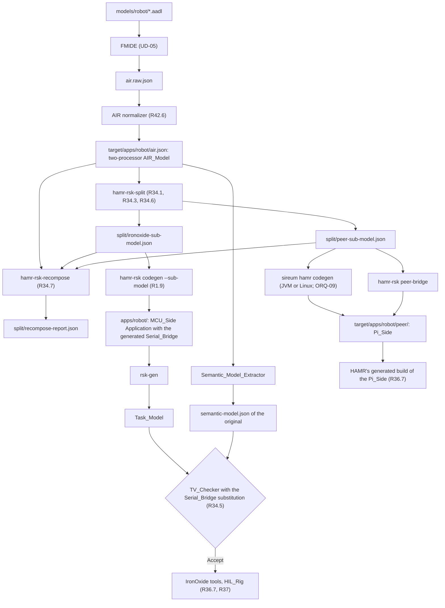

| Step | Command | Input | Output | Check |
|---|---|---|---|---|
| 1 | `cargo xtask front-end robot` | the AADL files | `target/apps/robot/air.json` | `test-robot-model-parses`, `test-air-normalized` |
| 2 | `hamr-rsk-split --air … --out-dir target/apps/robot/split` | the two-processor AIR_Model | both sub-models, or the diagnostics of R34.4 | `test-splitter`, `test-splitter-refusals` |
| 3 | `hamr-rsk-recompose …` | original and both sub-models | `split/recompose-report.json` | `check-splitter-recompose-robot` |
| 4 | `hamr-rsk codegen --air split/ironoxide-sub-model.json --sub-model …` | the IronOxide sub-model | `apps/robot/` | `test-robot-generation`, `check-generated-robot` |
| 5 | `sireum hamr codegen` (platform of ORQ-09, or JVM, Linux and ros2 until S-13) | the peer sub-model | `target/apps/robot/peer/<platform>/` | `test-splitter-peer-codegen` |
| 6 | `hamr-rsk peer-bridge --peer-air split/peer-sub-model.json --hamr-out target/apps/robot/peer/<platform>` | the peer sub-model, HAMR's output | the Pi_Side Serial_Bridge and Frame_Codec in HAMR's output | `test-robot-generation` (the Pi_Side compiles with HAMR's build) |
| 7 | `hamr-rsk-extract --air target/apps/robot/air.json …` | the original | the Semantic_Model | — |
| 8 | IronOxide_Generator, TV gate (P4 onward), IronOxide tools | the MCU_Side | Task_Model, reports | `check-tv-robot`, R18.2's items for `nrf52840` |

The responsibilities follow the decisions:
- The model declares every Serial_Bridge thread with its timing, Priority and process (UD-15). The Splitter only adds ports, declared connections, connection instances, markers and the moved integration clauses (R34.1, R34.3), so the Backend maps the MCU_Side Serial_Bridge threads as it maps every thread (R34.8), and the Analyzer, the Link_Checker and the TV_Checker see them as ordinary Tasks.
- The Splitter and the recomposition tool are independent: Scala on HAMR's reader and printer, and Rust over generic JSON (DD-05, DR-4). The recomposition check runs before either sub-model is used.
- The Backend generates the MCU_Side Serial_Bridge's code in its Partition crate (two Tasks, DD-41); `peer-bridge`, a subcommand of the same jar, generates the Pi_Side Serial_Bridge in Slang into HAMR's output. Both take the frame grammar and the Wire_Type layouts from the same Backend code, so both sides number the bridge paths and lay out payloads the same way; `pbt-frame-cross-codec` checks it.
- The TV_Checker checks the MCU_Side against the Semantic_Model of the original two-processor AIR_Model, not against the sub-model (R34.5), so a bridge path that the Splitter dropped, duplicated or misdirected on the IronOxide side is rejected by the TV_Checker as well as by the recomposition check.

At run time (section "Runtime structure", Serial_Bridge paragraph), the deployed system is the MCU_Side's three Partitions on the nRF52840 (safety at level A with the supervisor and the encoder Task, motor at level B, serial_bridge at level C with the receive and the transmit Task) and the Pi_Side's HAMR threads on the Raspberry Pi 5, joined by UARTE0 at PAR-12. Every peer message reaches an MCU_Side Partition only through the Serial_Bridge's parser, sequence check and R24.6 check, and then through an Upward Endpoint with a Validation_Function (R35.5).

### Runtime structure

Implements R19.6. Places at run time what R10 to R15 and R19 generate; the sections "Port_Glue and Port_API", "Cross-Partition connections and data-port sampling", "Validation_Functions", "Devices, peripherals and interrupts" and "Port_Glue Job State Machine" give the detail.

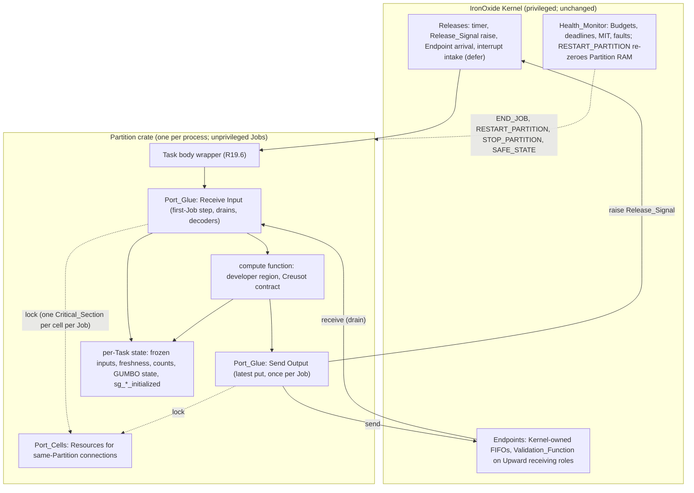

The Kernel side is IronOxide's at PAR-01, used without change (DD-12). Everything the Backend generates runs inside Jobs: unprivileged, in the Partition's MPU view, on the Partition's stack, and inside the Task's Budget (DEV-08).

#### One Job of a Task

1. A Release of Task t becomes due (period timer, Release_Signal raise, Endpoint arrival or interrupt intake; IronOxide design.md "Runtime structure").
2. When the Job starts, IronOxide's Job wrapper `rsk_jobs::<t>` builds the Context `rsk_ctx::<T>` (one `Shared` per Port_Cell and Resource, one `Signal` per Release_Signal in `raises`, one `Endpoint` per role, one `PerTask` per per-Task state item) and calls the Task body `crate::<t>`. That is the function the App_Declaration names with `task <t> (…)` (IronOxide `crates/rsk-gen/src/emit.rs`, `rsk_jobs` and `rsk_ctx`, at PAR-01).
3. The Backend generates the Task body as R19.6's wrapper: Receive Input (`glue::<t>::receive_input`), then exactly one call of `tasks::<t>::compute`, then the write-back of the GUMBO state (`glue::<t>::store_state`), then Send Output (`glue::<t>::send_output`), then return. The return is the Job's Release_Point.

| AADL run-time service | Generated item | When it runs |
|---|---|---|
| Initialize entry point | none; developer `const fn` values (R20.1, R20.2), presented by the first-Job step of DD-23 | inside the first Receive Input after instant 0 or a restart |
| Receive_Input | `glue::<t>::receive_input` | at Job start, before the compute code (R19.2) |
| Get_Value | `PortApi::get_<port>` and the readers of DD-24 and DD-70 | during the compute code; reads only what Receive Input froze |
| Put_Value | `PortApi::put_<port>` | during the compute code; the latest call wins (DD-24) |
| Send_Output | `glue::<t>::send_output` | after the compute code returns, before the Job returns (R19.3) |

#### Where the state lives

| Data | Storage | Written by | Reset |
|---|---|---|---|
| Port_Cells (R10.2 to R10.4) | Resources in the Partition's RAM (`ResourceCell` statics that the IronOxide_Generator emits) | the two connected Tasks' Port_Glue, inside Critical_Sections | zeroed with the Partition's RAM at reset and at RESTART_PARTITION (DD-23) |
| Glue state items (`sg` tag): `initialized`, held frozen values of cross-Partition data ports, counts | per-Task state (PR-25) | the Task's own Port_Glue | as Port_Cells |
| GUMBO state variables (R20.1) | per-Task state | `store_state`, after the compute code, from the Port_API | as Port_Cells; the first-Job step then writes the `const fn` values |
| The Port_API value: frozen inputs, freshness, counts and GUMBO state values for this Job, output slots | the Job's stack | Receive Input (inputs), Put Value (output slots) | built anew in every Job, every output slot absent (DD-24) |
| Endpoint channels | Kernel RAM (Endpoint storage) | the Kernel, in `send` and `recv` | emptied when either Partition stops or restarts, as IronOxide's design.md describes the implementation at PAR-01 (task 21.4 note); no IronOxide criterion states it, since IronOxide R42.3 requires only the peer-state error (IOP-18, `test-init-restart`) |

Every glue state item and Port_Cell has an all-zero initial value, so none depends on whether IronOxide loads non-zero initial values (ORQ-40). In the P1 demo's linker script at PAR-01, a Partition's `.data` is placed with its `.bss` in a NOLOAD section (`apps/p1-demo/gen/link.x`), which fits this choice.

#### Reachability of developer code (R19.6)

From a Task entry, developer code is reachable only through the wrapper's one call of the compute function, and, during Receive Input, through the developer function of R13.2 that a Validation_Function calls. The latter call happens inside `rsk::Endpoint::recv`, which runs `V::accept` in the Job after the receive SVC returns (IronOxide `crates/rsk/src/lib.rs`, `recv_from`). The wrapper calls the compute function in every Job, also when a Validation_Function rejected the Job's Dispatch-trigger message; the trigger port is then absent (R13.5, UD-21). `check-link-<model>` checks both paths on the call graph from the Task entries.

#### Ordering between Tasks

Inputs are frozen when Receive Input runs, not at the Release instant (DEV-01). Receive Input freezes the Task's ports one after another, each with its own Critical_Section or Endpoint operations, so a preempting Task can change one port after another port of the same Job was frozen (ORQ-07). Send Output likewise performs one operation at a time. An Overrun or fault response that ends the Job during Send Output can leave some outputs sent and others not (DEV-08). The section "Port_Glue Job State Machine" states what each Health_Monitor response leaves behind.

**The Serial_Bridge's Partition (case study; DD-41, DD-103).** On the MCU_Side of the case study, the Serial_Bridge's Partition `serial_bridge` (level C) owns UARTE0 and holds two Tasks whose compute functions the Backend generates (section "Serial_Bridge and Frame_Codec"). The receive Task TH-04 is Sporadic and released only by UARTE0's interrupt (line 2) with `defer`; each Release follows an ENDRX event, when EasyDMA has filled one of the two 128-byte receive buffers in TH-04's per-Task state and the `ENDRX_STARTRX` shortcut has already started reception into the other. In that Job, TH-04 feeds the filled buffer through the frame parser, the sequence check and the R24.6 check, puts each accepted message on its out port, re-arms the buffer with `rsk::dma_request`, and locks the Resource `link` once to record the last acceptance. The transmit Task TH-05 is Periodic (10 ms): its first Job configures UARTE0 and starts the receive path; every Job decides link loss from `link`, puts the link status for the supervisor (CN-03), and sends fresh telemetry as one frame by `rsk::dma_request` on TXD. The Partition exchanges data with the safety Partition only through Endpoints (CN-01 to CN-03 Upward, each with a Validation_Function; CN-07 from the safety Partition), never through shared memory, and its Port_Glue runs as in every other Partition.

### Phase builds and gating

Implements R16.8 (with "Diagnostics, mapping tables and the diagnostic table", which writes its diagnostics), and the Build_System side of R41.6 and R29.5 (DD-16, DD-35).

#### The Phase of a Backend build (DD-16)

The Phase for which the Backend is built is part of the built jar, not an option of a run. When the Build_System assembles `target/jvm/p<n>/hamr-rsk.jar` (n from 1 to 5), it writes the resource `hamr-rsk-phase.properties` into the jar with exactly one line, `phase=P<n>`, followed by a newline. At start the Backend reads the resource from its own class path (`getResourceAsStream("/hamr-rsk-phase.properties")`), and ends the run with an internal error (exit status 3, see "Error Handling") when the resource is absent or holds anything else. No command-line option sets or overrides the Phase. The Phase appears in the provenance block of the diagnostics document (`backend.phase`) and of the generation report, so every output names the Backend build that wrote it.

The Build_System assembles the jar of Phase P<n+1> only when the Verification_Plan's checkpoint record of Phase P<n> (R41.4) states the checkpoint as closed with the user's approval (R41.6, UD-09). Otherwise the assembly step fails, naming the open checkpoint, and every command that needs that jar fails with it. The jars of earlier Phases stay, because `test-phase-refusals` at the checkpoint of Pn runs the jar of Pn, and regression runs of earlier Phases keep their own jar. The current Phase of the Build_System is the lowest Phase whose checkpoint is not closed; `cargo xtask verify` uses the jar of the current Phase and runs the Evidence_Items of that Phase and every earlier one (R39.2).

The test-only jar `target/jvm/hamr-rsk-test.jar` (DD-18) carries the same resource for the current Phase; it differs from the production jar only by its entry point ("IronOxide limits and the test-only suspension").

#### Phase refusals (R16.8)

Table 16-1 is held by the Backend's `.check` package as a constant map from Table M-1 row to first Phase. For each element of R1.2, the Backend computes the set of Table 16-1 rows whose construct the element is, by the selectors below. If one of these rows has a first Phase later than the build's Phase, the element gets one Phase diagnostic per such row, and the Backend suppresses, for that element, every other diagnostic of the row and of the criteria of the requirement that Table 16-1 names for the row (R3.2).

| Table M-1 row | First Phase | The element is the construct when |
|---|---|---|
| MAP-02 | P2 | it is a thread whose `Thread_Properties::Dispatch_Protocol` reads Sporadic |
| MAP-10 | P2 | it is a data subcomponent of a process or thread group of R1.2 that the AIR_Model's access connections join to a thread |
| MAP-11 to MAP-14 | P2 | it is a port connection instance whose two ends are threads of one process of R1.2 |
| MAP-15, MAP-17 | P2 | it is an event or event data port connection instance between threads of two processes of R1.2 |
| MAP-16 | P2 | it is a data port connection instance between threads of two processes of R1.2 |
| MAP-18 | P2 | it is a port connection instance between threads of two processes of R1.2 whose destination process has the higher `IronOxide::Criticality_Level` |
| MAP-19 | P2 | it is a data port or event data port of a thread of R1.2 (the data type of the port is the construct) |
| MAP-20 | P2 | it is a device of MAP-20 |
| MAP-29 | P2 | it is a thread with a property whose name begins with `Programming_Properties::Initialize_Entrypoint`, or a GUMBO `initialize` clause (which entry-point properties each Front_End writes is open, settled by S-05, ORQ-27) |
| MAP-30 | P2 | it is a GUMBO subclause (`GclSubclause`) of a component of R1.2 |
| MAP-21 | P3 | it is an end-to-end flow of R1.2 with `Communication_Properties::Latency` |
| MAP-27 (cross-processor port connection) | P5 | it is a port connection instance of R1.4 (b) whose other end is a thread on another processor |

The selectors read only layer-1 facts of the AIR view (DD-03), so a Phase refusal never depends on HAMR's resolution. Where Table 16-1 groups rows (MAP-11 to MAP-14; MAP-15 and MAP-17), the diagnostic names the row that the port-connection classification of "Diagnostics, mapping tables and the diagnostic table" gives the connection. A diagnostic of R16.8 has rule class 3 with the entry "Phase restriction (R16.8)" and names the element as R3.1 requires, the Table M-1 row, the row's first Phase and the build's Phase (section "Diagnostics document (`hamr-rsk-diagnostics/1`)", member `phase`). Where a check counts or sums over several elements (the limits of Requirement 17), it leaves out the elements that a Phase refusal suppresses for that check, as R17.1 states for refused elements.

Suppression is per element and per row, so a model with constructs of a later Phase and with refusals of the current Phase gets every diagnostic in one run (`test-phase-refusals`). For example, in the P1 build a Sporadic thread with no Period gets the Phase diagnostic of MAP-02 and not MAP-02 (a), while a Periodic thread without Period in the same model gets MAP-01 (a).

#### Gates of the Build_System

The Build_System, not the Backend, decides which later steps run. The gates in order:

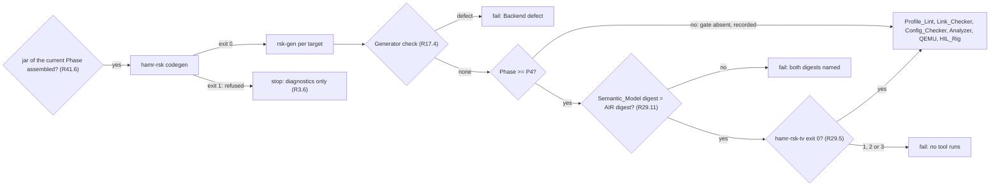

From Phase P4 the TV gate stands between the IronOxide_Generator and every tool that judges or runs the binary (DD-35): `hamr-rsk-build` runs the Profile_Lint, the Link_Checker, the Config_Checker, the Analyzer, the WCET_Harness, QEMU and the HIL_Rig on an Application only after `hamr-rsk-tv` exited with status 0 for its Task_Model and Semantic_Model. Before Phase P4 the gate is absent; each evidence record of a tool run then carries the condition "TV gate absent (Phase Pn)" in its `condition` field (DD-44), so no record claims a gate that did not run. The App_Prover is not behind the gate: it reads the generated Rust sources and not the Task_Model, and its results do not depend on the TV_Checker.

## Components and Interfaces

### Module boundaries

Implements the dependency rules that R21.4 (DR-2) and R28.2 (DR-1) require, and the rules of R29.6, R31.9, R34.7, R42.5 and R18.3 that keep the independent components independent (DR-3 to DR-7).

#### Repository paths

| Path | Content | Language, build |
|---|---|---|
| `Cargo.toml`, `rust-toolchain.toml`, `.cargo/config.toml` | Rust host workspace of `crates/*` (DD-06): rustc 1.95.0; vendored sources = `target/ironoxide/vendor`; offline; alias `xtask` (whether Cargo accepts the missing vendor directory while it builds the dependency-free `xtask` is part of S-03) | Rust |
| `xtask/` | Build_System entry (`cargo xtask`), its own Cargo workspace with no dependency: `check-pins` (R42.1, R42.2, R42.9), the extraction (DD-12, DD-15), then hand-over to `hamr-rsk-build` | Rust, standard library only |
| `crates/hamr-rsk-build/` | the other Build_System steps: AIR normalizer (DD-13), TV gate (DD-35), tool runs, evidence store (DD-44), registers, trace matrix, mutation driver, `vstd` scan (DD-32) | Rust |
| `crates/hamr-rsk-report/` | Verdict_Reporter and IronOxide-diagnostic back-mapper | Rust |
| `crates/hamr-rsk-trace-compare/` | Trace_Comparator | Rust |
| `crates/hamr-rsk-modelgen/` | Model_Generator | Rust, `proptest` |
| `crates/hamr-rsk-recompose/` | recomposition tool | Rust |
| `crates/hamr-rsk-jsonschema/` | RFC 8259 JSON parser (DD-96) and JSON Schema subset validator (F-S2, DD-06) | Rust |
| `crates/hamr-rsk-pi-stand-in/` | Pi_Stand_In (P5): host program, serial I/O through `libc` termios, the MCU_Side Frame_Codec module compiled for the host | Rust |
| `verus/` | Verus workspace (DD-07): `hamr-rsk-sampling/`, `hamr-rsk-tv/`, `hamr-rsk-correspondence/`; rustc 1.98.1 | Rust + Verus |
| `jvm/bin/project.cmd` | proyek project definition of the JVM modules | Slang script |
| `jvm/backend/` | Backend `hamr-rsk` (packages in "Modules and crates") | Scala 2.13.18 |
| `jvm/backend-test/` | test-only entry point (DD-18) | Scala |
| `jvm/extractor/` | Semantic_Model_Extractor `hamr-rsk-extract` | Scala, on `hamr-air.jar` only |
| `jvm/splitter/` | Deployment_Splitter `hamr-rsk-split` | Scala, on `hamr-air.jar` only |
| `schemas/` | published JSON schemas, one file per identifier ("Published schemas") | JSON |
| `property-set/IronOxide.aadl`, `property-set/IronOxide.sysml` | IronOxide_Property_Set (R2.1) | AADL, SysML v2 |
| `models/corpus/<model>/` | corpus models (adapted INSPECTA models keep the BSD-3-Clause notice, R42.8) | AADL, SysML v2, AIR JSON |
| `models/robot/` | Robot_Model (AADL, DD-46) | AADL |
| `apps/<model>/` | the generated Application of each corpus model and of `robot`, with its developer regions and developer-owned files (tracked, so that developer code is versioned); `apps/ironoxide` is an untracked link to `target/ironoxide` | Rust |
| `hil/robot-rig.toml`, `hil/stimulus/` | rig description (DM-42) and stimulus program (ORQ-65), P5 | TOML, Rust |
| `tests/fixtures/`, `tests/regressions/<pbt item>/` | example-test fixtures; regression corpora of R31.6 | various |
| `docs/` | `verification_plan.md`, `frame_grammar.md`, `gap_register.toml`, `trust_base_register.toml`, `proof_assumptions.toml`, `proof_mutations.toml`, `translation_mutations.toml`, `traceability_matrix.md`, `reviews/`, and from P6 `robot_integration_plan.md` | Markdown, TOML |
| `target/ironoxide/` | the extraction (DD-12) | — |
| `target/ironoxide-tools/` | IronOxide's host tools built from the unchanged extraction | — |
| `target/jvm/` | `hamr-air.jar`, `p<n>/hamr-rsk.jar`, `hamr-rsk-test.jar`, `hamr-rsk-extract.jar`, `hamr-rsk-split.jar` | — |
| `target/apps/<model>/` | per-model work: `air.json` (normalized source AIR_Model), `semantic-model.json`, `split/` (sub-models, recomposition report), `peer/` (HAMR's Pi_Side output), `jvm/` (HAMR JVM output with Slang Trace_Bodies), `reports/` (tool logs, back-mapped diagnostics, TV report, Verdict_Reports) | — |
| `target/apps/<model>.trace/` | trace variant (DD-38) | — |
| `target/apps/ironoxide` | untracked link to `target/ironoxide`, beside generated outputs of Model_Generator models | — |
| `target/evidence/`, `target/work/` | evidence store (DD-44); mutation work directories (DD-36) | — |
| `external/kekinian/`, `external/INSPECTA-models/`, `external/sysml-aadl-libraries/`, `external/verus/`, `external/.cache/` | pinned clones and installations (Table 42-1), caches (R42.3) | — |

Model_Generator outputs are written to `target/apps/<seed>-<index>/` (PBT runs), and corpus and robot outputs to `apps/<model>/`. In both cases the generated workspace finds IronOxide at `../ironoxide` ("The IronOxide extraction").

Two work paths complete the table: `target/apps/<model>/air.raw.json` is the Front_End's output before normalization, and `target/rebuild/<model>-<run>/` holds the clean checkout of R42.4 ("Build_System, pins and the IronOxide extraction"). The Build_System creates every path under `target/` and `external/.cache/`, and nothing outside the workspace (R42.3).

#### Modules and crates

| Module or crate | Path | Language | Contents | Depends on | Primary evidence |
|---|---|---|---|---|---|
| Backend `hamr-rsk` | `jvm/backend` | Scala | packages `org.hamrdahn.rsk.cli` (entry, subcommands), `.air` (AIR view, exact readers, DD-03, DD-19), `.scope` (R1.2), `.check` (refusals, diagnostic table, DD-17), `.map` (Tasks, timing, priorities, Partitions, Resources, connections, devices), `.names` (DD-09), `.types` (Table 14-1, Wire_Types), `.contracts` (Contract_Translator), `.emit` (Rust and App_Declaration printers, regions DD-10), `.report` (generation report, diagnostics), `.trace` (Trace_Bodies, P3), `.bridge` (Serial_Bridge and Frame_Codec, P5) | `sireum.jar` (HAMR reader, SysML front end, `TypeResolver`, `SymbolResolver`, `GclResolver`); Scala library | TV_Checker (P4), IronOxide's tools, App_Prover, PBTs |
| `hamr-rsk-test` | `jvm/backend-test` | Scala | DD-18 entry point | Backend | R17 comparison tests |
| Semantic_Model_Extractor | `jvm/extractor` | Scala | Table 28-1 rows, R28.3 reading, printer | `hamr-air.jar` only | `pbt-semantic-model-*`, `check-extractor-independence`, `diff-semantic-model-hamr` |
| Deployment_Splitter | `jvm/splitter` | Scala | R34.1, R34.3, R34.6, R34.8 | `hamr-air.jar` only | `pbt-splitter`, recomposition check |
| Build_System entry | `xtask` | Rust | the `cargo xtask` commands (see "Shared names"), pins, extraction, hand-over | standard library only | `check-pins`, `check-ironoxide-extraction` |
| Build_System steps | `crates/hamr-rsk-build` | Rust | normalizer, gates, tool runs, evidence, registers, trace matrix, mutation driver, `vstd` scan (DD-32) | vendored crates; `rsk-elf`, `rsk-digest`, `rsk-model` | the other `check-*` items |
| `hamr-rsk-report` | `crates/hamr-rsk-report` | Rust | Verdict_Reporter, back-mapper | `rsk-model`; vendored crates | `pbt-verdict-copy`, `test-ironoxide-diagnostic-backmap` |
| `hamr-rsk-trace-compare` | `crates/hamr-rsk-trace-compare` | Rust | Table 32-1 relation | vendored crates; `rsk-model` | `diff-*` fixtures |
| `hamr-rsk-modelgen` | `crates/hamr-rsk-modelgen` | Rust | Model_Generator, AIR JSON and SysML printers, records | `proptest`, vendored crates | `pbt-generator-coverage` |
| `hamr-rsk-recompose` | `crates/hamr-rsk-recompose` | Rust | R34.7 | `serde_json` | `mut-splitter` |
| `hamr-rsk-jsonschema` | `crates/hamr-rsk-jsonschema` | Rust | its own RFC 8259 parser, numbers kept as token text (DD-96); the keywords of F-S2 and the ignored annotations (DD-06) | `regex-automata` | `test-jsonschema-validator` |
| `hamr-rsk-sampling` | `verus/hamr-rsk-sampling` | Rust + Verus | C_sample and B specs and lemmas | `vstd` | `proof-tv-sampling-capacity` |
| TV_Checker `hamr-rsk-tv` | `verus/hamr-rsk-tv` | Rust + Verus | `core` (`verus!`), readers, printer, entry | `vstd`, `verus_builtin`, `verus_builtin_macros`, `hamr-rsk-sampling`, `hamr-rsk-jsonschema` (parser and validator, DD-96) | `proof-tv-core`, `pbt-tv-complete` |
| `hamr-rsk-correspondence` | `verus/hamr-rsk-correspondence` | Rust + Verus | R23.4 model and theorem | `vstd` | `proof-contract-correspondence` |
| Generated Application | `apps/<model>/`, `target/apps/...` | Rust | "The generated Application and regeneration" | extraction crates; vendored crates | IronOxide's tools, App_Prover |

#### Dependency diagram

Solid arrows are build dependencies; dashed arrows are data that one program writes and another reads. Each dependency that a rule forbids is absent, and each rule has a check that reads the build files.

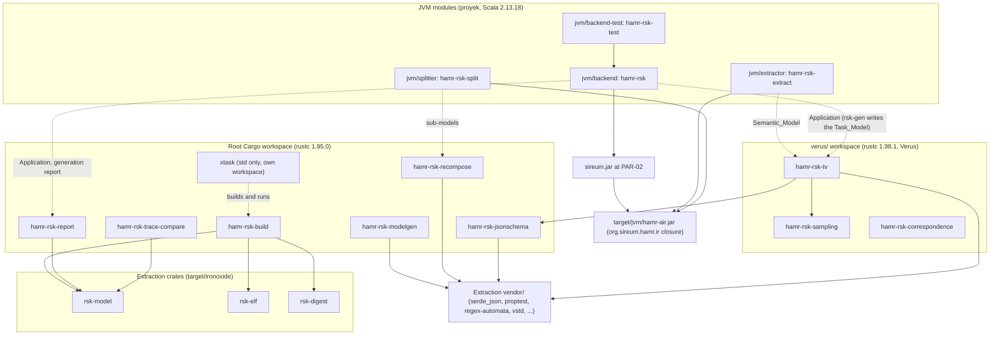

Absent by rule: no arrow from `jvm/extractor` to `jvm/backend` or back (DR-1); no arrow from any root-workspace crate or generated crate into `verus/` or `vstd` (DR-2); no arrow from `hamr-rsk-tv` to an `rsk-*` crate (DR-3); no arrow between `hamr-rsk-recompose` and `jvm/splitter` (DR-4); no arrow from `hamr-rsk-modelgen` to the Backend, the Extractor or the TV_Checker (DR-5).

#### Dependency rules

Each rule has its check:

- DR-1 (R28.2): `jvm/extractor` depends on nothing but `hamr-air.jar` and the Scala library; no Backend module (Backend, Contract_Translator, Verdict_Reporter, back-mapper, `hamr-rsk-test`) depends on it or reads a Semantic_Model. `check-extractor-independence` reads `jvm/bin/project.cmd`, every `import` and the class list of `hamr-air.jar`.
- DR-2 (R21.4): no generated crate and no root-workspace crate depends on `vstd`, `verus_builtin`, `verus_builtin_macros` or a `verus/` crate; `creusot-std` enters only through `rsk`'s `creusot` feature in `proofs/creusot/`. `check-deps` reads `cargo metadata` of every Flight_Build.
- DR-3 (R29.6): `hamr-rsk-tv` depends on no `rsk-*` crate and on no file the Backend writes; its non-core parts are exactly the readers, the printer and the entry point.
- DR-4 (R34.7): `hamr-rsk-recompose` shares no code with `jvm/splitter`.
- DR-5 (R31.9): `hamr-rsk-modelgen` depends on no Backend, Extractor or TV_Checker code.
- DR-6 (R42.5): Rust crates use third-party crates only from the extraction's vendor; JVM modules only `sireum.jar` (or its slice) and the Scala library of row 6.
- DR-7 (R18.3): every generated crate obeys R18.3; the Backend's Rust printer checks the rules it can check before writing (no `unsafe`, no `static mut`, no link attributes), and IronOxide's tools check the rest.

#### Inside the Backend

The Backend's packages (table above) form one pipeline. Layer 1 works on the Backend's own view of the AIR value; layer 2 is HAMR's resolution, run only where layer 1 found no input refusal and only on the part of the model that R1.2 selects (DD-03, DD-52).

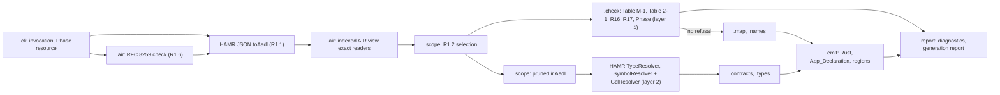

Layer 2 results feed only the Contract_Translator and the application types of Table 14-1 (DD-03); every refusal and every mapping decision of Table M-1 is computed in layer 1, so the Backend reports all of them in one run (R3.2) even when HAMR's resolution would stop at the first structural error. A resolution error of HAMR that no Table M-1 condition covers is the open conflict C-01.

#### Shared names

Every section uses the names below exactly. A name that is not listed here is local to the section that defines it.

##### Commands

| Command | Role |
|---|---|
| `cargo xtask verify` | the single entry point of every Evidence_Item (R39.2) |
| `cargo xtask check-pins` | R42.1, R42.2, R42.9; also the first step of every other command |
| `cargo xtask extract` | writes and checks the extraction, builds IronOxide's host tools, applies the change (see "The IronOxide extraction (DD-12, ORQ-37)") |
| `cargo xtask front-end <model>` | runs the Front_End and the AIR normalizer (`hamr-rsk-build normalize-air`, DD-13), writes `target/apps/<model>/air.json` |
| `cargo xtask gen <model>` | Splitter (two processors), Backend, Extractor, IronOxide_Generator, Generator check, TV gate (P4 onward) |
| `cargo xtask build <model> --target <nrf52840\|qemu_mps2_an386> [--hil]` | Flight_Build or HIL build, then the IronOxide checks |
| `cargo xtask qemu <model>` | R18.6 run |
| `cargo xtask prove <model>` | App_Prover on `proofs/creusot` |
| `cargo xtask pbt <item> [--seed <16 hex digits>]` | one `pbt-` item (R31.7) |
| `cargo xtask diff <model> [--rig]` | differential test (R32) |
| `cargo xtask hil <run>` | `hil-robot-nominal`, `hil-robot-faults`, `hil-robot-encoders`, `hil-serial-faults` |
| `cargo xtask mutations [--kind <kind>]` | proof and translation mutation runs (R30, R33) |
| `cargo xtask trace` | writes `docs/traceability_matrix.md` (R40.4) |
| `cargo xtask checkpoint P<n>` | R41.1 |
| `cargo xtask change-log init` | writes change-log entry 1 for the user to approve (R41.2; "Verification_Plan, evidence, registers and checkpoints") |
| `hamr-rsk codegen --air <file> --front-end <name> --front-end-version <v> --out <dir> [--sub-model --original-air-digest <hex> --splitter <name> --splitter-version <v>]` | the Backend (R1.5, R1.9); the Phase comes from the jar (DD-16) |
| `hamr-rsk-test <the options of hamr-rsk codegen> [--suspend-refusals <criterion list>] [--test-name-substitute <file>] [--test-end-to-end-flows <file>]` | the test jar (DD-18, DD-93); its users are listed in "IronOxide limits and the test-only suspension" |
| `hamr-rsk sysml-air --sourcepath <dirs> --system <qualified name> --out <file> <sysml files>` | SysML Front_End wrapper (DD-01, S-01) |
| `hamr-rsk trace-bodies --app <dir> --trace-out <dir> --hamr-jvm <dir> [--initial-values <file>]` | both Trace_Bodies (DD-38, DD-101) |
| `hamr-rsk peer-bridge --peer-air <file> --hamr-out <dir>` | Pi_Side Serial_Bridge and Frame_Codec (DD-41, DD-106) |
| `hamr-rsk-extract --air <file> --out <file>` | Semantic_Model_Extractor |
| `hamr-rsk-split --air <file> --out-dir <dir>` | writes `<dir>/ironoxide-sub-model.json` and `<dir>/peer-sub-model.json` |
| `hamr-rsk-recompose --original <f> --ironoxide <f> --peer <f> --report <f>` | R34.7 (DD-107) |
| `hamr-rsk-tv --semantic-model <f> --task-model <f> --report <f>` | exit 0 Accept, 1 Reject, 2 R29.9, 3 internal error (R29.6) |
| `hamr-rsk-report verdict --generation-report <f> --analysis-report <f> --task-model <f> --wcet <f>… --timing <f>… --build-manifest <f> --analyzer-exit <n> --analyzer-stderr <f> --run-record <f>… --coverage-threshold <n> --out <f>` | the Verdict_Reporter (R25, R27; the options after `--analysis-report` are DD-94's) |
| `hamr-rsk-report backmap --generation-report <f> --tool <name> --input <f> --out <f>` | back-mapping of IronOxide diagnostics (R3.4, DD-17, DD-54) |
| `hamr-rsk-trace-compare --jvm <f> --ironoxide <f> --task-model <f> --report <f>` | R32.3 (DD-108) |
| `hamr-rsk-modelgen --seed <hex> --index <n> --target <t> --path <sysml\|air> --out <dir>` | R31.7, R31.8 |
| `hamr-rsk-pi-stand-in` | the Pi_Stand_In host program (P5; "Robot_Model, the MCU side on the HIL_Rig, and robot integration") |

`cargo xtask` is the alias `run --manifest-path xtask/Cargo.toml --` of the root `.cargo/config.toml` ("Build_System, pins and the IronOxide extraction").

##### Published schemas

Each schema is published at `schemas/<identifier with / replaced by ->.json`, for example `schemas/hamr-rsk-semantic-model-1.json`. Identifiers are never reused (R28.5 for the first; the same rule for the others).

| Identifier | Document | Designed in |
|---|---|---|
| `hamr-rsk-semantic-model/1` | Semantic_Model (R28) | "Semantic_Model_Extractor"; "Semantic_Model, TV report and Verdict_Report" |
| `hamr-rsk-diagnostics/1` | Backend and back-mapped diagnostics (R3.3, R3.4) | "Diagnostics document (`hamr-rsk-diagnostics/1`)" |
| `hamr-rsk-generation-report/1` | generation report | "Generation report, App_Declaration as generated, Model_Generator record and coverage report" |
| `hamr-rsk-verdict/1` | Verdict_Report (R27.1) | "Timing: Analyzer runs, Chains and the Verdict_Reporter"; "Semantic_Model, TV report and Verdict_Report" |
| `hamr-rsk-tv-report/1` | TV_Checker report (R29.5) | "TV_Checker"; "Semantic_Model, TV report and Verdict_Report" |
| `hamr-rsk-modelgen-record/1` | Model_Generator model record (R31.1) | "Model_Generator and property-based tests over generated models" |
| `hamr-rsk-coverage-report/1` | `pbt-generator-coverage` report (R31.1) | "Model_Generator and property-based tests over generated models" |
| `hamr-rsk-trace/1` | observable trace, one per run (R32.2) | "Observable trace, frame grammar, rig description" |
| `hamr-rsk-diff-report/1` | differential test report, one per run (R32.4, R32.5; DD-108) | "Observable trace, frame grammar, rig description" |
| `hamr-rsk-recompose-report/1` | recomposition report (R34.7) | "Deployment_Splitter and recomposition tool" |
| `hamr-rsk-evidence/1` | evidence record, extending `rsk-evidence/1` (DD-44, DD-86) | "Contract items, the evidence record and the review record" |
| IronOxide's `rsk-task-model/1`, `rsk-analysis-report/1`, `rsk-wcet/1`, `rsk-kernel-timing/1` | read, never written by this project's code | — |

The text `hamr-rsk-modelgen/1` that DD-62 hashes into the Model_Generator's seeds is a fixed label, not a schema identifier.

The validator `hamr-rsk-jsonschema` accepts exactly the keywords that IronOxide's Task_Model schema uses (F-S2), `oneOf`, `$ref` into `$defs` and type arrays included, ignores the annotations `$schema`, `$id`, `title`, `description` and `examples`, and refuses a schema with any other keyword (DD-06), so that the TV_Checker's reader can validate a Task_Model against IronOxide's own schema (R29.6). It reads every document with its own RFC 8259 parser (DD-96). Each schema of this project uses only those keywords; the diagnostics schema uses neither `oneOf` nor type arrays.

##### Files of registers, plans and reports

| File | Content | Designed in |
|---|---|---|
| `docs/verification_plan.md` | Verification_Plan: the Evidence_Item table (R39.6), the property allocation (R39.1), the change log (R41.2) and the checkpoint records (R41.4) | "Verification_Plan, evidence, registers and checkpoints" |
| `docs/gap_register.toml`, `docs/trust_base_register.toml`, `docs/proof_assumptions.toml` | R40.1 to R40.3 | "Verification_Plan, evidence, registers and checkpoints"; "Trust-Base Analysis" |
| `docs/proof_mutations.toml` | Proof_Mutation_Register (R33.6) | "App_Prover runs and proof mutations" |
| `docs/translation_mutations.toml` | Translation_Mutation_Register (R30.4) | "Translation mutations" |
| `docs/traceability_matrix.md` | written by `cargo xtask trace` only (R40.4) | "Verification_Plan, evidence, registers and checkpoints" |
| `docs/reviews/<item>/<YYYY-MM-DD>-<commit>.toml` | review records (DD-44) | "Contract items, the evidence record and the review record" |
| `docs/checkpoints/p<n>/` | the register and matrix copies of a checkpoint record (R41.1) | "Verification_Plan, evidence, registers and checkpoints" |
| `docs/frame_grammar.md` | `doc-frame-grammar` (R35.1) | "Serial_Bridge and Frame_Codec" |
| `docs/robot_integration_plan.md` | Robot_Integration_Plan (R38, P6) | "Robot_Model, the MCU side on the HIL_Rig, and robot integration" |
| `docs/ironoxide_proposals.md` | the IOP-nn proposals (R40.5) | — |
| `hil/robot-rig.toml` | rig description (R37.1, ORQ-63; DD-105) | "Observable trace, frame grammar, rig description" |
| `crates/hamr-rsk-modelgen/catalogue.toml` | coverage catalogue of R31.1 (DD-67) | "Model_Generator and property-based tests over generated models" |
| `tests/regressions/<pbt item>/` | regression corpora (R31.6) | "Property-based tests and the Model_Generator; QEMU runs and IronOxide tool acceptance" |
| `<application>/hamr-rsk/generation-report.json`, `diagnostics.json`, `diagnostics.txt` | generation report and diagnostics of one Backend run | "Generation report, App_Declaration as generated, Model_Generator record and coverage report"; "Diagnostics document (`hamr-rsk-diagnostics/1`)" |
| `target/apps/<model>/air.raw.json`, `air.json`, `semantic-model.json` | the Front_End's output, the normalized AIR_Model, the Semantic_Model | "Front_End, AIR normalization and input acceptance"; "Semantic_Model_Extractor" |
| `target/apps/<model>/reports/tv-report.json`, `verdict-<target>.json`, `ironoxide-diagnostics.json` (each with a `.txt` twin) | TV report, Verdict_Report, back-mapped diagnostics | "TV_Checker"; "Timing: Analyzer runs, Chains and the Verdict_Reporter"; "Diagnostics, mapping tables and the diagnostic table" |
| `target/apps/<model>/reports/trace-<run>.json`, `diff-<run>.json` | observable traces (`jvm`, `qemu`, `rig`) and differential test reports | "Trace_Bodies, Trace_Comparator and differential tests" |
| `target/apps/<model>/split/ironoxide-sub-model.json`, `peer-sub-model.json`, `recompose-report.json` | the two sub-models and the recomposition report | "Deployment_Splitter and recomposition tool" |
| `target/evidence/<item>/<YYYYMMDDTHHMMSSZ>-<job>.json`, `target/evidence/summary-<job>.json` | evidence records and the job summary (R39.2, R39.8; DD-44, DD-86) | "Verification_Plan, evidence, registers and checkpoints" |
| `target/registers/mutation-items.json` | the required item lists of the translation mutation runner (DD-98) | "Translation mutations" |

##### Generated item names

| Item | Name | Defined in |
|---|---|---|
| Partition, Partition crate, Task, Resource, Port_Cell, Release_Signal, Endpoint, Chain, per-Task state items, developer `const fn`, application type and Wire_Type, GUMBO library | DD-09 with the tags of "The sanitization rule (DD-09, R8.6)", on the segments of DD-60 | "Mapping pipeline: threads, timing properties, priorities, processes and names" |
| Fixed crates | `hamr-app-decl`, `hamr-app-types` (payload-type crate), `hamr-app-system`, `hamr-app-bin` (DD-11) | "The generated Application and regeneration" |
| Glue state items of Task t (tag `sg`, last segment) | `initialized` (DD-23), `frozen_<port>`, `fresh_<port>`, `undelivered_<port>`, `peer_changed_<port>`, `rejected_<port>`, `num_invalid_<port>`; in the MCU_Side Serial_Bridge also `expected_seq_<type>`, `synced_<type>`, `lost_<type>`, `dup_<type>`, `superseded_<type>`, `discard_<reason>` (R35.4, R35.9) and `guarantee_rejected_<port>` (R24.6) | "Port_Cells, per-Task state and Wire_Types"; "Serial_Bridge and Frame_Codec" |
| Task body | `tasks::<t>::<t>(cx)`, the wrapper of R19.6 | "Port_Glue and Port_API" |
| Compute function | `tasks::<t>::compute(api: &mut PortApi)`, body in region `compute.<t>`; contracts outside the region | "Port_Glue and Port_API" |
| Port_Glue functions | `glue::<t>::receive_input`, `glue::<t>::store_state`, `glue::<t>::send_output` | "Port_Glue and Port_API" |
| Glue support | `glue::Token`, `glue::Log`, `glue::Op`, the wrappers `recv_logged`, `send_logged`, `raise_logged` (DD-72); the cell types `CountCell`, `DataCell<T>`, `Fifo<T, Q>` and `Frozen<T, N>` of `glue::cells`, each with `ZERO` (DD-71) | "Port_Glue and Port_API"; "Port_Cells, per-Task state and Wire_Types" |
| Port_API type | `api::<t>::PortApi`, with no lifetime parameter, built only through a `glue::Token` (DD-70); its Creusot view has the fields `in_<p>`, `out_<p>` and `st_<v>` | "Port_Glue and Port_API" |
| Port_API operations | `get_<port>`, `put_<port>`, `get_<port>_num_invalid` (R19.8); `is_fresh_<port>`, `num_undelivered_<port>`, `num_peer_changed_<port>`, `num_rejected_<port>` (DD-24); `count_<port>`, `queue_<port>`, `st_<v>`, `set_st_<v>`, `out_<port>` (DD-70); `with_st_<v>` for a GUMBO state variable of a thread whose Partition owns an EasyDMA-capable peripheral (DD-104) | "Port_Glue and Port_API" |
| Clause items of owner o, clause k | `def_<o>_n<k>`, `val_<o>_n<k>` (logic functions), `twin_<o>_n<k>` (executable twin): o is the DD-09 name of the owning thread (tag `t`) or data classifier (tag `ty`), k the clause's 1-based position among the owner's clauses in R28.6's SM-10 order; `_n` is not a DD-09 token, so the name stays unique (DD-31, DD-82) | "Contract items, the evidence record and the review record" |
| Items of a GUMBO function f | `def_<o>_s<E(f)>`, `logic_<o>_s<E(f)>`, `twin_<o>_s<E(f)>`, and the total twin `opt_<o>_s<E(f)>` (DD-82); for a library function (CK-04) the owner is the package, encoded with tag `lib` | "Contract items, the evidence record and the review record" |
| Invariant predicates | `inv_<ty name>` of a data type, `cellinv_<cell>` of a Port_Cell | "Contract items, the evidence record and the review record" |
| Contract modules | `contracts` and `contracts::logic` of each Partition crate and of `hamr-app-types`; `trunc_div`, `trunc_rem` and `abs` in `hamr_app_types::contracts::logic` (DD-30) | "Contract_Translator and the App_Prover" |
| Validation_Function | `validate::<endpoint>` implementing `rsk::Validate<W>` | "Validation_Functions" |
| Connection_Obligations | `contracts::obligation_<cell or endpoint>` and the initial-value obligation `contracts::obligation_init_<endpoint>` (R24.3), under `cfg(creusot)` | "Connection_Obligations" |
| Application type and Wire_Type of classifier C | `hamr_app_types::app::<C'>` and `hamr_app_types::wire::<C'>`, where C' is the DD-09 encoding of C's qualified name with tag `ty` | "Data types and Wire_Types" |
| Developer-owned files | `src/developer.rs` of each Partition crate and of the system crate, declared by the crate root as `mod developer; pub use developer::*;` (DD-66) | "The generated Application and regeneration" |
| Developer regions | `<purpose>.<name>` (see "Developer regions and region identifiers (DD-10)") | "The generated Application and regeneration" |
| Marker lines | `// BEGIN HAMR-RSK DEVELOPER REGION <id>`, `// END HAMR-RSK DEVELOPER REGION <id>` | "The generated Application and regeneration" |
| Frame types | the index of "Frame grammar details (DD-40, DD-41)" | "Serial_Bridge and Frame_Codec" |
| Bridge-path insertions | the marker property `HAMR_DAHN::Bridge_Path` (DD-39); inserted ports `bridge` ++ E, declared connections `hb_out` ++ E and `hb_in` ++ E (DD-100); a moved clause `<original identifier>_bridge_<E>` (DD-39), E being DD-09's encoding of the connection instance's path without kind tag | "Deployment_Splitter and recomposition tool" |
| Trace_Body items | GUMBO state variables `trace_n` and `trace_s` (DD-101); `crate::developer::trace_<t>` in the trace variant | "Trace_Bodies, Trace_Comparator and differential tests" |

The members of the generation report are listed in "Generation report, App_Declaration as generated, Model_Generator record and coverage report".

### Front_End, AIR normalization and input acceptance

Implements R1.1 to R1.9 and R42.6 (DD-01, DD-03, DD-13, DD-52, DD-57; DC-43, DM-65). Property 1 states the scope rule of R1.2.

#### Front_Ends (R1.1)

The Backend takes one AIR_Model JSON file. Three sources write that file, and each states its Front_End name and version in the Backend's invocation (`--front-end`, `--front-end-version`, R1.5):

| Source | How the AIR file is written | `--front-end` | `--front-end-version` |
|---|---|---|---|
| SysML v2 text | `hamr-rsk sysml-air --sourcepath <dirs> --system <qualified name> --out <file> <sysml files>`, which calls HAMR's SysML v2 front end inside `sireum.jar` as a library and writes the AIR value with `JSON.fromAadl` without running any code generator (DD-01). Which library entry does this is open, settled by S-01 (ORQ-01); the fallback is `sireum hamr sysml codegen --platform JVM` into a scratch directory under `target/work/`, keeping only its AIR file. The source path holds the directories `property-set/` (with `IronOxide.sysml`), `external/sysml-aadl-libraries/aadl.library` and `external/sysml-aadl-libraries/hamr.aadl.library`, the last two referenced in place (ORQ-21). | `hamr-sysml-v2` | `Sireum v4.20261104.e4595836; hamr-sysml-parser 4.20260911.6320233` (Table 42-1 rows 2 and 7) |
| AADL text | FMIDE's AIR export, once FMIDE is installed with the user's approval (Table 42-1 row 10; ORQ-10). Whether PAR-02's reader reads FMIDE's output is open, settled by S-05's FMIDE step (ORQ-22). | `fmide` | the content of the installation's `VER` file |
| Committed AIR of the corpus | a byte copy of an AIR file committed in INSPECTA-models at Table 42-1 row 8, for example `isolette/aadl/.slang/Isolette_isolette_single_sensor_Instance.json` (`test-input-aadl-air` until FMIDE is installed) | `committed-air` | `INSPECTA-models 549d4a70c1c0368309032d84cb8ed0f2efd5af51 <path in the clone>` |

The third row states what is known: the file was written by an OSATE installation of the INSPECTA authors whose version the clone does not record. Every source writes `target/apps/<model>/air.raw.json`; the normalizer below turns it into `target/apps/<model>/air.json`, the only AIR file that the Backend, the Extractor and the Deployment_Splitter read (R42.6).

#### The AIR normalizer (R42.6, DD-13)

The normalizer is the step `normalize-air` of `hamr-rsk-build`. It changes only the string tokens that hold source-position file references and copies every other byte (DM-65).

*Which tokens.* HAMR's printer writes a source position as an object `{"type": "Position", "uriOpt": …, "beginLine": …, …}` and an `Option` as `{"type": "Some", "value": …}` or `{"type": "None"}` (Slang's `Json.Printer.printPosition` and `printOption`, `runtime/library/shared/src/main/scala/org/sireum/Json.scala` lines 343 and 577 at PAR-02). A token is a candidate exactly when it is the string value of the member `value` of an object whose member `type` is `"Some"`, and that object is the value of the member `uriOpt` of an object whose member `type` is `"Position"`. The normalizer tokenizes the whole file first, recording each token's byte span, and identifies candidates on the token tree, so the order of members inside an object does not matter.

*Which candidates are file references.* The normalizer decodes the token's JSON escapes (HAMR writes `/` as `\/`) and classifies the value:

- a `file:` URI: `file:` followed either by `//`, an authority that is empty or `localhost`, and an absolute path, or directly by an absolute path; the path is percent-decoded as UTF-8 (RFC 8089);
- an absolute path: a value that begins with `/`;
- anything else is not a file reference and stays unchanged.

*Roots.* Each root has a fixed name (DD-13). The normalizer compares the decoded path with each root's absolute path, both as configured and in canonical form (`std::fs::canonicalize`, which resolves symbolic links such as `/var` to `/private/var` on macOS), and takes the longest matching root. A path matches a root R when it equals R or begins with R followed by `/`.

| Root | Fixed name |
|---|---|
| `external/kekinian/bin/mac/fmide.app` (Table 42-1 row 10) | `hamr-dahn:fmide/` |
| `external/kekinian` (rows 2 to 4) | `hamr-dahn:kekinian/` |
| `external/INSPECTA-models` (row 8) | `hamr-dahn:inspecta-models/` |
| `external/sysml-aadl-libraries` (row 9) | `hamr-dahn:sysml-aadl-libraries/` |
| `../IronOxide` (row 1) | `hamr-dahn:ironoxide/` |
| the workspace `HAMR-DAHN/` | `hamr-dahn:workspace/` |

The replacement value is the root's name followed by the decoded path relative to the root, its segments joined by `/`. The new token is printed with the escaping of Slang's `Json.Printer.printString` (same file, line 601), so the file stays in the form that HAMR's printer writes. For example, a SysML v2 position `file:///Users/u/repos/Kiro-experimentation/HAMR-DAHN/models/corpus/m/m.sysml` becomes `hamr-dahn:workspace/models/corpus/m/m.sysml`, printed as `"hamr-dahn:workspace\/models\/corpus\/m\/m.sysml"`. A normalized value begins with `hamr-dahn:` and is neither a `file:` URI nor an absolute path, so normalizing a normalized file changes nothing.

*Residual check.* After the rewrite, the normalizer decodes every string value of the file (member names excluded) and fails, naming each value's JSON path, when the value contains the absolute path of the workspace, of a location of Table 42-1, or of the home directory, each in configured and canonical form; for a `file:` URI it also searches the percent-decoded form. A JSON path is written from the root as `$`, then `.member` for an object member and `[i]` for an array element, for example `$.components[0].subComponents[2].identifier.pos.value.uriOpt.value`. On a failure the normalizer writes no `air.json` and keeps `air.raw.json` for inspection.

Two observations on the committed corpus at row 8 show why the check searches values rather than positions only. The committed OSATE AIR records Eclipse workspace paths such as `/isolette-artifacts-sel4/aadl/packages/Isolette.aadl`, which lie under no root and stay unchanged; the committed SysML AIR records `file:///Users/belt/...` URIs of another machine, which also lie under no root and contain none of this workspace's paths. Both pass the check unchanged. Which AIR element kinds carry positions in each Front_End's output is open, settled by S-05 (ORQ-24).

#### Input acceptance (R1.1, R1.6)

"Accept" means that HAMR's AIR JSON reader `org.sireum.hamr.ir.JSON.toAadl` at PAR-02 reads the file without error and none of R1.6's conditions holds (R1.1). The Backend checks the conditions in this order and reports one diagnostic of kind `input` (severity error) for each condition that holds:

1. The invocation lacks `--front-end` or `--front-end-version`, or one of them is empty (condition 4).
2. The invocation has `--sub-model` and lacks `--original-air-digest` (64 lowercase hexadecimal digits), `--splitter` or `--splitter-version` (condition 5).
3. The file is not valid JSON (condition 1): the Backend's own checker in `.air` judges the bytes by RFC 8259, requiring UTF-8 without a byte-order mark, and reports the 1-based line and column (column in Unicode code points) of the first error. An unreadable file (absent, or not a regular file) is reported under this condition, with the reason (DD-57).
4. HAMR's reader returns an error (condition 2): the diagnostic carries the reader's `Json.ErrorMsg` line, column and message.
5. The AIR value does not hold exactly one root system instance (condition 3): `Aadl.components` must have exactly one element, of category System.

Checks 3 to 5 stop at the first condition that holds, since the later ones are undefined on a file that fails an earlier one; checks 1 and 2 are independent of the file. After an input refusal the Backend writes only its diagnostics documents (R1.6, R3.6) and evaluates no further condition (R3.2). The diagnostics name the file by the path given in the invocation; the Build_System gives paths relative to the workspace root, which is the Backend's working directory, so the documents do not depend on where the workspace lies (R18.4).

#### Processor scope (R1.2, R1.3, R1.4, R1.7, R1.8)

The package `.scope` computes the scope S(M) of R1.2 on the layer-1 view, and every later reader of the Backend reaches the model only through S(M). Property names are compared without regard to ASCII letter case (DD-51), and a property is identified by the last segment of its AIR `Name`, which holds the qualified name `<Property_Set>::<Property>` (for example `Deployment_Properties::Actual_Processor_Binding` in the committed AIR of row 8).

1. **IronOxide_Processor (R1.3).** Read `IronOxide::Target` of every processor. A value outside the enumeration of Table 2-1 is refused under R2.4 and does not count. If no processor or two or more processors have a valid value, refuse with MAP-27 (a), naming the root system instance or every such processor, and stop (R3.2).
2. **Bindings (R1.7, R1.8).** Read `Deployment_Properties::Actual_Processor_Binding` of every process and every thread of the model. A binding value is the list of `ReferenceProp` values; each names a component by its instance path. Refuse with MAP-27 (g) a process without the property, a binding of a process or thread that names the IronOxide_Processor together with another processor, and a thread whose own binding names a processor other than its process's. If no process names the IronOxide_Processor, refuse with MAP-27 (f), IronOxide R21.3.
3. **Virtual processors (MAP-08).** Every virtual processor bound to the IronOxide_Processor, and every process bound to such a virtual processor, is in scope and is refused by MAP-08 (a).
4. **Processes and contents.** The processes whose binding names the IronOxide_Processor, and every component inside them at any depth, each with its features, connections, flow specifications, modes, properties and annex subclauses.
5. **Connection instances (R1.4).** Every connection instance of the model (AIR stores them in `connectionInstances` of the component that contains both ends, usually the root system) with an end inside a process of step 4, with its properties and the declared connections that its `connectionRefs` name. For the component at the other end, only its category and its binding value are in scope, unless step 6 adds it.
6. **Devices (MAP-20).** Each device at the other end of a connection instance of step 5, with its features, properties, modes and annex subclauses.
7. **Containers (R16.1).** For every component that contains a component of steps 1, 4 or 6, the root system instance included, only its modes, and every connection or connection instance of kind `ModeTransition` inside or ending at these components.
8. **Flows (MAP-21, MAP-31).** Each end-to-end flow with at least one thread of step 4 (AIR at PAR-02 records none, ORQ-48).
9. **Serial links.** Every bus with `IronOxide::Serial_Link`, with that value.
10. **Referenced classifiers.** The closure of data component classifiers (`Aadl.dataComponents`) that in-scope features, data subcomponents, GUMBO state variables and record fields name, and of GUMBO libraries (`Aadl.annexLib`) whose functions in-scope GUMBO expressions call (the CK-04 form `<package>::GUMBO__Library`), transitively through calls inside library functions.

The refusals of R1.4 apply to each connection instance of step 5 whose other end is outside every process of step 4 and is not a device of step 6: MAP-27 (b) for a port connection instance whose other end is a thread bound, directly or through a virtual processor, to another processor; (c) for a data access and (d) for a subprogram access connection instance whose other end lies in a process bound to another processor; (e) for any other such connection instance whose other end is not a Serial_Bridge thread that the model declares by `IronOxide::Serial_Bridge_Role` (R34.8, UD-15). Each diagnostic names the connection instance, the component at the other end and its binding value or its absence. In Phase builds before P5, case (b) is a construct of a later Phase and gets the Phase diagnostic instead ("Phase builds and gating").

*Layer 2 sees only the scope (DD-52).* For HAMR's resolution, `.scope` builds a pruned `ir.Aadl` value: the components of steps 1, 4 and 6 in full; their ancestors with only their identifier, category, classifier, `uriFrag` and modes; the connection instances of step 5; and the classifiers and libraries of step 10. HAMR's `TypeResolver` and `SymbolResolver` with `GclResolver` run on this value, never on the whole model. A change outside R1.2's list therefore leaves the pruned value unchanged apart from positions, and Property 1 holds for layer 2 by construction; for layer 1 it holds because no reader bypasses S(M), which `pbt-processor-scope` tests. Whether HAMR's resolution accepts every pruned model whose unpruned form it accepts is not confirmed; layer 2 first runs in Phase P2 (R14, R22), and `pbt-processor-scope` covers it from then on.

#### Provenance (R1.5, R1.9)

The Backend computes the SHA-256 digest of the bytes of the file it reads (the normalized `air.json`) with `java.security.MessageDigest`, and writes the provenance block of "Build-time data flow" into every file it writes: each generated file, the generation report, and both diagnostics documents. Where the invocation has `--sub-model`, the block also holds `--original-air-digest`, `--splitter` and `--splitter-version` as given, and the Front_End named is the one that produced the original two-processor AIR_Model (R1.9). The Backend does not check the original digest against a file; the Build_System, which ran the Deployment_Splitter, passes it, and the TV gate compares the Semantic_Model of the original file (R29.11, R34.5).

*Evidence:* `test-input-aadl-air`, `test-input-sysml-air`, `test-input-rejected` (one fixture per condition), `test-processor-selection`, `pbt-processor-scope` (Property 1), `test-refusal-diagnostics` and `mut-refusals` (R1.3, R1.4, R1.7, R1.8), `test-output-provenance`, `test-air-normalized`, `check-rebuild-<model>`.

### IronOxide_Property_Set

Implements R2.1 to R2.9 (DD-11, DD-19, DD-21, DD-51, DD-59, DD-66; DC-02).

#### The two files (R2.1)

The property set exists as `property-set/IronOxide.aadl` and `property-set/IronOxide.sysml`. Both declare exactly the 17 properties of Table 2-1, in the table's order, with no default value, and carry each row's Default and Feeds cells as comments directly above the declaration. The AADL form, abridged:

```aadl
-- IronOxide_Property_Set: requirements.md Table 2-1 (R2.1). No declaration has a
-- default value; the Backend applies every default (R2.5, R2.7).
property set IronOxide is
  -- Default: required on exactly one processor, which it makes the IronOxide_Processor (R1.3 refuses zero or several)
  -- Feeds: header `target` (IronOxide R21.1); MAP-27
  Target: enumeration (nrf52840, qemu_mps2_an386) applies to (processor);
  -- Default: required on the IronOxide_Processor
  -- Feeds: header `operating_duration`, in the largest unit that represents the value exactly (IronOxide R9.9, R22.6, R9.5); MAP-27
  Operating_Duration: Time applies to (processor);
  Safe_State: aadlstring applies to (processor);
  Log_Capacity: aadlinteger 1 .. 1073741823 applies to (processor);
  FP_Flush_To_Zero: aadlboolean applies to (processor);
  Criticality_Level: enumeration (A, B, C, D, E) applies to (process);
  Fault_Response: enumeration (END_JOB, RESTART_PARTITION, STOP_PARTITION, SAFE_STATE) applies to (process);
  Overrun_Response: enumeration (END_JOB, RESTART_PARTITION, STOP_PARTITION, SAFE_STATE, RECORD_AND_CONTINUE) applies to (process);
  Deadline_Miss_Response: enumeration (RESTART_PARTITION, STOP_PARTITION, SAFE_STATE, RECORD_ONLY) applies to (process);
  MIT_Violation_Threshold: aadlinteger 0 .. 4294967295 applies to (process);
  Peripherals: list of aadlstring applies to (process);
  Peripheral: aadlstring applies to (device);
  Uses_FPU: aadlboolean applies to (thread);
  MIT_Policy: enumeration (defer, discard) applies to (thread);
  Validation_Function: aadlstring applies to (data port, event port, event data port);
  Serial_Link: record (
    Baud_Rate: aadlinteger 1000000 .. 1000000;
    Payload_Bound: aadlinteger 1 .. 64;
    Device_Path: aadlstring;
  ) applies to (bus);
  Serial_Bridge_Role: enumeration (Receive, Send, Receive_And_Send) applies to (thread);
end IronOxide;
```

(The comments above the other declarations are omitted here; each declaration has its two.) `Time` is the AADL standard's time type; that OSATE's predeclared property sets resolve it unqualified is confirmed by `test-property-set-parses` once FMIDE is installed (ORQ-10). Integer ranges are declared where the Type cell states one, so that FMIDE also rejects values outside them; the Backend checks every Type cell itself in any case (R2.4), because the SysML form states no range. The ranges of `Baud_Rate` and `Payload_Bound` are PAR-12 and PAR-13; a change of either parameter under R41 changes this file with it.

The SysML v2 form follows the declaration style of the SysML AADL library at Table 42-1 row 9 (for example `aadl.library/Thread_Properties.sysml`): a line comment restating the AADL declaration, then the `attribute def`, an `enum def` for each enumeration, and nested attributes for a record. No file of that library is copied (ORQ-21).

```sysml
library package IronOxide {
  private import AADL_Project::*;
  // Target: enumeration (nrf52840, qemu_mps2_an386) applies to (processor);
  // Default: required on exactly one processor, which it makes the IronOxide_Processor (R1.3 refuses zero or several)
  // Feeds: header `target` (IronOxide R21.1); MAP-27
  enum def Targets { enum nrf52840; enum qemu_mps2_an386; }
  attribute def Target :> AADL::Property, Targets;
  // Operating_Duration: Time applies to (processor);
  attribute def Operating_Duration :> AADL::Property, Time;
  // Serial_Link: record (Baud_Rate: aadlinteger; Payload_Bound: aadlinteger; Device_Path: aadlstring) applies to (bus);
  attribute def Serial_Link :> AADL::Property {
    attribute Baud_Rate : ScalarValues::Integer;
    attribute Payload_Bound : ScalarValues::Integer;
    attribute Device_Path : ScalarValues::String;
  }
  // … the other 14 properties in Table 2-1's order
}
```

`check-property-set-table` (a step of `hamr-rsk-build`) reads Table 2-1 from requirements.md and both files, and compares, per property: the name exactly; the type after a fixed normalization (enumeration literals as a list, integer bounds as integers, `list of`, record fields with their types); the set of component or feature categories (from `applies to` in AADL, from the restating comment in SysML), compared with the categories that the Applies-to cell names before any restriction it adds (`in port, only the destination of an Upward connection` gives the three port categories, `thread, Sporadic threads only` gives `thread`), since AADL's `applies to` cannot state a direction or a dispatch protocol; and the Default and Feeds comments with the two cells, after collapsing white space. It fails on any declaration with a default value (`=>` in AADL, `default` or `=` in SysML), on any extra or missing property, and on any difference. `doc-property-set` is the published pair of files; `test-property-set-parses` runs the SysML package through HAMR's SysML v2 front end (`hamr-rsk sysml-air` on a model that uses every property) and the AADL file through FMIDE, reporting the AADL half as not run while FMIDE is not installed.

#### Reading property values

The Backend reads a property from the AIR view as the list of its `propertyValues`, identified by the last segment of the property's AIR `Name` (DD-51). The readers below are those of `.air`; the SysML and AADL forms of one model give the same AIR values up to letter case of names and the decimal spelling of numbers, which the readers remove, so R2.6 holds wherever the two Front_Ends record the same values (`test-property-set-equivalence`, not run while FMIDE is not installed).

| Type cell | AIR form | Reader |
|---|---|---|
| enumeration | one `ValueProp` | the literal compared with the declared literals without regard to ASCII letter case (DD-51) |
| Boolean | one `ValueProp` | `true` or `false`, without regard to ASCII letter case |
| integer with range | one `UnitProp` without unit, for example `"9.0"` in the committed OSATE AIR and `"9"` in the committed SysML AIR of row 8 | the decimal read exactly (R28.3's decimal rule, DD-19); a value that is not an integer, or lies outside the range, is outside the type |
| Time | one `UnitProp` with unit, for example `"1.0E12"` `ps` | R28.3: picoseconds, `exact`, `noise` or `fractional` (DD-19) |
| string (a Rust path) | one `ValueProp` | the string exactly, then the path grammar below |
| list of strings | one `ValueProp` per element, in AIR order | each string exactly; two equal strings make the value outside the type |
| record | one `RecordProp` whose fields are properties named `IronOxide::Serial_Link.<Field>` | each field by its own row |

A property with a number of values that its type does not allow (for example two values for an enumeration) is outside the type. *Rust path grammar* (`Safe_State`, `Validation_Function`): `segment ("::" segment)*`, where a segment is `crate`, `self`, `super` or a Rust identifier (a Unicode identifier start character or `_`, then identifier characters, read with `java.lang.Character.isUnicodeIdentifierStart` and `isUnicodeIdentifierPart`; not `_` alone, not a Rust 2021 strict or reserved keyword, no `r#` form). No generic arguments, no leading `::`. Where `crate`, `self` and `super` may stand, and whether the path names a function of the right type, the compiler checks when the generated Application compiles (Table 2-1).

#### Refusals of Table 2-1 (R2.3, R2.4, R2.8, R2.9)

Each refusal of R2.3 or R2.4 names the element, the property, the value (for R2.4), the MAP row and the rule. The table fixes both for every property. For a process property the label is the one that Table M-1's introduction assigns to these cases, MAP-07 (c) for an absent property and MAP-09 (a) for a value outside its type, with the rule of that label's Rule cell (R4.5). R2.3 and R3.1 name instead "the MAP row of the property's Feeds cell", which is MAP-09 for an absent process property too; this difference is conflict C-05 (see "Conflicts with Requirements"), and the table follows Table M-1's labels until the user decides.

| Property | Absent where required (R2.3) | Outside its type (R2.4) |
|---|---|---|
| `Target` | R1.3: MAP-27 (a), with that label's Rule entry | MAP-27, IronOxide R21.1; the value does not count for R1.3 |
| `Operating_Duration` | MAP-27, IronOxide R9.9 | MAP-27, IronOxide R22.6: not a whole number of ns or `fractional` (IronOxide time units end at ns, IronOxide R21.2); fewer than 1 or at least 2^62 ticks; fewer ticks than a Task's period or MIT or a Periodic_Task's offset |
| `Safe_State` | MAP-27, IronOxide R14.4 | MAP-27, IronOxide R21.1 (not a path of the grammar above) |
| `Log_Capacity` | (default 32) | MAP-27, IronOxide R14.6 (`crates/rsk-gen/src/validate.rs` `MAX_LOG_CAPACITY`) |
| `FP_Flush_To_Zero` | (default false) | MAP-27, IronOxide R11.8 |
| `Criticality_Level`, `Fault_Response`, `Overrun_Response`, `Deadline_Miss_Response`, `MIT_Violation_Threshold` | MAP-07 (c), IronOxide R15.7 | MAP-09 (a), IronOxide R14.5, R15.7; `RECORD_AND_CONTINUE` below the highest level: MAP-09 (b), IronOxide R18.5 |
| `Peripherals` | (default empty list) | a repeated name: MAP-07, PR-28; the other cases are R15.3's refusals under MAP-20 (d) to (g), reported once for both criteria |
| `Peripheral` | MAP-20, IronOxide R21.5 (a device connected to threads of R1.2) | R15.3's refusals under MAP-20 (d) to (g) |
| `Uses_FPU` | (default computed, Table 2-1) | MAP-28, PR-31 |
| `MIT_Policy` | (default `defer`) | MAP-02, IronOxide R10.2; on a Periodic thread: R2.8, MAP-01 (b), PR-11 |
| `Validation_Function` | (none: MAP-18 supplies the function) | MAP-18, IronOxide R42.4; on an in port that is not the destination of an Upward connection: R2.9, MAP-18 (b), IronOxide R42.4 (UD-29) |
| `Serial_Link` | MAP-27 (b), Backend restriction (Requirement 35) | MAP-27, Backend restriction (R35.1) |
| `Serial_Bridge_Role` | (none: no role) | MAP-27, Backend restriction (R34.8); missing, duplicated or split marks: MAP-27 (i); `Receive_And_Send` on the IronOxide_Processor: MAP-27 (l) |

*Ticks of which target.* The Type cell of `Operating_Duration` states its tick bounds for the IronOxide_Target and gives the minimum for both targets (63 ns on `nrf52840` at 16 MHz, 40 ns on `qemu_mps2_an386` at 25 MHz). The Backend checks the bounds for every IronOxide_Target for which R18.2 requires IronOxide's tools to accept the Application, as R6.7 does for thread time values (DD-59), because the declaration crate holds an App_Declaration for each of them (R18.1) and the IronOxide_Generator would reject the one whose conversion leaves the range (R17.4). Ticks are `⌊ns × f / 10^9⌋` with f the time-base rate in Hz (IronOxide R21.2, rounding down). The header value is written in the largest of ns, us, ms and s that represents it exactly (DD-19).

#### Partition sizes (R2.2, DD-21)

For each Partition, from the `Memory_Properties` of its process: `code` = `Code_Size`, `ram` = `Data_Size` + `Stack_Size` (UD-06), `stack` = `Stack_Size`. Each value is read exactly in bits (the committed OSATE AIR writes, for example, `"32.0"` `bits`) with the unit factors of Table 28-1's text, converted to bytes, and refused unless it is a positive whole number of bytes (MAP-07 (b) for zero, (f) for a fraction of a byte, IronOxide R15.7); `stack` must be a multiple of 8 bytes and at most `ram` (MAP-07 (d)). The sum is formed before the unit choice, so a process whose two sizes are each a fraction of a KiB but whose sum is whole is written in KiB (`test-map-07`). Each size is written in the largest of `B`, `KiB` and `MiB` that represents it exactly. Where the stack size comes from for a process in the SysML library, which declares `Stack_Size` for threads but not for processes, stays open (ORQ-23).

#### Defaults (R2.5, R2.7)

Where an element lacks a property for which Table 2-1 gives a default, the Backend uses that default and lists one entry in the generation report's `defaults` member: the element's instance path, the qualified property name and the applied value as it appears in the App_Declaration. The defaults are `Log_Capacity` 32, `FP_Flush_To_Zero` false, `Peripherals` the empty list, `MIT_Policy` `defer` (Sporadic threads only), and `Uses_FPU` computed from the thread's ports, GUMBO state variables and accessed data subcomponents; how AIR records that a type extends a floating-point base type stays open (ORQ-78). The order of the entries is instance-path order, then property name, so the report stays byte-identical across runs (R18.4).

#### The safe-state function (DC-02, DD-11, DD-66)

`IronOxide::Safe_State` names a function in the system crate `hamr-app-system`, whose developer-owned file is `system/src/developer.rs` (DD-11). The IronOxide_Generator calls it as `<path>()` from the system crate's root (`crates/rsk-gen/src/emit.rs` line 301 at PAR-01). The generated root declares `mod developer; pub use developer::*;`, and the initial content of `src/developer.rs`, written only when the file is absent (R18.5), defines `pub fn <f>() -> !` with the body of DD-45 at the module path that the property gives relative to the crate root (DD-66). Paths of the forms `crate::f`, `self::f`, `f`, `crate::developer::f` and paths through modules that `src/developer.rs` declares then resolve, so the Application as generated compiles and runs under QEMU (R18.2, R18.6); "The generated Application and regeneration" shows the generated root. A path that cannot resolve from the crate root, which the grammar above still accepts (a `super` segment, or `crate` or `self` after the first segment), gives an Application that does not compile as generated. That case is conflict C-04 (see "Conflicts with Requirements"). Until the user decides, the Backend accepts such a path as Table 2-1 does, and the Generator check reports the compile error in the Generator-emitted system manifest as a Backend defect (R17.4; "IronOxide limits and the test-only suspension").

*Evidence:* `doc-property-set`, `check-property-set-table`, `test-property-set-parses`, `test-map-07`, `test-refusal-diagnostics`, `mut-refusals`, `test-property-bounds` (each bound of each range and the value one past it), `test-defaults-reported`, `test-property-set-equivalence`.

### Diagnostics, mapping tables and the diagnostic table

Implements R3.1 to R3.8, R4.1 to R4.7 and R16.1 to R16.10 (R16.8 with "Phase builds and gating"); designs R10.8's refusal entry (DD-17, DD-53, DD-54; DM-04, DM-09 to DM-14). Property 2 states the diagnostics rule.

#### Diagnostic kinds (R3.1, R3.3, R3.5, R3.7)

Every diagnostic has a severity, a kind, a message and the items that its criterion requires. The kinds:

| Kind | Severity | Written by | Names |
|---|---|---|---|
| `refusal` | error | Backend | every element that causes the refusal (instance path and position, R3.1, R3.7), the MAP row with its label where the row labels the case, and one rule of one class (below) |
| `warning` | warning | Backend | the element, the property or flow specification, and MAP-25 or MAP-31 (R3.5) |
| `input` | error | Backend | the file and which condition of R1.6 holds; for a JSON syntax error the line and column (R1.6) |
| `regeneration` | error | Backend | the file, the line of the marker or of the first differing line, the region identifier where one applies, and the condition (R18.7) |
| `internal` | error | Backend | the exception's class and message; ends the run with exit status 3 ("Error Handling") |
| `ironoxide` | as the tool states it | `hamr-rsk-report backmap` | the tool's diagnostic unchanged, with the element it traces to or the statement that no element was found (R3.4, R3.8) |
| `backend-defect` | error | `hamr-rsk-report backmap` | an IronOxide_Generator diagnostic, a compile error in Generator-emitted code or a Task_Model difference, with the App_Declaration item and its element (R17.4) |

The rule of a `refusal` belongs to exactly one class of R3.1 and is stored as the class and its entry text:

1. `ironoxide-rule`: the entry of the Rule cell under the label (R4.5), or of the Feeds cell for R2.3 and R2.4 ("IronOxide_Property_Set"), for example `PR-11, IronOxide R22.4`;
2. `backend-restriction`: the text `Backend restriction (<item>)`, with the item stored separately, from the Rule cell or from the diagnostic table below;
3. `phase-restriction`: the text `Phase restriction (R16.8)` ("Phase builds and gating").

A refusal caused by several elements together names each of them, the first being the element the criterion refuses (R3.1): a MAP-26 limit lists every contributing element (Requirement 17), fan-in lists every incoming connection, a name collision lists both elements, and R1.3 lists every IronOxide_Processor. Where the AIR_Model records no position for an element, the element's `position` states `none`; where it records a position without a file URI, `no-file` with the line and column it records. The Backend substitutes no other position (R3.7, ORQ-24). The document format is "Diagnostics document (`hamr-rsk-diagnostics/1`)".

#### One run, one order (R3.2)

The `.check` package holds every refusal condition of Table M-1, of Table 2-1 and of the criteria as one check each. A check carries its criterion, its MAP row and label, its rule, and the Table 16-1 row of its construct. The Backend runs every check on the scope S(M), drops the diagnostics that a Phase refusal suppresses ("Phase builds and gating"), and sorts the rest by this key:

1. the first named element's source position, by file URI compared by Unicode code point, then begin line, then begin column; an element without a recorded position, including one with a position but no file URI (R3.1 defines a source position as file URI, line and column), sorts after every element with one;
2. the first named element's instance path, segment by segment by code point, a proper prefix first (the comparison of R7.5);
3. the MAP row number;
4. the label, `a` before `b`, an absent label first.

Only two conditions stop the evaluation: an input refusal of R1.6, after which no model exists, and a refusal of R1.3, after which no IronOxide_Processor's side exists. Every other check runs whatever the others report, because layer 1 computes all of them on the Backend's own AIR view and none waits for HAMR's resolution (DD-03). Diagnostics of kind `warning` sort with the others by the same key. The text form and the JSON form list the same diagnostics in this order (R3.3).

*Warnings (R3.5).* For each element of R1.2 and the IronOxide_Processor, the Backend emits one `warning` per property it lists whose name is `Timing_Properties::Frame_Period`, `Timing_Properties::Clock_Period` or `Timing_Properties::Slot_Time`, or lies in the property set `CASE_Scheduling` or `HAMR_Microkit` (MAP-25), and one per flow specification (an AIR `Flow` of kind Source, Sink or Path) of a component of R1.2 (MAP-31). For example, in a copy of the committed isolette AIR of row 8 whose processes are bound to an added IronOxide_Processor, each thread's `CASE_Scheduling::Domain` and each flow specification of a component of R1.2 gets one warning, and none of them is refused (`test-map-25`, `test-map-31`).

*Refusal output (R3.6).* The Backend computes every diagnostic and every generated file in memory before it writes anything. When at least one diagnostic of severity error exists, it writes only `hamr-rsk/diagnostics.json` and `hamr-rsk/diagnostics.txt` in the output directory, each through a temporary file in the same directory renamed over the target, and exits with status 1. Every other file present in the output directory, developer-owned files and developer regions included, stays byte-identical (`test-refusal-no-output`). The two diagnostics files are the exception that R3.6 names: a refused run replaces the diagnostics of the previous run, and the generation report of an earlier accepted run stays as it was, its provenance naming the AIR digest of that run.

#### Tables M-1 and M-2 as data (R4.1, R4.4, R4.5, R4.7, DD-53)

The Backend holds Table M-1 version 2 as a resource `table-m1.tsv` in its jar: one line per row and label, with the Rule cell's entry under that label and its rule class. It holds the diagnostic table below as a second resource `diagnostic-table.tsv`, with the columns of "Diagnostic table rows". Every refusal takes its rule text from one of the two resources, never from a string in the check's code, so one test compares all rules with their sources: `test-refusal-diagnostics` parses Table M-1 from requirements.md and the diagnostic table from this document (between the anchors `unit-diagnostic-table-begin` and `unit-diagnostic-table-end`) and fails on any difference with the resources. The table version, 2, is a constant of the Backend that it writes into the generation report (`table_version`) and the diagnostics document (R4.7); a new version of Tables M-1 and M-2 changes the constant, the resources and the Verification_Plan's change log together (R4.4, `check-mapping-version`), and from Phase P4 the TV_Checker's cited version too (R4.6).

*Port connections (R4.1).* Each port connection instance of R1.2 maps by exactly one row. The Backend classifies it in this order, the first match deciding:

| Condition on the connection instance | Row |
|---|---|
| one end is a device of MAP-20 | MAP-20 (or MAP-20 (a), (k)) |
| the other end is neither a thread nor a device of MAP-20 | refused: MAP-24 (e) |
| it is a hop of a flow that MAP-21 maps, between threads of one process | MAP-21 (the hop's Endpoint, R26.2) |
| both ends in one process, event port, destination port is the destination thread's Dispatch trigger | MAP-11 |
| both ends in one process, event port, destination thread Periodic | MAP-12 |
| both ends in one process, event port, destination thread Sporadic, destination port not its Dispatch trigger | refused: MAP-24 (j) (R10.8) |
| both ends in one process, event data port | MAP-13 |
| both ends in one process, data port | MAP-14 |
| ends in two processes, event or event data port | MAP-15 (with MAP-17 for its destination's `Overflow_Handling_Protocol`) |
| ends in two processes, data port | MAP-16 |
| the other end is outside every process of R1.2 | R1.4 (MAP-27) |

*Generated items (R4.7).* The generation report's `items` member lists each item of the generated App_Declaration exactly once: Partitions, Tasks, Resources, per-Task state items, Release_Signals, Endpoints, roles, Chains and peripheral assignments. Each entry holds the item's kind, its App_Declaration name (the DD-09 name; for a role, the Endpoint's name and the role's index), the instance path of the AADL element and the MAP row (`test-generation-trace`). The entry also holds every integer that the Backend writes for the item's `capacity`, `payload`, `mit_threshold` and `log_capacity` fields, which the Generator check of R17.4 compares with the Task_Model. An Endpoint's `capacity` is recorded once per IronOxide_Target, because C_sample and B are computed in each Target's ticks ("Cross-Partition connections and data-port sampling"); the Generator check compares each Target's value with that Target's Task_Model.

*Deviations (R4.3).* The `deviations` member has one entry per Table M-2 row, each listing the generated items that the row's "Applies to" cell selects, with the element's instance path and the DEV identifier. The selectors:

| Row | Selected items |
|---|---|
| DEV-01 | each Task whose thread has at least one input port |
| DEV-02 | each Endpoint of MAP-16, and each Endpoint that R26.2 declares for a same-Partition data connection |
| DEV-03 | each Task whose thread has an output data port, a GUMBO state variable or an Initialize entry point |
| DEV-04 | each Release_Signal of MAP-11, and each Release_Signal of MAP-13 whose destination port is a Dispatch trigger |
| DEV-05 | each Endpoint of MAP-15, and each Endpoint that R26.2 declares for a same-Partition event or event data connection |
| DEV-06 | each Sporadic_Task whose `mit_policy` is `discard` |
| DEV-07 | each Task that has the same Priority as at least one other Task |
| DEV-08 | each Task |
| DEV-09 | each Task released by an interrupt (`binds = PERIPHERAL`) |
| DEV-10 | each Endpoint receiving role that releases its Task, of MAP-15 or of R26.2 |
| DEV-11 | each generated `requires`, `ensures`, invariant predicate, Validation_Function condition and Connection_Obligation whose source clause or function contains EX-07 arithmetic on a bounded integer type, by its identifier in the report's `gumbo` member |

Entries are ordered by DEV row, then by item kind, then by name, so the report is byte-identical across runs (R18.4). `test-deviations-reported` checks each list against the exact set that the selector gives.

#### Element kinds (R4.2)

The kind of an element is what R4.2 lists: a component category, a feature category together with its direction, a connection category, a flow specification, an end-to-end flow, a mode, a mode transition, or an annex subclause of one annex language. The Backend computes the kind from the AIR value: `Component.category`; for features `FeatureEnd.category` with `direction`, `FeatureGroup`, or `FeatureAccess.category` with `accessCategory`; `Connection.kind` and `ConnectionInstance.kind`; `Flow`; `Mode`; and for an annex the class of its clause (`GclSubclause`, `Emv2Annex`, `BLESSAnnex`, `SmfAnnex`, `OtherAnnex`, `hamr/air/shared/.../AadlAST.scala` and the annex files beside it at PAR-02). The kinds that Table M-1 version 2 handles inside the scope of R1.2, and the row of each:

| Kind | Handled by |
|---|---|
| thread; thread group; process; processor; virtual processor | MAP-01 to MAP-03; MAP-07 (R8.2); MAP-07; MAP-27; MAP-08 |
| data component (subcomponent of a process or thread group) | MAP-10 |
| device | MAP-20 |
| bus with `IronOxide::Serial_Link` | MAP-27 (Requirement 35) |
| subprogram, subprogram group; subprogram access, subprogram group access, parameter features; parameter connections; subprogram calls | MAP-23 |
| data port, event port, event data port, direction `In` or `Out` | MAP-11 to MAP-16, MAP-20, MAP-24 (k), and UD-31 for an unconnected in event or event data port |
| any port or abstract feature with direction `InOut` | MAP-24 (a) |
| feature group; abstract feature | MAP-24 (b); MAP-24 (c) |
| data access feature; data access connection | MAP-10 |
| port connection | the classification above |
| mode; mode transition; connection of kind `ModeTransition` | MAP-22 |
| flow specification | MAP-31 (warning) |
| end-to-end flow | MAP-21, R26.4 |
| GUMBO subclause | MAP-30 |
| empty annex subclause of another language (R16.7) | ignored without diagnostic (MAP-24, UD-16) |
| any other kind | MAP-24 (j), with the row of the diagnostic table that names it, else the last row |

The handling depends on the kind only, as R4.2 states. One case falls through: a data subcomponent of a thread has the kind "data component", which MAP-10 handles, but MAP-10 maps only data subcomponents of a process or of its thread groups, so no row describes it and R4.2 does not reach it. This case is conflict C-06 (see "Conflicts with Requirements"); the design does not choose its treatment.

#### The diagnostic table (R16.3)

<a id="unit-diagnostic-table-begin"></a>

This table assigns the rule of each MAP-24 case whose Rule cell defers to it (MAP-24 (a) to (c), (e) to (g), (i) and (j); DM-04), one row per label, per element kind of R4.2 that no other row handles, and per annex language of R16.7. Each diagnostic of these cases names MAP-24 with its label and the row's rule entry (R16.3 to R16.7, R10.8). The other MAP-24 labels keep their Rule cells: (d) PR-12, IronOxide R38.1; (h) PR-02; (k) Backend restriction (R19.1).

| Row | Construct | Criterion | MAP row and label | Rule class | Rule entry | Why this item |
|---|---|---|---|---|---|---|
| DT-01 | a feature end (port or abstract feature) with direction `InOut` | R16.3 (a) | MAP-24 (a) | 2 | Backend restriction (R19.1) | the Port_API gives an input port Get Value and an output port Put Value; a port with both directions has neither meaning |
| DT-02 | a feature group, or a feature end of category `FeatureGroup` (OSATE's form of an empty feature group) | R16.3 (b) | MAP-24 (b) | 2 | Backend restriction (R19.8) | R19.8 names each Port_API operation after the port's own AADL identifier; a port inside a feature group has none |
| DT-03 | an abstract feature | R16.3 (c) | MAP-24 (c) | 2 | Backend restriction (R19.1) | the Port_API is defined for data, event and event data ports only |
| DT-04 | a port connection instance joining a thread of R1.2 to a component that is neither a thread nor a device of MAP-20 | R16.6 | MAP-24 (e) | 2 | Backend restriction (R4.1) | every row that maps a port connection (MAP-11 to MAP-16, MAP-20) joins a thread to a thread or a device; where the component lies outside every process of R1.2, R1.4 adds MAP-27 (e) |
| DT-05 | `Communication_Properties::Timing` other than Sampled on a port connection instance or a declared connection it lists | R16.4 | MAP-24 (f) | 2 | Backend restriction (R19.2) | Receive Input freezes every input at Job start (DEV-01); no immediate or delayed instant exists |
| DT-06 | `Communication_Properties::Queue_Processing_Protocol` other than FIFO on a port | R16.5 | MAP-24 (g) | 2 | Backend restriction (R19.1) | Get Value presents an event data port's frozen messages oldest first |
| DT-07 | `Timing_Properties::Dispatch_Jitter` with any value on a thread or thread group | R16.5 | MAP-24 (i) | 2 | Backend restriction (PR-27) | a Task declares release kind, period or MIT, offset, deadline, Budget, MIT policy, FPU use and Partition only; no declared jitter reaches the Analyzer |
| DT-08 | a component of category Abstract | R4.2 | MAP-24 (j) | 2 | Backend restriction (R4.1) | no row maps it |
| DT-09 | a component of category Memory | R4.2 | MAP-24 (j) | 2 | Backend restriction (IronOxide DD-07) | IronOxide's MPU layout places every region itself (`layout.rs`) |
| DT-10 | a component of category System or VirtualBus inside a process of R1.2 | R4.2 | MAP-24 (j) | 2 | Backend restriction (R4.1) | no row maps it (the containers of R1.2 contribute only their modes) |
| DT-11 | a data, event or event data port with direction `None` | R4.2 | MAP-24 (j) | 2 | Backend restriction (R19.1) | a port without a direction has no Port_API operation |
| DT-12 | a bus access or virtual bus access feature | R4.2 | MAP-24 (j) | 2 | Backend restriction (R4.1) | no row maps it; buses enter only through `IronOxide::Serial_Link` |
| DT-13 | a connection of kind `Feature`, of kind `FeatureGroup`, or of kind `Access` between bus or virtual bus access features | R4.2 | MAP-24 (j) | 2 | Backend restriction (R4.1) | no row maps it |
| DT-14 | an event port connection between two threads of one Partition whose destination thread is Sporadic and whose destination port is not its Dispatch trigger | R10.8 | MAP-24 (j) | 2 | Backend restriction (R4.1) | MAP-11 needs the Dispatch trigger and MAP-12 a Periodic destination (R4.2) |
| DT-15 | a non-empty annex subclause in the EMV2 language (`Emv2Annex`) | R16.7 | MAP-24 (j) | 2 | Backend restriction (R2.1) | fault handling comes only from the responses of Table 2-1, which IronOxide's Health_Monitor applies |
| DT-16 | a non-empty annex subclause in the BLESS language (`BLESSAnnex`) | R16.7 | MAP-24 (j) | 2 | Backend restriction (R18.8) | a thread's behaviour is the developer's compute code; a BLESS subprogram call is also refused under MAP-23 (a) (R16.2) |
| DT-17 | a non-empty annex subclause in the SMF language (`SmfAnnex`) | R16.7 | MAP-24 (j) | 2 | Backend restriction (R4.1) | no row maps it |
| DT-18 | a non-empty annex subclause in any other language (`OtherAnnex`, the language named by `Annex.name`) | R16.7 | MAP-24 (j) | 2 | Backend restriction (R4.1) | no row maps it |
| DT-19 | any other element kind that no row of Table M-1 handles | R4.2 | MAP-24 (j) | 2 | Backend restriction (R4.1) | no row maps it |

<a id="unit-diagnostic-table-end"></a>

The anchors let Table 41-1 name this table as a unit if the user so decides (ORQ-74, DD-44). A change to a row is a change to the rules that R16.3 refers to and goes through the Verification_Plan's change log like a change of Table M-1.

#### Constructs outside the profile (R16.1, R16.2, R16.4 to R16.7, R16.9, R16.10)

Each criterion has one check whose selector reads the AIR view:

- **R16.1 (MAP-22 (a), PR-01, PR-23).** Every component of R1.2 and every container of R1.2 (the root system included) whose `modes` list is non-empty, and every connection or connection instance of kind `ModeTransition` inside or ending at one of them, gets one diagnostic. AIR at PAR-02 records modes by name only (`Mode(name)`), so mode-dependent elements are refused through the modes they depend on (ORQ-34).
- **R16.2 (MAP-23 (a), PR-32).** Subcomponents of category Subprogram or SubprogramGroup; features of category `SubprogramAccess` or `SubprogramAccessGroup` and access features whose `accessCategory` is Subprogram or SubprogramGroup; connections of kind `Parameter`, and of kind `Access` between subprogram or subprogram group access features; and each `BTSSubprogramCallAction` inside a BLESS subclause, the only form of a call that AIR records at PAR-02 (ORQ-35). The check covers the components of R1.2 and the data classifiers that R1.2 includes.
- **R16.4 (MAP-24 (f)).** `Communication_Properties::Timing` on a port connection instance of R1.2 or on a declared connection that its `connectionRefs` name, with a value other than `Sampled` compared without regard to letter case. One diagnostic per connection instance, naming the value.
- **R16.5 (MAP-24 (g), (i)).** `Queue_Processing_Protocol` other than `FIFO` on a port of a component of R1.2; `Dispatch_Jitter` with any value, 0 included, on a thread or thread group of R1.2.
- **R16.6 (MAP-24 (e)).** A port connection instance with one end at a thread of R1.2 and the other at a component that is neither a thread nor a device of MAP-20; the diagnostic names the connection instance, the other component and its category.
- **R16.7 (MAP-24 (j)).** A non-GUMBO annex subclause of a component of R1.2 is empty when its AIR value is empty by this recursive rule: an object is empty when each member other than `type` and the position members (`pos`, `posOpt`, `attr`) is empty; an array is empty when it has no element; `{"type": "None"}` is empty and `{"type": "Some", "value": v}` is empty when v is; a string is empty when it is white space only; a number or a Boolean is never empty. The empty EMV2 subclause that OSATE attaches to every component, `{"type": "Emv2Clause", "libraries": [], "propagations": [], "flows": [], "componentBehavior": {"type": "Some", "value": {"type": "Emv2BehaviorSection", "events": [], "transitions": [], "propagations": []}}, "properties": []}` in the committed isolette AIR of row 8, is empty by this rule and gets no diagnostic (UD-16, `test-annex-subclauses`). A non-empty one gets the diagnostic table's row for its language.
- **R16.9.** The Trust_Base_Register entries for modes, subprogram calls and dropped annex subclauses are listed by "Trust-Base Analysis"; `check-registers` checks that they exist.
- **R16.10 (MAP-24 (k)).** A thread of R1.2 with an in data port that no port connection instance of the AIR_Model ends at gets one diagnostic per such port, naming the thread and the port, with the rule `Backend restriction (R19.1)` from MAP-24's Rule cell (UD-31). An in event or in event data port without a connection is not refused.

R16.3's cases (a) to (c) apply to features of processes, thread groups and threads of R1.2 and of devices of MAP-20, one diagnostic per label that a feature matches, so an `in out` abstract feature gets (a) and (c).

#### IronOxide tool diagnostics (R3.4, R3.8, DD-54)

`hamr-rsk-report backmap --generation-report <f> --tool <name> --input <f> --out <f>` reads one tool's captured output, the generation report and, for the Config_Checker, the Task_Model, and writes `target/apps/<model>/reports/ironoxide-diagnostics.json` and its text form, in the same schema. It reports every diagnostic the tool emitted, in the tool's order, each unchanged in the member `ironoxide.raw` (the exact line) and split into tool, severity, rule and location where the line has them. It counts one diagnostic per `error[...]` line; notes and summary lines are kept in the record of the run but are not diagnostics. The output formats at PAR-01:

| Tool | Diagnostic line at PAR-01 | Traced through |
|---|---|---|
| IronOxide_Generator (`rsk-gen`) | stderr `rsk-gen: error[<rule>] <item>: <message>`, `<item>` being `app`, `app.<field>` or `<kind> <name>[.<name>…]` (`crates/rsk-gen/src/decl.rs` `ItemRef`, `Diagnostic`) | `items`: the item's kind and DD-09 name. DD-09 names contain no `.`, so `task <p>.<t>` splits uniquely into Partition and Task names |
| Profile_Lint (`rsk-lint`) | stdout `error[<rule>] <file>:<line>: <message>` (`crates/rsk-lint/src/main.rs`) | `files`: the file's line map (below) |
| Link_Checker (`rsk-link`) | stdout `error[<rule>] <message>` (`crates/rsk-link/src/main.rs`) | `symbols`: the longest generated function path that the message names |
| Config_Checker (`rsk-confcheck`) | stdout `error[R26.3] <item>: expected <e>, found <f>` (`crates/rsk-confcheck/src/main.rs`) | the Task_Model item that `<item>` names: an index form `tasks[i]`, `partitions[i]` or `release[i]` resolved in the Task_Model, else the first DD-09 name in `<item>`, then `items` |
| Analyzer (`rsk-analyzer`) | stderr `rsk-analyzer: rejected input: <message>` with exit status 2 | the first DD-09 name in the message (names appear in backquotes), then `items`; verdicts are Requirement 27's |
| rustc (compile errors, R17.4) | `cargo --message-format=json` diagnostics | the primary span's file and line, as for the Profile_Lint |

*Line maps.* A Profile_Lint finding names a file and a line of the file as it stands, developer code included. The Backend records in `files`, for each generated file, spans of skeleton lines (the file with the content of every developer region removed, DD-10), each with the instance path of the element that the lines were generated from. The back-mapper reads the current file, finds its marker lines, and maps the finding's line: a line strictly inside a region traces to the thread (or process) that `developer_regions` names for the region, marked as developer code; any other line is converted to its skeleton line number by subtracting the region lines above it, and traces to the span that holds it. Line numbers therefore stay valid however much code the developer writes into the regions. A line in a developer-owned file traces to the file's thread, or to its process where the file belongs to no single Task, marked as developer code (R3.4). A finding in a Generator output directory (`gen-<target>/`) traces to the item of the first DD-09 name on the line, and otherwise is untraced.

*Untraced.* A diagnostic that none of these rules traces, for example one on Kernel code or on an IronOxide crate, is reported unchanged with `trace: untraced` and the statement "no AADL element was found" (R3.8), so the number of reported IronOxide diagnostics equals the number the tool emitted. Whether every tool's output at PAR-01 always fits these rules is checked on the fixtures of S-04 (ORQ-25); IOP-12 proposes structured output from IronOxide's tools.

*Evidence:* `test-refusal-diagnostics` (each rule class, and every rule entry against Table M-1 and the diagnostic table), `pbt-refusals-named` (Property 2), `test-phase-refusals`, `test-diagnostics-schema`, `test-ironoxide-diagnostic-backmap`, `test-map-25`, `test-map-31`, `test-refusal-no-output`, `test-diagnostic-no-position`, `test-deviations-reported`, `test-generation-trace`, `check-mapping-version`, `test-map-22`, `test-map-23`, `test-map-24`, `test-annex-subclauses`, `mut-refusals`, `check-registers`, `review-air-coverage`.

### IronOxide limits and the test-only suspension

Implements R17.1 to R17.7 (DD-18, DD-59; DM-15), and the test jar that the Evidence of R6.7, R8.7 and R26 also uses (DD-93). Properties 3 and 4 state the agreement with the IronOxide_Generator.

#### Exact quantities (R17.1)

Every count, size, sum and region end of Requirement 17 is computed in `.check` as an unbounded integer (Scala `BigInt`) from the integers that the Backend would write into the App_Declaration: the same function that `.emit` uses to print `capacity`, `payload`, `ops`, `code` and `ram` gives the value that the check compares, so the check and the declaration cannot disagree. No value is reduced modulo 2^32, although IronOxide's App_Declaration parser at PAR-01 does so for `capacity` and `payload` (`crates/rsk-gen/src/syntax.rs`; IOP-05). Where another check refuses an element, or a Phase refusal suppresses it ("Phase builds and gating"), the quantity is computed from the remaining elements, which can only lower it. Each limit is checked for every IronOxide_Target for which R18.2 requires IronOxide's tools to accept the Application (DD-59), because the declaration crate holds an App_Declaration for each of them (R18.1); a diagnostic names the target where the limit differs between targets (only R17.7's memory ends do).

| Criterion | Quantity | Limit | MAP-26 label | The diagnostic names | Contributing elements |
|---|---|---|---|---|---|
| R17.2 | threads in the processes of R1.2, at any depth of thread groups, Serial_Bridge threads included | 7 (PAR-04) | (b) | IronOxide DD-01, PAR-04, `crates/rsk-gen/src/target.rs` `dispatch_irqs`, IOP-02, the count and 7 | every such thread |
| R17.3 | port connections mapped to an Endpoint: one per MAP-15 or MAP-16 connection, each connection of an out port with several separately (R11.8), and each same-Partition hop of MAP-21 (R26.2) | 8 (PAR-05) | (c) | PR-14, `MAX_ENDPOINTS`, the count and 8 | every such connection, each with its MAP row |
| R17.5 | per Endpoint: `capacity` 1 to 255; `payload` 4 to 65,532 and a multiple of 4; each role's `ops` 1 to 255; and Σ roles² × `capacity` × `payload` over all Endpoints | 8,192 bytes for the sum (PAR-06) | (d) for capacity, payload and the sum; (f) for `ops` | PR-14 and `crates/rsk-gen/src/validate.rs`; for a value, the connection, the field, the value and its range; for the sum, `MAX_ENDPOINT_STORAGE`, the total and 8,192 | for the sum, every connection mapped to an Endpoint with its `capacity`, `payload` and storage in bytes |
| R17.6 | distinct peripherals that R15.1 assigns to one Partition and that the target's table lists | 5 (PAR-07) | (e) | IronOxide R20.4, IronOxide DD-07, `MAX_WINDOWS` of `crates/rsk-gen/src/layout.rs`, the count and 5; one diagnostic that also meets R15.5 | the process where its `IronOxide::Peripherals` names one of them, and each device whose `IronOxide::Peripheral` names one, with its peripheral |
| R17.7 | end of each Partition's code and RAM region as `layout.rs` (`plan`) places it | end of flash or RAM of the target | (g) | IronOxide R20.4 and `layout.rs`; the region; the `Memory_Properties` property and size; the region size and base; the memory end | the IronOxide_Processor and every process whose region of the same kind is placed before it |

A value of R17.5 for which R11.12, R12.3 or R14.5 already reports a diagnostic gets no second one; the sum always gets its own (R17.5). MAP-26 (a), the Priority count, is R7.4's.

*Placement of R17.7.* The check reproduces `layout.rs` at PAR-01 as R17.7 states it:

```scala
// Regions of one kind ("code" or "ram"), for one IronOxide_Target.
def place(parts: Seq[Part], kind: Kind, first: BigInt, end: BigInt): Seq[Diag] = {
  def pow2AtLeast(n: BigInt): BigInt = { var p = BigInt(1); while (p < n) p <<= 1; p }
  // DD-09 names are ASCII, so String order is the byte order that layout.rs uses.
  val order = parts.sortBy(p => (-p.codeBytes, -p.ramBytes, p.name))
  var next = first
  order.flatMap { p =>
    val size = kind match { case Code => pow2AtLeast(p.codeBytes max 32)
                            case Ram  => pow2AtLeast(p.ramBytes max 256) }
    val base = (next + size - 1) / size * size      // lowest multiple of size, not below next
    next = base + size
    if (base + size > end) Some(regionDiag(p, kind, size, base, end)) else None
  }
}
```

with `first` and `end` 0x0003_0000 and 0x0010_0000 (code) and 0x2000_8000 and 0x2004_0000 (RAM) on `nrf52840`, and 0x0002_0000 and 0x0040_0000 (code) and 0x2000_8000 and 0x2040_0000 (RAM) on `qemu_mps2_an386` (`crates/rsk-gen/src/target.rs`). `codeBytes` and `ramBytes` are the sizes of R2.2 in bytes, as `BigInt`.

#### The test-only suspension and the other test options (DD-18, DD-93, DM-15)

The production jar `target/jvm/p<n>/hamr-rsk.jar` has no way to suspend a refusal, to replace the sanitization rule or to add end-to-end flows. The test jar `target/jvm/hamr-rsk-test.jar` (module `jvm/backend-test`) has its own entry point, which takes every option of `hamr-rsk codegen` and in addition exactly the three options below. An option outside this list, or a value outside an option's closed set, ends the run with an internal error (exit status 3, "Error Handling").

| Option | Effect | Statement in the provenance block (R1.5) | Evidence_Items that use it |
|---|---|---|---|
| `--suspend-refusals <list>` | a comma-separated list from the closed set of criterion identifiers `R5.6`, `R6.7`, `R15.1`, `R15.3`, `R15.4`, `R15.5`, `R15.7`, `R17.2`, `R17.3`, `R17.5`, `R17.6`, `R17.7`, `R26.3`. For a suspended criterion the Backend writes the App_Declaration that the refused construct would give, in the form of the "Written when suspended" column below, and reports no diagnostic for it | `refusals suspended (test only): <list>`; in a JSON document the member `provenance.backend.refusals_suspended` | `pbt-limits` (R17.1; Property 4), `pbt-backend-checks-match-generator` (R17.4; Property 3), `pbt-time-limits-agree` (R6.7) |
| `--test-name-substitute <file>` | the substitute naming rule of `test-name-collision`: a TOML file of `[[substitute]]` tables, each with `kind` (a tag of "The sanitization rule (DD-09, R8.6)"), `path` (the element's instance path as a list of segments) and `name`. Each listed item gets that name instead of its DD-09 name; every other item keeps its DD-09 name. A fixture gives two items one name, so that the guard of R8.7 must refuse the model under MAP-07 (e) ("Mapping pipeline: threads, timing properties, priorities, processes and names") | `name substitute (test only): <SHA-256 of the file>`; member `provenance.backend.name_substitute_sha256` | `test-name-collision` (R8.7) |
| `--test-end-to-end-flows <file>` | a TOML list of end-to-end flows by instance paths, which the AIR view then holds as if the AIR_Model recorded them; AIR at PAR-02 has no data type for an end-to-end flow (DD-93, R26.7) | `end-to-end flows injected (test only): <SHA-256 of the file>`; member `provenance.backend.end_to_end_flows_sha256` | `test-map-21`, `test-verdict-report`, the R26.3 fixtures of `mut-refusals`, and the R26.3 rows of `pbt-backend-checks-match-generator` (with `--suspend-refusals R26.3`) |

The Build_System runs the test jar only for the Evidence_Items of the last column. The output of a run with `--suspend-refusals` goes only to `target/work/suspended/<seed>-<index>/`, and only the IronOxide_Generator runs on it. The output of a run with only the other two options goes to `target/work/test-jar/<item>/<case>/` and is used only by the Evidence_Item that ran it, which may build and analyze it (`test-verdict-report` needs the Analyzer's Chains). No other Evidence_Item, build or evidence record uses an output of the test jar.

#### Agreement with the IronOxide_Generator (R17.1, R17.4; Properties 3 and 4)

For each Model_Generator model, the property tests run the production Backend and, with the criteria under test suspended, the test jar, then `rsk-gen --decl <App_Declaration> --system-crate <name> --out <dir>` on each App_Declaration of the suspended output. A Backend action and an IronOxide_Generator report correspond when the rsk-gen line `error[<rule>] <item>: <message>` has a rule that the criterion's Rule cell names and an item that names the App_Declaration item which the Backend generated, through the generation report's `items`, from an element of the Backend's diagnostic. The rows:

| Criterion (row, label) | Backend action | Written when suspended | Expected IronOxide_Generator rule | Item |
|---|---|---|---|---|
| R5.6 (MAP-02 (d)) | refuses a Sporadic thread whose Dispatch trigger has no incoming connection | the Task, `sporadic` with its MIT and no Release_Source | PR-11 or IronOxide R22.4 | `task <p>.<t>` |
| R15.1 | lists a peripheral once that the process and a device, or two devices, name | the peripheral once per naming source | PR-28 | `partition <p>` field `peripherals`, or `peripheral <p>.<x>` |
| R15.3 (i), (v) (MAP-20 (d), (i)) | refuses a peripheral absent from the target's table, or an interrupt binding of a peripheral without an interrupt line | the name, or the binding, as given | IronOxide R21.5 | `peripheral <p>.<x>`, `task <p>.<t>` |
| R15.3 (ii) (MAP-20 (e)) | refuses a Kernel-owned peripheral | the name as given | PR-29 | `peripheral <p>.<x>` |
| R15.3 (iii) (MAP-20 (f)) | refuses a peripheral assigned to two Partitions | the peripheral in both Partitions | PR-28 | `peripheral <p>.<x>` |
| R15.3 (iv) (MAP-20 (g)) | refuses an EasyDMA-capable peripheral without a DMA register description | the name as given | IronOxide DD-08 | `peripheral <p>.<x>` |
| R15.4 (MAP-20 (c)), with R15.2 | refuses a device connected to threads of two processes | the peripheral in each process's Partition, and the binding | PR-28 or IronOxide R21.6 | `peripheral`, `task` |
| R15.5 (MAP-26 (e)) | refuses a Partition with more than 5 peripherals | every peripheral | IronOxide R20.4 | `partition <p>` |
| R15.7 (MAP-20 (j)) | refuses one interrupt releasing two or more Tasks | each Task bound to the peripheral | PR-12 or IronOxide R22.3 | `task <p>.<t>` |
| R26.3 (a), (b), (d) (MAP-21) | refuses a Chain hop not released by its Endpoint, a hop into a `discard` Task, a Latency of 0 ps | the Chain with its hops and `deadline` | IronOxide R41.4 | `chain <c>` |
| R26.3 (e) (MAP-21 (e)) | refuses a hop from a thread to itself | the hop's Endpoint with both roles on one Task | IronOxide R38.1 | `endpoint <e>` |
| R17.2 (MAP-26 (b)) | refuses more than 7 Tasks | every Task | IronOxide DD-01 | `app` or a `task` |
| R17.3 (MAP-26 (c)) | refuses more than 8 Endpoints | every Endpoint | PR-14 | `app` or an `endpoint` |
| R17.5 (MAP-26 (d), (f)) | refuses a field out of range or the storage sum | the values as computed | PR-14 | `endpoint <e>` or `app` |
| R17.6 (MAP-26 (e)) | as R15.5 | as R15.5 | IronOxide R20.4 | `partition <p>` |
| R17.7 (MAP-26 (g)) | refuses a region beyond the memory end | the sizes as computed | IronOxide R20.4 | `partition <p>` |

R26.3 (c) is not in the table: it is a Backend restriction (IOP-11) that IronOxide does not check, since the IronOxide_Generator takes the first declared Endpoint between two Tasks as the hop's (`derive.rs`). For R17.6 and R17.7 a model is compared only where rsk-gen reports no diagnostic other than IronOxide R20.4 ones, because the IronOxide_Generator computes the MPU layout only after validation succeeds (`crates/rsk-gen/src/lib.rs`). For `capacity` and `payload`, the models of `pbt-limits` draw values from 0 to 2^32 − 1 only: beyond that the parser's reduction modulo 2^32 (IOP-05) can make rsk-gen accept a value that the Backend correctly refuses, so rsk-gen is no oracle there; `test-map-26` covers values of 2^32 and above by example.

`pbt-backend-checks-match-generator` also checks the second half of R17.4 for every model that the production Backend accepts: rsk-gen reports nothing, the code it emits compiles, and the Task_Model records the integers that `items` holds (below). `pbt-limits` checks the rows of R17.2, R17.3 and R17.5 to R17.7 on models drawn at and around each limit, and `pbt-backend-checks-match-generator` the other rows. `pbt-time-limits-agree` uses the same mechanism with `R6.7` ("Mapping pipeline: threads, timing properties, priorities, processes and names").

#### The Generator check (R17.4)

For every model that the Backend accepts, `hamr-rsk-build` runs a check after rsk-gen and before any other tool. It fails the run with a non-zero exit status and reports a `backend-defect` for each of:

1. each diagnostic of rsk-gen on an App_Declaration that the Backend wrote (its parser `syntax.rs`, its validation `validate.rs`, its derivation `derive.rs` with `layout.rs`);
2. each compile error of the Flight_Build or HIL build, as `cargo build --message-format=json` reports it, whose primary span lies in a Generator output directory `gen-<target>/` or in the expansion of a macro defined in the crate `rsk-macros` (the `rsk::app!` declaration and the system and Partition crate manifests of IronOxide R24, which at PAR-01 assert each plain Endpoint's payload size against its `payload` and bound its type by `rsk::Plain`);
3. each Endpoint `capacity` and payload size, Partition `mit_threshold` and the event-log capacity that the Task_Model, read with `rsk_model::read_task_model`, records with an integer other than the one that `items` holds for that item. An Endpoint's `capacity` is recorded per IronOxide_Target (one `{target, value}` per Target of R18.2, section "Generation report, App_Declaration as generated, Model_Generator record and coverage report"), so the check compares each Target's Task_Model with that Target's value.

Each report holds the IronOxide output unchanged (both values for a difference), the App_Declaration item, and the instance path and position of the element from which the item was generated, found through `items` and the back-mapper ("Diagnostics, mapping tables and the diagnostic table"), or R3.8's statement where none is found. Compile errors located in developer-owned files or regions, and diagnostics of the Profile_Lint, the Link_Checker, the Config_Checker and the Analyzer, are reported under R3.4 and are not Backend defects. The `backend-source` mutants of R30.8 (`mut-backend-checks`) remove one Backend check each and run it on a model that the check refuses; the Generator check then reports a Backend defect with the IronOxide diagnostic and the element, which kills the mutant.

*Evidence:* `test-map-26` (for each IronOxide_Target and each label of MAP-26, one model at the limit and one just past it), `pbt-limits` (Property 4), `pbt-backend-checks-match-generator` (Property 3), `check-generated-<model>`, `mut-backend-checks`, `mut-refusals`.

### Mapping pipeline: threads, timing properties, priorities, processes and names

Implements R5.1 to R5.8, R6.1 to R6.8 and R6.10 (R6.9 is in "Timing: Analyzer runs, Chains and the Verdict_Reporter"), R7.1 to R7.6 and R8.1 to R8.9. Settles DM-07 with DD-09 and DD-60 (see "The sanitization rule (DD-09, R8.6)"). Properties 5 to 10.

The pipeline runs in the Backend package `.map` on layer 1 of DD-03 (the Backend's own AIR view), after the scope selection of R1.2 and before any file is written. It is a sequence of pure functions over the AIR view. Each step either adds items to an in-memory App_Declaration model or adds diagnostics; every refusal condition of R5 to R8 is evaluated whatever the outcome of the others, so that one run reports all of them in R3.2's order (DD-03).

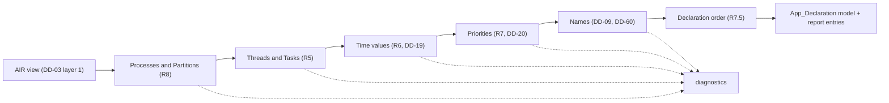

#### Processes to Partitions (R8)

For each process whose `Deployment_Properties::Actual_Processor_Binding` names the IronOxide_Processor (R1.2), the Backend creates one Partition with its own Partition crate (IronOxide DD-11). The Partition fields copy the process properties by enumerator name or integer (R8.1, MAP-09):

| Partition field | Source | Refusal |
|---|---|---|
| `level` | `IronOxide::Criticality_Level` | MAP-09 (a) outside A to E |
| `fault` | `IronOxide::Fault_Response` | MAP-09 (a) |
| `overrun` | `IronOxide::Overrun_Response` | MAP-09 (a); MAP-09 (b) for `RECORD_AND_CONTINUE` when the process's level is below the highest level of the processes on the IronOxide_Processor (R8.4, IronOxide R18.5) |
| `deadline_miss` | `IronOxide::Deadline_Miss_Response` | MAP-09 (a) |
| `mit_threshold` | `IronOxide::MIT_Violation_Threshold` | MAP-09 (a) outside 0 to 2^32 − 1 |
| `code`, `ram`, `stack` | DD-21: `Code_Size`; `Data_Size` + `Stack_Size`; `Stack_Size` | MAP-07 (b), (d), (f) (R8.8) |
| `peripherals` | `IronOxide::Peripherals` and the devices of MAP-20 ("Devices, peripherals and interrupts") | MAP-20 |
| `crate` | the Partition crate name, DD-09 tag `pc` | — |

Sizes are read as a whole number of bits by R28.3's decimal reading with the factors of Table 28-1's text (DD-21): 1 for `bits`, 8 for `Bytes`, 8 × 10^3n for `KByte` to `TByte` and 8 × 2^10n for `KiByte` to `TiByte`. A size whose mark is `fractional` or whose bit count is not a multiple of 8 is not a whole number of bytes (MAP-07 (f)). The `ram` value is computed in bytes, `Data_Size` + `Stack_Size`, and only then written, so a process whose two sizes are not whole KiB but whose sum is gets `ram = n.KiB()` (R2.2, `test-map-07`). Each size is written as `n.B()`, `n.KiB()` or `n.MiB()`, the largest unit of which the byte count is a whole multiple (R2.2). The stack checks of R8.8 compare byte counts: `stack mod 8 = 0` and `stack ≤ ram`.

Threads inside thread groups are collected by a depth-first walk of the process's subcomponents, so a thread at any nesting depth becomes a Task of the process's Partition (R8.2, R5.1). A process from which the walk collects no thread is refused under MAP-07 (a) with "Backend restriction" followed by IronOxide R21.3 (R8.5). Virtual processors are refused before the walk (R8.3, MAP-08): every virtual processor that is a subcomponent of the IronOxide_Processor or is bound to it, and every process on the IronOxide_Processor whose binding list names a virtual processor, gets one diagnostic naming PR-28 and MAP-08. A model with no process on the IronOxide_Processor gets exactly R1.7's diagnostic (R8.9, MAP-27 (f)) and no other diagnostic of this pipeline, since every later step iterates over Partitions.

#### Threads to Tasks (R5)

Each collected thread becomes exactly one Task, and no other Task is generated (R5.1). The release kind follows `Thread_Properties::Dispatch_Protocol` (MAP-01 to MAP-03):

| Dispatch_Protocol | Task | Refusal (rule) |
|---|---|---|
| `Periodic` | Periodic_Task (MAP-01) | MAP-01 (b) if `IronOxide::MIT_Policy` is set (PR-11, R2.8); MAP-01 (c) if `Dispatch_Trigger` is set |
| `Sporadic` | Sporadic_Task (MAP-02) | MAP-02 (b) to (d), below |
| `Aperiodic`, `Background`, a project-specified value, absent | none | MAP-03 (a), PR-27 (R5.4) |
| `Timed` | none | MAP-03 (b), PR-11 |
| `Hybrid` | none | MAP-03 (c), PR-11 |

For a Sporadic thread the Backend computes the Dispatch trigger set D: the features that `Thread_Properties::Dispatch_Trigger` names where the property is present, and otherwise every `in` event and `in` event data port of the thread (glossary). It refuses the thread under MAP-02 (b) (PR-11, IronOxide R22.4) when |D| ≠ 1 or when the property names a feature that is not an `in` event or `in` event data port of the thread, with one diagnostic that lists every element of D (R5.3). For D = {p}, the incoming port connection instances of p decide the Release_Source (R5.2):

| Source of the single incoming connection of p | `rsk::app!` field | Row |
|---|---|---|
| a thread of the same Partition | `signal = <Release_Signal name>` | MAP-11, MAP-13 |
| a thread of another Partition | `endpoint = <Endpoint name>` | MAP-15 |
| a device out event port | `binds = <IronOxide::Peripheral of the device>` | MAP-20 |

No incoming connection refuses the thread under MAP-02 (d) with PR-11 and IronOxide R22.4 (R5.6). Two or more are fan-in, refused under MAP-24 (d) (R11.7). The Task's `mit` is the thread's Period (ASM-03, R5.2) and its `mit_policy` is `IronOxide::MIT_Policy`, `defer` when absent, with the default listed in the generation report (R5.8, R2.7). A Sporadic thread with any `Timing_Properties::Dispatch_Offset`, 0 included, is refused under MAP-02 (c), PR-27 (R5.7).

Entry points (R5.5). The Backend refuses, under MAP-24 (h) with PR-02, a thread that carries a property association whose name matches `Programming_Properties::(Activate|Deactivate|Finalize|Recover)_Entrypoint(_Call_Sequence|_Source_Text)?`, the AADL standard form. How the SysML v2 front end records these is open, settled by S-05 (ORQ-27); S-05 adds that form to the same check. `Initialize_Entrypoint_Source_Text` is refused by R20.7 ("Initialization").

#### Time values (R6, DD-19)

Every time value comes from the AIR view's exact reader (DD-19): a `UnitProp`, alone or as a range bound, read by R28.3 into an integer v of picoseconds and a mark in {`exact`, `noise`, `fractional`} (R6.10). The reader is the Backend's own (R28.2); `test-time-reading` gives it the cases of `test-semantic-model-times`. All comparisons, ranks and conversions below use v.

Field values (R6.1, MAP-01, MAP-02, MAP-04, MAP-05):

| Task field | Value in ps |
|---|---|
| `period` (Periodic) or `mit` (Sporadic) | v(Period) |
| `offset` (Periodic) | v(Dispatch_Offset), or 0 when absent (0 is a whole multiple of every unit, so R6.2's rule writes `0.s()`) |
| `deadline` | v(Deadline), or v(Period) when absent (ASM-03) |
| `budget` | v(upper bound of Compute_Execution_Time), with no allowance for the Port_Glue (R6.6, DEV-08); the lower bound is not carried |

Absent Period or Compute_Execution_Time gives one diagnostic per absent property, PR-27 with MAP-01 (a) or MAP-02 (a) for the Period and MAP-05 (a) for the execution time, and no default (R6.4). The relations of R6.5 are checked on picosecond values: v(Deadline) > v(Period) under MAP-04 (a), IronOxide R22.1; v(budget) > v(deadline) under MAP-05 (b), IronOxide R22.1; one diagnostic per violated relation.

Writing (R6.2, MAP-04 (b)). Let v be a value that the Backend writes, here the four Task fields and the header's `operating_duration`. If its mark is `fractional` or v mod 1,000 ≠ 0, the element is refused under MAP-04 (b) naming the property, the AIR value string and unit, v, the mark and IronOxide R21.2 (R6.3). Otherwise the Backend writes `n.u()` with

  u = the first of s (10^12 ps), ms (10^9), us (10^6), ns (10^3) with v mod u = 0, and n = v / u.

So 1,500,000,000 ps is `1500.us()` and 2,000,000,000,000 ps is `2.s()`. No unit finer than ns and no rounding exist in this step, so the only rounding between the model and the Task_Model is the IronOxide_Generator's (IronOxide R21.2; Property 6).

Conversion limits (R6.7). For each IronOxide_Target t of R18.2 (the Target of the model and every other Target whose peripheral table holds every named peripheral), with (f_cpu, f_tick) = (64 MHz, 16 MHz) for `nrf52840` and (25 MHz, 25 MHz) for `qemu_mps2_an386` (`crates/rsk-gen/src/target.rs` at PAR-01), the Backend evaluates IronOxide's conversion exactly as `crates/rsk-gen/src/convert.rs` at PAR-01 does, in integer arithmetic on the written value n × u (ns), with ⌊·⌋, ⌈·⌉ and nearest (halfway up) rounding:

| Quantity | Converted value | Refused when (rule; row) |
|---|---|---|
| period, MIT | P = ⌊ns × f_tick / 10^9⌋ | P < 1 or P ≥ 2^64 (IronOxide R22.1; MAP-04); P > D_op (IronOxide R22.6; MAP-04) |
| deadline | Dl = ⌊ns × f_tick / 10^9⌋ | Dl < 1 or Dl ≥ 2^64 (R22.1; MAP-04); Dl > P (R22.1; MAP-04) |
| budget | B = ⌈ns × f_cpu / 10^9⌉ | B < 1, B > 2^32 − 1 or not representable (R22.1; MAP-05); B > ⌊Dl × f_cpu / f_tick⌋ (R22.1; MAP-05) |
| offset | O = nearest(ns × f_tick / 10^9) | O ≥ 2^64 (R22.6; MAP-01); O > D_op (R22.6; MAP-01) |
| operating duration | D_op = ⌊ns × f_tick / 10^9⌋ | Table 2-1's own checks (R2.4; see "IronOxide_Property_Set") |

Each refusal names the IronOxide_Target, the IronOxide criterion, the declared value with its unit and the converted value with its unit (R6.7). The checks are evaluated for every Target independently, so a thread can be refused for one Target only. A negative v is below 1 tick or cycle after conversion and is refused by the same rows; IronOxide's grammar has no negative literal, so `pbt-time-limits-agree` draws no negative value (Property 7).

A value whose n exceeds 2^64 − 1 cannot be written: IronOxide's parser reads every quantity's integer as `u64` (`crates/rsk-gen/src/syntax.rs` `parse_val`, PAR-01), and R6.2 allows no unit above s. Such a value (at least 2^64 ns, about 585 years, that is not a whole number of a larger unit) is accepted by the conditions of R6.7 and would make the IronOxide_Generator reject the App_Declaration, contrary to R18.2. No criterion refuses it. This is conflict C-03 (see "Conflicts with Requirements"), not resolved here; until the user decides, the Model_Generator draws no such value and the design writes nothing for it.

Conversion report (R6.8). For each Target t and each field whose converted value differs from the exact quotient (P, Dl, O with a non-zero remainder; B with a non-zero remainder), the generation report's `conversions` member gets one entry with t, the thread's instance path, the AADL property, v, the written `n.u()` and the converted integer with `ticks` or `cycles` (format in "Generation report (`hamr-rsk-generation-report/1`)"). `test-conversions-reported` compares these entries one to one with the Task_Model's `conversions` for each corpus model and Target.

#### Priorities (R7, DD-20)

Let Θ be the threads on the IronOxide_Processor, across all Partitions.

- If every thread of Θ has `Thread_Properties::Priority` (R7.1, MAP-06): let x_1 < x_2 < … < x_k be the distinct values. A thread with value x_i gets Priority i.
- If no thread of Θ has it (R7.2, UD-22): let r(θ) = v(Deadline), or v(Period) where Deadline is absent, in picoseconds before any conversion. Let r_1 > r_2 > … > r_k be the distinct values. A thread with r(θ) = r_i gets Priority i. Two deadlines that convert to the same tick count but differ in picoseconds get different Priorities.
- If some but not all have it (R7.3): one diagnostic per thread of Θ without the property, naming its instance path and position, "Backend restriction" followed by PR-03, and MAP-06 (a). Threads bound to other processors are not counted.
- If k > PAR-03 (7) (R7.4): one diagnostic on the IronOxide_Processor naming PR-33, MAP-06 (b), `MAX_PRIORITY` of `crates/rsk-gen/src/validate.rs` and k, independently of a MAP-26 (b) refusal.

Priority values are written as `priority = i`. A larger value is more urgent, as in IronOxide (ASM-02, DD-20). The generation report's `priorities` member lists, per thread of Θ, the instance path, the criterion (`R7.1` or `R7.2`), the ranked value (the Priority property value, or r(θ) in ps) and i (R7.6, `test-priority-report`). Property 8 states the rank.

#### Declaration order (R7.5)

Partitions are declared in ascending process instance path, and the Tasks of each Partition in ascending thread instance path. Paths are compared segment by segment from the root, each segment as the sequence of Unicode code points that the AIR_Model records (not UTF-16 units, not after sanitization); a proper prefix comes first. IronOxide starts eligible equal-priority Tasks in declaration order (IronOxide DD-03), so equal Priorities start in instance-path order (DEV-07; `test-declaration-order`). The same order sorts every other list that the Backend writes (Resources, Release_Signals, Endpoints, per-Task state, report entries), so the output depends on no AIR list order (Property 9).

#### Names (R8.6, R8.7; DM-07)

Every name of R8.6 is computed by the rule of DD-09 (see "The sanitization rule (DD-09, R8.6)") from a kind tag and a segment sequence. The segment sequence is fixed by DD-60:

1. Take the AIR `Name` segments of the element (R3.1). Let R be the single identifier segment of the root system instance.
2. If the first segment equals R, drop it. This is the form of components, features and, in AIR written by OSATE, connection instances (`["top_impl_Instance", "producer_p_p.producer.write_port -> consumer_p_s1.consumer.read_port"]` in INSPECTA's committed AADL AIR).
3. Otherwise, if the element is a connection instance whose Name is one segment of the form `R.s -> R.d`, use the single segment `s -> d`. This is the form that HAMR's SysML v2 front end writes at PAR-02 (`["top_impl_Instance.producer_p_p.producer.write_port -> top_impl_Instance.consumer_p_s1.consumer.read_port"]` in INSPECTA's committed SysML AIR of the same model). Both Front_Ends then give a connection the same name, as R2.6 compares them.
4. Otherwise use all segments.
5. Append the port name, the GUMBO state variable name or the glue item name (see "Shared names") where the sanitization rule says so.

Which other element kinds have Front_End-specific Name forms is part of the S-05 survey (ORQ-24).

Examples with R = `demo_impl_Instance`:

| Element | Segments | Name |
|---|---|---|
| process `ctl` | `ctl` | Partition `p_sctl`, crate `pc_sctl` |
| thread `ctl.filter` | `ctl`, `filter` | Task `t_sctl_sfilter` |
| GUMBO state variable `count` of it | `ctl`, `filter`, `count` | state `sv_sctl_sfilter_scount`, `const fn` `iv_sctl_sfilter_scount` |
| glue flag of it (DD-23) | `ctl`, `filter`, `initialized` | state `sg_sctl_sfilter_sinitialized` |
| connection `ctl.filter.trip -> ctl.alarm.trip` | one segment | Release_Signal `s_sctl_x2efilter_x2etrip_x20_x2d_x3e_x20ctl_x2ealarm_x2etrip` |
| thread `Ctl_2.f` | `Ctl_2`, `f` | `t_s_uctl_x5f2_sf` |

Distinctness beyond the argument of "The sanitization rule (DD-09, R8.6)". The IronOxide_Generator derives further identifiers from these names (`crates/rsk-gen/src/emit.rs` at PAR-01): the Context type `ctx_name(task)` (each `_` removed and the next character upper-cased), and statics `TASK_STATE` and `TASK_ENDPOINT` (the two names joined by `_` and upper-cased). These stay distinct:

- `ctx_name` is injective on DD-09 names: they contain no upper-case letter and no `__`, so each upper-case letter after the first marks one removed `_`.
- For two per-Task state statics `T(t)_S(s)`: E never produces `_s`, so the last `_S` of the joined name starts the last segment of s; the prefix is `t ++ "_" ++ tag ++ P` with |t| = 1 + |P| and |tag| = 2 for `sp`, `sv` and `sg`, so its length fixes P, hence t and the tag. The tag `sp` (per-Task state item of a port) is reserved and not used: no section generates such an item, and the argument holds with or without it.
- `_e` never occurs inside a DD-09 name, so in `T(t)_E(e)` the only `_E` is the join.

Resources, Port_Cells and Release_Signals have the tags `r`, `c` and `s`, which differ from the state tags, so the per-Task state check of `validate.rs` (PR-28, IronOxide R21.3) and the Endpoint check of R8.6 cannot fire. Property 10 states injectivity and acceptance by `crates/rsk-gen/src/syntax.rs`, whose identifiers are `syn::Ident`s; every DD-09 name contains `_s`, so it is never a keyword.

The guard of R8.7 stays. Before it writes, the Backend inserts every name into one map per kind and one map per Partition (per-Task state, Resource, Release_Signal) and per Endpoint role Task. A collision refuses the model under MAP-07 (e), naming both elements and PR-28, IronOxide DD-11 for crate names, or IronOxide R21.3 for a per-Task state or Endpoint collision. `test-name-collision` runs the test jar of DD-18 with its option `--test-name-substitute <file>` (section "IronOxide limits and the test-only suspension" gives its file format), whose file maps two chosen elements to one name.

### Shared data and Resources

Implements R9.1 to R9.9. Settles DM-08 with DD-22.

#### Selection and accessors (R9.1, R9.3, R9.5)

The Backend's AIR view collects, for each process on the IronOxide_Processor, its data subcomponents at any depth of thread groups (MAP-07, MAP-10). A data subcomponent of a thread has no treatment in this design: no Table M-1 row describes it, since MAP-10 maps only the data subcomponents of a process and its thread groups, and R4.2 does not reach it, since its category "data" is handled by MAP-10. This is conflict C-06 (see "Conflicts with Requirements"); until the user decides, such a model is outside this design. For each data subcomponent d it computes the accessor set A(d): the threads that have a data access feature f such that the AIR_Model holds a data-access connection instance between f and d. Whether and how each Front_End records these connection instances is open, settled by S-07 (ORQ-03); until then the corpus has no shared-data model from a Front_End, and the Model_Generator's AIR path writes the connection instances in the form that S-07 confirms.

| Condition | Outcome |
|---|---|
| A(d) is empty | refused under MAP-10 (c), IronOxide R22.5 (R9.5) |
| A(d) holds threads of two or more processes | refused under MAP-10 (a), PR-30, naming every accessing thread (R9.3) |
| otherwise | one Resource of the process's Partition: name `r_s…` (DD-09 tag `r`), type the application type of d's classifier (MAP-19, "Data types and Wire_Types"), accessors the Tasks of A(d) (R9.1) |

The App_Declaration declares the Resource in its Partition and lists it in the `resources = [...]` of each accessor Task. The IronOxide_Generator computes the Ceiling as the largest accessor Priority (PR-06, IronOxide R23.1), so the Backend writes no Ceiling; `test-map-10` checks the Task_Model's Ceiling against R7's Priorities.

#### Access rights (R9.2, R9.4)

For each accessor θ, if every data access feature through which θ reaches d has `Memory_Properties::Access_Right => read_only`, θ's Port_API offers for d only a lock operation whose closure parameter has the type `impl FnOnce(&T) -> R`; otherwise the closure receives `&mut T`. The generated operation calls `rsk::Shared::lock` on the Context field of the Resource and passes the reference on, so a developer write through the shared reference does not compile (`test-read-only-view`). θ stays an accessor, and its Priority counts in the Ceiling. The operation's name and its place in the Port_API are those of "Port_Glue and Port_API".

`Thread_Properties::Concurrency_Control_Protocol` on d or on any data access feature through which a thread accesses d, with a value other than `Priority_Ceiling`, refuses d under MAP-10 (b) naming IronOxide Requirement 8 (R9.4). Absence of the property is not refused.

#### Types (R9.9)

d is refused under MAP-10 (e), PR-15, when its classifier is, or contains as a field or element type at any depth, an integer type without a bit width and without `HAMR::Default_Bit_Width` (nearest setting, DD-28), an unbounded array or sequence, or a string without `HAMR::Max_String_Size`.

#### Initial values (R9.6, R9.8, DD-22)

The Resource's declared initial value comes from `Data_Model::Initial_Value` as the AIR view decodes it (a list property; ORQ-29 records that its AIR form per Front_End is surveyed by S-05):

| AIR value | Type of d (Table 14-1) | Declared initial value |
|---|---|---|
| absent | any | `crate::init::ir_s<path of d>()`: a developer `const fn` with no parameters returning T, declared in the Partition crate's `src/init.rs` with its body in region `init.ir_s…` (R9.6, R18.8) |
| one string, a decimal integer literal (optional `-`, digits) within T's range | integer type | the literal with T's suffix, for example `-5i16` |
| one string `true` or `false` | `Base_Types::Boolean` | `true` or `false` |
| one string that names a literal of T | enumeration | the path of that literal in `hamr_app_types::app::<T'>`, named as "Data types and Wire_Types" names enumeration literals |
| anything else: two or more list elements, a value outside T's range, any other text, or a record, array or string type | — | refused under MAP-10 (d), PR-34 (R9.8) |

The `const fn` of the absent case gets, as initial region content, the zero constant of T (0, `false`, the first enumeration literal, a struct or array of zero constants, an empty bounded string), so the generated Application compiles before the developer writes the body (R18.2).

IronOxide's design at PAR-01 states that every Partition static is zero-initialized by construction and lives in the Partition's `.bss` range, which a restart zeroes (IronOxide design.md, "Closed response sets", RESTART_PARTITION row). Whether a non-zero declared initial value of a Resource holds at instant 0 and after a restart is therefore not confirmed: open, settled by S-08 (ORQ-40, RC-04). DD-23's first-Job step covers per-Task state and Port_Cells ("Initialization"), not Resources, because a Resource's type is fixed by R9.1 and has no room for a flag. If S-08 shows that non-zero values are not loaded, RC-04 becomes a conflict with R9.6 and R20.6 and is raised then.

#### Invariants (R9.7)

Where d's classifier has GUMBO invariant clauses, the Resource is declared with `invariant |v: T| <Pearlite>`, the conjunction of the clauses as the Contract_Translator translates them (R22.2, "Contract_Translator and the App_Prover"). The App_Prover proves it after initialization and at the exit of every Critical_Section on the Resource at every Criticality_Level, except in trusted developer functions that R21.7 allows at levels C to E (IronOxide R46.4, DD-31, Property 27).

### The generated Application and regeneration

Implements R18.1 to R18.8 (R18.9 is in "Build_System, pins and the IronOxide extraction"). Settles DM-16 with DD-11 and DD-66, and DM-03 with the format in "Generation report (`hamr-rsk-generation-report/1`)" (DD-10, DD-64, DD-65). Properties 11 and 12.

#### Layout (R18.1, DD-11)

The Backend writes one Cargo workspace per accepted model into its output directory `<out>` (`apps/<model>/` for corpus models and the Robot_Model, `target/apps/<seed>-<index>/` for Model_Generator models). The crate set copies `apps/p1-demo` at PAR-01 (IronOxide DD-11):

```
<out>/
  Cargo.toml  rust-toolchain.toml  .cargo/config.toml  Cargo.lock
  decl/         hamr-app-decl    rsk::app! for the default Target; src/<target>.rs per other Target of R18.2
  types/        hamr-app-types   application types and Wire_Types (R14); cfg(creusot) helpers
  system/       hamr-app-system  rsk_system!(); src/developer.rs (developer-owned): the Safe_State function
  bin/          hamr-app-bin     main.rs with no symbol of its own; build.rs selects gen-<target>/link.x
  partitions/<pc name>/          one Partition crate per Partition (DD-09 tag pc)
    src/lib.rs                   rsk_partition_<p>!(); module tree; re-exports of the Task bodies
    src/tasks/<task>.rs          Task body wrapper (R19.6) and compute function (region compute.<task>)
    src/glue/<task>.rs           Port_Glue (R19.2, R19.3) with the first-Job step (DD-23)
    src/api/<task>.rs            Port_API (R19.1, R19.8)
    src/init.rs                  developer const fn signatures and contracts (regions init.<name>)
    src/contracts.rs             logic items, executable twins, library and checker functions (R22)
    src/validate.rs              generated Validation_Functions (R13)
    src/developer.rs             developer-owned file
  proofs/creusot/                App_Prover proof workspace (F-S6, DD-89): one member per Partition crate,
                                 IronOxide_Target and feature set; one per IronOxide_Target for hamr-app-types
  hamr-rsk/generation-report.json  hamr-rsk/diagnostics.json  hamr-rsk/diagnostics.txt
  gen-<target>/                  written by rsk-gen (Build_System), never by the Backend
```

The workspace finds the extraction at `../ironoxide`, a link that the Build_System places beside every output directory (see "The IronOxide extraction (DD-12, ORQ-37)"), so no file the Backend writes holds an absolute path (R18.4).

Workspace manifest (R18.1 build files). The members are exactly the crates above; the crate policy and the release profile are IronOxide's (IronOxide R14.1, DD-11); `[patch.crates-io]` binds the extraction's `rsk-entry` to this workspace's system crate (DD-12, F-S4 (b)):

```toml
# hamr-rsk generated file. air-sha256 = "3f1c…e0a2"; front-end = "OSATE 2.13.0"; ironoxide = "423a366881d744034282bd99cb2d6d057e405f17"
# hamr = "e459583680c261d772f6ae87987073b9fd0c7c0b"; hamr-codegen = "954bf4c0d50838badf4dda16f94bf60785aa492b"; phase = "P2"
[workspace]
resolver = "2"
members = ["decl", "types", "system", "bin", "partitions/pc_sctl", "partitions/pc_slog"]
exclude = ["proofs/creusot"]

[workspace.package]
version = "0.0.0"
edition = "2021"            # IronOxide R55.5
rust-version = "1.95.0"
publish = false

[workspace.dependencies]
rsk = { path = "../ironoxide/crates/rsk" }
rsk-kernel = { path = "../ironoxide/crates/rsk-kernel", default-features = false }
rsk-entry = { path = "../ironoxide/crates/rsk-entry" }
rsk-macros = { path = "../ironoxide/crates/rsk-macros" }

[patch.crates-io]
hamr-app-system = { path = "system" }

[profile.release]
panic = "abort"
codegen-units = 1
lto = false
debug = 2

[workspace.metadata.rsk]
target = "thumbv7em-none-eabihf"
[workspace.metadata.rsk.crates]
hamr-app-decl = { targets = ["host", "thumbv7em-none-eabihf"], declaration = true, variants = ["nrf52840"] }
hamr-app-types = { targets = ["host", "thumbv7em-none-eabihf"] }
hamr-app-system = { targets = ["host", "thumbv7em-none-eabihf"], flight = true }
pc_sctl = { targets = ["host", "thumbv7em-none-eabihf"], flight = true }
pc_slog = { targets = ["host", "thumbv7em-none-eabihf"], flight = true }
hamr-app-bin = { targets = ["thumbv7em-none-eabihf"], flight = true }
```

The `gen-<target>/` directories hold no manifest, so the workspace needs no exclusion for them. Which policy keys IronOxide's `xtask check --root <out> --workspace-only` requires (`check-static-<model>`) is confirmed by S-03.

`rust-toolchain.toml` copies IronOxide's at PAR-01: `channel = "1.95.0"`, `profile = "minimal"`, `components = ["clippy", "rustfmt"]`, `targets = ["thumbv7em-none-eabihf"]` (IronOxide R55.2).

`.cargo/config.toml` copies the `[source]` and `[net]` tables of IronOxide's `.cargo/config.toml` at PAR-01 with the vendor directory made relative to `<out>`. It also replaces the Creusot git source, because `rsk` has an optional `creusot-std` dependency on it and IronOxide's `Cargo.lock` at PAR-01 records `creusot-std 0.15.0-dev` from that source:

```toml
[source.crates-io]
replace-with = "vendored-sources"
[source."git+file:///Users/mars2292/repos/Kiro-experimentation/creusot?rev=18f2d371ecb0019d37ecbd25e67f474bed2dda00"]
git = "file:///Users/mars2292/repos/Kiro-experimentation/creusot"
rev = "18f2d371ecb0019d37ecbd25e67f474bed2dda00"
replace-with = "vendored-sources"
[source.vendored-sources]
directory = "../ironoxide/vendor"
[net]
offline = true
```

The git URL is IronOxide's source identifier, a constant of PAR-01; it is never accessed, and it does not depend on `<out>`.

`Cargo.lock` (DD-61). The Backend writes the lock file itself, from a lock template that the Build_System derives once per Backend build and puts into the Backend jar. The template holds every `[[package]]` entry that is not a generated crate: the third-party entries copied from the extraction's resolution (so their versions are those of IronOxide's `Cargo.lock` at PAR-01) and the entries of the extraction's path crates. The Backend adds one entry per generated crate (`name`, `version = "0.0.0"`, `dependencies` sorted as Cargo sorts them) and orders all entries by name and version, as Cargo does. Every Cargo command on a generated workspace runs with `--locked` or `--frozen`, so a lock file that differs from Cargo's resolution fails the build instead of being rewritten. `test-generated-layout` compares the third-party entries with IronOxide's `Cargo.lock`; S-03 confirms the template on the real extraction.

#### Declaration crate (R18.1)

`decl/src/lib.rs` holds the App_Declaration for the model's `IronOxide::Target`. Every other Target of R18.2 gets `src/<target>.rs`, selected by the cargo feature `<target>` as `apps/p1-demo/decl` selects `nrf52840`. A small example model:

| Element | Properties (AIR) |
|---|---|
| processor `mcu` | `IronOxide::Target => qemu_mps2_an386`; `Operating_Duration => 2 sec`; `Safe_State => "crate::developer::safe_state"`; `Log_Capacity` and `FP_Flush_To_Zero` absent |
| process `ctl` | level A; `RESTART_PARTITION`, `END_JOB`, `RECORD_ONLY`; threshold 10; `Code_Size => 32 KiByte`; `Data_Size => 28 KiByte`; `Stack_Size => 4 KiByte` |
| thread `ctl.filter` | Periodic, `Period => 10 ms`, `Compute_Execution_Time => 100 us .. 1.5 ms`; GUMBO state `count: Integer_32`, initialize `count == 0`; out event port `trip` |
| thread `ctl.alarm` | Sporadic, `Period => 20 ms`, `Compute_Execution_Time => 50 us .. 300 us`; in event port `trip` |
| connection `ctl.filter.trip -> ctl.alarm.trip` | MAP-11 |
| process `log` | level C; `STOP_PARTITION`, `END_JOB`, `RECORD_ONLY`; threshold 10; 16, 12 and 4 KiByte |
| thread `log.sink` | Periodic, `Period => 40 ms`, `Compute_Execution_Time => 1 ms .. 2 ms` |

No thread has `Thread_Properties::Priority`, so R7.2 ranks the deadlines 40 ms, 20 ms and 10 ms as Priorities 1, 2 and 3. No peripheral is named, so `nrf52840` is the second Target. The Backend writes:

```rust
// hamr-rsk generated file (provenance as in Cargo.toml). No developer region.
#![no_std]
#![forbid(unsafe_code)]
#[cfg(feature = "nrf52840")]
mod nrf52840;                     // the same declaration with `target = nrf52840`
#[cfg(not(feature = "nrf52840"))]
rsk::app! {
    target = qemu_mps2_an386, profile = Ravenscar, operating_duration = 2.s(),
    safe_state = crate::developer::safe_state, log_capacity = 32, fp_flush_to_zero = false;

    partition p_sctl (level = A, crate = pc_sctl, code = 32.KiB(), ram = 32.KiB(), stack = 4.KiB(),
                      fault = RESTART_PARTITION, overrun = END_JOB, deadline_miss = RECORD_ONLY,
                      mit_threshold = 10) {
        peripherals = [];
        signal s_sctl_x2efilter_x2etrip_x20_x2d_x3e_x20ctl_x2ealarm_x2etrip;
        state t_sctl_salarm.sg_sctl_salarm_sinitialized: bool = false;
        state t_sctl_sfilter.sv_sctl_sfilter_scount: i32 = crate::init::iv_sctl_sfilter_scount();
        state t_sctl_sfilter.sg_sctl_sfilter_sinitialized: bool = false;
        state t_sctl_sfilter.sg_sctl_sfilter_sundelivered_x5ftrip: u64 = 0;
        task t_sctl_salarm (sporadic, signal = s_sctl_x2efilter_x2etrip_x20_x2d_x3e_x20ctl_x2ealarm_x2etrip,
                            mit = 20.ms(), mit_policy = defer, deadline = 20.ms(), budget = 300.us(),
                            priority = 2);
        task t_sctl_sfilter (periodic, period = 10.ms(), offset = 0.s(), deadline = 10.ms(),
                             budget = 1500.us(), priority = 3,
                             raises = [s_sctl_x2efilter_x2etrip_x20_x2d_x3e_x20ctl_x2ealarm_x2etrip]);
    }
    partition p_slog (level = C, crate = pc_slog, code = 16.KiB(), ram = 16.KiB(), stack = 4.KiB(),
                      fault = STOP_PARTITION, overrun = END_JOB, deadline_miss = RECORD_ONLY,
                      mit_threshold = 10) {
        peripherals = [];
        state t_slog_ssink.sg_slog_ssink_sinitialized: bool = false;
        task t_slog_ssink (periodic, period = 40.ms(), offset = 0.s(), deadline = 40.ms(),
                           budget = 2.ms(), priority = 1);
    }
}
```

No `partition` item declares `init_arena`. The field is optional in IronOxide's grammar and defaults to 0 bytes (`crates/rsk-gen/src/syntax.rs` at PAR-01), and the TV_Checker requires the Task_Model's `regions.init_arena` to be 0 (DD-95, conjunct `conj_partition_regions` of "TV_Checker").

The generation report lists the applied defaults (`Log_Capacity` 32, `FP_Flush_To_Zero` false, `alarm`'s `MIT_Policy` defer; R2.7), every item with its element and MAP row (R4.7), the Priorities with their ranked deadlines (R7.6) and, for `nrf52840`, the conversions of R6.8 (none here: 10 ms is 160,000 ticks and 1.5 ms is 96,000 cycles). "Data Models: App_Declaration as generated" gives the rule for every field.

#### Partition crates (R18.1, R18.8)

Each Partition crate's manifest has the workspace's package fields, one feature per non-default Target that forwards to `hamr-app-decl/<target>`, the dependencies `hamr-app-decl`, `hamr-app-types` and `rsk`, and `check-cfg = ["cfg(creusot)"]`, as `apps/p1-demo/part1/Cargo.toml` has. Where DD-23 evaluates another Partition's `const fn` (R20.2 across Partitions) it also depends on that Partition crate; S-04 checks this against IronOxide's crate policy and Link_Checker (RC-06).

The crate root is generated and holds no region:

```rust
// hamr-rsk generated file (provenance). No developer region.
#![no_std]
#![forbid(unsafe_code)]
hamr_app_decl::rsk_partition_p_sctl!();
pub mod api { pub mod t_sctl_salarm; pub mod t_sctl_sfilter; }
pub mod glue { pub mod t_sctl_salarm; pub mod t_sctl_sfilter; }
pub mod tasks { pub mod t_sctl_salarm; pub mod t_sctl_sfilter; }
pub mod contracts;
pub mod init;
pub mod validate;
mod developer;
pub use developer::*;
// The Partition manifest calls the Task bodies as `super::<task>(…)` from the crate root
// (`crates/rsk-gen/src/emit.rs` at PAR-01), so each is re-exported here.
pub use tasks::t_sctl_salarm::t_sctl_salarm;
pub use tasks::t_sctl_sfilter::t_sctl_sfilter;
```

Developer regions hold only bodies. The signature and every generated contract attribute lie outside the region (see "Developer regions and region identifiers (DD-10)"; R18.8, R22.1, R20.4). `src/tasks/t_sctl_sfilter.rs`:

```rust
// hamr-rsk generated file (provenance). Developer region: compute.t_sctl_sfilter.
use crate::api::t_sctl_sfilter::PortApi;

/// Task body of thread `ctl.filter` (R19.6): the only call site of `compute`.
/// The Port_Glue's operations as "Port_Glue and Port_API" names them.
#[cfg_attr(creusot, rsk::creusot_std::macros::requires(crate::rsk_spec::t_sctl_sfilter_pre(&cx)))]
pub fn t_sctl_sfilter(mut cx: crate::rsk_ctx::TSctlSfilter) {
    let mut api = crate::glue::t_sctl_sfilter::receive_input(&mut cx);   // R19.2; first-Job step of DD-23 first
    compute(&mut api);                                                    // the only call site (R19.6)
    crate::glue::t_sctl_sfilter::store_state(&mut cx, &api);             // GUMBO state variable `count` back (R20.1)
    let _ = crate::glue::t_sctl_sfilter::send_output(&mut cx, &api);     // R19.3
}

/// Compute entry point of thread `ctl.filter` (R19.1).
#[cfg_attr(creusot, rsk::creusot_std::macros::ensures(/* compute guarantees, R22.1 */ true))]
pub fn compute(api: &mut PortApi) {
    // BEGIN HAMR-RSK DEVELOPER REGION compute.t_sctl_sfilter
    let _ = api;
    // END HAMR-RSK DEVELOPER REGION compute.t_sctl_sfilter
}
```

`src/init.rs`:

```rust
// hamr-rsk generated file (provenance). Developer region: init.iv_sctl_sfilter_scount.
/// Initial value of GUMBO state variable `count` of thread `ctl.filter` (R20.1).
#[cfg_attr(creusot, rsk::creusot_std::macros::ensures(result@ == 0))]   // initialize `count == 0` (R20.4)
pub const fn iv_sctl_sfilter_scount() -> i32 {
    // BEGIN HAMR-RSK DEVELOPER REGION init.iv_sctl_sfilter_scount
    0
    // END HAMR-RSK DEVELOPER REGION init.iv_sctl_sfilter_scount
}
```

Initial region content. A `compute` region starts as `let _ = api;`. An `init` region starts as the zero constant of the return type, as "Shared data and Resources" defines it. So the Application compiles as generated (R18.2), and every rule of R18.3 holds for the initial content. The initial content of `logic` and `twin` regions (CK-03) depends on the user's decision on C-02 (see "Conflicts with Requirements"); until that decision, a model with a developer-supplied GUMBO spec function has no compiling initial content, as C-02 states.

`src/developer.rs` of a Partition crate starts as a comment that names the crate's Partition. Where `IronOxide::Validation_Function` names a function of the crate (R2.9, UD-29), the initial content defines it at the module path that the property names, relative to the crate root, with the signature and initial body that "Validation_Functions" states; the root's `pub use developer::*;` makes `crate::<name>` and `crate::developer::<name>` both resolve (DD-66).

#### System crate and safe state (DM-16, DD-11, DD-45, DD-66)

`IronOxide::Safe_State` names a function of the system crate (DD-11, Table 2-1's "safe-state crate"). The system crate's root is generated:

```rust
// hamr-rsk generated file (provenance). No developer region.
#![no_std]
#![forbid(unsafe_code)]
hamr_app_decl::rsk_system!();
mod developer;
pub use developer::*;
```

The IronOxide_Generator writes the safe state into the system manifest as `fn safe_state() -> ! { <path>() }` at the crate root (`crates/rsk-gen/src/emit.rs` at PAR-01). With the glob re-export, a path `crate::f`, `self::f`, `f`, `crate::developer::f` or `crate::m::f` resolves when `src/developer.rs` defines `f` at that module path. The Backend writes the initial content of `src/developer.rs` to define the function where the property's path puts it. Table 2-1 also admits paths that cannot resolve from the crate root, for example one that begins with `super`; the Application of such a model does not compile as generated, contrary to R18.2. This is conflict C-04 (see "Conflicts with Requirements"), not resolved here.

The initial content prints the Kernel's event log under `qemu-mps2` and exits, as the P1 demo's `report_and_exit` does (F-S5; DD-45):

```rust
//! Developer-owned file (R18.5): written by hamr-rsk only when absent.
//! Defines the system safe state that IronOxide::Safe_State names: crate::developer::safe_state.
use crate::{Sys, NE};                       // from rsk_system!() (the system manifest)
use rsk_kernel::arch::cm4::unsafe_module::hw;
use rsk_kernel::arch::{KernelOps, System};

/// System safe state (IronOxide R14.4). Under `qemu-mps2` it reports the event log for R18.6.
#[rsk::bounds('events = NE)]                 // NE = the Log_Capacity, as in the P1 demo
pub fn safe_state() -> ! {
    #[cfg(feature = "qemu-mps2")]
    {
        let k = Sys::kernel().get();
        let len = k.log_len();
        let seq = k.log_seq();                       // events ever pushed, dropped ones included
        hw::semihosting_write(b"\nHAMR-RSK-EVENT-LOG\n");
        put_kv(b"len", len as u32);
        put_kv(b"overflow", seq.saturating_sub(len as u32));
        let mut i = 0;
        'events: while i < len {
            put_event(i, k.log_kind(i), k.log_partition(i), k.log_task(i), k.log_detail(i), k.log_instant(i));
            i += 1;
        }
        hw::semihosting_write(b"HAMR-RSK-EVENT-LOG-END\n");
    }
    hw::semihosting_exit(0)    // on a board without a debugger: the Kernel's idle loop (hw.rs at PAR-01)
}
// put_kv and put_event: decimal printers with constant-bounded loops, without core::fmt (PR-21),
// as the P1 demo's print_kv and write_num.
```

The log accessors are those of `crates/rsk-kernel/src/arch/bound.rs` at PAR-01 (`log_len`, `log_kind`, `log_partition`, `log_task`, `log_detail`, `log_instant`, `log_seq`); the overflow count is `log_seq − log_len`. S-04 confirms this content under QEMU, the Profile_Lint and the Link_Checker (ORQ-38). The Build_System reads the printed lines (R18.6; "Testing Strategy: property-based tests and the Model_Generator; QEMU runs and IronOxide tool acceptance").

The system crate's manifest declares every feature that the changed `rsk-entry` forwards (F-S3, F-S4 (d)): `qemu-mps2` and `nrf52840` select the Kernel board (`rsk-kernel/board-qemu-mps2`, `rsk-kernel/board-nrf52840`) and, for the non-default Target, the declaration variant and the Partition crates' variant features; `debug-port`, `trace`, `trace-ram`, `trace-pins`, `record-only`, `hw-dt`, `boot-mutation`, `defer-probe`, `defer-nofix`, `coverage` and `quiet` forward to `rsk-kernel` or `rsk` as `apps/p1-demo/system/Cargo.toml` forwards them, so that the HIL build of the glossary works; the P1 demo's own configurations (`qemu-flood`, `timing`, `timing-short`, `response`, `stress`, `stress-short`, `isolation`, `cycles`, `cycles-fpu`, `plain-measure`, `coverage-kernel`) are declared empty.

#### Binary crate

`bin/src/main.rs` is `#![no_std] #![no_main] #![forbid(unsafe_code)] use rsk_entry as _;`, with no symbol of its own (R18.1). `bin/build.rs` starts with `#![forbid(unsafe_code)]` (R18.3), selects `gen-nrf52840` when `CARGO_FEATURE_NRF52840` is set and `gen-qemu_mps2_an386` otherwise, and prints the link arguments of `apps/p1-demo/bin/build.rs` at PAR-01 (`-Tlink.x`, `--nmagic`, the search path and the `rerun-if-changed` lines). Its features forward the board and HIL features to `rsk-entry`, with the model's Target as default.

#### Proof workspace (DD-08, DD-89, F-S6)

`proofs/creusot/` follows IronOxide's `proofs/creusot` at PAR-01, with the members of DD-89: one per Partition crate, IronOxide_Target and feature set with which the Build_System builds the crate, and one per IronOxide_Target for the payload-type crate `hamr-app-types`, so that the Wire_Type codecs and the other executable items of that crate are proven too (DD-08). Each member is named `<crate>-<target>[-<feature>…]-proof` and compiles the crate's real source through `[lib] path`, with `rsk`'s `creusot` feature and the pinned `creusot-std`. For the example, on its default Target:

```toml
# proofs/creusot/pc_sctl-qemu_mps2_an386-proof/Cargo.toml (hamr-rsk generated file)
[package]
name = "pc_sctl-qemu_mps2_an386-proof"
version.workspace = true
edition.workspace = true
publish.workspace = true
[lib]
path = "../../../partitions/pc_sctl/src/lib.rs"
[dependencies]
hamr-app-decl = { path = "../../../decl" }
hamr-app-types = { path = "../../../types" }
rsk = { path = "../../../../ironoxide/crates/rsk", features = ["creusot"] }
creusot-std = { git = "file:///Users/mars2292/repos/Kiro-experimentation/creusot", rev = "18f2d371ecb0019d37ecbd25e67f474bed2dda00" }
[lints.rust.unexpected_cfgs]
level = "warn"
check-cfg = ["cfg(creusot)"]
```

```toml
# proofs/creusot/hamr-app-types-qemu_mps2_an386-proof/Cargo.toml (hamr-rsk generated file)
[package]
name = "hamr-app-types-qemu_mps2_an386-proof"
version.workspace = true
edition.workspace = true
publish.workspace = true
[lib]
path = "../../../types/src/lib.rs"
[dependencies]
rsk = { path = "../../../../ironoxide/crates/rsk", features = ["creusot"] }
creusot-std = { git = "file:///Users/mars2292/repos/Kiro-experimentation/creusot", rev = "18f2d371ecb0019d37ecbd25e67f474bed2dda00" }
[lints.rust.unexpected_cfgs]
level = "warn"
check-cfg = ["cfg(creusot)"]
```

The proof workspace root lists the members, sets `[workspace.metadata.creusot] default-members` to all of them, and has its own `.cargo/config.toml` (vendor directory `../../../ironoxide/vendor`) and `Cargo.lock`, written from a second template as DD-61 writes the main one. A Partition crate's member for the non-default Target enables the crate's Target feature, as IronOxide's `part0-nrf52840` member does. The `creusot-std` git URL is the machine-local source that IronOxide's `crates/rsk/Cargo.toml` names at PAR-01; whether Cargo accepts it in the generated file, and how R18.4 counts it, is open, settled by S-03, and IOP-17 would remove it (section "Contract_Translator and the App_Prover"). `cargo xtask prove <model>` runs the App_Prover on the workspace ("Contract_Translator and the App_Prover").

#### Code rules (R18.3, DR-7)

The Backend's Rust printer emits from typed syntax trees, not from free text, and has no constructor for `unsafe`, `static mut`, interior-mutable `static`, `async`, `.await`, `dyn`, function-pointer types, `asm!`, `global_asm!`, `#![feature]`, `#[panic_handler]`, `#[no_mangle]`, `#[export_name]`, `#[link_section]`, `extern` blocks or `extern` ABIs, `core::fmt` or `derive(Debug)`. Every crate root and build script it prints carries `#![forbid(unsafe_code)]`, and every Target crate root `#![no_std]`. Every loop it prints carries `#[rsk::bounds]` with a constant bound (PR-16), and the generated call graph is acyclic by construction (each generated function calls only functions of a lower layer: wrapper → glue → twins → codecs). Before writing, the printer scans each file's tokens for the forbidden forms above; a hit is a Backend defect, reported as an internal error with no file written. Build files set no `RUSTC_BOOTSTRAP` and declare no dependency on the Profile's disallowed crates or on `vstd`, `verus_builtin` or `verus_builtin_macros` (DR-2). IronOxide's tools check the rest (`check-profile-lint-<model>`, `check-profile-clippy-<model>`, `check-link-<model>`, `check-static-<model>`).

#### Determinism (R18.4)

The Backend's output is a function of the AIR_Model bytes, the Backend jar (its version, Phase and lock templates) and the invocation's Front_End name and version:

- The whole output is computed in memory before any file is written. Every collection is ordered by R7.5's instance-path order or by a stated key, never by hash order.
- Files are UTF-8 without BOM, with LF line ends and one final LF. They contain no time, no user, host or environment value and no absolute path.
- Integers are printed by an own decimal printer (no locale).
- The generation report and the diagnostics are printed by DD-64's printer.
- The Backend reads no environment variable; `HOME`, `USER`, `TZ` and `LANG` cannot reach the output.

`test-determinism` runs the Backend twice from different directories, times and environments and compares the file sets byte for byte.

#### Regeneration (R18.5, R18.7, DD-10, DD-64, DD-65)

Ownership classes: a generated file is owned by the Backend outside its regions, marker lines included; a developer region's inner lines and every developer-owned file belong to the developer (DD-10). A marker line is a line whose text, after leading spaces and tabs, is exactly `// BEGIN HAMR-RSK DEVELOPER REGION <id>` or `// END HAMR-RSK DEVELOPER REGION <id>`, with `<id>` as "Developer regions and region identifiers (DD-10)" defines it. Lines end at LF; a CR before the LF belongs to the line. The skeleton of a file is its line sequence with the inner lines of every region removed.

The generation report records, for every generated file, the SHA-256 digest of its skeleton (DD-10), the 64-bit prefix of the SHA-256 digest of each skeleton line (DD-65) and its region identifiers. It also records its own digest (DD-64). When `<out>` is not empty, the Backend runs these steps, all before it writes anything:

1. Read the previous report `hamr-rsk/generation-report.json`. It counts as present only if it parses as `hamr-rsk-generation-report/1` and its `self_sha256` matches (DD-64); otherwise no file has a record.
2. For each path that the new generation writes as a generated file and that exists, scan its lines. Markers do not nest: outside a region, a BEGIN opens one and an END is unmatched; inside region `x`, `END x` closes it and any other marker line leaves the BEGIN of `x` unmatched. Conditions of R18.7:
   - (i) an unmatched BEGIN or END;
   - (ii) two regions with one identifier;
   - (iii) a region whose identifier the new generation of the file lacks;
   - (iv) no record for the path, or a skeleton digest that differs from the record. The first differing line is the first skeleton line whose 64-bit digest differs from the recorded one, or the first line past the shorter sequence, reported by its line number in the present file.
3. For each path that the previous report lists as a generated file and the new generation does not write, if the file still exists: when it holds a region, condition (iii) holds; when its skeleton differs from the record, condition (iv) holds; otherwise step 5 deletes it.
4. If any condition holds, the Backend writes only `hamr-rsk/diagnostics.*`, one error per file and condition with the file, the line, the region identifier where one applies and the condition, and exits with a non-zero status. Every other file stays byte-identical (`test-regeneration-conflicts`).
5. Otherwise it writes each generated file as the new generation, with the inner lines of each region that the present file holds put in place of the new initial content, which is HAMR's merge with `invertMarkers` (`hamr/codegen/jvm/.../CodeGen.scala` at PAR-02). It writes each developer-owned file only where none exists, and deletes the stale region-free generated files of step 3. It never deletes a developer-owned file or a file with a region. It lists every developer-owned file and region with the instance path of its thread, or of its process where it belongs to no single thread (R18.5; `developer_files`, `developer_regions`).

Writing goes through a temporary file in the same directory followed by a rename, so an interrupted run leaves each file either old or new. The merge is tested against HAMR's `StringUtil` merge with `invertMarkers` on fixtures (DD-10). Property 11 states the preservation, which `pbt-user-code-preserved` and `test-user-code-preserved` show.

#### Placement (R18.8)

The compute skeleton (R19.1) and the `const fn` initial-value functions of R9.6, R20.1 and R20.2 have their bodies inside `compute.` and `init.` regions of their thread's Partition crate. The App_Declaration, the Port_Glue, the Port_API, the contracts, the twins, the Validation_Functions and the Wire_Types are generated outside every region and every developer-owned file. Each Partition crate and the system crate include their `src/developer.rs` from the crate root. `test-generated-layout` and `test-user-code-preserved` check the placement.

#### Acceptance by IronOxide's tools (R18.2)

An accepted model's Application must pass the IronOxide_Generator, the Profile_Lint with Clippy, the Link_Checker, the Config_Checker and the Analyzer, as R18.2 defines acceptance, for each Target whose peripheral table holds every named peripheral. The runs, their arguments and the QEMU run of R18.6 are in "Testing Strategy: property-based tests and the Model_Generator; QEMU runs and IronOxide tool acceptance". Property 12 states the claim over Model_Generator models.

### Initialization

Implements R20.1 to R20.7. Settles DC-14 with DD-23. Property 13.

IronOxide runs no Application code before instant 0 (PR-34). At PAR-01 every Partition static is zero-initialized by construction and lives in the Partition's `.bss` range, which a RESTART_PARTITION zeroes; IronOxide's own demo Partitions "initialize in their first Jobs" (IronOxide design.md, "Closed response sets", RESTART_PARTITION row, at PAR-01). Whether a non-zero declared `INIT` is loaded is open, settled by S-08 (ORQ-40). DD-23 therefore makes the values that R20.5 requires independent of that answer: the first Job of each Task writes them.

#### Generated items (R20.1, R20.2)

| Item | Declared in the App_Declaration | Developer `const fn` |
|---|---|---|
| GUMBO state variable v of thread θ (R20.1, MAP-29) | `state <task>.sv_s<θ>_s<v>: T = crate::init::iv_s<θ>_s<v>();` | `pub const fn iv_s<θ>_s<v>() -> T` in θ's Partition crate, body in region `init.iv_s<θ>_s<v>` |
| output data port p of θ that is the source of a connection that R10.4, R12.1 or R26.2 maps (R20.2) | nothing of its own | `pub const fn ip_s<θ>_s<p>() -> T` in θ's Partition crate, body in region `init.ip_s<θ>_s<p>` |
| flag of every Task (DD-23) | `state <task>.sg_s<θ>_sinitialized: bool = false;` | — |
| frozen value of an input data port q fed through an Endpoint (R12.1, R26.2), and its freshness | `sg_s<θ>_sfrozen_x5f<q>` and `sg_s<θ>_sfresh_x5f<q>`, declared with the zero constant of T and `false` ("Data Models: Port_Cells, per-Task state and Wire_Types") | — |

T is the application type of the variable's or port's type (MAP-19). An event or event data output port gets no `const fn`, because nothing is put before the first Release (DEV-03). R22.7 and R24.4 give `ip_…` a Creusot postcondition that states the port's integration guarantee clauses ("Contract_Translator and the App_Prover").

Every declared `INIT` of a per-Task state item or Port_Cell, other than the `const fn` calls that R20.1 requires, is a zero constant, so that the declaration and a zeroed RAM image agree whatever S-08 finds. (Resources of data subcomponents keep the initial value of R9.6; RC-04.) In the table, `<θ>`, `<v>`, `<p>` and `<q>` stand for the DD-09 encodings of the segments (see "The sanitization rule (DD-09, R8.6)").

#### The first-Job step (R20.5, DD-23)

Each Task's Receive Input begins with the step below. The constants are `const` items in the Task's `glue` module, so their values are computed by rustc at compile time and no Job calls a `const fn` at run time. For a source port in another Partition, the `const` item names that Partition crate's `ip_…`. This adds a compile-time dependency between the two crates but no call across Partitions (IronOxide R16.3); S-04 checks the dependency against IronOxide's crate policy and Link_Checker (RC-06).

```rust
// in src/glue/<task>.rs (shape; the Port_Glue's names are those of "Port_Glue and Port_API")
const INIT_SV_COUNT: i32 = crate::init::iv_sctl_sfilter_scount();          // R20.1
const INIT_IN_LEVEL: i32 = pc_ssrc::init::ip_ssrc_sproducer_slevel();      // R20.2, source in another Partition

fn first_job_step(cx: &mut crate::rsk_ctx::TSctlSfilter) {
    if !cx.sg_sctl_sfilter_sinitialized.get() {
        cx.sv_sctl_sfilter_scount.set(INIT_SV_COUNT);        // every GUMBO state variable
        cx.sg_sctl_sfilter_sfrozen_x5flevel.set(INIT_IN_LEVEL); // every input data port fed by an Endpoint
        cx.sg_sctl_sfilter_sfresh_x5flevel.set(false);
        cx.sg_sctl_sfilter_sinitialized.set(true);
    }
}
```

The step only writes. It reads no item that it writes, so its result does not depend on whether the declared `INIT` was loaded. The Port_API counts need no step: their declared value 0 is the zero state (R19.1).

The receive operations that follow (section "Port_Glue and Port_API") give R20.5's values:

| Input data port q | No value from the source has arrived since instant 0 or the last restart | Presented at the first Job |
|---|---|---|
| same-Partition connection (MAP-14): Port_Cell with latest value and freshness | the cell is in its zero state, which means "never written" ("Data Models: Port_Cells, per-Task state and Wire_Types") | the source's `ip_…` constant, not fresh |
| through an Endpoint (MAP-16, R26.2) | the drain accepts no message | the frozen value that the step wrote, not fresh |
| either, a value has arrived before Receive Input | — | that value (R10.4, R12.1) |

GUMBO state variables are presented with their `iv_…` value. Values of any bit pattern are presented, because they come from compile-time constants and not from the RAM image. The step runs unprivileged inside the Job, so the Job's Budget covers it (R6.6, DEV-08). Its execution time is part of the Port_Glue's WCET of R6.9 (section "Timing: Analyzer runs, Chains and the Verdict_Reporter").

The Port_Glue Job state machine places the step between Released and Receive Input ("Port_Glue Job State Machine").

#### Restart (R20.6)

A RESTART_PARTITION zeroes the Partition's statics (IronOxide design.md at PAR-01, as above). The flag returns to `false`, every Port_Cell returns to its zero state, and every count returns to 0, so the first Job after the restart repeats the step and presents R20.5's values counted from the restart (UD-12). Event and event data inputs carried by Port_Cells hold no event after the zeroing (MAP-12, MAP-13). For inputs carried by Endpoints (MAP-15), the restart "resets its Endpoint roles" (same row). R20.6 needs that reset to empty every channel into the restarted Partition, so that no message sent before the restart is received after it, because the Port_Glue cannot tell an old message from a new one. IronOxide's design.md at PAR-01 describes the implementation so in its note on task 21.4 ("a Partition's stop or restart empties both channels of each of its Endpoints"; the earlier note on task 21.2 kept what the Partition had sent with the receivers), but no IronOxide criterion states it: IronOxide R42.3 requires only the peer-state error. IOP-18 proposes that IronOxide state and test it. Until then the design relies on the described behaviour, `test-init-restart` observes it, and a negative result is raised as a conflict with R20.6.

#### Initialize clauses (R20.3, R20.4)

The Contract_Translator ("Contract_Translator and the App_Prover") translates each GUMBO initialize guarantee clause of θ under R23.3, with every event and event data output port of θ holding no event (DEV-03):

- A clause that refers to exactly one state variable or output data port becomes an `ensures` attribute of that item's `const fn`, outside its region (R18.8). Whether Creusot at its pin accepts `ensures` on a `const fn` is open, settled by S-06 (ORQ-41).
- Any other clause, and every clause if S-06 finds `ensures` on `const fn` unusable, becomes a `proof_assert!` over the `const fn` results in a checker function compiled only under `cfg(creusot)`, as `rsk_spec::<resource>_init_ok` does for Resource initial values (`crates/rsk-gen/src/emit.rs` at PAR-01). This gives one goal per clause (DD-31, Property 27).

Before translation, the Backend's check walks each initialize guarantee's typed Slang expression (layer 2 of DD-03). A call `AST.Exp.Invoke` whose identifier is `uif__MustSend` or `uif__MustSendWithExpectedValue` (`GclResolver.scala` at PAR-02) and whose first argument names an event or event data output port of θ refuses θ under MAP-29 (a), PR-34 (R20.3). The only exception is an occurrence that is itself the whole operand of a unary `not` (`AST.Exp.Unary` with the `Not` operator). So `not MustSend(p)` and `NoSend(p)` are accepted, and `MustSend(p)`, `MustSend(p, v)`, `c implies MustSend(p)` and `not (MustSend(p) and q)` are refused (`mut-refusals`, `test-map-29`).

#### Initialize entry point (R20.7)

A thread with `Programming_Properties::Initialize_Entrypoint_Source_Text` is refused under MAP-29 (b), PR-34. The `const fn` functions replace the Initialize entry point (DEV-03).

#### Evidence

| Claim | Evidence |
|---|---|
| R20.1, R20.2 items, names, placement | `test-map-29`, `check-generated-<model>` |
| first-Job values, restart values | Property 13: `proof-app-glue` (the step's postcondition over the Port_API model), `test-init-first-job` (QEMU runs of corpus models whose `const fn` results have non-zero bit patterns), `test-init-restart` |
| initialize clauses | `proof-app-creusot-<model>`, `mut-proof-contracts`, `test-contracts-traced` |
| refusals R20.3, R20.7 | `mut-refusals`, `test-refusal-diagnostics` |

### Port_Glue and Port_API

Implements R10.1 to R10.9 and R19.1 to R19.9. Settles DC-03 (DD-25), DC-09 to DC-12 and DC-44 (DD-24), and states the obligation of DC-13, which S-06 settles. New decisions: DD-70 (Port_API surface and its protection), DD-71 (Port_Cell layouts, total over every bit pattern), DD-72 (proof structure of `proof-app-glue`).

The Port_API surface also takes DD-104 (`with_st_<v>`, in-place access to a GUMBO state variable for EasyDMA).

The excerpts below are generated code shapes. They abbreviate DD-09 names: `cx.c_temp` is the Context field of a Port_Cell `c_s…`, `cx.e_meas` of an Endpoint role `e_s…`, `cx.s_done` of a Release_Signal `s_s…`, and `cx.sg_rejected_setp` of the glue state item `sg_s<thread path>_srejected_x5fsetp`. Types are written `Temp`, `Meas` and so on for `hamr_app_types::app::ty_s…`, and `wire::Meas` for `hamr_app_types::wire::ty_s…`. `Ctx` is the Task's Context type `rsk_ctx::<T>` that the IronOxide_Generator emits. Creusot attributes are shortened from `#[cfg_attr(creusot, rsk::creusot_std::macros::…)]` to `#[cfg_attr(creusot, …)]`.

#### Generated files of one Task t

| File (Partition crate) | Content | Owner |
|---|---|---|
| `src/tasks/<t>.rs` | Task body `pub fn <t>(cx: Ctx)` (R19.6); signature and contracts of `compute`, whose body is the developer region `compute.<t>` | Backend, except the region |
| `src/api/<t>.rs` | `PortApi` and its logical model (R19.1, R19.7, R19.8, DD-70) | Backend |
| `src/glue/<t>.rs` | `receive_input`, `store_state`, `send_output` (the names that every section uses for the Port_Glue's operations), the first-Job step (DD-23), the per-port drain and dequeue functions | Backend |
| `src/glue/mod.rs`, `src/glue/cells.rs` | `Token`, `Log`, the logged operation wrappers (DD-72), saturating counters, Port_Cell types (section "Port_Cells, per-Task state and Wire_Types") | Backend |

#### Task body wrapper (R19.6)

```rust
// partitions/<pc>/src/tasks/<t>.rs, for thread `ctl.ctrl` (Task t_sctl_sctrl)
#[cfg_attr(creusot, requires(crate::rsk_spec::t_sctl_sctrl_pre(&cx)))]   // IronOxide's Resource invariants (emit.rs)
pub fn t_sctl_sctrl(mut cx: Ctx) {
    let mut api = crate::glue::t_sctl_sctrl::receive_input(&mut cx);   // R19.2; first-Job step of DD-23 first
    compute(&mut api);                                                  // the only call site (R19.6)
    crate::glue::t_sctl_sctrl::store_state(&mut cx, &api);             // GUMBO state variables back (R20.1)
    let _ = crate::glue::t_sctl_sctrl::send_output(&mut cx, &api);     // R19.3
}

// compute contracts (R22.1) are generated here, outside the region
// (see "Developer regions and region identifiers (DD-10)")
pub fn compute(api: &mut crate::api::t_sctl_sctrl::PortApi) {
    // BEGIN HAMR-RSK DEVELOPER REGION compute.t_sctl_sctrl
    let _ = api;
    // END HAMR-RSK DEVELOPER REGION compute.t_sctl_sctrl
}
```

The wrapper runs in every Job, also when the Dispatch-trigger message was rejected (UD-21). The GUMBO state variables travel in the Port_API: Receive Input copies each per-Task state item into the `PortApi` with `PerTask::get`, and `store_state` copies them back with `PerTask::set` after the compute code returns. `compute` therefore has one parameter for every thread, and its contracts speak of one model (section "Contract_Translator and the App_Prover", vocabulary table).

A Task with a GUMBO state variable that DD-104 covers (its thread's Partition owns an EasyDMA-capable peripheral) has the same four steps, with the Context passed by value. The Context's per-Task fields are `rsk::PerTask<'static, T>` handles (`crates/rsk-gen/src/emit.rs` line 475 at PAR-01), which are not `Copy`, and `with_st_<v>` must reach the handle from the compute code, which holds only `api`. Receive Input therefore moves the whole Context into a private field of the `PortApi`, and `store_state` and `send_output` reach it through an accessor that takes a `glue::Token`, so compute code still cannot use a Context field directly:

```rust
// a Task with DD-104 state, for example the Robot_Model's supervisor (`pwm_seq`)
pub fn t_s…(cx: Ctx) {
    let mut api = crate::glue::t_s…::receive_input(cx);        // the PortApi takes the Context (DD-104)
    compute(&mut api);
    crate::glue::t_s…::store_state(&mut api);
    let _ = crate::glue::t_s…::send_output(&mut api);
}
```

`PortApi` keeps no lifetime parameter in both forms, so the compute function's signature is `compute(api: &mut PortApi)` for every Task (DD-70).

#### Port_API (R19.1, R19.7, R19.8; DD-24, DD-70)

```rust
// partitions/<pc>/src/api/t_sctl_sctrl.rs (excerpt)
pub struct PortApi {
    in_temp: Temp, fresh_temp: bool,           // in data port (frozen value and freshness)
    in_setp: Option<Setpoint>,                 // in event data port, OneItem
    in_cmd: cells::Frozen<Cmd, 4>,             // in event data port, MultipleItems with Dequeued_Items = 4
    in_alarm: u64,                             // in event port: frozen event count
    st_count: i32,                             // GUMBO state variable `count`
    out_heat: Option<Heat>, out_done: bool,    // output slots; absent when compute starts (DD-24)
    num_invalid_temp: u64, rejected_setp: u32, peer_changed_setp: u64, undelivered_heat: u64, // counts at compute start
    #[cfg(creusot)] trace: Snapshot<Seq<crate::glue::Op>>,   // what Receive Input observed (DD-72)
}
impl PortApi {
    pub fn new(_t: crate::glue::Token, /* inputs, state, counts, trace */) -> PortApi { /* every output slot absent */ }
    pub fn get_temp(&self) -> Temp { self.in_temp }                       // R19.8
    pub fn is_fresh_temp(&self) -> bool { self.fresh_temp }               // DD-24
    pub fn get_temp_num_invalid(&self) -> u64 { self.num_invalid_temp }  // R14.6, R19.8
    pub fn get_setp(&self) -> Option<Setpoint> { self.in_setp }           // R19.8
    pub fn num_rejected_setp(&self) -> u32 { self.rejected_setp }        // R13.9
    pub fn get_cmd(&self) -> Option<Cmd> { self.in_cmd.first() }          // R19.8 shape: the oldest frozen message
    pub fn queue_cmd(&self) -> &cells::Frozen<Cmd, 4> { &self.in_cmd }    // DD-70: every frozen message, oldest first
    pub fn get_alarm(&self) -> bool { self.in_alarm >= 1 }                // R19.8
    pub fn count_alarm(&self) -> u64 { self.in_alarm }                    // DD-70: the frozen event count
    pub fn st_count(&self) -> i32 { self.st_count }                       // GUMBO state, read
    pub fn set_st_count(&mut self, v: i32) { self.st_count = v }          // GUMBO state, written back after compute
    pub fn put_heat(&mut self, v: Heat) { self.out_heat = Some(v) }       // the latest put wins (DD-24, ORQ-39)
    pub fn put_done(&mut self) { self.out_done = true }
    pub fn out_heat(&self) -> Option<Heat> { self.out_heat }              // read-only slot readers for Send Output
    pub fn out_done(&self) -> bool { self.out_done }
}
```

Operations per port (`<port>` is the AADL identifier, as R19.8 requires):

| Port | Operations | Result |
|---|---|---|
| in data | `get_<port>`, `is_fresh_<port>`, `get_<port>_num_invalid`, `num_rejected_<port>`, `num_peer_changed_<port>` | application type; `bool`; `u64`; `u32`; `u64` |
| in event data | `get_<port>`, `queue_<port>`, `get_<port>_num_invalid`, `num_rejected_<port>`, `num_peer_changed_<port>` | `Option` of the application type (the oldest frozen message); `&Frozen<T, N>` with N = n_recv, `Dequeued_Items` or `Queue_Size`; counts as above |
| in event | `get_<port>`, `count_<port>`, `num_rejected_<port>`, `num_peer_changed_<port>` | `bool` (count ≥ 1); `u64`; counts as above |
| out data, out event data | `put_<port>(v)`, `num_undelivered_<port>`, `num_peer_changed_<port>` | `()`; `u64`; `u64` |
| out event | `put_<port>()`, `num_undelivered_<port>`, `num_peer_changed_<port>` | `()`; `u64`; `u64` |
| GUMBO state variable `v` | `st_<v>`, `set_st_<v>(x)` | the application type; `()` |
| GUMBO state variable `v` of a thread whose Partition owns an EasyDMA-capable peripheral (DD-104) | in addition `with_st_<v>(f)`, f of type `impl FnOnce(&mut T)` | `()` |

`with_st_<v>` gives developer code the per-Task item itself, which `rsk::dma_request` needs as its buffer (IronOxide R17.1), since every other Port_API value is a copy on the Job's stack (DD-104):

```rust
// api::<t> of a Task with DD-104 state, GUMBO state variable `pwm_seq: [u16; 4]` (Robot_Model supervisor)
pub fn with_st_pwm_seq(&mut self, f: impl FnOnce(&mut [u16; 4])) {
    let cx = &mut self.cx;                              // private; present only in DD-104 Tasks
    cx.sv_s…_spwm_x5fseq.set(self.st_pwm_seq);           // the item takes the Port_API's current value first
    cx.sv_s…_spwm_x5fseq.with(f);                        // f runs on the per-Task item (PerTask::with)
    self.st_pwm_seq = cx.sv_s…_spwm_x5fseq.get();        // the copy is refreshed afterwards
}
```

A count reader exists only where its count can change: `num_rejected_` on a role with a Validation_Function, `num_peer_changed_` where the port has an Endpoint. `get_<port>_num_invalid` exists for every in data and in event data port, as R19.8 requires, and stays 0 where no Wire_Type is decoded (R14.6). The names and types of `get_<port>`, `put_<port>` and `get_<port>_num_invalid` are HAMR's Microkit Rust API shapes (`CRustApiUtil.scala` at PAR-02: `bool` for an event port, `Option<T>` for an event data port, `T` for a data port). HAMR's API reads no `Dequeue_Protocol`, so it gives a MultipleItems or AllItems port the `Option<T>` shape too; `queue_<port>` and `count_<port>` carry what R19.1 requires beyond that shape (DD-70). The added operations use prefixes that no HAMR-shaped name starts with (`queue_`, `count_`, `st_`, `set_st_`, `out_`), so they cannot coincide with the operations of another port or variable. `test-port-api-hamr-shape` compares type paths modulo the generation report's classifier map, since this project names a classifier C `hamr_app_types::app::<C'>`.

Protection (R19.1). `PortApi`'s fields are private to `api::<t>`, and its only constructor takes a `glue::Token`, a struct whose single field is private to the module `glue`. `PortApi` implements neither `Clone` nor `Default`. Code outside `glue`, the compute code included, can therefore neither build a `PortApi` nor overwrite `*api` with another one, and it can use no Context field (in a DD-104 Task the `PortApi` holds the Context in a private field, reached only through `with_st_<v>` and the Token accessor); the only writes it can make are Put Value, `set_st_<v>` and, for a DD-104 variable, `with_st_<v>`. The compile-fail cases of `test-port-api` cover a Get Value on an output port, a Put Value on an input port, a write of a frozen input, freshness or count, and every use of a Port_Cell, Release_Signal or Endpoint role from compute code.

Contracts (R19.7). `PortApi` implements Creusot's `View`; its model `(*api)@` is a `cfg(creusot)` struct with exactly the fields that the Contract_Translator's vocabulary table names: `in_<p>` per input port (`T`, `Option<T>`, `Frozen<T, N>` or the `u64` count), `out_<p>` per output port (`Option<T>`, or `bool` for an event port) and `st_<v>` per GUMBO state variable. That is one value per port, as in HAMR's ghost fields; the view copies the struct's fields of the same names.

- `get_<port>` (and `queue_<port>`, `count_<port>`) ensures that `result` is the port's model value or a function of it; it takes `&self`, so it changes no model value.
- `put_<port>(v)` ensures `(^self)@.out_<port> == Some(v)` (`true` for an event port) and that every other model field is unchanged. Its precondition is the conjunction of the port's integration guarantee clauses (R24.4; the clause text is the Contract_Translator's).
- `set_st_<v>(x)` ensures `(^self)@.st_<v> == x` and every other model field unchanged; `st_<v>` returns the model value.
- `with_st_<v>(f)` (DD-104) requires f's precondition on every value of v's type, and ensures that `(^self)@.st_<v>` is a final value that f's postcondition allows from `self@.st_<v>` and that every other model field is unchanged. It rests on the trusted contracts of `PerTask::set`, `PerTask::with` and `PerTask::get` at PAR-01 (`crates/rsk/src/lib.rs` lines 159 to 183).
- Every output slot is absent when `compute` starts: `PortApi::new` ensures it, and the wrapper calls `compute` right after, which discharges the compute function's "nothing put at entry" precondition.
- The Get Value postcondition (the port's integration assume clauses on a present result, R24.4, and the data type's invariants that R22.7 requires of frozen inputs) is stated as a Creusot type invariant of `PortApi` over its input fields, so that each `get_<port>` proves its postcondition from `self`'s invariant. The obligation then lies at one place: the call of `PortApi::new` in Receive Input. For a port fed by a Port_Cell, the App_Prover proves it from the cell's Resource invariant (DD-31) through `Shared::lock`'s contract, and for the zero state from the source's `const fn` postcondition (Table 24-1, first row). For a port fed by an Endpoint, `Endpoint::recv` carries no postcondition at PAR-01, so the step is not provable (R24.5). It is taken at exactly that call, once per such port, each with its `[[step]]` entry in the Proof_Assumption_Register (R40.3). The construct that takes it is open, settled by S-06 (DC-13, ORQ-69). It must not be a trusted generated function (R21.5); if every construct that the pinned Creusot offers for an unproven fact is a trusted item, RC-02 becomes a conflict with R21.5 and goes to section "Conflicts with Requirements".

#### Order of operations

Receive Input first performs the first-Job step (DD-23; section "Initialization"), then freezes the input ports in ascending order of port identifier (the code-point order of R7.5). Send Output handles the output ports in the same order, and, for each port, its connections in ascending order of connection instance path. Both orders are fixed by the model, so the generated code is the same for any permutation of AIR lists (R31.4).

#### Receive Input by connection kind

| Connection (destination side) | MAP | Operation at Job start | Frozen input |
|---|---|---|---|
| event, same Partition, Dispatch trigger of a Sporadic thread | MAP-11 | none; the Release_Signal released the Job | count 1 (DD-24) |
| event, same Partition, Periodic destination | MAP-12 | one Critical_Section: copy the count, set it to 0 | the count (≤ `Queue_Size`) |
| event data, same Partition | MAP-13 | one Critical_Section: dequeue 1, up to `Dequeued_Items`, or all items | the dequeued items, oldest first |
| data, same Partition | MAP-14 | one Critical_Section: copy the value and the flags, clear FRESH | the value, or the source's `const fn` value in the zero state (DD-23); fresh as read |
| event or event data, other Partition (or R26.2 hop) | MAP-15 | drain of at most n_recv receives, then decode | accepted tokens (count) or accepted messages, oldest first |
| data, other Partition (or R26.2 hop) | MAP-16 | drain of at most C_sample receives, then decode | the newest accepted message, fresh; otherwise the held value `frozen_<port>` (the source's `const fn` value, which the first-Job step writes, until a message is accepted), not fresh |
| device interrupt on the Dispatch trigger | MAP-20 | none; the interrupt released the Job | count 1 (DD-24, DEV-09) |
| in event or in event data port without connection | MAP-24 | none | absent, count 0 (UD-31) |

Event count cell (MAP-12, R10.2) and data cell (MAP-14, R10.4):

```rust
// one Critical_Section per cell per Job (R10.6)
let in_alarm: u64 = cx.c_alarm.lock(|c| { let n = c.n; c.n = 0; n }) as u64;
let (k, v) = cx.c_temp.lock(|c| c.take());             // flags and value; clears FRESH (DD-71)
let in_temp = if k & cells::WRITTEN != 0 { v } else { INIT_IN_TEMP };  // zero state: the source's const fn (DD-23)
let fresh_temp = k & cells::FRESH != 0;
// INIT_IN_TEMP is `const INIT_IN_TEMP: Temp = crate::init::ip_s…();`, evaluated at compile time (DD-23)
```

FIFO cell (MAP-13, R10.3), MultipleItems with `Dequeued_Items` = 4 and `Queue_Size` = 8. The dequeue loop runs inside the closure, so the whole dequeue is one Critical_Section. A OneItem port calls `f.pop()`, which has no loop.

```rust
let cmd: cells::Frozen<Cmd, 4> = cx.c_cmd.lock(|f| take_cmd(f));

#[rsk::bounds('take = 4)]
fn take_cmd(f: &mut cells::Fifo<Cmd, 8>) -> cells::Frozen<Cmd, 4> {
    let mut out = cells::Frozen::<Cmd, 4>::EMPTY;
    let (head, len) = f.ctl();                       // head < 8 and len ≤ 8 whatever the cell holds (DD-71)
    let k = if len < 4 { len } else { 4 };
    let mut i = 0usize;
    #[cfg_attr(creusot, invariant(i@ <= k@ && k@ <= 4))]
    #[cfg_attr(creusot, variant(4 - i@))]
    'take: while i < k {
        out.push(f.items[(head + i) % 8]);
        i += 1;
    }
    f.set((head + k) % 8, len - k);
    out
}
```

Event data drain (MAP-15, R11.2), MultipleItems with n_recv = 3, on a role with a Validation_Function (Upward). An event connection has the same loop without the decoder and counts the delivered tokens (R11.3).

```rust
#[rsk::bounds('drain = 3)]
fn drain_batch(cx: &mut Ctx, log: &mut Log) -> cells::Frozen<Sample, 3> {
    let mut out = cells::Frozen::<Sample, 3>::EMPTY;
    let mut i = 0u32;
    #[cfg_attr(creusot, invariant(i@ <= 3 && out.len@ <= i@))]
    #[cfg_attr(creusot, variant(3 - i@))]
    'drain: while i < 3 {
        i += 1;                                      // every receive counts toward `ops` (R11.9, R13.5)
        match recv_logged(&cx.e_batch, log) {
            Ok(Some(w)) => match wire::Sample::decode(&w) {
                Some(v) => out.push(v),               // arrival order (R11.2)
                None => bump64(&mut cx.sg_num_invalid_batch),          // R14.6, R14.7: discarded
            },
            Ok(None) => break 'drain,                                  // channel empty (IronOxide R40.4)
            Err(RecvError::Rejected) => bump32(&mut cx.sg_rejected_batch),   // R13.5, R13.9: not replaced
            Err(RecvError::PeerChanged) => { bump64(&mut cx.sg_peer_changed_batch); break 'drain }   // R11.11
        }
    }
    out
}
```

Data drain (MAP-16, R12.1, R12.4, R13.8, R14.7), C_sample = 6:

```rust
#[rsk::bounds('drain = 6)]
fn drain_meas(cx: &mut Ctx, log: &mut Log) -> (Meas, bool) {
    let mut newest: Option<Meas> = None;
    let mut i = 0u32;
    #[cfg_attr(creusot, invariant(i@ <= 6))]
    #[cfg_attr(creusot, variant(6 - i@))]
    'drain: while i < 6 {
        i += 1;                                      // a consumed message counts, delivered or rejected (R12.1)
        match recv_logged(&cx.e_meas, log) {
            Ok(Some(w)) => match wire::Meas::decode(&w) {
                Some(v) => newest = Some(v),          // a later accepted message replaces an earlier one (UD-13)
                None => bump64(&mut cx.sg_num_invalid_meas),
            },
            Ok(None) => break 'drain,
            Err(RecvError::Rejected) => bump32(&mut cx.sg_rejected_meas),       // R13.8: earlier accepted one stays
            Err(RecvError::PeerChanged) => { bump64(&mut cx.sg_peer_changed_meas); break 'drain }  // R12.7
        }
    }
    let fresh = newest.is_some();
    if let Some(v) = newest { cx.sg_frozen_meas.set(v) }    // held for later Jobs (R12.1)
    cx.sg_fresh_meas.set(fresh);
    (cx.sg_frozen_meas.get(), fresh)   // R12.4: otherwise the latest earlier accepted value, or the
}                                      // source's const fn value that the first-Job step wrote (DD-23)
```

A Dispatch trigger released by a Release_Signal (MAP-11) or an interrupt (R15.2) is frozen as the constant count 1, because the Kernel gives one Release for one or more raises or latched events and records no count (DEV-04, DEV-09). An in event or in event data port without a connection is the constant absence: `None`, an empty `Frozen`, or count 0 (UD-31).

#### Send Output by connection kind

Send Output acts only for output ports whose slot is present (R19.3) and passes the slot's value, which is the latest put (DD-24). Each refused operation is counted and not repeated, and the remaining operations of the Job are performed (R19.9).

| Connection (source side) | MAP | Operation after compute returns | Refused outcome and count |
|---|---|---|---|
| event → Sporadic Dispatch trigger, same Partition | MAP-11 | `Signal::raise`, once | `false`: undelivered (R19.9) |
| event → Periodic, same Partition | MAP-12 | one Critical_Section: count + 1, saturating at `Queue_Size` | none (saturation is AADL's queue bound, DEV-04) |
| event data, same Partition | MAP-13 | one Critical_Section: enqueue with the overflow policy; then the raise where the destination port is a Dispatch trigger | DropNewest and Error with a full FIFO: discarded, undelivered (R10.9, DD-25); DropOldest: the oldest item is removed, nothing counted |
| data, same Partition | MAP-14 | one Critical_Section: write the value, set WRITTEN and FRESH | none |
| event or event data, other Partition | MAP-15 | encode, `Endpoint::send` once | `Full`: undelivered (R11.5, R11.10); `PeerChanged`: peer changed, message dropped (R11.11); `Refused`: undelivered (R19.9) |
| data, other Partition | MAP-16 | encode, `Endpoint::send` once | as MAP-15 (R12.5, R12.7) |

```rust
// out event port `done` → Dispatch trigger of Sporadic `ctl.log` (MAP-11)
if api.out_done() && !raise_logged(&cx.s_done, &mut log) { bump64(&mut cx.sg_undelivered_done) }

// out event data port `rec` → `ctl.log.rec` (MAP-13), Queue_Size 8, DropNewest, `rec` is log's Dispatch trigger
if let Some(v) = api.out_rec() {
    if !cx.c_rec.lock(|f| f.push_drop_newest(v)) { bump64(&mut cx.sg_undelivered_rec) }  // R10.9
    if !raise_logged(&cx.s_rec, &mut log) { bump64(&mut cx.sg_undelivered_rec) }          // after the enqueue (R10.3)
}

// out data port `heat`: fan-out (R11.8) to `ctl.act.heat` (MAP-14) and to `mon.view.heat` (MAP-16)
if let Some(v) = api.out_heat() {
    cx.c_heat.lock(|c| c.put(v));
    let w = wire::Heat::encode(&v);                                     // R14.2; the same bytes on every Endpoint
    match send_logged(&cx.e_heat_mon, &w, &mut log) {
        Ok(()) => {}
        Err(SendError::PeerChanged) => bump64(&mut cx.sg_peer_changed_heat),
        Err(SendError::Full) | Err(SendError::Refused) => bump64(&mut cx.sg_undelivered_heat),
    }
}
```

`Overflow_Handling_Protocol => Error` on a FIFO cell behaves as DropNewest and raises no fault (DD-25): IronOxide has no Application-level error response other than a panic, which R19.4 forbids in the Port_Glue.

#### Counts (DD-24)

| Count | Ports | Type | Increased by 1 when | Glue state item |
|---|---|---|---|---|
| undelivered | out | `u64` | a FIFO enqueue is discarded (R10.9); a send returns `Full` (R11.5, R11.10, R12.5) or `Refused`; a raise returns `false` (R19.9) | `undelivered_<port>` |
| peer changed | in and out ports with an Endpoint | `u64` | a send or receive returns `PeerChanged` (R11.11, R12.7) | `peer_changed_<port>` |
| rejected | in ports on a role with a Validation_Function | `u32` | a receive returns `RecvError::Rejected`, also when the Validation_Function's own decoding check failed (R13.9) | `rejected_<port>` |
| decoder rejected | in data and in event data ports with a Wire_Type | `u64` | the Port_Glue's own decoder returns `None` (R14.6) | `num_invalid_<port>` |

Every count saturates (`saturating_add(1)` in `bump32` and `bump64`), is 0 at instant 0 and after each restart of the Partition because the Partition's RAM is zeroed (DD-23, R20.6), and is read into the Port_API when `PortApi::new` runs, so the compute code sees it as it stood when the compute code started (R19.1). A port with several connections has one count of each kind.

#### Loops and their bounds (R19.4)

| Loop | Where | Bound of `#[rsk::bounds]` and of the Creusot `variant` |
|---|---|---|
| receive drain of an event or event data Endpoint | Receive Input | n_recv (R11.2, R11.3) |
| receive drain of a data Endpoint | Receive Input | C_sample (R12.1) |
| FIFO dequeue for MultipleItems and AllItems | Receive Input, inside the cell's Critical_Section | `Dequeued_Items` or `Queue_Size` |
| element loop over a fixed-size array | encoders, decoders, Validation_Functions, twins | the element count N (UD-28) |
| range loop of EX-12 | twins | K (DD-30) |

Each bound is written as an integer literal, the form IronOxide R35.5 accepts, and the Creusot `variant` is written `<bound> - <counter>@`, because the Profile_Lint compares the two texts (`crates/rsk-lint/src/lints.rs`, `variant_proof`, at PAR-01). Each drain also ends at a `PeerChanged` result. Enqueue, single dequeue, the count cell and the data cell have no loop: the FIFO is a ring indexed modulo `Queue_Size` (DD-71).

#### Same-Partition refusals (R10.5, R10.8)

The Backend refuses, with the rule texts of the criteria, a source whose Period or MIT is shorter than the destination's MIT on a connection mapped with a Release_Signal ("Backend restriction" followed by IronOxide R10.2 and R10.3, MAP-11 (a), and MAP-13 (a) for event data), comparing the picosecond values of R6.10 before any conversion; and an event port connection to a non-trigger port of a Sporadic thread (MAP-24, with the rule of the diagnostic table in "Diagnostics, mapping tables and the diagnostic table"). No criterion and no Table M-1 label refuses a same-Partition `Queue_Size` (MAP-12, MAP-13), although a value of 0 leaves R10.9's DropOldest undefined and the FIFO cell covers only 1 to 65,535 (section "Port_Cells, per-Task state and Wire_Types"); this is conflict C-10 (see "Conflicts with Requirements"), not resolved here. The Port_Cell of R10.7 is a Resource of the connection's Partition listed in the `resources` of exactly the source and the destination Task, so the IronOxide_Generator computes its Ceiling (PR-06).

#### Proof structure of `proof-app-glue` (R19.5, DD-72)

`proof-app-glue` is the App_Prover run on the Port_Glue of every Task, at every Criticality_Level, under the trusted contracts of `Shared::lock`, `PerTask`, `Signal::raise`, `Endpoint::send` and `Endpoint::recv` at PAR-01. Those contracts say nothing about the values a send or receive passes, so the Port_Glue records them itself:

- `glue/mod.rs` defines `recv_logged`, `send_logged` and `raise_logged`, generic three-line wrappers that call the `rsk` operation and, under `cfg(creusot)` only, append the call's argument and result to a `Snapshot<Seq<Op>>` held in a `Log` (zero-sized in Flight_Builds, since `Snapshot` and the field exist only under `cfg(creusot)`). Their `ensures` states the append, so the record and the operation share one argument by construction: a planted defect that changes what is sent changes the record too.
- `receive_input` stores the record in the `PortApi` (field `trace`) and ensures, per input port, `field == spec::freeze_<kind>(trace, held state at Job start)`. The `spec::freeze_*` logic functions transcribe R10.2 to R10.4, R11.2, R11.3, R12.1, R12.4, R13.5, R13.8 and R14.7 in Pearlite, one per row of PM-04's conjunct list.
- `send_output` returns a `Sent` value whose record lists the operations performed; it ensures `record == spec::send_ops(api)`, which states R19.5's second property: for each output port with a present slot, one operation per connection in the order above, each with the slot's value (through the encoder for an Endpoint); none for an absent slot.
- For a Port_Cell, `Shared::lock`'s contract relates the closure's result and the cell's final value to a cell value satisfying the Resource invariant, through the closure's own postcondition. Each closure therefore carries one (for the data cell's `take`: the result is the flags and value that the cell held, and the cell afterwards differs only in FRESH; for `put(v)`: the cell afterwards holds v with WRITTEN and FRESH set), and the glue appends the matching entry (`Op::CellRead`, `Op::CellWrite`, `Op::Enqueue`) to the record after the lock. The form in which the pinned Creusot accepts a closure contract in code that rustc 1.95.0 also compiles for Flight_Builds (attributes on closure expressions are unstable) is open, settled by S-06.
- `bump32` and `bump64` carry the postcondition that the counter's new value is the minimum of its old value plus 1 and the type's maximum, which gives Property 20's per-Job step.

`Shared::lock` panics when the Kernel refuses a lock, which the type system excludes (IronOxide `crates/rsk/src/lib.rs`); that path is inside the trusted `rsk` code, not in the generated Port_Glue. `mut-proof-glue` plants the defects of PM-04, at least one per conjunct, in the generated Port_Glue and not in its contracts.

### Cross-Partition connections and data-port sampling

Implements R11.1 to R11.12 and R12.1 to R12.8. Settles DC-04 and DC-05 (DD-26; see "The DropOldest bound B (DD-26, R11.6)"). The run-time code of the drains and sends is in section "Port_Glue and Port_API"; this section gives the declarations, the two capacity formulas, what the Verus lemma proves, and the refusals.

#### Endpoint declarations

Every port connection between threads of two Partitions, and every same-Partition flow hop that R26.2 maps to an Endpoint, gets one plain two-role Endpoint of its own (MAP-15, MAP-16; no multiplexing, ORQ-08 deferred). The sending role is named `tx` and bound to the source Task; the receiving role is named `rx` and bound to the destination Task. n_recv is 1 for OneItem (the default), `Dequeued_Items` for MultipleItems and `Queue_Size` for AllItems (R11.2).

| Connection | `capacity` | Payload type and `payload` (bytes) | `ops` of `tx` | `ops` of `rx` | Release of the destination |
|---|---|---|---|---|---|
| event (R11.3) | destination `Queue_Size` (1 when absent) | `u32` token, 4 | 1 | n_recv | `endpoint = e…` if the port is the Dispatch trigger (R11.4) |
| event data (R11.2) | destination `Queue_Size` (1 when absent) | Wire_Type W, max(4, 4·⌈size(W)/4⌉) (R11.1, R14.9) | 1 | n_recv | as above |
| data (R12.6) | C_sample | Wire_Type W, as above | 1 | C_sample | none: data connections to Sporadic destinations are refused (UD-07) |

App_Declaration lines for the example of this section (data connection `io.sense.meas -> ctl.ctrl.meas`, Upward from level C to level A, `Meas` an 8-byte Wire_Type):

```text
endpoint e_s…: hamr_app_types::wire::ty_s… {
    tx => p_sio.t_sio_ssense,
    rx => p_sctl.t_sctl_sctrl validate = crate::validate::e_s… ops = 6
} capacity = 6, payload = 8;
```

`validate` appears on `rx` for an Upward connection (R13.1, R13.2) and on `tx` when the source Partition has the higher Criticality_Level (R13.6). A destination Task released by the arrival is declared `task t_s… (sporadic, endpoint = e_s…, mit = …, mit_policy = <IronOxide::MIT_Policy, defer when absent>, …)` (R11.4, DEV-10). An out port with several outgoing connections gets one Endpoint per connection, and Send Output sends the same encoded value once on each (R11.8). A destination port with more than one incoming connection is refused under PR-12, IronOxide R38.1 and MAP-24, listing every connection (R11.7).

The Backend's per-Endpoint values are per IronOxide_Target, because C_sample and B are computed in that target's Kernel ticks; each target's App_Declaration in the `decl` crate (DD-11) carries its own `capacity` and `ops`.

#### Time values in ticks

T_S, D_S and O_S are the source Task's period (MIT for a Sporadic_Task), relative deadline and offset (0 for a Sporadic_Task); T_R, D_R and O_R are the destination's. Each is the tick value that the IronOxide_Generator writes into the Task_Model, which the Backend reproduces from the value it wrote into the App_Declaration with IronOxide's conversion at PAR-01 (`crates/rsk-gen/src/convert.rs`): periods, MITs and deadlines rounded down, offsets to the nearest tick (half up), at the target's `tick_hz` (16,000,000 on `nrf52840` and 25,000,000 on `qemu_mps2_an386`, as the P1 demo's generated `rsk_target::TICK_HZ` shows at PAR-01). The Backend computes C_sample and B with Slang's arbitrary-precision `Z`, so no step overflows.

#### C_sample (R12.2)

For a cross-Partition data connection whose destination thread is Periodic:

C_sample = 1 + ⌊(D_R + max(T_R + D_S, O_R − O_S)) / T_S⌋ messages.

DD-26 takes R12.2's formula unchanged; its tightness is ORQ-06, measured by M-02. The connection is refused (R12.3) when C_sample exceeds 255 (PR-14, MAP-16 (a), stating C_sample); when Σ over the Application's Endpoints of roles² × capacity × payload exceeds 8,192 bytes (PR-14, MAP-16 (b), stating C_sample, `MAX_ENDPOINT_STORAGE`, the connection's storage and the total, with every Endpoint counted as declared and the connections of case (c) left out); and when the destination is Sporadic ("Backend restriction" followed by ORQ-30, MAP-16 (c), UD-07).

#### The DropOldest condition and B (R11.6)

| Destination port | Condition for acceptance | Otherwise |
|---|---|---|
| `Overflow_Handling_Protocol` DropNewest or Error | none; a full channel refuses the newest message (`Full`), counted at the source (R11.5) | — |
| DropOldest (the default), destination Sporadic | never met: no maximum interval between Releases (R12.3) | refused: IronOxide R40.4, R39.4, MAP-17 (a) |
| DropOldest, Periodic, n_recv ≥ `capacity` | `capacity` ≥ C_sample | refused as above |
| DropOldest, Periodic, n_recv < `capacity` | T_R ≤ n_recv × T_S and `capacity` ≥ B | refused as above; B is unbounded where T_R > n_recv × T_S |

B = 1 + ⌊(D_R − 1 + max(T_R + D_S, O_R − O_S)) / T_S⌋ where T_R ≤ n_recv × T_S (DD-26).

Design argument (see "The DropOldest bound B (DD-26, R11.6)"), which `proof-tv-sampling-capacity` turns into a Verus lemma; until the lemma is proven, it is a design argument and not a proof. R11.6 defines B as the largest value of N_S(s, t) − n_recv × N_R(s, t) over all instants 0 ≤ s ≤ t. N_S depends on s and t only through t − L with L = max(s − D_S, O_S). Fix m = N_R(s, t). The windows with N_R = m have t − L at most W(m) = m × T_R + W(0), where W(0) = D_R − 1 + max(T_R + D_S, O_R − O_S). The extreme window starts at the release instant of destination Job j − 1, which N_R just excludes because it counts only Jobs released strictly after s, and ends one tick before the deadline of Job j + m; this gives the term T_R + D_S once s − D_S ≥ O_S. For j = 0 the window starts at instant 0, where L = O_S, which gives the term O_R − O_S. Then

N_S − n_recv × N_R ≤ ⌊W(m) / T_S⌋ + 1 − n_recv × m = ⌊(W(0) − m × (n_recv × T_S − T_R)) / T_S⌋ + 1.

Where T_R ≤ n_recv × T_S the right side does not increase with m, so its maximum is at m = 0, which is B. Where T_R > n_recv × T_S it grows without bound. The extreme windows are realizable, so the closed form equals R11.6's maximum, not only an upper bound of it.

#### Worked example (nrf52840, `tick_hz` 16,000,000, so 1 ms = 16,000 ticks)

Source `io.sense`: Periodic, period 10 ms, deadline 10 ms, offset 0, so T_S = D_S = 160,000 and O_S = 0. Destination `ctl.ctrl`: Periodic, period 20 ms, deadline 20 ms, offset 5 ms, so T_R = D_R = 320,000 and O_R = 80,000. Then max(T_R + D_S, O_R − O_S) = max(480,000, 80,000) = 480,000.

- Data connection `meas`: C_sample = 1 + ⌊(320,000 + 480,000) / 160,000⌋ = 1 + 5 = 6. The Endpoint has capacity 6, `rx` ops 6, `tx` ops 1; with an 8-byte `Meas` its storage is 2² × 6 × 8 = 192 bytes. On `qemu_mps2_an386` (T_S = D_S = 250,000, T_R = D_R = 500,000, O_R = 125,000) C_sample is also 1 + ⌊1,250,000 / 250,000⌋ = 6.
- Event data connection, DropOldest, MultipleItems with `Dequeued_Items` = 2 (n_recv = 2), `Queue_Size` 8: n_recv < capacity and T_R = 320,000 ≤ 2 × 160,000, so B = 1 + ⌊(319,999 + 480,000) / 160,000⌋ = 1 + 4 = 5. Capacity 8 is accepted; `Queue_Size` 4 = B − 1 is refused (the `mut-refusals` case of R11.6).
- The same with OneItem (n_recv = 1): T_R = 320,000 > 160,000, so B is unbounded and the connection is refused whatever its `Queue_Size`.
- The same with AllItems and `Queue_Size` 6: n_recv = capacity, so the condition is capacity ≥ C_sample = 6, accepted; `Queue_Size` 5 is refused.

R12.2's numerator has D_R where B's has D_R − 1. C_sample therefore equals B, except where D_R + max(T_R + D_S, O_R − O_S) is a multiple of T_S; there C_sample is B + 1, as here (6 and 5). R11.6 prescribes C_sample for n_recv ≥ capacity, and the design keeps it (DD-26); whether the extra message is ever reached is part of ORQ-06 (M-02).

#### What `proof-tv-sampling-capacity` proves

The lemma lives in `verus/hamr-rsk-sampling` (DD-07; Phase P2). Its specification functions are the ones the TV_Checker core uses to check the Task_Model's `capacity` and `ops` (section "TV_Checker"); the crate also exports executable versions over `u64`, each with an `ensures` that equates it with the specification function where no overflow occurs.

```rust
verus! {
pub struct Conn { pub t_s: int, pub d_s: int, pub o_s: int, pub t_r: int, pub d_r: int, pub o_r: int, pub n_recv: int, pub cap: int }
pub open spec fn c_sample(c: Conn) -> int { 1 + (c.d_r + max(c.t_r + c.d_s, c.o_r - c.o_s)) / c.t_s }
pub open spec fn b_closed(c: Conn) -> int { 1 + (c.d_r - 1 + max(c.t_r + c.d_s, c.o_r - c.o_s)) / c.t_s }
pub open spec fn n_s(c: Conn, s: int, t: int) -> int;            // R11.6's N_S
pub open spec fn n_r(c: Conn, s: int, t: int) -> int;            // R11.6's N_R
pub open spec fn accepted(c: Conn, data: bool) -> bool;          // R12.2 for data; the table above for DropOldest
pub open spec fn admissible(c: Conn, e: Exec) -> bool;           // the IronOxide rules R12.2 cites
pub open spec fn hypothesis(c: Conn, e: Exec) -> bool;           // no suppressed Release; every Job by its deadline
pub proof fn lemma_b_is_max(c: Conn) requires wf(c), c.t_r <= c.n_recv * c.t_s
    ensures forall|s: int, t: int| 0 <= s <= t ==> n_s(c, s, t) - c.n_recv * n_r(c, s, t) <= b_closed(c),
            exists|s: int, t: int| 0 <= s <= t && n_s(c, s, t) - c.n_recv * n_r(c, s, t) == b_closed(c);
pub proof fn lemma_b_unbounded(c: Conn) requires wf(c), c.t_r > c.n_recv * c.t_s
    ensures forall|k: int| exists|s: int, t: int| 0 <= s <= t && n_s(c, s, t) - c.n_recv * n_r(c, s, t) > k;
pub proof fn lemma_capacity(c: Conn, data: bool, e: Exec) requires wf(c), accepted(c, data), admissible(c, e), hypothesis(c, e)
    ensures forall|i: int| e.is_send(i) ==> e.occupancy_before(i) <= (if data { c_sample(c) } else { c.cap }) - 1;
}
```

`Exec` is a finite sequence of events with tick instants: releases, Job starts and completions of both Tasks, at most one send per source Job between its start and completion (R19.3), and at most n_recv receives (C_sample for data) per destination Job between its start and completion, each removing the oldest message if the channel holds one (R12.1; the FIFO of IronOxide R39.4). `admissible` encodes IronOxide R9.1, R9.2, R9.6, R9.7, R10.1, R10.2, R10.6, R11.8, R19.2, R19.3 and R12.1, as R12.2's evidence lists them; `hypothesis` is R12.2's. `lemma_capacity` with `data = true` is R12.2's lemma (`capacity` = C_sample); with `data = false` it is R11.6's extension. `mut-proof-sampling-capacity` plants defects in the model of the drain and of the sends, not in the statement, the hypothesis or the definition of C_sample (PM-02).

Two further items check the same numbers by other means. `test-dropoldest-bound` (an example test in `verus/hamr-rsk-sampling`, run with `cargo test`) enumerates R11.6's definition directly. For every tuple with T_S and T_R in 1 to 6, D_S in 1 to T_S, D_R in 1 to T_R, O_S in 0 to T_S − 1, O_R in 0 to T_R − 1 and n_recv in 1 to 3, it takes the maximum of N_S − n_recv × N_R over 0 ≤ s ≤ t ≤ H, with H = O_S + O_R + D_S + D_R + 2 × T_R + 2 × lcm(T_S, T_R). Where T_R ≤ n_recv × T_S, it requires that maximum to equal the executable B; otherwise it requires the maximum over [0, 2H] to exceed the one over [0, H]. `pbt-sampling-no-full` simulates executions: for every accepted model with a cross-Partition data connection to a Periodic destination, it reads the Task_Model's tick values through `rsk-model`, draws PAR-08 executions of at least 1,000 source sends each that the hypothesis permits (release instants, start and completion instants within the deadlines, sends and receives interleaved at random within their Jobs), and requires that no send finds C_sample messages in the channel. It is a proptest property in `crates/hamr-rsk-build` and shares no code with the lemma.

#### Receive and send behaviour

These rules are implemented by the drains and sends of section "Port_Glue and Port_API":

- Event and event data drains stop at an empty channel, after n_recv receives, or at `PeerChanged`; each accepted message is kept in arrival order; a rejected receive counts toward n_recv and is not replaced (R11.2, R11.3, R13.5).
- The data drain stops at an empty channel, after C_sample consumed messages, or at `PeerChanged`, and keeps the newest message that both the Validation_Function and the decoder accept (R12.1, UD-13). Without one, the Port_API presents the value held from the latest earlier Job whose drain accepted one, since instant 0 or the last restart, or the source's `const fn` value, not fresh (R12.4, DD-23).
- A send that returns `Full` is dropped and counted at the source; the Job goes on (R11.5, R11.10, R12.5). `PeerChanged` on a send drops the message and is counted; on a receive it ends the drain and keeps what was accepted before (R11.11, R12.7). `Refused` is counted as undelivered (R19.9).
- `ops` = 1 on `tx` and n_recv or C_sample on `rx` are exactly the operations one Job performs (R11.9), which `proof-app-glue` checks against the loop bounds (Property 21).

Run-time reports (R11.10, R12.8): the Verdict_Reporter lists, per cross-Partition connection, the sends that returned `Full` in a QEMU or HIL_Rig run, and reports each non-zero number as a violation of the timing assumption under which the connection was accepted (section "Timing: Analyzer runs, Chains and the Verdict_Reporter"). The Kernel records each such send as an `EV_ENDPOINT_FULL` event against the sending Task and its Partition (IronOxide design.md, task 21.2; `Kernel::record_event` in `crates/rsk-logic/src/logic/kernel.rs` at PAR-01); whether the event log names the Endpoint is ORQ-54, settled by S-09. The QEMU run records carry the per-connection counts, attributed as section "Property-based tests and the Model_Generator; QEMU runs and IronOxide tool acceptance" states. The source's `undelivered_<port>` count is the Port_Glue's own per-port total, which also counts `Refused` sends (R19.9).

#### Refusals of this section

| Case | Criterion | Rule and MAP label |
|---|---|---|
| DropOldest connection that fails the condition above | R11.6 | IronOxide R40.4, IronOxide R39.4, MAP-17 (a) |
| in port with more than one incoming connection | R11.7 | PR-12, IronOxide R38.1, MAP-24, listing every connection |
| `Queue_Size` outside 1 to 255, or MultipleItems with `Dequeued_Items` absent or outside 1 to 255 | R11.12 | PR-14, MAP-15 (d) |
| C_sample above 255 | R12.3 (a) | PR-14, MAP-16 (a) |
| total Endpoint storage above 8,192 bytes | R12.3 (b) | PR-14, MAP-16 (b) |
| data connection to a Sporadic destination | R12.3 (c) | Backend restriction, ORQ-30, MAP-16 (c) |

### Validation_Functions

Implements R13.1 to R13.9. Applies DD-27 and UD-29; the twins it calls are DD-31's, the decoders DD-28's and DD-73's.

#### Which role gets which function

A connection is Upward when its source Partition has a lower Criticality_Level than its destination Partition. IronOxide's Generator requires a `validate` entry on every role that receives from a Partition of lower level (IronOxide R42.4), and both roles of a plain Endpoint receive: `rx` on the forward channel, `tx` on the reverse channel that the AADL connection never uses.

| Connection | Role | `validate` entry names | Criterion |
|---|---|---|---|
| Upward, destination port without `IronOxide::Validation_Function`, with at least one integration assume clause | `rx` | generated `crate::validate::<e>`: decode, then every assume clause and type invariant through its twin | R13.1 |
| Upward, destination port with `IronOxide::Validation_Function` | `rx` | generated `crate::validate::<e>`: decode and the type invariants, then the developer function on the decoded value | R13.2, with R13.7's obligation where the port has assume clauses |
| Upward, destination port with neither | — | refused, naming the connection, its destination port, IronOxide R42.4 and MAP-18; the decoding check and the type invariants alone do not count | R13.3 |
| source Partition of higher level than the destination | `tx` | generated `crate::validate::<e>` in the source Partition crate, returning `false` | R13.6 |
| same level, or same Partition (R26.2 hop) | — | none | — |

`<e>` is the Endpoint's DD-09 name. The two functions of one Endpoint lie in different Partition crates, so they share the name without clash. `IronOxide::Validation_Function` on any other in port is refused under R2.9 (IronOxide R42.4, MAP-18 (b), UD-29).

The `validate = PATH` entry names a function `fn(&W) -> bool`. The IronOxide_Generator binds it to the role: it emits `rsk_validate::<e>_<role>`, a struct whose `rsk::Validate<W>::accept` calls PATH, and types the Context field `rsk::Endpoint<W, N, rsk_validate::<e>_<role>>` (`crates/rsk-gen/src/emit.rs`, `rsk_validate` and `rsk_ctx`, at PAR-01). That struct is the `rsk::Validate<W>` implementation of DD-27. `Endpoint::recv` calls `accept` in the receiving Job after the receive SVC copied the message; a rejected message is consumed, reported to the Kernel as a fault of the sending Partition, and returned as `Err(RecvError::Rejected)` (IronOxide R42.4; `crates/rsk/src/lib.rs`, `recv_from`).

#### Generated forms

```rust
// partitions/p_sctl/src/validate.rs (receiving Partition, level A); R13.1
// INV(v) abbreviates hamr_app_types::contracts::logic::inv_ty_s…(v), the type's invariants;
// ASM(v) abbreviates logic::def_t_sctl_sctrl_n1(v) && logic::val_t_sctl_sctrl_n1(v) && …, over every
// integration assume clause k of `setp` (the clause predicates of "Contract_Translator and the App_Prover")
#[cfg_attr(creusot, ensures(result == match wire::Setpoint::decode_l(*m) {
    None => false,
    Some(v) => INV(v) && ASM(v),
}))]
pub fn e_s…(m: &wire::Setpoint) -> bool {
    match wire::Setpoint::decode(m) {
        None => false,                               // decoding check (R14.2)
        Some(v) => matches!(hamr_app_types::contracts::twin_ty_s…_n1(&v), Some(true))   // type invariant
                && matches!(crate::contracts::twin_t_sctl_sctrl_n1(&v), Some(true)),    // assume clause of `setp`
    }
}

// R13.2, with the R13.7 obligation; `developer::check_setp` is the path that the property names
#[cfg_attr(creusot, ensures(result ==> match wire::Setpoint::decode_l(*m) {
    None => false,
    Some(v) => INV(v) && ASM(v),
}))]
#[cfg_attr(creusot, ensures(match wire::Setpoint::decode_l(*m) {
    None => !result,
    Some(v) => !INV(v) ==> !result,
}))]
pub fn e_s…(m: &wire::Setpoint) -> bool {
    match wire::Setpoint::decode(m) {
        None => false,
        Some(v) => matches!(hamr_app_types::contracts::twin_ty_s…_n1(&v), Some(true))
                && crate::developer::check_setp(&v),  // called only after the decoding check (R13.2)
    }
}

// partitions/p_sio/src/validate.rs (source Partition of higher level); R13.6
#[cfg_attr(creusot, ensures(result == false))]
pub fn e_s…(_m: &wire::Meas) -> bool { false }
```

- R13.2's "a valid value of the port's data type" is read as R13.1's parenthetical defines it: the decoder accepts the message and the data type's GUMBO invariants hold. The wrapper of R13.2 therefore checks the invariants' twins before it calls the developer function.
- Every twin returns `Option<bool>`, `None` where a GUMBO operation of its clause is undefined (DD-31, R23.8). The function accepts only on `Some(true)` of every twin, so it returns false for every message on whose decoded value an operation of the assume clauses is undefined (R13.4).
- The functions contain no loop. Their callees loop only over fixed-size arrays (decoders, twins) and over EX-12 ranges (twins), each with its Loop_Bound_Annotation (R13.1, R19.4, UD-28).
- The developer function of R13.2 lives in a developer-owned file of the destination Partition crate (see "Developer regions and region identifiers (DD-10)") and has the signature `fn(&T) -> bool`, T the port's application type, because R13.2 calls it with the decoded value and R13.7 states its obligation on that argument. R13.7's obligation is the second function's first `ensures`: the wrapper returns the developer function's result exactly when decoding succeeded, so the implication on the wrapper's result is the implication on the developer function's result. The App_Prover proves it from a postcondition that the developer writes on the function in the developer-owned file; R18.8 keeps generated contracts out of developer code, and R21.5 with UD-19 forbids marking the function trusted, since a Validation_Function calls it. A developer function without such a postcondition makes `proof-app-validators-<model>` fail.
- An Upward event connection carries a `u32` token and no value. Its destination port can have no integration clause (CK-06), so R13.3 refuses it unless the property names a developer function; that function then has the signature `fn(&u32) -> bool` and the wrapper calls it without a decoding step.

#### Proof obligations (R13.4)

`proof-app-validators-<model>` is the App_Prover's run over every `validate.rs` and the developer functions they call, for every receiving Partition whatever its Criticality_Level. Its goals are those of PM-05: for R13.1, acceptance implies decoding and the clauses, and the converse; for R13.2, acceptance implies decoding and the developer function's true result, and the converse; R13.4's rejection wherever an operation is undefined; R13.6's rejection of every value; R13.7's implication; the implicit goals (no panic, no overflow, no out-of-bounds access, termination). `decode_l` is the decoder's logic function (section "Data types and Wire_Types"); INV and ASM are the conjunctions of D(e) ∧ e over the data type's invariants and over the port's assume clauses, written with the predicates `inv_<ty name>`, `def_<owner>_n<k>` and `val_<owner>_n<k>` (sections "Contract_Translator and the App_Prover" and "Contract items, the evidence record and the review record"). R13.1's function evaluates the same clauses through their twins, whose contracts tie each twin to the same predicates (R23.8). `mut-proof-validators` plants defects in the generated functions and in the developer function, never in their contracts.

#### What the Port_API makes of rejections (R13.5, R13.8, R13.9)

The drains of section "Port_Glue and Port_API" implement these criteria:

- An event or event data drain leaves a rejected message out of the frozen queue or count; the receive still counts toward n_recv and is not replaced. A Sporadic Dispatch trigger whose only message was rejected leaves the port absent, and the wrapper still calls the compute code once; the trigger's handler clauses are guarded by `HasEvent` and do not apply (R13.5, UD-21, CK-14).
- A data drain presents the newest message that both the Validation_Function and the decoder accepted, fresh, even when a newer one was rejected; without one it presents the value of R12.4, not fresh. Every consumed message counts toward C_sample (R13.8, UD-13).
- Each `Err(RecvError::Rejected)` adds 1 to the port's `u32` rejection count, saturating at 2^32 − 1 (R13.9). This covers messages that failed the Validation_Function's own decoding check, because the Port_Glue sees the same result for both. The decoder count of R14.6 counts only the Port_Glue's own decoder. On an Upward connection that second decode receives only messages that the same decoder already accepted, so it does not fail; `Endpoint::recv`'s contract does not state this, so the Port_Glue keeps the branch and the proof treats it.

### Data types and Wire_Types

Implements R14.1 to R14.9. Settles DC-06 and DC-07 (DD-28; DC-07 with the open point below). New decision: DD-73 (Wire_Type layout and Rust names of fields and enumerators).

#### Which types are generated

For every data type of a data or event data port of a thread on the IronOxide_Processor, the payload-type crate `hamr-app-types` gets the application type of Table 14-1 in module `app`. A Wire_Type, with its encoder and decoder, is generated in module `wire` only for types that cross a Partition boundary (MAP-15, MAP-16), travel on an Endpoint that R26.2 declares for a same-Partition hop (MAP-21), or travel over the serial link (MAP-27). Port_Cells hold application values and need no Wire_Type.

`HAMR::Default_Bit_Width` and `HAMR::Max_String_Size` are read by the Backend's own property readers (DD-19, DD-28). The value applicable to a port is the one set on the port's thread or, failing that, on the nearest enclosing component that sets it (DC-06). HAMR's CLI defaults (`--bit-width`, `--max-string-size`) are not used. How these properties enter the model is ORQ-31.

#### Application types (Table 14-1)

| AADL type | Application type in `hamr_app_types::app` | All-zero value (`ZERO`) |
|---|---|---|
| `Base_Types::Boolean` | `bool` | `false` |
| `Integer_8` … `Unsigned_64`; `Integer` with applicable width w | `i8` … `u64`; `i8`, `i16`, `i32` or `i64` for w | 0 |
| `Float_32`, `Float_64` | `f32`, `f64` | +0.0 |
| enumeration with k enumerators | `#[repr(u32)] enum ty_s… { <e0> = 0, …, <ek−1> = k − 1 }`, variants in declaration order | the first enumerator |
| fixed-size array `[A; N]` | `[A; N]` | N zero elements |
| `Base_Types::String`, applicable bound n | `str_n<n>`, for example `str_n5`: private fields `len: u32` and `bytes: [u8; n]` | the empty string |
| record f1 … fm | `struct ty_s… { f1, …, fm }`, fields in declaration order | every field zero |

Every application type derives `Clone` and `Copy` and implements the trait `hamr_app_types::Zero`, whose `const ZERO: Self` has an all-zero bit pattern. That is what DD-23's zero state relies on, and what lets per-Task state and Port_Cells holding these types sit in zero-initialized memory. The explicit discriminants 0 to k − 1 make the zero pattern the first enumerator.

A bounded string's value is a byte sequence of 0 to n bytes, held canonically: `len ≤ n` and every byte at position `len` or later is 0. This is a Creusot type invariant of `str_n<n>`, so field equality is value equality, as R14.3 requires. Developer code builds one with `str_n5::from_str(&str) -> Option<str_n5>` (None above n bytes) and reads it with `as_bytes`. The names `str_n<n>` contain the token `_n`, which DD-09 does not produce, so they never clash with DD-09 names.

Field and enumerator names (DD-73): the AADL identifier itself where it is an identifier of AADL's syntax (a letter, then letters, digits and underscores), does not start with `f_s` or `v_s`, and is not a Rust keyword without a raw form (`self`, `Self`, `super`, `crate`); a Rust keyword with a raw form is written `r#<identifier>`. Every other identifier (SysML names outside that syntax, the four keywords, and names starting with `f_s` or `v_s`) becomes `f_s` (fields) or `v_s` (enumerators) followed by DD-09's encoding E of the identifier. The two sets cannot meet, and padding fields start with `_`, which no AADL identifier does, so names are distinct within a type. `#[allow(non_snake_case)]` and `#[allow(non_camel_case_types)]` on generated types are accepted by the Profile_Lint, whose own lints are only `clippy::disallowed_methods`, `clippy::disallowed_types`, `clippy::disallowed_macros`, `clippy::all`, `clippy::style` and `warnings` (`crates/rsk-lint/src/config.rs`, `PROFILE_LINTS`, at PAR-01). This answers the check that "The sanitization rule (DD-09, R8.6)" asks of this section.

#### Wire_Type layout (DD-28, DD-73)

Every Wire_Type W has a size s(W) and an alignment a(W) of at most 8:

| Application type | Wire_Type | s(W) | a(W) |
|---|---|---|---|
| `bool` | `u8` (0 false, 1 true) | 1 | 1 |
| `i8`, `u8`; `i16`, `u16`; `i32`, `u32`, `f32`; `i64`, `u64`, `f64` | the same type | 1; 2; 4; 8 | 1; 2; 4; 8 |
| enumeration | `u32`, the 0-based position | 4 | 4 |
| `[A; N]` | `[W_A; N]` | N × s(W_A) | a(W_A) |
| `str_n<n>` | `#[repr(C)] struct str_n<n> { len: u32, bytes: [u8; n], _pad0: [u8; p] }`, p = (4 − n mod 4) mod 4, the pad omitted when p = 0 | 4 + n + p | 4 |
| record | `#[repr(C)]` struct built by the algorithm below | multiple of max(4, a) | max of the fields' a |

The 8-byte alignment of `u64`, `i64` and `f64` holds on `thumbv7em-none-eabihf` and on the 64-bit hosts that run the property-based tests, so the layout is the same on both.

Record layout. Let the fields' Wire_Types be W_1 … W_m in declaration order. Start with offset o = 0 and alignment A = 1. For each field i: if o mod a(W_i) ≠ 0, insert a padding field `[u8; p_i]` with p_i = a(W_i) − (o mod a(W_i)) and set o = o + p_i; place the field at o; set o = o + s(W_i) and A = max(A, a(W_i)). After the last field, let A′ = max(4, A); if o mod A′ ≠ 0, append a padding field of A′ − (o mod A′) bytes. Padding fields are named `_pad0`, `_pad1`, … in order. Then:

- every field starts at a multiple of its alignment, so `#[repr(C)]` inserts no padding inside the struct;
- the size is a multiple of A′, hence of A, so `#[repr(C)]` adds no trailing padding;
- the size is a multiple of 4 (R14.1), and every padding byte lies in an explicit `[u8; p]` field;
- a(W) is the largest primitive alignment inside, at most 8, which `rsk::Endpoint` requires (`Words::fits`: `align_of::<T>() <= 8`, IronOxide `hw.rs` at PAR-01);
- a padding array has alignment 1, so it does not change A.

Each Wire_Type derives `Clone`, `Copy` and `rsk::Plain` (IronOxide's derive, which accepts `#[repr(C)]` structs of `Plain` fields; `bool` and enums are not `Plain`, hence `u8` and `u32`). Each is followed by `const _: () = assert!(::core::mem::size_of::<W>() == S && ::core::mem::align_of::<W>() == A);` with the computed S and A, so a layout that differs from the algorithm fails to compile. Field offsets are checked against the generation report by the harness of `pbt-wire-round-trip` (section "Port_Glue, wire and sampling proofs").

Example: a record `Temp_Status` with fields `alarm: Base_Types::Boolean`, `degrees: Base_Types::Integer_16`, `stamp: Base_Types::Unsigned_64` and `label: Base_Types::String` with n = 5.

| Field | Wire_Type | Alignment | Offset | Size |
|---|---|---|---|---|
| `alarm` | `u8` | 1 | 0 | 1 |
| `_pad0` | `[u8; 1]` | 1 | 1 | 1 |
| `degrees` | `i16` | 2 | 2 | 2 |
| `_pad1` | `[u8; 4]` | 1 | 4 | 4 |
| `stamp` | `u64` | 8 | 8 | 8 |
| `label` | `str_n5` (`len` at 16, `bytes` 20 to 24, its `_pad0` 25 to 27) | 4 | 16 | 12 |
| `_pad2` | `[u8; 4]` | 1 | 28 | 4 |

o is 28 after `label`, A = 8, A′ = 8, so 4 trailing bytes make the size 32 and the alignment 8. The Endpoint payload is 32 bytes, 8 words (R11.1, R14.9). A `bool` port's Wire_Type `u8` has size 1 and gets the minimum payload of 4.

Both Partitions of a connection run on one core and the Kernel copies whole words (IronOxide R42.2), so a Wire_Type crosses a Partition boundary as the memory image that both IronOxide_Targets store little-endian. Over the serial link, the Frame_Codec carries these bytes as stored (DD-28; section "Serial_Bridge and Frame_Codec").

A Wire_Type larger than 65,532 bytes, padding included, is refused under PR-14 and MAP-19 (c) (R14.5).

#### Encoder and decoder (R14.2, R14.3)

`wire::<W>::encode(&app) -> W` and `wire::<W>::decode(&W) -> Option<app>` are generated per Wire_Type, without `unsafe`, panics or recursion. Their only loops are over fixed-size arrays (an array of Table 14-1, a string's byte array, a padding field), each labelled and listed in the function's `#[rsk::bounds]` with its literal length (UD-28, R19.4).

- The encoder maps `bool` to 0 or 1 and an enumerator to its position, copies the string length and bytes (the bytes from `len` on are already 0 by the type invariant), and writes 0 into every padding byte.
- The decoder returns `None` exactly for the patterns of Table 14-1: a Boolean byte other than 0 and 1; an enumeration value of k or more; a string length L greater than n; a non-zero string byte at position L or later; a non-zero padding byte; an array or record with a rejected element or field.

Contracts, for `proof-wire-round-trip` (PM-06): per Wire_Type, `cfg(creusot)` logic functions `encode_l(v)` and `valid_l(w)` transcribe the two rules above field by field. `encode` ensures `result == encode_l(*v)`; `decode` ensures `match result { None => !valid_l(*w), Some(v) => valid_l(*w) && encode_l(v) == *w }`. Two lemmas complete R14.3: `valid_l(encode_l(v))`, and `encode_l` is injective. From them, decode(encode(v)) = Some(v) and, for every w that decode accepts, encode(decode(w)) = w. `decode_l(w)`, used by the Validation_Functions, is the value that `decode` returns, as a logic function. Values are equal when their fields are equal; whether pinned Creusot states equality of `f32` and `f64` fields by bit pattern is ORQ-43, settled by S-06. The codecs live in `hamr-app-types`, so the App_Prover verifies that crate as well as the Partition crates: `proofs/creusot/` has one member per IronOxide_Target for `hamr-app-types` (DD-08, DD-89; section "The generated Application and regeneration"). Whether Creusot compiles `hamr-app-types` with `cfg(creusot)` when it is a dependency of a proof member is open, settled by S-06 (section "Contract_Translator and the App_Prover"); if it does not, the codecs and their logic functions are generated into each Partition crate that uses them, and only the Wire_Type and application type definitions stay in `hamr-app-types`.

Decoder rejections in the Port_Glue are counted per port in `num_invalid_<port>` (R14.6) and the message is discarded (R14.7); section "Port_Glue and Port_API" shows the drains.

#### Bounded strings and UTF-8 (DC-07): open

DD-28 makes a bounded string's values the UTF-8 encodings of 0 to n bytes, with the decoder rejecting a byte sequence that is not valid UTF-8. R14.2, however, requires the decoder to reject exactly the patterns that Table 14-1 lists, and Table 14-1's string row lists only L > n, a non-zero byte at position L or later and a non-zero padding byte, with application values "the byte sequences of 0 to n bytes". A UTF-8 check would reject patterns that the table does not list. This is conflict C-09 (see "Conflicts with Requirements"); because a design point that contradicts a criterion is not chosen, this design does not generate the check until the user decides. Until then:

- the decoder rejects exactly Table 14-1's patterns, and `str_n<n>` holds any byte sequence of 0 to n bytes;
- UTF-8 is the character encoding by which these bytes correspond to Slang `String` values (DD-28); a received sequence that is not valid UTF-8 has no Slang counterpart.

Options for the user: (1, recommended) add "bytes 0 to L − 1 are not valid UTF-8" to Table 14-1's rejected cell for strings and to R14.2's list; the decoder then gains one bounded loop over the n bytes, and DD-28 holds as written. (2) Keep R14.2 and Table 14-1, and record in the Gap_Register that a received string that is not valid UTF-8 has no Slang counterpart.

#### Refusals of this section

| Case | Criterion | Rule and MAP label |
|---|---|---|
| `Base_Types::Integer` without an applicable `Default_Bit_Width` of 8, 16, 32 or 64 | R14.4 | PR-14, MAP-19 (a) |
| unbounded array or sequence; `Base_Types::String` without an applicable `Max_String_Size` ≥ 1 | R14.4 | PR-14, MAP-19 (b) |
| Wire_Type larger than 65,532 bytes | R14.5 | PR-14, MAP-19 (c) |
| `Character`, `Float`, bounded or multi-dimensional arrays, arrays without exactly one `Base_Type`, any kind Table 14-1 does not list | R14.8 | IronOxide R42.1, MAP-19 (d) |

Open (conflict C-11, see "Conflicts with Requirements"): because R14.1 makes widths and bounds applicable per thread, the two ends of one connection, or two ports that use one record or array classifier, can get different applicable values, so that one classifier would need two Rust types or a connection would join two different types. Table M-1 has no label to refuse such a model. Until the user decides, the Backend generates one application type per classifier and per bound, and such a model is outside this design.

### Devices, peripherals and interrupts

Implements R15.1 to R15.9. Settles DC-08 (DD-24, DD-29) and DM-05 (DEV-09, by IronOxide DD-06 as below).

The Backend maps no device to a Task (R5.1). A device of R1.2 contributes only its peripheral, which goes to one Partition, and possibly the interrupt that releases one Sporadic Task.

#### Peripheral tables

The Backend checks peripherals against the peripheral tables of the IronOxide_Targets at PAR-01 (`crates/rsk-gen/src/target.rs`: per peripheral `name`, `window_base`, `window_size`, `irq`, `kernel_owned`, `easy_dma`, `dma`). It carries them as a resource of its jar, `ironoxide-targets-par01.json`, one entry per peripheral with those fields, the `dma` field reduced to present or absent. `pbt-backend-checks-match-generator` keeps the resource and the Generator in agreement (R17.4). The test-only jar of DD-18 can load a test table instead, which `test-map-20` uses for case (iv), since every EasyDMA-capable entry of the PAR-01 tables has a DMA register description.

#### Peripheral assignment (R15.1, R15.5)

The `peripherals` list of the Partition of process P is the union of P's `IronOxide::Peripherals` (empty when absent) and the `IronOxide::Peripheral` values of the devices of R1.2 whose port connection instances all end at threads of P. Each peripheral appears once, also when P and one or more devices name it (PR-28 would reject a duplicate), and the list is written in ascending peripheral name. That is the order in which the IronOxide_Generator numbers a Partition's EasyDMA channels for `rsk::dma_request` (`emit.rs` at PAR-01: "in Partition order then peripheral name order"), so the list order changes nothing at run time and is independent of AIR list order (R31.4). More than PAR-07 (5) peripherals in one Partition, counted as one 4 KiB window each as `layout.rs` counts them, are refused once under IronOxide R20.4, IronOxide DD-07, `MAX_WINDOWS` and MAP-26 (e), listing the peripherals and every process and device that assigns them. That one diagnostic meets R15.5 and R17.6.

#### Interrupt-released Tasks (R15.2, R15.6, R15.7, R15.9; DD-29)

A device out event port connected to the Dispatch trigger of a Sporadic thread makes the peripheral's interrupt that thread's only Release_Source. For a device `gps` with `IronOxide::Peripheral => UARTE0` whose out event port is connected to the Dispatch trigger of thread `nav.gpsrx` (MIT 1 ms):

```text
partition p_snav (…) {
    peripherals = [UARTE0];
    task t_snav_sgpsrx (sporadic, binds = UARTE0, mit = 1.ms(), mit_policy = defer, deadline = …, budget = …, priority = …);
}
```

The MIT is the thread's of R5.2, and the policy is `defer` only (IronOxide DD-06). A thread whose `IronOxide::MIT_Policy` is `discard` is refused under IronOxide DD-06 and MAP-20 (h); the IronOxide_Generator at PAR-01 reads no policy of an interrupt-released Task, so this check is the only enforcement (R15.6, IOP-06). Two or more Dispatch triggers connected to device ports that name the same peripheral are refused once under PR-12, IronOxide R22.3 and MAP-20 (j), naming every device, connection and thread (R15.7).

What the Kernel does with the line (IronOxide design.md, "Interrupt intake and MIT enforcement (DD-06)"): on each event, the intake handler stamps the instant, masks the line, releases the Task if R10.1 accepts the event, and re-enables the line at the later of one MIT after the event and the end of the Job. Events that the peripheral latches while the line is masked arrive as one event when it is re-enabled. Several device events therefore give one Release (DEV-09), and the Kernel records no count of them. Get Value on the Dispatch trigger presents a frozen event count of exactly 1 in every Job that the interrupt releases (R15.9, DD-24). The Port_Glue performs no operation for this port: the constant is written in Receive Input (section "Port_Glue and Port_API").

The Task's own code must read and clear the peripheral's event in the Job, because the line is re-enabled when the Job ends, and a level-triggered source whose event is still set would re-enter the Kernel at once. The Port_API does not wrap this access (DD-24, ORQ-32). Developer code in the compute region uses `rsk::mmio::read` and `rsk::mmio::write` for a peripheral of its own Partition, and `rsk::dma_write` and `rsk::dma_request` for an EasyDMA-capable one, whose window is read-only to the Partition (IronOxide DD-08). A buffer that `rsk::dma_request` transfers must lie in per-Task state (IronOxide R17.1), while the Port_API's GUMBO state values are copies on the Job's stack; developer code reaches the per-Task item of a GUMBO state variable through `with_st_<v>` (DD-104, section "Port_Glue and Port_API").

#### Refusals (R15.3, R15.4, R15.8)

| Case | Criterion | Rule | MAP-20 label |
|---|---|---|---|
| peripheral absent from the target's table | R15.3 (i) | IronOxide R21.5 | (d) |
| Kernel-owned peripheral (CLOCK, TIMER0, WDT, PPI on `nrf52840`; CMSDK_TIMER0, CMSDK_TIMER1 on `qemu_mps2_an386`) | R15.3 (ii) | PR-29 | (e) |
| peripheral assigned to more than one Partition | R15.3 (iii) | PR-28 | (f) |
| EasyDMA-capable without a DMA register description | R15.3 (iv) | IronOxide DD-08 | (g) |
| interrupt binding of a peripheral without an interrupt line (P0 and PPI on `nrf52840`; CMSDK_GPIO0 on `qemu_mps2_an386`) | R15.3 (v) | IronOxide R21.5 | (i) |
| device with a data or event data port | R15.4 (a) | Backend restriction, PR-29 | (a) |
| device with a `Dispatch_Protocol` | R15.4 (b) | Backend restriction, PR-29 | (b) |
| device connected to threads of more than one process | R15.4 (c) | PR-28, IronOxide R21.6 | (c) |
| any other event connection between a device and a thread | R15.8 | Backend restriction, PR-29, IronOxide R19.5 | (k) |

Each R15.3 case gives exactly one diagnostic per peripheral and case, counting any diagnostic that R2.4 reports for the same property value, and names every process and device that names the peripheral and, for (v), the thread. Each R15.4 case gives one diagnostic per case that holds, whether or not HAMR's `--devices-as-thread` option was set. `hamr-rsk` has no such option and reads only the AIR_Model, so the option can matter only through the AIR that a Front_End writes; `test-devices-as-thread` gives the Backend the same AIR_Model with and without the option and requires byte-identical outputs and diagnostics. Whether HAMR's SysML Front_End, which sets `devicesAsThreads = T`, records a `Dispatch_Protocol` on a device whose model sets none is ORQ-33, settled by S-07.

### Contract_Translator and the App_Prover

Implements R21.1 to R21.7 and R22.1 to R22.9. Settles DC-15 and DC-17 (DD-08), DC-16 (DD-32, DD-88), DC-19 and DC-20 (DD-31), DC-21 and DC-22 (DD-30) and DM-18 (DD-83); DC-18 stays open as C-02. New decisions DD-80 to DD-83, DD-88 and DD-89. Properties 25 and 26.

The Contract_Translator is the package `org.hamrdahn.rsk.contracts` of the Backend (section "Module boundaries"). It reads HAMR's typed GUMBO AST after layer 2 of DD-03 (`GclResolver`, CT-02) and writes Creusot items into the Partition crates, the payload-type crate and the App_Declaration, plus the `gumbo` and `connection_obligations` sections of the generation report (section "Contract items, the evidence record and the review record"). It runs only on a model without input refusal; on a model that HAMR's resolver rejects outside every Table M-1 condition it does not run, which is conflict C-01.

#### Pipeline

1. **Scope (R22.8).** Collect every `GclSubclause` of each thread bound to the IronOxide_Processor, of each data component that types a port, GUMBO state variable or Resource of those threads (transitively through fields and elements), of each system that contains those threads, and every `GclLib` that a collected clause calls. Clauses are numbered per owner by their 1-based position in R28.6's SM-10 order; that number is the `k` of the item names of section "Contract items, the evidence record and the review record".
2. **Classify.** Give each clause its Table 22-1 row and each sub-expression its Table 22-2 row from the operand types that HAMR's resolver assigned. Collect every refused case of R22.4 (all of them, in R3.2's order, one diagnostic per clause listing each refused form) and every not-carried clause of R22.5 (a warning each). Integration clauses on event ports are refused (CK-06, ORQ-46). A port with several integration clauses uses their conjunction, read from the `GclSubclause`, not from HAMR's `integrationMap` (DD-30, ORQ-76).
3. **Translate.** For each translated clause e compute two Pearlite terms, D(e) by Table 22-2 and the value of e, over the clause's free variables (section "Contract vocabulary" below). For each GUMBO function f compute its body's value and D_f.
4. **Bound.** Compute the static interval of every integer sub-expression for the executable twins (DD-81) and the constant K of every range quantifier (DD-30).
5. **Emit** the items of the table below, each preceded by its R22.6 comment, and record them in the generation report.

The R22.6 comment has one fixed form, which `test-contracts-traced` parses:

```rust
// GUMBO <identifier> (<Table 22-1 row>) at <file URI>:<begin line>:<begin column>
```

where the URI is the normalized one of DD-13, or the text `no source position (R3.7)` stands in place of `at …`. An item generated from several clauses (an invariant predicate, a Connection_Obligation, a Put Value `requires` over several guarantees) carries one such line per clause, in R28.6's order.

#### Where each item is compiled (DD-08, DC-15, DC-17)

<a id="unit-contract-gating"></a>
Every item below is either an attribute that takes effect only under `cfg(creusot)`, an item gated by `#[cfg(creusot)]`, or executable code compiled in both configurations. The Backend writes no item under `cfg(not(creusot))` (DD-08); section "The source the App_Prover proves (CT-08, DD-83, DM-18)" below lists what is compiled only outside `cfg(creusot)`.

| Item | Gating | File | Table 22-1 rows |
|---|---|---|---|
| `requires` and `ensures` of the compute function | `#[cfg_attr(creusot, rsk::creusot_std::macros::requires(…))]`, `…ensures(…)` | `partitions/<pc>/src/tasks/<task>.rs` | CK-05, CK-06, CK-10 to CK-14 |
| Put Value `requires`, Get Value `ensures` | the same attribute form, on the Port_API operations | `partitions/<pc>/src/api/<task>.rs` | CK-06, CK-07 (R24.4) |
| `ensures` of a developer `const fn` | the same attribute form | `partitions/<pc>/src/init.rs` | CK-07, CK-08 (one name) |
| Clause predicates `def_<owner>_n<k>`, `val_<owner>_n<k>`; function items `def_…`, `logic_…`; invariant predicates `inv_<ty name>` | `#[logic(open)]` functions in a module `logic` under `#[cfg(creusot)]` | `partitions/<pc>/src/contracts.rs`; for CK-05 and its clauses, `types/src/contracts.rs` | CK-02 to CK-05, every translated clause |
| CK-03 logic function | `#[logic(open)]` with its body in region `logic.<name>`; initial content open (C-02) | `partitions/<pc>/src/contracts.rs` | CK-03, CK-04 as CK-03 |
| Executable twins `twin_<owner>_n<k>`; function twins `twin_…` and `opt_…` (DD-82) | compiled in both configurations; contract attributes under `cfg_attr(creusot, …)` | `contracts.rs` of the Partition crate (clauses of threads, functions); of the payload-type crate (CK-05 clauses) | every translated clause, CK-02 to CK-05 |
| Initialize checker `init_check_<owner>_n<k>` | `#[cfg(creusot)]` program function with `proof_assert!` | `partitions/<pc>/src/contracts.rs` | CK-08 (several names) |
| Connection_Obligation carrier `obligation_<cell or endpoint>`, initial-value obligation `obligation_init_<endpoint>` | `#[cfg(creusot)]` program function with `proof_assert!` | `partitions/<pc>/src/contracts.rs` of the destination | R24.1, R24.3 |
| Port_Cell invariant | the Resource's `invariant` closure in the App_Declaration, calling `crate::contracts::logic::cellinv_<cell>` | `decl/src/lib.rs` | R24.4 (section "Connection_Obligations") |
| `trunc_div`, `trunc_rem` | `#[logic(open)]` under `#[cfg(creusot)]` | `types/src/contracts.rs` | EX-06, EX-07 |

The logic module of each crate starts as IronOxide_Generator's `rsk_spec` module does (`crates/rsk-gen/src/emit.rs` lines 493 to 496 at PAR-01):

```rust
#[cfg(creusot)]
#[allow(unused_imports, unused_variables)]
pub mod logic {
    use ::rsk::creusot_std::prelude::*;
    // items
}
```

Whether Creusot's driver sets `cfg(creusot)` when it compiles the dependency `hamr-app-types` of a proof member is open, settled by S-06; if it does not, the CK-05 items and `trunc_div`, `trunc_rem` are written once into each Partition crate instead, as CK-04 functions are.

#### Pearlite forms

The excerpts of this section use only forms that IronOxide's crates use at PAR-01, except those marked †, which are open, settled by S-06 (ORQ-69 for what each construct admits without proof):

| Form | Use at PAR-01 |
|---|---|
| `#[cfg_attr(creusot, rsk::creusot_std::macros::requires(…))]` and `ensures(…)`, on `fn` and on `const fn` | `apps/p1-demo/part0/src/lib.rs` lines 94 and 102; `const fn Stats::new` with `ensures`, `apps/p1-demo/part2/src/lib.rs` line 242; `rsk_target::ms`, `emit.rs` lines 390 and 391 |
| `#[logic(open)] pub fn f(v: T) -> bool { pearlite! { … } }` in a `#[cfg(creusot)]` module | `emit.rs` lines 504 to 531 (`<res>_inv`, `<task>_pre`) |
| `#[logic(opaque)] fn f(…) -> T { dead }` | `crates/rsk/src/lib.rs` lines 44 to 79 and 383 to 395 (under `rsk`'s `creusot` feature) |
| `proof_assert!(…)` in a `#[cfg(creusot)]` program function, with `forall<x: T>` or `exists<x: T>` over a machine type | `emit.rs` lines 507 to 511 (`<res>_init_ok`); `part2/src/lib.rs` line 465 |
| `x@` (the `Int` view of an integer), `T::MAX@`, `^v` (final value), `(*cx).f@`, `(^cx).f@` | `emit.rs` line 390; `part0/src/lib.rs` line 264; `part2/src/lib.rs` lines 111, 112, 249 |
| `==>`, `&&`, `!`, Int `+`, `*`, `/` and comparisons in contracts | `emit.rs` line 390 |
| `match result { … }` in an `ensures` | `crates/rsk/src/lib.rs` line 404 |
| loop `invariant(…)` and `variant(…)` attributes | `part0/src/lib.rs` lines 36 and 37 |
| † `Int` as a parameter or result type of a logic function and as a binder (`forall<i: Int>`) | none found |
| † `if … { } else { }` and `match` on `Option` inside `pearlite!` | none found |
| † the sequence view of an array or FIFO (`a@[i]`, `a@.len()`) | none found |
| † Creusot specifications of `checked_add`, `checked_sub`, `checked_mul`, `checked_neg`, `checked_div` | none found (IronOxide's code uses `saturating_*`) |
| † a `const` item whose initializer calls a `const fn`, seen by a goal as its evaluated value | none found |

#### Contract vocabulary

R22.1 and R19.7 state every compute contract over the Port_API's logical model, which section "Port_Glue and Port_API" defines. The Contract_Translator needs exactly these model fields, written `(*api)@` at the compute function's entry and `(^api)@` at its return:

| GUMBO name (EX-02, EX-03, EX-14) | Model field | In a `requires` | In an `ensures` |
|---|---|---|---|
| in data port `p` | `in_p: T` (frozen value) | `(*api)@.in_p` | `(*api)@.in_p` (Get Value changes no model value) |
| in event data port `p`, `OneItem` | `in_p: Option<T>` | `match (*api)@.in_p { Some(m) => C[m], None => false }` | as in a `requires` |
| in event port `p` (only `HasEvent`) | `in_p: u64` (frozen count) | `(*api)@.in_p@ > 0` | as in a `requires` |
| out event data port `p` | `out_p: Option<T>` (latest put, absent at entry) | `false` wherever D adds `MustSend(p)` | `match (^api)@.out_p { Some(m) => C[m], None => false }` |
| out event port `p` (only `MustSend`, `NoSend`) | `out_p: bool` | `!(*api)@.out_p` holds at entry | `(^api)@.out_p` |
| out data port `p` | `out_p: Option<T>` | `exists<h: T> C[h]` (DD-80) | `match (^api)@.out_p { Some(m) => C[m], None => forall<h: T> C[h] }` (DD-80) |
| GUMBO state variable `v` | `st_v: T` (per-Task state) | `(*api)@.st_v` | `v`: `(^api)@.st_v`; `In(v)`: `(*api)@.st_v` |
| `MustSend(p, v)` | | | `(^api)@.out_p == Some(v)`, with D(v) |

C[x] is the clause with the port's term replaced by x; where a clause names several such ports, the forms nest in the order of the ports' instance paths. Every compute function also carries `requires((*api)@.out_p == None)` (or `!(*api)@.out_p` for an event port) for each out port, the "nothing put at entry" requirement of EX-14, which the Task body wrapper proves from the Port_API's construction (R19.7, DD-24).

**DD-80, out data ports (ORQ-45).** R19.7 makes an out data port's model value absent when the compute function starts, while Table 22-2 row EX-02 reads the port as the value it holds and adds nothing to D. The translation therefore never treats an absent value as undefined. Where the Job put a value, the clause is read on it. Where it did not, the clause must hold for every value of the type (`forall<h: T>`) in an `ensures`, and for some value (`exists<h: T>`) in a `requires`. HAMR's meaning reads the value the port held from earlier dispatches (its one ghost field per port, `docs/hamr_study.md` section 6). The `forall` form implies the clause for that held value, whatever it is, and the `exists` form assumes no more than the clause for it, so the generated obligation implies HAMR's meaning in both positions (section "Contract semantics and their correspondence"). A guarantee such as `y == x + 1` is thus provable only by a compute function that puts `y`.

#### Generated forms by Table 22-1 row

The excerpts use one thread, `sys.proc.consumer` (Task name `t_sproc_sconsumer`, Partition crate `pc_sproc`), with in data port `x` and out data port `y` of `Base_Types::Integer_32`, GUMBO state variable `last: Base_Types::Integer_32`, function `inRange` (`s32"-100" <= v & v <= s32"100"`), integration assume `xRange: inRange(x)` (k = 2), compute assume `lastSmall: last < s32"1000"` (k = 4) and compute guarantee `incr: y == x + s32"1"` (k = 5); and the data type `Msgs::Cmd.i` (name `ty_s_umsgs_s_ucmd_x2ei`) with fields `lo`, `hi` of `Base_Types::Integer_16` and invariant `loHi: lo <= hi` (k = 1). Positions are abbreviated to `m1.aadl:<line>:<column>`.

**CK-02 and CK-04, a GUMBO function** (`contracts.rs`, module `logic`, and the twins outside it):

```rust
// GUMBO inRange (CK-02) at m1.aadl:44:9
#[logic(open)]
pub fn def_t_sproc_sconsumer_sin_urange(v: i32) -> bool { pearlite! { true } }
// GUMBO inRange (CK-02) at m1.aadl:44:9
#[logic(open)]
pub fn logic_t_sproc_sconsumer_sin_urange(v: i32) -> bool { pearlite! { -100 <= v@ && v@ <= 100 } }

// GUMBO inRange (CK-02) at m1.aadl:44:9
#[cfg_attr(creusot, rsk::creusot_std::macros::requires(logic::def_t_sproc_sconsumer_sin_urange(*v)))]
#[cfg_attr(creusot, rsk::creusot_std::macros::ensures(result == logic::logic_t_sproc_sconsumer_sin_urange(*v)))]
pub fn twin_t_sproc_sconsumer_sin_urange(v: &i32) -> bool { -100 <= *v && *v <= 100 }
// GUMBO inRange (CK-02) at m1.aadl:44:9
#[cfg_attr(creusot, rsk::creusot_std::macros::ensures(match result {
    None => !logic::def_t_sproc_sconsumer_sin_urange(*v),
    Some(r) => logic::def_t_sproc_sconsumer_sin_urange(*v) && r == logic::logic_t_sproc_sconsumer_sin_urange(*v),
}))]
pub fn opt_t_sproc_sconsumer_sin_urange(v: &i32) -> Option<bool> { Some(-100 <= *v && *v <= 100) }
```

`twin_…` is CK-02's form (`requires` D_f, result equal to the logic function), with plain Rust operators, whose absence of overflow the App_Prover proves from D_f. `opt_…` is the total form that clause twins call (DD-82). A library function (CK-04) has the same items with the owner encoded with tag `lib`, written once into each Partition crate whose clauses call it (DD-31, DC-19). CK-02's refusals (a body other than one returned expression, a method contract, direct or indirect recursion) are checked in step 2; recursion is found as a cycle of the call graph over the collected functions.

**CK-03, a developer-supplied spec function.** The Backend writes `def_…` as `pearlite! { true }` (a function without a GUMBO body has no definedness condition), the logic function's signature and `#[logic(open)]` attribute with its body in region `logic.<name>`, and the twin `twin_<owner>_s<f>(…) -> Option<R>` with its contract `ensures(result == Some(logic::logic_…(…)))` outside region `twin.<name>` and its body inside. The CK-03 twin is the total form, so clause twins call it as they call `opt_…` of a CK-02 function, and no separate `opt_…` exists for it. What the two regions hold when first generated is not chosen: CK-03 says neither has a generated default, and R18.2 needs a compiling Application (C-02, DC-18). The generation report and the Trust_Base_Register entry for the item `developer-spec-functions` list each such function.

**CK-05, a data type invariant** (`types/src/contracts.rs`):

```rust
// GUMBO loHi (CK-05) at m1.aadl:12:7
#[logic(open)]
pub fn def_ty_s_umsgs_s_ucmd_x2ei_n1(v: crate::app::ty_s_umsgs_s_ucmd_x2ei) -> bool { pearlite! { true } }
// GUMBO loHi (CK-05) at m1.aadl:12:7
#[logic(open)]
pub fn val_ty_s_umsgs_s_ucmd_x2ei_n1(v: crate::app::ty_s_umsgs_s_ucmd_x2ei) -> bool { pearlite! { v.lo@ <= v.hi@ } }
// GUMBO loHi (CK-05) at m1.aadl:12:7
#[logic(open)]
pub fn inv_ty_s_umsgs_s_ucmd_x2ei(v: crate::app::ty_s_umsgs_s_ucmd_x2ei) -> bool {
    pearlite! { def_ty_s_umsgs_s_ucmd_x2ei_n1(v) && val_ty_s_umsgs_s_ucmd_x2ei_n1(v) }
}
```

inv_T is the conjunction of D ∧ e of T's clauses, of inv of each field's type that has one, and, for an array type, of the element type's inv at every index (`forall<i: Int> 0 <= i && i < N ==> inv_E(v@[i])` †). It is used as R22.2 states: a `requires` on each value of T in the frozen inputs and pre-state, an `ensures` on each value of T put or left in the post-state, a conjunct of each Port_Cell invariant of a T-typed connection, and a conjunct of R13.1's validity check through its twins.

**CK-06 and CK-10, assume clauses; CK-11, a guarantee** (`tasks/t_sproc_sconsumer.rs`):

```rust
// GUMBO xRange (CK-06) at m1.aadl:47:9
#[cfg_attr(creusot, rsk::creusot_std::macros::requires(
    crate::contracts::logic::def_t_sproc_sconsumer_n2((*api)@.in_x)
        && crate::contracts::logic::val_t_sproc_sconsumer_n2((*api)@.in_x)))]
// GUMBO lastSmall (CK-10) at m1.aadl:51:9
#[cfg_attr(creusot, rsk::creusot_std::macros::requires(
    crate::contracts::logic::def_t_sproc_sconsumer_n4((*api)@.st_last)
        && crate::contracts::logic::val_t_sproc_sconsumer_n4((*api)@.st_last)))]
#[cfg_attr(creusot, rsk::creusot_std::macros::requires((*api)@.out_y == None))]
// GUMBO incr (CK-11) at m1.aadl:52:9
#[cfg_attr(creusot, rsk::creusot_std::macros::ensures(match (^api)@.out_y {
    Some(y) => crate::contracts::logic::def_t_sproc_sconsumer_n5((*api)@.in_x, y)
        && crate::contracts::logic::val_t_sproc_sconsumer_n5((*api)@.in_x, y),
    None => forall<h: i32> crate::contracts::logic::def_t_sproc_sconsumer_n5((*api)@.in_x, h)
        && crate::contracts::logic::val_t_sproc_sconsumer_n5((*api)@.in_x, h),
}))]
pub fn compute(api: &mut crate::api::t_sproc_sconsumer::PortApi) {
    // BEGIN HAMR-RSK DEVELOPER REGION compute.t_sproc_sconsumer
    // END HAMR-RSK DEVELOPER REGION compute.t_sproc_sconsumer
}
```

with, in module `logic`:

```rust
// GUMBO incr (CK-11) at m1.aadl:52:9
#[logic(open)]
pub fn def_t_sproc_sconsumer_n5(x: i32, y: i32) -> bool { pearlite! { i32::MIN@ <= x@ + 1 && x@ + 1 <= i32::MAX@ } }
// GUMBO incr (CK-11) at m1.aadl:52:9
#[logic(open)]
pub fn val_t_sproc_sconsumer_n5(x: i32, y: i32) -> bool { pearlite! { y@ == x@ + 1 } }
```

The definedness conjunct of `incr` comes from EX-07 (the sum must lie in S32's range). Each clause has its own pair `def_`, `val_`, so that the compute contract, the twin's contract and the Validation_Function all use one Pearlite translation of the clause (R23.8). For an in event data port with `MultipleItems` or `AllItems`, CK-06 becomes `forall<i: Int> 0 <= i && i < (*api)@.in_p@.len() ==> def(…[i]) && val(…[i])` † over the frozen queue; for `OneItem` it is `match (*api)@.in_p { Some(m) => def(m) && val(m), None => true }`, since an integration clause speaks of each value in the frozen queue and an empty queue has none. The same predicates are the Get Value postcondition (R24.4) and enter the Port_Cell invariant (section "Connection_Obligations").

**CK-07, an integration guarantee.** For an out data or event data port `y` of thread `sys.proc.producer` with guarantee `yPos` (k = 1): `#[cfg_attr(creusot, …requires(logic::def_t_sproc_sproducer_n1(value) && logic::val_t_sproc_sproducer_n1(value)))]` on `put_y` (Port_API), and, for a data port, `#[cfg_attr(creusot, …ensures(logic::def_t_sproc_sproducer_n1(result) && logic::val_t_sproc_sproducer_n1(result)))]` on the developer `const fn` `ip_sproc_sproducer_sy` (R20.2) in `init.rs`, the body in region `init.ip_sproc_sproducer_sy`.

**CK-08, an initialize guarantee.** A clause that names one state variable or output data port becomes an `ensures` of that item's `const fn`, over `result` (R20.4). A clause that names several becomes (DD-31, DC-20):

<a id="unit-initialize-several"></a>
```rust
// GUMBO lastBelowY (CK-08) at m1.aadl:49:9
#[cfg(creusot)]
pub fn init_check_t_sproc_sconsumer_n3() {
    let last: i32 = crate::init::iv_sproc_sconsumer_slast();
    let y: i32 = crate::init::ip_sproc_sconsumer_sy();
    proof_assert!(logic::def_t_sproc_sconsumer_n3(last, y) && logic::val_t_sproc_sconsumer_n3(last, y));
}
```

This is the form that R20.4 prescribes and that IronOxide's `<res>_init_ok` uses. The App_Prover sees a `const fn`'s result only through its contract, as IronOxide's `rsk_spec::stats_init_ok` sees `Stats::new()` only through its `ensures` (`part2/src/lib.rs` line 242). The goal is therefore provable when the single-name clauses of the same `const fn` functions (their `ensures`) imply it, or when the App_Prover sees each value as an evaluated `const` item †, in which case the checker reads `const` items that the Backend generates from the same calls. Which of the two holds is open, settled by S-06 (ORQ-41); where neither does, the goal cannot be discharged however the developer writes the bodies. This is RC-07 (see "Conflicts with Requirements").

**CK-09.** No item (Table 22-1).

**CK-12, a compute case** (assume A, guarantee G): `ensures(def_A && (val_A ==> (def_G && val_G)))` over the forms above (EX-04's `CondImply`), or `ensures(def_G && val_G)` where the case has no assume.

**CK-13, the frame.** Where the compute `modifies` or the applicable handler's `modifies` is non-empty, one `ensures((^api)@.st_v == (*api)@.st_v)` for each GUMBO state variable `v` that neither names; no frame condition where both are empty, and ports in a `modifies` list are ignored (DD-30, ORQ-44).

**CK-14, a handler** of the Dispatch trigger `t`: each assume as `requires(HasEvent(t) ==> (def && val))` and each guarantee and case as the corresponding `ensures` under the same premise, where `HasEvent(t)` is the term of the vocabulary table for `t`'s kind. A Job whose trigger message a Validation_Function rejected runs the compute function with `t` absent, and these clauses then hold trivially (UD-21).

**Executable twin of a clause** (R22.9, R23.8, DD-31; outside module `logic`):

```rust
// GUMBO incr (CK-11) at m1.aadl:52:9
#[cfg_attr(creusot, rsk::creusot_std::macros::ensures(match result {
    None => !logic::def_t_sproc_sconsumer_n5(*x, *y),
    Some(b) => logic::def_t_sproc_sconsumer_n5(*x, *y) && b == logic::val_t_sproc_sconsumer_n5(*x, *y),
}))]
pub fn twin_t_sproc_sconsumer_n5(x: &i32, y: &i32) -> Option<bool> {
    let s = match x.checked_add(1) { Some(s) => s, None => return None };
    Some(*y == s)
}
```

A twin's parameters are the clause's free variables by reference, in the order of the vocabulary table: frozen inputs (`&T`, `&Option<T>` for an in event data port), outputs (for an out data port, the value it holds at return, `&T`; for an out event data port `&Option<T>`; for an out event port `bool`), pre-state values (`In(v)`), post-state values, and function parameters. A twin never calls a `requires`-carrying twin; it calls `opt_…` of a GUMBO function and returns `None` where that does. Its only loops are those R19.4 admits (fixed-size arrays and the EX-12 range loops), each with `#[rsk::bounds('<label> = <n>)]` on the function and Creusot `invariant` and `variant` attributes whose bound equals the annotation, as IronOxide's loops carry them (`part0/src/lib.rs` lines 36 and 37). A range loop runs over the whole range, since a later undefined P(i) makes the quantifier undefined even after a false one.

#### Arithmetic in twins (DD-81)

<a id="unit-trunc-div"></a>
**Logic side (DD-30, DC-21).** `/` and `%` on integers are `trunc_div(a@, b@)` and `trunc_rem(a@, b@)`, defined in `types/src/contracts.rs` without relying on how Pearlite's `Int` division rounds negative operands:

```rust
#[logic(open)]
pub fn trunc_div(a: Int, b: Int) -> Int {          // † Int signature
    pearlite! { if (a >= 0) == (b > 0) { abs(a) / abs(b) } else { -(abs(a) / abs(b)) } }
}
#[logic(open)]
pub fn trunc_rem(a: Int, b: Int) -> Int { pearlite! { a - b * trunc_div(a, b) } }
```

with `abs` a logic function of the same module. Pearlite `/` is applied only to non-negative operands with a positive divisor, where floor, Euclidean and truncating division agree. D adds `b != 0`. For a = −7, b = 2: trunc_div = −3 and trunc_rem = −1, as Rust's `-7 / 2` and `-7 % 2`.

**Twin side, bounded types (EX-07, EX-09).** For an operation on a bounded type T the twin uses T's `checked_add`, `checked_sub`, `checked_mul`, `checked_neg` and `checked_div`, which return `None` exactly when the mathematical result leaves T's range or the divisor is 0, which is EX-07's D. `%` is the exception: Rust's `checked_rem` also returns `None` for `T::MIN % -1`, whose mathematical result 0 is in range and defined under Table 22-2, so the twin computes `if b == 0 { None } else if b == -1 { Some(0) } else { Some(a % b) }` for signed T. A conversion `toY(v)` is `Y::try_from(v).ok()`. Whether the pinned `creusot-std` specifies these `core` functions is open, settled by S-06; if it does not, the twin computes in the next wider type (i64 for operands of up to 32 bits, i128 for S64, u128 for U64 `+` and `*`, a comparison before U64 `-`) and compares with T's range, which needs no `core` specification beyond primitive arithmetic.

**Twin side, `Z` (EX-06).** A `Z` sub-expression is always defined apart from `/` and `%` by 0, so the twin must compute its exact value. Every leaf of a `Z` expression has a static interval: a literal is its value; `toZ(v)` is the range of v's type; a range-quantifier variable lies in [lo, hi] with lo and hi constants (DD-30); a GUMBO function parameter of type `Z` takes the union of the intervals of its arguments over every call site in the crate, and its result the interval of its body, both computed over the call graph, which is acyclic because CK-02 refuses recursion. Interval arithmetic gives every sub-expression an interval. The twin computes each sub-expression in `i128` when its interval and every intermediate interval lie within i128; otherwise in the generated type `zint::Z<N>` of the payload-type crate (N 64-bit limbs in two's complement, N = ⌈(b + 1) / 64⌉ for the largest bit length b of the intervals), whose `add`, `sub`, `mul`, `neg`, `trunc_div`, `trunc_rem` and comparisons carry contracts over a logic view to `Int` that the App_Prover proves (R21.5). `zint` is generated only for models that need it.

<a id="unit-range-bound"></a>
**Range quantifiers (EX-12, DD-30, DC-22).** `lo` and `hi` must each be a constant expression of integer literals, `size` and `lastIndex` of fixed-size array types, `+` and `−`; K = hi − lo + 1 (`to`) or hi − lo (`until`), and K ≤ 0 gives an empty range, for which the twin returns `Some(true)` for `All` and `Some(false)` for `Exists`. Any other bound expression is refused under R22.4. The loop's annotation is `#[rsk::bounds('q<j> = K)]`, K as an integer literal (IronOxide R35.5), j the quantifier's position in the clause.

#### The call site of the compute function

The Task body wrapper (R19.6, section "Port_Glue and Port_API") calls `compute(&mut api)`; the App_Prover must discharge each `requires` there. The wrapper has two forms, with the same call. In the common form, Receive Input borrows the Context (`receive_input(&mut cx)`), and `store_state` and `send_output` take `&mut cx` and `&api`. In the DD-104 form, for a Task with a GUMBO state variable that DD-104 covers, Receive Input takes the Context by value and moves it into a private field of the `PortApi` (`receive_input(cx)`), and `store_state` and `send_output` take `&mut api` and reach the Context through the `glue::Token`-gated accessor. In both forms `PortApi` has no lifetime parameter and the call is `compute(&mut api)`, so the goals below are the same in both forms; the compute code cannot reach the Context field of the DD-104 form (section "Port_Glue and Port_API", protection). The goals and how each is discharged:

| Goal at the call | Discharged by |
|---|---|
| nothing put at entry | proven from the Port_API constructor's contract (R19.7) |
| integration assumes over frozen inputs from a Port_Cell | proven from the Get Value postcondition, which the Port_Cell invariant gives (R24.4; Table 24-1 row 1) |
| integration assumes over frozen inputs from an Endpoint | the Get Value postcondition taken without proof as a `[[step]]` of R24.5, with the construct that section "Port_Glue and Port_API" chooses under DC-13 (S-06, RC-02) |
| data type invariants of frozen inputs | as the two rows above, the invariant being a conjunct of the Port_Cell invariant or of the Validation_Function (Upward); for a non-Upward Endpoint a `[[step]]` of R22.7 |
| data type invariants of the pre-state | a `[[step]]` per GUMBO state variable, as CK-05 and R22.7 state, discharged by the previous Job's `ensures` (R22.2) and, for the first Job and after a restart, by Property 27; IOP-20 (per-Task state with a declared invariant) would let the App_Prover prove them and remove these steps |
| compute assume clauses (CK-10) and handler assume clauses (CK-14) | not chosen: no criterion lists this step for the Proof_Assumption_Register (R40.3 names R19.7, R22.7 and R24.5), R21.5 admits no unproven step in the generated wrapper, and R19.6 calls the compute function in every Job; this is C-07 (see "Conflicts with Requirements") |

#### Proof obligations by Criticality_Level (R21.3, R21.5, R21.7; UD-19)

| Code | Levels A and B | Levels C, D and E |
|---|---|---|
| Generated functions (Port_Glue, Port_API, Validation_Functions, codecs, twins, `opt_…`) | panics, overflow, lossy `as`, bounds, Resource invariant after each Critical_Section, loop bounds; their contracts; no trusted item | the same (R21.5) |
| Developer functions (compute, `const fn`, functions they call, developer Validation_Functions) | the same, plus their generated contracts; no trusted item and no other R40.3 construct | the same, except developer functions marked trusted or accepted through another R40.3 construct, listed in the Proof_Assumption_Register with `tasks` and `omits`, and reachable from no Validation_Function |

`check-proof-assumptions` enforces both columns: it lists every assumption construct of R40.3 in the proved sources, outside comments and string literals and inside `#[cfg_attr(…)]` included, fails on any construct in a file or item that the generation report lists as generated, fails on any construct in a developer item of a Partition at level A or B, and fails on a developer item at C to E that the call graph of `check-link-<model>` (the one R19.6 already builds) reaches from a Validation_Function symbol.

#### The proof workspace of a generated Application (DD-89)

`<out>/proofs/creusot/` has one member per Partition crate, IronOxide_Target and Cargo feature set with which the Build_System builds that crate (R21.2), named `<pc name>-<target>[-<feature>…]-proof`, as IronOxide's `proofs/creusot/Cargo.toml` has one member per HIL configuration at PAR-01. It also has one member per IronOxide_Target for the payload-type crate `hamr-app-types`, named by the same rule, so that the Wire_Type codecs and the other executable items of that crate are proven (DD-08). Each member's `Cargo.toml` (in `<out>/proofs/creusot/<member>/`) has `[lib] path = "../../../partitions/<pc name>/src/lib.rs"` (the crate's own root, F-S6; `../../../types/src/lib.rs` for `hamr-app-types`), path dependencies on `hamr-app-decl` (with the target's feature), `hamr-app-types` and every Partition crate the member's crate depends on (DD-23), `rsk = { path = "../../../../ironoxide/crates/rsk", features = ["creusot"] }`, and `creusot-std` with the git source and revision that IronOxide's `crates/rsk/Cargo.toml` names at PAR-01. `proofs/creusot/.cargo/config.toml` replaces crates-io and that git source with `../../../ironoxide/vendor`, as IronOxide's root `.cargo/config.toml` does at PAR-01, and sets `[net] offline = true`. That git source is a machine-local `file://` URL at PAR-01, so the generated file must spell it; whether Cargo accepts it there, and whether R18.4 counts it as a dependence on an absolute path, is open, settled by S-03. IOP-17 proposes that IronOxide declare `creusot-std` as a vendored registry dependency of `rsk`, after which the crates-io replacement alone suffices. `proofs/creusot/why3find.json` is a copy of IronOxide's at PAR-01 (provers alt-ergo, z3, cvc5, cvc4; `time` 1.0; `depth` 6; tactics `compute_specified` and `split_vc`); the Build_System compares its `fast`, `time`, `depth`, `packages`, `provers`, `tactics`, `drivers` and `warnoff` with the extraction's file before every run and fails on a difference (R21.2).

`check-proof-sources-<model>` shows that the proved files are the Flight_Build's: each member's `[lib] path` resolves to the same file (device and inode) as the Partition crate's `src/lib.rs`, and the set of source files under `partitions/<pc name>/` that the Flight_Build's dep-info (`.d`) lists equals the set that the proof build's dep-info lists. Whether Creusot's driver writes dep-info is open, settled by S-06; otherwise the second set is the module tree that the generation report's `files` lists for the crate, which every `mod` declaration of the generated root follows.

#### Prover pins (R21.6)

`check-prover-pins` runs `cargo creusot version` and compares, each as an exact string, the Creusot version, its rustc toolchain, Why3, why3find and each solver with the `[creusot]` table of the extraction's `toolchain/decision.toml` (`version = "0.15.0-dev"`, `pinned_rustc = "nightly-2026-08-03"`, `why3 = "1.8.2+git"`, `why3find = "1.3.0+dev"`, solvers alt-ergo 2.6.4, z3 5.1.0, cvc4 1.8, cvc5 1.4.1). It fails naming each differing tool with both versions, and fails when `cargo creusot` is absent. The commit check is the Verification_Plan's method of ORQ-42 (status VP). For cvc5, whose banner `cargo creusot version` reports as "bad CVC5 version" at PAR-01 (the comment of the `[creusot]` table), the check runs `cvc5 --version` and reads its first line.

#### No `vstd` symbol in the binary (R21.4, DD-32, DD-88)

<a id="unit-vstd-scan"></a>
`check-link-<model>` adds to IronOxide's Link_Checker a `hamr-rsk-build` scan of every symbol of the ELF file, of every type and binding (function, object, section, file, no type; `.symtab` and, if present, `.dynsym`), read with `rsk-elf`. It fails, naming the symbol, its type and its section, on every name that contains one of `4vstd`, `13verus_builtin` or `20verus_builtin_macros` not preceded by an ASCII digit. Both of rustc's manglings write a path segment as its byte length followed by its bytes: the legacy scheme inside `_ZN…E`, and the v0 scheme of [RFC 2603](https://rust-lang.github.io/rfcs/2603-rust-symbol-name-mangling-v0.html) for every identifier, crate roots included. The digit rule keeps an identifier such as a 14-byte `vstd_…` from matching. No demangler is needed, and none is in IronOxide's vendor (F-S1). `check-deps` shows the other half of R21.4 (DR-2). Because the corpus binaries contain no `vstd` symbol, the scan itself is tested by `test-vstd-symbol-scan`, an example test on fixture ELF files: a `vstd` data symbol, a `FILE` symbol, a legacy-mangled and a v0-mangled `vstd` path, a v0-mangled crate root, each of which must fail the scan, and a 14-byte identifier starting with `vstd`, which must not (DD-88).

#### The source the App_Prover proves (CT-08, DD-83, DM-18)

<a id="unit-ct08-list"></a>
CT-08 trusts that the proven code is the code compiled. Every item of a Partition crate that is compiled only outside `cfg(creusot)` is listed here, and the generation report's `files` section records, per file, the generated `cfg(not(creusot))` items it contains:

| Item compiled only outside `cfg(creusot)` | Written by | Why it is not proven |
|---|---|---|
| `rsk_resources` (Resource cells, Port_Cells included) | IronOxide_Generator (`emit.rs` line 318) | Creusot rejects `static` items; the App_Prover's model of a Resource is its invariant (`Shared`'s view) |
| `rsk_state` (per-Task state cells, RoleSlots) | IronOxide_Generator (`emit.rs` line 333) | as above; the model is `PerTask`'s view |
| `rsk_jobs` (Job wrappers calling the Task body) | IronOxide_Generator (`emit.rs` line 534) | as above; it constructs the Context and calls the Task body, whose precondition `rsk_spec::<task>_pre` it takes on trust |
| `Drop` of Protocol role types | IronOxide_Generator (`crates/rsk-gen/src/roles.rs` line 207) | not used: the Backend declares no Protocol Endpoint |
| the second statement of a closure pair (below) | Backend (Port_Glue) | Creusot needs the `ensures` attribute on the closure, which stable rustc does not accept on an expression |

The Backend emits no item under `cfg(not(creusot))` (DD-08). Where generated code passes a closure to `Shared::lock` or `PerTask::with` with a postcondition, it writes the closure twice, as IronOxide's Task bodies do (`part0/src/lib.rs` lines 263 to 266): `#[cfg(creusot)] let f = #[rsk::creusot_std::macros::ensures(…)] |v: &mut T| <body>;` followed by `#[cfg(not(creusot))] let f = |v: &mut T| <body>;`. `check-generated-<model>` fails when the two `<body>` token streams differ. Crates that no proof member compiles (`hamr-app-system` with the safe state of `src/developer.rs`, `hamr-app-bin`, IronOxide's `rsk-entry` and `rsk-kernel`) are outside the App_Prover's scope altogether; R21.3 and R21.5 concern Partition crates only, and IronOxide's own evidence covers the Kernel (CT-12).

### Contract semantics and their correspondence

Implements R23.1 to R23.9. Records the design's answers to ORQ-05, ORQ-07 and ORQ-45 for the Verification_Plan (status VP, section "Open Research Question Dispositions"). Properties 27 and 30.

This section fixes what the Verification_Plan states under R23.1 to R23.4 and R23.7, which `doc-contract-semantics`, `review-contract-semantics` and `review-contract-correspondence` then cover; the Verification_Plan copies the formulas and adds the per-operation table and the review findings.

#### Notation

For a thread θ: in data ports P_d, in event data ports P_q, in event ports P_e; out data ports O_d, out event data ports O_q, out event ports O_e; GUMBO state variables V. Clauses: compute assumes CA, compute guarantees CG, compute cases CS (pairs (A, G), A possibly absent), the handler of the Dispatch trigger t with assumes HA, guarantees HG and cases HS (Sporadic threads), integration assumes IA_p of each in port p, integration guarantees IG_p of each out port p, initialize guarantees IN, the `modifies` sets M_c (compute) and M_h (handler), and the invariant clauses of each data type T, whose conjunction with those of its field and element types is inv_T (CK-05).

For a dispatch k of θ:

- ι_k, the frozen inputs: a value ι_k(p) for p ∈ P_d; a finite sequence q_k(p) for p ∈ P_q (at most one element for `OneItem`); a count n_k(p) ≥ 0 for p ∈ P_e;
- σ_k and σ'_k, the values of V at the dispatch (pre-state) and at completion (post-state);
- ω_k, the outputs: for p ∈ O_d ∪ O_q the value of the dispatch's latest put on p, or ⊥ for none; for p ∈ O_e whether an event was put;
- η_k(p) for p ∈ O_d, the value p holds at the dispatch: the value of the latest put on p in an earlier dispatch since instant 0 or the last restart, otherwise the result of p's `const fn` (R20.2), otherwise any value of p's type.

⟦e⟧ρ = D(e)ρ ∧ e ρ, with value and D of Table 22-2 (this project's meaning, ASM-09, UD-04), in the environment ρ that binds each name as Table 22-2 row EX-02 states. In particular, an out data port p denotes ω_k(p) where ω_k(p) ≠ ⊥ and η_k(p) otherwise (HAMR's one ghost value per port, `docs/hamr_study.md` section 6); HasEvent(p) is n_k(p) > 0 or q_k(p) ≠ ⟨⟩; MustSend(p) is ω_k(p) ≠ ⊥ (or the event put).

#### Reference meaning (R23.1, CT-04)

The meaning of θ's GUMBO component contract is Φ_θ = Φ_init ∧ ∀k. (Pre_k ⇒ Post_k), where:

```
Pre_k  = ⋀_{a ∈ CA} ⟦a⟧(ι_k, σ_k)
       ∧ ⋀_{p ∈ P_d} ⋀_{c ∈ IA_p} ⟦c⟧(ι_k(p))
       ∧ ⋀_{p ∈ P_q} ⋀_{v ∈ q_k(p)} ⋀_{c ∈ IA_p} ⟦c⟧(v)
       ∧ (HasEvent(t) ⇒ ⋀_{a ∈ HA} ⟦a⟧(ι_k, σ_k))
       ∧ Inv(ι_k) ∧ Inv(σ_k)

Post_k = ⋀_{g ∈ CG} ⟦g⟧(ι_k, σ_k, ω_k, σ'_k)
       ∧ ⋀_{(A,G) ∈ CS} ⟦A CondImply G⟧(…)          (⟦G⟧ alone where A is absent)
       ∧ (HasEvent(t) ⇒ ⋀_{g ∈ HG} ⟦g⟧ ∧ ⋀_{(A,G) ∈ HS} ⟦A CondImply G⟧)
       ∧ ⋀_{p ∈ O_d ∪ O_q, ω_k(p) ≠ ⊥} ⋀_{c ∈ IG_p} ⟦c⟧(ω_k(p))
       ∧ Frame_k ∧ Inv(ω_k) ∧ Inv(σ'_k)

Frame_k = (M_c ∪ M_h = ∅) ∨ ∀v ∈ V \ (M_c ∪ M_h). σ'_k(v) = σ_k(v)

Φ_init = ⋀_{g ∈ IN} ⟦g⟧(σ_0, ω_0) ∧ ⋀_{p ∈ O_d} ⋀_{c ∈ IG_p} ⟦c⟧(ω_0(p)) ∧ Inv(σ_0) ∧ Inv(ω_0)
```

Inv(x) is the conjunction of inv_T(v) over every value v of a type T with invariant clauses in x, fields and array elements included; this is where the data type invariants of R22.2 enter. σ_0 and ω_0 are the initial state and the initial values of the out data ports, with no event output (DEV-03). ⟦A CondImply G⟧ = D(A) ∧ (A ⇒ ⟦G⟧) (row EX-04). M_h counts only for a Job whose trigger is present (UD-21).

The cases that R23.1 names:

| Case | Value that a clause denotes |
|---|---|
| in event data port with an empty frozen queue, in event port with count 0 | HasEvent(p) is false. A value reference to p has D false, so a clause that contains it is false: in Pre_k it makes Φ_k vacuous, in Post_k it fails unless guarded by HasEvent. IA_p quantifies over the queue's values and holds for an empty one. |
| in event data port whose frozen queue holds more than one message (R11.2) | IA_p holds for each message. Elsewhere a value reference to a `MultipleItems` or `AllItems` port is refused (EX-02), and a `OneItem` port freezes at most one message. |
| out data port on which the dispatch puts nothing | the held value η_k(p) (ORQ-45, as HAMR's ghost field holds it; unconfirmed against HAMR's documentation, checked by `review-contract-semantics`) |
| out event data port on which the dispatch puts nothing | MustSend(p) is false; a value reference to p is undefined, so a guarantee that reads it fails unless guarded |
| out data or event data port on which the dispatch puts more than once | ω_k(p) is the latest put (DD-24, ORQ-39); "every value put" is that value. HAMR's C runtime enqueues once per call; that difference is recorded under R23.4 below |

#### Meaning of the generated obligation (R23.2)

Ψ_θ = Ψ_compute ∧ Ψ_glue ∧ Ψ_init, as the App_Prover proves it at the pins of R21.2:

- Ψ_compute: for every Port_API model a₀ with per-Task state that satisfies the translated `requires` R(a₀) of section "Contract_Translator and the App_Prover", every execution of `compute` from a₀ does not panic, overflow, use a lossy `as` or index out of bounds, and, if it returns with model a₁, satisfies the translated `ensures` E(a₀, a₁). Termination is not part of the meaning: the meaning is partial correctness, the Budget bounds every Job at run time (DEV-08), and a Job that the Kernel ends is a case of R23.4 below. Generated loops carry variants that the App_Prover proves (R19.4); whether it proves termination of developer code at the pin is open, settled by S-06.
- Ψ_glue: R19.5's two properties of the Port_Glue (`proof-app-glue`): the model's frozen inputs are those that R10.2 to R10.4, R11.2, R11.3, R12.1, R12.4, R13.5, R13.8 and R14.7 define from the Job's Receive Input; Send Output passes exactly the latest put of each port and nothing for a port without one.
- Ψ_init: the values of the `const fn` functions of R20.1 and R20.2 satisfy their generated postconditions and checkers (R20.4, CK-07, CK-08), and every Resource's initial value its invariant (Property 27).

The item that carries each clause kind:

| Clause kind | Carried by |
|---|---|
| CA, HA (guarded) | `requires` of the compute function |
| CG, CS, HG and HS (guarded) | `ensures` of the compute function; the out data port form of DD-80 |
| IA_p | `requires` of the compute function over the frozen value or each frozen message (R22.7); Get Value `ensures` (R24.4); for a Port_Cell, a conjunct of its invariant; for a non-Upward connection, the conclusion of its Connection_Obligation (R24.1); for an Upward one, the Validation_Function (R13.1, R13.2) and the initial-value obligation (R24.3) |
| IG_p | Put Value `requires` (R24.4); `ensures` of the port's `const fn` (R20.2); a conjunct of each Port_Cell invariant the port feeds; the premise of each Connection_Obligation from the port |
| IN | `ensures` of a `const fn`, or an initialize checker (CK-08, R20.4) |
| `modifies` | the frame `ensures` of CK-13 |
| inv_T | `requires` and `ensures` of the compute function (R22.2), the Resource `invariant` of R9.7, Port_Cell invariants, Validation_Function conjuncts |

#### Correspondence (R23.4): argument, Phase P2

Claim: for every Job j of θ's Task τ that the Kernel lets complete its Send Output, the four premises imply Pre_k ⇒ Post_k for the dispatch k = j that HAMR gives the Job's Release, with frozen inputs as Table M-2 redefines them, and Φ_init holds. Every step names the Table 23-1 row it rests on; the Trust_Base_Register has one entry per row (section "Trust-Base Analysis").

1. **The contract read is the one written.** θ's clauses in the AIR_Model are those of the source text [CT-01], read unchanged by HAMR's reader [CT-03], with the operator and operand types to which R23.3's table gives a meaning [CT-02]. The normalizer (DD-13) changes only file references, which no clause reads (Trust_Base_Register entry TBR-20).
2. **The formulas state HAMR's meaning.** Φ_θ formalizes HAMR's informal semantics and Slang's at PAR-02 [CT-04]; its operations differ from Slang's where R23.7's list says so (DEV-11).
3. **The Pearlite says what Φ_θ says.** For each clause c, def_c ∧ val_c over the Rust model means ⟦c⟧ over the AADL values, through Table 14-1's correspondence of application types and AADL values [CT-06]. Reduced by: the twins proven equal to def_c and val_c (Property 25) and run against HAMR's GUMBOX executables [CT-05] by R23.5.
4. **Job j's frozen inputs are dispatch k's.** By Ψ_glue the model's inputs are Receive Input's results, which stand for HAMR's frozen inputs with DEV-01's substitution (frozen at Job start), DEV-02 (newest accepted message) and DEV-04, DEV-09 and DEV-10 (event counts). The `rsk` operations behave as their contracts state [CT-09], and the Kernel as IronOxide's Verus specification states [CT-12].
5. **The pre-state is σ_k.** τ's per-Task state at the start of Job j is what Job j − 1 left (only τ's Jobs touch it, `PerTask` [CT-09]), or the `const fn` values at instant 0 and after a restart (R20.5, R20.6, DEV-03).
6. **Pre_k implies the compute `requires`.** Each conjunct of R(a₀) is the translation of a conjunct of Pre_k (step 3), and the nothing-put-at-entry conjuncts hold by R19.7. The out data port form `exists<h> C[h]` is implied by C[η_k(p)].
7. **The compute function establishes the `ensures`.** By Ψ_compute [CT-07], on the source that the Flight_Build compiles [CT-08], E(a₀, a₁) holds when the function returns. A developer function that R21.7 exempts at levels C to E behaves as its contract states [CT-10].
8. **The released outputs are ω_k.** By Ψ_glue, Send Output passes exactly each port's latest put, through the encoder of R14.2, and nothing else; the frame `ensures` and the per-Task state give σ'_k.
9. **E(a₀, a₁) implies Post_k.** Each `ensures` conjunct is the translation of a conjunct of Post_k (step 3). For an out data port without a put, `forall<h> C[h]` implies C[η_k(p)]. IG_p for each value put follows from Put Value's `requires`, which the App_Prover proved at every call site.
10. **Φ_init.** By Ψ_init, with DEV-03 for event outputs.
11. **The assumptions of other threads.** For each IA_p of a destination that steps 4 and 6 take as given at run time, Requirement 24 discharges it: a proven Connection_Obligation and the source's Put Value `requires` (non-Upward), or the proven Validation_Function (Upward); the steps not proven are the `[[step]]` entries of R22.7 and R24.5. This premise makes Pre_k's integration part true in the running system, so that step 6 applies; Φ_θ itself stays an implication.

The verdict that the steps above produce is aggregated by the Build_System (TBR-28), and the clauses that R22.5 does not carry are checked by nothing on IronOxide [CT-13]. The correspondence argument itself is CT-11.

Dispositions that R23.4 requires. "Unchanged": Pre_k ⇒ Post_k holds as stated. "Substitution": it holds with the stated replacement. "Does not hold": the condition under which it fails.

| Row or case | Disposition |
|---|---|
| DEV-01 (frozen at Job start, one port at a time) | substitution: ι_k is read at Job start, one Critical_Section or Endpoint operation per port; a value written between two of them may be read (ORQ-07) |
| DEV-02 (newest accepted message; `Full` instead of overwrite) | substitution: ι_k(p) is the newest message that the decoder and Validation_Function accept; when R12.2's hypothesis fails, the newest send is refused and counted (R12.5) |
| DEV-03 (constant initial values, none for event outputs) | substitution: σ_0 and ω_0 are the `const fn` values; Φ_init's event part is vacuous |
| DEV-04, DEV-09, DEV-10 (one pending Release; coalesced interrupt events; MIT_Violations) | substitution: n_k(t) = 1 for a Release_Signal or interrupt trigger (DD-24); dispatches that HAMR would make are fewer, and each Job's meaning holds |
| DEV-05 (`Full` refuses the newest) | unchanged for θ's dispatch; the destination receives fewer messages, which its counts show (R11.5) |
| DEV-06 (`discard`) | unchanged for every Job that runs; dropped Releases make no Job |
| DEV-07 (declaration order of equal Priorities) | unchanged |
| DEV-08 (Overrun, also during Send Output) | does not hold for a Job that the Kernel ends before its Send Output completes: some outputs may be sent and others not, and σ'_k is what the Job left. Every output that was sent satisfies IG_p (Put Value `requires`), so destinations' assumptions are unaffected (ORQ-07) |
| DEV-11 (Slang wraps bounded arithmetic) | unchanged under this project's meaning. Against Slang's: on an input where an operation is undefined here and wraps in Slang, a `requires` that contains it is false here (the Job's obligation is vacuous where Slang's assume could hold), and an `ensures` that contains it is false here (the code cannot meet it, which Slang's wrapped value might) |
| a Job ended before Send Output completes (Overrun or a fault response) | as DEV-08 |
| a stop or restart of τ's Partition between two Jobs | substitution: the next Job starts from σ_0 and the R20.2 values, with counts 0 (R20.6, UD-12); HAMR's semantics has no restart |
| a send that returns `Full` or `PeerChanged` | unchanged for θ: ω_k is what Send Output passes; the destination does not receive it and counts it (R11.5, R11.11, R12.5, R12.7) |
| a message that a Validation_Function rejects | substitution: the destination's Job runs with that input absent (R13.5, R13.8); handler clauses do not apply (UD-21) |
| a port on which the Job puts more than once | substitution: the latest put is the one value released (DD-24), as HAMR's Microkit model keeps one ghost value per port; HAMR's C runtime would release one message per put (ORQ-39), which the destination then does not see |
| an input on which R23.3 gives an operation a meaning other than Slang's | as DEV-11 |

#### Correspondence (R23.4): mechanized proof, Phase P4

The proof is written in Verus (DD-07) in `verus/hamr-rsk-correspondence/`, checked by `cargo verus verify -p hamr-rsk-correspondence` at the pins of R29.3. It is generic over a thread: clause meanings are parameters, not a deep embedding of Table 22-2.

| Module | Content |
|---|---|
| `model.rs` | `Val` (an uninterpreted value type), `PortId`, `VarId`; `Frozen` (data values, queues as `Seq<Val>`, counts as `nat`), `State` (`Map<VarId, Val>`), `Outputs` (`Map<PortId, Option<Val>>`, events as `bool`), `Held`; `Contract`, a struct of `spec_fn` fields for CA, CG, CS, HA, HG, HS, IA, IG, IN, inv and the `modifies` sets |
| `glue.rs` | `receive_post(env, frozen)` and `send_post(puts, sent)`: R19.5's two postconditions as spec predicates over the model, the forms that `proof-app-glue` proves of the generated Port_Glue |
| `generated.rs` | the generated obligation: `requires_holds(c, frozen, pre, held)` and `ensures_holds(c, frozen, pre, puts, post)`, built from per-clause spec functions `gen_def`, `gen_val` and the DD-80 forms |
| `reference.rs` | Pre, Post, Frame and Φ_init of the formulas above, over `ref_def`, `ref_val` |
| `theorem.rs` | `proof fn lemma_job_meaning(c, env, frozen, pre, puts, sent, post, held)` with `requires` the premises below and `ensures` Pre ⇒ Post, one `ensures` clause per conjunct of R23.1 (Table 33-1 row PM-03: compute guarantees, cases, handler clauses, integration guarantees of values put, frame, initialize guarantees, initial output values); `proof fn lemma_init` for Φ_init |

The premises are `requires` of the lemmas, so the proof contains no `assume`, `admit` or `external_body` (R23.9): R19.5's postconditions; the compute contract as an implication `requires_holds ⇒ ensures_holds` (Ψ_compute); per-clause translation correctness `gen_def(enc(ρ)) == ref_def(ρ) && gen_val(enc(ρ)) == ref_val(ρ)` (CT-06, which Properties 25 and the R23.5 test reduce); Put Value's precondition on every put; and the Connection_Obligation or Validation_Function facts for each IA. The DEV rows enter as the definitions of `receive_post` and `send_post` (DEV-01, DEV-02, DEV-04) and as separate lemmas for the restart and rejection cases. A Job ended before Send Output is outside `lemma_job_meaning`, as the table above states. `mut-proof-correspondence` plants its defects in `glue.rs` and `generated.rs` (Table 33-1 row PM-03), never in `reference.rs`.

#### Operation table (R23.3)

The Verification_Plan's table has one row per operator and concrete operand types: the 8 bounded integer types, `Z`, `B`, enumerations, records and fixed-size arrays for the accepted forms, and rows for F32, F64, R, C, the shifts and the `toRawY` conversions that state Slang's meaning and are marked refused (EX-08, EX-09, EX-17, EX-18). Columns, one per bullet of R23.3:

| Column | Content |
|---|---|
| Operation, operand types | e.g. `+`, `S32 × S32` |
| Result | as a function of the operand values, e.g. a + b in Int |
| Undefined on | e.g. a + b ∉ [−2^31, 2^31 − 1]; b = 0 for `/`, `%`; i ∉ [0, N) for indexing; v outside Y for `toY` |
| Slang's result where undefined here | e.g. (a + b + 2^31) mod 2^32 − 2^31 (DEV-11) |
| Conditional operators | whether the result is defined when the left operand decides it: yes for `CondAnd` with a false left operand, `CondOr` with a true one, `CondImply` with a false one (EX-04) |
| F32, F64 | rounding mode and `==`, `~~` on NaN and signed zeros (Slang's runtime), on refused rows only |
| Rust type for Z and R | Z: `i128` or `zint::Z<N>` in twins (DD-81), `Int` in Pearlite; R: none (refused) |
| Source | the Slang file at PAR-02 and the GUMBO documentation page [RN-02] that the row follows, or "the GUMBO documentation does not cover it" |
| Pearlite form; twin form | e.g. `a@ + b@` with D `i32::MIN@ <= a@ + b@ && a@ + b@ <= i32::MAX@`; `a.checked_add(b)` |
| App_Prover | whether goals over the row are discharged (e.g. "yes" for integer rows; "not applicable, refused" for F32) |

#### Contract differential test (R23.5, `diff-contract-gumbox`)

For each corpus model, the Build_System runs HAMR at PAR-02 twice into `target/apps/<model>/gumbox/`: the JVM platform (whose Slang `<thread>_GUMBOX` objects give one executable per clause) and the Microkit platform (`<thread>_GUMBOX.rs`). It then generates a host harness crate `target/apps/<model>/gumbox/harness/`, built with rustc 1.95.0 for the host with `overflow-checks = true`, that includes the Partition crates' `contracts.rs` and the payload-type crate's `contracts.rs` by `#[path]`, and HAMR's Rust GUMBOX file and its data types the same way, and that draws inputs with `proptest` 1.12.0 from the recorded seed. The Slang executables run in a child JVM in batch mode, reading the harness's inputs as JSON lines and writing one Boolean per line (DD-06). Per clause the harness pairs the twin `twin_<owner>_n<k>` with the GUMBOX function of the same clause identifier and draws, after the mandatory inputs (each scalar's minimum, maximum and 0, and for F32 and F64 NaN, −0.0 and both infinities), until PAR-18 inputs on which both are defined have been compared or 6 × PAR-18 have been drawn. A twin is defined where it returns `Some`, a Slang executable where it returns without exception, a Rust GUMBOX executable where it returns without panic (caught by `catch_unwind` in the host harness). The record lists per clause the counts, every input on which exactly one is defined, and each difference. A clause whose GUMBOX executable does not compile, or for which HAMR generates none (finding F-2), is not compared, and so is a model whose HAMR Microkit crate needs a crate outside IronOxide's vendor (`vstd` `=0.0.0-2026-10-25-0158`, R42.5), unless its GUMBOX file compiles without it, which S-06 does not cover and the first P2 run of this test establishes.

#### Trust_Base_Register entries (R23.6) and the list of differences (R23.7)

Each row of Table 23-1 has one entry, and every other step of the chain above that no proof covers has one too (the normalizer TBR-20, the Build_System's verdict aggregation TBR-28, and the Proof_Assumption_Register's `[[step]]` entries under TBR-13 and TBR-18); the entries are those of section "Trust-Base Analysis", each `CT-` row named in a `[[r40_2]]` table. The Verification_Plan's list of R23.7 has one row per operation of the table above whose meaning differs from Slang's runtime, Logika's encoding, HAMR's Verus translation or either GUMBOX executable, with the differing operand values: at least every `+`, `-`, `*`, unary `-` and `toY` of S8 to S64 and U8 to U64 on the operand pairs whose mathematical result lies outside the type's range, where Slang and Logika wrap, HAMR's Verus translation truncates with `as T`, and HAMR's Rust GUMBOX panics in a test build (F-1). Each row states its effect on R23.4, which is the DEV-11 row above.

#### Assumption gate of the mechanized proof (R23.9)

`proof-contract-correspondence` runs only from P4. `check-proof-assumptions` scans `verus/hamr-rsk-correspondence/` for the Verus constructs of R40.3 and fails on any that the Proof_Assumption_Register does not list; the planned proof lists none. Its record states the Verus, Z3 and `vstd` versions as `verus --version` reports them.

### Connection_Obligations

Implements R24.1 to R24.6. Settles DC-23 (DD-31). Properties 28 and 29.

#### Selection and classification (R24.1, R24.3)

The Contract_Translator visits every connection instance c of the AIR view (DD-03) whose source and destination threads are bound to the IronOxide_Processor, a Serial_Bridge thread of R34.1 included, and whose destination port is a data or event data port with at least one integration assume clause. Each connection of an out port with several connections is visited on its own (R10.7, R11.8), and connections that R26.2 maps to Endpoints are included. With L(x) the Criticality_Level of x's Partition (A highest):

| c | Upward | Generated |
|---|---|---|
| both threads in one Partition | no | one Connection_Obligation `obligation_<cell>` (Port_Cell, tag `c`) or `obligation_<endpoint>` (R26.2 Endpoint, tag `e`) |
| two Partitions, L(source) ≥ L(destination) | no | one Connection_Obligation `obligation_<endpoint>` |
| two Partitions, L(source) < L(destination) | yes | no Connection_Obligation; the Validation_Function of R13 on the receiving role; for a data connection, one initial-value obligation `obligation_init_<endpoint>` |

The carrier lies in the destination's Partition crate (`src/contracts.rs`, `#[cfg(creusot)]`), because its conclusion is the destination's clauses. A Serial_Bridge out port that stands for a Peer_Processor port is the source of an Upward connection (R35.5 makes every Serial_Bridge delivery Upward), so it gets no Connection_Obligation; a destination on the Peer_Processor gets one from the MCU_Side source to the Serial_Bridge in port that carries the moved assume clauses (R34.3, Table 24-1 row 5).

#### The obligation (R24.1)

For c with source port s (thread o_s) and destination port d (thread o_d) of application type T:

```rust
// Connection_Obligation of proc.c1 (R24.1): proc.producer.y -> proc.consumer.x
// GUMBO yPos (CK-07) at m1.aadl:30:9
// GUMBO xRange (CK-06) at m1.aadl:47:9
#[cfg(creusot)]
pub fn obligation_c_sproc_sc1() {
    proof_assert!(forall<v: i32>
        (logic::def_t_sproc_sproducer_n1(v) && logic::val_t_sproc_sproducer_n1(v))
            ==> (logic::def_t_sproc_sconsumer_n2(v) && logic::val_t_sproc_sconsumer_n2(v)));
}
```

The premise is the conjunction of def ∧ val of every integration guarantee clause of s, or `true` where s has none; the conclusion is the conjunction of def ∧ val of every integration assume clause that o_d's subclause states on d (ORQ-76), so an operation undefined on v makes the conclusion false (R22.3). The quantifier ranges over every value of the Rust application type T, which includes every value of the AADL type. The source's predicates live in the source's crate; where the two threads are in different Partitions, the destination crate's `logic` module holds a copy of the source's predicates under their own names (DD-09 names are global, so the copy has the same name in another crate), and `check-generated-<model>` fails when a copy differs token for token from the source crate's predicate. The record of each obligation in the generation report's `connection_obligations` section names c, s, d, every clause in it with identifier and position, and the carrier's path (section "Contract items, the evidence record and the review record").

R24.2: when the App_Prover reports a goal of `obligation_<name>` as not discharged, the Build_System fails the proof job, whatever run-time checks exist, and prints from that record the connection's instance path, the instance paths of s and d, each clause's identifier and source position, and the App_Prover's result line for the goal. A source port without guarantee clauses gives the premise `true`, so the job fails unless the destination's assumes hold for every value.

#### Initial-value obligation (R24.3)

For an Upward data connection, the destination presents the R20.2 value of the source port until it accepts a message (R12.4, R13.8). DD-23 evaluates that value in a `const` item of the destination crate; the obligation states the destination's assumes on it:

```rust
#[cfg(creusot)]
pub fn obligation_init_e_sc7() {
    proof_assert!(logic::def_t_sctl_sact_n3(crate::glue::INIT_E_SC7) && logic::val_t_sctl_sact_n3(crate::glue::INIT_E_SC7));
}
```

R24.3 forbids relying on the source's guarantees, and the source's `const fn` may be a trusted developer function at level C to E (R21.7), so the proof must see the constant's value, not the `const fn`'s contract. Whether the App_Prover sees a `const` item as its evaluated value † is open, settled by S-06; if it does not, this obligation can be proven only from the source's contract, which R24.3 forbids. This is RC-07 (see "Conflicts with Requirements").

#### Port_Cell invariant (R24.4, DC-23)

<a id="unit-port-cell-invariant"></a>
A Port_Cell of a connection from s to d (R10.3, R10.4) is a Resource whose App_Prover model is its invariant alone (`Shared`'s view, `crates/rsk/src/lib.rs` lines 63 to 69 at PAR-01). Its invariant, over every value v that the cell holds (its latest value, or each item of its FIFO), is

cellinv_c(v) = G_s(v) ∧ A_d(v) ∧ inv_T(v)

with G_s the conjunction of def ∧ val of s's integration guarantees (R24.4), A_d that of d's assumes and inv_T the type's invariant (DD-31). The App_Declaration declares it with the Resource, in IronOxide's grammar (`resource in_cs: u32 = 0 invariant |v: u32| v@ <= 1;`, `apps/p1-demo/decl/src/lib.rs` line 110). The cell's initial value is the all-zero `ZERO` of DD-71, DD-23's zero state, not the source's `const fn` value:

```rust
resource c_sproc_sc1: crate::glue::cells::DataCell<i32> = crate::glue::cells::DataCell::<i32>::ZERO
    invariant |v: crate::glue::cells::DataCell<i32>| crate::contracts::logic::cellinv_c_sproc_sc1(v);
```

where section "Port_Cells, per-Task state and Wire_Types" defines the cell types (`DataCell<T>`, `Fifo<T, Q>`) and `cellinv_c_…` applies G_s ∧ A_d ∧ inv_T to every value the cell holds: to `value` when the flag WRITTEN is set, and to each item of a FIFO (`forall<i: Int> 0 <= i && i < l ==> …` † over the l items that `ctl()` gives). The obligations that follow, all proven by the App_Prover at every Criticality_Level (R21.5):

- at initialization, IronOxide's `rsk_spec::c_sproc_sc1_init_ok` (the Generator's check): `ZERO` holds no value (WRITTEN clear, or a FIFO of length 0), so cellinv_c holds for it whatever G_s, A_d and inv_T are;
- in the zero state, Receive Input presents the source's `const fn` value `INIT_<port>` (DD-23) instead of a held value: from the `const fn`'s `ensures` (G_s, CK-07) the App_Prover must show A_d and inv_T for it, the same reasoning as the Connection_Obligation (ORQ-41, S-06);
- at each write in Send Output: the value satisfies G_s by Put Value's `requires`, and the closure passed to `Shared::lock` must leave a value satisfying cellinv_c (IronOxide R46.4);
- at each read in Receive Input: `lock` gives a value satisfying cellinv_c, which yields Get Value's postcondition A_d without a `[[step]]` (Table 24-1 row 1).

#### Get Value postconditions not proven (R24.5)

For every in port whose values arrive through an Endpoint (R11, R12, R26.2), Get Value's postcondition is not proven from the Port_Glue's code, because `Endpoint::recv` carries no Creusot postcondition at PAR-01 (`crates/rsk/src/lib.rs` lines 362 to 366). The Backend writes the step list into the generation report's member `steps` (section "Generation report, App_Declaration as generated, Model_Generator record and coverage report"), and for a connection with a Connection_Obligation also into `connection_obligations[].step`, and `check-registers` fails unless the Proof_Assumption_Register holds, for each, one `[[step]]` with these values:

| Field | Non-Upward connection | Upward connection |
|---|---|---|
| `model` | the corpus model | the corpus model |
| `item` | the destination port's instance path | the destination port's instance path |
| `statement` | `get_<port>` ensures the conjunction of `<clause identifiers>` | the same |
| `criterion` | `R24.5` | `R24.5` |
| `discharged_by` | `R24.1`, `R24.4`, `R14.3`, `IronOxide R39.4`, `IronOxide R42.2`, `proof-connection-obligations-<model>`, `proof-wire-round-trip` | `R13.1` (or `R13.2`, `R13.7`), `R13.4`, `R24.3`, `IronOxide R42.4`, `IOP-09`, `proof-app-validators-<model>` |

The construct by which the App_Prover takes the step is the one that section "Port_Glue and Port_API" chooses for DC-13 (S-06, RC-02), listed under R40.3.

#### Serial_Bridge guarantee check (R24.6)

In the MCU_Side Serial_Bridge (section "Serial_Bridge and Frame_Codec"), for each out port that stands for a Peer_Processor out port and carries guarantee clauses attached by R34.3 (identifiers `<original>_bridge_<E>`, DD-39), the generated receive path evaluates, after the Frame_Codec and the Wire_Type decoder accept a value v (R35.4) and before Put Value:

```rust
match (twin_t_s…_n1(&v), twin_t_s…_n2(&v)) {
    (Some(true), Some(true)) => api.put_p(v),
    _ => st.guarantee_rejected_p = st.guarantee_rejected_p.saturating_add(1),   // port p
}
```

with one twin per attached clause and, per such port, the `u32` counter `guarantee_rejected_<port>` in the Serial_Bridge Task's per-Task state, initially 0 and saturating at 2^32 − 1. The twins' contracts give Put Value's `requires`, so the App_Prover proves it from the check (`proof-app-creusot-robot`) and no proof relies on the Pi_Side's code (NG-04).

#### Table 24-1, as generated

| Table 24-1 row | Items in the generated Application | Evidence |
|---|---|---|
| one Partition, Port_Cell | `obligation_c_…`, Put Value `requires`, `const fn` `ensures`, `cellinv_c_…` | `proof-connection-obligations-<model>`, `proof-app-creusot-<model>` |
| one Partition through an R26.2 Endpoint, or source level ≥ destination level | `obligation_e_…`, Put Value `requires`, `const fn` `ensures`; `[[step]]` of R24.5 | `proof-connection-obligations-<model>`, `check-registers` |
| Upward | Validation_Function (R13), `obligation_init_e_…` (data); `[[step]]` of R24.5 | `proof-app-validators-<model>`, `proof-connection-obligations-<model>` |
| Serial_Bridge source | the R24.6 check, then the Upward row | `test-serial-guarantee-check`, `proof-app-creusot-robot` |
| destination on the Peer_Processor | `obligation_…` to the Serial_Bridge in port | `proof-connection-obligations-<model>` |
| event port | none (refused, MAP-30 (a)) | `mut-refusals` |

### Timing: Analyzer runs, Chains and the Verdict_Reporter

Implements R25.1 to R25.7, R26.1 to R26.8, R27.1 to R27.6 and R6.9. Records DD-33, DD-93 and DD-94; leaves DM-06 open with ORQ-28 (S-10, RC-05). Property 38 states the copying rule. <a id="unit-timing"></a>

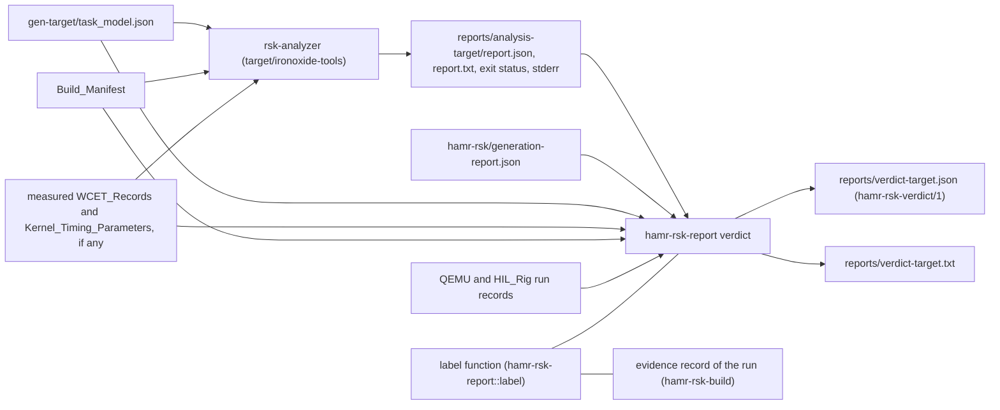

#### Analyzer runs (R25.1, R25.3, R25.6)

The Build_System step `analyze` of `hamr-rsk-build` runs IronOxide's Analyzer, built from the unchanged extraction into `target/ironoxide-tools/` (DD-12), on every Application it builds for an IronOxide_Target, after the TV gate from P4 (DD-35). It runs from P1 as one of the tools that must accept the Application (R18.2, UD-27); from P3 its results are timing evidence or development evidence as labelled below. The inputs are the Task_Model that the IronOxide_Generator wrote for that build (`<out>/gen-<target>/task_model.json`) and the build's Build_Manifest (section "Build_System, pins and the IronOxide extraction"). The measured records are those under `target/apps/<model>/wcet/<target>/`, written by `hil-wcet-<model>` for this build's binary or for a HIL build that the Build_Manifest lists. The command has one of two forms, both at PAR-01 (`crates/rsk-analyzer/src/main.rs`):

- complete measured sets: `rsk-analyzer --model <tm> --wcet <set> --timing <set> --manifest <bm> --out target/apps/<model>/reports/analysis-<target>/`;
- otherwise: `rsk-analyzer --model <tm> --placeholders [--wcet <measured>]… [--timing <measured>]… --manifest <bm> --out …`. The Analyzer then writes a placeholder record for every Task entry and every Critical_Section site (the Task's Budget in cycles) and nominal placeholder Kernel_Timing_Parameters, all carrying the analysed binary's hash from the manifest, and lets every measured record replace the placeholder of its item (`rsk_analyzer::placeholders::make` and `overlay_wcet` at PAR-01). No input is then missing (IronOxide R28.2, R13.3), and none carries another binary's hash (IronOxide R28.3, R33.4).

The step deletes the output directory before the run, so that no report of an earlier run is ever read (R27.2, R27.6). It records the exit status and standard error beside the report. It writes nothing outside `target/apps/<model>/reports/`, and neither the Backend nor the Verdict_Reporter writes a model file, the AIR_Model or anything in the generated Application. The Backend reads no Analyzer report, WCET_Record or Verdict_Report: the Backend jar has no option or code path that opens one (R25.6). `test-analysis-leaves-model-unchanged` hashes the model sources, `air.json` and the App_Declaration before a failing analysis and after a regeneration.

R25.3 is met by the Port_Glue of section "Port_Glue and Port_API": its only `lock` calls are on Port_Cells, one Critical_Section site per accessing Task (R10.6, R10.7), and its only Endpoint operations are on the roles that the Task_Model lists for its Task, at most `ops` per Job (R11.9). For R25.3, `check-generated-<model>` reads each generated `src/glue/<task>.rs` with the vendored `syn` parser (`syn` 2.0.119 is in the extraction's `vendor/`). Every `lock` call's receiver must be the Context field of a Port_Cell (`c_s…`) that the Task_Model lists in the Task's `resources`, so that its site is one of the Task's `cs_sites` (`<task>#cs:<resource>`). Every Endpoint operation's receiver must be a role field of one of the Task's `endpoint_roles` (`<endpoint>.<role>`). The step fails naming each other call, with its file and line.

Whether IronOxide's WCET_Harness and HIL harness can measure a generated Application from outside IronOxide's repository without change is ORQ-47 (deferred, S-10, P3; IOP-10). The Kernel_Timing_Parameters are per Application, because IronOxide's committed sets carry the hashes of IronOxide's demo builds. Until a measured set exists for a model's build, that model's runs carry placeholders and are development evidence.

#### Labels (R25.5, DD-94)

One function, `hamr_rsk_report::label::classify(target, report, wcet_sets, timing_sets, manifest, threshold)`, computes the label. `hamr-rsk-build` calls it to label the run's evidence record, and `hamr-rsk-report verdict` calls it to state the label, so that the two never differ. The label is timing evidence exactly when all of these hold, and development evidence otherwise, with one entry per failing condition and item:

| Condition | Source |
|---|---|
| L1 the IronOxide_Target is `nrf52840` | the Task_Model's `target` |
| L2 the report lists no input of method `placeholder` | every `tasks[].wcet_provenance` string of the report, and the methods of the input sets |
| L3 every measured WCET_Record and Kernel_Timing_Parameter has `measured.runs` ≥ 10,000 (IronOxide PAR-02) | the input sets |
| L4 each of them has `measured.margin_percent` = 25 (PAR-11) | the input sets |
| L5 every measured Task-entry and Critical_Section-site record has `measured.coverage_branch_percent` ≥ the threshold | the input sets; the threshold is `[coverage] branch_percent` of `target/ironoxide/hil-rig.toml`, 50 at PAR-01 (IronOxide Verification_Plan 11.13) |

A timing-evidence label also names the binary hash that the records carry and whether the Build_Manifest lists it under `binaries` (the Flight_Build) or `hil_binaries` (a HIL build).

`analysis-rta-<model>` passes when the Analyzer rejects no input under IronOxide R28.2, R28.3 or R13.3 (R25.1). `analysis-rta-<model>-measured` passes only when the exit status is 0 (PASS), the label is timing evidence, and the Verdict_Report reports no model defect under R25.2; otherwise it fails, naming each unmet condition and each such thread (R25.7).

#### Model defects against `Compute_Execution_Time` (R25.2)

For each thread whose Task's entry has a measured record in the run, with W the record's `wcet_cycles` (the WCET_Harness has already applied the margin; the Verdict_Reporter adds none), U the upper bound of `Compute_Execution_Time` in picoseconds and f the Task_Model's `clock.cpu_hz`:

- defect exactly when W × 10^12 > U × f, in `u128` integers (W < 2^64, 10^12 < 2^40, U < 2^81, f < 2^27, so both products fit);
- percentage of U rounded up to one decimal place: p10 = ⌈W × 10^13 / (U × f)⌉ tenths, printed as `p10 / 10` with one decimal (for U = 0 the entry states "U is 0" and the thread is a defect).

U, its value string and its unit must come from the generation report, because the Verdict_Reporter reads no Semantic_Model (DR-1) and the Budget in cycles does not determine U. The generation report holds the Backend's reading of `Compute_Execution_Time` (R6.10) in the member `items[].compute_execution_time` of each Task item, with `low` and `high` each as text, unit, picoseconds and exactness (section "Generation report, App_Declaration as generated, Model_Generator record and coverage report"); U is `compute_execution_time.high`. Every such thread is reported, not only the first that the Analyzer names under IronOxide R28.4, because the Analyzer stops at the first.

#### The Port_Glue's WCET (R6.9, DM-06)

How the Port_Glue's WCET is obtained is open, settled by S-10 (P3), ORQ-28, with RC-05. The candidates:

- (a) a lower bound with no new measurement: G = Σ over the Task's Port_Cell sites of (site WCET + Δ_lock_in + Δ_lock_out) + Σ over its roles of `ops` × max(Δ_send, Δ_recv). It omits Wire_Type encoding and decoding, the drain of R12.1 and Validation_Function work outside those operations, so it is a lower bound, and choosing it needs R6.9 reworded (RC-05);
- (b) a separate measurement of the glue, which IronOxide R34.7 counts as an instrumentation difference.

The Verdict_Report reserves the thread entry's member `glue`. Once S-10 has chosen, it holds the WCET in cycles with the margin of PAR-11, the method, and the share of the Task's Budget in cycles, rounded up to one decimal place as above, all marked as computed by the Verdict_Reporter (R27.2). Until then `glue` states "not obtained: ORQ-28 open", and `analysis-glue-share-<model>` is reported as not run, naming ORQ-28.

#### End-to-end flows to Chains (R26)

The Backend's package `org.hamrdahn.rsk.map` holds `Flows.scala`. It takes the end-to-end flows of the AIR view, each with its instance path, position, elements and connections in flow order, and its `Communication_Properties::Latency` read by R6.10. AIR at PAR-02 has no data type for an end-to-end flow (`AadlAST.scala`; ORQ-48, UD-03), so the production AIR view yields none and R26.7's count is 0. The test jar `hamr-rsk-test.jar` (DD-18) also accepts `--test-end-to-end-flows <file>`, a TOML list of flows by instance paths, which `test-map-21`, `test-verdict-report` and the R26.3 refusal fixtures use. Every file written with it carries "end-to-end flows injected (test only)" in its provenance block (DD-93).

For each flow with a Latency and at least one thread bound to the IronOxide_Processor, in instance-path order:

1. Shape (R26.1, R26.4): drop a first element that is a device of MAP-20 whose out event port the first connection joins to the first thread's Dispatch trigger, and a last element that is a device of MAP-20. The rest must be two or more threads bound to the IronOxide_Processor. Otherwise the flow is not analyzed, with every reason of R26.4 that applies: (i) each element bound to another processor, naming the processor; (ii) a non-thread element other than such a first or last device, naming it; (iii) a first device whose port the first connection does not join to the Dispatch trigger, naming the device and the port; (iv) fewer than two threads.
2. Refusals (R26.3): one diagnostic per case and hop, with the flow's path, the hop's connection and destination thread, and (a) MAP-21 (a), IronOxide R41.4; (b) MAP-21 (b), IronOxide R41.4; (c) MAP-21 (c), Backend restriction (IOP-11); (d) MAP-21 (d), IronOxide R41.4; (e) MAP-21 (e), IronOxide R38.1.
3. Chain: `chain NAME { PART.TASK -> PART.TASK … } deadline = T;` with NAME = N(`ch`, flow path), the Tasks of the threads in flow order (devices excluded), and T the Latency's upper bound written as R6.2 writes every time value. The IronOxide_Generator converts T to ticks rounding down (IronOxide R21.2).
4. Hops: every connection between two consecutive threads is a hop (MAP-21). A hop between threads of one Partition is mapped to one plain Endpoint, one per connection however many flows use it, declared as R11 and R12 declare cross-Partition Endpoints, and counted toward PAR-05 and PAR-06 (R26.2, MAP-26).
5. Declaration order (R26.6): the App_Declaration declares the Endpoints of every Chain's hops first, in Chain order and then hop order, before every other Endpoint, so that the IronOxide_Generator's rule "the first Endpoint whose roles are bound to both Tasks" (`crates/rsk-gen/src/derive.rs`) picks the hop's own Endpoint.

The generation report's member `flows` (section "Generation report, App_Declaration as generated, Model_Generator record and coverage report") holds the counts `mapped` (flows with a Chain) and `not_analyzed` (flows of R26.4), whose sum is R26.7's number; `not_recorded`, true while AIR records no end-to-end flow (the statement of R26.7); and `entries`, one per counted flow with its instance path, position, Latency (text, unit, picoseconds), Chain name, Tasks, hop connections and Endpoints, or its R26.4 reasons. The Verdict_Reporter takes its flow entries from `flows.entries`.

#### The Verdict_Reporter (R27, DD-94)

`hamr-rsk-report verdict` takes `--generation-report <f> --analysis-report <f> --out <f>` and these further options, which R25.2, R25.5, R27.1, R27.2, R27.4 and R27.6 need (DD-94): `--task-model <f>`, `--wcet <f>…`, `--timing <f>…`, `--build-manifest <f>`, `--analyzer-exit <n>`, `--analyzer-stderr <f>`, `--run-record <f>…` and `--coverage-threshold <n>`. `--analysis-report` may name a missing file, which means "no report". The crate reads `rsk-analysis-report/1`, `rsk-wcet/1`, `rsk-kernel-timing/1` and the Task_Model through `rsk-model` (DD-33). It writes the JSON form `<out>` and the text form `<out>` with `.txt`, the same entries in the same order.

Steps:

1. Result: PASS, FAIL or REJECTED as the report's `result` gives it; "no report" when the exit status is 3 or outside 0 to 3, whatever file exists, or when no report file exists (exit status 2 after a schema rejection, whose messages go to standard error only). Because the `analyze` step deletes the output directory before the run, a file that exists afterwards is this run's. Copy the exit status, `utilization_percent`, `analyzer`, `profile`, `inputs` (the identities of R30.2), `statements`, `omitted_terms`, `cross_check` and `rejections` unchanged; copy standard error's lines where the report is absent. Copy the binary hashes from the Build_Manifest (R27.2, R27.3).
2. Limits (R27.3): the three fixed statements of `docs/hamr_study.md` section 11 (measured maxima with margin, not static bounds; L_kernel a measured masked span; the fixed point and terms proven in Verus, the per-Task composition and verdict plain Rust tested against a reference), then every statement of the report unchanged, including the placeholder statement.
3. Thread entries (R27.4, R27.6): one per Task item of the generation report, that is per thread bound to the IronOxide_Processor, ordered by instance path compared segment by segment by code point. Each entry gets the path and position from the item, and the Task's `id`, Partition, level and Priority from the report. The model value is `Timing_Properties::Deadline`, or `Timing_Properties::Period` where it is absent (ASM-03), with its property name, its picoseconds and its text as written in the App_Declaration. Then D_i, C_i, B_i with its source, O_i, J_i and each interference term (with the interfering Task's thread), R_i labelled WCRT or lower bound, the slack (none for a not-schedulable Task), and the verdict. A Task without a result gets "no verdict" with the cause, the exit status and every message unchanged, and no response time, bound or slack; the report's 0 and 2^64 − 1 are never shown as values (R27.6).
4. B_i source (R27.4): the report's `b_source` has three forms at PAR-01 (`crates/rsk-analyzer/src/inputs.rs`): `<task>#cs:<resource>` (a Critical_Section site, mapped through the Resource `<partition>.<resource>` to the data subcomponent or the Port_Cell's connection that the generation report gives), `<task>:endpoint:<endpoint>.<role>:send|recv (…)` (an Endpoint operation, mapped to the Endpoint's connection), or the Kernel term's text (L_kernel, or the Partition stop and restart work of IronOxide R14.10). A text of another form is shown unchanged and marked untraced (R3.8); IOP-12 proposes structured output.
5. Picoseconds: every cycle value v is shown as `cycles` and as `ps_computed` = v × (10^12 / f_cpu), exact because f_cpu divides 10^12 at both targets (15,625 ps per cycle at 64 MHz, 40,000 at 25 MHz). A Task_Model whose `clock.cpu_hz` does not divide 10^12 stops the Verdict_Reporter with an internal error, because R27.4's exactness would not hold.
6. FAIL details (R25.4): for each not-schedulable Task, the deadline in its AADL unit and in cycles, the lower bound, `excess_computed` = lower bound − deadline in cycles, and the AADL element behind each term (as step 4). The Analyzer's report does not give the excess (`slack_cycles` is 0 for a not-schedulable Task), and R27.2's list of values that the Verdict_Reporter may compute does not name it; this is C-17 (see "Conflicts with Requirements"); for a FAIL without fixed-point iteration (IronOxide R29.9), the utilization; for each rejected input, the back-mapped diagnostic of R3.4 (`hamr-rsk-report backmap`, DD-17). No property change is suggested beyond those the report states.
7. Measured entries (R25.2) and the Port_Glue entry (R6.9), as above.
8. Flow entries (R27.5, R26.4, R26.5, R26.7, R26.8): one per flow of the generation report's `flows`, ordered by instance path. An analysed flow shows its Chain, its Tasks in flow order with their threads, the Latency upper bound in picoseconds and as written, the Chain deadline, the terms as the report names them, the bound (labelled a lower bound where a Task of the Chain is not schedulable; none for UNBOUNDED, with the report's reason term) and the result. It also states the interval of R26.8, from the first Task's Release (or the interrupt event, Δ_stamp) to the last Task's completion (ORQ-49, VP). A not-analyzed flow shows its reasons. A flow with a Latency lower bound above 0 ps shows that bound and the statement that nothing in this project verifies it (R26.5). Then the count of R26.7 with its statement.
9. Refused sends (R27.1, R11.10, R12.8): from each `--run-record` (the evidence records of `test-qemu-<model>` and of the HIL runs, each of which holds the per-port refused-send counts in its `refused_sends`; section "Property-based tests and the Model_Generator; QEMU runs and IronOxide tool acceptance" defines the QEMU records and section "Robot_Model, the MCU side on the HIL_Rig, and robot integration" the HIL_Rig records), one entry per port with the run kind, the Evidence_Item, the binary hash, and "outside the analysis" where the analysed Build_Manifest does not list that hash.

Every value that the Verdict_Reporter computes is in a member whose name ends in `_computed` (R27.2). Whether the Verdict_Report is also given as Sireum `Message`s for markers in OSATE or FMIDE is ORQ-77 (deferred to the P3 checkpoint). Evidence: `test-verdict-schema`, `test-verdict-report`, `test-verdict-no-result`, `pbt-verdict-copy` (Property 38), `analysis-rta-<model>`, `analysis-rta-<model>-measured`, `analysis-glue-share-<model>`, `test-map-21`.

### Semantic_Model_Extractor

Implements R28.1 to R28.7 and Table 28-1 (schema `hamr-rsk-semantic-model/1`). Settles DC-24 and DM-19 by DD-34, and records DD-04, DD-91 and DD-92. Properties 32, 33 and 34 state its correctness. <a id="unit-semantic-model"></a>

#### Program and module

The Extractor is the program `hamr-rsk-extract --air <file> --out <file>`, proyek module `jvm/extractor`, Scala package `org.hamrdahn.rsk.extract`, compiled against `target/jvm/hamr-air.jar` and the Scala library only (DD-04, DR-1). Its source files:

| File | Content |
|---|---|
| `Main.scala` | command line, exit status (0 written; 1 one or more R28.7 conditions; 2 a usage or I/O error), diagnostics on standard error |
| `Index.scala` | one walk over the `ir.Aadl` value that `JSON.toAadl` returns: every component with its instance path, features (feature groups opened), connection instances, flows, modes, annexes, and the data classifiers of `dataComponents` |
| `Select.scala` | the selection of each row of Table 28-1 (below) |
| `Decode.scala` | the decoding forms of DD-91 and the exact readings of time and size values (R28.3) |
| `Gumbo.scala` | row SM-10: clause identities from `GclSubclause` (`hamr/air/shared/src/main/scala/org/sireum/hamr/ir/GumboAST.scala` at PAR-02) and the port that an integration clause names, found by a walk over the Slang `Exp` tree |
| `Model.scala` | the Extractor's own case classes, one per `$defs` entry of the schema |
| `Order.scala` | the orders of R28.6 |
| `Print.scala` | the printer of DD-34 |
| `ReprintMain.scala` | test-only entry `hamr-rsk-extract-reprint`, used by `pbt-semantic-model-round-trip` only (Testing Strategy, translation validation) |

The Extractor imports only `org.sireum.hamr.ir`, `org.sireum` (the Slang runtime), `org.sireum.lang.ast` (the GUMBO expressions) and `java.*`. It reads no file other than `--air`, no environment variable and no system property, and it calls no locale-sensitive formatting or comparison: integers are printed with `java.math.BigInteger.toString` and strings are compared by code points. `check-extractor-independence` (DR-1, section "Module boundaries") reads `jvm/bin/project.cmd`, these imports and the class list of `hamr-air.jar`. Whether that class list stays within `hamr/air`, the Slang runtime and the Slang AST is open, settled by S-02 (RC-03).

#### Pipeline

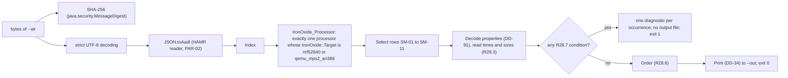

The Extractor evaluates every condition of R28.7 before it writes anything and reports all occurrences, in the order of R3.2 (file URI, line, column, positionless last, then instance path). A file that is not valid UTF-8 cannot be given to HAMR's reader, which takes a string; the Extractor reports it under R28.7's first condition. The output is written to a temporary file in the directory of `--out` and renamed, so that a failed run leaves no partial Semantic_Model.

Diagnostic form (one line each): `hamr-rsk-extract: <AIR file>: R28.7 (<n>) <condition text>: <instance path> at <uri>:<line>:<column>`, with `no position recorded` or `no file recorded` in place of the position where R3.7 applies. The conditions are numbered 1 to 6 in the order of R28.7's list.

#### Selection (Table 28-1)

The IronOxide_Processor is the one component of category `Processor` that has an `IronOxide::Target` value decoding (DD-91, enumeration literal) to `nrf52840` or `qemu_mps2_an386`; none or several is R28.7 (2). An in-scope process is a component of category `Process` whose decoded `Deployment_Properties::Actual_Processor_Binding` contains the IronOxide_Processor's instance path. Each row then selects exactly the elements that its "Selected elements" cell names, and an element that rows SM-01 to SM-10 select is never also selected by SM-11. Elements outside every row (for example a thread of a process that is not in scope) do not appear (Property 32).

#### Decoding (DD-91)

AIR at PAR-02 has six property value forms (`AadlAST.scala`: `ClassifierProp`, `RangeProp`, `RecordProp`, `ReferenceProp`, `UnitProp`, `ValueProp`). HAMR reads integers as a `UnitProp` without a unit and enumeration literals and Booleans as a `ValueProp` (`hamr/codegen/shared/src/main/scala/org/sireum/hamr/codegen/common/properties/PropertyUtil.scala` lines 42 to 53, 136 to 151 and 186 to 192 at PAR-02). The values of a property are the values of every entry of the element's `properties` whose qualified name (the last segment of the AIR property name, Table 28-1) is that name, in AIR order. This is the reading of HAMR's `getPropertyValues`, implemented here independently. Whether instance models from OSATE or FMIDE and from HAMR's SysML front end carry entries with non-empty `appliesTo` that this reading would merge is unconfirmed; it is open, settled by S-05's AIR survey (see "Spikes and measurements that settle deferred points").

| Type in Table 28-1 | Accepted values | Decoded JSON | Otherwise |
|---|---|---|---|
| integer | one `UnitProp` without unit, or one `ValueProp`, whose text the decimal grammar below reads as an exact integer | integer in the field's range (DD-34) | R28.7 (3), or (4) out of range |
| time | one `UnitProp` whose unit is `ps`, `ns`, `us`, `ms`, `sec`, `min` or `hr` | `time` object (R28.3) | R28.7 (3) for no unit or another unit; (4) out of range |
| range of times | one `RangeProp` whose two bounds are times | `{low, high}` of `time` objects | R28.7 (3) or (4) |
| size | one `UnitProp` whose unit is a size unit of Table 28-1's text | `size` object | R28.7 (3) or (4) |
| enumeration literal, string | one `ValueProp` | its text, unchanged | R28.7 (3) |
| Boolean | one `ValueProp` whose text is `true` or `false` | `true` or `false` | R28.7 (3) |
| instance paths | every value a `ReferenceProp` that names an element of the AIR_Model | array of paths (possibly empty) | R28.7 (3) |
| list of strings | every value a `ValueProp` | array of strings | R28.7 (3) |
| record (`IronOxide::Serial_Link`) | one `RecordProp` | `{baud_rate, payload_bound, device_path}`, decoded from the record's fields `IronOxide::Serial_Link.Baud_Rate`, `IronOxide::Serial_Link.Payload_Bound` and `IronOxide::Serial_Link.Device_Path` (the field names that section "IronOxide_Property_Set" declares), each by its own type, `null` where the record lacks it | R28.7 (3) |

A property that the element does not list decodes to `null` ("absent"); no default is applied (R28.1). The Extractor never checks an enumeration literal against a set: whether a literal is allowed is a refusal of Table M-1, which the Backend decides and the TV_Checker's "No refused construct" conjunct checks.

Decimal grammar of R28.3 (DD-91): `[+-]?[0-9]+(\.[0-9]+)?([Ee][+-]?[0-9]+)?`, read with `java.math.BigDecimal` exactly. Examples of R28.3: `1.0E12`, `1.0000E+12`, `100`.

#### Time and size values (R28.3)

For a value string v with unit u and factor k(u) (time: 1, 10^3, 10^6, 10^9, 10^12, 6 × 10^13, 3.6 × 10^15; size in bits: 1 for `bits`, 8 for `Bytes`, 8 × 10^3n for `KByte` to `TByte`, 8 × 2^10n for `KiByte` to `TiByte`, n = 1 to 4):

1. x = v × k(u), an exact `BigDecimal`.
2. Before any rounding, the Extractor looks at d = `precision − scale` of x (for |x| ≥ 1, the number of digits before the decimal point). If d > 26, then |x| ≥ 10^26 > 2^80 (2^80 < 1.3 × 10^24) and the value is R28.7 (4). If x ≠ 0 and d < −1, then |x| < 0.01, so n = 0 and step 4 gives `fractional`. These shortcuts keep a value string such as `1E999999999` or `1E-999999999` as cheap as a short one.
3. Otherwise n = x rounded to the nearest integer, a value exactly halfway rounded away from zero (`RoundingMode.HALF_UP`, which rounds halfway cases away from zero for both signs).
4. Mark: `exact` if x = n; else `noise` if |x − n| × 2^50 ≤ |n| (exact comparison); else `fractional`.
5. R28.7 (4) if n lies outside [−2^80, 2^80].

The `time` object keeps the value string and unit as the AIR_Model records them beside `ps` and `exactness`; the `size` object does the same with `bits`. The R28.3 cases of `test-semantic-model-times` follow from these steps: `3.3299999999999996E10` ps gives n = 33,300,000,000 with |x − n| = 4 × 10^−6, below n / 2^50 ≈ 2.96 × 10^−5, so `noise`; `2.5` ps gives 3 `fractional`.

#### Document structure (DD-92)

The document is one JSON object. Its members, in the schema's and the printer's order:

| Member | Content | Row |
|---|---|---|
| `schema` | `"hamr-rsk-semantic-model/1"` | R28.1 |
| `air_sha256` | 64 lowercase hexadecimal digits over the bytes of `--air` | R28.1 |
| `hamr_revisions` | `{ "kekinian": <40 hex>, "codegen": <40 hex> }`, the two commits of PAR-02, constants of the Extractor's build | R28.1 |
| `platform` | processors, virtual processors and buses | SM-01 |
| `processes` | every process | SM-02 |
| `threads` | threads of in-scope processes at any depth | SM-03 |
| `ports` | data, event and event data features of SM-03 threads and SM-07 devices | SM-04 |
| `connections` | connection instances with an end in scope | SM-05 |
| `data` | data subcomponents and data access features | SM-06 |
| `devices` | devices at an end of an SM-05 connection | SM-07 |
| `classifiers` | data component classifiers, transitively | SM-08 |
| `flow_specs` | flow specifications | SM-09 |
| `gumbo_subclauses`, `gumbo_clauses` | GUMBO subclauses and their clauses | SM-10 |
| `others` | every other element | SM-11 |

Every element object of SM-01 to SM-07, SM-09 and SM-11 starts with the members `path` (instance path segments, at least one), `pos` (`{uri, line, column}` with `uri` a string or `null`, or `null` where the AIR_Model records no position; R3.1, R3.7), `category` (the AIR category: component category, feature category, `Mode`, or the annex name) and `properties` (every property the AIR_Model lists for the element). The row's "Recorded" items follow, each as a member that is always present and is `null` where the item is absent or does not apply to the element's category. The schema therefore needs no `oneOf`: each object kind has one shape (DD-92). The members of each row:

| Row | Row-specific members (decoded type; `?` marks `null` allowed) |
|---|---|
| SM-01 | `target`?, `safe_state`? (strings); `operating_duration`? (time); `log_capacity`? (u64); `fp_flush_to_zero`? (Boolean); `containing_processor`? (path, virtual processors); `processor_binding`? (paths, virtual processors); `serial_link`? (record, buses) |
| SM-02 | `processor_binding`? (paths); for an in-scope process, else `null`: `criticality_level`?, `fault_response`?, `overrun_response`?, `deadline_miss_response`? (literals); `mit_violation_threshold`? (u64); `peripherals`? (strings); `code_size`?, `data_size`?, `stack_size`? (sizes); `thread_groups`? (paths, every depth) |
| SM-03 | `process` (path); `thread_groups` (paths, outermost first); `processor_binding`?; `dispatch_protocol`?; `dispatch_trigger`? (paths of the referenced ports); `period`?, `deadline`?, `dispatch_offset`? (times); `compute_execution_time`? (range); `priority`? (u64); `mit_policy`?; `uses_fpu`? (Boolean); `serial_bridge_role`? |
| SM-04 | `owner` (path); `direction`; `classifier`? (string); `queue_size`?, `dequeued_items`? (u64); `overflow_handling_protocol`?, `dequeue_protocol`?, `queue_processing_protocol`?; `validation_function`? (string); `integration_clauses` (clause identities, SM-10 order) |
| SM-05 | `kind` (AIR `ConnectionKind`); `src`, `dst` (end: `component` path, `feature`? path, `direction`?, `outside`? with `category`, `component_binding`? and `process_binding`? for an end outside every in-scope process); `timing`?; `connection_binding`? (paths); `latency`? (range) |
| SM-06 | `classifier`?; `concurrency_control_protocol`?; `initial_value`? (raw values, as recorded); `access_type`? (`Provides` or `Requires`, features); `access_right`?; `access_connections` (paths of the `Access` connection instances that join the element, ORQ-03) |
| SM-07 | `peripheral`?; `dispatch_protocol`?; `processor_binding`? |
| SM-08 | (header `name`, `pos`, `category`, `properties`); `fields` (`{name, classifier}` in AIR order); `floating_point` (Boolean: the classifier is `Base_Types::Float`, `Float_32` or `Float_64`, or a record or array type with such a component at any depth, through its fields and its `Data_Model::Base_Type`; extension of a floating-point type is not recognized until S-05 answers ORQ-78) |
| SM-09 | `kind` (`Source`, `Sink`, `Path`); `source`?, `sink`? (paths) |
| SM-10 | subclause: `owner` (`{thread}` path or `{classifier}` name, the other `null`), `pos`, `state` (`{name, classifier}`); clause: `identity` (`owner`, `row` `CK-05` to `CK-08`, `CK-10` to `CK-12` or `CK-14` to `CK-16`, `handler`? port name, `id`), `pos`, `port`? (the SM-04 port that an integration clause's expression names) |
| SM-11 | `direction`? (features) |

Ranges (DD-34, DC-24, DM-19): every `ps` and `bits` field is an integer from −2^80 to 2^80 (±1,208,925,819,614,629,174,706,176); every other integer (counts, Priorities, `Queue_Size`, `Dequeued_Items`, `Log_Capacity`, `MIT_Violation_Threshold`, the `Serial_Link` integers, and the `line` and `column` of a position) is an integer from 0 to 2^64 − 1. A JSON integer is a number token without fraction and exponent; the Extractor never writes another form, and the TV_Checker's readers reject another form under R29.9 as a schema violation (DD-96).

#### Schema excerpt

The published file is `schemas/hamr-rsk-semantic-model-1.json`. Its keywords are a subset of those of F-S2 (see "Facts checked for this design"), which `hamr-rsk-jsonschema` supports (DD-06): type names and type arrays, the assertion and applicator keywords, `$defs` (the container into which `$ref` points) and the annotations `$schema`, `$id`, `title` and `description`, as IronOxide's Task_Model schema uses them. It does not use `oneOf`, which IronOxide's Task_Model schema uses once, in `$defs/source` (DD-92). Object keywords (`properties`, `required`, `additionalProperties`) constrain only objects and `items` only arrays, so `"type": ["object", "null"]` gives a nullable object without `oneOf`.

```json
{
  "$schema": "https://json-schema.org/draft/2020-12/schema",
  "$id": "https://hamr-dahn.invalid/schemas/hamr-rsk-semantic-model-1.json",
  "title": "HAMR-DAHN Semantic_Model (hamr-rsk-semantic-model/1)",
  "type": "object",
  "additionalProperties": false,
  "required": ["schema", "air_sha256", "hamr_revisions", "platform", "processes", "threads", "ports",
               "connections", "data", "devices", "classifiers", "flow_specs",
               "gumbo_subclauses", "gumbo_clauses", "others"],
  "properties": {
    "schema": { "const": "hamr-rsk-semantic-model/1" },
    "air_sha256": { "type": "string", "pattern": "^[0-9a-f]{64}$" },
    "hamr_revisions": {
      "type": "object", "additionalProperties": false, "required": ["kekinian", "codegen"],
      "properties": {
        "kekinian": { "type": "string", "pattern": "^[0-9a-f]{40}$" },
        "codegen": { "type": "string", "pattern": "^[0-9a-f]{40}$" } } },
    "threads": { "type": "array", "items": { "$ref": "#/$defs/thread" } }
  },
  "$defs": {
    "u64": { "type": "integer", "minimum": 0, "maximum": 18446744073709551615 },
    "u64_or_null": { "type": ["integer", "null"], "minimum": 0, "maximum": 18446744073709551615 },
    "ps": { "type": "integer", "minimum": -1208925819614629174706176, "maximum": 1208925819614629174706176 },
    "exactness": { "enum": ["exact", "noise", "fractional"] },
    "path": { "type": "array", "minItems": 1, "items": { "type": "string" } },
    "path_or_null": { "type": ["array", "null"], "minItems": 1, "items": { "type": "string" } },
    "paths_or_null": { "type": ["array", "null"], "items": { "$ref": "#/$defs/path" } },
    "string_or_null": { "type": ["string", "null"] },
    "pos_or_null": {
      "type": ["object", "null"], "additionalProperties": false, "required": ["uri", "line", "column"],
      "properties": { "uri": { "type": ["string", "null"] },
                      "line": { "$ref": "#/$defs/u64" }, "column": { "$ref": "#/$defs/u64" } } },
    "time": {
      "type": "object", "additionalProperties": false, "required": ["text", "unit", "ps", "exactness"],
      "properties": { "text": { "type": "string" }, "unit": { "enum": ["ps", "ns", "us", "ms", "sec", "min", "hr"] },
                      "ps": { "$ref": "#/$defs/ps" }, "exactness": { "$ref": "#/$defs/exactness" } } },
    "time_or_null": {
      "type": ["object", "null"], "additionalProperties": false, "required": ["text", "unit", "ps", "exactness"],
      "properties": { "text": { "type": "string" }, "unit": { "enum": ["ps", "ns", "us", "ms", "sec", "min", "hr"] },
                      "ps": { "$ref": "#/$defs/ps" }, "exactness": { "$ref": "#/$defs/exactness" } } },
    "time_range_or_null": {
      "type": ["object", "null"], "additionalProperties": false, "required": ["low", "high"],
      "properties": { "low": { "$ref": "#/$defs/time" }, "high": { "$ref": "#/$defs/time" } } },
    "unit_value_or_null": {
      "type": ["object", "null"], "additionalProperties": false, "required": ["text", "unit", "time", "size"],
      "properties": { "text": { "type": "string" }, "unit": { "$ref": "#/$defs/string_or_null" },
                      "time": { "$ref": "#/$defs/time_or_null" }, "size": { "$ref": "#/$defs/size_or_null" } } },
    "value": {
      "type": "object", "additionalProperties": false,
      "required": ["kind", "text", "unit", "time", "size", "low", "high", "reference", "fields"],
      "properties": {
        "kind": { "enum": ["classifier", "range", "record", "reference", "unit", "value"] },
        "text": { "$ref": "#/$defs/string_or_null" }, "unit": { "$ref": "#/$defs/string_or_null" },
        "time": { "$ref": "#/$defs/time_or_null" }, "size": { "$ref": "#/$defs/size_or_null" },
        "low": { "$ref": "#/$defs/unit_value_or_null" }, "high": { "$ref": "#/$defs/unit_value_or_null" },
        "reference": { "$ref": "#/$defs/path_or_null" },
        "fields": { "type": ["array", "null"], "items": { "$ref": "#/$defs/property" } } } },
    "property": {
      "type": "object", "additionalProperties": false, "required": ["name", "applies_to", "values"],
      "properties": {
        "name": { "type": "string" },
        "applies_to": { "type": "array", "items": {
          "type": "object", "additionalProperties": false, "required": ["kind", "path"],
          "properties": { "kind": { "enum": ["Component", "Connection", "Port", "Flow"] },
                          "path": { "$ref": "#/$defs/path" } } } },
        "values": { "type": "array", "items": { "$ref": "#/$defs/value" } } } },
    "thread": {
      "type": "object", "additionalProperties": false,
      "required": ["path", "pos", "category", "properties", "process", "thread_groups", "processor_binding",
                   "dispatch_protocol", "dispatch_trigger", "period", "deadline", "dispatch_offset",
                   "compute_execution_time", "priority", "mit_policy", "uses_fpu", "serial_bridge_role"],
      "properties": {
        "path": { "$ref": "#/$defs/path" }, "pos": { "$ref": "#/$defs/pos_or_null" },
        "category": { "const": "Thread" },
        "properties": { "type": "array", "items": { "$ref": "#/$defs/property" } },
        "process": { "$ref": "#/$defs/path" },
        "thread_groups": { "type": "array", "items": { "$ref": "#/$defs/path" } },
        "processor_binding": { "$ref": "#/$defs/paths_or_null" },
        "dispatch_protocol": { "$ref": "#/$defs/string_or_null" },
        "dispatch_trigger": { "$ref": "#/$defs/paths_or_null" },
        "period": { "$ref": "#/$defs/time_or_null" }, "deadline": { "$ref": "#/$defs/time_or_null" },
        "dispatch_offset": { "$ref": "#/$defs/time_or_null" },
        "compute_execution_time": { "$ref": "#/$defs/time_range_or_null" },
        "priority": { "$ref": "#/$defs/u64_or_null" },
        "mit_policy": { "$ref": "#/$defs/string_or_null" },
        "uses_fpu": { "type": ["boolean", "null"] },
        "serial_bridge_role": { "$ref": "#/$defs/string_or_null" } } }
  }
}
```

`size`, `size_or_null` and the other rows' definitions follow the same pattern (`bits` with the `ps` range, the members of the table above). `check-semantic-model-schema` validates every Semantic_Model that the Build_System writes against this file with `hamr-rsk-jsonschema` (DD-06, DD-96). The section "Semantic_Model, TV report and Verdict_Report" shows an instance excerpt.

#### Order (R28.6) and printing (DD-34)

- Elements of each row by instance path, compared as R7.5 compares paths: segment by segment, each segment by Unicode code points (not UTF-16 code units: `Order.scala` compares `codePointAt` sequences, because `String.compareTo` orders supplementary characters differently), a proper prefix first.
- `classifiers` by `name`, by code points; `gumbo_subclauses` by owner (threads before classifiers, then by path or name); `gumbo_clauses` by identity: owner, Table 22-1 row, handler port (`null` first), identifier.
- Properties of an element by qualified name; properties with the same qualified name (possible with different `appliesTo`) by the printed bytes of the whole property object, so the order does not depend on the AIR order (Property 33).
- Values of a property, fields of a classifier, and record fields in AIR order.
- The printer writes UTF-8, members in the order of the schema's `properties`, no white space except one final newline, integers as decimal digits with a leading `-` for negatives, and strings escaped as RFC 8785 serializes them ([RFC 8785 section 3.2.2.2](https://www.rfc-editor.org/rfc/rfc8785#section-3.2.2.2)): `\"`, `\\`, the short forms `\b`, `\t`, `\n`, `\f`, `\r`, and `\u00xx` with lowercase hexadecimal for the other code points up to U+001F; nothing else is escaped. A string holding an unpaired surrogate cannot be written as UTF-8; the Extractor reports it under R28.7 (3), naming the element.

Because every list is sorted by content and every map is printed in schema order, the output is a function of the AIR bytes alone (R28.6), whatever the working directory, paths, environment, locale, time or earlier runs. `test-semantic-model-deterministic` checks two runs byte for byte.

#### Versioning (R28.5)

The Verification_Plan's change log (R41.2) records for identifier 1 the SHA-256 of `schemas/hamr-rsk-semantic-model-1.json` and of the text of Table 28-1 in requirements.md, from its line `**Table 28-1` up to the line before `### Requirement 29`. `check-semantic-model-version` (a `hamr-rsk-build` step) recomputes both and fails naming the identifier and the file that differs. A change is published as `schemas/hamr-rsk-semantic-model-2.json` with its own change-log entry; the TV_Checker then still rejects `/2` under R29.9 until its reader is extended.

#### Independence and its evidence (R28.2)

The Extractor shares with the Backend only `JSON.toAadl` and the schema. It does not use `PropertyUtil`, `TypeResolver`, `SymbolResolver` or `GclResolver`; the GUMBO port of an integration clause is found by its own walk, and the R28.7 rule on it follows HAMR's rule (`GclResolver.scala`) without calling it. Evidence: `check-extractor-independence` (every Phase), `review-extractor-independence` (each checkpoint from P4; ORQ-18 deferred to the P4 checkpoint), and `diff-semantic-model-hamr`, a test-only proyek module `jvm/extractor-diff` that runs HAMR's `SymbolResolver` on each corpus model and compares the items R28.2 lists (`AadlThread.dispatchProtocol`, `periodPs`, `computeExecutionTimePs`, ports, connection instances, process bindings) with the Semantic_Model. `jvm/extractor-diff` is neither the Extractor nor a Backend module, so DR-1 holds.

### TV_Checker

Implements R29.1 to R29.11. Records DD-07, DD-35, DD-90, DD-95 and DD-96. Properties 35, 36 and 37 state its correctness. <a id="unit-mapping-relation"></a>

#### Crate layout

`hamr-rsk-tv` is a member of the Verus workspace `verus/` (rustc 1.98.1, Verus 0.2026.10.04.426d8b0, Z3 4.16.0, `vstd` `=0.0.0-2026-10-04-0306`; DD-07, R29.3). Its manifest carries `[package.metadata.verus] verify = true` and the `unexpected_cfgs` entry for `cfg(verus_keep_ghost)`, as IronOxide's `crates/rsk-analyzer/Cargo.toml` does at PAR-01. Dependencies: `vstd`, `verus_builtin`, `verus_builtin_macros`, `hamr-rsk-sampling` (C_sample, R12.2) and `hamr-rsk-jsonschema` (path `../../crates/hamr-rsk-jsonschema`); no `rsk-*` crate and no file the Backend writes (DR-3).

| Path | Part (R29.6) | Content |
|---|---|---|
| `src/core/model.rs` | core | executable input types and their ghost views |
| `src/core/convert.rs` | core | IronOxide R21.2 conversions over `int`, the clock constants of R29.2 |
| `src/core/names.rs` | core | the DD-09 naming rule as a specification function and its executable twin |
| `src/core/relation.rs` | core | one specification function per conjunct, `mapping_relation`, `MAPPING_TABLE_VERSION`, `CONJUNCTS` |
| `src/core/check/*.rs` | core | one executable check function per conjunct |
| `src/core/entry.rs` | core | `check`, whose postcondition is soundness (R29.1) |
| `src/read/semantic_model.rs`, `src/read/task_model.rs` | readers | parse, validate, build the document value, convert it to the core's input |
| `src/print.rs` | report printer | text and `hamr-rsk-tv-report/1` |
| `src/main.rs` | entry point | `hamr-rsk-tv --semantic-model <f> --task-model <f> --report <f>`; exit 0, 1, 2 or 3 |

Every file under `src/core/` holds its items in one `verus!` block, with only `use` lines outside it. The readers, printer and entry point are plain Rust that Verus does not verify.

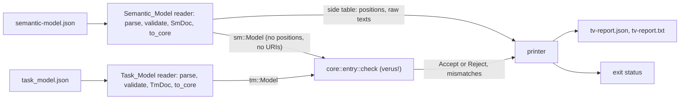

#### Core inputs and their views

The readers give the core two values, `sm::Model` and `tm::Model`, built only from the fields that a conjunct reads (DD-95). Identifiers and instance-path segments are `Vec<char>` with view `Seq<char>`; times in picoseconds and sizes in bits are `i128` with view `int`; Task_Model integers are `i128` (DD-07). Positions, file URIs, and the value string and unit kept beside each picosecond or bit value are not in these types, so no conjunct can read them (R29.2); the reader keeps them in a side table, indexed like the core's lists, for the printer. The view pattern is the one of IronOxide's `crates/rsk-protocol/src/progress.rs` at PAR-01 (`pub ghost struct Cfg` and `open spec fn cfg`):

```rust
use vstd::prelude::*;
verus! {
/// One SM-03 thread as the core sees it (Table 28-1).
pub struct Thread {
    pub path: Vec<Vec<char>>,
    pub process: Vec<Vec<char>>,
    pub dispatch_protocol: Option<Vec<char>>,
    pub dispatch_trigger: Option<Vec<Vec<Vec<char>>>>,
    pub period_ps: Option<i128>,
    pub deadline_ps: Option<i128>,
    pub offset_ps: Option<i128>,
    pub cet_ps: Option<(i128, i128)>,
    pub priority: Option<i128>,
    pub mit_policy: Option<Vec<char>>,
    pub uses_fpu: Option<bool>,
    pub serial_bridge_role: Option<Vec<char>>,
}
pub ghost struct ThreadV {
    pub path: Seq<Seq<char>>,
    pub process: Seq<Seq<char>>,
    pub dispatch_protocol: Option<Seq<char>>,
    pub period_ps: Option<int>,
    pub deadline_ps: Option<int>,
    // … one field per field of `Thread`, `int` for every integer
}
pub open spec fn segs(p: Vec<Vec<char>>) -> Seq<Seq<char>> {
    p@.map(|i: int, s: Vec<char>| s@)
}
pub open spec fn int_of(x: Option<i128>) -> Option<int> {
    match x { Some(v) => Some(v as int), None => None }
}
pub open spec fn thread_v(t: Thread) -> ThreadV {
    ThreadV { path: segs(t.path), process: segs(t.process), period_ps: int_of(t.period_ps), /* … */ }
}
} // verus!
```

`SmV` and `TmV` (the views of `sm::Model` and `tm::Model`) are built the same way, list by list with `@.map`.

#### The Mapping_Relation

`mapping_relation(sm: SmV, tm: TmV) -> bool` is the `&&&` conjunction of the 29 conjuncts below, each called directly (R29.2). A conjunct's identifier is the name of its specification function; the mismatch reports (R29.4), the `conjunct` field of the Translation_Mutation_Register (R30.4) and `CONJUNCTS` use that name (DD-95). Notation: N(tag, path) is the DD-09 name of the path without its first segment (see "The sanitization rule (DD-09, R8.6)"); f_tick and f_cpu are the constants of the IronOxide_Processor's `IronOxide::Target` (R29.2 Header), never read from the Task_Model; "the image" of a model element is the Task_Model item whose `id` its name gives. The two correspondence conjuncts, the row conjuncts of shared data and connections, and `conj_no_extra_items` require counterparts; every other conjunct is stated for each pair that names relate, so that an element or item without a counterpart violates only the conjunct that requires the counterpart (R29.4).

| Conjunct | R29.2 item | States, for every element or pair | Cites |
|---|---|---|---|
| `conj_partitions_correspond` | Correspondence | each process of R1.2 has exactly one `partitions` item with `id` = N(`p`, process) | MAP-07, R1.2, R8.1, R8.6 |
| `conj_tasks_correspond` | Correspondence | each thread of R1.2 has exactly one `tasks` item with `id` = N(`p`, its process) `.` N(`t`, thread) | MAP-01, MAP-02, R5.1, R8.2, R8.6 |
| `conj_header_target` | Header | `target` = the IronOxide_Processor's `IronOxide::Target` | MAP-27 |
| `conj_header_clock` | Header | `clock.cpu_hz`, `clock.tick_hz` = 64,000,000 and 16,000,000 (`nrf52840`) or 25,000,000 and 25,000,000 (`qemu_mps2_an386`) | MAP-27, R6.7 |
| `conj_header_operating_duration` | Header | `operating_duration_ticks` = ticks_down(O, f_tick) | MAP-27 |
| `conj_header_values` | Header | `safe_state` = `IronOxide::Safe_State`; `fp_flush_to_zero` = `IronOxide::FP_Flush_To_Zero`, false when absent; `capacities.event_log` = `IronOxide::Log_Capacity`, 32 when absent | MAP-27 |
| `conj_task_kind` | Task timing | `kind` = periodic for `Periodic`, sporadic for `Sporadic` | MAP-01, MAP-02 |
| `conj_task_period` | Task timing | `period_ticks` (periodic) or `mit_ticks` (sporadic) = ticks_down(T, f_tick), the other absent | MAP-01, MAP-02, MAP-04, R6.1 |
| `conj_task_offset` | Task timing | periodic: `offset_ticks` = ticks_nearest(S, f_tick), 0 when `Dispatch_Offset` is absent | MAP-01, MAP-04, R6.1 |
| `conj_task_deadline` | Task timing | `deadline_ticks` = ticks_down(D, f_tick), D the Deadline or else the Period (ASM-03) | MAP-04, R6.1 |
| `conj_task_budget` | Task timing | `budget_cycles` = cycles_up(C, f_cpu), C the upper bound of `Compute_Execution_Time` | MAP-05, R6.1, R6.6 |
| `conj_task_partition` | Task attributes | `partition` = N(`p`, its process); the partition's `tasks` lists exactly the ids of the tasks whose `partition` it is | MAP-07, R8.2 |
| `conj_task_priority` | Task attributes | `priority` = the rank of R7.1 (every thread has `Priority`) or R7.2 (none has); no value satisfies it otherwise | MAP-06, R7.1, R7.2 |
| `conj_task_mit_policy` | Task attributes | sporadic: `mit_policy` = `IronOxide::MIT_Policy`, `defer` when absent; periodic: absent | MAP-02 |
| `conj_task_source` | Task attributes | periodic: `source` null; sporadic: the Release_Signal of MAP-11 or MAP-13, the receiving role of MAP-15, or the interrupt of the MAP-20 device's peripheral, as the thread's one Dispatch trigger's connection gives | MAP-02, MAP-11, MAP-13, MAP-15, MAP-20 |
| `conj_task_fpu` | Task attributes | `fpu` = `IronOxide::Uses_FPU`, or else the default of Table 2-1 computed from the SM-08 `floating_point` flags of the thread's ports, GUMBO state variables and accessed data | MAP-28 |
| `conj_partition_responses` | Partitions | `level`, `fault`, `overrun`, `deadline_miss`, `mit_threshold` = the process's IronOxide properties, same literal or integer | MAP-09, R8.1 |
| `conj_partition_regions` | Partitions | 8 × `regions.code` = `Code_Size` bits; 8 × `regions.ram` = `Data_Size` + `Stack_Size` bits; 8 × `regions.stack` = `Stack_Size` bits; `regions.init_arena` = 0, because the Backend declares no `init_arena` (IronOxide `crates/rsk-gen/src/syntax.rs` makes it optional) | MAP-07, R2.2 |
| `conj_partition_peripherals` | Partitions | `peripherals`, as a set without repetition, = `IronOxide::Peripherals` ∪ the `IronOxide::Peripheral` of each MAP-20 device connected to the process's threads | MAP-07, MAP-20, R15.1 |
| `conj_partition_crate` | Partitions (added, DD-95) | `crate` = N(`pc`, process) | MAP-07, R8.6 |
| `conj_shared_data` | Shared data | each MAP-10 data subcomponent: one `resources` item `id` = N(`p`) `.` N(`r`, data), in its process's Partition, `accessors` exactly the Tasks of the accessing threads, each listing it in its `resources` | MAP-10, R9.1 |
| `conj_conn_signals` | Connections | MAP-11 and MAP-13 connections: one `signals` item `id` = N(`p`) `.` N(`s`, connection), `bound_task` the destination Task, `raised_by` exactly the source Task, the signal in the source Task's `raises` and the Partition's `signals` | MAP-11, MAP-13, R10.1 |
| `conj_conn_cells` | Connections | MAP-12, MAP-13 and MAP-14 connections: one Port_Cell `resources` item `id` = N(`p`) `.` N(`c`, connection), `accessors` exactly {source Task, destination Task} | MAP-12, MAP-13, MAP-14, R10.7 |
| `conj_conn_endpoints` | Connections | MAP-15, MAP-16 and MAP-21 hop connections: one `endpoints` item `id` = N(`e`, connection), two roles, `tx` bound to the source Task and `rx` bound to the destination Task (the names of "Cross-Partition connections and data-port sampling"), `capacity` and receiving `ops` as MAP-15 or R12.6 give (C_sample of `hamr-rsk-sampling` for MAP-16), sending `ops` 1, `release` true on the receiving role exactly when the destination port is the Dispatch trigger, `protocol` null, `after` empty, each role in its Task's `endpoint_roles` | MAP-15, MAP-16, MAP-21, R11.1, R11.2, R12.2, R12.6, R26.2 |
| `conj_conn_validate` | Connections | a role has `validate` entries exactly when R13.1, R13.2 or R13.6 declares one, with the function path the Backend writes, as the IronOxide_Generator prints it into the Task_Model, and `label` null | MAP-18, R13.1, R13.2, R13.6 |
| `conj_chains` | Chains | for each end-to-end flow of R26.1, one `chains` item with the hops and `deadline_ticks` of R29.2; vacuous under schema `/1` (SM-09) | MAP-21, R26.1, R26.6 |
| `conj_serial_bridge` | Serial_Bridge | the substitution of R34.5 over the threads that SM-03 records with `IronOxide::Serial_Bridge_Role` | MAP-27, R34.5 |
| `conj_no_extra_items` | No extra items | every `partitions`, `tasks`, `resources`, `signals`, `endpoints` (and each of its `roles`) and `chains` item is the image of exactly one model element | R29.2; MAP-07, MAP-10 to MAP-16, MAP-21 |
| `conj_no_refused_construct` | No refused construct | the Semantic_Model records none of the kinds that MAP-03, MAP-08, MAP-22, MAP-23 and MAP-24 refuse unconditionally, held as one constant list in `relation.rs` | MAP-03, MAP-08, MAP-22, MAP-23, MAP-24 |

The citations cover every row that R29.10 lists. Three points are open. The printed form of a Validation_Function path in the Task_Model is IronOxide's (it prints a Resource type as `crate :: Stats` but `safe_state` as `crate::report_and_exit` at PAR-01), and `test-tv-accepts-<model>` fixes it on the corpus at P4. Table 28-1 does not record whether a non-GUMBO annex subclause is empty (R16.7, UD-16), so `conj_no_refused_construct` does not check annex subclauses; this is C-16 (see "Conflicts with Requirements"). `conj_no_refused_construct` reads only the Semantic_Model and `conj_chains` is vacuous under schema `/1`, so no `task-model` mutant can violate either, as R30.1 requires; this is C-13 (see "Conflicts with Requirements"; section "Translation mutations").

#### Verus excerpts

Conversions of IronOxide R21.2 over `int` (`crates/rsk-gen/src/convert.rs` at PAR-01: Budgets up, periods, MITs and deadlines down, offsets to the nearest tick with a halfway value up). Verus's `int` division is Euclidean, which for the positive divisors here is ⌊a / d⌋; `cycles_up` is IronOxide's `ceil_div` form (`crates/rsk-analyzer/src/rta.rs`).

```rust
verus! {
pub open spec fn ps_per_s() -> int { 1_000_000_000_000 }
/// ⌊ps × f / 10^12⌋: periods, MITs, deadlines, the operating duration, Chain deadlines.
pub open spec fn ticks_down(ps: int, f: int) -> int { (ps * f) / ps_per_s() }
/// ⌊(2 × ps × f + 10^12) / (2 × 10^12)⌋: offsets, a value exactly halfway rounded up.
pub open spec fn ticks_nearest(ps: int, f: int) -> int { (2 * ps * f + ps_per_s()) / (2 * ps_per_s()) }
/// ⌈ps × f / 10^12⌉: Budgets.
pub open spec fn cycles_up(ps: int, f: int) -> int { (ps * f + ps_per_s() - 1) / ps_per_s() }

pub fn ticks_down_exec(ps: i128, f: i128) -> (r: i128)
    requires 0 <= ps <= 0x1_0000_0000_0000_0000_0000, 0 < f <= 64_000_000,
    ensures r as int == ticks_down(ps as int, f as int),
{
    assert(ps as int * f as int <= 0x1_0000_0000_0000_0000_0000 * 64_000_000) by (nonlinear_arith)
        requires 0 <= ps <= 0x1_0000_0000_0000_0000_0000, 0 < f <= 64_000_000;
    (ps * f) / 1_000_000_000_000
}
} // verus!
```

The naming rule of DD-09 (see "The sanitization rule (DD-09, R8.6)") over code points, with `c as u32` as `vstd` itself uses it in specifications (`std_specs/char.rs` at the pinned `vstd`):

```rust
verus! {
pub open spec fn hex(d: int) -> char
    recommends 0 <= d < 16,
{ seq!['0', '1', '2', '3', '4', '5', '6', '7', '8', '9', 'a', 'b', 'c', 'd', 'e', 'f'][d] }

pub open spec fn enc(c: char) -> Seq<char> {
    let u = c as u32 as int;
    if (97 <= u <= 122) || (48 <= u <= 57) { seq![c] }
    else if 65 <= u <= 90 { seq!['_', 'u', lower(u)] }
    else if u <= 0xFF { seq!['_', 'x', hex(u / 16), hex(u % 16)] }
    else { seq!['_', 'y', hex(u / 0x100000), hex(u / 0x10000 % 16), hex(u / 0x1000 % 16),
                hex(u / 0x100 % 16), hex(u / 0x10 % 16), hex(u % 16)] }
}
/// tag ++ "_s" ++ E(seg_1) ++ … ++ "_s" ++ E(seg_m), over the segments after the root.
pub open spec fn name(tag: Seq<char>, segs: Seq<Seq<char>>) -> Seq<char>
    decreases segs.len(),
{
    if segs.len() == 0 { tag }
    else { name(tag, segs.drop_last()) + seq!['_', 's'] + enc_all(segs.last()) }
}
} // verus!
```

`lower(u)` is the lowercase letter of the code point u by the same `seq!` lookup, and `enc_all` concatenates `enc` over a segment (recursive, `decreases`). The caller passes `path.skip(1)`.

One conjunct, and the top level. The quantifier ranges over every thread and every task whose `id` is the thread's name, so a thread without a task satisfies it vacuously (R29.4's rule that only the correspondence conjunct reports a missing counterpart):

```rust
verus! {
/// Tables M-1 and M-2, version 2 (R4.6, R29.10).
pub const MAPPING_TABLE_VERSION: u64 = 2;

/// Conjunct `conj_task_period` (MAP-01, MAP-02, MAP-04; R6.1).
pub open spec fn conj_task_period(sm: SmV, tm: TmV) -> bool {
    forall|i: int, j: int|
        0 <= i < sm.threads.len() && 0 <= j < tm.tasks.len()
        && tm.tasks[j].id == task_id(sm, sm.threads[i])
        ==> #[trigger] period_ok(sm, sm.threads[i], tm.tasks[j])
}
pub open spec fn period_ok(sm: SmV, th: ThreadV, tk: TaskV) -> bool {
    let f = tick_hz(target(sm));
    match th.period_ps {
        Some(t) => if th.dispatch_protocol == Some(lit_sporadic()) {
                       tk.mit_ticks == Some(ticks_down(t, f)) && tk.period_ticks.is_none()
                   } else {
                       tk.period_ticks == Some(ticks_down(t, f)) && tk.mit_ticks.is_none()
                   },
        None => false, // R6.4 refuses the thread; no Task may correspond to it
    }
}

pub open spec fn mapping_relation(sm: SmV, tm: TmV) -> bool {
    &&& conj_partitions_correspond(sm, tm)
    &&& conj_tasks_correspond(sm, tm)
    &&& conj_header_target(sm, tm)
    // … one line per conjunct of the table above, in its order …
    &&& conj_no_refused_construct(sm)
}
} // verus!
```

The entry function and its postcondition, in the form of IronOxide's `rsk-protocol::progress::certify` (`ensures r ==> certificate(..)`):

```rust
verus! {
pub enum Verdict { Accept, Reject }

pub fn check(sm: &sm::Model, tm: &tm::Model, out: &mut Vec<Mismatch>) -> (r: Verdict)
    ensures
        r matches Verdict::Accept ==> mapping_relation(sm_v(sm), tm_v(tm)),
{
    let ok_partitions_correspond = check::correspond::partitions(sm, tm, out);
    let ok_tasks_correspond = check::correspond::tasks(sm, tm, out);
    // … one call per conjunct; every call runs, so every violated instance is reported …
    let ok_no_refused_construct = check::refused::no_refused_construct(sm, out);
    if ok_partitions_correspond && ok_tasks_correspond /* && … */ && ok_no_refused_construct {
        Verdict::Accept
    } else {
        Verdict::Reject
    }
}
} // verus!
```

#### How the core checks (DD-95)

- Each conjunct c has one check function `fn …(sm, tm, out) -> (ok: bool) ensures ok ==> c(sm_v(sm), tm_v(tm))`. Each pushes one `Mismatch` per violated instance and returns `false` if any. Its loops carry invariants of the form "every pair before the cursor satisfies the instance", and `decreases` clauses. The postconditions state only soundness, as R29.1 and R29.7 require; completeness is tested (below).
- The core takes no precondition on its inputs. Where `i128` arithmetic needs a bound (|ps| ≤ 2^80, f ≤ 64 × 10^6, so 2 × ps × f + 10^12 < 2^108), the check tests the bound and fails the instance otherwise. The postcondition therefore holds for every value a reader could build, whatever the reader does.
- Names are computed by the executable twin of `name` (`ensures r@ == name(tag@, segs@)`), and elements are related to items by name equality. Each conjunct's statement thus does not depend on the order of the Task_Model's lists, and the check is O(n × m) over at most PAR-04 Tasks.
- C_sample comes from the specification function of `hamr-rsk-sampling` over which `proof-tv-sampling-capacity` is stated (R12.2, DD-26), with its executable twin.
- `Mismatch` holds the conjunct's index into `CONJUNCTS`, the element's index in its Semantic_Model list (or none), the item's index in its Task_Model list (or none, or the root for a header value), a field selector, and the required and found values as `MVal::{Int(i128), Str(Vec<char>), Bool(bool), Absent, Missing}`. The printer turns indices into instance paths, positions, `id`s and JSON paths through the side table. `Missing` marks the side that lacks a counterpart.

`CONJUNCTS: [Conjunct; 29]` is a constant array `{ name, item, cites }` in `relation.rs`, in the order of `mapping_relation`. The printer reads it for reports, and `check-mapping-relation-rows` (a `hamr-rsk-build` step) reads `relation.rs` as text. That check fails naming each R29.10 row that no `cites` entry names, each cited row that Table M-1 of the cited version lacks, and each function that `mapping_relation` conjoins without a `CONJUNCTS` entry or the reverse. `check-mapping-version` compares `MAPPING_TABLE_VERSION` with the version line of Table M-1 in requirements.md.

#### Mismatch reporting (R29.4)

A Reject lists every mismatch, not only the first. Where an element has no item, the mismatch names `conj_partitions_correspond` or `conj_tasks_correspond` (or the row conjunct that requires a Resource, Release_Signal, Endpoint or Chain); where an item has no element, it names `conj_no_extra_items`. Because every other conjunct quantifies over name-related pairs only, no other conjunct reports that element or item. A mutant that violates one conjunct therefore yields a report naming that conjunct alone, which R30.10 relies on. Mismatches are ordered as R3.2 orders diagnostics: by the element's file URI (code points), line, column, positionless last; then instance path, MAP row of the conjunct's first citation, conjunct name, the item's `id`, and the JSON path.

#### Readers and their trusted conversion (DD-07, DD-96, DD-90)

Each reader does, in this order, and reports the first failing step as Input_Rejected with exit status 2 (R29.9), naming the document, the condition and the JSON path of the first violation:

1. Parse the text with the RFC 8259 parser of `hamr-rsk-jsonschema` (DD-96). It keeps every number as its token text, keeps member order, and rejects a duplicate member name as "not valid JSON" ([RFC 8259 section 4](https://www.rfc-editor.org/rfc/rfc8259#section-4) leaves duplicate names' meaning unpredictable).
2. Check that `schema` is `hamr-rsk-semantic-model/1` or `rsk-task-model/1`; a later identifier (R28.5) is rejected here.
3. Validate against the schema with `hamr-rsk-jsonschema`. The Semantic_Model schema is `schemas/hamr-rsk-semantic-model-1.json`, the Task_Model schema `target/ironoxide/crates/rsk-model/schemas/task_model.json` of the extraction (PAR-01); both are embedded with `include_str!` and their SHA-256 digests are printed in the report. An integer is a number token without fraction or exponent; `minimum` and `maximum` are compared exactly on the token text, so ranges such as ±2^80 are exact. The validator supports the keyword set of F-S2 as corrected in "Facts checked for this design" (DD-06): `type` with a type name or an array of type names (for example `["integer", "null"]`), `properties`, `required`, `additionalProperties`, `items`, `$ref` to `#/$defs/<name>` with `$defs` as the container, `enum`, `const`, `minimum`, `maximum`, `minItems`, `maxItems`, `pattern` and `oneOf`. It ignores the annotations `$schema`, `$id`, `title`, `description` and `examples`, as IronOxide's own validator does (`crates/rsk-model/src/schema.rs`, `KNOWN`), and refuses a schema with any other keyword. IronOxide's Task_Model schema needs `oneOf` (in `$defs/source`) and type arrays; the Semantic_Model schema uses no `oneOf` (DD-92).
4. Build the document value `SmDoc` or `TmDoc`, a plain Rust structure with one field per schema member and `Option` for every nullable or optional member. This is the value of R28.4's round trip (Property 34).
5. Convert to the core's input (`to_core`): copy the fields that the conjuncts read, convert every string to `Vec<char>` with `str::chars` and every integer token to `i128` with `str::parse::<i128>`, and record positions and raw texts in the side table. A Task_Model integer field without `maximum` whose token does not fit `i128` cannot occur in a pair that satisfies the Mapping_Relation (every required value is below 2^90), and R29.9 does not cover it, so the reader stops with exit status 3, an internal error, and the core never runs (DD-90).

The Trust_Base_Register lists each reader with what is trusted: that the core input's view equals the document's content field by field, the conversion of strings to code-point sequences (DD-07, ORQ-72 resolved), the embedded schemas, and the parser and validator of `hamr-rsk-jsonschema` (R29.6). Evidence: `pbt-semantic-model-round-trip` (Property 34), `pbt-task-model-reader-round-trip` and `diff-task-model-reader` (Property 35), and `test-jsonschema-validator`. The last is an example test of the parser and validator themselves: it compares `hamr-rsk-jsonschema`'s verdicts with those of IronOxide's `rsk-model` validator on IronOxide's five schemas and their committed documents, and checks the exact-integer cases 2^53 + 1, 2^64, ±2^80 and 2^80 + 1, the tokens `1.0` and `1e3` where an integer is required, and a duplicate member name.

#### Report printer and entry point (R29.4, R29.6, R29.9)

`main.rs` reads both files, runs both readers, calls `core::entry::check` only when both readers succeed, and calls the printer, which writes `--report` (JSON, `hamr-rsk-tv-report/1`, section "Semantic_Model, TV report and Verdict_Report") and the same path with `.txt` (the same entries in the same order). Exit status: 0 only for `Verdict::Accept`; 1 for `Verdict::Reject`; 2 for Input_Rejected (R29.9; the core does not run); 3 for an internal error (an I/O failure, DD-90, or a panic caught at the top of `main`, which still writes a report with verdict `internal_error` where it can). `test-tv-exit-status` covers the four statuses.

#### Gate (R29.5, R29.11; DD-35)

From Phase P4 the Build_System step `tv` of `hamr-rsk-build` runs after the IronOxide_Generator, for each corpus model, each Model_Generator model of R31.2, and the IronOxide sub-model of the Robot_Model:

1. Read `air_sha256` from `target/apps/<model>/semantic-model.json` and compare it with the SHA-256 of the Application's source AIR_Model: `target/apps/<model>/air.json`, whose digest the generated files record (R1.5), or, for an IronOxide sub-model, the two-processor AIR_Model given to the Deployment_Splitter (R34.5). On a difference, fail naming both digests, the Semantic_Model file and the Application, and run nothing further (R29.11).
2. Run `hamr-rsk-tv --semantic-model … --task-model <out>/gen-<target>/task_model.json --report target/apps/<model>/reports/tv-report.json`.
3. On exit status 0, continue with the Profile_Lint, Link_Checker, Config_Checker, Analyzer, WCET_Harness, QEMU and HIL_Rig steps; otherwise fail the build and run none of them.

`check-tv-<model>` stores the report, both input digests, `MAPPING_TABLE_VERSION` and the outputs of `verus --version` and `z3 --version`. The Header conjunct `conj_header_target` ties the Task_Model to the processor's `IronOxide::Target`. R18.1 also asks for an App_Declaration for every other IronOxide_Target of R18.2, whose Task_Model this conjunct rejects, so that from P4 the gate would stop R18.2's and R18.6's builds for those targets. This is C-12 (see "Conflicts with Requirements"). The design keeps the target in one specification function, `target(sm)`, so that the resolution changes one function.

#### Soundness: how it is proven (R29.1, R29.3)

`proof-tv-core` runs, in `verus/`, `cargo verus verify -p hamr-rsk-tv` with the pinned toolchain. It fails if `verus --version` or `z3 --version` differs from Verus 0.2026.10.04.426d8b0 or Z3 4.16.0 (`check-verus-pins`), if Verus reports an error or no results line for the library or binary target, or if `src/core/` holds an assumption construct (`assume`, `admit`, `#[verifier::external_body]`, `assume_specification`, or a `#[verifier::…]` attribute that the Proof_Assumption_Register lists as one) that the register does not list (`check-proof-assumptions`). The core holds none by design. What Verus proves is the postcondition of `check`: Accept implies `mapping_relation` over the views. With the readers' trusted view equality, Accept therefore implies the relation over the documents' contents (Property 36). `mut-proof-tv` plants at least one defect per proof conjunct of Table 33-1 row PM-01, each in a check function's executable code (a removed call result in the final conjunction, an inverted comparison, a skipped loop iteration) and each rejected by Verus with its registered text (R33). IronOxide's verified crates use `u64` and `u128` with `as int` and do not exercise `i128` or `char`; their use here is confirmed by the first `proof-tv-core` run (P4).

#### Completeness: how it is tested (R29.8)

Completeness (the relation holds, so the TV_Checker accepts) is not proven, because an incomplete TV_Checker only rejects a correct pair and stops the build (R29.7). It is tested by `pbt-tv-complete` (Property 37), `test-tv-accepts-<model>` and `test-tv-boundaries` (Testing Strategy, translation validation). A Reject in `pbt-tv-complete` fails the run with its mismatches and is added to `tests/regressions/pbt-tv-complete/` with a field `classification`, `unclassified` until the developer who triages it sets `backend` (the Backend wrote a value that Table M-1 does not give) or `tv-completeness` (the found value is correct). The run's evidence record lists each classification (DD-97).

#### What the two steps cover (R29.7)

The Verification_Plan (section "Verification_Plan, evidence, registers and checkpoints") states: TV_Checker soundness proven, completeness tested; IronOxide's Config_Checker from Task_Model to binary, a recomputation tested by IronOxide's mutation suite (`docs/config_mutations.toml`, IronOxide Evidence_Item `test-config-mutations-<target>` at PAR-01), relied on under ASM-05. Not covered by either: the Front_End and the Extractor; the Port_Glue's behaviour (App_Prover, R19.5); developer code; per-Task state, Resource initial values and invariants, Endpoint payload types and Wire_Types (IOP-13 would let the Task_Model record them); the readers, printer and entry point; and, under schema `/1`, the emptiness of non-GUMBO annex subclauses (C-16, above). The Task_Model fields that the Backend declares for these items (`/resources/*/type`, `/endpoints/*/payload_bytes`, `/endpoints/*/payload_type`) are therefore constrained by no conjunct, and R30.7 allows them no exclusion; this is C-15 (see "Conflicts with Requirements"; section "Translation mutations").

### Translation mutations

Implements R30.1 to R30.15 and Table 30-1. Records DD-36 and DD-98. Property 39 states the kill rule. <a id="unit-translation-mutations"></a>

#### The register (R30.4)

`docs/translation_mutations.toml` has the form of IronOxide's `docs/config_mutations.toml` at PAR-01: a line `schema = 1`, then `[[mutation]]` and `[[exclusion]]` tables with exactly the fields of R30.4. One entry per kind, as written in the register:

```toml
schema = 1

[[mutation]]
id = "air-map-01-b-mit-policy-on-periodic"
kind = "air"
base = "models/corpus/temp-control-periodic/air.json"
phase = "P1"
row = "MAP-01 (b)"
criterion = "R2.8"
diagnostics = [ { paths = ["TempControl.tcproc.tempSensor"], row = "MAP-01 (b)", rule = "PR-11" } ]
[[mutation.edit]]
find = "\"name\" : [\"TempControl\", \"tcproc\", \"tempSensor\"]"
replace = "…the same text followed by an IronOxide::MIT_Policy property entry…"

[[mutation]]
id = "tm-task-period-nrf"
kind = "task-model"
base = "temp-control-periodic"
phase = "P4"
conjunct = "conj_task_period"
fields = ["/tasks/*/period_ticks"]
expect = ["conj_task_period", "p_stcproc.t_stcproc_stemp_usensor", "TempControl.tcproc.tempSensor"]
[[mutation.edit]]
find = "\"period_ticks\": 16000000"
replace = "\"period_ticks\": 15999999"

[[mutation]]
id = "decl-priorities-swapped"
kind = "app-declaration"
base = "temp-control-periodic"
phase = "P4"
row = "MAP-06"
conjunct = "conj_task_priority"
expect = ["conj_task_priority"]
[[mutation.edit]]
find = "priority = 2)"
replace = "priority = 1)"

[[mutation]]
id = "backend-no-r17-2-check"
kind = "backend-source"
base = "jvm/backend/src/org/hamrdahn/rsk/check/Limits.scala"
phase = "P1"
criterion = "R17.2"
refusal = "air-r17-2-eight-threads"
expect = ["IronOxide DD-01", "TempControl.tcproc"]
[[mutation.edit]]
find = "if (threads.size > MaxTasks) report(…)"
replace = "if (false) report(…)"

[[exclusion]]
scope = "task-model-field"
item = "/tasks/*/vector"
reason = "derived by the IronOxide_Generator and recomputed by the Config_Checker (IronOxide R26.2)"
covered_by = ["test-config-mutations-nrf52840"]
```

The paths, names and texts above illustrate the form only; the register's content is written when the corpus exists. A mutant's `id` matches `^[a-z0-9-]+$` and is unique. Each `edit` table has `find` and `replace`, and the edits apply in order.

#### The runner (R30.9 to R30.13, DD-36)

`cargo xtask mutations [--kind <kind>]` and `cargo xtask verify` run the mutation driver of `hamr-rsk-build`:

1. Read the register and check its format (R30.4, R30.12): the `schema` line, only the two table kinds, for each kind only its fields, every required field present, `kind` and `phase` from their value sets. A departure fails the job, naming the entry and the field.
2. Read the Phase for which the Backend is built from `hamr-rsk-phase.properties` in `target/jvm/p<n>/hamr-rsk.jar` (DD-16). A mutant whose `phase` is later gets the verdict "not run" with that Phase.
3. For each other mutant, in register order: clear `target/work/<id>/`, copy the base artifact (or, for `app-declaration` and `backend-source`, the tree it lives in) there, and apply the edits to the copy. An edit whose `find` does not occur exactly once in the text as the earlier edits left it makes the mutant invalid. The base artifact and the Backend's source stay byte-identical; the step compares their SHA-256 before and after the run and fails if either changed.
4. Check validity (R30.12), then judge the mutant by its kind (table below).
5. Record the verdict: killed, survived, unexpected, invalid or not run, as in IronOxide's `xtask/src/mutations.rs` (`Verdict`: killed, survived, unexpected) plus invalid and not run.
6. Store, in the kind's Evidence_Item (Table 30-1), one record per registered mutant: `id`, verdict (with the excluding Phase for "not run"), the SHA-256 of the register, the base artifact and the mutated artifact, and the judging tool's exit status and complete output; and the count per verdict (R30.15, DD-44).
7. Fail the job if any mutant is survived, unexpected or invalid, whatever option, field or environment is given (R30.13). For each, the report gives `id`, kind, base, target (`conjunct`, or `row` with label), verdict, exit status, output, every missing or extra item, and for a survivor its meaning: the Mapping_Relation does not exclude a defect of the target conjunct (`task-model`, `semantic-model`, `app-declaration`); the Backend does not make the refusal (`air`); the Build_System does not report the Backend defect (`backend-source`).

Base validity (R30.12, third condition) is computed once per base and cached by the base's digest. For `air`, the Backend reports no error diagnostic on the base. For `task-model`, `semantic-model` and `app-declaration`, the TV_Checker accepts the base model's unmutated pair.

| Kind | Work directory | Further validity (R30.12) | Judge | Killed when (R30.10, R30.11, R17.4) |
|---|---|---|---|---|
| `air` | `air.json` | — | `hamr-rsk.jar codegen` with the corpus options; `hamr-rsk-split` for a mutant whose `criterion` is R34.4 | exit status ≠ 0; the output directory holds only `hamr-rsk/diagnostics.json` and `.txt` (R3.6); the error diagnostics equal `diagnostics` as a multiset of (sorted instance paths, MAP row with label, rule); warnings not compared |
| `task-model` | `task_model.json` | the mutated file conforms to IronOxide's schema (`hamr-rsk-jsonschema`) | `hamr-rsk-tv` with the base model's `semantic-model.json` | exit status 1; the set of conjunct names in the report's mismatches is exactly {`conjunct`}; every `expect` string occurs in the text report |
| `semantic-model` | `semantic-model.json` | conforms to `hamr-rsk-semantic-model/1` | `hamr-rsk-tv` with the base model's Task_Model | as `task-model` |
| `app-declaration` | a copy of the generated Application with `ironoxide` linked beside it (see "The IronOxide extraction (DD-12, ORQ-37)") | the IronOxide_Generator reports no diagnostic and writes a Task_Model, and that Task_Model differs from the base's in a field or item list that no exclusion covers | the IronOxide_Generator, run as the Build_System runs it on the Application, then `hamr-rsk-tv` with the base Semantic_Model | as `task-model` |
| `backend-source` | a copy of `jvm/`, built with proyek into the work directory | the `air` mutant named by `refusal` exists and is valid | the mutant Backend on that `air` mutant's AIR_Model, then the Build_System's Backend-defect check of R17.4 | the check fails and reports a Backend defect whose report contains every `expect` string |

The base Task_Model of a `task-model` or `app-declaration` mutant is the one written for the base model's own `IronOxide::Target` (`gen-<target>/task_model.json`). The register's base models include at least one model whose target is `nrf52840` and one whose target is `qemu_mps2_an386` (R30.1). A TV_Checker exit status of 2 on a mutated input that the validator accepted makes the mutant invalid, naming the disagreement; status 3 makes it unexpected.

#### Required items (R30.1 to R30.3, R30.5 to R30.8)

`check-registers` (whose register checks section "Verification_Plan, evidence, registers and checkpoints" defines; this section defines the mutation items) computes the item lists from their sources. For each item whose Phase is not later than the built Phase, and from P4 for the items of R30.1, R30.5, R30.6 and R30.7, it fails, naming the item and the criterion, unless the item has its registered mutants or, where allowed, an exclusion whose every `covered_by` resolves (R40.5).

| Item | Source of the list | Minimum (Table 30-1) | Exclusion allowed |
|---|---|---|---|
| conjunct of the Mapping_Relation | `CONJUNCTS` in `verus/hamr-rsk-tv/src/core/relation.rs` | PAR-17 (1) `task-model` mutant violating only it, per conjunct; base models for both targets | no |
| labelled refusal of Table M-1 | Table M-1 of requirements.md (current version), its "Refused" labels; MAP-07 (e) excluded; a case that its cell assigns to another row's label (MAP-15 (a) to MAP-24 (d)) counted under that label | 1 `air` mutant | no |
| criterion whose Evidence names `mut-refusals` | the acceptance criteria of requirements.md, with the mutants their Evidence describes | 1 `air` mutant, plus each described one | no |
| Semantic_Model field or item list | the paths of `schemas/hamr-rsk-semantic-model-1.json`, `*` for array indexes; a recursive `$defs` entry (`value.fields`) is listed once, at its first entry into the cycle | 1 `semantic-model` mutant per scalar or scalar array; 1 removal and 1 addition per array of objects | yes, where no conjunct reads it (for example the value string and unit beside each picosecond value, `exactness`, positions, raw `properties`, `hamr_revisions`, `flow_specs`) |
| Table M-1 row of R30.6 | every row except MAP-03, MAP-08, MAP-22 to MAP-26 and MAP-31 | 1 `app-declaration` mutant | yes, for an output that the Task_Model does not record (MAP-17, MAP-19, MAP-29, MAP-30), naming the Evidence_Items that cover it |
| Task_Model field or item list | the paths of IronOxide's `task_model.json`, the members of each `oneOf` alternative included | 1 `task-model` mutant per scalar or scalar array; 1 removal and 1 addition per array of objects | yes, for a field that the IronOxide_Generator derives (below) |
| check of R30.8 | the checks of R17.2, R17.3, R17.5 to R17.7, and each labelled refusal whose Rule cell names a rule that the IronOxide_Generator reports at PAR-01, as `review-translation-mutations` records the list in the Verification_Plan | 1 `backend-source` mutant | no |

An item's Phase is its row's Phase in Table 16-1, or the Phase that its requirement's heading gives its construct. The Build_System writes the computed lists with their Phases to `target/registers/mutation-items.json`, which `review-translation-mutations` reviews. A mutant counts toward every minimum it meets (R30.7). `review-translation-mutations` also confirms that each mutant contains only its construct (R30.2) and violates only its target conjunct (R30.1); R29.4's report makes the second checkable, and the runner checks it under R30.10.

Task_Model fields, classified for R30.7 (the paths are those of `rsk-task-model/1` at PAR-01):

| Class | Fields | Register entry |
|---|---|---|
| constrained by a conjunct (TV_Checker table) | `/target`, `/clock/*`, `/operating_duration_ticks`, `/safe_state`, `/fp_flush_to_zero`, `/capacities/event_log`; `/partitions` with `id`, `crate`, `level`, `fault`, `overrun`, `deadline_miss`, `mit_threshold`, `regions/{code,ram,stack,init_arena}`, `peripherals`, `tasks`, `resources`, `signals`; `/tasks` with `id`, `partition`, `priority`, `kind`, `offset_ticks`, `period_ticks`, `mit_ticks`, `mit_policy`, `source` and its members, `deadline_ticks`, `budget_cycles`, `fpu`, `resources`, `raises`, `endpoint_roles`; `/resources` with `id`, `partition`, `accessors`; `/signals` and every member; `/endpoints` with `id`, `capacity`, `protocol`, `roles` and every role member including `validate`; `/chains` and every member | mutants |
| derived and recomputed by IronOxide's Config_Checker (IronOxide R26.2) | `/config_checksum`, `/layout_checksum`, `/kernel_levels`, `/priority_map/**`, `/capacities/{lock_stack,timer_slots}`, `/layout/**`, `/partitions/*/mpu/**`, `/tasks/*/{vector,nesting_depth,slots/*}`, `/resources/*/ceiling`, `/endpoints/*/{k,storage_offset}` | exclusion, `covered_by` the IronOxide Evidence_Item `test-config-mutations-<target>` at PAR-01, cited as R39.5 requires |
| derived by the IronOxide_Generator, recomputation not confirmed, or a schema constant | `/schema`, `/profile/*`, `/generator`, `/kernel`, `/core_revision`, the `derived` markers, `/tasks/*/{core,cs_sites,entry}`, `/resources/*/core`, `/endpoints/*/{cores,ceiling,gating_rank,channels/**,projections/**}`, `/conversions/**` | exclusion, `covered_by` a Gap_Register entry (section "Verification_Plan, evidence, registers and checkpoints"); `/conversions/**` also names `test-conversions-reported` in its reason |
| declared by the Backend, constrained by no conjunct | `/resources/*/type`, `/endpoints/*/payload_bytes`, `/endpoints/*/payload_type` | none that R30.7 allows: conflict C-15 |

#### Open points

Each point below is a conflict of section "Conflicts with Requirements", which gives its options.

- R30.1 requires, for each conjunct, a `task-model` mutant that violates only that conjunct, and R30.3 allows no exclusion for a conjunct. No Task_Model change can violate `conj_no_refused_construct`, which reads only the Semantic_Model, or `conj_chains`, which is vacuous under schema `/1` (a `chains` item without a flow is reported under `conj_no_extra_items`, R29.4). This is C-13, between R29.2, R30.1 and R30.3.
- R34.7 has the register list the planted Deployment_Splitter defects of `mut-splitter`, but R30.4 admits only the five kinds above and no others. This is C-14; until it is decided, `mut-splitter` has no register entries, and the recomposition check of section "Deployment_Splitter and recomposition tool" is judged by its own planted-defect fixtures, `test-recompose-defects`.
- R30.7 allows an exclusion only for a field that the IronOxide_Generator derives, while R29.7 says that Endpoint payload types and Wire_Types are covered by neither step. The three declared fields of the last class therefore have neither a killing mutant nor an allowed exclusion. This is C-15.

#### Change control (R30.14)

At each checkpoint, `doc-checkpoint-p<n>` stores the register's text. `check-registers` compares the current register with it and fails, naming the mutant and the change, for each missing `id` and each changed `kind`, `base`, `edit`, `conjunct`, `row`, `criterion` or `diagnostics` that has no change-log entry with its rationale and the user's approval (R41.2, `check-criteria-approved`). The rationale for removing a surviving mutant is a `review-translation-mutations` record showing that the mutated input still satisfies Table M-1 for its base model.

### Model_Generator and property-based tests over generated models

Implements R31.1 to R31.9 and Table 31-1, from Phase P1 (UD-25). Records DD-37 and DD-06 and adds DD-62, DD-63 and DD-67. Properties 14 to 17; the model-based Properties 1 to 12 use the same machinery. The test protocol, costs and the QEMU runs are in "Testing Strategy: property-based tests and the Model_Generator; QEMU runs and IronOxide tool acceptance".

#### Components

```mermaid
flowchart LR
    CAT["catalogue.toml (DD-67)"] --> PLAN["draw plan (DD-62)"]
    SEED["run seed s, index i"] --> PLAN
    PLAN --> GEN["proptest strategies (ChaCha TestRng per model)"]
    GEN --> GM["GenModel + record (own oracle)"]
    GM -->|"AIR path"| AIRP["AIR JSON printer"]
    GM -->|"SysML path"| SYSP["SysML v2 printer"] --> FE["hamr-rsk sysml-air (HAMR SysML front end)"]
    AIRP --> NORM["AIR normalizer (DD-13)"]
    FE --> NORM
    NORM --> RES["record resolution by structural key (DD-67)"]
    RES --> PIPE["Backend, Extractor, IronOxide tools, TV gate"]
    PIPE --> DRV["pbt driver: pass conditions, coverage report"]
    DRV -->|"violation"| SHR["shrink loop (DD-63)"] --> REG["tests/regressions/<item>/"]
```

- `crates/hamr-rsk-modelgen` (library and binary `hamr-rsk-modelgen`): the catalogue, the abstract model `GenModel`, the strategies, the oracle that writes the record, both printers, the shrink candidates, the permutation of R31.4 and the pair derivation of R31.5. It depends on `proptest` 1.12.0, `serde`, `serde_json`, `toml` and `rsk-digest` only, and on no Backend, Extractor or TV_Checker code (DR-5). Its refusal oracle (R31.9) is therefore its own: the record lists the refused cases that the generator put into the model by intent, not the result of a second implementation of the Backend's checks.
- The pbt driver is the module `pbt` of `crates/hamr-rsk-build`, which uses the library. It runs the pipeline on each model and evaluates the pass conditions of Table 31-1.

#### The abstract model

`GenModel` is a tree of plain Rust values that mirrors the AIR constructs the Backend reads (R1.2):

- the root system and its processors, with exactly one IronOxide_Processor unless a focus item says otherwise;
- processes with bindings, thread groups, threads, data subcomponents and devices;
- features, declared connections and the connection instances derived from them, and end-to-end flows;
- property associations, GUMBO subclauses (state, initialize, integration, compute, functions, invariants as small typed expression trees) and the "extra" elements that Table M-1 refuses (modes, feature groups, subprograms, other annexes).

Every time value is a pair (value string, unit), and every size a pair (value string, size unit). The generator writes literal text whose exact decimal value it chose (for example `1.5` `ms`, `1000.4` `ps` for a `fractional` value, `1.0E10` `ps` for an `exact` one written in floating-point form), so it knows each value's picosecond integer and R28.3 mark by construction, without the Backend's reader.

The strategies keep every non-focus part of a model accepted by construction:

- CET upper bound ≤ deadline ≤ period;
- every converted value within IronOxide's limits on both Targets;
- distinct identifiers; one Dispatch trigger per Sporadic thread, connected;
- Priority present on all threads or on none;
- sizes whole, non-zero and a multiple of 8 bytes for stacks;
- Endpoint counts and storage within PAR-05 and PAR-06.

Identifiers are drawn to include pairs that differ only in letter case and, on the AIR path, segments with characters outside Rust identifiers (`.`, `-`, space, `>`, non-ASCII), as `pbt-names-injective`'s inputs require. Time values are drawn from round values (1 ms, 10 ms, 1 s) and from random integers of ns in [1 µs, 10 s], each written in a randomly chosen unit among `ps`, `ns`, `us`, `ms`, `sec`, `min`, `hr` that represents it exactly, and sometimes in floating-point form.

#### Coverage catalogue (R31.1, DD-67)

`crates/hamr-rsk-modelgen/catalogue.toml` lists every item of R31.1 once, for table version 2:

```toml
table_version = 2

[[item]]
id = "MAP-02/alt/release-endpoint"   # row / kind / name
row = "MAP-02"
kind = "alternative"                 # alternative | refused | ignored | limit-at | limit-past | refusal-outside
label = ""                           # "(b)" for a labelled refused case
criterion = "R5.2"                   # the criterion that implements the item; its Phase gates the item
phase = "P2"
sysml = "yes"                        # yes | no | unknown (ORQ-51)
global = false                       # true: changes the whole model; at most one global item per model
hook = "sporadic_endpoint_release"   # generator function that realizes the item
```

Item kinds and how they are derived from requirements.md:

| Kind | One item per | Example ids |
|---|---|---|
| `alternative` | alternative of a Table M-1 mapping cell, counted as R4.1 counts them for `test-map-`: each "or" branch, each "where … / where none" pair, each "when absent" default | `MAP-01/alt/offset-absent`, `MAP-01/alt/offset-present`, `MAP-06/alt/r7.1`, `MAP-06/alt/r7.2`, `MAP-06/alt/equal-values`, `MAP-12/alt/queue-size-absent` |
| `refused` | labelled refused case of every row | `MAP-02/refused/b`, `MAP-10/refused/d`, `MAP-27/refused/a` |
| `refusal-outside` | refusal that a criterion states outside Table M-1's labels | `R6.7/budget-cycles/nrf52840`, `R6.7/offset-beyond-duration/qemu_mps2_an386`, `R2.4/log-capacity-range`, and `R16.8/<construct>` for each construct of a later Phase, with a field `until` naming the Phase from which the construct is mapped and the item no longer applies |
| `ignored` | property that MAP-25 ignores: `Frame_Period`, `Clock_Period`, `Slot_Time` and each property of HAMR's `CASE_Scheduling` and `HAMR_Microkit` property sets at PAR-02 | `MAP-25/ignored/Timing_Properties::Frame_Period` |
| `limit-at`, `limit-past` | label (a) to (g) of MAP-26: an accepted model at the limit, and one at R31.1's "one step past" (for example 8 Tasks for (b), 8,208 bytes of plain Endpoint storage for (d)) | `MAP-26/b/at`, `MAP-26/b/past` |

R1.6's input refusals are not items: on either path such a refusal is a failure to deliver (R31.8).

Each run checks the catalogue against the requirements first. It parses requirements.md's Table M-1 (the `Row` and `Refused` cells) and fails, naming the row and label, when the catalogue lacks a labelled case or a MAP-26 label. It also fails when its `table_version` differs from the version that the Backend writes into the generation report (R4.7). The `alternative` items are those that the `test-map-` items count (R4.1); both lists are kept in this one file, and the Verification_Plan's Evidence_Item table points `test-map-` at it.

Items marked `global` act on the whole model, for example `MAP-27/refused/a` (no IronOxide_Processor), `MAP-26/b/*` (the Task count), `MAP-06/refused/a`, `MAP-06/alt/r7.1` and `MAP-06/alt/r7.2`. Every other item's hook adds or changes a part of the model that no other hook touches (its own process, thread or connection), so local items combine freely in one model.

#### Draw plan (R31.7, DD-62)

All randomness of model i of a run with seed s comes from that model's per-model seed, written `<s as 16 lowercase hex digits>-<i>`:

- The ChaCha key K_i is SHA-256 of `"hamr-rsk-modelgen/1"`, a zero byte, s as 8 bytes big-endian and i as 8 bytes big-endian (`rsk-digest`).
- The model is `strategy(t_i, π_i, F_i).new_tree(&mut TestRunner::new_with_rng(cfg, TestRng::from_seed(RngAlgorithm::ChaCha, &K_i))).current()` (proptest 1.12.0, `test_runner/rng.rs` and `runner.rs`).
- The Target t_i is `nrf52840` for even i and `qemu_mps2_an386` for odd i.
- With q = ⌊i/2⌋, the path π_i is SysML when q mod 4 = 3 and AIR otherwise.
- Within its (Target, path), the model has rank j = ⌊q/4⌋ on the SysML path and 3⌊q/4⌋ + (q mod 4) on the AIR path. It is an accepted-focus model for even j and a refused-focus model for odd j.

F_i is the model's focus set. Let L be the catalogue items applicable to the model's class, Phase and path:

- kinds `alternative`, `ignored` and `limit-at` for accepted-focus models; kinds `refused`, `refusal-outside` and `limit-past` for refused-focus models;
- items whose `phase` is at most the Phase of the run;
- on the SysML path, items whose `sysml` is not `no`.

L is sorted by `id`. Let G be the global items of L, N = L ∖ G, and J the number of models of this (Target, path, class) among indices 0 to PAR-08 − 1. The model of rank m within that class gets:

- F_i = {G[m]} if m < |G|;
- otherwise the w items of N starting at position ((m − |G|) × w) mod |N|, where w = ⌈|N| / (J − |G|)⌉.

So every item is a focus of at least one of the first PAR-08 models of each Target and path that can express it. A run whose catalogue does not fit (|G| ≥ J) fails before its first draw, naming the counts. With PAR-08 = 1,000, each Target gets 375 AIR-path and 125 SysML-path models. M-01 measures the cost per model, and a change of the SysML share changes the Model_Generator's version.

Indices from PAR-08 on, which tests with a precondition may need (R31.7), follow the same rule and wrap around L. The Phase is part of the Model_Generator's version, `<crate version>+p<n>`: `build.rs` of `hamr-rsk-modelgen` reads it from `HAMR_RSK_PHASE`, which `hamr-rsk-build` sets from the checkpoint state that DD-16 uses. A run with the same seed, version and pins therefore draws byte-identical models, and `hamr-rsk-modelgen --seed <s> --index <i> --target <t> --path <p> --out <dir>` regenerates model i alone (R31.7). The command refuses a `--target` or `--path` that differs from the plan's. The per-model seed is also how the Verification_Plan names a Model_Generator model as a differential-corpus candidate (R32.7).

#### Delivery (R31.8)

- AIR path. The printer writes the JSON form that HAMR's `JSON.toAadl` reads (`hamr/air/shared/src/main/scala/org/sireum/hamr/ir/JSON.scala` at PAR-02), with OSATE's naming: the root instance `<Root>_impl_Instance`, and connection instances named `[root, "<src> -> <dst>"]`. Half of the elements, chosen by the RNG, carry a position with the URI `hamr-dahn:modelgen/<per-model seed>.aadl`; the others carry none, so both R3.1 positions and R3.7 statements are drawn. That URI is neither a `file:` URI nor an absolute path, so the normalizer leaves it (R42.6). The Front_End of R1.5 is `hamr-rsk-modelgen` with the Model_Generator's version.
- SysML path. The printer writes one SysML v2 package that imports HAMR's SysML v2 AADL libraries (`external/sysml-aadl-libraries`, RN-06) and `property-set/IronOxide.sysml`. The Build_System runs `hamr-rsk sysml-air --sourcepath external/sysml-aadl-libraries:property-set --system <package>::<Root>.impl --out <file> <model.sysml>` (DD-01, S-01). The Front_End of R1.5 is HAMR's SysML v2 front end with its version.
- Both paths. The AIR file goes through the normalizer (DD-13) to `target/apps/<seed>-<i>/air.json`.
- End-to-end flows. AIR at PAR-02 records no end-to-end flows (DD-93), so neither printer writes the model's flows into the AIR. For the R26.3 rows of `pbt-backend-checks-match-generator` and for `test-map-21`, the Model_Generator writes the model's flows into a flow file `flows.toml` beside the model, in the TOML form of the test jar's option `--test-end-to-end-flows <file>` (section "IronOxide limits and the test-only suspension"), and the driver runs the test jar with that option (DD-93). The flow file names elements by structural keys like the record; the driver resolves them against the delivered AIR (below) and passes the resolved file `flows.resolved.toml`.

A front-end error, a file that `JSON.toAadl` does not read, an R1.6 input refusal by the Backend, or a record key that does not resolve (below) is a failure to deliver. It is reported as a Model_Generator defect and fails the run (`test-pbt-input-paths`). The AIR path trusts that its shapes are ones a Front_End writes (ORQ-52); S-14 re-derives a sample of AIR-path models through the SysML path and compares.

#### The record (R31.1, DD-67)

The oracle writes `record.json` (`hamr-rsk-modelgen-record/1`, "Generation report, App_Declaration as generated, Model_Generator record and coverage report") beside the model. It lists the focus items and every other catalogue item that the model exercises, each with the Table M-1 row, the alternative or label, and the elements concerned.

Elements are named by structural keys: components and features by the identifiers on their containment path, connection instances by their (source feature key, destination feature key). After delivery, the driver resolves each key against the delivered AIR and stores the AIR instance path in the resolved record (`record.resolved.json`). This matters on the SysML path, whose front end writes connection-instance Names in its own form (DD-60, section "Mapping pipeline: threads, timing properties, priorities, processes and names").

#### Shrinking and the regression corpus (R31.6, DD-63)

Model-level shrinking is a loop of the pbt driver over the Model_Generator's candidate function, not proptest's shrinker. R31.6 fixes the candidate set, the acceptance rule and the stop record, and proptest's `TestRunner::run_one` reports none of these.

Candidates of a model x, in this order:

1. remove one component, with the connections, connection instances and flows that end in it, in instance-path order;
2. remove one connection, with its instances and flows;
3. remove one feature, with its connections;
4. remove one property association;
5. remove one GUMBO clause;
6. move one numeric property value v toward the lower end lo of the generator's range for that property, to lo + ⌊(v − lo) / 2⌋ (to lo when v − lo = 1).

Each candidate's record is recomputed by the oracle, so a removed focus element takes its refused case with it. For a pair of R31.4 or R31.5, the derivation is applied to both models: the permuted copy keeps its permutation restricted to the remaining elements, and a candidate that removes the thread of R31.5's change is skipped.

A candidate replaces x only if it violates the same part of the pass condition, compared by a signature:

| Test | Signature |
|---|---|
| `pbt-accepted-models-pass-ironoxide` (R31.2) | (Target, tool, exit status) |
| `pbt-refusals-named` (R31.3) | the missing item of the diagnostic (instance path, position, MAP row or rule) |
| `pbt-refusal-oracle` (R31.9) | the recorded case that was not reported (catalogue id), or "refused with no recorded case" |
| every other model-based test | the named part of its pass condition, for example "Priority differs from rank" or "file differs" |

The loop tries the candidates of the current x in order and restarts on the first accepted one. It stops when no candidate is accepted (`exhausted`) or when 200 candidates or 2 h of wall-clock time have been spent on the input (`budget`). A candidate that fails to deliver is not accepted.

The shrunk case is stored in `tests/regressions/<item>/<case id>/`, under version control:

- `air.json` (the AIR as the Backend received it) and, on the SysML path, `model.sysml`; `a/` and `b/` for pairs;
- `case.toml` with `item`, `run_seed`, `model_seed`, `path`, `target`, `generator_version`, `violated` (the signature), `output` (the file with the tool output), `shrink_end` (`exhausted` or `budget`) and `candidates_tried`.

The case id is the first 16 hex digits of SHA-256 of the stored `air.json` (of `a/air.json` for pairs). The run then ends with a non-zero status naming the test, the run seed and the case. Replay evaluates the pass condition on the stored AIR, not on a regenerated model, so a case stays valid when the Model_Generator changes. Property 17 states the replay order.

#### Permuted copies (R31.4)

The permutation of accepted model i uses its own ChaCha key: SHA-256 of `"hamr-rsk-modelgen/permute"`, a zero byte, s and i. Every list with at least two elements gets a Fisher–Yates shuffle: the subcomponents, the features and the connections of each component classifier and instance (on the AIR path also `connectionInstances`). If every shuffle is the identity, the first such list in instance-path order is rotated by one. On the AIR path the printer permutes the AIR lists; on the SysML path it permutes the declarations in the text, and the front end runs again. The comparison replaces every source position and every AIR digest of R1.5 in both outputs by the fixed text `<normalized>`. Generated files and the generation report must then be byte-identical, and the diagnostics equal as multisets (Property 9).

#### Pairs for timing monotonicity (R31.5, UD-23; Phase P3)

Pair k uses the per-model seed `<s>-p<k>` with the key domain `"hamr-rsk-modelgen/pair"`. M is drawn with:

- no end-to-end flow with `Latency`, so no Chain (R26.1);
- no cross-Partition data connection (MAP-16);
- `Thread_Properties::Priority` on every thread;
- a total utilization Σ C/T between 0.9 and 1.4 on the pair's Target, so that FAIL is frequent.

M′ differs in one way: for even k, one thread's CET upper bound is larger by Δ; for odd k, one thread's Period (MIT) is smaller by Δ. The thread and Δ (a whole number of ns, at least 1 ns) are drawn. The pair meets the precondition when the Backend accepts M and M′ and the Analyzer run of R31.2 on M exits with status 1. The run continues until PAR-08 pairs meet it, at least PAR-08 / 2 of each kind, under R31.7's rejection limit. The placeholder WCET_Records of M′ follow its Budget, as `rsk-analyzer --placeholders` makes them. Property 16 states the pass condition.

#### Coverage report (R31.1, R31.8, R31.9)

For each Target, `pbt-generator-coverage` counts, for every catalogue item applicable to the run's Phase, the models among the first PAR-08 draws that exercise it, separately per path. A model counts only where the Backend's outcome agrees with its resolved record:

- accepted exactly when the record lists no refused case;
- for each listed case, a diagnostic that names the case's element as element or contributing element, its MAP row and the rule of R31.3.

Items of kind `refused`, `refusal-outside` and `limit-past` count only in refused models, the others only in accepted ones. The report (`hamr-rsk-coverage-report/1`) lists each item with its counts per path and the paths on which a count is required:

- some path, for every item;
- the SysML path, for every item whose `sysml` is `yes`.

The run fails on any required count of 0. Items whose `sysml` is `unknown` get their SysML count reported without a requirement; the first P1 runs answer ORQ-51 from these counts, and the catalogue is then updated, which changes the generator's version.

### Trace_Bodies, Trace_Comparator and differential tests

Implements R32.1 to R32.9 (DD-38, DD-45, DD-101, DD-102, DD-108; DC-25 to DC-29; DM-20 to DM-24). Phase P3 runs the comparison under QEMU, Phase P4 adds the HIL_Rig's target board. Anchor: `unit-comparison-relation` (DD-44).

#### Pipeline of one differential test

`cargo xtask diff <model> [--rig]` runs, for a model that `check-diff-corpus` admits (below):

| Step | Tool | Output |
|---|---|---|
| 1 | `cargo xtask gen <model>` | `apps/<model>/` and its Task_Model (R18) |
| 2 | `sireum hamr codegen --platform JVM` on `target/apps/<model>/air.json`, unmodified | `target/apps/<model>/jvm/` (R32.8 step 1) |
| 3 | `hamr-rsk trace-bodies --app apps/<model> --trace-out target/apps/<model>.trace --hamr-jvm target/apps/<model>/jvm` | the trace variant; the Slang Trace_Bodies in HAMR's component files; `HamrRskGumboxCheck.scala` |
| 4 | the checker's initial-value mode, then `hamr-rsk trace-bodies … --initial-values <file>` (DD-101) | the initial values of the output data ports on both sides |
| 5 | IronOxide_Generator on the trace variant; `hamr-rsk-build` | Task_Model of the trace variant (checked equal to the Application's); the JVM_Schedule and `HamrRskDiffTest.scala` (DD-102) |
| 6 | the test runner of HAMR's generated JVM project (`bin/project.cmd`, proyek) on `HamrRskDiffTest` | ART's log: one JSON line per `logInfo` call |
| 7 | `cargo xtask qemu` on the trace variant (R18.6's build, command line and limit); from P4 also `--rig` | semihosting console; the Kernel event log printed by the safe state (DD-45) |
| 8 | `hamr-rsk-build` | `target/apps/<model>/reports/trace-jvm.json`, `trace-qemu.json`, `trace-rig.json` (`hamr-rsk-trace/1`) |
| 9 | `HamrRskGumboxCheck` on each trace | `gumbox-<run>.json` (R32.5) |
| 10 | `hamr-rsk-trace-compare --jvm <f> --ironoxide <f> --task-model <f> --report <f>` | `diff-<run>.json` (`hamr-rsk-diff-report/1`), the Evidence_Item's verdict |

Steps 2, 3, 6 and the compilation of the Slang project are the steps of R32.8; a non-zero exit, a compile error or a JVM run that does not end by `Stop()` records the model as not compared with the step, the status and the first error line, and the model does not count toward PAR-09 (`test-diff-not-compared`).

#### Trace_Body state and provenance (DD-101)

Developer code reaches no per-Task storage other than the GUMBO state variables that the Port_API copies in and out (`st_<v>()`, `set_st_<v>(x)`; DD-70), and the trace variant may change only developer regions and developer-owned files (R32.1). The Trace_Body therefore keeps its state in two GUMBO state variables that every thread of every differential-corpus candidate declares and that no clause reads: `trace_n: Base_Types::Unsigned_32` (the last dispatch index) and `trace_s: Base_Types::Unsigned_64` (a running digest). Hand-written corpus models declare them in their GUMBO subclauses, and the Model_Generator's differential-corpus mode adds them; the Verification_Plan lists no candidate without them. Both are 0 initially on both sides, so the initialization record holds them as 0.

The **provenance component** of a data type T (R32.1, R32.7) is: T itself, if T is an integer type of at least 32 bits; for a record, the field named `prov` if its type has a provenance component, otherwise the first field in declaration order whose type has one; for a fixed-size array, that of element 0; none otherwise. `check-diff-corpus` checks that no integration clause and no invariant reads it. prov(v) is the value of v's provenance component.

#### The Trace_Body function (R32.1; DD-38)

For thread T, port p and Job n (n = `trace_n` + 1 at the start of the Job):

- **Put decision.** h(p) is the index of p in T's ports sorted by identifier in code-point order. T puts on output port p in Job n exactly when (n + h(p)) mod 2 = 0.
- **Mixing.** All arithmetic is on 64-bit words, wrapping (Rust `wrapping_*`; Slang `U64`, which wraps, RN-12): `mix(a, b) = f(f(a ^ b))` with `f(z) = (z ^ (z >>> 30)) * 0xBF58476D1CE4E5B9` then `^ (z >>> 27)`, multiplied by `0x94D049BB133111EB`, then `^ (z >>> 31)` (the finalizer of SplitMix64).
- **Input digest.** `dg` folds T's input ports in identifier order with `mix`: a present data port contributes 1 and its value, an absent one 0; an event data port 2, its message count and each message; an event port 3 and its count. A value contributes its components in declaration order: integers as their two's-complement 64-bit word, Booleans as 0 or 1, enumerators as their position, floats as their bit pattern, strings as their length and bytes. Freshness and Port_API counts do not enter (R32.1).
- **State.** `trace_s'` = mix(`trace_s`, mix(n, dg)); `trace_n'` = n.
- **Seeds.** For an event data port, seed(p, n) = mix(n, h(p) + 1), which depends on n and p only. For a data port, seed(p, n) = mix(mix(n, h(p) + 1), `trace_s'`).
- **Candidates.** Candidate k (k = 0 to 63) is the value `val_T(mix(seed, k))` with its provenance component set to n, where `val_T(x)` is:

| Type (Table 14-1) | `val_T(x)` |
|---|---|
| Boolean | `x & 1 = 1` |
| `Integer_8` | (x mod 201) − 100 |
| `Integer_16`, `Integer_32`, `Integer_64`, `Integer` with a width | (x mod 2,001) − 1,000 |
| `Unsigned_8` | x mod 201 |
| `Unsigned_16`, `Unsigned_32`, `Unsigned_64` | x mod 1,001 |
| `Float_32`, `Float_64` | the `Integer_16` rule's value, converted exactly |
| enumeration of k enumerators | the enumerator at position x mod k |
| fixed-size array `[A; N]` | element i = `val_A(mix(x, i))` |
| bounded string of bound n | length x mod (n + 1); byte j = `a` + (mix(x, j) mod 26), so the value is ASCII and valid UTF-8 (DD-28) |
| record | field i = `val_Fi(mix(x, i))` in declaration order |

  Small magnitudes keep clause arithmetic away from overflow, where Slang's wrapping and the executable twins' "undefined" differ (UD-04, DEV-11); floats are integers, so no NaN or −0 arises.
- **Choice.** The value put is the first candidate that satisfies every integration guarantee clause of p and every invariant of its type: on IronOxide the first whose executable twins (R23.8) all return `Some(true)`, on the JVM the first whose GUMBOX functions of HAMR's JVM output all return true. When none of the 64 does, the Trace_Body puts nothing on that port in that Job and marks its record `no_choice`; a run of either side with such a record takes the model out of the differential corpus (`check-diff-corpus`), the Verification_Plan lists it with this reason (R32.6), and it does not count toward PAR-09. For an event data port this depends on n and p only, so the JVM run finds every such case. An event port put carries no value.
- **Initial values.** For each output data port, the value of the choice rule with n = 0 and `trace_s'` = 0, provenance 0. Because the Rust value is a `const fn` result (R20.2), which cannot call a twin, both sides receive it as a literal: step 4 runs `HamrRskGumboxCheck --initial-values`, which applies the rule with the GUMBOX functions and writes the values as JSON, and `hamr-rsk trace-bodies --initial-values <file>` writes them into the `init` regions (a Rust literal) and into the Slang `initialise` method (a Put Value). `test-trace-bodies` also checks that the Rust twins accept each literal. Event and event data ports get no value at initialization (DEV-03).
- **Absent inputs (F-3).** The Slang Trace_Body reads every input with the `Option`-returning `api.get_<p>()` and never calls `.get` on it; absent inputs enter the digest as 0.

#### Where the Trace_Bodies live (DC-25)

In the trace variant `target/apps/<model>.trace/`, every file is the Application's except: each `compute.<t>` region holds one call `crate::developer::trace_<t>(api)`; each `init.<name>` region of an output data port holds the literal of step 4, and each `init.<name>` of `trace_n` and `trace_s` holds `0`; and `src/developer.rs` of each Partition crate holds the Trace_Body functions and the record writer. No region is added, so no marker line differs; the region purpose `trace` of section "Developer regions and region identifiers (DD-10)" is therefore not used, because a `trace.<name>` region would add marker lines outside the Application's regions, which R32.1 forbids. `check-generated-<model>` compares the two trees and fails on any difference outside regions and developer-owned files.

```rust
// trace variant, partitions/<pc>/src/developer.rs (excerpt; generated by hamr-rsk trace-bodies)
pub fn trace_t_sa_sp(api: &mut PortApi) {
    let s0 = rsk::now();                                     // s(T, n): first operation
    let n = api.st_trace_n().wrapping_add(1);
    let dg = digest_t_sa_sp(api);                            // frozen inputs, identifier order
    let st = mix(api.st_trace_s(), mix(n as u64, dg));
    if (n + H_OUT) % 2 == 0 {                                // h(out) = H_OUT
        let mut k = 0u64; let seed = mix(mix(n as u64, H_OUT as u64 + 1), st);
        #[rsk::bounds(64)]
        while k < 64 {
            let v = val_ty_sm_sreading(mix(seed, k), n);     // provenance component := n
            if crate::contracts::twin_t_sa_sp_n1(&v) == Some(true) { api.put_out(v); break; }
            k += 1;
        }
    }
    api.set_st_trace_n(n); api.set_st_trace_s(st);
    write_record(api, n, s0, rsk::now());                    // e(T, n) is the last time-base read
}
```

The Slang Trace_Body in HAMR's component file `src/main/component/<package>/<Thread>_<impl>.scala` has the same shape in `timeTriggered(api)` (Periodic) or the dispatch handler of the trigger port (Sporadic), outside HAMR's markers, which HAMR keeps on regeneration (section "Serial_Bridge and Frame_Codec", "Placement in HAMR's output"); it calls the GUMBOX function of each clause instead of a twin and `api.logInfo(record)` instead of `write_record`.

#### Job records and initialization records (R32.1, R32.2; DC-26; ORQ-13, ORQ-53)

A record is one compact JSON object (section "Observable trace, frame grammar, rig description" gives the fields). The three channels:

| Run | Channel | Form |
|---|---|---|
| JVM | `api.logInfo(record)` in `initialise` (initialization record) and in each dispatch (Job record) | ART prints `{ "log" : "info", "title" : …, "msg" : <record as a JSON string>, "time" : … }` per call (`ArtNative_Ext.scala` lines 247 and 323 to 326 at PAR-02); `hamr-rsk-build` keeps the lines whose `msg` starts with `{"hrt":1`, ignores `time`, and numbers them in log order, which is the run's single sequence of Jobs |
| QEMU | `rsk::debug` with one call per record of `HRT1 <record>\n`, built in a stack buffer whose size the Backend computes from the thread's port types | the console holds whole lines; one call per record keeps records of preempting Tasks from interleaving. The initialization record is written in the first Job (R32.1). Acceptance of `rsk::debug` in Task code by the Profile_Lint and the Link_Checker is S-09 (ORQ-53) |
| HIL_Rig (P4) | per-Task record ring in a GUMBO state variable `trace_ring` (an array of `Unsigned_32` words with write index and lost-record count), read by `probe-rs` over the target's probe while the run continues | open, settled by S-11 (ORQ-53): `rsk::debug` writes nothing in the HIL build, whose features include `quiet` (`crates/rsk/src/lib.rs` `debug` at PAR-01), and Partition RAM cannot hold a whole run, so the ring must be read during the run; that the record of R32.2 holds every GUMBO state variable, the ring included, is the second point S-11 settles (DD-38), possibly with a change of R32.2 through R41. The rig runs attach the probe, so `EV_DEBUGGER` is the tolerated entry of R32.9 for `diff-jvm-rig-<model>` (DM-24) |

On IronOxide, s(T, n) and e(T, n) are the first and the last `rsk::now()` reads of the Job's Trace_Body; the record also holds the Port_API counts the Trace_Body read (`num_undelivered_<p>`, `num_peer_changed_<p>`, `num_rejected_<p>`, `get_<p>_num_invalid`) and the freshness of each data port.

#### JVM_Schedule and the JVM run (R32.2; DD-102; DC-27)

`hamr-rsk-build` computes the JVM_Schedule from the trace variant's Task_Model, read with `rsk-model`, and the generation report's `items` (thread of each Task):

1. H = lcm of the `period` (Periodic) and `mit` (Sporadic) of every Task, in Kernel ticks.
2. One slot (instant O_T + i × P_T, T) for each Periodic T and each i with O_T + i × P_T < H.
3. Sort by key (instant ascending, Priority descending, instance path ascending; DEV-07).
4. For each Sporadic thread D, in an order in which the source S of D's Dispatch trigger comes first (a cycle of Sporadic threads excludes the model from the corpus): for each slot of S at instant t, insert a slot (t, D) after it, at the first position whose slot has a key greater than (t, Priority of D, path of D); slots of D are inserted for every slot of S, whether or not S puts in that Job, because ART dispatches D only when its trigger port holds a message (`ArtNative_Ext.shouldDispatch`), as IronOxide releases D only on an arrival.
5. Refuse more than 10,000 slots (R32.7).

The schedule is written as an ART `DScheduleSpec` in the generated system test `src/test/system/<package>/HamrRskDiffTest.scala`: domain d is the d-th thread in instance-path order, `domainToBridgeIdMap` maps d to that thread's bridge, every slot has length 1 and `hyperPeriod` equals the number of slots. ART uses slot lengths only in the consistency check `checkHyperPeriodTicks`, which this satisfies, and dispatches by slot order (`Explorer.executeSlotIMP`); `checkNoMissingDomain` holds because every thread has a slot.

```scala
// target/apps/<model>/jvm/src/test/system/<package>/HamrRskDiffTest.scala (shape)
val schedule = DScheduleSpec(maxDomain = 2, hyperPeriod = 7, DSchedule(ISZ(
  Slot(0, 1), Slot(2, 1), Slot(1, 1), Slot(0, 1), Slot(2, 1), Slot(0, 1), Slot(1, 1))))
Art.initializePhase(Schedulers.getStaticSchedulerH(MSome((schedule, domainToBridgeIdMap, threadNickNames,
  ISZCommandProvider(ISZ(Hstep(nRun), Stop()))))))   // nRun = N_run of R32.2
Art.computePhase(…)                                   // as HAMR's SystemTests.scala at PAR-02
```

`getStaticSchedulerH` takes exactly this tuple (`arsit/templates/SchedulerTemplate.scala` line 102 at PAR-02); HAMR's default schedule and `DefaultCommandProvider` are not used (R32.2). `test-jvm-schedule` compares the JVM_Schedule with the start order of a zero-execution-time simulation of the Task_Model over one hyperperiod, written separately in `hamr-rsk-trace-compare` (it releases every Task at its instants, starts the highest-Priority released Task first, breaks ties by instance path, and releases a Sporadic Task when its source completes).

#### The comparison relation (R32.3, R32.4; DC-28, DC-29)

`hamr-rsk-trace-compare` reads both traces, the Task_Model (P_T, O_T, Dl_T, Priority, Endpoints and their capacities) and, through the trace documents, each connection's kind and destination-port properties. The relation is Table 32-1 exactly; no row is narrowed (DD-38, ORQ-12). Each row is one function from the two traces to a list of differences:

| Row | Implementation |
|---|---|
| CR-01 | per Periodic T: JVM count of T's Jobs in the first k hyperperiods = k × H / P_T for each k; IronOxide: r(T, n) ≤ s(T, n) and e(T, n) ≤ r(T, n) + Dl_T for each Job in W, and the count of Jobs with s < k × H is k × H / P_T or one less; between: counts differ by at most 1 at each boundary |
| CR-02 | per Sporadic D with trigger source S.q: JVM one Job of D after each put-Job of q not lost (a JVM loss is a put that a later put replaced before D's slot), in order; IronOxide: Job count = put-Jobs in W − attributed `EV_MIT_VIOLATION` entries − at most 1 in transit, the n-th Job starts after the end of at least n put-Jobs, and the frozen count is 1 under MAP-11 |
| CR-03 | per data connection: JVM prov = largest preceding put-Job index; IronOxide: monotone prov, upper bound by e(S, k) ≤ s(D, n), lower bound by s(S, k) + Dl_S + Dl_D < s(D, n) and, for two Periodic threads, by r(S, k) + Dl_S < r(D, n); freshness exactly when prov increases; prov 0 presents the initial value, not fresh; no `EV_ENDPOINT_FULL` for a MAP-16 Endpoint |
| CR-04, CR-05 | per event data connection: received sequence = sent sequence of W minus in-transit and policy-dropped messages, with the DropNewest/Error count and the DropOldest condition of the row; Endpoints: missing messages exactly the `Full` sends, each with one refused-send count and one `EV_ENDPOINT_FULL`; `Dequeue_Protocol` bounds per Job; between: equal value sequences over the common length where neither trace lost a message, lengths differing by at most the in-transit messages |
| CR-06 | per event connection to a Periodic thread within a Partition: JVM count rule; IronOxide: cumulative counts between the two bounds of the row |
| CR-07 | per pair of equal-Priority Periodic threads: JVM slot order; IronOxide s(T, n) ≤ s(U, m) at shared Release instants |
| CR-08 | rig only, once ORQ-55 is resolved: with e_1 < … < e_m the captured stimulus edges in W, the Job count lies in [1 + #{j > 1 : e_j − e_(j−1) > 2 × MIT + Δ_stamp}, m], Δ_stamp = `delta_stamp_cycles` of the rig description divided by 64 MHz (DC-29); not exercised while the corpus has no devices |
| CR-09 | per thread: for each n such that T(1) to T(n) froze equal inputs in both traces (values compared as AADL values, without freshness and counts), equal put decisions and equal values |

Attribution of `EV_MIT_VIOLATION` and `EV_ENDPOINT_FULL` entries to a connection uses the event record's fields (ORQ-54); while S-09 has not settled ORQ-54, the corpus excludes `discard` (R32.7) and the comparator attributes an entry to the only connection of its Partition that can cause it, and reports the run as failed under R32.9 where two can.

**First difference (R32.4).** The comparator orders all differences by the s(T, n) of their IronOxide Job, then, for differences without an IronOxide Job, by the JVM sequence position, and reports the first with its row, connection or thread, dispatch indices, values or counts on both sides and IronOxide time stamps, plus the number of differences per row. Any difference fails the run.

**GUMBOX clauses (R32.5).** `HamrRskGumboxCheck.scala`, generated by `hamr-rsk trace-bodies` into the test directory of HAMR's JVM output, decodes each record's values into the Slang types of HAMR's output and calls, for each thread, the GUMBOX function of each initialize clause on the initialization record and of each compute, handler and integration clause on each Job record (pre-state, frozen inputs, post-state, outputs). It writes per clause the Jobs evaluated and violated, each violation (trace, thread, dispatch index, clause identifier), each Job on which the function halted or threw, and each clause of another kind as not evaluated. The comparator copies this into its report and counts a violated integration clause as a difference (R32.4).

#### Run validity (R32.9) and the corpus (R32.6, R32.7)

`hamr-rsk-build` checks R32.9's list before comparing and reports the run as failed, naming the condition: IronOxide tools' acceptance of the trace variant; QEMU's own exit within R18.6's limit; on the rig, the read-back hash; the event log obtained, with overflow count 0, `EV_OPERATING_END` present and not earlier than N_run × H plus the largest relative deadline; no entry other than `EV_OPERATING_END`, `EV_SAFE_STATE`, the `EV_MIT_VIOLATION` and `EV_ENDPOINT_FULL` entries that CR-02 and CR-05 account for, and on the rig `EV_DEBUGGER`; every Job record of W present, whole and in dispatch order, and no lost record reported by the rig's ring. `test-diff-run-validity` injects one case per condition.

`check-diff-corpus` evaluates R32.7's conditions on each candidate the Verification_Plan lists, from the Backend's acceptance, the generation report, the Task_Model (`conversions`, offsets, periods), the AIR view (Resources, devices, unconnected in ports, Dispatch triggers, `MIT_Policy`) and the JVM_Schedule size, together with DD-101's two conditions (the Trace_Body state variables are declared; the JVM run has no `no_choice` record). It fails the job when fewer than PAR-09 models are compared and checks that every Table 32-1 row other than CR-08 applies to at least one compared model. The Verification_Plan lists every candidate not in the corpus with the condition it fails (R32.6).

### Deployment_Splitter and recomposition tool

Implements R34.1 to R34.8 (DD-05, DD-39, DD-100, DD-107; DC-30, DC-31; DM-25, DM-26). R34.5 is the TV_Checker's conjunct `conj_serial_bridge` ("TV_Checker"); this section fixes what that conjunct reads in the IronOxide sub-model.

`hamr-rsk-split --air <file> --out-dir <dir>` (proyek module `jvm/splitter`, compiled against `hamr-air.jar` only, section "Module boundaries") reads the normalized AIR_Model with `org.sireum.hamr.ir.JSON.toAadl` and writes `<dir>/ironoxide-sub-model.json` and `<dir>/peer-sub-model.json` with `JSON.fromAadl(model, F)` (R34.6), or, on a refusal, only `<dir>/diagnostics.json` and `<dir>/diagnostics.txt` in `hamr-rsk-diagnostics/1` (R34.4). It never reads or writes AADL or SysML v2 text. For the Robot_Model, `<dir>` is `target/apps/robot/split/`.

#### Step 1: the model's processors and bindings

The Splitter builds its own index of the `ir.Aadl` value: every component instance by instance path, its category, its features, and the values of `Deployment_Properties::Actual_Processor_Binding` (a `ReferenceProp` list) and `Deployment_Properties::Actual_Connection_Binding`. A thread is on processor P when its process's binding names P, or names a virtual processor whose own binding names P; a thread's own binding, where present, must name the same processor (R34.4 (b)). The IronOxide_Processor is the processor with `IronOxide::Target`; the Peer_Processor is the other one.

#### Step 2: refusals (R34.4)

All six cases are evaluated over the whole model before anything is written, one diagnostic per case and element, in R3.2's order and R3.1's form, written in `hamr-rsk-diagnostics/1` like the Backend's. The label and rule are Table M-1's for MAP-27:

| Case | Condition the Splitter evaluates | MAP-27 label | Rule |
|---|---|---|---|
| (a) | number of `Processor` component instances ≠ 2, or none has `IronOxide::Target` | (a) | IronOxide NG-01; NG-05 (Backend restriction) |
| (b) | a process without `Actual_Processor_Binding`; a process or thread whose binding names both processors; a thread bound to a processor other than its process's | (g) | Backend restriction (R1.8, R34.4 (b)) |
| (c) | a connection instance of kind `Access` between components on different processors | (c) for a data access, (d) for a subprogram access | PR-30; PR-32 |
| (d) | a cross-processor port connection instance without `Actual_Connection_Binding`, or whose binding names no bus with `IronOxide::Serial_Link` | (b) | Backend restriction resting on Requirement 35 |
| (e) | a device with port connection instances to threads on both processors | (h) | Backend restriction (R34.4 (e)) |
| (f) | on a processor, a number ≠ 1 of threads with `Serial_Bridge_Role` `Receive` or `Receive_And_Send`, or ≠ 1 with `Send` or `Receive_And_Send`, or the two in different processes | (i) | Backend restriction (R34.4 (f), R34.8) |

`IronOxide::Serial_Bridge_Role => Receive_And_Send` on the IronOxide_Processor is not a Splitter refusal; the Backend refuses it on the IronOxide sub-model under MAP-27 (l) (R35.8 (c)).

#### Step 3: what each sub-model keeps (R34.6)

For each processor P, the kept set K(P) is computed on the index and then copied from the original `ir.Aadl` value, so that every kept element keeps its AIR value, source positions included:
- P and every virtual processor bound to P;
- every process bound to P (directly or through such a virtual processor), with its whole subtree, its features, its declared connections, connection instances, flow specifications, properties and annex subclauses;
- every device all of whose port connection instances end at threads of those processes (a device with none is kept on both sides);
- every component instance that is not a processor, virtual processor, process or device and lies inside none of them (the root system, enclosing systems, buses, memories);
- every declared connection and connection instance outside those processes whose two end components are in K(P);
- all `dataComponents` and `annexLib` entries.

A kept component instance holds only the kept and inserted subcomponents, declared connections and connection instances, in their original order, with the inserted ones appended (step 4). Nothing else is changed: in particular, a kept declared connection keeps its `connectionInstances` list, which may name a cross-processor connection instance that neither sub-model holds. That such a dangling name is harmless to HAMR's codegen is checked by `test-splitter-peer-codegen` (on the peer side) and by the Backend's acceptance of the IronOxide sub-model (`test-robot-generation`).

#### Step 4: bridge paths (R34.1, R34.8; DD-39, DD-100)

Let C be the cross-processor port connection instances: those whose source and destination are ports of threads on different processors. Each c ∈ C, from port s of thread S on processor A to port d of thread D on processor B, is replaced by c_A in A's sub-model and c_B in B's, following the pattern of HAMR's `MonitorInjector.inject` (`hamr/codegen/shared/.../microkit/plugins/monitors/MonitorInjector.scala` lines 150 to 232 at PAR-02): a port on the target thread, a port on its process boundary, a delegation connection inside that process, a connection in the enclosing context, and one connection instance whose `connectionRefs` name those connections. The names below are DD-100's.

- E(c) is DD-09's encoding of c's instance path without kind tag (section "The sanitization rule (DD-09, R8.6)"), so it starts with `_s`. The inserted ports are named `bridge` ++ E(c), for example `bridge_splanner_x2eplanning_x2ecmd_x20_x2d_x3e_x20safety_x2esupervisor_x2evelocity_x5fcmd` for the CN-01 instance `planner.planning.cmd -> safety.supervisor.velocity_cmd` (its second segment, as OSATE writes it). The name contains only `a`-`z`, `0`-`9` and `_`, so it is an AADL and Slang identifier. Before writing, the Splitter checks that no inserted name equals a feature name already present on the same component, and stops with an internal error naming both if one does (no model of the corpus has one).
- On A: an `In` `FeatureEnd` `bridge`E on A's sending Serial_Bridge thread BS (the thread with `Send` or `Receive_And_Send`), and, where S's process is not BS's process PB, the same port on PB. On B: an `Out` `FeatureEnd` `bridge`E on B's receiving Serial_Bridge thread BR and, where D's process is not BR's process, on that process.
- Each inserted port has d's category and classifier on A and s's on B, exactly those of `Communication_Properties::Queue_Size`, `Communication_Properties::Overflow_Handling_Protocol`, `Thread_Properties::Dequeue_Protocol` and `Thread_Properties::Dequeued_Items` that the port it stands for has (d on A, s on B), with equal values, plus the marker; its `identifier` carries the source position of the port it stands for.
- Declared connections on A: the connection references of c are split at the first reference whose destination end is not in K(A). The references before it stay (they name kept declared connections). In its place come two inserted connections: one in that reference's context from its source end to PB.`bridge`E (named `<context>` :+ `hb_out` ++ E), and one inside PB from PB.`bridge`E to BS.`bridge`E (named `<PB>` :+ `hb_in` ++ E). Where S lies in PB (allowed on the Peer_Processor), c_A's references are instead exactly one inserted connection inside PB, from S.s to BS.`bridge`E, named `<PB>` :+ `hb_in` ++ E. B is symmetric, from BR.`bridge`E outwards to the first reference whose source end is in K(B), whose successors stay.
- c_A has the name `[root, "<S.s path after root> -> <BS.bridgeE path after root>"]` (OSATE's form), c's `src`, the destination `EndPoint(BS, BS.bridgeE, In)`, kind `Port`, the split references, and every property of c except `Deployment_Properties::Actual_Connection_Binding`, plus the marker; c_B likewise from `EndPoint(BR, BR.bridgeE, Out)` to c's `dst`. Both lie in the component that holds c (the root system for every cross-processor instance of OSATE's AIR). Their `name` and the inserted declared connections' `name` carry c's source position. Inserted declared connections have an empty `connectionInstances` list, as MonitorInjector's do.
- The marker (DD-39) on every inserted port, declared connection and connection instance: an `ir.Property` named `[<element's path>, "HAMR_DAHN::Bridge_Path"]` with one `RecordProp` of two fields, `[<element's path>, "HAMR_DAHN::Bridge_Path.connection"]` with a `ValueProp` of c's name segments joined by `.`, and `[<element's path>, "HAMR_DAHN::Bridge_Path.bus"]` with the `ReferenceProp` of c's `Actual_Connection_Binding` bus. The field naming copies OSATE's record properties in the committed AIR (`ARINC653::Schedule_Window.Partition` inside `ARINC653::Module_Schedule`, INSPECTA `test_data_port_periodic_three_domains` at PAR-02). The marker's own position is `None`.

An out port with n cross-processor instances gets n bridge paths (R34.1), one per E(c). The inserted elements are appended in ascending c instance path, so the output is independent of the order of C in the input (R31.4's lists).

#### Step 5: GUMBO clauses on the bridge threads (R34.3; DD-39)

For each c: on A, every integration `GclAssume` of d (from D's `GclSubclause`, all of them, ORQ-76) is copied into BS's subclause; on B, every integration `GclGuarantee` of s into BR's subclause. A copy has the identifier `<original identifier>_bridge_` ++ E(c) (so `_bridge__s…`; DD-39), the expression with every `Exp.Ident` that names the original port replaced by one that names `bridge`E, positions unchanged, and its `attr` unchanged. Every GUMBO function of the original thread's subclause that the clause calls, directly or through other functions, is copied with the name `<original name>_bridge_` ++ E(c), and every call among the copies is renamed the same way. Where the bridge thread has no GUMBO annex, the Splitter adds `Annex("GUMBO", GclSubclause(…))` with empty state, invariants, initialize, compute and compositions, the copied functions as `methods` and the copies in `integration`. Every other GUMBO subclause and property of every kept component is unchanged (R34.3). `test-splitter-gumbo` uses R34.3's three cases.

#### What the sub-models feed

| Consumer | Input | Settled by |
|---|---|---|
| Backend | `hamr-rsk codegen --air <dir>/ironoxide-sub-model.json --sub-model --original-air-digest <SHA-256 of air.json> --splitter hamr-rsk-split --splitter-version <v>` (R1.9) | `test-robot-generation` |
| HAMR | `sireum hamr codegen` on `<dir>/peer-sub-model.json`, unmodified, for the platform of ORQ-09 or, until S-13, JVM, Linux and ros2 (R34.2) | `test-splitter-peer-codegen`, which also shows whether HAMR's back ends ignore the marker property (DD-39) |
| Extractor and TV_Checker | the original `air.json`, not a sub-model (R34.5); `conj_serial_bridge` relates each c with an end on the IronOxide_Processor to the Task_Model items of c_A or c_B | `check-tv-robot` |

#### Recomposition tool (R34.7; DD-05, DD-107)

`hamr-rsk-recompose --original <f> --ironoxide <f> --peer <f> --report <f>` is a Rust crate on vendored `serde_json` only. It reads the three files as generic JSON values and knows the AIR JSON form only through the member names that HAMR's printer writes (`type`, `identifier`, `name`, `subComponents`, `features`, `connections`, `connectionInstances`, `properties`, `propertyValues`, `src`, `dst`, `connectionRefs`, `annexes`). It shares no code with the Splitter (DR-4) and none with HAMR's reader, so the Trust_Base_Register entry lists only the tool itself.

1. **Inserted elements.** In each sub-model, a port, declared connection or connection instance is inserted when its `properties` hold a property whose last name segment is `HAMR_DAHN::Bridge_Path`; a GUMBO clause or function of a Serial_Bridge thread is inserted when its identifier ends with `_bridge_` ++ E for some E whose marker string occurs; an annex is inserted when every clause and function in it is. The tool computes E from each marker string with its own implementation of DD-09.
2. **Union.** Both sub-models without their inserted elements are merged by instance path: a component instance present in both must be equal in both as a JSON value, apart from its lists `subComponents`, `connections` and `connectionInstances`, which are merged element by element by instance path (an element in both must be equal in both).
3. **Reference value.** The original without the cross-processor port connection instances (computed by the tool from `Actual_Processor_Binding`, independently of the Splitter) and without the declared connections that only those instances reference through `connectionRefs` (R34.7 (i)).
4. **Comparison (i).** Every list whose elements carry an instance path (`identifier.name` or `name.name`) is sorted by it in both values; other lists keep their order. The two values must be equal as JSON values, numbers compared as their decimal text.
5. **Check (ii).** For each cross-processor c from s to d: the sub-model of s's processor holds exactly one inserted connection instance whose marker `connection` string equals c's joined name, with `src` = c's `src` and a destination port that is inserted; the sub-model of d's processor holds exactly one, from an inserted port to c's `dst`; and every marker string names a cross-processor instance of the original.
6. **Report.** `target/apps/<model>/split/recompose-report.json` (`hamr-rsk-recompose-report/1`, section "Observable trace, frame grammar, rig description"): the verdict, the number of cross-processor instances, and each difference with its JSON pointer and the two values (at most 100, then their number). The Build_System fails `check-splitter-recompose-<model>` unless both checks hold.

**Conflict C-18 between R34.6 and R34.7 (i) (see "Conflicts with Requirements").** A cross-processor connection instance c reaches another processor only through its process's boundary, so its references always include a declared connection inside S's process (S.s to the process's out port) and one inside D's process. R34.6 keeps both, because each lies inside a kept process. If only c references them, R34.7 (i)'s reference value excludes them while the union holds them, and check (i) fails on every two-processor model, the Robot_Model included. This design does not pick a reading: the tool computes the reference value as R34.7 (i) states, and the report lists these declared connections separately under `kept_inner_connections`. The options for the user, recommended first: (1) amend R34.7 (i) to exclude only the declared connections that neither sub-model keeps under R34.6 (those outside every kept process); (2) amend R34.6 to drop, inside kept processes, declared connections that only cross-processor instances reference. Until the user decides through R41, `check-splitter-recompose-<model>` fails on every model that has such connections.

`mut-splitter` has no register entries until conflict C-14 on R30.4's kinds is decided (see "Conflicts with Requirements"; section "Translation mutations"). Meanwhile the Evidence_Item `test-recompose-defects` holds the recomposition tool's planted-defect fixtures: single planted defects in copies of the Splitter's output (a dropped, a duplicated and a misdirected bridge path, and a changed or dropped property, GUMBO clause and source position), each of which must make the recomposition check fail. The Verification_Plan's Evidence_Item table defines the item (section "Verification_Plan, evidence, registers and checkpoints").

### Serial_Bridge and Frame_Codec

Implements R35.1 to R35.10 and R24.6's place in the receive path (DD-40, DD-41, DD-103, DD-106; DC-32, DC-33; DM-27 to DM-30). The refusals of R35.8 are rows of the diagnostic table ("Diagnostics, mapping tables and the diagnostic table": MAP-27 (j), (k), (l)); the Serial_Bridge substitution of R34.5 is the TV_Checker's conjunct `conj_serial_bridge` ("TV_Checker"). Anchor: `unit-frame-grammar` (DD-44).

The Serial_Bridge has three parts: the frame grammar, which both sides share; the MCU_Side, two generated Tasks in the Serial_Bridge's own Partition; and the Pi_Side, Slang code in HAMR's Arsit output. `docs/frame_grammar.md` (`doc-frame-grammar`) holds the grammar subsection below verbatim, with the worked example and the error-detection argument.

#### Frame grammar (DD-40)

A frame belongs to one direction of the link (Pi_Side to MCU_Side, or MCU_Side to Pi_Side) and to one bridge path of that direction (R34.1). The **frame type** of a bridge path is its index among the bridge paths of its direction, ordered by the `connection` string of their markers (DD-39) in code-point order. Every connection instance of an AIR_Model has the root system instance as its first segment, and OSATE writes the rest as one segment (the committed AIR of `structs_arrays` at PAR-02 has names of the form `[Sys_i_Instance, "producer.producer.myStructArray -> consumer.consumer.myStructArray"]`), so this order is the order of R7.5 on the instance paths. Both sides compute the index from their own sub-model's markers, which carry the same strings (R35.2: both sides give each connection the same frame type).

**Unstuffed frame.** All multi-byte fields are little-endian.

| Field | Offset | Width | Content | Valid values |
|---|---|---|---|---|
| `type` | 0 | 1 byte | frame type | 0 to n_dir − 1, n_dir the number of bridge paths of the direction |
| `seq` | 1 | 2 bytes | sequence number, w = 16 (R35.9) | 0 to 65,535 |
| `len` | 3 | 1 byte | payload length in bytes | exactly the Wire_Type size of the type's connection (0 for an event port connection), and at most the bus's `IronOxide::Serial_Link` `Payload_Bound` (at most PAR-13, 64) |
| `payload` | 4 | `len` bytes | the Wire_Type value byte for byte as the IronOxide_Target stores it (little-endian, explicit zero padding; DD-28, DD-73) | bytes that the Wire_Type decoder of R14.2 accepts |
| `crc` | 4 + `len` | 4 bytes | CRC-32C over bytes 0 to 3 + `len` | the CRC of those bytes |

The unstuffed length is 8 + `len`, at most 72 bytes. The data word that the CRC covers is at most 68 bytes, 544 bits.

**CRC.** CRC-32C (Castagnoli) in the parameter model of Rocksoft (Williams): width 32, polynomial 0x1EDC6F41 (normal form; 0x82F63B78 reflected; Koopman notation 0x8f6e37a0), input reflected, output reflected, initial value 0xFFFFFFFF, final XOR 0xFFFFFFFF. Its check value, the CRC of the nine ASCII bytes `123456789`, is 0xE3069283; `test-serial-frames` checks both codecs against it. Implementation: the reflected bit-serial form, one byte at a time through a 256-entry table of `u32` that the Backend computes and writes as a constant array (entry 1 is 0xF26B8303), so neither codec computes the table at run time. Hamming distance (F-S10, [Koopman's table for 0x8f6e37a0](https://users.ece.cmu.edu/~koopman/crc/c32/0x8f6e37a0_len.txt)): 6 for data words up to 5,243 bits, so 6 at the 544-bit maximum; every error of 1 to 5 bits in the unstuffed data word and CRC is detected.

**Byte stuffing.** The octet stuffing of [RFC 1662](https://www.rfc-editor.org/rfc/rfc1662) section 4.2 with an asynchronous control character map that escapes no control character: the frame delimiter is 0x7E (RFC 1662's Flag Sequence), the escape byte 0x7D (Control Escape). Each 0x7E or 0x7D of the unstuffed frame is sent as 0x7D followed by the byte XOR 0x20 (0x7D 0x5E and 0x7D 0x5D); no other byte is escaped. The stuffed frame is followed by exactly one 0x7E. Three differences from RFC 1662: a frame has no opening delimiter of its own and no address or control field; its check sequence is CRC-32C, not PPP's 32-bit FCS; and the receiver accepts only 0x5E and 0x5D after 0x7D, where RFC 1662's receiver XORs any following octet, so that every frame has exactly one stuffed form, which R35.3's second round trip needs. Like RFC 1662 (section 3.1, "two consecutive Flag Sequences constitute an empty frame, which is silently discarded"), two consecutive delimiters are ignored.

**Stuffed frame and candidates (R35.4).** A frame candidate is the bytes received after a 0x7E, or after the start of reception, up to and including the next 0x7E. A candidate of zero bytes before its delimiter is ignored and not counted (this is how delimiter fill, below, costs nothing). The stuffed form of a frame is the stuffing of exactly 8 + `len` unstuffed bytes; a candidate is valid stuffing only when every 0x7D in it is followed by 0x5E or 0x5D and its unstuffed length is 8 + `len`. **L_max = 2 × 72 = 144 bytes**: the longest stuffed frame before its delimiter, with every byte escaped.

**Grammar.** Over bytes, with `%x` hexadecimal as in RFC 5234:

```abnf
stream     = *( fill / candidate )
fill       = %x7E                          ; a zero-byte candidate, ignored
candidate  = 1*144( plain / escaped ) %x7E ; R35.4 (i) above 144
plain      = %x00-7C / %x7F-FF
escaped    = %x7D ( %x5E / %x5D )          ; R35.4 (ii) for any other byte after %x7D
; a candidate is a frame when its unstuffed bytes u satisfy:
;   |u| = 8 + u[3], crc32c(u[0 .. 3+u[3]]) = le32(u[4+u[3] .. 7+u[3]]),
;   u[0] < n_dir, u[3] = wire_size(u[0]) <= Payload_Bound, decode(u[0], payload) accepted
```

**Worked example.** A velocity command of CN-01 (frame type 0 in this example), sequence number 382 (0x017E), `left` = 500 mm/s and `right` = 125 mm/s (Wire_Type: two `i16`, 4 bytes):

| Step | Bytes (hexadecimal) |
|---|---|
| `type`, `seq` (LE), `len` | `00` `7E 01` `04` |
| `payload`: 500 = 0x01F4, 125 = 0x007D, LE | `F4 01 7D 00` |
| CRC-32C over the 8 bytes above: 0x05600627, LE | `27 06 60 05` |
| unstuffed frame (12 bytes) | `00 7E 01 04 F4 01 7D 00 27 06 60 05` |
| stuffed frame with its delimiter (15 bytes) | `00 7D 5E 01 04 F4 01 7D 5D 00 27 06 60 05 7E` |

The CRC was computed with the parameters above (bit-serial reference, which also reproduces the check value 0xE3069283); `test-serial-frames` holds this frame as a fixture for both codecs.

**Error detection argument (for the Verification_Plan, ASM-06, ORQ-59).** The Verification_Plan states it with the Hamming distance above (row 11 of its contents, "Verification_Plan, evidence, registers and checkpoints").
- A single flipped bit in a byte that is neither 0x7D nor 0x7E before or after the flip changes one unstuffed byte; the CRC detects every 1-bit error.
- A flip that turns a byte into 0x7E splits the candidate: the first part fails reason (ii) or (iii), the rest becomes a new candidate that fails in the same way, and neither delivers. A flip that turns 0x7E into another byte joins two candidates, whose unstuffed length then differs from 8 + `len` of the first (reason (ii)) or exceeds L_max (reason (i)). A flip that creates or removes a 0x7D changes the unstuffed length by one (reason (ii)), or leaves a 0x7D followed by a byte other than 0x5E and 0x5D (reason (ii)).
- A burst of at most 32 bits that leaves the escape structure unchanged changes the unstuffed bytes in a burst of the same span, and CRC-32C detects every burst of at most 32 bits. A burst that removes one escape and creates another within its span keeps the unstuffed length; its unstuffed change spans at most 5 bytes (40 bits), and CRC-32C misses such a pattern with probability at most 2^−31.
- Residual (ASM-06): for corruption patterns beyond these, the probability that a corrupted candidate passes the CRC is about 2^−32 (2.3 × 10^−10) per corrupted candidate, under the assumption that the corruption is uniformly random; the sequence check of R35.9 adds detection of lost, repeated and reordered frames, not of corruption.

#### Sequence numbers and counts (R35.9; DD-40 w = 16)

For each frame type t of the Pi_Side to MCU_Side direction, the receiving Task keeps in per-Task state `expected_seq_<t>: u16`, `synced_<t>: bool` and the counts `lost_<t>`, `dup_<t>` and `superseded_<t>` (`u32`, saturating; glue state items, named by DD-09 with tag `sg`). On a frame of type t and sequence number s that R35.4 does not discard:

| Condition | Action |
|---|---|
| `synced_<t>` is false (first frame since instant 0, a restart, or the last link-loss report) | accept; count nothing; set `synced_<t>` |
| d = (s − e) mod 2^16 = 0 | accept |
| 0 < d < 2^15 | accept; `lost_<t>` += d |
| d ≥ 2^15 | discard without Put Value; `dup_<t>` += 1 |

After acceptance, e := (s + 1) mod 2^16; then the R24.6 check (section "Connection_Obligations", "Serial_Bridge guarantee check") and, if it passes, Put Value on the out port that stands for t's connection; if it fails, the value is discarded and the port's count `guarantee_rejected_<port>` (`u32`, saturating) grows by 1. A second Put Value on an event or event data port in one Job adds 1 to `superseded_<t>` (R19.3 sends only the latest). The six discard reasons of R35.4 have the counts `discard_<reason>` (`u32`, saturating). All are zero at instant 0 and after a restart because they lie in Partition RAM (UD-12, DD-23).

#### MCU_Side structure (DD-41, DD-103)

The Robot_Model declares the Serial_Bridge's process `serial_bridge` (Criticality_Level C) with the threads `bridge_rx` (TH-04, `Serial_Bridge_Role => Receive`) and `bridge_tx` (TH-05, `Send`), and a data subcomponent `link` that both threads access (MAP-10, a Resource). `link` holds `accepted: Unsigned_32`, `last_accept: Unsigned_64` (Kernel ticks) and `loss_reports: Unsigned_32`. The Deployment_Splitter adds only the bridge ports (UD-15). The Backend generates the compute functions of both Serial_Bridge Tasks itself, outside developer regions: their code is generated (R35.2, R35.7), and the only developer code they call are the injection hooks of `src/developer.rs` (DD-43, below), so that developer code is reachable only through the compute call (R19.6).

Files of the Serial_Bridge's Partition crate (in addition to the layout of "The generated Application and regeneration"):

| File | Content |
|---|---|
| `src/frame.rs` | module `frame`: `Frame`, the printer `print`, the parser `Parser` with `feed`, `crc32c`, the CRC table; no dependency other than `core` and the payload-type crate; compiled for `thumbv7em-none-eabihf` and, through `#[path]`, for the host in `hamr-rsk-pi-stand-in` |
| `src/bridge/rx.rs` | compute function of TH-04: the receive buffer protocol, the parser loop, the sequence check, the R24.6 check, the Put Values |
| `src/bridge/tx.rs` | compute function of TH-05: UARTE0 set-up in its first Job, link loss, frame printing and transmission |
| `src/bridge/uarte.rs` | UARTE0 register offsets and the `rsk::mmio::read`, `rsk::dma_write` and `rsk::dma_request` calls, the only place where the crate touches UARTE0 |
| `src/developer.rs` | developer-owned; initially the empty hooks `inject_rx(n: u32, in_cs: bool)` and `inject_tx(n: u32, in_cs: bool)` |

UARTE0 is accessed only as R35.7 states: bytes move only by `rsk::dma_request` on the RXD channel (channel index 0 of UARTE0, the first pair of `UARTE_DMA` in `crates/rsk-gen/src/target.rs` at PAR-01) or the TXD channel (index 1), over buffers in the Tasks' per-Task state; every other register is written by `rsk::dma_write` (configuration, tasks, event clearing, `INTENSET`, `INTENCLR`, `SHORTS`, `ERRORSRC`); registers are read by `rsk::mmio::read`; a buffer is read or written only while no transfer over it is in progress. At PAR-01, `dma_write` refuses the pointer, count and list registers and accepts every other register of the window (`crates/rsk/src/lib.rs`, doc comment of `dma_write`); whether the Kernel accepts a `dma_request` on RXD while a transfer over the other receive buffer is in progress is part of S-12 ("UARTE0 receive restart"). IOP-21 proposes that IronOxide accept such a request on a double-buffered channel. If the Kernel at PAR-01 refuses it, the receive protocol below cannot meet R35.10 without IOP-15 or IOP-21, and the case is then added to section "Conflicts with Requirements".

**First Job of TH-05 (set-up).** UARTE0 has no Release before reception starts, so the Periodic Task starts it. In the Job in which `sg_<tx>_initialized` is false (DD-23), TH-05 writes `ENABLE` = 0, `INTENCLR` = all, `PSEL.RXD`, `PSEL.TXD` (the pins of the rig description, `hil/robot-rig.toml`), `BAUDRATE` for 1,000,000 baud, `CONFIG` = no parity, one stop bit, no hardware flow control (R35.10, NG-04), `ENABLE` = UARTE, `INTENSET` = ENDTX, and sends one 0x7E. Its ENDTX is the first UARTE0 interrupt and releases TH-04 once. Register values and bit positions are those of the nRF52840 Product Specification section 6.34 (UARTE), which `target.rs` cites; this workspace does not hold the specification, so S-12 confirms each value on the rig.

**Receive protocol of TH-04 (ORQ-58: delimiter fill).** Two receive buffers `rx_buf: [[u8; B_rx]; 2]` in TH-04's per-Task state, B_rx = 128 bytes (proposal; M-05). The protocol relies on the double-buffered `RXD.PTR` and `RXD.MAXCNT` registers (they may be written after `RXSTARTED` for the next reception) and on the `ENDRX_STARTRX` shortcut, which restarts reception into the prepared buffer when the current one is full; both are taken from the product specification and confirmed by S-12.

| Job of TH-04 | Steps |
|---|---|
| first (`rx_running` false) | `INTENCLR` = ENDTX; clear `EVENTS_ENDTX`; `dma_request(RXD, rx_buf[0])`; `SHORTS` = ENDRX_STARTRX; clear `EVENTS_ENDRX`; `INTENSET` = ENDRX; `TASKS_STARTRX`; poll `EVENTS_RXSTARTED` at most 8 times (a loop with `#[rsk::bounds(8)]`); clear it; `dma_request(RXD, rx_buf[1])`; `next` := 0; `rx_running` := true |
| every later Job | if `EVENTS_ENDRX` is set: clear it; read `ERRORSRC` and clear it (`uart_errors` += 1 if non-zero); feed the B_rx bytes of `rx_buf[next]` to the parser in order (each frame through the sequence check, the R24.6 check and Put Value); clear `EVENTS_RXSTARTED`; `dma_request(RXD, rx_buf[next])`; `next` := 1 − `next`. A Job with `EVENTS_ENDRX` clear (a spurious release) changes nothing |

Within the parser loop, TH-04 locks `link` once per Job (one Critical_Section site) to write `accepted`, `last_accept` (`rsk::now()` at the acceptance) and to read `loss_reports`; a change of `loss_reports` since the previous Job clears every `synced_<t>` (R35.9, first frame after a link-loss report).

Each Job therefore reads `rx_buf[next]` after the hardware has filled it and before the shortcut can start a transfer into it again, as long as the Job ends before the following buffer is full. The timing conditions (DM-28 to DM-30), with byte time τ = 10 bits / PAR-12 = 10 µs, the UART rate tolerance δ (proposal 5 %, stated by the Verification_Plan and measured by M-05), τ_min = τ / (1 + δ) = 9.524 µs, τ_max = τ × (1 + δ) = 10.5 µs, and Δ_stamp the Kernel_Timing_Parameter of the robot's HIL build (until RM-02 measures it, IronOxide's rig bound `delta_stamp_cycles` = 8,000 cycles = 125 µs at 64 MHz):

| Quantity | Formula | Value with the proposals |
|---|---|---|
| buffer period while the line is busy | B_rx × τ | 1,280 µs (shortest 1,219 µs) |
| MIT_rx (TH-04's MIT, R35.7) | the largest T_sup / k (k a whole number) not above B_rx × τ_min − Δ_stamp; a divisor of T_sup keeps the hyperperiod H at 10 ms (tick = 1 / 16 MHz) | B_rx × τ_min − Δ_stamp = 1,094 µs, so MIT_rx = 10 ms / 10 = 1,000 µs = 16,000 ticks |
| relative deadline D_rx (Table 36-1: equal to the MIT) | MIT_rx | 1,000 µs |
| no buffer is overwritten, no ENDRX is deferred | Δ_stamp + MIT_rx ≤ B_rx × τ_min and WCRT_rx ≤ D_rx (the Analyzer's PASS) | 1,125 µs ≤ 1,219 µs |
| t_rx (R36.9): end of a valid frame on the line to the Release of the TH-04 Job that obtains it | (B_rx − 1) × τ_max + Δ_stamp, while the peer keeps the line busy after the frame | 1,458.5 µs |
| work per Job (WCET input, PAR-13) | B_rx bytes through the parser; at most ⌈B_rx / 9⌉ = 15 frames end in one buffer (the shortest stuffed frame is 8 bytes plus its delimiter), each with one decode of at most PAR-13 = 64 payload bytes and one CRC | measured by `analysis-rta-robot-measured` |

Under these conditions the induction is: if the Release for buffer k is at most Δ_stamp after its ENDRX t_k, the Job ends by t_k + Δ_stamp + D_rx ≤ t_(k+1), the line is re-enabled before ENDRX k + 1 (the Kernel re-enables it at the later of one MIT after the event and the Job's end; section "Devices, peripherals and interrupts"), and that Release is again at most Δ_stamp late. Every received byte is therefore obtained in order (R35.10), and no MIT_Violation arises from UARTE0 in a nominal run.

Delimiter fill (ORQ-58, partly resolved by DD-41): a buffer completes only when it is full, so a frame whose delimiter lies early in a buffer waits for B_rx − 1 more bytes. The Pi_Side and the Pi_Stand_In fill the line with 0x7E whenever they have no frame to send; each 0x7E after a delimiter is a zero-byte candidate (ignored). t_rx holds only while the peer keeps sending; a silent peer leaves its last frames in a partial buffer, and the MCU_Side then behaves as if those frames had not been sent: the supervisor's timeouts count from the last command it froze, which ends motion earlier, not later (section "Robot_Model, the MCU side on the HIL_Rig, and robot integration"). That t_rx rests on the untrusted peer is the safety-relevant conflict C-20 (see "Conflicts with Requirements"), for the user's decision with R36.12.

**Transmit and link loss (TH-05, R35.1, R35.6; UD-10).** TH-05 is Periodic, T = 10 ms, offset 0, D = 10 ms. Each Job:
1. Receive Input freezes CN-07 (`telemetry`, from TH-01 through a plain Endpoint A → C with the reject-all role of R13.6).
2. r := ⌊(`rsk::now()` − O) / T⌋ × T + O, the Job's Release instant (a Job starts before r + D ≤ r + T). In the first Job after instant 0 or a restart, `epoch` := r.
3. Lock `link` once: read `last_accept` and `accepted`. `lost` := (r ≥ max(`epoch`, `last_accept`) + PAR-14), with PAR-14 = 100 ms = 1,600,000 ticks. If `lost`, `loss_reports` += 1 (saturating) in the same Critical_Section.
4. Put on `link_status` (CN-03) the record `{lost, reports}`. Because PAR-14 is 10 periods, the first Job with r ≥ X, X = max(`epoch`, `last_accept`) + PAR-14, is the first Job whose Release is due at or after X, and it ends by X + T + D, within R35.6's bound; every later Job repeats the report until `last_accept` changes.
5. For each MCU_Side to Pi_Side bridge path whose frozen value is fresh (data port, R35.1) or present (event and event data ports): print its frame (`seq` from `tx_seq_<t>`, then incremented modulo 2^16) into `tx_buf: [u8; 2 × (8 + P) + 1]` of per-Task state, P the largest payload of the direction; if the previous transmission has ended (`EVENTS_ENDTX` set, read by `mmio::read`), clear it, `dma_request(TXD, tx_buf[..n])` and `TASKS_STARTTX`; otherwise add 1 to `tx_busy` and send nothing in this Job. A 32-byte telemetry frame is at most 81 stuffed bytes, 0.81 ms on the line, well inside one period.

The MCU_Side sends no fill: the Pi_Side reads its port through the operating system, which delivers partial reads.

**Fault-injection hooks (DD-43).** The generated compute functions call `crate::developer::inject_rx(n, false)` (or `inject_tx`) once per Job outside every Critical_Section and `inject_rx(n, true)` once inside the `link` Critical_Section, n being the Task's Job counter `jobs` (per-Task state, `u32`, saturating). The Flight_Build's `src/developer.rs` defines them empty; the injection version of R37.4 case (a) busy-waits with `rsk::spin::<K>()` in 1 of every 10 Jobs, both outside and inside the Critical_Section, so that the Partition's Overrun_Response applies (section "Robot_Model, the MCU side on the HIL_Rig, and robot integration"). `link` is a Resource rather than two Port_Cell connections so that the Tasks enter a Critical_Section in their own code; if S-07 shows that FMIDE's AIR at PAR-02 carries no data-access connections (ORQ-03), `link` becomes two Port_Cell data connections between the two threads, and case (a)'s overrun inside a Critical_Section cannot be injected from `src/developer.rs`.

#### MCU_Side parser (R35.3, R35.4)

`frame::Parser` holds `buf: [u8; 144]` (the unstuffed bytes; never more than L_max, since the unstuffed length is at most the stuffed length), `ulen: u8`, `raw: u8` (stuffed bytes of the candidate so far, saturating at 145), `esc: bool` and `bad: bool`. `feed(&mut self, b: u8) -> Option<Outcome>` returns `Some` only at a delimiter that ends a non-empty candidate:

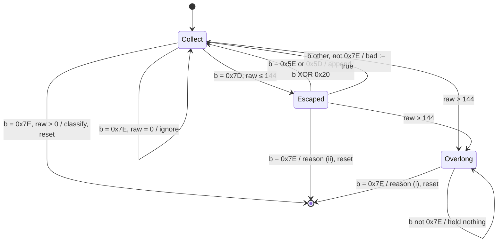

Classification of a candidate ended in `Collect`, the first applicable reason winning (R35.4's order): (ii) if `bad`, or `ulen` < 4, or `ulen` ≠ 8 + `buf[3]`; (iii) if `crc32c(buf[0 .. 4 + len]) ≠ le32(buf[4 + len ..])`; (iv) if `buf[0]` ≥ n_dir of the Pi_Side to MCU_Side direction; (v) if `len` > `Payload_Bound` or `len` ≠ the Wire_Type size of the type's connection; (vi) if the type's Wire_Type decoder rejects the payload; otherwise `Outcome::Frame(Frame { ftype, seq, len, payload })`. Every non-frame outcome is `Outcome::Discard(reason)`, for which the caller only increments `discard_<reason>`; no part of a discarded candidate reaches a Put Value, because the only Put Value calls take the decoded value of an `Outcome::Frame`.

`frame::print(f: &Frame, out: &mut [u8; 2 × (8 + P) + 1]) -> usize` writes the stuffed frame and its delimiter and returns its length; it is total for every valid frame.

Proof (`proof-frame-parser`, Creusot, Property 41 and Property 44): logic functions `unstuffed(f): Seq<u8>`, `stuff(s): Seq<u8>` and `printed(f) = stuff(unstuffed(f)) ++ [0x7E]`, and a logic function `run(p, bytes)` that folds `feed`. Proven: (a) for every valid frame f and every parser state at a candidate boundary, feeding `printed(f)` yields `None` for every byte but the last and `Some(Frame(f))` for the last, and the state is again at a candidate boundary (first round trip; "consumes exactly those bytes"); (b) if feeding a byte string b from a boundary yields `Some(Frame(f))` exactly at its last byte, then b = `printed(f)` (second round trip); (c) `print` and `feed` are free of panics, overflow and out-of-bounds access (R21.5); (d) `ulen` ≤ 144 in every state (R35.4's "at most L_max bytes"). The receive compute function's contract adds: every Put Value argument is the decoded payload of an accepted `Outcome::Frame` that passed the R24.6 check (`proof-app-creusot-robot`). The Proof_Mutation_Register's row PM-07 plants the defects of `mut-proof-codecs` here (section "App_Prover runs and proof mutations").

#### Pi_Side Serial_Bridge and Frame_Codec (DD-41, DD-106; ORQ-09)

ORQ-09 is partly resolved (S-13 settles it): the Pi_Side runs on an Arsit platform, JVM or Linux (Slang transpiled to C). Both platforms take the same Slang source, so the design below holds for either; the differences are the serial-port implementation and the build, listed at the end. `hamr-rsk peer-bridge --peer-air <file> --hamr-out <dir>` writes it after `sireum hamr codegen` has written HAMR's output into `<dir>` (R36.7).

**Placement in HAMR's output.** Arsit writes a thread's component file `src/main/component/<package>/<Thread>_<impl>.scala` with `overwrite = F` and its GUMBO markers with `invertMarkers = F` (`hamr/codegen/jvm/.../arsit/StubGenerator.scala` lines 224 to 226 and 300 to 310 at PAR-02). On a later run, HAMR keeps the file and replaces only the text inside its markers (`CodeGen.scala` lines 634 to 676). The text that HAMR keeps, outside its markers, is therefore the Pi_Side's equivalent of developer regions; this is how this design reads "the marker regions of HAMR's back end" in DD-41 and R36.7 (DD-106). `peer-bridge` writes:

| File | Content | HAMR's treatment |
|---|---|---|
| the component file of each Pi_Side Serial_Bridge thread | the bodies of `initialise` and `timeTriggered` (outside HAMR's markers): open the device, run the receive and send steps below | kept; markers refreshed |
| `src/main/component/<package>/hamr_rsk/HamrRskFrame.scala` | `// #Sireum` object with the CRC table, `print`, the `Parser` record and the Wire_Type codecs of the cross-processor types | not written by HAMR |
| `src/main/component/<package>/hamr_rsk/HamrRskSerialPort.scala` | `@ext object HamrRskSerialPort { def open(path: String): Z; def read(fd: Z, max: Z): ISZ[U8]; def write(fd: Z, bytes: ISZ[U8]): Z; def queued(fd: Z): Z }` | not written by HAMR |
| JVM: `src/main/component/<package>/hamr_rsk/HamrRskSerialPort_Ext.scala` | sets the line with `stty -F <path> 1000000 cs8 -parenb -cstopb -crtscts raw -echo` through `java.lang.ProcessBuilder`, then reads and writes the device with `java.io.RandomAccessFile`; `queued` returns −1 | not written by HAMR |
| Linux: `src/c/ext-c/hamr_rsk_serial_port.c` | `open` with `O_RDWR | O_NOCTTY | O_NONBLOCK`, `termios` raw mode, `cfsetispeed`/`cfsetospeed(B1000000)`, no `CRTSCTS`; `queued` through `ioctl(TIOCOUTQ)` | Arsit's C extension directory (`arsit/Util.scala` line 299) |

The device path is the bus's `IronOxide::Serial_Link` `Device_Path` (R35.2), which `peer-bridge` reads from the peer sub-model. The provenance of the serial-port code is this table: generated by `peer-bridge`, built with HAMR's generated build files, and, on the JVM, the `stty` of the Raspberry Pi 5 image (R38.1 (f)); S-13 records it as the answer to ORQ-09's second question.

**Pi_Side threads.** The Robot_Model's Pi_Side Serial_Bridge is one thread `pi_bridge` with `IronOxide::Serial_Bridge_Role => Receive_And_Send` (allowed on the Peer_Processor, R34.8), Periodic with a period of 10 ms (proposal). Each Job: (1) read the bytes available (non-blocking) and feed them to `HamrRskFrame.Parser`, applying the sequence check of R35.9 per frame type (the Pi_Side keeps the same counts, for its log only, NG-04); put each accepted message on the inserted out port of its type; (2) for each inserted in port with a new value, print its frame; (3) write the frames, then 0x7E fill bytes up to F_fill = 1,000 bytes per Job (10 ms × 100,000 bytes/s) minus the bytes the port still holds (`queued`, Linux) or minus nothing (JVM, where `write` blocks once the operating system's buffer is full). Pi_Side timing is not analyzed (NG-04); a late Job leaves the line idle, which delays MCU_Side delivery as stated above.

**Codec shape (Slang, excerpt).**

```scala
// #Sireum
object HamrRskFrame {
  @datatype class Frame(val ftype: U8, val seq: U16, val payload: ISZ[U8])
  val crcTable: ISZ[U32] = ISZ(u32"0x00000000", u32"0xF26B8303", u32"0xE13B70F7" /* … 253 entries … */)
  def crc32c(bytes: ISZ[U8], n: Z): U32 = {
    var c: U32 = u32"0xFFFFFFFF"
    for (i <- 0 until n) { c = crcTable(((c ^ conversions.U8.toU32(bytes(i))) & u32"0xFF").toZ) ^ (c >>> u32"8") }
    return c ^ u32"0xFFFFFFFF"
  }   // conversion names as in Slang's `conversions` package; checked when the code is written
  @record class Parser(var buf: ISZ[U8], var ulen: Z, var raw: Z, var esc: B, var bad: B) {
    def feed(b: U8): Option[Outcome] = { /* the state machine of the MCU_Side parser, same reasons and order */ }
  }
}
```

The Slang parser is the same state machine as `frame::Parser`, with the same reasons in the same order and the same 144-byte buffer; the Wire_Type codecs follow the layouts that the Backend's `.types` package computes (DD-73), because `peer-bridge` is a subcommand of the Backend jar and uses that package. Slang `@bits` arithmetic on `U8`, `U16` and `U32` wraps (RN-12), which is what the CRC and the sequence arithmetic need.

**Platform differences.**

| | JVM | Linux |
|---|---|---|
| build | HAMR's generated JVM build, unchanged | HAMR's transpile and CMake scripts, unchanged; the transpiler's array bound (`ArsitOptions.maxArraySize`, set on the `sireum hamr codegen` command line) at least 1,024, the largest `ISZ` of the codec |
| serial port | `HamrRskSerialPort_Ext.scala` with `stty` | `hamr_rsk_serial_port.c` with `termios` |
| Table 42-1 row 16 (DM-66) | Sireum's JDK and Scala of rows 5 and 6; the `stty` of the image | the C compiler and CMake of the Raspberry Pi 5 image |

Until S-13 records the platform, R34.2 and R36.7 run HAMR's codegen for the JVM, Linux and ros2 platforms, and `peer-bridge` writes the JVM and Linux forms; ros2 is generated (so that `test-splitter-peer-codegen` covers it) but receives no Serial_Bridge code, because DD-41 excludes it as the Pi_Side. Table 42-1 row 16 stays "none until design.md resolves ORQ-09" and is set with the pin when S-13 resolves it.

#### Tests of this section

| Evidence | What it runs |
|---|---|
| `test-serial-frames` | the worked example and the CRC check value on both codecs; one frame of every type of the Robot_Model; a frame with a 64-byte payload of 0x7E bytes (at least 136 stuffed bytes) and a 145-byte candidate (reason (i)); one fixture per discard reason (i) to (vi), (vi) on a fixture type with a Boolean field |
| `test-serial-sequence` | R35.9's cases (d = 0, 1, 2^15 − 1, 2^15, 2^16 − 1; the first frame after instant 0, after a restart and after a link-loss report; two frames of one event data connection in one Job) on the host build of `src/bridge/rx.rs` with a simulated UARTE0 |
| `test-serial-link-loss` | TH-05's rule on a simulated time base: report at the first Release at or after X, repeats, no report while a frame is accepted every 50 ms |
| `pbt-frame-round-trip-mcu`, `pbt-frame-round-trip-peer`, `pbt-frame-cross-codec`, `pbt-frame-garbage` | Properties 41 to 44 |
| `proof-frame-parser`, `mut-proof-codecs` | the proof above and its planted defects |
| `hil-serial-throughput`, `hil-serial-faults` | section "Differential tests and HIL_Rig runs" |

### Robot_Model, the MCU side on the HIL_Rig, and robot integration

Implements R36.1 to R36.12, R37.1 to R37.9 and R38.1 to R38.6 (DD-42, DD-43, DD-46, DD-103, DD-104, DD-105, DD-109; DC-34 to DC-37; DM-31 to DM-54, DM-69). Anchors: `unit-robot-model`, `unit-stop-bounds`, `unit-rig-plan` (DD-44). Every number in this section that Table 36-1, Table 36-2 or a criterion marks as a proposal stays a proposal; changing one follows R41.

#### Model files and structure (R36.1; DD-46)

The Robot_Model is AADL under `models/robot/`: `Robot_Types.aadl` (data types), `Robot_MCU.aadl` (the three MCU_Side processes), `Robot_Pi.aadl` (the Pi_Side processes), `Robot.aadl` (the root system `Robot::Robot.i` with both processors, the bus, the devices and the connections). It uses `property-set/IronOxide.aadl`, HAMR's `Base_Types` and `Data_Model`, and is instantiated by FMIDE installed inside the workspace (UD-05, Table 42-1 row 10) into `target/apps/robot/air.json`. Until FMIDE is installed (ORQ-10), `test-robot-model-parses` cannot run.

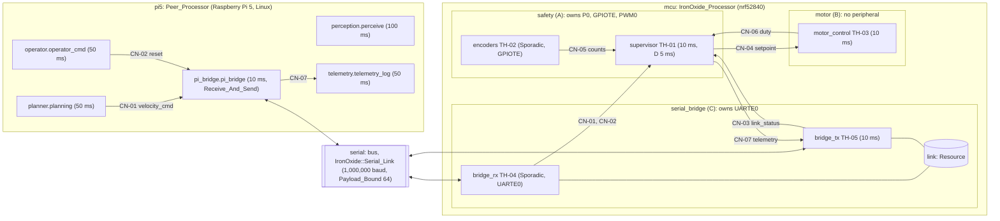

The bus `serial` has `IronOxide::Serial_Link => [Baud_Rate => 1000000; Payload_Bound => 64; Device_Path => "/dev/ttyAMA0";]` (the device path is a proposal that S-13 confirms on the Raspberry Pi 5 image), and every cross-processor port connection has `Deployment_Properties::Actual_Connection_Binding => (reference (serial))` (R34.4 (d)). The MCU_Side excerpt:

```aadl
process implementation safety.i
  subcomponents
    supervisor: thread supervisor.i;  encoders: thread encoders.i;
  connections
    c5: port encoders.counts -> supervisor.counts;            -- CN-05, Port_Cell
  properties
    IronOxide::Criticality_Level => A;  IronOxide::Peripherals => ("P0", "PWM0");
    IronOxide::Fault_Response => RESTART_PARTITION;  IronOxide::Overrun_Response => RESTART_PARTITION;
    IronOxide::Deadline_Miss_Response => RESTART_PARTITION;  IronOxide::MIT_Violation_Threshold => 0;
end safety.i;

thread implementation supervisor.i
  properties
    Dispatch_Protocol => Periodic;  Period => 10 ms;  Deadline => 5 ms;   -- T_sup, D_sup; no Priority (R7.2)
    Compute_Execution_Time => 0 us .. 500 us;                              -- placeholder until WCET_Records exist
end supervisor.i;
```

The devices `encoder_events` (`IronOxide::Peripheral => "GPIOTE"`, out event port connected to `encoders`' Dispatch trigger) and `uarte0_events` (`"UARTE0"`, connected to `bridge_rx`'s) put GPIOTE into `safety` and UARTE0 into `serial_bridge` (R15.1, R15.2).

#### Table 36-1 as realized (R36.2, R36.8; DC-34)

| Row | Thread | Process (level) | Dispatch | Period or MIT | Deadline | Priority (R7.2) | Peripheral access |
|---|---|---|---|---|---|---|---|
| TH-01 | `supervisor` | `safety` (A) | Periodic, offset 0 | 10 ms | 5 ms | 2 | P0: e-stop level, direction pins; GPIOTE: e-stop channel (no interrupt), configuration of every channel in its first Job; PWM0: both motor outputs |
| TH-02 | `encoders` | `safety` (A) | Sporadic, GPIOTE, `defer` | 625 µs (below) | 625 µs | 4 | GPIOTE: encoder channels' events; P0: encoder levels |
| TH-03 | `motor_control` | `motor` (B) | Periodic, offset 0 | 10 ms (PAR-16) | 10 ms | 1 | none |
| TH-04 | `bridge_rx` | `serial_bridge` (C) | Sporadic, UARTE0, `defer` | MIT_rx = 1,000 µs | 1,000 µs | 3 | UARTE0 receive |
| TH-05 | `bridge_tx` | `serial_bridge` (C) | Periodic, offset 0 | 10 ms | 10 ms | 1 | UARTE0 transmit and set-up |

Every period and MIT divides T_sup, so the hyperperiod H of the MCU_Side's Task_Model is 10 ms and PAR-10 is one hour (1,000 × H is 10 s). Deadline-monotonic ranking (UD-22) gives 4 distinct Priorities, within PAR-03; TH-03 and TH-05 share one, started in instance-path order (DEV-07). Every Periodic offset is 0, so TH-01 and TH-05 are released together and TH-01 runs first: each TH-05 Job freezes the telemetry of the TH-01 Job of the same period, so every supervisor Job's telemetry reaches the Pi_Side, which R37.2 (g) needs (a TH-05 Job starts after TH-01's Job of its period ends and before TH-01's next Job ends, both meeting their deadlines).

**Sizes and thresholds (DC-34, M-04).** Each process's `Memory_Properties::Code_Size` is the next power of two at or above 1.25 × the linked size of its Partition crate's code, and `Data_Size` + `Stack_Size` the next power of two at or above 1.25 × (its data plus the Link_Checker's stack bound), because the MPU places each region at a power-of-two size and alignment (IronOxide DD-07); M-04 takes the sizes from the first HIL build. Until then the model carries 16 KiB of code for each process and 8 KiB (safety), 4 KiB (motor) and 4 KiB (serial_bridge) of RAM. `MIT_Violation_Threshold` is 0 in every process: no MCU_Side Task is released by an Endpoint or a Release_Signal, and the interrupt-released ones use `defer`, so no MIT_Violation can be recorded against any Partition; M-04 confirms that the first `hil-robot-nominal` run counts none.

#### Table 36-2 as realized (R36.3, R36.8; DM-41)

| Row | Ports | Data type (`Robot_Types`) | Destination port properties | Mapping |
|---|---|---|---|---|
| CN-01 | `planning.cmd` → `supervisor.velocity_cmd` | `Wheel_Speeds.i`: `left`, `right` `Integer_16` mm/s (Wire_Type 4 bytes) | event data, `Queue_Size => 1`, `OneItem`, `DropNewest` | bridge path, with the source's guarantee `velocity_cmd_range` checked in `bridge_rx` (R24.6, below); `bridge_rx` → TH-01 plain Endpoint C → A, Validation_Function from the assume clause `cmd_any` |
| CN-02 | `operator_cmd.reset` → `supervisor.reset` | none (4-byte token) | event, as CN-01 | bridge path; Endpoint C → A; `IronOxide::Validation_Function => "validate_reset"`, a developer function of the safety crate that accepts every token |
| CN-03 | `bridge_tx.link_status` → `supervisor.link_status` | `Link_Status.i`: `lost` `Boolean`, `reports` `Unsigned_32` | data | plain Endpoint C → A (MAP-16), assume clause `link_any` that every value satisfies (ORQ-60: one data port, sent every 10 ms; no heartbeat frame, DD-41) |
| CN-04 | `supervisor.setpoint` → `motor_control.setpoint` | `Setpoint.i`: `left`, `right` `Integer_16`; `left_count`, `right_count` `Integer_32` | data | plain Endpoint A → B (MAP-16); Connection_Obligation: guarantee `setpoint_range` ⇒ assume `setpoint_in_range` |
| CN-05 | `encoders.counts` → `supervisor.counts` | `Counts.i`: `left_count`, `right_count` `Integer_32` | data | Port_Cell (MAP-14) |
| CN-06 | `motor_control.duty` → `supervisor.duty` | `Duty_Report.i`: `left`, `right` `Integer_16` (0.1 % steps); `left_speed`, `right_speed` `Integer_16` mm/s | event data, `OneItem`, `Queue_Size => 3`, `DropOldest` | plain Endpoint B → A; Validation_Function from `duty_in_range`. R11.6 (the closed form of "The DropOldest bound B (DD-26, R11.6)", ticks of 62.5 ns): T_R = T_S = 10 ms ≤ n_recv × T_S, B = 1 + ⌊(5 ms − 1 tick + max(10 ms + 10 ms, 0)) / 10 ms⌋ = 3, so `Queue_Size` 3 meets the condition; DropNewest with capacity 1 is not used because two duties can arrive in one supervisor period (TH-03 ends late in one period and early in the next) |
| CN-07 | `supervisor.telemetry` → `telemetry_log.telemetry` | `Telemetry.i`: the setpoints, measured speeds, counts, `stop_latched`, `cmd_timeout`, `duty_timeout`, `limit_count` `Unsigned_32`, `job_index` `Unsigned_32`, `froze_cmd`, `froze_duty`, `froze_reset` `Boolean` (Wire_Type 32 bytes with DD-73's padding) | data | plain Endpoint A → C (MAP-16, reject-all role, R13.6), then the bridge path from `bridge_tx` |

The MCU_Side has 6 Endpoints (CN-01 to CN-04, CN-06, CN-07), within PAR-05; the Backend computes their capacities, `ops` and storage under R11.2, R12.2 and R12.6 and refuses the model if they exceed PAR-06 (R36.8). Every Wire_Type is at most 32 bytes, below `Payload_Bound` (R35.8 (a)).

#### Peer_Processor threads and the properties HAMR requires (R36.1; DM-31)

The Pi_Side processes `perception`, `planner`, `operator`, `telemetry` and `pi_bridge` are bound to `pi5` (`Actual_Processor_Binding`). Each Pi_Side thread carries these properties, each required by the HAMR source named (PAR-02):

| Property | Required for | Source |
|---|---|---|
| `Thread_Properties::Dispatch_Protocol` | without it HAMR warns and assumes Sporadic for a thread | `hamr/codegen/shared/.../common/symbols/SymbolResolver.scala` lines 350 to 360 |
| `Timing_Properties::Period` | every Periodic thread (error when absent), and a positive value | `common/symbols/Linter.scala` lines 34 to 36 and 223 to 241 |
| `Timing_Properties::Compute_Execution_Time` | where given: low end ≥ 0, high end > 0, low ≤ high | `Linter.scala` lines 243 to 262 |
| `Deployment_Properties::Actual_Processor_Binding` on each process | the bound processor whose timing Arsit reads | `hamr/codegen/jvm/.../arsit/util/SchedulerUtil.scala` lines 59 to 70 |

`Timing_Properties::Frame_Period` on `pi5` is optional (Arsit defaults to 1,000 ms, `SchedulerUtil.scala` lines 102 to 113). `test-splitter-peer-codegen` shows whether the platform chosen under ORQ-09 requires anything further (S-13). The serial-port driver's provenance is that of section "Serial_Bridge and Frame_Codec" (ORQ-09).

#### Peripheral ownership: resolution of ORQ-11 (R36.8; DM-36)

The safety Partition owns P0, GPIOTE and PWM0, the Serial_Bridge's Partition owns UARTE0, and the motor control Partition owns none (UD-20). Reasons: P0 has no interrupt line (`irq: None` in the `nrf52840` table of `crates/rsk-gen/src/target.rs` at PAR-01; R15.3 (v)), so it cannot release a Task and goes to the Partition whose Tasks read it; GPIOTE has one interrupt (line 6), which releases exactly one Task (R15.7), so the encoder Task and the e-stop latch share GPIOTE's owner; and the safety Partition owns every motor output and the e-stop input, so no Task of a lower Criticality_Level lies on the stop paths of R36.4, R36.5 and R36.10. The path of R36.12 also contains TH-04 (level C), which only carries the last command; R36.9 bounds its part by t_rx and WCRT_rx. ORQ-11 is resolved by UD-20 and DD-42 (section "Open Research Question Dispositions").

The `P0` window of the `nrf52840` table (base 0x5000_0000, 4 KiB) also holds the registers of port P1 at 0x5000_0300 according to the nRF52840 memory map (to be confirmed by S-12), so the P1 pins of the rig lie in the safety Partition's view. The Kernel drives its trace pins P1.11 to P1.14 in the HIL build; the safety Partition's code therefore writes only `OUTSET`, `OUTCLR` and the `PIN_CNF` words of its own pins, never `OUT` or `DIR` as a whole. If S-12 confirms that P1's registers lie in the `P0` window, the MPU view does not keep the Partition from writing the trace pins, and only this rule protects them; IOP-22 proposes that IronOxide protect the trace pins P1.11 to P1.14 from the Partition that owns `P0`.

#### Pins, levels and PWM (DM-32 to DM-35, DM-40, DM-48)

| Signal | Rig pin (target) | Peripheral, use | Levels |
|---|---|---|---|
| left motor PWM | P1.10 | PWM0 `PSEL.OUT[0]` | inactive (motor-off) level low; active high for `COMPARE` counts of each period |
| right motor PWM | P1.15 | PWM0 `PSEL.OUT[1]` | as left |
| left, right direction | P0.03, P0.04 | P0 outputs, written by TH-01 with the duty's sign | high = forward |
| emergency-stop input | P1.01 | P0 input with pull-up; GPIOTE IN channel 2, polarity LoToHi, no interrupt | asserted = high: on the robot a normally closed contact holds the pin low, so pressing it or breaking a wire asserts (R38.1 (d)); on the rig the stimulus board drives it |
| left encoder A, B | P1.02, P1.03 | A: GPIOTE IN channel 0 (Toggle, interrupt); B: P0 input | — |
| right encoder A, B | P1.04, P1.07 | A: GPIOTE IN channel 1 (Toggle, interrupt); B: P0 input | — |
| fault injection, case (g) only | P1.08 | P0 input, read by the injection version only | high = inject |
| UARTE0 RXD, TXD | P0.26, P0.27 | UARTE0 `PSEL.RXD`, `PSEL.TXD` | idle high |

PWM0 runs in up mode from the 16 MHz clock with `COUNTERTOP` = 16,000, a period T_pwm of 1 ms; a duty of d steps of 0.1 % is `COMPARE` = 16 × |d|, so the shortest active-level time at a non-zero duty is 16 counts = 1 µs = 2 × T_s at the analyzer's 2 MHz (R37.6). A duty of 0 keeps the pin at its inactive level for the whole period. The polarity bit and the decoder mode are set as the nRF52840 Product Specification section 6.17 (PWM) describes them; this workspace does not hold the specification, and S-12 confirms the levels on the rig (ORQ-62).

Shortest e-stop pulse (R36.5, DM-35): a GPIOTE IN channel in event mode latches an edge in `EVENTS_IN[2]`, which the supervisor reads and clears in every Job. The shortest pulse that it latches is a figure of the Product Specification, which S-12 records; until then the design claims R36.5 for the pulses that its evidence uses (1 ms, R37.6), and the Verification_Plan states that limit. Nordic's forum reports detection of a 20 ns pulse on an IN channel ([DevZone: nRF52840 GPIO timing question](https://devzone.nordicsemi.com/f/nordic-q-a/49430/nrf52840-gpio-timing-question)); that is an indication, not a source for the claim.

**PWM updates without writing a buffer in transfer (ORQ-62).** PWM0's duty values come only from RAM by EasyDMA, so TH-01 needs a sequence buffer `pwm_seq: [u16; 4]` in per-Task state (IronOxide R17.1). The intended form: a sequence of one value per channel played once (`LOOP` = 0, `REFRESH` = 0), after whose `SEQEND` the transfer has ended and the outputs hold the last value; in each Job TH-01 checks `EVENTS_SEQEND[0]`, writes `pwm_seq`, `dma_request(SEQ0, pwm_seq)` and `TASKS_SEQSTART[0]`, and the new values take effect at the next period boundary. The fallback, if S-12 shows that the outputs do not hold the last value after `SEQEND`: `TASKS_STOP`, poll `EVENTS_STOPPED` for at most one PWM period, then write and restart. Both give t_pwm ≤ T_pwm + 10 µs = 1.01 ms (the 10 µs covers the register writes; proposal, measured by S-12). The Port_API copies GUMBO state into the `PortApi` (section "Port_Glue and Port_API"), so the compute code reaches `pwm_seq` in place through the Port_API operation `with_st_pwm_seq` (DD-104), which runs a closure on the per-Task item itself through `PerTask::with`; the closure writes the duty values and passes the item to `rsk::dma_request`.

#### Supervisor Job structure and contracts (R36.3 to R36.6, R36.10 (a); ORQ-16)

N = PAR-14 / T_sup = 10. In every Job of TH-01, the compute code (developer code in `compute.<supervisor>`, calling functions of the safety crate's `src/developer.rs`) does, in this order:

1. In the first Job (`job_index` = 0): configure GPIOTE channels 0 to 2, enable the interrupt of channels 0 and 1 only (which starts TH-02's Releases), configure PWM0 and the direction pins.
2. Read `EVENTS_IN[2]` and the e-stop pin level (`rsk::mmio::read`), clear `EVENTS_IN[2]`; set the state variable `estop` = `{latched, level}`.
3. Update `stop_latched`, `cmd_miss` and `duty_miss` (below).
4. Compute and put `setpoint` (speed limit, R36.6), update `limit_count`.
5. Compute `applied`; write PWM0 and the direction pins (the step that R36.9's argument places last among the reads and decisions).
6. Put `telemetry`; increment `job_index` (saturating).

GUMBO state variables of TH-01 and their initial values (CK-08, R20.4):

| Variable | Type | Initial | Role |
|---|---|---|---|
| `stop_latched` | `Boolean` | true | the stop latch (UD-20) |
| `estop` | `Estop_Sample.i` (`latched`, `level` `Boolean`) | `{false, false}` | the e-stop sample (R36.3 (iii)) |
| `cmd_miss`, `duty_miss` | `Integer_32` | 10 (N) | consecutive Jobs without a velocity or duty command, saturating at N |
| `last_duty` | `Duty_Pair.i` (`left`, `right` `Integer_16`) | `{0, 0}` | the most recent duty frozen from TH-03 |
| `applied` | `Duty_Pair.i` | `{0, 0}` | the duty applied to PWM0 in this Job (R36.3 (ii)) |
| `limit_count` | `Unsigned_32` | 0 | R36.6 |
| `job_index` | `Unsigned_32` | 0 | the index carried in CN-07 |
| `pwm_seq` | `PWM_Sequence.i` (4 × `Unsigned_16`) | zeros | the PWM0 buffer (DD-104) |

The contracts (R36.3), with `asserted(e) = e.latched | e.level`, `released(e) = !e.latched & !e.level`, `clamp(v) = if v > 1000 then 1000 else if v < -1000 then -1000 else v`, `stop = stop_latched | cmd_miss >= 10 | duty_miss >= 10` (all over the post-state unless written `In(x)`):

| Kind | Identifier | Clause (meaning) | Criterion |
|---|---|---|---|
| integration guarantee | `setpoint_range` | −1000 ≤ `setpoint.left` ≤ 1000 and the same for `right` | R36.3 (i) |
| compute guarantee | `setpoint_limited` | if `HasEvent(velocity_cmd)`: `setpoint.left = clamp(velocity_cmd.left)` and the same for `right` | R36.3 (i), R36.6 |
| compute guarantee | `limit_counted` | `limit_count` = `In(limit_count)` + 1 (saturating at 2^32 − 1) exactly when `HasEvent(velocity_cmd)` and some wheel's speed is above 1000 or below −1000; otherwise unchanged | R36.6 |
| compute guarantee | `latch_rule` | `stop_latched = asserted(estop) | (In(stop_latched) & !(HasEvent(reset) & released(estop)))` | R36.3 (iii), R36.5 |
| compute guarantee | `cmd_count`, `duty_count` | `cmd_miss` = 0 if `HasEvent(velocity_cmd)`, else min(10, `In(cmd_miss)` + 1); `duty_miss` likewise with `duty` | R36.3 (ii), R36.4, R36.10 (a) |
| compute guarantee | `last_duty_rule` | `last_duty` = the frozen duty's `left`, `right` if `HasEvent(duty)`, else `In(last_duty)` | R36.3 (ii) |
| compute guarantee | `applied_rule` | `applied = {0, 0}` if `stop`, else `last_duty` | R36.3 (ii) |
| initialize guarantees | `init_latched`, `init_counts`, `init_applied` | `stop_latched`; `cmd_miss = 10 & duty_miss = 10`; `applied = {0, 0}` | R36.3 (iv) |
| integration assume | `cmd_any` | −32768 ≤ `velocity_cmd.left` ≤ 32767 and the same for `right` (every value of the type, UD-20) | R36.3 (v) |
| integration assume | `duty_in_range` | −1000 ≤ `duty.left` ≤ 1000 and the same for `right` | R36.3 (v) |

R36.3 (i) lists the limited setpoint as an integration guarantee; an integration clause can read only its own port, so the relation to the frozen command is the compute guarantee `setpoint_limited`, and the integration guarantee keeps the range. Together the two are at least as strong as R36.3 (i); its wording is part of C-21 (see "Conflicts with Requirements"). TH-03 has the integration guarantee `duty_range` (each duty put lies in −1,000 to 1,000) and the assume `setpoint_in_range`; its control law is developer code in its compute region, which calls `src/developer.rs` (so that the injection versions of R37.4 (e) and (f) replace only that file), and its GUMBO state holds the integrator and a Job counter `steps` (`Unsigned_32`, saturating), which the injection versions read. The two unproven steps of R36.3 (`estop` equals the latch and level read; `applied` is what the PWM0 accesses produce) are entries of the Proof_Assumption_Register (`check-registers`), with `review-robot-peripheral-code` and the rig runs as their evidence.

**Guarantee clauses on Peer_Processor out ports (R24.6, R34.3).** One Peer_Processor out port of the Robot_Model carries an integration guarantee clause: the planner's `planning.cmd` (CN-01) has `velocity_cmd_range`, −32768 ≤ `cmd.left` ≤ 32767 and the same for `right`, the bound of the command's data type `Wheel_Speeds.i` (`Integer_16`), which does not depend on PAR-19. No other Pi_Side out port that crosses the link (CN-02's `operator_cmd.reset`, an event port) carries one. The Deployment_Splitter attaches the clause to the inserted out port of `bridge_rx` that stands for `planning.cmd` as `velocity_cmd_range_bridge_<E>` (DD-39), so R24.6 generates the check on that port and the count `guarantee_rejected_<port>` exists for CN-01, with `<port>` the inserted port's identifier `bridge` ++ E(CN-01) (section "Deployment_Splitter and recomposition tool"); this section calls it `guarantee_rejected_velocity_cmd`. Since every value of `Wheel_Speeds.i` satisfies the clause, the check rejects no decoded value and the count stays 0 in every run; the assume clause `cmd_any` of R36.3 (v) is unchanged.

TH-02 (encoders), in each Job: for each wheel whose `EVENTS_IN[ch]` is set, read the A and B levels from P0, clear the event, and add +1 to the wheel's count when A ≠ B and −1 otherwise (forward rotation has A leading B by a quarter cycle, so after every A edge A ≠ B); counts saturate at the `Integer_32` bounds; put `counts`. The signed count of CN-05 is therefore the number of A edges, each signed by the direction (R37.9).

**ORQ-16, thread by thread (DD-42).** Every GUMBO state variable and output data port of the MCU_Side has a constant initial value: TH-01 the table above and zero records for `setpoint` and a `telemetry` record with `stop_latched`, `cmd_timeout` and `duty_timeout` true and every number 0; TH-02 zero counts; TH-03 a zero `duty` record and a zero integrator; TH-04 and TH-05 zero counts and states (Partition RAM, DD-23). What is not a value but an action, the configuration of GPIOTE and PWM0 and the start of UARTE0 reception, runs in the first Job of the Periodic Task of each Partition (TH-01, TH-05), which also starts the interrupt-released Task of that Partition. No thread needs an Initialize entry point beyond constants, so the case study raises no conflict under ORQ-16; the register status stays as section "Open Research Question Dispositions" records it until the P5 checkpoint.

#### Stop bounds (R36.9; DM-37, DM-38)

The terms, with Table 36-1's numbers and the Analyzer's verdict PASS (which gives WCRT ≤ deadline for every Task):

| Term | Bound | Source |
|---|---|---|
| T_sup | 10 ms | Table 36-1 |
| WCRT_sup | ≤ D_sup = 5 ms | Analyzer (`analysis-rta-robot-measured`) |
| t_pwm | ≤ T_pwm + 10 µs = 1.01 ms | PWM0 loads a new value at a period boundary (nrfx documentation: STOP takes effect at the end of the current PWM period, [nrfx PWM HAL](https://developer.nordicsemi.com/nRF_Connect_SDK/doc/1.8.0/nrfx/drivers/pwm/hal.html)); T_pwm = 1 ms above; open for the levels after STOP and in the safe state (ORQ-62, S-12) |
| WCRT_rx | ≤ D_rx = 1,000 µs | Analyzer |
| t_rx | ≤ (B_rx − 1) × τ_max + Δ_stamp = 1,458.5 µs, while the peer keeps the line busy | section "Serial_Bridge and Frame_Codec" (ORQ-58, M-05); an assumption on the peer (C-20) |

| Bound | Formula | Value | Margin to PAR-15 = 20 ms |
|---|---|---|---|
| B_estop | T_sup + WCRT_sup + t_pwm | 16.01 ms | 3.99 ms |
| B_timeout | WCRT_sup + t_pwm | 6.01 ms | 13.99 ms |
| B_gap | t_rx + WCRT_rx + T_sup + WCRT_sup + t_pwm | 18.47 ms | 1.53 ms |

`analysis-robot-stop-bound` computes the three bounds from the Analyzer's WCRTs of the HIL build (not from the deadlines above, which only bound them), records them with PAR-15 and the limits of R36.9 (Budgets and MITs of the safety Partition respected, ASM-05; B_gap also on t_rx and WCRT_rx; the exclusions of R36.9), and fails unless the verdict is PASS and all three are at most PAR-15. With the delimiter fill, a peer that stops sending after a command leaves that command undelivered: the supervisor's command count then runs from the previous frozen command, so zero duty comes earlier, never later, than B_gap after the last frozen command's frame (section "Serial_Bridge and Frame_Codec"). A peer that pauses and then resumes shortly before the command timeout can, however, deliver an old command late, after which motion can last longer than PAR-14 + PAR-15 after that frame's end although the peer was active throughout. B_gap's term t_rx therefore depends on the untrusted peer (R36.9, R36.12, NG-04, R38.2); this is the safety-relevant conflict C-20 (see "Conflicts with Requirements").

#### Encoder MIT (R36.11; DM-39, DM-43)

For the HIL_Rig's stimulus this design records a wheel of diameter 65 mm (circumference π × 65 mm = 204.2 mm) and an encoder of 48 edges per wheel revolution on each of A and B (24 cycles), B a quarter cycle behind A (proposals). At PAR-19 (1.0 m/s) the wheel turns 4.897 times per second, so each signal has 235.1 edges per second and the shortest interval between two consecutive edges of one signal is I = 204.2 mm / (48 × 1,000 mm/s) = 4.254 ms. TH-02 must read B before B changes, which happens I/2 after each A edge. An A edge just after a Job's read waits at most MIT_enc (line masked) + Δ_stamp + WCRT_enc before the next Job reads the levels, with WCRT_enc ≤ D_enc = MIT_enc, so the condition is 2 × MIT_enc + Δ_stamp < I/2 = 2.127 ms. MIT_enc = 625 µs = T_sup / 16 gives 1.375 ms (margin 0.75 ms, so the condition holds for any Δ_stamp up to 875 µs) and, as a divisor of T_sup, keeps H at 10 ms. The weaker condition of R36.11, MIT_enc ≤ I, and the condition that no two edges of one signal merge (MIT_enc + Δ_stamp + WCRT_enc < I) follow. For the robot, the same formula is evaluated with the encoder and wheel of R38.1 (c) when ORQ-66 is resolved (ORQ-61 stays deferred to M-06, which checks that the Analyzer accepts the MIT).

#### HIL_Rig runs (R37; DD-43, DD-105)

**Build.** Every run uses the MCU_Side's HIL build (`nrf52840,debug-port,quiet,trace-ram,trace-pins`, release profile) from the generated source of the Flight_Build, with the Flight_Build's Generated_Config checksum, its hash listed in the Build_Manifest's `hil_binaries` (UD-11); building and measuring a generated Application this way depends on S-03 and S-10 (ORQ-37, ORQ-47). The read-back hashes of the target and stimulus boards are compared before each run (R37.5). The rig drives logic levels only: no motor supply is connected, so no rig run is a powered test (R38.2).

**Channels (Table 37-1; ORQ-63).** The analyzer section of `hil/robot-rig.toml` equals IronOxide's (`fx2lafw`, 2 MHz, so T_s = 0.5 µs; `task_id_channels` D1 to D3, `kernel_channel` D4, `stimulus_channel` D6). The robot's `[wiring]` (section "Observable trace, frame grammar, rig description") assigns the remaining channels: D0 left PWM (target P1.10, the wire IronOxide uses for its response line), D5 right PWM (target P1.15), D7 the Pi_Stand_In's transmit line, which moves from IronOxide's stimulus spare to the USB-UART adapter's TX. New wires: stimulus P1.07 to target P1.07 (right encoder B), stimulus P1.08 to target P1.08 (injection line), the adapter's TX to target P0.26 and analyzer D7, target P0.27 to the adapter's RX. S-12 confirms the wiring with a discovery pass like IronOxide's of 2026-11-01.

**Pi_Stand_In (R37.1; ORQ-20).** `hamr-rsk-pi-stand-in` on the host, through a USB-UART adapter at PAR-12 (the adapter is chosen and pinned with S-12; ASM-07). It prints frames with the MCU_Side Frame_Codec compiled for the host, which `pbt-frame-cross-codec` checks against the Pi_Side codec. Per Pi_Side to MCU_Side connection of the peer sub-model it sends one frame per Job of the source thread (CN-01 every 50 ms, UD-34) in sequence order, with payloads from the run's seed that satisfy the source's guarantee clauses (so that no R24.6 count `guarantee_rejected_<port>` grows in a nominal run) and speeds within PAR-19; each frame is one back-to-back burst followed by 100 µs of idle line and then at least B_rx − 1 = 127 delimiter bytes, which complete the MCU_Side's receive buffer; after them it continues the fill until the next frame, except during the command gaps that R37.6 makes "with the line idle", in which the line stays idle until the next burst. The 100 µs add at most 100 µs to t_rx on the rig (B_gap 18.57 ms). Without the 127 bytes, the last command before an idle gap would stay in a partial buffer and be delivered during the next burst, so that the outputs could leave zero duty before r_k; with them, the line is idle for all but the first 1.4 ms of each idle gap, which this design takes as R37.6's "line idle". This reading is part of C-21 (see "Conflicts with Requirements"), which the user may confirm or resolve by a change of R37.6. It logs each burst (index, type, sequence number, valid or planted) and each fill span, and logs every telemetry frame it receives (R37.2 (f), (g)).

**Stimulus board (ORQ-65).** An rsk Application on the stimulus board drives the e-stop line together with its mirror on D6 in one register write, the four encoder lines, and in case (g) the injection line with the mirror. Its program and a common time base with the Pi_Stand_In are open, settled by S-12 (ORQ-65). The judgement does not depend on that time base: d_k and r_k come from the capture, on which D6 and D7 share the analyzer's clock; the time base only orders and spaces the steps.

**Runs.**

| Run | Build | Pi_Stand_In | Stimulus | Passes when |
|---|---|---|---|---|
| `hil-robot-nominal` | HIL build | nominal (above) for PAR-10 | encoders at PAR-19; the e-stop events and command gaps of R37.6 | R37.3's comparisons hold and R37.7 reports nothing |
| `hil-robot-estop`, `hil-robot-timeout` | taken from the nominal run | — | — | at least 1,000 events of the kind, each meeting R37.6's rule; the PWM levels and shortest active time above |
| `hil-robot-limits` | HIL build | one command per 20 ms with speeds 0, ±999, ±1,000, ±1,001, −32,768 and 32,767 mm/s | — | setpoints and `limit_count` in the telemetry as R36.6 states |
| `hil-robot-encoders` | HIL build | nominal | the profile of R37.9 with the 48-edge encoder above | every pause's counts equal the logged signed edges |
| `hil-robot-faults` | one run per case below | per case | per case | R37.4 and R37.7 |
| `hil-serial-throughput` | HIL build | valid frames back to back, separated only by delimiters, for PAR-10 | — | every frame accepted; every discard, lost-frame and duplicate count 0 (R35.10) |
| `hil-serial-faults` | HIL build | single-bit errors and bursts of at most 32 bits planted in frames; drops, duplicates, reorders; silence; only discarded frames | — | each planted frame discarded and counted, nothing of it delivered; counts exact; link-loss reports within R35.6's bound and none while a valid frame arrives every 50 ms |

**Fault cases (R37.4; DC-35 to DC-37).**

| Case | Variant | Injection |
|---|---|---|
| (a) Overruns, Serial_Bridge | `src/developer.rs` of the Serial_Bridge crate replaced | `inject_rx` and `inject_tx` spin `rsk::spin::<K>()` with K above twice the Task's Budget in cycles, in Jobs with n mod 10 = 0, once outside and once inside the `link` Critical_Section (section "Serial_Bridge and Frame_Codec") |
| (b) Malformed frames | HIL build | the Pi_Stand_In plants at least 100 frames for each discard reason (i) to (v): over-long candidates, bad escapes and wrong lengths, CRC errors, unknown types, wrong `len`. Reason (vi) and the frames that the Validation_Function rejects cannot be produced for this model: CN-01's Wire_Type (two `i16`, no padding) has no rejected bit pattern, its assume clause accepts every value (UD-20, R36.3 (v)), and CN-02 carries no payload. This is C-19 (see "Conflicts with Requirements"); until the user decides, the run plants (i) to (v) and the report states that (vi) and the rejections were not planted |
| (c) Late frames | HIL build | each valid frame delayed by a uniform draw from 0 to 200 ms |
| (d) Missing frames | HIL build | frames left out singly and in runs longer than 100 ms |
| (e) Overruns, motor control | `src/developer.rs` of the motor crate replaced | the control step spins beyond TH-03's Budget in Jobs with n mod 10 = 0 and in every Job of the seeded stretches of at least PAR-14 + PAR-15 + 50 ms |
| (f) Rejected duties | as (e) | the control step returns duties of ±1,001 in the same Jobs; the supervisor's Validation_Function rejects them |
| (g) Safety Partition fault | `src/developer.rs` of the safety crate replaced | in each Job of TH-01, the injection version reads P1.08; when it is high, the Task calls `panic!()`, as R37.4 (g) states ("a Task of that crate panics"). IronOxide's panic handler turns the panic into a fault of the Partition through SVC 5 (`crates/rsk-entry/src/lib.rs` lines 213 to 228 at PAR-01), and the Kernel applies the Partition's Fault_Response RESTART_PARTITION (DD-43). The stimulus board raises P1.08 and the D6 mirror in one register write. The alternative, a read with `rsk::mmio::read` of an address outside the Partition's MPU view (a MemManage fault of the Partition, IronOxide R16.4), is not used |
| (h) Safe state at the operating-duration end | HIL build | none; the capture runs PAR-15 + 50 ms past `operating_end` |

Each variant changes only that one developer-owned file, selected by no cargo feature, so the Task_Model and Generated_Config checksums equal the HIL build's (`test-hil-robot-run-validity` compares them).

**Records (R37.2).** (a) `RELEASE_STATS` and the Kernel_Timing_Parameter observations over the probe after the run, as IronOxide's rig reads them; (b) per-Job Release and completion records: the Robot_Model's Task_Model declares no Chain (AIR at PAR-02 records no end-to-end flow, R26.7), so (b) is not recorded and the report says so (UD-24); (c) the Chain count, 0; (d) the capture of D0 to D7 with its sample rate and lost-sample count; (e) `EVENT_MIRROR` and `FAULT_RING`; (f) the Pi_Stand_In's burst log and the stimulus board's seed and event list; (g) the freeze flags from the telemetry log, listing every missing `job_index`. No debugger is attached before `operating_end`; a `debugger` entry before it fails the run (R37.7), and whether the Kernel logs one when the probe attaches after the run is observed by S-12, as on IronOxide's own rig.

**Refused-send counts (R27.1, R11.10, R12.8).** Each `runs` entry of a HIL_Rig run's evidence record carries `refused_sends` in the form of the QEMU run record (section "Property-based tests and the Model_Generator; QEMU runs and IronOxide tool acceptance"): one entry per Endpoint that the Application declares for a cross-Partition connection or an R26.2 hop, also where the count is 0, with the fields `connection`, `port`, `endpoint`, `source_task`, `destination_task`, `kind`, `c_sample`, `count`, `attribution`, `task_total` and `lower_bound`. `count` and `task_total` count the `EV_ENDPOINT_FULL` entries of the event mirror (record (e)), attributed as that section states until S-09 settles ORQ-54; `lower_bound` is `true` where the mirror's number of events written exceeds its capacity of 512, since older entries are then lost. The run entry also holds the Port_Glue counts `undelivered_<port>` of every source port of these Endpoints (per-Task state, section "Port_Cells, per-Task state and Wire_Types"), read over the probe after the run with records (a) and (e). They are recorded to check the attribution and do not replace `count`: they also count `Refused` sends (R19.9) and a restart re-zeroes them, so only in a run without a restart do the attributed counts of a port's Endpoints sum to at most that port's `undelivered_<port>`. The Verdict_Reporter reads these records through `--run-record`, as it reads the QEMU records (section "Timing: Analyzer runs, Chains and the Verdict_Reporter").

**Response instants on the capture (ORQ-79, DM-69; S-12).** Case (g): d_k is the first sample at which D6 shows the injection edge. The Kernel's response (RESTART_PARTITION of the safety Partition) shows on the capture as a Kernel-active span on D4 after which TH-01's and TH-02's indices on D1 to D3 next appear only after the restart. Case (h): d_k is the end of the run's last Job, the last sample at which D1 to D3 change from a Task index to 7 (no Task) before the capture shows no further Task index. The stop rule then requires every PWM channel inactive from d_k + PAR-15 − T_s to the end of the capture. With TH-01 reading P1.08 in each Job, the fault comes at most T_sup + WCRT_sup after d_k (15 ms), the Kernel stops PWM0's transfers on the restart (IronOxide R14.5, R17.6), and the restarted Partition starts with `stop_latched` set; whether the pins are at their inactive level after the stop is ORQ-62.

**Verdicts (R37.3) and the plan (R37.8).** The Verdict_Report compares each Task's observed maximum (largest response time × 4 cycles per tick) with the WCRT of the Analyzer run on the HIL build's measured WCET_Records and Kernel_Timing_Parameters, as section "Timing: Analyzer runs, Chains and the Verdict_Reporter" designs. The Verification_Plan allocates RM-01 to RM-10 to their claims, labels every observation as testing evidence on the HIL build, states that no Analyzer bound covers the stop reactions (no Chain; R36.9 bounds them), and cites the Gap_Register entry for the Flight_Build (UD-11) with IronOxide's instrumentation shares (−8.6 % to +15.3 %).

#### Robot integration, Phase P6 (R38)

`docs/robot_integration_plan.md` (`doc-robot-integration-plan`) is written before P6 starts and has these parts:

1. **Configuration (R38.1).** One table per item of (a) to (g) with manufacturer, part number, version or image hash; every unchosen item listed as open under ORQ-66. Its wiring table (g) has one row per signal with the nRF52840-DK pin, peripheral, Robot_Model device or port, far end and voltage, including UARTE0 TX, RX and ground to the Raspberry Pi 5 UART at PAR-12; `review-robot-wiring` checks each row against the pins of the MCU_Side's code and the robot as built.
2. **Hazard analysis (R38.2).** One row per hazard of R38.2's causes with cause, consequence, stages, measures, the criterion or Evidence_Item of each measure, and residual risk; the states without a controlling Job are listed with the driver input levels that ORQ-67 determines and, for PWM0's pins, ORQ-62.
3. **Safety cases.** One each for R36.4, R36.5, R36.6 and the hardware emergency stop, with the claim and bound, standstill time and stopping distance (from PAR-19, or from the speed at 100 % duty and the assumed operator reaction time for the hardware emergency stop), the argument (R35.6, R36.9's B_estop, B_timeout and B_gap, R36.10, R36.12, R37.3, R37.4 and the P5 Evidence_Items), the assumptions (at least ASM-06, ASM-10, NG-04) and the confirming test.
4. **Powered-test rules (R38.5).** Stated once and repeated as the first block of every powered-test procedure:
   - (a) a human operator is present for the whole test, whose only task is to watch the robot and operate the hardware emergency stop, within reach of its switch at every instant from outside the fence (stage F) or the guard line (stage B);
   - (b) the hardware emergency stop removes motor power from every motor driver through a circuit that neither the nRF52840, the Raspberry Pi 5 nor any software of this project controls or can override; a radio switch removes motor power on loss of its link;
   - (c) the hardware emergency stop's function check opens each session (stage B, wheels off the ground, a non-zero commanded speed, every wheel at standstill within the time of its safety case); no powered test runs after a failed check;
   - (d) the stop procedure (hardware emergency stop, then disconnection of the motor supply, then the steps that make the robot safe to approach) ends every test and is applied at any uncommanded wheel motion;
   - (e) after uncommanded wheel motion the session ends, and no powered test resumes until the cause is in the Gap_Register and `review-robot-hazards` is repeated;
   - (f) nobody inside the fence in stage F or past the guard line in stage B.
5. **Procedures (R38.3).** Stage B, then stage F, each test with its configuration check (the MCU_Side Flight_Build's read-back hash, the image hash), steps, pass criteria (those of `hil-robot-timeout`, `hil-robot-estop` and `hil-robot-limits` plus the safety case's standstill times and distances), at least 10 runs per stage and speed step, and the Kernel event log read as ORQ-68 resolves. Stage B begins with the motor supply disconnected; stage F begins only after every stage B test has passed and ORQ-67 is resolved, with speed steps of at most 0.25 × PAR-19 up to PAR-19. Every powered procedure starts with block 4.
6. **Evidence (R38.6).** The record fields of `test-robot-bench-<n>`, `test-robot-field-<n>` and `doc-robot-session-<n>` (per session: the operator, the function check's result, each application of the stop procedure); the Build_System refuses a P6 record without any datum of R38.6 (i).

**P6 entry check (R38.4; DM-54).** `check-p6-entry` evaluates R38.4 (i) to (iv) and fails naming each condition that does not hold. For (iii), this design records ORQ-11 as resolved (UD-20) and ORQ-09 as partly resolved (S-13); ORQ-66 and ORQ-68 are deferred to P6 (section "Open Research Question Dispositions"), so the check fails until the Verification_Plan records all four as resolved and every other ORQ affecting R34 to R38 as resolved or deferred with a rationale that `review-robot-hazards` accepts.

### Build_System, pins and the IronOxide extraction

Implements R42.1 to R42.9 and R18.9 (DD-06, DD-12, DD-14, DD-15, DD-50, DD-55, DD-56; DC-41, DC-42; DM-17). The AIR normalizer of R42.6 is designed in "Front_End, AIR normalization and input acceptance"; Table 42-1 row 16 (DM-66) is set when ORQ-09 is resolved ("Serial_Bridge and Frame_Codec").

#### Commands

The table of the commands of the Build_System and of the tools it runs is in the subsection "Commands" (see "Shared names").

`cargo xtask` is the alias `run --manifest-path xtask/Cargo.toml --` of the root `.cargo/config.toml`. `xtask` has no dependency at all, so it builds before the extraction and its vendored crates exist (DD-06); whether Cargo accepts the root configuration's vendored-source entry while the directory is still missing is part of S-03. `xtask` runs `check-pins` and the extraction, then builds `hamr-rsk-build` and hands every other step to it.

#### Start of every command (R42.1, R42.2, R42.3, DD-55)

Every `cargo xtask` command runs these steps before any other, in this order:

1. **Environment.** `xtask` fails, naming the variable and the value it needs, unless its own environment already has `CARGO_HOME` set to `<workspace>/external/.cache/cargo`. Cargo builds `xtask` before any code of this project runs, so only the environment the user starts it with can keep that first Cargo process inside the workspace (R42.3); the failure message gives the command line to use. `xtask` then sets `CARGO_HOME`, `SIREUM_CACHE` (`external/.cache/sireum`) and `COURSIER_CACHE` (`external/.cache/coursier`) for every process it starts, `CARGO_TARGET_DIR` for every Cargo build of a package outside the workspace or in the extraction, and `RUSTUP_HOME` for every process that installs or runs a toolchain that the Build_System installed (R42.3). It refuses to run when the absolute path of the workspace, of the extraction or of `CARGO_HOME` contains white space, because `RUSTFLAGS` splits at white space (DD-14 below).
2. **Start snapshot** of the IronOxide working tree (R42.2, below).
3. **`check-pins`** for every row of Table 42-1 that the command runs, reads or builds against (for `cargo xtask verify`, every row needed from the current or an earlier Phase), with the warnings of R42.9.
4. **Extraction**, if `target/ironoxide/` does not exist: written, checked and changed as below, then compared like an existing one.

At the end of the command, and after each build that compiles against the extraction, `xtask` takes a later snapshot and compares it with the start snapshot (R42.2).

#### `check-pins` (R42.1)

Each row's value is read as below and compared with the pin as an exact string, so a commit matches only on all 40 digits. Both values go into the `check-pins` Evidence_Item, and a difference, or a value that cannot be read, fails the command naming the row, the pin and the value found. Every git command runs with `--no-optional-locks`.

| Row | Value read |
|---|---|
| 1 | the extraction, path by path (below); the working tree's differences from PAR-01 as warnings (R42.9) |
| 2 | `git rev-parse HEAD` in `external/kekinian`; `git status --porcelain` there, which must print nothing; the first line of `bin/sireum -v`, compared with `Sireum v4.20261104.e4595836` |
| 3 | the line of `hamr/codegen` in `git submodule status --recursive` in row 2's clone: a space (no `+`, `-` or `U`), then the 40-digit commit |
| 4 | every other line of the same output, each compared with the commit that its parent records (`git ls-tree <parent commit> <path>`, a `160000 commit` entry); `git status --porcelain` in each submodule, which must print nothing |
| 5 | the build string of the second line of `external/kekinian/bin/mac/java/bin/java -version`, `OpenJDK Runtime Environment (build 25.0.4.1+1-LTS)`, compared with `25.0.4.1+1-LTS` |
| 6, 7 | the values of `org.scala-lang%scala-library%` and `org.sireum%hamr-sysml-parser%` in `external/kekinian/versions.properties` |
| 8, 9 | `git rev-parse HEAD` and `git status --porcelain` in each clone |
| 10 | the `VER` file of the FMIDE installation, compared with the content that `bin/install/fmide.cmd`'s defaults at PAR-02 give |
| 11 | `rustc +1.95.0 --version`; the pin compared with `[pin]` of the extraction's `toolchain/decision.toml` |
| 12 | the Version and Toolchain lines of `verus --version` and the output of `z3 --version` of the release installed under `external/verus/` (R29.3); the pin compared with `[verus_toolchain]` |
| 13 | `cargo creusot version` (R21.6); the pin compared with `[creusot]` |
| 14 | the first line of `qemu-system-arm --version`; until ORQ-70 sets the pin, the row has none and R42.5 fails every step that needs it |
| 15 | `probe-rs --version`, `sigrok-cli --version`; the pins compared with `[probe-rs]` and `[sigrok-cli]` |
| 16 | none until ORQ-09 is resolved and R38.1 names the image; R42.5 fails every step that needs it |

#### The IronOxide extraction (R18.9, DD-12, DD-15, DD-50)

The lifecycle is the one of "The IronOxide extraction" in the Overview. The parts that this section fixes:

*Writing it (DD-50).* `xtask` runs `git --no-optional-locks archive --format=tar 423a366881d744034282bd99cb2d6d057e405f17 IronOxide` and reads the tar stream from the pipe with its own reader, so no `tar` program is needed (no row of Table 42-1 lists one, R42.5) and no archive file is written. The reader accepts exactly the entry types that the archive of PAR-01 holds: the pax global header (type `g`, whose `comment` record must equal PAR-01), pax extended headers (type `x`, for long paths), directories (type `5`) and regular files (type `0`). It fails on any other type, on any path outside `IronOxide/` or containing `..`, and on a short read. It strips the first path component and writes `target/ironoxide/`. At PAR-01 the tree holds 6,463 files, 6,451 with mode `100644` and 12 with `100755`, no symbolic link and no submodule (`git ls-tree -r <PAR-01> -- IronOxide`), and no `.gitattributes` file.

*Checking it (DD-15, DC-41).* For each file of `target/ironoxide/`, `xtask` computes the git blob identifier as the SHA-1 of `blob <size in decimal>\0` followed by the content (its own SHA-1, since `xtask` uses the standard library only), and the mode as `100755` if any executable bit is set and `100644` otherwise. It compares the set of paths and each identifier and mode with `git ls-tree -r <PAR-01> -- IronOxide` as exact strings, and fails naming each missing, added or differing path (R18.9, R42.1). On a fresh extraction it first checks every file, `crates/rsk-entry/Cargo.toml` included, before the change: since the archive comes from the same commit, any difference means that the hash code, the reader or a content conversion in git's output is wrong, and the command fails. For example, the formula gives `e4dda0f79739bb9711f863218a2701b5d7974dae` for `crates/rsk-entry/Cargo.toml` at PAR-01, the identifier that `git ls-tree` lists.

*Building IronOxide's tools.* Before the change, `xtask` runs `cargo +1.95.0 build --release --locked --offline` in `target/ironoxide/` with `CARGO_TARGET_DIR=target/ironoxide-tools` for the packages `rsk-gen`, `rsk-lint`, `rsk-link`, `rsk-confcheck`, `rsk-analyzer`, `rsk-hil` and IronOxide's `xtask`. `--locked` keeps the extraction's `Cargo.lock` byte-identical. After the change, no Cargo command uses the extraction as its workspace (DD-12, RC-01); the tools run as binaries from `target/ironoxide-tools/release/`.

*The change (DM-17, ORQ-37).* Exactly one file changes, `crates/rsk-entry/Cargo.toml`; the root `Cargo.toml`, whose `members` R18.9 also allows to change, stays byte-identical, and so does every other file. The change, as a unified diff against PAR-01:

```diff
@@ -16,18 +16,18 @@
 # own cargo invocation, so the two are never unified into one build.
 default = ["app-p1-demo"]
 app-p1-demo = ["dep:rsk-system"]
-app-hil-stimulus = ["dep:hil-stimulus-system"]
+app-hil-stimulus = []
 # The board, forwarded from the binary to the selected system crate.
 qemu-mps2 = ["rsk-system?/qemu-mps2"]
 # The P1 demo's flood configuration (task 21.6, A-P7), on QEMU.
 qemu-flood = ["rsk-system?/qemu-flood"]
-nrf52840 = ["rsk-system?/nrf52840", "hil-stimulus-system?/nrf52840"]
+nrf52840 = ["rsk-system?/nrf52840"]
 # HIL builds only: the debug port stays open across resets (see rsk-kernel).
-debug-port = ["rsk-system?/debug-port", "hil-stimulus-system?/debug-port"]
+debug-port = ["rsk-system?/debug-port"]
 # Debugging only: the Kernel's semihosting trace of every entry point.
-trace = ["rsk-system?/trace", "hil-stimulus-system?/trace"]
-trace-ram = ["rsk-system?/trace-ram", "hil-stimulus-system?/trace-ram"]
-trace-pins = ["rsk-system?/trace-pins", "hil-stimulus-system?/trace-pins"]
+trace = ["rsk-system?/trace"]
+trace-ram = ["rsk-system?/trace-ram"]
+trace-pins = ["rsk-system?/trace-pins"]
 # The P1 demo's release-timing configurations (task 7.3).
 timing = ["rsk-system?/timing"]
 timing-short = ["rsk-system?/timing-short"]
@@ -39,17 +39,16 @@
 cycles-fpu = ["rsk-system?/cycles-fpu"]
 plain-measure = ["rsk-system?/plain-measure"]
 coverage-kernel = ["rsk-system?/coverage-kernel"]
-hw-dt = ["rsk-system?/hw-dt", "hil-stimulus-system?/hw-dt"]
+hw-dt = ["rsk-system?/hw-dt"]
 boot-mutation = ["rsk-system?/boot-mutation"]
 defer-probe = ["rsk-system?/defer-probe"]
 defer-nofix = ["rsk-system?/defer-nofix"]
-record-only = ["rsk-system?/record-only", "hil-stimulus-system?/record-only"]
+record-only = ["rsk-system?/record-only"]
 coverage = ["rsk-system?/coverage"]
-storm = ["hil-stimulus-system?/storm"]
+storm = []
 # HIL builds: the Tasks' debug prints are silent (see the rsk crate).
-quiet = ["rsk-system?/quiet", "hil-stimulus-system?/quiet"]
+quiet = ["rsk-system?/quiet"]
 
 [dependencies]
 rsk-kernel.workspace = true
-rsk-system = { path = "../../apps/p1-demo/system", default-features = false, optional = true }
-hil-stimulus-system = { path = "../../apps/hil-stimulus/system", default-features = false, optional = true }
+rsk-system = { version = "=0.0.0", package = "hamr-app-system", default-features = false, optional = true }
```

The changed file's blob identifier is `7968966e9e9a920f93855a2dbf95b7a2b331f835`, computed by the formula above while this design was written. The Trust_Base_Register entry `ironoxide-extraction` holds the path, `blob_before = "e4dda0f79739bb9711f863218a2701b5d7974dae"`, `blob_after = "7968966e9e9a920f93855a2dbf95b7a2b331f835"` and this diff. `check-pins` and `check-ironoxide-extraction` compare the file's identifier with `blob_after` and the PAR-01 identifier that `git ls-tree` lists with `blob_before`; any other value fails (R42.1). The feature `app-hil-stimulus` stays declared and empty, so that a build that enables it fails to compile instead of linking another Application.

*Binding a generated Application (UD-01, UD-02).* `rsk-entry` now depends on the registry package `hamr-app-system` at version `=0.0.0`, and each generated workspace supplies it (F-S4 (b)):

```toml
# <out>/Cargo.toml (excerpt)
[patch.crates-io]
hamr-app-system = { path = "system" }
```

```toml
# <out>/.cargo/config.toml
[source.crates-io]
replace-with = "vendored-sources"
[source."git+file:///Users/mars2292/repos/Kiro-experimentation/creusot?rev=18f2d371ecb0019d37ecbd25e67f474bed2dda00"]
git = "file:///Users/mars2292/repos/Kiro-experimentation/creusot"
rev = "18f2d371ecb0019d37ecbd25e67f474bed2dda00"
replace-with = "vendored-sources"
[source.vendored-sources]
directory = "../ironoxide/vendor"
[net]
offline = true
```

The second source entry is copied from IronOxide's own `.cargo/config.toml` at PAR-01: `rsk` declares its optional `creusot-std` dependency with that git URL (`crates/rsk/Cargo.toml` line 15), and Cargo records optional dependencies in the lock file, so the generated workspace needs the same replacement. The string is a constant of the Backend tied to PAR-01, not a path that the Backend resolves, so it does not make the output depend on where the workspace lies (R18.4, R42.4). The URL names a checkout on one machine; IOP-17 proposes that IronOxide declare `creusot-std` as a vendored registry dependency, so that dependents need only the `crates-io` replacement. That this binding resolves offline with `rsk`'s git dependency is confirmed by S-03, which F-S4's spike did not cover. The generated system crate has version `0.0.0` and declares, empty where it has no use, each of the 24 features that the changed `rsk-entry` forwards to it (F-S3, F-S4 (d)): `qemu-mps2`, `qemu-flood`, `nrf52840`, `debug-port`, `trace`, `trace-ram`, `trace-pins`, `timing`, `timing-short`, `response`, `stress`, `stress-short`, `isolation`, `cycles`, `cycles-fpu`, `plain-measure`, `coverage-kernel`, `hw-dt`, `boot-mutation`, `defer-probe`, `defer-nofix`, `record-only`, `coverage`, `quiet`.

`../ironoxide` beside every output directory is a symbolic link to `target/ironoxide/` that the Build_System creates (`apps/ironoxide`, `target/apps/ironoxide`, and one in each rebuild directory); it is untracked. `check-ironoxide-extraction` runs after every build and compares the extraction path by path as above; `check-generated-<model>` shows through the Config_Checker that no other Application's tables are linked.

#### Snapshots of the IronOxide working tree (R42.2, R42.9)

A snapshot walks `../IronOxide` with `lstat` (links are not followed) and lists every path, tracked or untracked, ignored or not, with its kind (file, directory, link), mode, size and modification time, together with the output of `git --no-optional-locks status --porcelain --ignored -- IronOxide` from the repository root. Two snapshots differ at a path that appears, disappears, or changes in kind, mode, size, modification time or status; the command then fails naming each path relative to the repository root and its kind of difference. The walk is the only access to `IronOxide/` besides read-only git and `git archive` (R42.3).

The warnings of R42.9 come from the start snapshot and from `git --no-optional-locks diff --name-status <PAR-01> -- IronOxide`: each tracked path that differs from PAR-01 in content, mode or presence, whether committed, staged or neither; each untracked path that git does not ignore; and each ignored path as `status --porcelain --ignored` reports it, one entry per ignored directory. Each warning has the path, its size and its modification time. Warnings change no outcome.

#### Writing only inside the workspace (R42.3)

Every directory the Build_System creates is under `target/` or `external/.cache/`. Sireum's `proyek` writes its build output into the project directory (`<root>/<outDirName>`, `proyek/jvm/src/main/scala/org/sireum/proyek/Proyek.scala` line 43 at PAR-02), so `jvm/out/` is listed in `.gitignore` beside `external/` and `target/`, and the assembled jars are copied to `target/jvm/`. Git runs only with `--no-optional-locks` and only as `rev-parse`, `ls-tree`, `ls-files`, `diff`, `status`, `log`, `archive` (to a pipe), `check-ignore` and `submodule status`. Every process start goes through one function of `hamr-rsk-build` (and of `xtask` before it) that writes the command line, the environment and the exit status into the command log, so `test-git-read-only` and `check-workspace-local` read one log. `check-workspace-local` lists `~/.cargo`, `~/.rustup`, `~/.m2`, `~/.ivy2`, `~/.sireum`, `~/Downloads/sireum`, `~/Library/Caches/Coursier`, `~/.cache/coursier`, `~/.eclipse`, `~/.p2` and each location of Table 42-1 outside the workspace by path, size and modification time at the start and the end of the verification job and fails on any difference.

#### Reproducible rebuild (R42.4, DD-14, DC-42)

`check-rebuild-<model>` creates `target/rebuild/<model>-<run>/` and writes into it, side by side, `HAMR-DAHN/` (`git archive HEAD:HAMR-DAHN`) and `IronOxide/` (the extraction procedure above, change included). The clones and installations of Table 42-1 are used in place. In the copy it runs the Front_End (for a SysML v2 model) and the normalizer, with the copy's `HAMR-DAHN/` as the workspace root, then the Backend, the Extractor, rsk-gen and the builds of R18.2. It compares byte for byte: `air.json`; every file the Backend writes, as a set of relative paths and contents; the Semantic_Model; the Generated_Config and the Task_Model; and, for each target, the binary hash over loadable sections (`rsk_elf::Elf::hash_input`, as IronOxide R59.1). It records both values of each comparison and the first difference. While a file of this project is uncommitted or untracked, the item is recorded as not run, never as passed.

Both builds pass `--remap-path-prefix` in `RUSTFLAGS` for each source root: the workspace to `/hamr-dahn/workspace`, `CARGO_HOME` to `/hamr-dahn/cargo-home`, the extraction to `/hamr-dahn/ironoxide`, and the generated workspace to `/hamr-dahn/app`. rustc applies the last matching mapping when several match ([rustc book, "Remap source paths"](https://doc.rust-lang.org/rustc/remap-source-paths.html)), and these roots nest (the generated workspace and the extraction lie inside the workspace), so the flags are passed least specific first, which gives the most specific root precedence as DD-14 intends. Cargo reaches the extraction through the link `../ironoxide` beside the output directory, so the extraction's mapping is passed for the link's path and again for `target/ironoxide/`, the link's mapping last.

#### Unlisted tools (R42.5)

Each step of `hamr-rsk-build` declares the Table 42-1 rows it needs. Before a step runs, the Build_System checks that each row exists and has a pin; otherwise it fails the step, installs and downloads nothing, and reports the step, the item, the version it needs and the location where it would be installed, so the user can approve a new or changed row under R41. Row 14 (QEMU, ORQ-70) and row 16 (ORQ-09) have no pin yet, so the steps that need them fail this way (`test-unlisted-tool`).

#### Commit scope (R42.7)

`check-commit-scope` reads `git --no-optional-locks log --format=%H --name-only --diff-merges=first-parent HEAD` from the repository root and fails, naming each commit, when one commit changes a path under `HAMR-DAHN/` and a path outside it; a merge commit is judged by its difference from its first parent. It fails naming the path when `git ls-files HAMR-DAHN/external HAMR-DAHN/target` lists anything, and when `git check-ignore` does not report both directories as ignored. When this design was written, no commit reachable from HEAD changed paths on both sides.

#### Reuse rules (R42.8, DD-56)

`check-licenses` uses git blob identifiers as content identities, which read-only git provides for every tracked file: `git ls-files -s HAMR-DAHN` gives the identifiers of this project's files, and `git ls-tree -r HEAD` in each clone of rows 2 to 4, 8 and 9 (each submodule separately) gives theirs. A tracked file is byte-identical to a clone's file exactly when the two identifiers are equal. The check fails, naming the file, the row and the rule, when:

- the reuse record of the Verification_Plan lists the file as adapted from a BSD-licensed repository of rows 2 to 4 or 8 and the file lacks that repository's notice (BSD-2-Clause for rows 2 to 4, BSD-3-Clause for row 8);
- the file's identifier equals one of rows 2 to 4 or 8 and the reuse record does not list it;
- the file's identifier equals one of row 9, or of a submodule of row 4 whose license is not recorded;
- the file is the `hamr-sysml-parser` jar of row 7, or has the CRC-32 and the size of an entry of that jar's ZIP central directory. The central directory records each entry's CRC-32 and uncompressed size, so this test needs no decompression; a file with equal CRC-32 and size is treated as identical, which can only fail the job wrongly and never misses an identical file.

The reuse record and the review of adapted files that are not byte-identical copies (`review-reuse`) are the Verification_Plan's ("Verification_Plan, evidence, registers and checkpoints").

*Evidence:* `check-pins` (fixtures per row and per extraction case of R42.1, and per snapshot case of R42.2 and R42.9), `check-ironoxide-extraction`, `check-registers`, `check-generated-<model>`, `check-workspace-local`, `test-git-read-only`, `check-rebuild-<model>`, `test-unlisted-tool`, `test-air-normalized`, `check-commit-scope`, `check-licenses`, `review-reuse`.

### Verification_Plan, evidence, registers and checkpoints

Implements R39.1 to R39.8, R40.1 to R40.7 and R41.1 to R41.6. Settles DC-38 and DC-39 (DD-44, DD-86), DM-55 to DM-64 and DM-68; DC-40 and DC-45 stay deferred with ORQ-74 (P1 checkpoint question). New decisions DD-84 to DD-87.

All checks of this section are steps of `hamr-rsk-build` (module `verify`), reached from `cargo xtask verify` after `check-pins` and the extraction (DD-06, DD-12). None of them reads a command-line option or an environment variable that changes its verdict (R41.3).

#### Files

| Path | Content | Edited by | Checked by |
|---|---|---|---|
| `docs/verification_plan.md` | the Verification_Plan (layout below) | people; the columns marked "generated" by `cargo xtask trace`; checkpoint records by `cargo xtask checkpoint` | `check-evidence`, `check-registers`, `check-criteria-approved`, `check-checkpoint`, `check-trace` |
| `docs/gap_register.toml` | Gap_Register (R40.1) | people | `check-registers` |
| `docs/trust_base_register.toml` | Trust_Base_Register (R40.2), entries of section "Trust-Base Analysis" | people | `check-registers` |
| `docs/proof_assumptions.toml` | Proof_Assumption_Register (R40.3) | people | `check-proof-assumptions`, `check-registers` |
| `docs/proof_mutations.toml` | Proof_Mutation_Register (R33.6) | people | `check-registers` |
| `docs/translation_mutations.toml` | Translation_Mutation_Register (R30.4, section "Translation mutations") | people | `check-registers` |
| `docs/traceability_matrix.md` | Traceability_Matrix (R40.4) | `cargo xtask trace` only | `check-trace` |
| `docs/reviews/<item>/<YYYY-MM-DD>-<commit>.toml` | review records (DD-44) | reviewers | `check-evidence` |
| `target/evidence/<item>/<YYYYMMDDTHHMMSSZ>-<job>.json` | evidence records (`hamr-rsk-evidence/1`) | the Build_System only | `check-evidence` |
| `target/evidence/summary-<job>.json` | the job summary of R39.8 | the Build_System only | `check-evidence` |

`<job>` is the verification job's identifier: the job's start time in the same form followed by `-` and eight lowercase hexadecimal digits read from the operating system's random source, unique per job. `<item>` is the Evidence_Item name, with a pattern's placeholder replaced by its value (`proof-app-creusot-robot`).

#### Layout of the Verification_Plan

The plan follows the section order of IronOxide's `docs/verification_plan.md` at PAR-01 where the two overlap.

| § | Section | Criteria | Evidence_Item standing for it |
|---|---|---|---|
| 1 | Evidence at this revision; 1.1 to 1.6 the checkpoint records of P1 to P6 | R39.8 (a copy of the last summary), R41.4 | `doc-checkpoint-p<n>` (each subsection) |
| 2 | Evidence_Item table | R39.6 | `doc-verification-plan` |
| 3 | Property allocation; 3.1 testing-only evidence; 3.2 criteria outside the allocation table | R39.1, R39.3 | `doc-verification-plan` |
| 4 | IronOxide Evidence_Items relied on | R39.5 | `doc-verification-plan` |
| 5 | Measurements and what they inform | R39.4 | `doc-verification-plan` |
| 6 | Contract semantics: R23.1's formula, R23.2's meaning, R23.3's table, R23.7's list | R23.1 to R23.3, R23.7 | `doc-contract-semantics`, `review-contract-semantics` |
| 7 | Contract correspondence: the argument and its dispositions | R23.4 | `review-contract-correspondence` |
| 8 | The App_Prover: decision record, version check of ORQ-42, the constructs of ORQ-69, output naming of ORQ-56 | R21.1, R21.6, R40.3 | `review-prover-decision` |
| 9 | Translation validation and its limits | R29.7 (section "TV_Checker") | `doc-verification-plan` |
| 10 | Differential corpus | R32.6 (section "Trace_Bodies, Trace_Comparator and differential tests") | `doc-verification-plan` |
| 11 | Serial link: residual probability and stuffing analysis | R35.1 (section "Serial_Bridge and Frame_Codec"), ORQ-59 | `doc-verification-plan` |
| 12 | HIL_Rig runs of the case study | R37.8 (section "Robot_Model, the MCU side on the HIL_Rig, and robot integration") | `doc-verification-plan` |
| 13 | Open research questions that the plan answers | ORQ-05, 07, 42, 45, 49, 59 (status VP) | `doc-verification-plan` |
| 14 | Change log | R41.2 | `doc-verification-plan`, `check-criteria-approved` |
| 15 | Review records: one line per record of `docs/reviews/` | R39.2 | `check-evidence` |

A `doc-` item names a file, or a file and the heading of one of its sections; its record's digest is the SHA-256 of the file, or of the section's text from its heading to the next heading of the same or a higher level. The Build_System reads the plan's tables as GitHub pipe tables (header row, separator row, cells split at each `|` not preceded by `\`) and two kinds of fenced block: ` ```toml change-log ` (§ 14) and ` ```toml checkpoint-p<n> ` (§ 1.n). A table or block that does not parse fails `check-evidence` naming its line.

Columns that `cargo xtask trace` regenerates from the evidence store of the last `cargo xtask verify` run (DD-87): the status column of § 3 (R39.1) and the "Newest record" column of § 2 (R39.6). `check-trace` fails, naming the first differing cell, when the committed plan differs from what `trace` writes; people edit every other cell.

#### Evidence_Item table (§ 2, R39.6)

One row per name or pattern, with the columns of R39.6:

| Name or pattern | Kind | Produced by (tool; `cargo xtask verify` step) or record | Cited by | Phase | Frequency | Not run or not compared when | Newest record (generated) |
|---|---|---|---|---|---|---|---|
| `proof-app-creusot-<model>` (`<model>`: each corpus model; `robot`) | proof | `cargo creusot -p <member> -- --offline` per proof member (section "App_Prover runs and proof mutations"); step `app-prover` | R9.6, R9.7, R19.4, R19.7, R20.4, R21.2, R21.3, R21.5, R21.7, R22.1 to R22.3, R22.7, R22.9, R23.8, R24.4, R39.6; as `proof-app-creusot-robot` also R24.6, R35.7, R35.9, R36.3 to R36.6, R36.10, R36.12, R38.4 | P2 | every job | the Phase for which the Backend is built is earlier than P2 | outcome, Creusot and solver versions, date |
| `check-evidence` | check | `hamr-rsk-build`; step `evidence` | R30.15, R38.6, R39.1 to R39.4, R39.7, R39.8 | P1 | every job | never | … |
| `doc-checkpoint-p<n>` (`<n>`: 1 to 6) | document | § 1.n of the plan | R30.9, R38.4, R38.6, R41.1, R41.4, R41.5 | P<n> | checkpoint run | — | … |

(three illustrative rows; the plan has one row per name of R39.6's lists, `test-map-01` to `test-map-31` one row each, plus one row per design-introduced Evidence_Item below.) The "Not run or not compared when" cell lists every condition that a criterion permits, with the criterion, and always the condition "the item's Phase is later than the Phase for which the Backend is built (R16.8)". The frequency is "every job", "at most H hours, because <reason>" (for example a HIL_Rig run that lasts PAR-10), or "checkpoint run"; M-01 sets the hours of the `pbt-` items.

**Design-introduced Evidence_Items.** design.md cites four Evidence_Items that requirements.md does not define. R39.6 allows the table rows beyond the names that criteria cite, so the Verification_Plan's Evidence_Item table defines each of them, with "Cited by" written as "— (design.md, <section>)":

| Name | Kind | What it tests | Used by |
|---|---|---|---|
| `test-dropoldest-bound` | test | the DropOldest closed form B against direct enumeration of R11.6's definition over a small domain (DD-26) | Property 22; allocation row P-22; sections "The DropOldest bound B (DD-26, R11.6)", "Cross-Partition connections and data-port sampling" and "Port_Glue, wire and sampling proofs" |
| `test-jsonschema-validator` | test | `hamr-rsk-jsonschema`'s parser and validator against IronOxide's `rsk-model` validator on IronOxide's five schemas and their committed documents, with exact-integer, non-integer-token and duplicate-member cases (DD-06, DD-96) | section "TV_Checker" (readers, R29.6); allocation row P-47; Trust_Base_Register entry TBR-07 |
| `test-vstd-symbol-scan` | test | the `vstd` symbol scan of `check-link-<model>` on fixture ELF files that do and do not contain the length-prefixed identifiers (DD-88) | section "Contract_Translator and the App_Prover" (R21.4); allocation row P-49 |
| `test-recompose-defects` | test | the recomposition tool on copies of the Splitter's output with one planted defect each, every one of which must fail the check (DD-107) | section "Deployment_Splitter and recomposition tool" (R34.7, until C-14 is decided); allocation row P-40; Trust_Base_Register entry TBR-21 |

`check-evidence` treats these rows like every other row, except that no criterion's Evidence line names them.

#### Evidence store and records (R39.2, R39.7, R39.8; DD-44, DD-86)

<a id="unit-evidence-format"></a>
Each run of an Evidence_Item writes one record file; records are never rewritten. The record format `hamr-rsk-evidence/1` (section "Contract items, the evidence record and the review record") keeps every field of IronOxide's `rsk-evidence/1` (F-S7) with its meaning and adds the members R39.2 needs. `verdict` is derived from `outcome`: passed gives `pass`, failed gives `fail`, not run and not compared give `inconclusive`, so that IronOxide's readers stay correct. An item made of several runs records each in `runs` and takes its outcome by R39.2's rule (failed over not run over not compared over passed), ignoring runs that a criterion excludes for the Backend's Phase. A run that ends without a verdict (crash, timeout, stop) is recorded as failed. For every name whose Phase is later than the Backend's, the job writes a record with outcome not run and that condition.

`check-evidence` reads requirements.md (criteria and their Evidence lines, by the parser of R40.4), the plan's §§ 2 and 3 and the store, and fails, naming each finding, when:

- a record lacks a member of R39.2's list, or a `review-` record's outcome is passed while its review record lacks `reviewer`, `date` or `commit` or has a finding with `status = "open"` (DC-39);
- a criterion cites no Evidence_Item; a cited name, or an instance whose value its pattern row does not list, has no row; a row names as citing it a criterion that does not exist or does not cite it; a row lacks a field or a pattern row lists no value (R39.6, R39.7);
- for a completed Phase (closed by the user, or ending in this checkpoint run): an item has the outcome failed; an item has not run or not compared under a condition its row does not list; an item is missing: no record from this job (every job), none written within its hours before the job started, none from this checkpoint run, or its newest such record names a Build_Manifest identity other than this job's build (R39.7, UD-18);
- a criterion is in neither an allocation row nor § 3.2; an allocation row is "established" while one of its items has another outcome in its newest non-missing record, or one of its Analyzer runs is labelled development evidence where the row needs timing evidence (R39.1); a row or named part without proof evidence has no entry in § 3.1 (R39.3);
- a measurement record cites neither an existing criterion of requirements.md nor a DD-nn of design.md's "Design decisions" table (R39.4, DM-55, DM-56); such a record is moved to `target/evidence/refused/` instead of being stored, and the job fails naming it.

At the end of every job the Build_System writes and prints the summary of R39.8: each name and each pattern instance once, under exactly one of passed, failed, not run, not compared and missing, with the permitting condition; the Analyzer runs labelled development evidence apart from those labelled timing evidence; and the count under each outcome, where only passed counts as passed and only passed Analyzer runs labelled timing evidence count as timing evidence.

#### Review records (DC-39)

<a id="unit-review-outcome"></a>
```toml
item = "review-contract-semantics"
reviewer = "…"
date = "2027-01-15"
commit = "<40 hexadecimal digits>"
files = ["docs/verification_plan.md"]      # the files reviewed, at `commit`
[[finding]]
id = "F-1"
text = "…"
status = "closed"                          # open | closed | accepted
resolution = "…"
```

A `review-` item's run reads its newest record, checks the three fields and the findings, and records the record's path and SHA-256 digest with the reviewer, date and commit (R39.2). It counts as produced at a checkpoint only when `git ls-tree -r` lists the same blob identifiers for every path of `files` at `commit` and at the checkpoint revision (R41.1; read-only git, R42.3).

#### Registers (R40.1 to R40.3, R40.6)

Each register is TOML with IronOxide's top-level keys at PAR-01 (`schema = 1`, `version`, `updated`) and IronOxide's header comment explaining the fields.

**Gap_Register** (`docs/gap_register.toml`). `[[gap]]` and `[[orq]]` tables with R40.1's fields. The gaps that R40.1 requires, with their planned identifiers:

| GAP | Title | Owner | Links |
|---|---|---|---|
| GAP-01 | The Front_End is not qualified | applicant | ASM-01, ORQ-10 |
| GAP-02 | HAMR's and the Backend's code is unverified; only the Task_Model's translation validation covers it | prototype | NG-02, R29.7 |
| GAP-03 | The Semantic_Model_Extractor is trusted | prototype | ORQ-18 |
| GAP-04 | WCETs are measured, not bounded | shared | R25, IronOxide GAP-04 |
| GAP-05 | The Analyzer's soundness against the Kernel's schedules is unproven | upstream | IronOxide TBR-12 |
| GAP-06 | The deviations of Table M-2 | prototype | DEV-01 to DEV-11 |
| GAP-07 | The Pi_Side's timing is not analysed | prototype | NG-04 |
| GAP-08 | IronOxide changes this project needs | upstream | IOP-01 to IOP-22 |

R41.5 adds one gap per Evidence_Item that a checkpoint finds not run, not compared or missing, and per criterion without a linked Evidence_Item. One `[[orq]]` per ORQ-01 to ORQ-79, whose `status` maps the table of section "Open Research Question Dispositions": resolved gives `resolved`, partly resolved gives `partly-resolved`, deferred and VP give `deferred` (VP becomes `resolved` once § 13 of the plan records the answer). `check-registers` reads that table from design.md and § 13 from the plan and fails on any difference (DM-57, DM-61).

**Trust_Base_Register** (`docs/trust_base_register.toml`). `[[entry]]` tables TBR-01 to TBR-31 of section "Trust-Base Analysis" with R40.2's fields, and one `[[r40_2]]` table per R40.2 item, `CT-01` to `CT-13` included (R23.6).

**Proof_Assumption_Register** (`docs/proof_assumptions.toml`). `[[assumption]]` tables with IronOxide's fields plus `model`, `tasks` and `omits` (R40.3), and `[[step]]` tables with `model`, `item`, `statement`, `criterion` and `discharged_by`. The generation reports list every step of R19.7, R22.7 and R24.5 in their member `steps` (section "Generation report, App_Declaration as generated, Model_Generator record and coverage report"), so the register's steps are compared with the reports, not written from memory.

`check-registers` implements R40.5, R40.6 and R40.7 and the register parts of R16.9, R22.5, R23.6, R24.5, R33.1, R33.3 to R33.6, R39.5 and R41.5, and the Translation_Mutation_Register conditions of section "Translation mutations". Its identifier resolution (R40.5) scans requirements.md, design.md, tasks.md, the plan, every register and the matrix for these patterns, with token boundaries, and looks each up where R40.5 says: `R<n>.<m>`, `Requirement <n>`, table-row identifiers (`MAP-<nn>` with an optional label, `DEV-`, `CT-`, `CK-`, `EX-`, `SM-`, `PM-`, `CN-`, `TH-`, `RM-`, `CR-`), `ASM-`, `ORQ-`, `NG-`, `PAR-`, `RN-`, `IOP-`, `F-<n>`, `GAP-`, `TBR-`, `P-<nn>`, `UD-`, `PR-`, Evidence_Item names, and every identifier after the word IronOxide, looked up in the extraction's documents at PAR-01 (`target/ironoxide/`). `ORQ-new-…` and `IOP-new-…` never resolve. Identifiers that design.md defines for itself and that R40.5 does not list (DD-nn of the "Design decisions" table, C-nn and RC-nn of "Conflicts with Requirements", S-nn and M-nn of "Spikes and measurements that settle deferred points", F-Sn of "Facts checked for this design", DM-nn and DC-nn of "Appendix: Design obligations and DD candidates") are resolved against those design.md tables, so that a measurement record's DD-nn (R39.4) is checked too. That R40.5 itself has no case for them is C-08 (see "Conflicts with Requirements").

#### Traceability_Matrix (R40.4)

`cargo xtask trace` writes `docs/traceability_matrix.md` in the layout of IronOxide's at PAR-01. First line: `<!-- generated by cargo xtask trace; source <40 hex>; evidence <64 hex> -->`, the evidence digest being the SHA-256 of the sorted list of `<path> <sha256>` lines of the last job's records. Per criterion:

| Column | Source |
|---|---|
| Criterion | requirements.md, by the unit parser of R41.3 |
| Allocation | the P-nn rows of the plan's § 3 whose "Criteria" cell names it (a range `Rn.a to Rn.b` names each criterion in it; `Rn` names all of Rn's) |
| Design | each design.md heading of level 2 to 4 whose section text cites it, by the same range rule |
| Tasks | each tasks.md task whose `_Requirements:` line cites it, with `done` for `- [x]` and `open` otherwise |
| Code | each tracked file outside `docs/` and `.kiro/` whose text contains the criterion's identifier at a token boundary |
| Evidence_Items | each name the criterion's Evidence line cites, with the verdict of its newest record in the store or `absent`; a pattern passes only when the store holds at least one instance and every instance passes |

Then the summary line, the per-Phase table, and "Criteria without a passing Evidence_Item" grouped by Phase (IronOxide R50.6). `check-trace` regenerates the file from the inputs its first line records and fails naming the first differing line.

#### Checkpoints (R41.1, R41.4 to R41.6)

`cargo xtask checkpoint P<n>` requires a clean working tree (the checkpoint revision is `HEAD`) and the Backend jar of Phase Pn (P5 for P6, DD-16). It runs `cargo xtask verify` in checkpoint mode, so that items of frequency "checkpoint run" run too, then writes § 1.n of the plan between the lines `<!-- BEGIN CHECKPOINT P<n> -->` and `<!-- END CHECKPOINT P<n> -->`: prose for the reader and one ` ```toml checkpoint-p<n> ` block that the Build_System reads (DD-87):

```toml
phase = "P1"
revision = "<40 hex>"
first_run = "2027-02-01T09:00:00Z"
last_run = "2027-02-01T16:40:12Z"
backend_phase = "P1"
check_pins = { outcome = "passed", warnings = [] }
counts = { passed = 0, failed = 0, not_run = 0, not_compared = 0, missing = 0 }
criteria_approved = "<the check-criteria-approved report>"
changes_since_previous = [2, 3]
verdict = "fail"       # pass when every item passed
closing = { decision = "", date = "", revision = "" }   # written by the user
[[item]]
name = "proof-app-creusot-m1"
covers = ["R21.2"]
outcome = "passed"
sha256 = "<64 hex>"
reason = ""            # the first failed check, for an outcome other than passed
gap = ""               # the Gap_Register entry, where R41.5 requires one
[[unlinked]]           # criteria of Pn or earlier without a linked Evidence_Item
criterion = "R…"
gap = "GAP-…"
[[question]]
number = 1
text = "…"
source = "change 2"    # change N | item <name> | ORQ-nn | UD-nn | design.md C-nn | close
answer = ""            # written by the user
answered = ""          # YYYY-MM-DD
```

The record also holds the register copies of R41.1 (the six registers and the matrix, copied into `docs/checkpoints/p<n>/` and named in the record with their digests) and the conjunct lists of R33.5 for every Table 33-1 row of Pn or earlier.

The questions are generated in R41.4's order (DM-62, DM-63): one per change-log entry since the previous record; one per item with an outcome other than passed; one per ORQ whose "Affects" column names a criterion of Pn or earlier and whose row in the table of section "Open Research Question Dispositions" has neither status resolved nor a rationale (every row of that table has one, so the question arises only for an ORQ added later); one per UD-nn that no approved change-log entry names; one per decision that design.md marks as needing the user, which are the rows of "Conflicts with Requirements" and the ORQ rows whose "Settled by" cell reads "P<n> checkpoint" or "P<n> checkpoint question" for this n; and last, whether to close.

`check-checkpoint` fails a record whose listed outcome differs from the stored one, whose counts differ from its item lines, that omits an item the Traceability_Matrix links to a criterion of Pn or earlier, that lists as produced an item stored for another revision, a QEMU item in place of a `hil-` item, or a review whose files changed after the review, that asks no question for a pending UD-nn, that has a question without an answer when closed, or whose last question is not the closing one. The Phase gate of R41.6 is the jar assembly step of DD-16: it refuses to assemble `target/jvm/p<n+1>/hamr-rsk.jar`, or to produce an Evidence_Item of a P6 criterion, unless the record of Pn (P5 before P6) has verdict pass, every answer, and `closing.decision = "closed"`, and names each condition not met.

#### Change log and approved units (R41.2, R41.3)

§ 14 of the plan holds one ` ```toml change-log ` block of `[[change]]` tables, numbered from 1 without reuse:

```toml
[[change]]
number = 2
date = "2027-02-03"
relaxes = false
rationale = "…"
affected = ["R21.2", "proof-app-creusot-<model>"]
[[change.unit]]
kind = "Acceptance criterion"          # a "Unit kind" of Table 41-1
id = "R21.2"
old = "…"                              # or "added"
new = "…"                              # or "removed"
digest = "<64 hex>"                    # of the new text
[change.relaxing]                      # only when relaxes = true
evidence = "proof-app-creusot-m1"
verdict = "failed"
why_unit_not_implementation = "…"
[change.approval]
user = "…"
date = "2027-02-04"
record = "checkpoint-p1#question-7"    # or the path of another record
```

with, where they apply, `table_row` (the fields of R4.4), `schema` (`n`, `digest`, R28.5), `mutation` (`verdict`, `cause`, `replaced_by`, R33.7) and `review` (the `review-translation-mutations` record, R30.14). Entry 1 records the revision of requirements.md that the user first approved and one `[[change.unit]]` with the digest of every unit; `cargo xtask change-log init` writes it for the user to approve. Entry 1 does not approve the UD rows (Table 41-1, "Pending decision").

`check-criteria-approved` derives the units of Table 41-1 and their digests, and fails, naming kind, identifier, approved text or value with its source, and current text or value, when a unit differs from its approved state, an entry lacks a field of R41.2, or entry 1 is absent. Units and their delimitation:

| Unit kind | Delimited by |
|---|---|
| Acceptance criterion `Rn.m` | from the line `m. ` under `### Requirement n:` to the line before the next criterion, heading or table caption, its Evidence and lists included |
| Requirement heading `Rn` | the heading line and its User Story paragraph |
| Table row | each body row of a table in the section "Requirements", identified by table number and first cell (MAP-, DEV- rows by identifier, PAR rows by PAR identifier); each caption paragraph `**Table …**` by table number |
| Defining text | each Glossary entry, Non-Goal, Assumption, Conventions bullet, Fixed-inputs bullet and Phases-table row |
| Pending decision | each UD row with its Criteria cell |
| Semantic_Model schema | the change log's digest for each `hamr-rsk-semantic-model/n` (R28.5) |
| Translation mutant, translation exclusion, proof mutation, proof assumption | the register entry by `id`, `scope` and `item`, or construct, against the copy in the last checkpoint record with approved entries since applied |
| Proof conjunct | each conjunct of R33.5's lists, against the last checkpoint record's lists |
| Applied parameter | each PAR value that a record states in `parameters` (section "Contract items, the evidence record and the review record"), against the Parameters table |

The digest is the SHA-256 of the unit's UTF-8 text after every run of white space is replaced by one space and leading and trailing white space removed (R41.3). An entry without `approval` approves nothing. How the Build_System tells the user's approval from an entry someone else wrote is ORQ-73, deferred to the P1 checkpoint question (R41.1); until it is answered the only protection is the user's confirmation of every entry at the next checkpoint (R41.4), which `check-checkpoint` enforces by the first group of questions (DM-68).

#### Design content as a unit (ORQ-74, DC-40, DC-45)

Whether design.md content to which criteria defer becomes a unit of Table 41-1 is the user's decision at the P1 checkpoint. design.md marks each such place with an anchor `<a id="unit-<name>"></a>` (DD-44); the contract and evidence sections carry `unit-contract-gating`, `unit-initialize-several`, `unit-trunc-div`, `unit-range-bound`, `unit-vstd-scan`, `unit-ct08-list`, `unit-port-cell-invariant`, `unit-evidence-format` and `unit-review-outcome`. If the user decides yes, the change adds one Table 41-1 row, "Design content", whose units are the anchors and whose text runs from the anchor to the next heading of the same or a higher level; `check-criteria-approved` then digests those spans like every other unit, with no other change to the design.

## Data Models

### Diagnostics document (`hamr-rsk-diagnostics/1`)

Implements R3.3, and the formats that R1.6, R3.1, R3.4, R3.5, R3.7, R3.8, R16.8, R17.4 and R18.7 fill (DD-17, DD-53).

Two kinds of document share the schema, published as `schemas/hamr-rsk-diagnostics-1.json`: a Backend run writes `hamr-rsk/diagnostics.json` (`document: "backend-run"`), and `hamr-rsk-report backmap` writes `target/apps/<model>/reports/ironoxide-diagnostics.json` (`document: "ironoxide-backmap"`). Each has a text twin with the same diagnostics in the same order (`.txt` beside it). A run without diagnostics writes the document with an empty `diagnostics` list (R3.3).

#### Schema

The schema uses only the keywords of F-S2 and no `oneOf` or type array; constraints that depend on `kind` are stated after it and checked by `test-refusal-diagnostics`.

```json
{
  "$schema": "https://json-schema.org/draft/2020-12/schema",
  "$id": "https://hamr-dahn.invalid/schemas/hamr-rsk-diagnostics-1.json",
  "title": "HAMR-DAHN diagnostics (hamr-rsk-diagnostics/1)",
  "type": "object",
  "additionalProperties": false,
  "required": ["schema", "document", "provenance", "table_version", "outcome", "counts", "diagnostics"],
  "properties": {
    "schema": { "const": "hamr-rsk-diagnostics/1" },
    "document": { "enum": ["backend-run", "ironoxide-backmap"] },
    "provenance": { "$ref": "#/$defs/provenance" },
    "table_version": { "type": "integer", "minimum": 1 },
    "outcome": { "enum": ["generated", "refused-model", "refused-input", "refused-regeneration", "internal-error", "backmapped"] },
    "counts": {
      "type": "object", "additionalProperties": false, "required": ["errors", "warnings"],
      "properties": {
        "errors": { "type": "integer", "minimum": 0 },
        "warnings": { "type": "integer", "minimum": 0 }
      }
    },
    "tool_run": { "$ref": "#/$defs/tool_run" },
    "diagnostics": { "type": "array", "items": { "$ref": "#/$defs/diagnostic" } }
  },
  "$defs": {
    "hex64": { "type": "string", "pattern": "^[0-9a-f]{64}$" },
    "text": { "type": "string", "pattern": "^.+$" },
    "phase": { "enum": ["P1", "P2", "P3", "P4", "P5", "P6"] },
    "named_version": {
      "type": "object", "additionalProperties": false, "required": ["name", "version"],
      "properties": { "name": { "$ref": "#/$defs/text" }, "version": { "$ref": "#/$defs/text" } }
    },
    "provenance": {
      "type": "object", "additionalProperties": false,
      "required": ["air_file", "air_sha256", "ironoxide_revision", "hamr_revision", "hamr_codegen_revision", "backend"],
      "properties": {
        "air_file": { "$ref": "#/$defs/text" },
        "air_sha256": { "type": "string", "pattern": "^([0-9a-f]{64}|unreadable)$" },
        "front_end": { "$ref": "#/$defs/named_version" },
        "ironoxide_revision": { "const": "423a366881d744034282bd99cb2d6d057e405f17" },
        "hamr_revision": { "const": "e459583680c261d772f6ae87987073b9fd0c7c0b" },
        "hamr_codegen_revision": { "const": "954bf4c0d50838badf4dda16f94bf60785aa492b" },
        "sub_model": {
          "type": "object", "additionalProperties": false, "required": ["original_air_sha256", "splitter"],
          "properties": {
            "original_air_sha256": { "$ref": "#/$defs/hex64" },
            "splitter": { "$ref": "#/$defs/named_version" }
          }
        },
        "backend": {
          "type": "object", "additionalProperties": false, "required": ["version", "phase"],
          "properties": {
            "version": { "$ref": "#/$defs/text" },
            "phase": { "$ref": "#/$defs/phase" },
            "refusals_suspended": { "type": "array", "items": { "type": "string", "pattern": "^R[0-9]+\\.[0-9]+$" } },
            "name_substitute_sha256": { "$ref": "#/$defs/hex64" },
            "end_to_end_flows_sha256": { "$ref": "#/$defs/hex64" }
          }
        }
      }
    },
    "tool_run": {
      "type": "object", "additionalProperties": false, "required": ["tool", "input_sha256", "exit_status", "emitted"],
      "properties": {
        "tool": { "$ref": "#/$defs/tool" },
        "input_sha256": { "$ref": "#/$defs/hex64" },
        "exit_status": { "type": "integer" },
        "emitted": { "type": "integer", "minimum": 0 }
      }
    },
    "tool": { "enum": ["rsk-gen", "rsk-lint", "clippy", "rsk-link", "rsk-confcheck", "rsk-analyzer", "rustc"] },
    "position": {
      "type": "object", "additionalProperties": false, "required": ["status"],
      "properties": {
        "status": { "enum": ["recorded", "no-file", "none"] },
        "uri": { "$ref": "#/$defs/text" },
        "begin_line": { "type": "integer", "minimum": 1 },
        "begin_column": { "type": "integer", "minimum": 1 }
      }
    },
    "fact": {
      "type": "object", "additionalProperties": false, "required": ["name", "value"],
      "properties": {
        "name": { "type": "string", "pattern": "^[a-z][a-z0-9_]*$" },
        "value": { "type": "string" },
        "unit": { "$ref": "#/$defs/text" }
      }
    },
    "element": {
      "type": "object", "additionalProperties": false, "required": ["instance_path", "position", "role"],
      "properties": {
        "instance_path": { "type": "array", "minItems": 1, "items": { "type": "string" } },
        "position": { "$ref": "#/$defs/position" },
        "role": { "enum": ["subject", "contributing", "other-end", "traced"] },
        "category": { "$ref": "#/$defs/text" },
        "developer_code": { "type": "boolean" },
        "facts": { "type": "array", "items": { "$ref": "#/$defs/fact" } }
      }
    },
    "diagnostic": {
      "type": "object", "additionalProperties": false, "required": ["severity", "kind", "message", "elements"],
      "properties": {
        "severity": { "enum": ["error", "warning"] },
        "kind": { "enum": ["refusal", "warning", "input", "regeneration", "internal", "ironoxide", "backend-defect"] },
        "criterion": { "type": "string", "pattern": "^R[0-9]+\\.[0-9]+$" },
        "map": {
          "type": "object", "additionalProperties": false, "required": ["row"],
          "properties": {
            "row": { "type": "string", "pattern": "^MAP-[0-9]{2}$" },
            "label": { "type": "string", "pattern": "^[a-z]$" }
          }
        },
        "rule": {
          "type": "object", "additionalProperties": false, "required": ["class", "entry", "source"],
          "properties": {
            "class": { "enum": ["ironoxide-rule", "backend-restriction", "phase-restriction"] },
            "entry": { "$ref": "#/$defs/text" },
            "rests_on": { "$ref": "#/$defs/text" },
            "source": { "enum": ["table-m1", "table-2-1", "diagnostic-table", "criterion"] },
            "source_row": { "$ref": "#/$defs/text" }
          }
        },
        "phase": {
          "type": "object", "additionalProperties": false, "required": ["construct", "backend"],
          "properties": { "construct": { "$ref": "#/$defs/phase" }, "backend": { "$ref": "#/$defs/phase" } }
        },
        "cites": { "type": "array", "items": { "$ref": "#/$defs/text" } },
        "facts": { "type": "array", "items": { "$ref": "#/$defs/fact" } },
        "input": {
          "type": "object", "additionalProperties": false, "required": ["file", "condition"],
          "properties": {
            "file": { "$ref": "#/$defs/text" },
            "condition": { "enum": ["front-end-missing", "sub-model-items-missing", "not-json", "not-air", "root-count"] },
            "line": { "type": "integer", "minimum": 1 },
            "column": { "type": "integer", "minimum": 1 },
            "detail": { "type": "string" }
          }
        },
        "regeneration": {
          "type": "object", "additionalProperties": false, "required": ["file", "line", "condition"],
          "properties": {
            "file": { "$ref": "#/$defs/text" },
            "line": { "type": "integer", "minimum": 1 },
            "region": { "$ref": "#/$defs/text" },
            "condition": { "enum": ["begin-without-end", "end-without-begin", "duplicate-region", "region-dropped", "edited-outside-regions"] }
          }
        },
        "item": {
          "type": "object", "additionalProperties": false, "required": ["kind", "name"],
          "properties": { "kind": { "$ref": "#/$defs/text" }, "name": { "$ref": "#/$defs/text" } }
        },
        "ironoxide": {
          "type": "object", "additionalProperties": false, "required": ["tool", "raw", "trace"],
          "properties": {
            "tool": { "$ref": "#/$defs/tool" },
            "raw": { "type": "string" },
            "severity": { "type": "string" },
            "rule": { "type": "string" },
            "location": { "type": "string" },
            "message": { "type": "string" },
            "trace": { "enum": ["traced", "developer-code", "untraced"] },
            "statement": { "const": "no AADL element was found" }
          }
        },
        "message": { "$ref": "#/$defs/text" },
        "elements": { "type": "array", "items": { "$ref": "#/$defs/element" } }
      }
    }
  }
}
```

Constraints by kind, which the Backend's printer asserts before it writes and `test-refusal-diagnostics` checks:

| Kind | Required members besides the schema's | Elements |
|---|---|---|
| `refusal` | `criterion`, `map`, `rule`; `phase` exactly when `rule.class` is `phase-restriction`; `rule.rests_on` exactly when it is `backend-restriction`; `map.label` exactly where the row labels the case | at least one; the first has role `subject` |
| `warning` | `map` (MAP-25 or MAP-31); a fact `property` or `flow` | exactly one, role `subject` |
| `input` | `input`; `line` and `column` exactly for `not-json` and `not-air` | none |
| `regeneration` | `regeneration`; `region` where the condition concerns one | none |
| `internal` | none | none |
| `ironoxide` | `ironoxide`; `statement` exactly when `trace` is `untraced` | one with role `traced` unless untraced |
| `backend-defect` | `ironoxide`, `item` | one with role `traced` unless untraced |

`provenance.air_file` is the path of the AIR_Model file that the Backend read (the file of `--air`), relative to the workspace root and with `/` separators, for example `target/apps/m/air.json` or, for an IronOxide sub-model, `target/apps/robot/split/ironoxide-sub-model.json`; it is never an absolute path (R18.4). The members `refusals_suspended`, `name_substitute_sha256` and `end_to_end_flows_sha256` of `provenance.backend` appear only in an output of the test jar, each exactly when the run had the corresponding option (DD-18, "IronOxide limits and the test-only suspension"). A position with `status: "recorded"` has `uri`, `begin_line` and `begin_column`; `no-file` has the two numbers only; `none` has none (R3.7). Facts carry the criterion-specific values as exact decimal strings (a count, a limit, a property value, a converted time with its `unit`), and `cites` the further items a criterion names, for example `["IronOxide DD-01", "PAR-04", "crates/rsk-gen/src/target.rs dispatch_irqs", "IOP-02"]` for R17.2. `counts` equals the number of diagnostics of each severity. In a back-map document, `tool_run.emitted` is the number of diagnostics the tool emitted, and `diagnostics` has exactly that many entries (R3.8).

*Printing.* UTF-8; object members in the order of the schema's `properties`, absent optional members omitted; two spaces of indentation per level; strings escaped only for `"`, `\` and U+0000 to U+001F; one newline at the end. The document holds no time stamp and no absolute path, so it is byte-identical across runs on the same input (R18.4, R42.4).

#### Text form

The text twin starts with a header and lists one block per diagnostic in the same order:

```text
hamr-rsk diagnostics (hamr-rsk-diagnostics/1), backend-run
air: target/apps/m/air.json sha256 3f2c…e1
front-end: hamr-sysml-v2 Sireum v4.20261104.e4595836; hamr-sysml-parser 4.20260911.6320233
pins: ironoxide 423a366881d744034282bd99cb2d6d057e405f17 hamr e459583680c261d772f6ae87987073b9fd0c7c0b codegen 954bf4c0d50838badf4dda16f94bf60785aa492b
backend: 0.1.0 phase P1; table version 2
outcome: refused-model; 2 errors, 1 warning

error[MAP-24 (i)] hamr-dahn:workspace/models/corpus/m/m.sysml:41:7: m_Instance.proc.t: Timing_Properties::Dispatch_Jitter is set (value 1 ms); IronOxide releases periodic Tasks at absolute instants with no declared jitter
  rule: Backend restriction (PR-27)  [diagnostic-table DT-07]
  criterion: R16.5
  fact: value = 1000000000 ps
```

The first line of a block is `<severity>[<tag>] <position>: <instance path>: <message>`. The tag is the MAP row with its label for `refusal` and `warning`, `input: <condition>`, `regeneration: <condition>`, `internal`, the tool name for `ironoxide`, and `backend-defect: <tool>`. A position prints as `<uri>:<line>:<column>`, `(no file):<line>:<column>` or `(no position)`; an instance path prints its segments joined by `.` (the JSON form is the exact one). Indented lines follow for the rule, the criterion, each further element (`element (<role>): <position>: <path>`), the cites, each fact (`fact: <name> = <value>[ <unit>]`), the Phases (`phase: construct P2, backend P1`), and for IronOxide diagnostics the raw line and either `traced to: <position>: <path>` or `no AADL element was found`.

#### Row format of the diagnostic table and of Table M-1 (DD-53)

The resources `diagnostic-table.tsv` and `table-m1.tsv` in the Backend jar are UTF-8 text with one header line and one tab-separated line per row, in the order of their sources:

| Resource | Columns |
|---|---|
| `diagnostic-table.tsv` | `row` (`DT-nn`), `selector` (the name of the check's selector in `.check`), `criterion`, `map_row`, `label`, `class` (1, 2 or 3), `entry`, `rests_on` |
| `table-m1.tsv` | `row` (`MAP-nn`), `label` (empty where the row has one refusal or none), `class`, `entry` (the Rule cell's text under the label), `rests_on` |

The selectors of the diagnostic table are, in row order: `feature-end-inout`, `feature-group`, `abstract-feature`, `port-ci-non-thread-end`, `timing-not-sampled`, `queue-processing-not-fifo`, `dispatch-jitter`, `component-abstract`, `component-memory`, `component-system-or-virtual-bus`, `port-direction-none`, `bus-access-feature`, `connection-unmapped-kind`, `event-cell-to-sporadic-non-trigger`, `annex-emv2`, `annex-bless`, `annex-smf`, `annex-other`, `kind-unhandled`. A diagnostic built from a row carries `rule.source: "diagnostic-table"` and `rule.source_row: "DT-nn"`.

### Generation report, App_Declaration as generated, Model_Generator record and coverage report

Implements the formats that R18.4, R18.5, R31.1 and the glossary entry "Generation report" leave to design.md: the generation report (DM-03), the App_Declaration as generated, the Model_Generator record and the coverage report. Schemas are published as `schemas/hamr-rsk-generation-report-1.json`, `schemas/hamr-rsk-modelgen-record-1.json` and `schemas/hamr-rsk-coverage-report-1.json`. They use only the keywords of F-S2, so `hamr-rsk-jsonschema` validates them.

#### Generation report (`hamr-rsk-generation-report/1`)

Written to `<out>/hamr-rsk/generation-report.json` with every generated Application (never on a refusal, R3.6). It holds every member that another section reads: the regeneration check of R18.7 ("The generated Application and regeneration"), the Generator check of R17.4 ("IronOxide limits and the test-only suspension"), the back-mapper of R3.4 ("Diagnostics, mapping tables and the diagnostic table"), the Verdict_Reporter ("Timing: Analyzer runs, Chains and the Verdict_Reporter"), `check-registers` ("Connection_Obligations"), the App_Prover runner ("App_Prover runs and proof mutations") and the `pbt-wire-round-trip` harness ("Port_Glue, wire and sampling proofs"). An excerpt for the example of "The generated Application and regeneration", wrapped for reading:

```json
{
  "schema": "hamr-rsk-generation-report/1",
  "self_sha256": "9b0e…41c7",
  "provenance": {
    "air_file": "target/apps/demo/air.json",
    "air_sha256": "3f1c…e0a2",
    "front_end": {"name": "OSATE", "version": "2.13.0"},
    "ironoxide_revision": "423a366881d744034282bd99cb2d6d057e405f17",
    "hamr_revision": "e459583680c261d772f6ae87987073b9fd0c7c0b",
    "hamr_codegen_revision": "954bf4c0d50838badf4dda16f94bf60785aa492b",
    "backend": {"version": "0.1.0", "phase": "P2"}
  },
  "table_version": 2,
  "defaults": [
    {"element": ["Top_impl_Instance", "ctl", "alarm"], "property": "IronOxide::MIT_Policy", "value": "defer"},
    {"element": ["Top_impl_Instance", "mcu"], "property": "IronOxide::Log_Capacity", "value": "32"}
  ],
  "deviations": [
    {"row": "DEV-04", "items": [{"kind": "release_signal", "name": "s_sctl_x2efilter_x2etrip_x20_x2d_x3e_x20ctl_x2ealarm_x2etrip", "element": ["Top_impl_Instance", "ctl.filter.trip -> ctl.alarm.trip"]}]}
  ],
  "items": [
    {"kind": "app", "name": "app", "element": ["Top_impl_Instance", "mcu"],
     "position": {"status": "recorded", "uri": "hamr-dahn:workspace/models/corpus/demo/demo.aadl", "begin_line": 8, "begin_column": 3},
     "map_row": "MAP-27", "log_capacity": 32},
    {"kind": "partition", "name": "p_sctl", "element": ["Top_impl_Instance", "ctl"], "position": {"status": "none"}, "map_row": "MAP-07",
     "mit_threshold": 10},
    {"kind": "task", "name": "t_sctl_sfilter", "partition": "p_sctl", "element": ["Top_impl_Instance", "ctl", "filter"],
     "position": {"status": "none"}, "map_row": "MAP-01",
     "compute_execution_time": {"low": {"text": "100", "unit": "us", "ps": 100000000, "exactness": "exact"},
                                "high": {"text": "1.5", "unit": "ms", "ps": 1500000000, "exactness": "exact"}},
     "deadline": {"property": "Timing_Properties::Period", "text": "10", "unit": "ms", "ps": 10000000000, "exactness": "exact",
                  "written": "10.ms()"}},
    {"kind": "per_task_state", "name": "sv_sctl_sfilter_scount", "task": "t_sctl_sfilter", "element": ["Top_impl_Instance", "ctl", "filter"],
     "position": {"status": "none"}, "map_row": "MAP-29"}
  ],
  "conversions": [],
  "priorities": [
    {"element": ["Top_impl_Instance", "ctl", "filter"], "criterion": "R7.2", "ranked": {"relative_deadline_ps": 10000000000}, "priority": 3}
  ],
  "files": [
    {"path": "partitions/pc_sctl/src/init.rs", "owner": "generated", "skeleton_sha256": "c41d…0f2e",
     "skeleton_lines": "5e0c19a2b7d3f001…", "regions": ["init.iv_sctl_sfilter_scount"],
     "spans": [{"begin": 1, "end": 1, "element": ["Top_impl_Instance", "ctl"]},
               {"begin": 2, "end": 7, "element": ["Top_impl_Instance", "ctl", "filter"]}],
     "cfg_not_creusot": []}
  ],
  "developer_files": [
    {"path": "partitions/pc_sctl/src/developer.rs", "element": ["Top_impl_Instance", "ctl"], "element_kind": "process"}
  ],
  "developer_regions": [
    {"file": "partitions/pc_sctl/src/tasks/t_sctl_sfilter.rs", "id": "compute.t_sctl_sfilter", "element": ["Top_impl_Instance", "ctl", "filter"], "element_kind": "thread"}
  ],
  "symbols": [
    {"path": "pc_sctl::init::iv_sctl_sfilter_scount", "file": "partitions/pc_sctl/src/init.rs", "line_begin": 3, "line_end": 7, "element": ["Top_impl_Instance", "ctl", "filter"], "role": "init"},
    {"path": "pc_sctl::tasks::t_sctl_sfilter::compute", "file": "partitions/pc_sctl/src/tasks/t_sctl_sfilter.rs", "line_begin": 14, "line_end": 19, "element": ["Top_impl_Instance", "ctl", "filter"], "role": "compute"}
  ],
  "gumbo": [
    {"owner": ["Top_impl_Instance", "ctl", "filter"], "owner_kind": "thread", "kind": "clause", "identifier": "…", "row": "CK-08", "k": 1,
     "position": {"status": "none"}, "outcome": "translated", "items": ["pc_sctl::init::iv_sctl_sfilter_scount#ensures"]}
  ],
  "connection_obligations": [],
  "steps": [],
  "wire_types": [],
  "flows": {"mapped": 0, "not_analyzed": 0, "not_recorded": true, "entries": []}
}
```

Members, in this order:

| Member | Entry fields | Order of entries | Filled by (criterion); read by |
|---|---|---|---|
| `schema`, `self_sha256` | the identifier; SHA-256 of the printed report with this member's value replaced by 64 `0` digits (DD-64) | — | DD-64; the regeneration check |
| `provenance` | the object `provenance` of `hamr-rsk-diagnostics/1` (section "Diagnostics document (`hamr-rsk-diagnostics/1`)"), with the same values as the run's diagnostics document: `air_file`, `air_sha256`, `front_end`, `ironoxide_revision` (PAR-01), `hamr_revision` and `hamr_codegen_revision` (PAR-02), `sub_model` for an IronOxide sub-model (the original AIR digest and the Deployment_Splitter's name and version, R1.9), and `backend` with the Backend's version and the Phase for which its jar is built (`phase`, DD-16), plus `refusals_suspended`, `name_substitute_sha256` and `end_to_end_flows_sha256` in the test jar's output only (DD-18); `air_file` is relative to the workspace root, with `/` separators (R18.4) | — | R1.5, R1.9, DD-16 |
| `table_version` | integer | — | R4.7; `pbt-generator-coverage` |
| `defaults` | `element`, `property`, `value` (as written in the App_Declaration) | element (R7.5 order), property | R2.7 ("IronOxide_Property_Set") |
| `deviations` | `row`; `items`: `kind`, `name`, `element` | row; items by kind, then element | R4.3 ("Diagnostics, mapping tables and the diagnostic table") |
| `items` | `kind` (`app`, `partition`, `task`, `resource`, `per_task_state`, `release_signal`, `endpoint`, `role`, `chain`, `peripheral`); `name` (the DD-09 name; `app` for the header; `tx` or `rx` for a role); the owning `partition`, `task` or `endpoint` where the kind has one; `index` for a role (its position in the Endpoint's role list, 0 or 1); `element`; `position`; `map_row`; and the kind's further members of the next table | kind in that order, then element | R4.7 (this section and the sections of each mapping); the Generator check, the back-mapper, the Verdict_Reporter, the JVM_Schedule |
| `conversions` | `target`, `element`, `property`, `value_ps`, `written` (`n.u()`), `converted`, `converted_unit` (`ticks`, `cycles`) | target, element, property | R6.8 |
| `priorities` | `element`, `criterion` (`R7.1`, `R7.2`), `ranked` (`{"priority_value": x}` or `{"relative_deadline_ps": r}`), `priority` | element | R7.6 |
| `files` | `path` (relative, `/`-separated); `owner` (`generated`); `skeleton_sha256`; `skeleton_lines` (16 hex digits per skeleton line, concatenated: the first 8 bytes of SHA-256 of the line); `regions` (identifiers in file order); `spans` (skeleton line spans: `begin` and `end`, 1-based and inclusive, and the `element` the lines were generated from); `cfg_not_creusot` (the Rust paths of the file's items that are compiled only outside `cfg(creusot)`) | path, bytewise | DD-10, DD-65, DD-54; the regeneration check, the back-mapper, the CT-08 list of "Contract_Translator and the App_Prover" |
| `developer_files` | `path`, `element`, `element_kind` (`thread`, `process`, `system`) | path | R18.5 |
| `developer_regions` | `file`, `id`, `element`, `element_kind` | file, then position in the file | R18.5 |
| `symbols` | Rust `path`, `file`, `line_begin` and `line_end` (skeleton line numbers, DD-54), `element`, `role` (`compute`, `glue`, `twin`, `validate`, `codec`, `init`, …) | path | DD-17, DD-54; the back-mapper (Link_Checker messages), the App_Prover runner (goal names) |
| `gumbo` | the entries that section "Contract items, the evidence record and the review record" defines: `owner`, `owner_kind`, `kind`, `identifier`, `row`, `k`, `position`, `outcome`, `items` | R28.6's order | R22.8 |
| `connection_obligations` | the entries that the same section defines: `connection`, `source`, `destination`, `class`, `carrier`, `validation_function` (where the class is `upward`), `guarantees`, `assumes`, `step` | R28.6's order | R24.2, R24.5; `check-registers` |
| `steps` | one entry per `[[step]]` table that the Proof_Assumption_Register must hold for the model, for every proof step that R19.7, R22.7 or R24.5 records as not proven, with the fields of R40.3: `model`; `item` (the instance path of the port or connection, as an AIR segment list); `statement`; `criterion` (`R19.7`, `R22.7` or `R24.5`); `discharged_by` (criteria, IronOxide criteria, Evidence_Items and IOP identifiers). An entry whose step belongs to a Connection_Obligation equals that entry's `step`; an in port whose step has no Connection_Obligation, for example an Endpoint-fed port with type invariants (R22.7), appears only here | criterion, then item | R19.7, R22.7, R24.5 ("Port_Glue and Port_API", "Connection_Obligations"); `check-registers` compares it with the register (R40.3) |
| `wire_types` | the layout descriptions of section "Port_Cells, per-Task state and Wire_Types": `rust_path`, `classifier`, `size`, `align`, `fields` | Rust path | DD-74; the `pbt-wire-round-trip` harness |
| `flows` | `mapped`, `not_analyzed` and `not_recorded` (the count and statement of R26.7), and `entries`, one per counted flow, with the fields of the flow table below | entries by flow instance path | R26.7 ("Timing: Analyzer runs, Chains and the Verdict_Reporter"); the Verdict_Reporter's flow entries (R27.5) |

Further members of an `items` entry:

| `kind` | Members | Read by (criterion) |
|---|---|---|
| `app` | `log_capacity`: the integer written | the Generator check (R17.4) |
| `partition` | `mit_threshold`: the integer written | the Generator check (R17.4) |
| `task` | `compute_execution_time`: `low` and `high`, each the Backend's reading of the bound (DD-19, R6.10) with `text` (the AIR value string), `unit`, `ps` and `exactness` (`exact`, `noise` or `fractional`); `deadline`: the model value of R27.4, with `property` (`Timing_Properties::Deadline`, or `Timing_Properties::Period` where Deadline is absent, ASM-03), `text`, `unit`, `ps`, `exactness`, and `written`, the `n.u()` of the App_Declaration | the Verdict_Reporter: U of R25.2 is `compute_execution_time.high`; the thread entry's model value (R27.4) is `deadline` |
| `endpoint` | `capacity`: one `{"target": …, "value": …}` per IronOxide_Target of R18.2, the default Target first and then the others by name, since C_sample and B are computed in each Target's ticks ("Cross-Partition connections and data-port sampling"); `payload`: the integer written, in bytes | the Generator check (R17.4) |

`element` of an `app` item is the IronOxide_Processor; of a `resource` item the data subcomponent, or for a Port_Cell the connection instance; of an `endpoint` item its connection instance or R26.2 hop; of a `chain` item its end-to-end flow. The Verdict_Reporter maps an Analyzer `b_source` through these entries (R27.4).

A flow entry of `flows.entries`, here one that the test jar injects (DD-93):

```json
{"element": ["Top_impl_Instance", "f_sense_to_act"], "position": {"status": "none"},
 "latency": {"low": {"text": "0", "unit": "ms", "ps": 0, "exactness": "exact"},
             "high": {"text": "40", "unit": "ms", "ps": 40000000000, "exactness": "exact"}},
 "outcome": "mapped", "chain": "ch_sf_x5fsense_x5fto_x5fact", "deadline_written": "40.ms()",
 "tasks": [{"task": "t_sio_ssense", "element": ["Top_impl_Instance", "io", "sense"]},
           {"task": "t_sctl_sctrl", "element": ["Top_impl_Instance", "ctl", "ctrl"]}],
 "hops": [{"connection": ["Top_impl_Instance", "io.sense.meas -> ctl.ctrl.meas"], "endpoint": "e_s…"}],
 "reasons": []}
```

| Field | Content |
|---|---|
| `element`, `position` | the flow's instance path and position |
| `latency` | `Communication_Properties::Latency` read by R6.10, `low` and `high` as in `compute_execution_time` |
| `outcome` | `mapped` (the flow has a Chain) or `not_analyzed` (R26.4) |
| `chain`, `deadline_written` | the Chain's DD-09 name and its `deadline` as written by R6.2; `null` for a flow that is not analyzed |
| `tasks` | the Chain's Tasks in flow order, each with its thread; empty for a flow that is not analyzed |
| `hops` | each hop's connection instance and the Endpoint that R26.2 or R11 declares for it, in flow order |
| `reasons` | for a flow that is not analyzed, one entry per reason of R26.4 that applies: `case` (`(i)` to `(iv)`) and `elements`, the elements that the case names (the element and its processor for (i), the element for (ii), the device and its port for (iii), none for (iv)); empty for a mapped flow |

Values:

- `element` is the AIR `Name` segment list as the AIR_Model records it, root included (R3.1).
- `position` is the form of `hamr-rsk-diagnostics/1` (`status` `recorded`, `no-file` or `none`, with `uri`, `begin_line` and `begin_column` as that schema states, R3.7).
- Every integer is a JSON integer. Picosecond values can exceed 2^64, so readers deserialize them as `i128`. The vendored `serde_json` 1.0.151 parses `i128` and `u128` from the integer text without `f64` (`src/de.rs` lines 356 to 406 at PAR-01).
- `spans` of a file cover each of its skeleton lines exactly once, in ascending order. Lines that no single element produced (the provenance block, module declarations) belong to the element of the file: its thread for a file under `src/tasks`, `src/glue` or `src/api`, its process for another Partition crate file, and the IronOxide_Processor otherwise.
- `cfg_not_creusot` is empty for every file that the Backend writes, because the Backend emits no item under `cfg(not(creusot))` (DD-08). The items that the IronOxide_Generator emits outside `cfg(creusot)` are listed in "The source the App_Prover proves (CT-08, DD-83, DM-18)", since the Backend does not write them.
- `null` stands only where the tables say so, and where section "Contract items, the evidence record and the review record" says so for `connection_obligations` (`step` of a Port_Cell).

The report lists neither itself nor `hamr-rsk/diagnostics.*` under `files`. It checks itself through `self_sha256`, and the diagnostics are rewritten on every run (R18.7).

Printer (DD-64):

- UTF-8, members in the order above, two-space indentation, one object member per line;
- arrays of scalars on one line; arrays of objects with one element per line;
- strings escaped as DD-34 escapes them (only `"`, `\` and U+0000 to U+001F);
- one LF at the end.

The same printer writes `hamr-rsk-diagnostics/1` (section "Diagnostics document (`hamr-rsk-diagnostics/1`)") and the Model_Generator's documents below. So identical inputs give identical bytes (R18.4, `test-determinism`).

#### App_Declaration as generated

One `rsk::app!` block per Target, in the grammar of `crates/rsk-gen/src/syntax.rs` at PAR-01. Items appear in R7.5's order: Partitions by process path; within a Partition `peripherals`, then Resources and Port_Cells, Release_Signals, per-Task state and Tasks, each by element path; then the Endpoints, those of the Chains' hops first in Chain order and hop order (R26.6) and the others by connection path; then the Chains by flow path. Field rules:

| Item and field | Written as | Source (criterion) |
|---|---|---|
| header `target` | the Target's name | `IronOxide::Target`, or the variant's Target (R18.1) |
| header `profile` | `Ravenscar` | fixed input (IronOxide Profile 0.6, Profile_Variant Ravenscar) |
| header `operating_duration` | `n.u()` by R6.2 | `IronOxide::Operating_Duration` (Table 2-1) |
| header `safe_state` | the property's path verbatim | `IronOxide::Safe_State` (MAP-27, DD-66) |
| header `log_capacity`, `fp_flush_to_zero` | integer; `true` or `false` | Table 2-1 with defaults 32 and false (R2.5) |
| `partition NAME (…)` | DD-09 `p`; `crate =` DD-09 `pc`; `level`, `fault`, `overrun`, `deadline_miss`, `mit_threshold` by name or integer; `code`, `ram`, `stack` as `n.B()`, `n.KiB()` or `n.MiB()`; no `init_arena`, so the IronOxide_Generator records 0, which the TV_Checker requires (DD-95) | R8.1, R2.2, DD-21 |
| `peripherals = [...]` | peripheral names in ascending name order, the order in which the IronOxide_Generator numbers a Partition's EasyDMA channels | R15.1 ("Devices, peripherals and interrupts") |
| `resource NAME: T = INIT [invariant …]` | DD-09 `r` or `c`; T and INIT by DD-22 or "Data Models: Port_Cells, per-Task state and Wire_Types"; invariant by R9.7 or DD-31 | R9.1, R9.6, R9.7, R10.7 |
| `signal NAME;` | DD-09 `s` | R10.1 |
| `state TASK.NAME: T = INIT;` | DD-09 `sv` or `sg` (the tag `sp` is reserved and not used); INIT a `const fn` call (R20.1) or a zero constant (DD-23) | R20.1, R12.1 (see "Shared names") |
| `task NAME (periodic, …)` | `period`, `offset`, `deadline`, `budget` by R6.2; `priority`; `fpu` written only when `IronOxide::Uses_FPU` is true; `resources`, `raises`, `endpoints` lists by name order | R5.1, R6.1, R7, MAP-28 |
| `task NAME (sporadic, …)` | `signal =`, `endpoint =` or `binds =`; `mit`, `mit_policy`, `deadline`, `budget`, `priority`, `fpu`, lists | R5.2, R5.8 |
| `endpoint …`, `chain …` | as "Cross-Partition connections and data-port sampling", "Validation_Functions" and "Timing: Analyzer runs, Chains and the Verdict_Reporter" state | R11, R12, R13, R26 |

The excerpt of "The generated Application and regeneration" is a complete instance for two Partitions.

#### Model_Generator record (`hamr-rsk-modelgen-record/1`)

Written beside each drawn model as `record.json`. After delivery the driver adds every resolved instance path and writes `record.resolved.json` (DD-67).

```json
{
  "schema": "hamr-rsk-modelgen-record/1",
  "generator": {"name": "hamr-rsk-modelgen", "version": "0.1.0+p2"},
  "run_seed": "8c1f04d2a7e3b950",
  "index": 43,
  "model_seed": "8c1f04d2a7e3b950-43",
  "target": "qemu_mps2_an386",
  "path": "air",
  "class": "refused",
  "focus": ["MAP-02/refused/b"],
  "items": [
    {"id": "MAP-02/refused/b", "row": "MAP-02", "kind": "refused", "label": "(b)", "rule": "PR-11, IronOxide R22.4",
     "element": {"key": ["ctl", "alarm"], "instance_path": ["Top_impl_Instance", "ctl", "alarm"]},
     "contributing": [{"key": ["ctl", "alarm", "trip"], "instance_path": ["Top_impl_Instance", "ctl", "alarm", "trip"]},
                      {"key": ["ctl", "alarm", "wake"], "instance_path": ["Top_impl_Instance", "ctl", "alarm", "wake"]}]},
    {"id": "MAP-01/alt/offset-absent", "row": "MAP-01", "kind": "alternative", "label": "",
     "element": {"key": ["ctl", "filter"], "instance_path": ["Top_impl_Instance", "ctl", "filter"]}, "contributing": []}
  ],
  "refused_cases": ["MAP-02/refused/b"]
}
```

| Field | Meaning |
|---|---|
| `generator`, `run_seed`, `index`, `model_seed`, `target`, `path`, `class`, `focus` | the draw plan's values (DD-62) |
| `items` | every catalogue item that the model exercises, focus or not: `id`, `row`, `kind`, `label`, `rule` (refused kinds: the rule that R31.3 requires the diagnostic to name), `element` and `contributing` (structural `key`; `instance_path` as the AIR records it, `null` in `record.json` on the SysML path until resolution) |
| `refused_cases` | the ids of the items of refused kinds; empty exactly when the model is meant to be accepted (R31.9) |

Pairs of R31.5 add `pair: {"k": …, "kind": "cet" | "period", "thread": key, "delta_ns": …}` to M′'s record. Permuted copies add `permuted_of: <model_seed>`.

#### Coverage report (`hamr-rsk-coverage-report/1`)

Written by `pbt-generator-coverage` into the run's evidence record (`target/evidence/pbt-generator-coverage/…`):

```json
{
  "schema": "hamr-rsk-coverage-report/1",
  "run_seed": "8c1f04d2a7e3b950",
  "generator_version": "0.1.0+p2",
  "phase": "P2",
  "table_version": 2,
  "models": 1000,
  "targets": [
    {"target": "nrf52840",
     "items": [
       {"id": "MAP-01/alt/offset-absent", "required": ["any", "sysml"], "air": 41, "sysml": 9, "disagreements": 0},
       {"id": "MAP-27/refused/a", "required": ["any"], "air": 1, "sysml": 0, "disagreements": 0}
     ],
     "missing": []}
  ],
  "verdict": "pass"
}
```

`required` is `["any"]`, or `["any", "sysml"]` where the item's `sysml` is `yes`. `air` and `sysml` count the models that agree with their records. `disagreements` counts the models that exercise the item and disagree; every disagreement also fails `pbt-refusal-oracle`. `missing` lists every item with a required count of 0, and `verdict` is `fail` exactly when `missing` is non-empty in some Target (R31.1).

### Port_Cells, per-Task state and Wire_Types

Implements R10.7 and the data shapes of R10.2 to R10.4, R12.1, R13.9, R14.1, R14.6 and R19.1 (DD-24, DD-25, DD-71). Wire_Type layouts are those of section "Data types and Wire_Types" (DD-73); the generation report's `wire_types` section below describes them for the test harness (DD-74).

#### Port_Cell types (`src/glue/cells.rs` of each Partition crate)

```rust
pub const WRITTEN: u32 = 1 << 0;              // DataCell flags
pub const FRESH: u32 = 1 << 1;

#[derive(Clone, Copy)] pub struct CountCell { pub(in crate::glue) n: u32 }                       // MAP-12
#[derive(Clone, Copy)] pub struct DataCell<T: Copy> { pub(in crate::glue) flags: u32, pub(in crate::glue) value: T } // MAP-14
#[derive(Clone, Copy)] pub struct Fifo<T: Copy, const Q: usize> {                                // MAP-13
    pub(in crate::glue) head: u16, pub(in crate::glue) len: u16, pub(in crate::glue) items: [T; Q],
}
pub struct Frozen<T: Copy, const N: usize> { len: u32, items: [T; N] }   // one Job's frozen queue (Port_API)
```

| Cell | Operations (no loops) | Values the cell holds (for DD-31's invariant) | Initial value |
|---|---|---|---|
| `CountCell` | Send Output: `n = if n < Q { n + 1 } else { Q }`; Receive Input: read `n`, set 0 | none; R10.2 attaches no clause to an event | `n = 0` |
| `DataCell<T>` | `put(v)`: `value = v`, `flags = WRITTEN \| FRESH`; `take()`: return `(flags, value)`, clear FRESH | `value`, when WRITTEN is set | `flags = 0`, `value = T::ZERO` (the zero state of DD-23) |
| `Fifo<T, Q>` | `ctl()` returns `(head mod Q, min(len, Q))`; `push_drop_newest(v) -> bool`; `push_drop_oldest(v)`; `pop() -> Option<T>`; `set(head, len)` | `items[(h + i) mod Q]` for 0 ≤ i < l, with (h, l) = `ctl()` | `head = 0`, `len = 0`, items `T::ZERO` |

Q ≥ 1 and Q ≤ 65,535 are compile-time assertions of `Fifo` (`const OK: () = assert!(Q >= 1 && Q <= 65535)`). A same-Partition `Queue_Size` outside that range has no design yet: R10.2 and R10.3 accept every value and Table M-1 has no label to refuse one. This is conflict C-10 (see "Conflicts with Requirements"), not resolved here. `push_drop_oldest` on a full FIFO advances `head` by one and writes the new item into the freed slot (R10.9). `T::ZERO` comes from the trait `hamr_app_types::Zero`, which every application type implements with its all-zero value. The fields are visible to `crate::glue` and its submodules only, so no compute code reaches them.

Every operation is total over every bit pattern of its cell: `ctl()` reduces `head` modulo Q and clamps `len` to Q, so no index leaves the array and no arithmetic overflows, whatever a cell holds. This matters after a Health_Monitor action ends a Job inside a Critical_Section: IronOxide then releases the Resource with whatever the closure had written (IronOxide R8.9; `InCS --> Idle` in IronOxide's "Ceiling-Protocol State Machine"). IronOxide R46.4 proves Resource invariants only at the exits of Critical_Sections, and the App_Prover's model of `Shared` takes the invariant for granted at every entry, so after such an end a cell's value may violate DD-31's invariant even though no later operation goes out of bounds. The control fields (`n`, `flags`, `head`, `len`) are integers, valid in every bit pattern. A value field left partly written could, if rustc copies a `bool` or an enumeration in pieces narrower than the field, hold a bit pattern that is no value of its type; the design does not exclude this. Section "Port_Glue Job State Machine" lists both residuals. An IronOxide change would remove them: escalating an END_JOB that interrupts a Critical_Section to RESTART_PARTITION, which zeroes the Partition's Resources, or deferring the end to the Critical_Section's exit (IOP-19).

App_Declaration items for one connection of each kind (`<A>` is the application type, `<inv>` DD-31's closure, `<src>` and `<dst>` the two Tasks):

```text
resource c_s…: crate::glue::cells::CountCell = crate::glue::cells::CountCell::ZERO;
resource c_s…: crate::glue::cells::DataCell<<A>> = crate::glue::cells::DataCell::<<A>>::ZERO invariant <inv>;
resource c_s…: crate::glue::cells::Fifo<<A>, 8> = crate::glue::cells::Fifo::<<A>, 8>::ZERO invariant <inv>;
task <src> (…, resources = [c_s…, …], raises = [s_s…]);   // the Release_Signal only for MAP-11, and MAP-13 with a Dispatch trigger
task <dst> (…, resources = [c_s…, …]);
```

The type paths resolve in the Partition crate that expands the manifest, since the IronOxide_Generator pastes the declared type text into that crate's `rsk_resources` and `rsk_ctx` (`emit.rs` at PAR-01). Each Port_Cell lists exactly its two Tasks, so the IronOxide_Generator computes its Ceiling as the higher of their Priorities (R10.7, PR-06).

#### Glue state items (per-Task state, PR-25)

Each is declared `state <t>.sg_s<thread path>_s<E(item)>: T = INIT;`, with `<t>` the Task and E the encoding of "The sanitization rule (DD-09, R8.6)" applied to the last segment (so `undelivered_heat` becomes `undelivered_x5fheat`).

| Item | T | INIT | Exists for | Written by |
|---|---|---|---|---|
| `initialized` | `bool` | `false` | every Task | the first-Job step (DD-23), set last |
| `frozen_<port>` | A | `A::ZERO` | in data ports fed by an Endpoint (MAP-16, R26.2) | the first-Job step (the source's `const fn` value, DD-23); Receive Input, when the drain accepts a message (R12.1) |
| `fresh_<port>` | `bool` | `false` | the same ports | the first-Job step (`false`); Receive Input, in every Job |
| `undelivered_<port>` | `u64` | 0 | out ports | Send Output |
| `peer_changed_<port>` | `u64` | 0 | ports with an Endpoint | Receive Input, Send Output |
| `rejected_<port>` | `u32` | 0 | in ports whose role has a Validation_Function | Receive Input |
| `num_invalid_<port>` | `u64` | 0 | in data and in event data ports | Receive Input |

All INIT values are all-zero bit patterns, so none depends on how IronOxide initializes Partition RAM (ORQ-40); the P1 demo's linker script at PAR-01 puts a Partition's `.data` with its `.bss` into a NOLOAD section (`apps/p1-demo/gen/link.x`). The Serial_Bridge's items (`expected_seq_<type>` and the others) are those of section "Serial_Bridge and Frame_Codec".

#### The Port_API value

`PortApi` lives on the Job's stack (section "Port_Glue and Port_API"): per input port its frozen input (a value and a `bool`, an `Option<A>`, a `Frozen<A, N>`, or a `u64` count), per GUMBO state variable a copy of its value, per count its copy, per output port an `Option<A>` or a `bool`, and, in a Task with DD-104 state, the Task's Context (its handles, not the per-Task values). Its size counts toward the Task's stack bound, which IronOxide's Link_Checker computes from the call graph (IronOxide R37), and must fit the Partition's `stack` (R2.2). `Frozen<A, N>` has N = n_recv, `Dequeued_Items` or `Queue_Size`, so a large AllItems queue is a stack cost the Link_Checker reports.

#### Generation report section `wire_types` (DD-74)

The generation report (`hamr-rsk-generation-report/1`, section "Generation report, App_Declaration as generated, Model_Generator record and coverage report") gains one member, `wire_types`: an array, one entry per Wire_Type, in ascending order of its Rust path.

```json
{ "rust_path": "hamr_app_types::wire::ty_s…", "classifier": "Isolette::Temp_Status", "size": 32, "align": 8,
  "fields": [
    { "name": "alarm", "offset": 0, "kind": "bool" },
    { "name": "_pad0", "offset": 1, "kind": "pad", "len": 1 },
    { "name": "degrees", "offset": 2, "kind": "int", "bits": 16, "signed": true },
    { "name": "_pad1", "offset": 4, "kind": "pad", "len": 4 },
    { "name": "stamp", "offset": 8, "kind": "int", "bits": 64, "signed": false },
    { "name": "label", "offset": 16, "kind": "string", "bound": 5, "type": "hamr_app_types::wire::str_n5" },
    { "name": "_pad2", "offset": 28, "kind": "pad", "len": 4 } ] }
```

`kind` is one of `bool`, `int` (`bits`, `signed`), `float` (`bits`), `enum` (`count`), `array` (`len`, `element`, a nested kind description), `string` (`bound`), `record` (`type`, naming another entry) and `pad` (`len`). The section describes the layout; it is not read back by the Backend.

### Contract items, the evidence record and the review record

Implements the data forms of R22.2, R22.8, R22.9, R23.8 and R24.2 (contract items and their report sections) and of R39.2 and R39.4 (evidence and review records). Settles the format halves of DC-38 and DC-39 (DD-44, DD-86).

#### Contract items

Names are fixed prefixes followed by DD-09 names (`<owner>` is the DD-09 name of the owning thread, tag `t`, data classifier, tag `ty`, or library package, tag `lib`; `k` the clause's position in R28.6's SM-10 order; `<f>` the DD-09 encoding E of the function's identifier):

| Item | Name and signature | Module | Compiled |
|---|---|---|---|
| definedness of clause k | `fn def_<owner>_n<k>(<free variables by value>) -> bool` | `contracts::logic` | `cfg(creusot)`, `#[logic(open)]` |
| value of clause k | `fn val_<owner>_n<k>(<same>) -> bool` | `contracts::logic` | `cfg(creusot)`, `#[logic(open)]` |
| executable twin of clause k | `pub fn twin_<owner>_n<k>(<free variables by reference>) -> Option<bool>`; `ensures(match result { None => !def(..), Some(b) => def(..) && b == val(..) })` | `contracts` | both |
| GUMBO function f: definedness, logic function | `def_<owner>_s<f>(params) -> bool`, `logic_<owner>_s<f>(params) -> R` | `contracts::logic` | `cfg(creusot)` |
| GUMBO function f: CK-02 twin | `pub fn twin_<owner>_s<f>(params by reference) -> R`; `requires(def(..))`, `ensures(result == logic(..))` | `contracts` | both |
| GUMBO function f: total twin (DD-82) | `pub fn opt_<owner>_s<f>(params by reference) -> Option<R>`; `ensures(match result { None => !def(..), Some(r) => def(..) && r == logic(..) })` | `contracts` | both |
| CK-03 function f: developer twin | `pub fn twin_<owner>_s<f>(params by reference) -> Option<R>`; `ensures(result == Some(logic(..)))`; body in region `twin.<name>` | `contracts` | both |
| data type invariant | `fn inv_<ty name>(v: T) -> bool` | `hamr_app_types::contracts::logic` | `cfg(creusot)` |
| Port_Cell invariant | `fn cellinv_<cell>(v: CellT) -> bool` | `contracts::logic` of the cell's Partition crate | `cfg(creusot)` |
| initialize checker (CK-08, several names) | `pub fn init_check_<owner>_n<k>()` with `proof_assert!` | `contracts` | `cfg(creusot)` |
| Connection_Obligation | `pub fn obligation_<cell or endpoint>()` with `proof_assert!` | `contracts` of the destination | `cfg(creusot)` |
| initial-value obligation (R24.3) | `pub fn obligation_init_<endpoint>()` | `contracts` of the destination | `cfg(creusot)` |
| truncating division | `fn trunc_div(a: Int, b: Int) -> Int`, `fn trunc_rem(a: Int, b: Int) -> Int`, `fn abs(a: Int) -> Int` | `hamr_app_types::contracts::logic` | `cfg(creusot)` |
| wide integers (DD-81) | `pub struct Z<const N: usize>([u64; N])` with `add`, `sub`, `mul`, `neg`, `trunc_div`, `trunc_rem`, `cmp` and `View<ViewTy = Int>` | `hamr_app_types::zint` | both; generated only when needed |

Free variables are ordered: frozen inputs, outputs, pre-state values (`In(v)`), post-state values, then function parameters; within each group by AADL identifier. Their types are the application types of Table 14-1, with `Option<T>` for an in or out event data port and `bool` for an out event port (section "Contract_Translator and the App_Prover", contract vocabulary). The `_n` and `_s` tokens after the owner keep all these names distinct: `_n` is not one of DD-09's tokens `_s`, `_u`, `_x` and `_y`, and the prefixes `def_`, `val_`, `twin_`, `opt_`, `logic_`, `inv_`, `cellinv_`, `init_check_`, `obligation_` and `obligation_init_` are fixed.

#### Generation report: `gumbo` and `connection_obligations`

Two members of `hamr-rsk/generation-report.json` (schema `hamr-rsk-generation-report/1`, section "Generation report, App_Declaration as generated, Model_Generator record and coverage report"); the Contract_Translator fills them, in R28.6's order:

```json
"gumbo": [
  { "owner": ["Sys_impl_Instance", "proc", "consumer"], "owner_kind": "thread",
    "kind": "clause", "identifier": "incr", "row": "CK-11", "k": 5,
    "position": { "status": "recorded", "uri": "hamr-dahn:workspace/models/corpus/m1/m1.aadl", "begin_line": 52, "begin_column": 9 },
    "outcome": "translated",
    "items": ["pc_sproc::contracts::logic::def_t_sproc_sconsumer_n5",
              "pc_sproc::contracts::logic::val_t_sproc_sconsumer_n5",
              "pc_sproc::contracts::twin_t_sproc_sconsumer_n5",
              "pc_sproc::tasks::t_sproc_sconsumer::compute#ensures"] },
  { "owner": ["Sys_impl_Instance", "proc", "consumer"], "owner_kind": "thread",
    "kind": "function", "identifier": "inRange", "row": "CK-02",
    "position": { "status": "recorded", "uri": "…", "begin_line": 44, "begin_column": 9 },
    "outcome": "translated", "items": ["…"] },
  { "owner": ["Sys_impl_Instance"], "owner_kind": "system",
    "kind": "clause", "identifier": "c1", "row": "CK-17",
    "position": { "status": "none" }, "outcome": "not carried", "items": [] }
]
```

`owner_kind` is `thread`, `data`, `library` or `system`; `kind` is `clause` or `function`; `outcome` is `translated` or `not carried` (R22.5); a refused model writes no generation report (R3.6). `owner` is an AIR segment list, as `element` is in section "Generation report, App_Declaration as generated, Model_Generator record and coverage report": for a thread or system, the instance's `Name` segments, root included; for a data classifier, the one-segment list of the name that AIR's `Classifier` records; for a library package, the segments of the `GclLib`'s `containingPackage` (`hamr/air/shared/src/main/scala/org/sireum/hamr/ir/AadlAST.scala` and `GumboAST.scala` at PAR-02). `position` has the form of `hamr-rsk-diagnostics/1` (`status` `recorded`, `no-file` or `none`, with `uri`, `begin_line` and `begin_column` as that schema states); its `status` is `none` where the AIR_Model records no position (R3.7). Every clause and function of R22.8's scope appears exactly once.

```json
"connection_obligations": [
  { "connection": ["Sys_impl_Instance", "proc.producer.y -> proc.consumer.x"],
    "source": ["Sys_impl_Instance", "proc", "producer", "y"],
    "destination": ["Sys_impl_Instance", "proc", "consumer", "x"],
    "class": "same-partition-cell",
    "carrier": "pc_sproc::contracts::obligation_c_sproc_x2eproducer_x2ey_x20_x2d_x3e_x20proc_x2econsumer_x2ex",
    "guarantees": [ { "identifier": "yPos", "position": { "status": "recorded", "uri": "…", "begin_line": 31, "begin_column": 9 } } ],
    "assumes": [ { "identifier": "xRange", "position": { "status": "recorded", "uri": "…", "begin_line": 48, "begin_column": 9 } } ],
    "step": null },
  { "connection": ["Sys_impl_Instance", "ctl.sense.out -> act.act.in"],
    "source": ["Sys_impl_Instance", "ctl", "sense", "out"],
    "destination": ["Sys_impl_Instance", "act", "act", "in"],
    "class": "upward",
    "carrier": "pc_sact::contracts::obligation_init_e_sctl_x2esense_x2eout_x20_x2d_x3e_x20act_x2eact_x2ein",
    "validation_function": "pc_sact::validate::e_sctl_x2esense_x2eout_x20_x2d_x3e_x20act_x2eact_x2ein",
    "guarantees": [], "assumes": [ { "…": "…" } ],
    "step": { "model": "m1", "item": ["Sys_impl_Instance", "act", "act", "in"], "statement": "get_in ensures xOk",
              "criterion": "R24.5", "discharged_by": ["R13.1", "R13.4", "R24.3", "IronOxide R42.4", "IOP-09"] } }
]
```

`connection` is the connection instance's AIR `Name` segment list, here in OSATE's form `[root, "<src> -> <dst>"]` (DD-60), and `source` and `destination` are the `Name` segment lists of its end features (R24.2). Carriers and Validation_Functions carry the DD-09 names of the Port_Cell or Endpoint that DD-60 derives from that connection instance. `class` is `same-partition-cell`, `same-partition-endpoint`, `cross-partition` or `upward`. `step` is the `[[step]]` that R24.5 requires (null for a Port_Cell), with the fields of R40.3; the same entry also appears in the generation report's member `steps`, which lists every step of R19.7, R22.7 and R24.5 and which `check-registers` compares with the Proof_Assumption_Register. `carrier` is what the R24.2 report maps a failed goal back to.

#### Evidence record `hamr-rsk-evidence/1` (DD-44, DD-86)

Published as `schemas/hamr-rsk-evidence-1.json` and validated with `hamr-rsk-jsonschema` before a record is stored. An example, for one run of a pattern instance:

```json
{
  "schema": "hamr-rsk-evidence/1",
  "id": "proof-app-creusot-m1",
  "kind": "proof",
  "name": "App_Prover on the Partition crates of m1",
  "covers": ["R21.2", "R21.3", "R21.5", "R22.1"],
  "verdict": "pass",
  "source_revision": "<40 hex>",
  "source_dirty": false,
  "profile_version": "0.6",
  "tool": { "name": "cargo xtask", "version": "<hamr-rsk-build version>", "solvers": {} },
  "command_lines": ["cargo creusot -p pc_sproc-nrf52840-proof -- --offline"],
  "build_manifest": null,
  "artifacts": ["creusot-pc_sproc-nrf52840.log"],
  "notes": [],
  "produced_at": "2027-02-01T10:12:44Z",
  "outcome": "passed",
  "condition": null,
  "phase": "P2",
  "pins": { "par01": "423a366881d744034282bd99cb2d6d057e405f17",
            "par02_kekinian": "<40 hex>", "par02_inspecta": "<40 hex>",
            "ironoxide_profile": "0.6" },
  "tools": [ { "name": "creusot", "version": "0.15.0-dev", "rustc": "nightly-2026-08-03",
               "backends": { "why3": "1.8.2+git", "why3find": "1.3.0+dev" },
               "solvers": { "alt-ergo": "2.6.4", "z3": "5.1.0", "cvc4": "1.8", "cvc5": "1.4.1" } } ],
  "inputs": [ { "path": "apps/m1/partitions/pc_sproc/src/lib.rs", "sha256": "<64 hex>" } ],
  "commands": [ { "line": "cargo creusot -p pc_sproc-nrf52840-proof -- --offline", "exit_status": 0 } ],
  "labels": [],
  "parameters": {},
  "runs": [ { "part": "pc_sproc-nrf52840-proof", "outcome": "passed", "condition": null } ],
  "logs": [ { "name": "creusot-pc_sproc-nrf52840.log", "sha256": "<64 hex>" } ],
  "review": null
}
```

| Member | Origin | Content |
|---|---|---|
| `schema` … `produced_at` | `rsk-evidence/1` (F-S7) | unchanged meaning; `kind` also takes `document` for a `doc-` item (R39.6); `verdict` is derived from `outcome` (DD-86); `tool` is the Build_System; `produced_at` UTC to the second |
| `outcome` | DD-44 | `passed`, `failed`, `not run`, `not compared` |
| `condition` | DD-44 | for not run and not compared, the condition of the item's row with its criterion; else `null` |
| `phase` | DD-44 | the Phase for which the Backend is built (DD-16) |
| `pins` | DD-44 | PAR-01, both PAR-02 revisions, the IronOxide Profile version |
| `tools` | DD-86 | each tool the item runs, as it reports itself, with back-end and solver versions (R39.2) |
| `inputs` | DD-44 | path and SHA-256 of each input file |
| `commands` | DD-44 | each command line in order, with its exit status |
| `labels` | DD-44 | for an Analyzer run, `timing evidence` or `development evidence` (R25.5) |
| `parameters` | DD-86 | each PAR value the item applied, by PAR identifier (Table 41-1, "Applied parameter") |
| `runs` | DD-44 | one entry per part (corpus model, IronOxide_Target, configuration or named part) |
| `logs` | DD-44 | name and SHA-256 of each log and report stored with the record |
| `review` | DD-86 | for a `review-` or `doc-` item: the record or document path and its SHA-256, and for a review the reviewer, date and reviewed commit |

`id` is the item's name, so a re-run writes a new file with the same `id`. A measurement record (R39.4) has `kind = "measurement"`, and its `covers` holds at least one criterion of requirements.md or one DD-nn of design.md; `check-evidence` refuses it otherwise (section "Verification_Plan, evidence, registers and checkpoints"). Determinism comparisons exclude `produced_at`, as IronOxide's do.

#### Review record

TOML at `docs/reviews/<item>/<YYYY-MM-DD>-<commit>.toml` with `item`, `reviewer`, `date` (YYYY-MM-DD), `commit` (40 hexadecimal digits), `files` (paths reviewed at `commit`) and `[[finding]]` tables with `id`, `text`, `status` (`open`, `closed` or `accepted`) and `resolution`. The review item passes only with `reviewer`, `date` and `commit` present and no `status = "open"` (DC-39); `accepted` records a finding that the reviewer accepts without change and requires a non-empty `resolution` stating why.

### Semantic_Model, TV report and Verdict_Report

Implements the formats of R28.1 (`hamr-rsk-semantic-model/1`), R29.4 (`hamr-rsk-tv-report/1`) and R27.1 (`hamr-rsk-verdict/1`). Each schema is published at `schemas/<identifier with / replaced by ->.json` and uses the keywords of the Semantic_Model schema (section "Semantic_Model_Extractor"). <a id="unit-reports"></a>

#### Semantic_Model (excerpt)

One SM-03 thread of a periodic model, as the Extractor prints it (shown here with line breaks and indentation, which the printer does not write; DD-34):

```json
{
  "path": ["Example", "proc", "sensor"],
  "pos": { "uri": "hamr-dahn:workspace/models/corpus/example/Example.aadl", "line": 41, "column": 5 },
  "category": "Thread",
  "properties": [
    { "name": "Compute_Execution_Time", "applies_to": [],
      "values": [ { "kind": "range", "text": null, "unit": null, "time": null, "size": null,
                    "low":  { "text": "1", "unit": "ms", "time": { "text": "1", "unit": "ms", "ps": 1000000000, "exactness": "exact" }, "size": null },
                    "high": { "text": "2", "unit": "ms", "time": { "text": "2", "unit": "ms", "ps": 2000000000, "exactness": "exact" }, "size": null },
                    "reference": null, "fields": null } ] },
    { "name": "Dispatch_Protocol", "applies_to": [],
      "values": [ { "kind": "value", "text": "Periodic", "unit": null, "time": null, "size": null,
                    "low": null, "high": null, "reference": null, "fields": null } ] },
    { "name": "Period", "applies_to": [],
      "values": [ { "kind": "unit", "text": "1", "unit": "sec", "time": { "text": "1", "unit": "sec", "ps": 1000000000000, "exactness": "exact" },
                    "size": null, "low": null, "high": null, "reference": null, "fields": null } ] }
  ],
  "process": ["Example", "proc"],
  "thread_groups": [],
  "processor_binding": null,
  "dispatch_protocol": "Periodic",
  "dispatch_trigger": null,
  "period": { "text": "1", "unit": "sec", "ps": 1000000000000, "exactness": "exact" },
  "deadline": null,
  "dispatch_offset": null,
  "compute_execution_time": { "low": { "text": "1", "unit": "ms", "ps": 1000000000, "exactness": "exact" },
                              "high": { "text": "2", "unit": "ms", "ps": 2000000000, "exactness": "exact" } },
  "priority": null,
  "mit_policy": null,
  "uses_fpu": null,
  "serial_bridge_role": null
}
```

The model, path, position and values are illustrative. The position shows the root name of the AIR normalizer (DD-13). `deadline` is `null` because the AIR_Model gives none: no default is applied (R28.1), and the Mapping_Relation applies ASM-03 itself.

#### TV report (`hamr-rsk-tv-report/1`)

| Member | Type | Content |
|---|---|---|
| `schema` | const | `hamr-rsk-tv-report/1` |
| `verdict` | enum | `accept`, `reject`, `input_rejected`, `internal_error` |
| `exit_status` | integer 0 to 3 | R29.6 |
| `inputs` | object | `semantic_model` and `task_model`, each `{ path, sha256 }` |
| `schemas` | object | the SHA-256 of the two embedded schemas (Readers, step 3) |
| `air_sha256` | string or null | as the Semantic_Model states it (R29.11) |
| `mapping_table_version` | integer | `MAPPING_TABLE_VERSION` (R29.10) |
| `input_rejection` | object or null | `document` (`semantic-model`, `task-model`), `condition` (`not-json`, `schema-identifier`, `schema`, `integer-range`), `json_path`, `detail` (R29.9) |
| `internal_error` | string or null | the cause, for exit status 3 |
| `mismatches` | array | in the order of R3.2 (TV_Checker, "Mismatch reporting") |

Each mismatch:

| Member | Type | Content (R29.4) |
|---|---|---|
| `conjunct` | string | the conjunct's identifier, a `CONJUNCTS` name |
| `cites` | array of strings | the MAP rows and criteria the conjunct cites |
| `element` | object or null | `path` (segments) and `pos` (`{uri, line, column}` or null) as the Semantic_Model records them; `no_position` (`"no position recorded"`, `"no file recorded"` or null, R3.7) |
| `item` | object or null | `id` (the Task_Model item's `id`, or `"/"` for a header value) and `json_path` of the compared field |
| `missing` | enum or null | `item` (the element has no counterpart), `element` (the item has none), or null |
| `required`, `found` | string | the canonical text of the value: decimal integers, JSON-quoted strings, `true`, `false`, `absent` |

The text form prints one mismatch per line: `<uri>:<line>:<column>: <conjunct> (<cites>): <path joined by .>: task model <id> <json_path>: required <v>, found <v>`, with the R3.7 statement in place of the position. A path is joined by `.`, which no AADL identifier contains, so the `expect` strings of the Translation_Mutation_Register (R30.4) can name instance paths in that form.

#### Verdict_Report (`hamr-rsk-verdict/1`)

The schema identifier is the one R27.1 states, `hamr-rsk-verdict/1`. Top-level members, in order:

| Member | Content | Criterion |
|---|---|---|
| `schema` | `hamr-rsk-verdict/1` | R27.1 |
| `application` | model name, IronOxide_Target, `air_sha256`, SHA-256 of the generation report | R27.1 |
| `analysis` | `result` (`PASS`, `FAIL`, `REJECTED`, `no report`), `exit_status` (integer or null), `utilization_percent` (or null), `analyzer`, `profile` (`version`, `variant`), `inputs` (the report's four identities), `binary_hashes` (each `{package, file, hash, role}` with `role` `flight` or `hil`), `statements`, `omitted_terms`, `cross_check` (`status`, `detail`), `rejections`, `stderr` | R27.1, R27.2, R27.3 |
| `label` | `kind` (`timing evidence`, `development evidence`), `binary_hash`, `binary_role`, `unmet` (each `{condition, item, detail}`, L1 to L5) | R25.5 |
| `limits` | the three fixed statements of R27.3 | R27.3 |
| `threads` | thread entries, by instance path | R27.4, R27.6, R25.2, R25.4, R6.9 |
| `flows` | `recorded` (integer), `statement`, `entries` (flow entries, by instance path) | R26.4, R26.5, R26.7, R26.8, R27.5 |
| `refused_sends` | each `{run_kind, evidence_item, binary_hash, outside_analysis, connection, port, endpoint, source_task, destination_task, kind, c_sample, count, attribution, task_total, lower_bound}`: the first four describe the run, as step 9 of section "Timing: Analyzer runs, Chains and the Verdict_Reporter" states, and the others are copied from one `refused_sends` entry of a QEMU or HIL_Rig run record (sections "Property-based tests and the Model_Generator; QEMU runs and IronOxide tool acceptance" and "Robot_Model, the MCU side on the HIL_Rig, and robot integration") | R27.1, R11.10, R12.8 |

A timing quantity is `{ "cycles": <copied>, "ps_computed": <cycles × 10^12 / f_cpu> }`. A thread entry holds `path`, `pos`, `no_position`, `task`, `partition`, `level`, `priority`, `verdict` (`schedulable`, `not schedulable`, `no verdict`), `no_verdict` (or null: `cause`, `exit_status`, `messages`), `model_value` (`property`, `text`, `unit`, `ps`, `written`), and `d`, `c`, `b` (with `source` and `source_element`: `kind`, `path` or `name`, `traced`), `o`, `j`, `interference` (each `task`, `thread`, `e`, `jobs`, `total`), `r` (with `kind` `WCRT` or `lower bound`), `slack` (or null), `excess_computed` (or null), `measured` (or null: `wcet`, `max_observed`, `u` with `text`, `unit` and `ps`, `budget`, `percent_of_u_computed`, `model_defect_computed`, `names` = MAP-05, DEV-08, IronOxide R28.4) and `glue` (`status`, or the WCET, `method` and `percent_of_budget_computed`). Every response-time member is null in a `no verdict` entry (R27.6). A flow entry holds `path`, `pos`, `no_position`, `status` (`analyzed`, `not analyzed`), `chain`, `tasks` (each `task`, `thread`), `model_value`, `chain_deadline`, `terms`, `bound` (with `kind` `bound` or `lower bound`, or null), `result` (`PASS`, `FAIL`, `UNBOUNDED`, `no verdict`), `unbounded_reason`, `interval` (R26.8), `reasons` (R26.4) and `latency_lower_bound` (or null: `text`, `unit`, `ps`, `statement`). Members whose names end in `_computed` hold the values that the Verdict_Reporter computes (R27.2); every other value is copied.

### Observable trace, frame grammar, rig description

Implements the formats of R32.2, R34.7, R35.1 and R37.1 (DD-38, DD-40, DD-105, DD-107, DD-108). Each JSON document is published under `schemas/` (section "Module boundaries", "Published schemas") and validated by `hamr-rsk-jsonschema` with the keywords of F-S2; integers are JSON integers (ticks and counts up to 2^64 − 1), never floats.

#### Observable trace: `hamr-rsk-trace/1`

One document per run, `target/apps/<model>/reports/trace-<run>.json`, assembled by `hamr-rsk-build` from ART's log (JVM), the semihosting console (QEMU) or the rig's record ring (HIL_Rig).

| Member | Type | Content |
|---|---|---|
| `schema` | string | `hamr-rsk-trace/1` |
| `model`, `run` | string | the model; `jvm`, `qemu` or `rig` |
| `binary` | string or null | SHA-256 of the binary run (IronOxide runs), from the Build_Manifest |
| `n_run`, `h_ticks` | integer | N_run and H of R32.2 |
| `threads` | array | per thread in instance-path order: `path` (array of strings), `kind` (`periodic`, `sporadic`), `period_ticks`, `offset_ticks`, `deadline_ticks`, `priority` (from the Task_Model), `ports` (per port: `name`, `direction`, `category`, `type`, `h` the index of DD-38, and for in ports `source` (thread path and port), `queue_size`, `overflow`, `dequeue`, `dequeued_items`, `mapping` (`MAP-11` … `MAP-17`)) |
| `init` | array | per thread: `path`, `outputs` (data port name to value, prov 0), `state` (GUMBO state variable name to value) |
| `jobs` | object | thread path joined by `.` to its Job records in dispatch-index order |
| `jvm_sequence` | array or null | JVM only: `[thread index, n]` per Job in the run's order (the log order) |
| `event_log` | object or null | IronOxide only: `entries` (each `kind`, `task`, `partition`, `prs`, `instant`, `detail` as `crates/rsk-logic/src/logic/log.rs` writes them at PAR-01), `overflow` |
| `record_channel` | object | `lost` (records the channel reports lost; always 0 on the JVM and QEMU), `truncated` (records that did not parse) |

A **Job record** (the `msg` of an ART line, or the text after `HRT1 ` on QEMU, or the decoded ring entry on the rig) is `{"hrt":1, "t":<thread index>, "n":<dispatch index>, "in":{…}, "out":{…}, "pre":{…}, "post":{…}, "cnt":{…}, "s":<ticks>, "e":<ticks>, "no_choice":[…]}`:
- `in`: per input port, `{"v":<value>, "fresh":<bool>}` (data; `fresh` on IronOxide only), `{"q":[<values oldest first>]}` (event data), `{"c":<count>}` (event), or `null` when absent;
- `out`: per output port, `{"v":<value>}`, `{"ev":true}` (event put) or `null` (no put);
- `pre`, `post`: GUMBO state variables at the start and at the return of the compute code;
- `cnt`: IronOxide only, the Port_API counts the Trace_Body read, per port;
- `s`, `e`: IronOxide only, s(T, n) and e(T, n) (R32.2);
- `no_choice`: the output ports for which no candidate satisfied the clauses (DD-101), normally empty.

Values: integers as JSON integers, Booleans as `true`/`false`, enumerators as their name, floats as `{"bits":"0x…"}` (bit pattern), strings as JSON strings, arrays as arrays, records as objects with fields in declaration order.

#### Differential test report: `hamr-rsk-diff-report/1` (DD-108)

`target/apps/<model>/reports/diff-<run>.json`, written by `hamr-rsk-trace-compare`: `schema`; `model`; `ironoxide_run` (`qemu` or `rig`); `validity` (R32.9: each condition with `held` and, when it failed, the detail); `verdict` (`passed`, `failed`, `not compared`); `first_difference` (row, connection as source and destination port paths or thread, dispatch indices on both sides, the two recorded values or counts, the IronOxide `s` and `e`); `differences_per_row` (CR-01 to CR-09 to an integer); `gumbox` (R32.5: per clause `evaluated`, `violated`, each violation with trace, thread, n and clause identifier, each halt or exception, and the clauses not evaluated). The evidence record of `diff-jvm-qemu-<model>` or `diff-jvm-rig-<model>` names this file in `artifacts`.

#### Recomposition report: `hamr-rsk-recompose-report/1` (DD-107)

`target/apps/<model>/split/recompose-report.json`: `schema`; the SHA-256 of the three inputs; `cross_processor_instances` (count); `check_i` (`held`, the differences as JSON pointer with both values, at most 100, and their total); `check_ii` (`held`, per cross-processor instance the inserted instances found on each side, and every marker that names no cross-processor instance); `kept_inner_connections` (the declared connections that R34.6 keeps although only cross-processor instances reference them, conflict C-18 of section "Deployment_Splitter and recomposition tool"); `verdict`.

#### Frame grammar

The frame grammar of DD-40 (fields, widths, byte order, CRC-32C parameters, RFC 1662 stuffing, L_max = 144) is given with its worked example in section "Serial_Bridge and Frame_Codec", subsection "Frame grammar", which `docs/frame_grammar.md` copies. The data types of the codecs:

| Item | MCU_Side (Rust, module `frame`) | Pi_Side (Slang, `HamrRskFrame`) |
|---|---|---|
| frame | `struct Frame { ftype: u8, seq: u16, len: u8, payload: [u8; 64] }` | `@datatype class Frame(ftype: U8, seq: U16, payload: ISZ[U8])` |
| parser state | `struct Parser { buf: [u8; 144], ulen: u8, raw: u8, esc: bool, bad: bool }`, zero state = start of reception | `@record class Parser(buf: ISZ[U8], ulen: Z, raw: Z, esc: B, bad: B)` |
| outcome | `enum Outcome { Frame(Frame), Discard(Reason) }`, `enum Reason { Overlong, Stuffing, Crc, Type, Length, Payload }` (R35.4 (i) to (vi)) | the same as a Slang `@enum` and `@datatype` |
| printed form | `[u8; 2 × (8 + P) + 1]` and its length | `ISZ[U8]` |

#### Rig description: `hil/robot-rig.toml` (DD-105; ORQ-63)

Schema `rsk-hil-rig/1`, the format of IronOxide's `hil-rig.toml` at PAR-01. Its `[boards.*]` and `[analyzer]` sections equal IronOxide's byte for byte (R37.1), so `rsk-hil` reads the boards and the analyzer as it reads IronOxide's; the robot's own content is in `[wiring]` and in a section `[robot]` that `hamr-rsk-build` reads. Whether `rsk-hil` at PAR-01 accepts the added `[wiring]` keys and the `[robot]` section is checked by S-12; if it does not, they move to `hil/robot-rig-extra.toml` and `hil/robot-rig.toml` keeps IronOxide's keys only. The wiring below is a proposal that S-12 confirms with a discovery pass.

```toml
schema = "rsk-hil-rig/1"
chip = "nRF52840_xxAA"
# [boards.target], [boards.stimulus], [boards.spare], [analyzer]: copied from IronOxide's hil-rig.toml at PAR-01
[wiring]
stimulus_line   = "P1.01: stimulus -> target, emergency-stop input (asserted high)"
board_spares    = ["P1.02: left encoder A", "P1.03: left encoder B", "P1.04: right encoder A"]
board_added     = ["P1.07: right encoder B", "P1.08: case (g) injection line"]
stimulus_mirror = "stimulus P1.05 -> analyzer D6, driven in the same register write as P1.01 (or P1.08 in case (g))"
response_line   = "target P1.10 -> analyzer D0: left motor PWM (PWM0 OUT[0])"
target_spares   = ["P1.11 -> D1", "P1.12 -> D2", "P1.13 -> D3", "P1.14 -> D4", "P1.15 -> D5: right motor PWM (PWM0 OUT[1])"]
pi_stand_in     = "USB-UART adapter TX -> target P0.26 (UARTE0 RXD) and analyzer D7; target P0.27 (UARTE0 TXD) -> adapter RX"
ground          = "common ground across both boards, the adapter and the analyzer"
[robot]
pwm_channels       = [0, 5]        # analyzer channels of the motor PWM outputs (RM-05, RM-06, RM-10)
pwm_inactive_level = 0             # ASM-10; DM-33, DM-48
pwm_min_active_us  = 1             # 16 counts of 62.5 ns at duty 0.1 % (2 x T_s at 2 MHz)
uart_tx_channel    = 7             # the Pi_Stand_In's transmit line (RM-06)
estop_asserted     = 1             # DM-34
encoder_edges_per_rev = 48         # per signal, A and B (R36.11, R37.9; DM-43)
wheel_diameter_mm  = 65
pi_stand_in        = "host:hamr-rsk-pi-stand-in"   # ORQ-20; the adapter's serial number is set with S-12
```

## Port_Glue Job State Machine

Implements R19.2, R19.3, R20.5 and R20.6, and states DEV-08's consequences for the generated code. This machine refines the `Running` and `InCS` states of IronOxide's Ceiling-Protocol State Machine (IronOxide design.md) for one Job of a generated Task t; the Kernel's states (`Idle`, `Deferred`, `Pending`, preemption) are IronOxide's and are shown only where the Port_Glue meets them.

```mermaid
stateDiagram-v2
    [*] --> Idle
    Idle --> Released: Release due (timer, raise, arrival, interrupt intake)
    Released --> Released: further Release while pending or deferred: MIT_Violation (DEV-04, DEV-10)
    Released --> FirstJobInit: Job starts and initialized == false
    Released --> ReceiveInput: Job starts and initialized == true
    FirstJobInit --> ReceiveInput: const fn values written, then initialized = true (DD-23)
    ReceiveInput --> ReceiveInput: next input port (one Critical_Section or one drain)
    ReceiveInput --> Compute: every port frozen; PortApi built, output slots absent
    Compute --> WriteBack: compute returns
    WriteBack --> SendOutput: GUMBO state stored
    SendOutput --> SendOutput: next operation (refused ones counted, not repeated)
    SendOutput --> Idle: Task body returns (job-end SVC, the Release_Point)
    FirstJobInit --> Idle: END_JOB (Overrun, deadline miss or fault response)
    ReceiveInput --> Idle: END_JOB
    Compute --> Idle: END_JOB
    WriteBack --> Idle: END_JOB
    SendOutput --> Idle: END_JOB
    Idle --> Restarted: RESTART_PARTITION of t's Partition
    Released --> Restarted: RESTART_PARTITION
    Compute --> Restarted: RESTART_PARTITION
    Restarted --> Idle: Partition RAM zeroed; Releases counted from the restart
    Idle --> Stopped: STOP_PARTITION
    Compute --> Stopped: STOP_PARTITION
```

Every Job state (FirstJobInit to SendOutput) can also take each Health_Monitor transition that the diagram shows for one of them; the diagram draws RESTART_PARTITION and STOP_PARTITION from `Compute` only, to stay readable. Inside FirstJobInit, ReceiveInput, WriteBack and SendOutput, every `Shared::lock` closure is IronOxide's `InCS`, every `PerTask` access and Endpoint operation runs without a Critical_Section of the Application, and the channel step of `Endpoint::send` and `Endpoint::recv` runs inside one SVC, so no Job end interrupts it (IronOxide R40.6); `Signal::raise` is one SVC as well. A Validation_Function runs after the receive SVC, in the Job. Transitions not shown are impossible by construction: the wrapper's code is straight-line apart from the bounded loops of R19.4, and nothing in it waits (PR-08).

#### Transition table

| # | From | Event | Guard | Action of the generated code | To | Criteria |
|---|---|---|---|---|---|---|
| 1 | Idle | Release due | — | none (Kernel) | Released | IronOxide R9, R10 |
| 2 | Released | further Release | — | none; the Kernel defers or discards it and records an MIT_Violation | Released | DEV-04, DEV-10 |
| 3 | Released | Job starts | `initialized == false` | write the `const fn` result of R20.1 into each GUMBO state item, then set `initialized` | FirstJobInit → ReceiveInput | R20.5, DD-23 |
| 4 | Released | Job starts | `initialized == true` | none | ReceiveInput | R19.2 |
| 5 | ReceiveInput | next input port | ports in ascending identifier order | one lock of the port's Port_Cell, or one drain of at most n_recv or C_sample receives, or nothing (a Release_Signal or interrupt trigger, an unconnected port); counts updated | ReceiveInput | R10.2 to R10.4, R10.6, R11.2, R11.3, R12.1, R13.5, R13.8, R14.7 |
| 6 | ReceiveInput | all ports frozen | — | `PortApi::new`: frozen inputs, freshness, counts and GUMBO state values copied; every output slot absent; a data port without a value since instant 0 or the restart presents the source's `const fn` value, not fresh | Compute | R19.1, R20.5, DD-23, DD-24 |
| 7 | Compute | compute returns | — | none | WriteBack | R19.6 |
| 8 | WriteBack | — | — | `store_state`: each GUMBO state item set from the Port_API's `st_<v>` | SendOutput | R20.1 |
| 9 | SendOutput | next operation | output ports in ascending order, connections in ascending instance path, only ports with a present slot | one write, enqueue, raise or send; a refused one counted and not repeated | SendOutput | R10.1 to R10.4, R10.9, R11.5, R11.8, R11.10, R11.11, R12.5, R12.7, R19.3, R19.9 |
| 10 | SendOutput | all operations done | — | the Task body returns | Idle | R19.3 |
| 11 | any Job state | Overrun, deadline miss or fault, response END_JOB | — | none; the Kernel ends the Job and releases its Resources | Idle | DEV-08, IronOxide R8.9, R18.3 |
| 12 | any Job state | Overrun, response RECORD_AND_CONTINUE | — | none; recorded | the same state | IronOxide R18.3 |
| 13 | any state | RESTART_PARTITION of t's Partition | — | none; the Partition's RAM is zeroed (`initialized`, Port_Cells, held values and counts become 0) and its Endpoint roles are reset, both channels emptied as IronOxide's design.md describes it at PAR-01 (task 21.4 note; IOP-18) | Restarted → Idle | R20.6, IronOxide R14.5, R14.10, R42.3 |
| 14 | any state | STOP_PARTITION | — | none; the Partition's Tasks get no further Jobs; peers see `PeerChanged` once on each Endpoint | Stopped | IronOxide R14.5, R42.3 |
| 15 | any state | SAFE_STATE | — | the system crate's safe-state function runs (DD-45) | — | IronOxide R14.5 |

#### Invariants

1. At most one Job of t is in a Job state at any time (IronOxide's invariant 4, PR-12), so per-Task state needs no lock.
2. From the end of row 6 to the end of the Job, every input field of the Port_API equals what this Job's Receive Input froze; no Get Value result changes (Property 18).
3. From row 6 on, each output slot is absent or holds the value of the latest Put Value of this Job (DD-24); row 9 passes exactly that value (Property 19).
4. Each Port_Cell is locked at most once per Job, and each Endpoint role performs at most its declared `ops` per Job (Property 21).
5. `initialized` is false from instant 0 or a restart until row 3 of a Job completes; a Job ended inside row 3 leaves it false, and the next Job repeats row 3, which writes constants and is idempotent.
6. Counts change only by saturating increments and by the zeroing of row 13 (Property 20).

#### What an ended Job leaves behind

| Ended in | Effect that remains | Status |
|---|---|---|
| FirstJobInit | some GUMBO state items hold their `const fn` values, `initialized` is false | repaired by the next Job (invariant 5) |
| ReceiveInput, between ports | the inputs taken so far are consumed (removed from their cells or channels, counted); later ports keep theirs for the next Job | DEV-01, DEV-08; Get Value of the next Job follows R10 to R12 from the remaining contents |
| ReceiveInput or SendOutput, inside a Port_Cell's Critical_Section | the cell holds what the closure had written; every later operation stays in bounds (DD-71), but the value may violate DD-31's invariant, and a partly copied value field may not be a value of its type (section "Port_Cells, per-Task state and Wire_Types") | residual: IronOxide R46.4 proves invariants only at Critical_Section exits; Gap_Register entry (section "Verification_Plan, evidence, registers and checkpoints"); IOP-19 proposes that IronOxide escalate such an END_JOB to RESTART_PARTITION or defer it to the Critical_Section's exit |
| Compute | no output sent, GUMBO state unchanged | consistent; the next Job starts from the old state |
| WriteBack | some GUMBO state items updated, others not; a multi-word item can be partly written | residual: R20.1 fixes each item's type as the application type, so the store cannot be made indivisible; Gap_Register entry |
| SendOutput, between operations | some outputs sent or written, others not | DEV-08, ORQ-07 |

A RESTART_PARTITION removes every one of these residues for the restarted Partition, since it zeroes all of the Partition's per-Task state and Port_Cells (row 13). Each peer's next operation reports `PeerChanged` (IronOxide R42.3; R11.11, R12.7). IronOxide's design.md at PAR-01 also describes the restart as emptying both channels of each of the Partition's Endpoints (task 21.4 note), so messages in transit to or from it are lost; no IronOxide criterion states this, IOP-18 proposes one, and `test-init-restart` observes it (section "Initialization").

## Correctness Properties

*A property is a characteristic or behavior that should hold true across all valid executions of a system-essentially, a formal statement about what the system should do. Properties serve as the bridge between human-readable specifications and machine-verifiable correctness guarantees.*

Each property below names the criteria it validates and the Evidence_Items that establish it. "Proof" means Verus (the TV_Checker, the sampling lemma, the contract correspondence) or Creusot (the App_Prover), each of which covers every input its statement quantifies over. A `pbt-` item is a property-based test, which is testing evidence (R39.3): each property that a `pbt-` item establishes is implemented by that single property-based test, driven by `proptest` 1.12.0 from the extraction's vendored crates (DD-06), with at least 100 cases per run, and with PAR-08 (1,000) Model_Generator models per run where requirements.md says so. Each such test carries the comment `// Feature: hamr-ironoxide-backend, Property <n>: <title>`, and takes its seed and replays its regression corpus as R31.6 and R31.7 state. A JVM component under test (the Backend, the Extractor, the Deployment_Splitter) runs as a child process in batch mode. The numbers are fixed; a property's number is not reused if the property is withdrawn.

### Property 1: Processor scope
*For any* AIR_Model M and any AIR_Model M′ that differs from M only in elements outside the list of R1.2, the Backend's run on M′ has the same outcome as its run on M (exit status, and acceptance or refusal), and writes the same set of files with the same contents once the provenance block of R1.5 and every source position are removed, the diagnostics documents of a refusal included. The Model_Generator draws M′ from M by out-of-scope edits that its own scope function selects (DR-5): adding, removing or changing processors without a valid `IronOxide::Target`, processes bound to them and everything inside those processes, connections between out-of-scope components, properties of out-of-scope components, and data classifiers and GUMBO libraries that no in-scope element references. It never changes an item that R1.2 lists, such as any processor's `IronOxide::Target`, any process's or thread's binding, or the category and binding of a component at the other end of an in-scope connection instance.
**Validates: Requirements 1.2** · Evidence: `pbt-processor-scope` (copies that the Backend accepts and copies that it refuses), `test-processor-selection`, `proof-tv-core`

### Property 2: Every refusal is named
*For any* model that the Backend refuses, every diagnostic of severity error that it reports for a model element (kind `refusal`) names: the instance path of each element that the criterion lists as contributing, each path present in the AIR_Model; for each such element its source position as the AIR_Model records it, or R3.7's statement where it records none or no file; the Table M-1 row, with the label of the refused case where the row labels it; and exactly one rule of exactly one class of R3.1, whose entry equals the Rule cell under that label in Table M-1 version 2, or the Feeds cell of Table 2-1 for R2.3 and R2.4, or the row of the diagnostic table for the cases that MAP-24's Rule cell defers to it, or `Phase restriction (R16.8)`. The diagnostics appear in the order of R3.2, and the text and JSON forms list the same diagnostics in that order. The models include, for each element kind that Table M-1 does not map (R4.2), at least one element of that kind, and the refusals of R10.8, R14.8 and R15.8.
**Validates: Requirements 3.1, 4.2, 10.8, 14.8, 15.8, 31.3** · Evidence: `pbt-refusals-named`, `test-refusal-diagnostics`, `mut-refusals`

### Property 3: Backend checks agree with the IronOxide_Generator
*For any* Model_Generator model and any Backend check that duplicates an IronOxide_Generator check (the rows of R5.6, R15.1, R15.2 with R15.4, R15.3, R15.5, R15.7 and R26.3 (a), (b), (d) and (e) in "IronOxide limits and the test-only suspension"), the production Backend takes the check's action (a refusal under the check's criterion, or for R15.1 listing a peripheral once that two sources name) on an element exactly when the IronOxide_Generator, run on the App_Declaration that the test jar writes with that check suspended (DD-18), reports a diagnostic whose rule is one that the check's Rule cell names on the App_Declaration item generated from that element. And *for any* Model_Generator model that the Backend accepts, the IronOxide_Generator reports no diagnostic on any App_Declaration that the Backend wrote, the code it emits compiles, and its Task_Model records for every Endpoint `capacity` and payload size, every Partition `mit_threshold` and the event-log capacity the integer that the App_Declaration states.
**Validates: Requirements 5.6, 15.1, 15.2, 15.3, 15.5, 15.7, 17.4, 26.3** · Evidence: `pbt-backend-checks-match-generator`, `check-generated-<model>`, `mut-backend-checks`

### Property 4: Limits agree with IronOxide
*For any* Model_Generator model drawn at or around a limit of R17.2, R17.3, R17.5, R17.6 or R17.7, for each IronOxide_Target of R18.2, the production Backend refuses the model under that criterion, without invoking the IronOxide_Generator, exactly when the IronOxide_Generator, run on the App_Declaration that the test jar writes with the refusals of these criteria suspended (DD-18), reports the rule that the criterion names (IronOxide DD-01 for R17.2, PR-14 for R17.3 and R17.5, IronOxide R20.4 for R17.6 and R17.7) on the corresponding item; each refusal names MAP-26 with the label of its criterion and every contributing element. For R17.6 and R17.7 the statement covers the App_Declarations on which the IronOxide_Generator reports no diagnostic other than under IronOxide R20.4, because it computes the MPU layout only after validation succeeds; for `capacity` and `payload` it covers values from 0 to 2^32 − 1, below the modulo-2^32 reduction of IronOxide's parser (IOP-05), which `test-map-26` covers by example.
**Validates: Requirements 17.1, 17.2, 17.3, 17.5, 17.6, 17.7** · Evidence: `pbt-limits`, `test-map-26`, `mut-refusals`

### Property 5: Thread–Task bijection
*For any* model that the Backend accepts, the generation report's `items` give a bijection between the threads that R5.1 maps (every thread of every process on the IronOxide_Processor, at any depth of thread groups) and the Tasks of the App_Declaration. Each Periodic thread corresponds to a Periodic_Task and each Sporadic thread to a Sporadic_Task, and every Task lies in the Partition of its thread's process.
**Validates: Requirements 5.1** · Evidence: `pbt-thread-task-bijection`

### Property 6: Time values written exactly
*For any* accepted model and any time value v (in picoseconds, read by R28.3 with the mark `exact` or `noise`) that the Backend writes into an App_Declaration as `n.u()`, u is the largest of s, ms, us and ns of which v is a whole multiple, and n × u = v.
**Validates: Requirements 6.2** · Evidence: `pbt-time-exact`

### Property 7: Time limits agree with IronOxide's conversion
*For any* Model_Generator model, drawn with time values at and around the conversion limits of R6.7, and any IronOxide_Target of R18.2, the Backend refuses a thread under R6.7 for that Target exactly when the IronOxide_Generator, run on the App_Declaration that the test jar (DD-18) writes with R6.7's refusals suspended, rejects the thread's Task under IronOxide R22.1 or R22.6. The drawn values are non-negative and have an n of at most 2^64 − 1, the values that IronOxide's grammar can express (C-03; see "Mapping pipeline: threads, timing properties, priorities, processes and names").
**Validates: Requirements 6.7** · Evidence: `pbt-time-limits-agree`

### Property 8: Priority rank
*For any* accepted model, the Priority of each Task in the Task_Model equals the rank of its thread's value in the increasing list of the distinct `Thread_Properties::Priority` values when every thread on the IronOxide_Processor has one (R7.1). When none has one, it equals the rank of its relative deadline in picoseconds in the decreasing list of the distinct relative deadlines (R7.2, UD-22). In both cases the Priorities used are exactly 1 to k, and equal values give equal Priorities.
**Validates: Requirements 7.1, 7.2** · Evidence: `pbt-priority-rank`

### Property 9: Order invariance
*For any* accepted Model_Generator model and any permuted copy of R31.4, the Backend accepts the copy and writes the same set of relative paths. After every source position and AIR digest is replaced by one fixed text, every generated file and the generation report are byte-identical, and the diagnostics are equal as multisets. In particular, Partitions and Tasks are declared in ascending instance-path order (R7.5).
**Validates: Requirements 7.5, 31.4** · Evidence: `pbt-order-invariance`

### Property 10: Names are injective and accepted
*For any* accepted model, the names that DD-09 and DD-60 give the items of R8.6 are pairwise distinct within each kind and across kinds. Each per-Task state name differs from every Resource and Release_Signal name of its Partition, and each Endpoint name from every Resource, Release_Signal and per-Task state name of a Task bound to one of its roles. The IronOxide_Generator's App_Declaration parser (`crates/rsk-gen/src/syntax.rs`) accepts every name as an identifier. This holds also for models whose identifiers differ only in letter case or contain characters that the parser does not accept.
**Validates: Requirements 8.6** · Evidence: `pbt-names-injective`

### Property 11: Developer code preserved
*For any* Application that the Backend generated from an accepted model, and any content written into its developer regions and developer-owned files, regenerating from the same model into that output directory keeps the content of every developer-owned file and every developer region byte for byte. It writes every other file as a generation into an empty directory writes it, and lists every developer-owned file and region in the generation report.
**Validates: Requirements 18.5** · Evidence: `pbt-user-code-preserved`

### Property 12: Accepted models pass IronOxide's tools
*For any* model that the Backend accepts and any IronOxide_Target of R18.2, the Application as generated, built as R18.2 and R18.9 state, is accepted by the IronOxide_Generator, the Profile_Lint with Clippy, the Link_Checker and the Config_Checker as R18.2 defines acceptance. From Phase P3, the Analyzer with placeholder timing exits with status 0 or 1; from Phase P4, the TV_Checker accepts first. This includes Applications whose Task_Model declares Chains (R26.1).
**Validates: Requirements 18.2, 26.1, 31.2** · Evidence: `pbt-accepted-models-pass-ironoxide`

### Property 13: Initial values at the first Job and after a restart
*For any* Task and any Job that is the Task's first Job after instant 0 or after a restart of its Partition, the Port_API presents to the compute code each GUMBO state variable with the result of its `const fn` (R20.1). Each input data port to which no value put by the source has arrived since that instant is presented with the result of the source port's `const fn` (R20.2), marked not fresh. Every count reads 0. No input event or event data port presents an event that was sent before that instant. These values hold whatever bit patterns the `const fn` results have and whether or not IronOxide loads non-zero declared initial values (DD-23).
**Validates: Requirements 20.2, 20.5, 20.6** · Evidence: `proof-app-glue`, `test-init-first-job`, `test-init-restart`

### Property 14: Generator coverage
*For any* run seed and each IronOxide_Target, the first PAR-08 models of a run of the Model_Generator cover every item of R31.1 that applies to the run's Phase. Each item is covered on some path, and each item that the catalogue marks as expressible in SysML v2 is also covered on the SysML path. A model counts for an item only where the Backend's outcome agrees with the model's record (R31.9), on the path that R31.8 records for it.
**Validates: Requirements 31.1, 31.8** · Evidence: `pbt-generator-coverage`

### Property 15: Refusal oracle
*For any* Model_Generator model, the Backend refuses the model exactly when the model's record lists at least one refused case. For each listed case, the Backend reports a diagnostic that names the case's element (as the element or as a contributing element), the case's MAP row and the rule that R31.3 requires for the case.
**Validates: Requirements 31.9** · Evidence: `pbt-refusal-oracle`

### Property 16: Timing monotonicity
*For any* pair (M, M′) of R31.5 under UD-23's restrictions where the Analyzer run of R31.2 on M exits with FAIL, the Analyzer run on M′ for the same IronOxide_Target does not exit with PASS. Every Task that it reports as schedulable is reported as schedulable for M, Tasks of M and M′ corresponding by name.
**Validates: Requirements 31.5** · Evidence: `pbt-timing-monotone`

### Property 17: Regressions replayed
*For any* `pbt-` item and any case in its regression corpus, a run of the item evaluates the item's pass condition on that case before it evaluates any drawn input. A case that violates the condition fails the run, naming the item, the run seed and the case. Every shrunk violating input of a run is stored in the corpus with its per-model seed, the run seed, the violated part of the pass condition and the reason shrinking ended.
**Validates: Requirements 31.6** · Evidence: `pbt-regressions`

### Property 18: Receive Input freezes inputs
*For any* Job of any Task, any input port of a connection kind of Table M-1 (MAP-11 to MAP-16, MAP-20, and an unconnected port of MAP-24), any contents of the port's Port_Cell or channel and any sequence of results that the trusted `rsk` contracts allow for that Job's lock, receive and per-Task state operations, the value, freshness and absence that Get Value presents for the port are the ones that R10.2 to R10.4, R11.2, R11.3, R12.1, R12.4, R13.5, R13.8, R14.7 and R15.9 define from those results and from the Task's per-Task state at the Job's start (count 1 for a Dispatch trigger released by a Release_Signal or an interrupt; the source's `const fn` value, not fresh, for a data port to which no value has arrived since instant 0 or the last restart), and no Get Value result changes between the end of Receive Input and the end of the Job.
**Validates: Requirements 10.1, 10.2, 10.3, 10.4, 11.2, 11.3, 12.1, 12.4, 13.8, 14.7, 15.9, 19.2** · Evidence: `proof-app-glue`

### Property 19: Send Output sends the latest put once
*For any* Job and any sequence of Put Value calls by its compute code, Send Output performs, for each output port with at least one Put Value in the Job and for each connection leaving it, exactly one Port_Cell write, FIFO enqueue, Release_Signal raise or Endpoint send, in ascending connection order, each passing the value of the latest Put Value on that port (through the encoder of R14.2 for an Endpoint, the same bytes on every Endpoint of the port), and performs none for a port without Put Value; and for each operation that the trusted `rsk` contracts allow to fail (a full FIFO under DropNewest or Error, `Full`, `Refused`, a raise returning false, `PeerChanged`), it adds 1 to the count of the port that R19.1 names for that outcome, does not repeat the operation, and performs the Job's remaining operations.
**Validates: Requirements 10.9, 11.5, 11.8, 11.10, 12.5, 19.3, 19.9** · Evidence: `proof-app-glue`

### Property 20: Counts and peer changes
*For any* sequence of Jobs of a Task since instant 0 or the last restart of its Partition, each count that the Port_API reports when a Job's compute code starts (undelivered outputs, `PeerChanged` results, Validation_Function rejections, decoder rejections) equals min(2^w − 1, the number of the events that R11.11, R12.7, R13.9, R14.6 and R19.1 count for that port in the earlier Jobs and in this Job's Receive Input), w being 32 for the rejection count of R13.9 and 64 for the others.
**Validates: Requirements 11.11, 12.7, 13.5, 13.9, 14.6, 19.1** · Evidence: `proof-app-glue`

### Property 21: Port_Glue is safe and bounded
*For any* input to a Job, including every result that the trusted `rsk` contracts allow a lock, receive, send or raise to return and every value of a Port_Cell or glue state item, the generated Port_Glue, Validation_Functions, Wire_Type codecs and executable twins terminate without panic, arithmetic overflow or out-of-bounds access; every loop among them is one of R19.4's and runs at most the bound of its Loop_Bound_Annotation (n_recv, C_sample, `Dequeued_Items` or `Queue_Size`, an array length, or K); and the Job enters at most one Critical_Section on each Port_Cell and performs on each Endpoint role at most the `ops` declared for it.
**Validates: Requirements 10.6, 11.9, 19.4, 19.5** · Evidence: `proof-app-glue`

### Property 22: Sampling capacity
*For any* cross-Partition connection that the Backend accepts, with its Task_Model tick values T_S, D_S, O_S, T_R, D_R, O_R and its n_recv, and for any execution that IronOxide's rules permit and that meets R12.2's hypothesis (no Health_Monitor response suppresses a Release of the destination Task, and both Tasks complete every Job by its absolute deadline), every send of the source Task finds at most C_sample − 1 messages in the channel of a data connection, and at most `capacity` − 1 in the channel of a DropOldest event or event data connection accepted under R11.6 (`capacity` ≥ C_sample where n_recv ≥ `capacity`; T_R ≤ n_recv × T_S and `capacity` ≥ B otherwise); and B equals the maximum of N_S(s, t) − n_recv × N_R(s, t) over 0 ≤ s ≤ t wherever T_R ≤ n_recv × T_S, that maximum being unbounded otherwise.
**Validates: Requirements 11.6, 12.2** · Evidence: `proof-tv-sampling-capacity`, `pbt-sampling-no-full`, `test-dropoldest-bound`

### Property 23: Wire_Type round trip
*For all* values v of an application type of Table 14-1, decoding the encoding of v gives v, and the encoding has 0 in every padding byte and in every string byte at position L or later; *for all* values w of its Wire_Type, the decoder returns no value exactly when w contains a pattern that Table 14-1's "Rejected by the decoder" column lists for w's type or for a type it contains, and otherwise encoding the decoded value gives w byte for byte.
**Validates: Requirements 14.2, 14.3** · Evidence: `proof-wire-round-trip`, `pbt-wire-round-trip`

### Property 24: Validation_Functions accept exactly the valid messages
*For any* Wire_Type value m received on a role that has a Validation_Function: a function of R13.1 returns true exactly when m decodes to a value v on which the data type's invariants and every integration assume clause of the destination port are defined and true under R23.3, so it returns false wherever a GUMBO operation of those clauses is undefined on v; a function of R13.2 returns true exactly when m decodes to a value v on which the data type's invariants are defined and true and the developer function returns true on v, and where the port has integration assume clauses a true result implies them on v (R13.7); a function of R13.6 returns false; and every such function terminates without panic, overflow or out-of-bounds access, whatever the Criticality_Level of its Partition.
**Validates: Requirements 13.1, 13.2, 13.4, 13.6, 13.7** · Evidence: `proof-app-validators-<model>`

### Property 25: Executable twin agrees with its clause

*For any* clause e that Table 22-1 translates and any assignment of values of their application types to e's free variables, the executable twin of e returns `None` exactly when D(e) is false under R23.3's semantics, and otherwise returns `Some(b)` where b is the truth value of e's Pearlite translation (`val`) on those values; it does so without panic, arithmetic overflow, lossy `as` conversion or out-of-bounds access, and within the annotated bound of each of its loops, so that D(e) ∧ e holds exactly when the twin returns `Some(true)`.

**Validates: Requirements 22.3, 22.9, 23.8** · Evidence: `proof-app-creusot-<model>`, `test-contract-definedness`, `test-contracts-translation`, `diff-contract-gumbox`, `mut-proof-contracts`

### Property 26: Generated contracts are proven at every level

*For any* corpus model, any Partition of its Application and any IronOxide_Target and Cargo feature set with which the Build_System builds that Partition's crate, the App_Prover at the pins and why3find settings of R21.2, run on the Flight_Build's own source files, discharges every goal of the crate: the GUMBO-derived contracts of R22.1, R22.2 and R22.7 on the compute function, the Port_API and the `const fn` functions; the absence of panics, overflow, lossy `as` conversions and out-of-bounds access, the Resource invariant after each Critical_Section and each loop's annotated bound, in every generated function at every Criticality_Level and in every developer function at levels A and B; and no generated function, and no developer function at levels A or B, is marked trusted or accepted through another construct that R40.3 lists, while each such construct elsewhere is listed in the Proof_Assumption_Register.

**Validates: Requirements 19.7, 21.2, 21.3, 21.5, 21.7, 22.1, 22.2, 22.7** · Evidence: `proof-app-creusot-<model>`, `check-proof-sources-<model>`, `check-proof-assumptions`, `mut-proof-contracts`

### Property 27: Initial values satisfy initialize clauses and invariants

*For any* generated Application and any Resource, Port_Cell or per-Task state item with a GUMBO meaning, the value that its initial-value expression yields (the result of its developer `const fn` of R9.6, R20.1 or R20.2) satisfies, under R23.3's semantics, every initialize guarantee clause that names it (an `ensures` of the `const fn`, or the checker of R20.4 for a clause that names several), the integration guarantee clauses of the output data port it initializes, the invariant of its data type, and, for a Resource, its declared Resource invariant; for a Port_Cell, whose initial value `ZERO` holds no value (DD-71), the source port's `const fn` value that Receive Input presents in the zero state satisfies the cell's invariant: the source port's integration guarantee clauses, the destination port's integration assume clauses and the invariant of the connection's data type.

**Validates: Requirements 9.6, 9.7, 20.4** · Evidence: `proof-app-creusot-<model>`, `test-contracts-translation`, `mut-proof-contracts`

### Property 28: Port_Cell invariant

*For any* reachable state of a generated Application and any Port_Cell of a same-Partition data or event data connection from port s to port d, every value that the cell holds (its latest value, or each item of its FIFO) satisfies the conjunction of s's integration guarantee clauses, d's integration assume clauses and the invariant of the connection's data type, under R23.3's semantics; consequently every value that Get Value presents on d from that cell satisfies d's assume clauses.

**Validates: Requirements 24.4** · Evidence: `proof-app-creusot-<model>`, `test-contracts-translation`, `mut-proof-connections`

### Property 29: Connection_Obligations

*For any* mapped connection whose destination port d has at least one integration assume clause: if the connection is not Upward, then for every value v of the connection's data type, the conjunction of the source port's integration guarantee clauses on v (true where it has none) implies the conjunction of d's integration assume clauses on v, each clause read as D ∧ e; and if it is Upward, every message that the receiving role's Validation_Function accepts satisfies d's assume clauses, and, for a data connection, so does the initial value that the destination presents until it accepts a message.

**Validates: Requirements 24.1, 24.3** · Evidence: `proof-connection-obligations-<model>`, `proof-app-validators-<model>`, `test-connection-obligations`, `test-connection-obligation-report`, `mut-proof-connections`

### Property 30: Contract correspondence

*For any* thread θ with a GUMBO subclause and any Job j of θ's Task that completes its Send Output, if Job j's frozen inputs and pre-state satisfy θ's compute and handler assume clauses and its in ports' integration assume clauses, then the values that Job j's Send Output releases and its post-state satisfy θ's compute guarantees, the guarantee of every compute case whose assumption holds, the handler clauses of the Dispatch trigger, each out port's integration guarantee clauses for the value put, and the `modifies` frame, all as R23.1 states them for the dispatch that HAMR's semantics gives Job j's Release with Table M-2's substitutions; and the initial state and initial output data values satisfy the initialize guarantees and the out data ports' integration guarantees. This holds given the generated obligation of R23.2, the Port_Glue's proven behaviour, the Connection_Obligations and Validation_Functions of Requirement 24, and the trusted steps of Table 23-1.

**Validates: Requirements 23.4, 23.9** · Evidence: `proof-contract-correspondence`, `review-contract-correspondence`, `mut-proof-correspondence`

### Property 31: Every planted proof defect is killed

*For all* mutations m of the Proof_Mutation_Register whose Table 33-1 row has reached its Phase, applying m alone to a fresh copy of the tree (for a generated row, after the unmutated Backend has generated m's corpus model) makes the prover that m names, at the pins of R21.2 or R29.3, type-check the mutant and fail with at least one goal of the function or lemma that carries m's conjunct not discharged and every `expect` string in its output, in each configuration in which that prover runs on m's package, after the unmutated proof of the row passed in the same job; and, where m has `neutralize`, the mutant with the conjunct's text also replaced by `true` discharges every goal of that function or lemma.

**Validates: Requirements 33.1, 33.2, 33.3, 33.7** · Evidence: `mut-proof-tv`, `mut-proof-sampling-capacity`, `mut-proof-correspondence`, `mut-proof-glue`, `mut-proof-validators`, `mut-proof-codecs`, `mut-proof-connections`, `mut-proof-contracts`, `test-proof-mutation-runner`, `check-registers`

### Property 32: Semantic_Model completeness
*For any* AIR_Model for which no condition of R28.7 holds, every element that a row of Table 28-1 selects appears in the Semantic_Model exactly once, in that row's list and in no other, with every item that the row lists; and no element that no row selects appears.
**Validates: Requirements 28.1** · Evidence: `pbt-semantic-model-complete`

### Property 33: Semantic_Model order invariance
*For any* AIR_Model and any permutation of the order in which it lists components (except the fields of a data component classifier), features, connection instances and properties, the Semantic_Model_Extractor writes a byte-identical Semantic_Model.
**Validates: Requirements 28.6** · Evidence: `pbt-semantic-model-order-invariance`

### Property 34: Semantic_Model round trip
*For any* Semantic_Model m that validates against `hamr-rsk-semantic-model/1`, the TV_Checker's Semantic_Model reader parses the Semantic_Model_Extractor's printing of m into a value equal to m, field by field and with every list in the same order, and the core input that the reader builds from it holds m's decoded values with every string as its sequence of code points.
**Validates: Requirements 28.4, 29.6** · Evidence: `pbt-semantic-model-round-trip`

### Property 35: Task_Model reader round trip
*For any* Task_Model that IronOxide's schema `rsk-task-model/1` accepts, the TV_Checker's Task_Model reader gives, for every field that a conjunct of R29.2 reads, the value that IronOxide's `rsk_model::read_task_model` gives, with every string as its sequence of code points and every integer exact.
**Validates: Requirements 29.6** · Evidence: `pbt-task-model-reader-round-trip`, `diff-task-model-reader`

### Property 36: TV_Checker soundness
*For any* pair of values that the TV_Checker's readers build from a Semantic_Model and a Task_Model, the core returns Accept only if the Mapping_Relation, the conjunction of the 29 conjuncts of the TV_Checker section, holds between their views.
**Validates: Requirements 29.1, 29.2, 29.3, 1.2, 4.1, 5.1, 5.2, 5.8, 6.1, 6.2, 6.6, 7.1, 7.2, 8.1, 9.1, 10.1, 10.7, 11.1, 11.2, 11.4, 11.9, 12.2, 12.6, 15.1, 15.2, 26.1, 26.2, 26.6, 34.3** · Evidence: `proof-tv-core`

### Property 37: TV_Checker completeness
*For any* pair between whose views, as the readers build them, the Mapping_Relation holds, the TV_Checker returns Accept with exit status 0.
**Validates: Requirements 29.8** · Evidence: `pbt-tv-complete`

### Property 38: Verdicts copied exactly
*For any* Analyzer report and generation report, every result, verdict, response time, lower bound, term, slack, Chain bound, utilization and rejection in the Verdict_Report equals the corresponding field of the Analyzer's `rsk-analysis-report/1` document of the same run, attached to the AADL element of its Task or Chain, and every picosecond value equals the cycle value × 10^12 / f_cpu.
**Validates: Requirements 27.2, 27.4, 27.5** · Evidence: `pbt-verdict-copy`

### Property 39: Every registered translation mutant is killed
*For every* mutant of the Translation_Mutation_Register whose `phase` is not later than the Phase for which the Backend is built, the judging tool of its kind rejects it as R30.10 and R30.11 define: the TV_Checker with a report that names exactly the mutant's conjunct and every `expect` string, the Backend or the Deployment_Splitter with exactly the registered error diagnostics, or the Build_System's Backend-defect check with every `expect` string. The recomposition check of R34.7 judges the planted Deployment_Splitter defects, whose register kind is open (C-14).
**Validates: Requirements 30.9, 30.10, 30.11, 30.13** · Evidence: `mut-translation`, `mut-translation-decl`, `mut-refusals`, `mut-backend-checks`, `mut-splitter`

### Property 40: The Deployment_Splitter preserves the model
*For any* two-processor model that R34.4 does not refuse, the Deployment_Splitter writes two sub-models such that: each holds exactly the elements of R34.6 for its processor, every kept element with its original AIR value and source position, plus the inserted elements; each cross-processor port connection instance c of the original, from s to d, is replaced by exactly one inserted connection instance in each sub-model (from s to an inserted in port on the sending Serial_Bridge thread of s's processor, and from an inserted out port on the receiving Serial_Bridge thread of d's processor to d), each carrying the marker `HAMR_DAHN::Bridge_Path` that names c and its bus, and no marker names any other connection instance; every inserted port has the category, classifier and queue and dequeue properties of the port it stands for; and the union of the two sub-models without their inserted elements, merged by instance path, equals the original without its cross-processor port connection instances and without the declared connections that R34.7 (i) removes (whose extent is conflict C-18 of section "Deployment_Splitter and recomposition tool").
**Validates: Requirements 34.1, 34.6, 34.7** · Evidence: `pbt-splitter`

### Property 41: MCU_Side frame round trip
*For every* frame type t of a two-processor model and every valid frame f of t (a sequence number from 0 to 2^16 − 1 and a payload that t's Wire_Type decoder accepts, empty for an event port connection), the MCU_Side parser `frame::Parser`, started at a candidate boundary and fed the bytes of `frame::print(f)`, returns nothing for every byte but the last, returns f for the last, and is again at a candidate boundary; and *for every* byte string b on which the parser, started at a candidate boundary, returns a frame g exactly at b's last byte, `frame::print(g)` is b. Printer and parser are free of panics, overflow and out-of-bounds access.
**Validates: Requirements 35.3** · Evidence: `proof-frame-parser`, `pbt-frame-round-trip-mcu`

### Property 42: Pi_Side frame round trip
*For every* frame type t and every valid frame f of t, the Pi_Side `HamrRskFrame.Parser`, started at a candidate boundary and fed the bytes of `HamrRskFrame.print(f)`, returns nothing for every byte but the last and f for the last, and is again at a candidate boundary; and *for every* byte string b on which it returns a frame g exactly at b's last byte, `HamrRskFrame.print(g)` is b. This holds on each platform that the Verification_Plan records for ORQ-09 (the JVM and Linux until S-13 records one).
**Validates: Requirements 35.3** · Evidence: `pbt-frame-round-trip-peer`

### Property 43: Codecs agree across processors
*For every* frame type t and every valid frame f of t, the Pi_Side printer and the MCU_Side printer give the same bytes for f, the MCU_Side parser fed the Pi_Side printer's bytes returns f, and the Pi_Side parser fed the MCU_Side printer's bytes returns f; both sides give each connection the same frame type.
**Validates: Requirements 35.2, 37.1** · Evidence: `pbt-frame-cross-codec`

### Property 44: Garbage never delivers
*For any* byte string g, any valid frame f and any state of the MCU_Side receive path at a candidate boundary, feeding g, one frame delimiter and the bytes of `frame::print(f)` makes the parser return f exactly once, at the last byte of the printing of f; it returns no frame for a candidate of g that is not a valid frame, and puts no part of such a candidate; it holds at most L_max = 144 bytes at every step; and the discard counts grow by exactly the number of non-empty candidates of g that are not valid frames, each under the first reason of R35.4 that applies. Every value that the receive Task puts was accepted by the sequence check of R35.9 and satisfies the attached guarantee clauses of R24.6, and the counts of R35.9 change as that criterion states.
**Validates: Requirements 24.6, 35.4, 35.9** · Evidence: `pbt-frame-garbage`, `proof-frame-parser`

### Property 45: Robot safety contracts
*For any* sequence of Jobs of the supervisor Task (TH-01) and the motor control Task (TH-03), starting from the initial values or from a restart of their Partition, with any frozen inputs that satisfy the destination ports' integration assume clauses and any e-stop samples: the stop latch is set at the end of every Job whose sample shows an assertion and is cleared only in a Job that freezes an operator reset while the sample reads released; the applied duty is 0 for both wheels in every Job in which the latch is set or N = 10 consecutive Jobs, that one included, froze no velocity command or no duty command, and equals the most recent frozen duty otherwise; each setpoint put in a Job that freezes a velocity command is the requested speed limited to −1,000 to 1,000 mm/s, the limit count grows by one exactly in the Jobs that limit a speed, and every setpoint and duty put lies in −1,000 to 1,000; and the initial state has the latch set, both counts at N and both applied duties 0. Every value that the Serial_Bridge's receive Task puts passed the checks of R24.6 and R35.9. With the bounds of R36.9 and the measurements of R37.6, every stop condition of R36.4, R36.5, R36.10 (a) and R36.12 therefore drives zero duty within PAR-15 of its instant.
**Validates: Requirements 24.6, 35.7, 35.9, 36.3, 36.4, 36.5, 36.6, 36.10, 36.12, 38.4** · Evidence: `proof-app-creusot-robot`

### Property 46: Differential traces are related
*For any* model of the differential corpus and any IronOxide run of its trace variant (under QEMU from Phase P3, on the HIL_Rig from Phase P4) that none of the conditions of R32.9 fails, the observable trace of the JVM run and that of the IronOxide run satisfy every row of Table 32-1 that applies to the model, without narrowing; and when a row does not hold, the Trace_Comparator reports the first difference in the order of R32.4, with its row, connection or thread, dispatch indices, values and IronOxide time stamps, and the count of differences per row.
**Validates: Requirements 32.3, 32.4, 32.9** · Evidence: `diff-jvm-qemu-<model>`, `diff-jvm-rig-<model>`

## Error Handling

Implements the error behaviour of R1.6, R3.6, R18.7, R21.6, R29.9 and R42.5, and summarizes the stages at which the other criteria stop a run. Errors are caught at the earliest stage that can see them, and each diagnostic names the model element, the file or the tool concerned and the rule (R3).

### Stages

| Stage | Detector | Examples | Outcome |
|---|---|---|---|
| Pins and environment | `xtask` at the start of every command ("Build_System, pins and the IronOxide extraction") | a pin that differs; an extraction file that differs from PAR-01 or from `blob_after`; `CARGO_HOME` outside the workspace; a path under `IronOxide/` that changes during the command; a step that needs an unlisted or unpinned tool | The command fails before any other step, naming the row, the pinned and the found value, or the path and its kind of difference; nothing is installed or downloaded (R42.1, R42.2, R42.5) |
| Front_End and normalization | `normalize-air` of `hamr-rsk-build` | a string value that still contains the workspace, a Table 42-1 location or the home directory | The step fails naming each JSON path; no `air.json` is written (R42.6) |
| Input | Backend, `.cli` and `.air` | missing `--front-end`; a sub-model without its items; invalid JSON (line and column); HAMR's reader rejects the file; not exactly one root system instance | Exit status 1; only the diagnostics documents, of kind `input`; no generated artefact (R1.6) |
| Model refusal | Backend, `.check` | every condition of Table M-1, Table 2-1, Requirement 16, Requirement 17 and the Phase restriction, all in one run | Exit status 1; only the diagnostics documents; every other file in the output directory byte-identical (R3.2, R3.6) |
| Regeneration conflict | Backend, `.emit` (DD-10) | a marker without its pair; two regions with one identifier; a region whose identifier the new generation lacks; a changed line outside the regions, or a file the Backend never wrote | Exit status 1; one diagnostic of kind `regeneration` per file and condition, with the line and region; no other file written, none changed (R18.7) |
| Internal error | Backend | an exception, the Phase resource missing (DD-16), an option or value outside the test jar's closed sets (DD-18) | Exit status 3; a diagnostic of kind `internal` where the Backend can still write one; no generated artefact |
| IronOxide_Generator and compile | the Generator check of `hamr-rsk-build` (R17.4) | a diagnostic of `rsk-gen` on a written App_Declaration; a compile error in code that `rsk-gen` emitted; a Task_Model integer that differs from the App_Declaration's | A `backend-defect` with the IronOxide output, the item and the element; the run fails |
| IronOxide tools | Profile_Lint, Link_Checker, Config_Checker, Analyzer, and the `vstd` symbol scan (DD-32) | a lint finding in developer code; a link violation; a configuration discrepancy; an Analyzer input rejection | Each diagnostic back-mapped to its element or reported as untraced (R3.4, R3.8); the build fails where R18.2's acceptance fails. An Analyzer exit with FAIL is accepted (UD-27); its verdict is Requirement 27's |
| TV gate (Phase P4 onward) | `hamr-rsk-build`, `hamr-rsk-tv` | a Semantic_Model of another AIR_Model (R29.11); Reject (exit 1); Input_Rejected (exit 2: not JSON, another schema identifier, a schema violation or an integer outside its range, R29.9); an internal error (exit 3) | The build fails, naming the digests or the TV report; no tool of R29.5 runs on the Application (DD-35) |
| App_Prover | `cargo creusot` on `proofs/creusot/` | Creusot not installed; a reported version of Creusot, its rustc, Why3, why3find or a solver that differs from the pin; an unproven goal | The verification job fails naming each differing tool with both versions, instead of skipping the prover (R21.6); a failed goal fails `proof-app-creusot-<model>` with the goal it names (ORQ-56) |
| Run time | IronOxide Kernel and Health_Monitor | faults, panics, Overruns, deadline misses, release overlaps, MIT_Violations, full Endpoints, rejected messages | The declared response of the Partition (below), logged in the Kernel event log; a QEMU run fails on any such entry (R18.6, UD-26) |

Exit statuses: the Backend exits with 0 when it wrote an Application, 1 on any refusal (input, model or regeneration) and 3 on an internal error; the TV_Checker with 0 (Accept), 1 (Reject), 2 (Input_Rejected) and 3 (internal error) (R29.6); the Analyzer's 0 (PASS) and 1 (FAIL) count as acceptance and 2 and 3 as failures (R18.2); every `cargo xtask` command exits non-zero when any of its steps fails.

### Run-time responses of generated code

Generated code has no error response of its own beyond counting. The Port_Glue, the Wire_Type codecs, the Validation_Functions and the executable twins do not panic, overflow or index out of bounds (R19.4, Property 21); every condition they meet is recorded in a count that the Port_API shows, and the Kernel's Health_Monitor handles everything else with the responses that the model declares through the IronOxide_Property_Set (Table 2-1).

| Condition at run time | Handled by | Seen by |
|---|---|---|
| a send on a full Endpoint, or a full FIFO Port_Cell with DropNewest or Error | Port_Glue: the value is discarded and counted (R10.9, R11.5, DD-25); for an Endpoint the Kernel also records `EV_ENDPOINT_FULL` against the sending Partition (IronOxide R40.5) | the source's count of outputs not delivered (R19.1) |
| a message that the Wire_Type decoder rejects | Port_Glue: not presented, counted (R14.6) | the destination's `get_<port>_num_invalid()` |
| a message that the Validation_Function rejects on an Upward connection | the receiving role's `validate` hook refuses it (IronOxide R42.4) and the Port_Glue counts it (R13.9); the Job still runs with the input absent (UD-21) | `num_rejected_<port>()` |
| a peer role reset by a restart of the other Partition | Port_Glue: the `PeerChanged` result is counted (R11.11, R12.7) | `num_peer_changed_<port>()` |
| a Release_Signal raised too early, or an arrival less than one MIT after the last accepted Release | Kernel: an MIT_Violation counted toward the Partition's `mit_threshold`; above it, the Partition's `Fault_Response` (IronOxide R10.4; DEV-04, DEV-10) | the event log |
| a panic, a MemManage, BusFault or UsageFault in a Job | Kernel: a fault of the running Partition, the Partition's `Fault_Response` (PR-19, IronOxide R14.3); a Job ended inside a Critical_Section leaves the Resource as the closure wrote it (IronOxide R8.9; IOP-19, "Port_Glue Job State Machine") | the event log |
| a Job that exhausts its Budget | Kernel: an Overrun, the Partition's `Overrun_Response` (IronOxide R18.3; DEV-08) | the event log |
| a deadline miss or a release overlap | Kernel: the Partition's `Deadline_Miss_Response` (IronOxide R9.6, R9.7) | the event log |
| RESTART_PARTITION | Kernel: Partition RAM re-zeroed; the per-Task state, the first-Job flag `sg_…_initialized` and the Port_Cells start again as at instant 0, so the next Job presents the `const fn` values (UD-12, DD-23); the Partition's Endpoint roles are reset and, as IronOxide's design.md describes it at PAR-01, their channels emptied, which no IronOxide criterion states (IOP-18; "Initialization") | every count restarts at 0 (R19.1) |
| a Kernel fault, `SAFE_STATE`, or the end of the operating duration | Kernel: the system safe state, the function that `IronOxide::Safe_State` names (DD-11, DD-45) | the event log; under QEMU the log is printed by the safe-state function |

The Kernel's own responses are IronOxide's and are not changed (NG-01); the Backend only declares them, from `IronOxide::Fault_Response`, `Overrun_Response`, `Deadline_Miss_Response` and `MIT_Violation_Threshold` of each process (MAP-09).

## Testing Strategy

### Kinds of evidence and the property allocation

Implements R39.1 and R39.3, and fixes the content of § 3 of the Verification_Plan (section "Verification_Plan, evidence, registers and checkpoints"). New decision DD-84.

#### Kinds of evidence

The project follows a dual approach: example tests (`test-`) pin specific cases, fixtures and error paths; property-based tests (`pbt-`) state universal properties over generated inputs with `proptest` 1.12.0 (at least 100 cases per property, PAR-08 models where a criterion says so, each test tagged `// Feature: hamr-ironoxide-backend, Property <n>: <title>`, one test per property); proofs (`proof-`) apply wherever a prover reaches the code. Each Evidence_Item name gives one kind of evidence to the allocation rows that cite it, by its prefix:

| Prefix | Evidence_Item kind (R39.6) | Kind for an allocation row (R39.1) | Tools |
|---|---|---|---|
| `proof-` | proof | proof | App_Prover (Creusot); Verus with Z3 |
| `pbt-` | test | test | `proptest` over Model_Generator models or generated values |
| `test-` | test | test | example tests, QEMU runs, fixtures |
| `diff-` | test | test | Trace_Comparator; GUMBOX differential harness; reader differential |
| `mut-` | test | test | proof and translation mutation runners |
| `hil-` | test or measurement | test | IronOxide's HIL_Rig, Pi_Stand_In, logic analyzer |
| `check-` | check | test | static checks of `hamr-rsk-build` and IronOxide's tools |
| `analysis-` | analysis | argument | IronOxide's Analyzer (its core proven in IronOxide, IronOxide TBR-12) |
| `doc-` | document | argument | the document, reviewed |
| `review-` | review | review | review record |

#### Allocation rows (DD-84)

R39.1's row identifiers are `P-` and two or more digits, and design.md's Correctness Properties are numbered 1 to 46. Row P-n for n from 01 to 46 is Correctness Property n, with its Validates line as its criteria. Rows P-47 to P-67 cover the guarantees that R39.1 names and that no single property states, and every remaining criterion; "comprises" names the property rows each includes. A criterion may lie in several rows. The status column is generated by `cargo xtask trace` (DD-87) and starts as "not established" for every row; a row whose guarantee is a timing bound on `nrf52840` (P-51 and P-52) is "established" only when every Analyzer run it cites is labelled timing evidence (R25.5).

"Depends on" names the ASM identifiers, the Trust_Base_Register entries (section "Trust-Base Analysis"), the Proof_Assumption_Register entries ("PA" with the criterion whose `[[step]]` tables apply) and the IronOxide Evidence_Items relied on (written "IronOxide `<name>` at PAR-01", R39.5).

| P | Guarantee | Criteria | Tool | Evidence | Phase | Depends on |
|---|---|---|---|---|---|---|
| P-01 | Processor scope | R1.2 | PBT | `pbt-processor-scope` | P1 | TBR-02, TBR-22 |
| P-02 | Every refusal is named | R3.1, R4.2, R10.8, R14.8, R15.8, R31.3 | PBT | `pbt-refusals-named` | P1 | TBR-22 |
| P-03 | Backend checks agree with the IronOxide_Generator | R5.6, R15.1, R15.2, R15.3, R15.5, R15.7, R17.4, R26.3 | PBT; IronOxide_Generator | `pbt-backend-checks-match-generator` | P1 | TBR-18, TBR-22 |
| P-04 | Limits agree with IronOxide | R17.1, R17.2, R17.3, R17.5, R17.6, R17.7 | PBT; IronOxide_Generator | `pbt-limits` | P1 | TBR-18, TBR-22 |
| P-05 | Thread–Task bijection | R5.1 | PBT; TV_Checker | `pbt-thread-task-bijection`, `proof-tv-core` | P1, P4 | TBR-06, TBR-07, TBR-09 |
| P-06 | Time values written exactly | R6.2 | PBT | `pbt-time-exact` | P1 | TBR-22 |
| P-07 | Time limits agree with IronOxide's conversion | R6.7 | PBT | `pbt-time-limits-agree` | P1 | TBR-18 |
| P-08 | Priority rank | R7.1, R7.2 | PBT | `pbt-priority-rank` | P1 | ASM-02 |
| P-09 | Order invariance | R7.5, R31.4 | PBT | `pbt-order-invariance` | P1 | TBR-02 |
| P-10 | Names are injective and accepted | R8.6 | PBT | `pbt-names-injective` | P1 | TBR-18 |
| P-11 | Developer code preserved | R18.5 | PBT | `pbt-user-code-preserved` | P1 | TBR-28 |
| P-12 | Accepted models pass IronOxide's tools | R18.2, R26.1, R31.2 | PBT; IronOxide's tools | `pbt-accepted-models-pass-ironoxide` | P1 | TBR-18, TBR-19, TBR-22, TBR-24 |
| P-13 | Initial values at the first Job and after a restart | R20.2, R20.5, R20.6 | App_Prover; QEMU | `proof-app-glue`, `test-init-first-job`, `test-init-restart` | P2 | TBR-10, TBR-13, TBR-24; IronOxide `hil-response` at PAR-01 |
| P-14 | Generator coverage | R31.1, R31.8 | PBT | `pbt-generator-coverage` | P1 | TBR-22 |
| P-15 | Refusal oracle | R31.9 | PBT | `pbt-refusal-oracle` | P1 | TBR-22 |
| P-16 | Timing monotonicity | R31.5 | PBT; Analyzer | `pbt-timing-monotone` | P3 | TBR-18 |
| P-17 | Regressions replayed | R31.6 | PBT | `pbt-regressions`, `mut-pbt-regressions` | P1 | TBR-28 |
| P-18 | Receive Input freezes inputs | R10.1 to R10.4, R11.2, R11.3, R12.1, R12.4, R13.8, R14.7, R15.9, R19.2 | App_Prover | `proof-app-glue`, `mut-proof-glue` | P2 | TBR-10, TBR-12, TBR-13; PA R24.5; IronOxide `proof-kernel-verus` at PAR-01 |
| P-19 | Send Output sends the latest put once | R10.9, R11.5, R11.8, R11.10, R12.5, R19.3, R19.9 | App_Prover | `proof-app-glue`, `mut-proof-glue` | P2 | TBR-10, TBR-12, TBR-13; IronOxide `proof-kernel-verus` at PAR-01 |
| P-20 | Counts and peer changes | R11.11, R12.7, R13.5, R13.9, R14.6, R19.1 | App_Prover | `proof-app-glue`, `mut-proof-glue` | P2 | TBR-10, TBR-13 |
| P-21 | Port_Glue is safe and bounded | R10.6, R11.9, R19.4, R19.5 | App_Prover | `proof-app-glue`, `mut-proof-glue` | P2 | TBR-10, TBR-12, TBR-13 |
| P-22 | Sampling capacity | R11.6, R12.2 | Verus; PBT; enumeration test | `proof-tv-sampling-capacity`, `pbt-sampling-no-full`, `test-dropoldest-bound` | P2 | TBR-09; IronOxide `proof-kernel-verus` at PAR-01 |
| P-23 | Wire_Type round trip | R14.2, R14.3 | App_Prover; PBT | `proof-wire-round-trip`, `pbt-wire-round-trip` | P2 | TBR-10, TBR-12 |
| P-24 | Validation_Functions accept exactly the valid messages | R13.1, R13.2, R13.4, R13.6, R13.7 | App_Prover | `proof-app-validators-<model>`, `mut-proof-validators` | P2 | TBR-10, TBR-15, TBR-16; IronOxide `proof-kernel-verus` at PAR-01 |
| P-25 | Executable twin agrees with its clause | R22.3, R22.9, R23.8 | App_Prover; GUMBOX differential | `proof-app-creusot-<model>`, `test-contract-definedness`, `diff-contract-gumbox`, `mut-proof-contracts` | P2 | TBR-10, TBR-15, TBR-16; ASM-09 |
| P-26 | Generated contracts are proven at every level | R19.7, R21.2, R21.3, R21.5, R21.7, R22.1, R22.2, R22.7 | App_Prover | `proof-app-creusot-<model>`, `check-proof-sources-<model>`, `check-proof-assumptions`, `mut-proof-contracts` | P2 | TBR-10, TBR-11, TBR-12, TBR-13, TBR-14; PA R19.7, R22.7, R24.5 |
| P-27 | Initial values satisfy initialize clauses and invariants | R9.6, R9.7, R20.4 | App_Prover | `proof-app-creusot-<model>`, `mut-proof-contracts` | P2 | TBR-10 |
| P-28 | Port_Cell invariant | R24.4 | App_Prover | `proof-app-creusot-<model>`, `mut-proof-connections` | P2 | TBR-10, TBR-13 |
| P-29 | Connection_Obligations | R24.1, R24.3 | App_Prover | `proof-connection-obligations-<model>`, `proof-app-validators-<model>`, `test-connection-obligations`, `mut-proof-connections` | P2 | TBR-10, TBR-16 |
| P-30 | Contract correspondence | R23.4, R23.9 | review (P2); Verus (P4) | `review-contract-correspondence`, `proof-contract-correspondence`, `mut-proof-correspondence` | P2, P4 | TBR-01, TBR-02, TBR-03, TBR-15, TBR-16, TBR-17; ASM-04 |
| P-31 | Every planted proof defect is killed | R33.1, R33.2, R33.3, R33.7 | proof mutation runner | `mut-proof-tv`, `mut-proof-sampling-capacity`, `mut-proof-correspondence`, `mut-proof-glue`, `mut-proof-validators`, `mut-proof-codecs`, `mut-proof-connections`, `mut-proof-contracts`, `test-proof-mutation-runner` | P2, P4, P5 | TBR-09, TBR-10, TBR-28 |
| P-32 | Semantic_Model completeness | R28.1 | PBT | `pbt-semantic-model-complete` | P1 | TBR-02, TBR-06 |
| P-33 | Semantic_Model order invariance | R28.6 | PBT | `pbt-semantic-model-order-invariance` | P1 | TBR-06 |
| P-34 | Semantic_Model round trip | R28.4, R29.6 | PBT | `pbt-semantic-model-round-trip` | P1 | TBR-06, TBR-07 |
| P-35 | Task_Model reader round trip | R29.6 | PBT; reader differential | `pbt-task-model-reader-round-trip`, `diff-task-model-reader` | P4 | TBR-07 |
| P-36 | TV_Checker soundness | R29.1, R29.2, R29.3 and the mapping criteria of Property 36 | Verus | `proof-tv-core`, `mut-proof-tv` | P4 | TBR-02, TBR-06, TBR-07, TBR-08, TBR-09 |
| P-37 | TV_Checker completeness | R29.8 | PBT | `pbt-tv-complete` | P4 | TBR-07 |
| P-38 | Verdicts copied exactly | R27.2, R27.4, R27.5 | PBT | `pbt-verdict-copy` | P3 | TBR-18 |
| P-39 | Every registered translation mutant is killed | R30.9, R30.10, R30.11, R30.13 | translation mutation runner | `mut-translation`, `mut-refusals`, `mut-splitter` | P1, P4, P5 | TBR-28 |
| P-40 | The Deployment_Splitter preserves the model | R34.1, R34.6, R34.7 | PBT; example tests of the recomposition tool | `pbt-splitter`, `test-recompose-defects` | P5 | TBR-05, TBR-21 |
| P-41 | MCU_Side frame round trip | R35.3 | App_Prover; PBT | `proof-frame-parser`, `pbt-frame-round-trip-mcu` | P5 | TBR-10 |
| P-42 | Pi_Side frame round trip | R35.3 | PBT | `pbt-frame-round-trip-peer` | P5 | TBR-04 |
| P-43 | Codecs agree across processors | R35.2, R37.1 | PBT | `pbt-frame-cross-codec` | P5 | TBR-04 |
| P-44 | Garbage never delivers | R24.6, R35.4, R35.9 | PBT; App_Prover | `pbt-frame-garbage`, `proof-frame-parser` | P5 | TBR-10, TBR-27; ASM-06 |
| P-45 | Robot safety contracts | R24.6, R35.7, R35.9, R36.3 to R36.6, R36.10, R36.12, R38.4 | App_Prover | `proof-app-creusot-robot` | P5 | TBR-10, TBR-13, TBR-14; ASM-10 |
| P-46 | Differential traces are related | R32.3, R32.4, R32.9 | Trace_Comparator | `diff-jvm-qemu-<model>`, `diff-jvm-rig-<model>`, `mut-diff` | P3, P4 | TBR-23, TBR-24, TBR-25 |
| P-47 | Mapping correctness (comprises P-05, P-36, P-37) | R4.1, R5.2, R5.8, R6.1, R6.6, R6.10, R8.1, R8.2, R9.1, R9.2, R10.7, R11.1, R11.4, R12.6, R14.1, R14.9, R26.2, R26.6, R29.4, R29.5, R29.7, R29.9, R29.10, R29.11, R34.3, R34.5 | TV_Checker; example tests | `proof-tv-core`, `pbt-tv-complete`, `check-tv-<model>`, `test-map-01` to `test-map-31`, `test-tv-accepts-<model>`, `test-tv-rejects`, `test-tv-gate`, `test-tv-input-rejected`, `test-jsonschema-validator`, `test-tv-boundaries`, `test-time-reading`, `test-read-only-view`, `check-generated-<model>`, `check-mapping-relation-rows`, `check-mapping-version`, `review-mapping-relation`, `doc-verification-plan` | P1, P4 | TBR-02, TBR-06, TBR-07, TBR-08, TBR-09, TBR-28; ASM-01 |
| P-48 | Refusal completeness (comprises P-02, P-03, P-04, P-15, P-39) | R1.3, R1.4, R1.6, R1.7, R1.8, R2.3, R2.4, R2.8, R2.9, R3.6, R4.2, R4.5, R5.3 to R5.7, R6.3 to R6.5, R7.3, R7.4, R8.3 to R8.5, R8.8, R8.9, R9.3 to R9.5, R9.8, R9.9, R10.5, R11.7, R11.12, R12.3, R13.3, R14.4, R14.5, R15.4, R15.6, R16.1 to R16.10, R20.3, R20.7, R22.4, R30.1 to R30.8, R30.12, R30.14, R30.15, R34.4, R35.8 | mutation runs; example tests; checks | `mut-refusals`, `mut-backend-checks`, `mut-translation-decl`, `mut-diff`, `test-refusal-diagnostics`, `test-refusal-no-output`, `test-phase-refusals`, `test-annex-subclauses`, `test-property-bounds`, `test-input-rejected`, `test-devices-as-thread`, `test-name-collision`, `test-partition-sizes`, `test-mutation-verdicts`, `test-map-24`, `test-map-26`, `check-registers`, `check-evidence`, `check-criteria-approved`, `review-translation-mutations`, `review-air-coverage` | P1 | TBR-22, TBR-28, TBR-29 |
| P-49 | Profile conformance of generated code and acceptance by IronOxide's tools (comprises P-12) | R18.2, R18.3, R18.6, R19.6, R21.1, R21.4 | IronOxide's Profile_Lint, Link_Checker, Config_Checker; `hamr-rsk-build` checks; QEMU | `check-generated-<model>`, `check-profile-lint-<model>`, `check-profile-clippy-<model>`, `check-link-<model>`, `test-vstd-symbol-scan`, `check-static-<model>`, `check-deps`, `test-qemu-<model>`, `review-prover-decision`, `pbt-accepted-models-pass-ironoxide` | P1 | TBR-11, TBR-18, TBR-19, TBR-24, TBR-28 |
| P-50 | Wire and frame round trips (comprises P-23, P-41, P-42, P-43) | R14.2, R14.3, R35.2, R35.3 | App_Prover; PBT | `proof-wire-round-trip`, `pbt-wire-round-trip`, `test-wire-decoder-reject`, `proof-frame-parser`, `pbt-frame-round-trip-mcu`, `pbt-frame-round-trip-peer`, `pbt-frame-cross-codec`, `mut-proof-codecs` | P2, P5 | TBR-04, TBR-10, TBR-12 |
| P-51 | Timing verdict mapping (comprises P-16, P-38) | R6.9, R12.8, R25.1 to R25.7, R26.4, R26.5, R26.7, R26.8, R27.1, R27.3, R27.6 | Analyzer; WCET_Harness; Verdict_Reporter | `analysis-rta-<model>`, `analysis-rta-<model>-measured`, `analysis-glue-share-<model>`, `hil-wcet-<model>`, `hil-sampling-no-full`, `test-qemu-<model>`, `test-verdict-report`, `test-verdict-schema`, `test-verdict-no-result`, `test-analysis-leaves-model-unchanged` | P3 | TBR-18, TBR-25; IronOxide `hil-release-timing` at PAR-01 |
| P-52 | MCU_Side response times | R35.10, R36.9, R37.3 | Analyzer (timing evidence); HIL_Rig | `analysis-rta-robot-measured`, `analysis-robot-stop-bound`, `hil-robot-nominal`, `hil-serial-throughput`, `test-verdict-report` | P5 | TBR-18, TBR-25; IronOxide `hil-release-timing` at PAR-01 |
| P-53 | Serial-link robustness (comprises P-41 to P-44) | R35.1, R35.4 to R35.7, R35.9, R37.4 | PBT; App_Prover; HIL_Rig | `doc-frame-grammar`, `test-serial-frames`, `test-serial-sequence`, `test-serial-link-loss`, `pbt-frame-garbage`, `proof-frame-parser`, `hil-serial-faults`, `hil-serial-throughput`, `hil-robot-faults`, `check-tv-robot`, `check-generated-robot`, `proof-app-creusot-robot`, `review-robot-model`, `doc-verification-plan` | P5 | TBR-25, TBR-26, TBR-27; ASM-06; IronOxide `hil-dma` at PAR-01 |
| P-54 | Inputs accepted and outputs traced to them | R1.1, R1.5, R1.9, R42.6 | example tests | `test-input-aadl-air`, `test-input-sysml-air`, `test-output-provenance`, `test-air-normalized`, `check-rebuild-<model>` | P1, P5 | TBR-01, TBR-02, TBR-20 |
| P-55 | The IronOxide_Property_Set | R2.1, R2.2, R2.5, R2.6, R2.7 | document; example tests | `doc-property-set`, `check-property-set-table`, `test-property-set-parses`, `test-property-set-equivalence`, `test-defaults-reported`, `test-map-07` | P1 | TBR-01 |
| P-56 | Diagnostics and generation records | R3.2, R3.3, R3.4, R3.5, R3.7, R3.8, R4.3, R4.4, R4.6, R4.7, R6.8, R7.6 | example tests; checks | `test-refusal-diagnostics`, `test-phase-refusals`, `test-diagnostics-schema`, `test-ironoxide-diagnostic-backmap`, `test-map-25`, `test-map-31`, `test-diagnostic-no-position`, `test-deviations-reported`, `check-mapping-version`, `test-generation-trace`, `test-conversions-reported`, `test-priority-report` | P1 | TBR-18 |
| P-57 | Layout, determinism and regeneration of the generated Application | R8.7, R18.1, R18.4, R18.7, R18.8, R19.8, R20.1 | example tests | `test-generated-layout`, `test-determinism`, `test-regeneration-conflicts`, `test-user-code-preserved`, `test-name-collision`, `test-port-api-hamr-shape`, `test-map-29`, `check-generated-<model>` | P1, P2 | TBR-28 |
| P-58 | GUMBO clauses accounted for, traced and reported | R22.5, R22.6, R22.8, R23.5, R23.6, R24.2, R24.5 | example tests; GUMBOX differential; checks | `test-contracts-not-carried`, `test-contracts-traced`, `test-contracts-accounted`, `diff-contract-gumbox`, `test-connection-obligation-report`, `mut-proof-connections`, `check-registers` | P2 | TBR-15, TBR-30, TBR-31; PA R24.5 |
| P-59 | Contract semantics stated | R23.1, R23.2, R23.3, R23.7 | document; review | `doc-contract-semantics`, `review-contract-semantics`, `test-contracts-translation`, `diff-contract-gumbox` | P2 | TBR-15; ASM-04, ASM-09 |
| P-60 | Pins, reproducibility and the workspace boundary | R18.9, R21.6, R42.1 to R42.5, R42.7 to R42.9 | checks | `check-pins`, `check-ironoxide-extraction`, `check-prover-pins`, `check-workspace-local`, `test-git-read-only`, `check-rebuild-<model>`, `test-unlisted-tool`, `check-commit-scope`, `check-licenses`, `review-reuse`, `check-registers`, `check-generated-<model>` | P1 | TBR-11, TBR-19, TBR-28 |
| P-61 | Semantic_Model independence and reading | R28.2, R28.3, R28.5, R28.7 | checks; differential; review | `check-extractor-independence`, `review-extractor-independence`, `diff-semantic-model-hamr`, `test-semantic-model`, `test-semantic-model-times`, `test-semantic-model-errors`, `check-semantic-model-schema`, `check-semantic-model-version` | P1, P4 | TBR-02, TBR-06 |
| P-62 | Test protocol of property-based and differential tests | R31.7, R32.1, R32.2, R32.5, R32.6, R32.7, R32.8 | example tests; Trace_Comparator | `test-pbt-protocol`, `test-trace-bodies`, `test-jvm-schedule`, `diff-jvm-qemu-<model>`, `diff-jvm-rig-<model>`, `check-diff-corpus`, `test-diff-not-compared`, `check-generated-<model>`, `doc-verification-plan` | P1, P3, P4 | TBR-23, TBR-24, TBR-25 |
| P-63 | The Proof_Mutation_Register follows the artifacts | R33.4, R33.5, R33.6 | checks | `check-registers`, `test-conjunct-split` | P2 | TBR-28 |
| P-64 | Two-processor generation | R34.2, R34.8 | example tests | `test-splitter`, `test-splitter-peer-codegen`, `test-map-06`, `check-splitter-recompose-<model>` | P5 | TBR-05, TBR-21 |
| P-65 | The Robot_Model and its generation | R36.1, R36.2, R36.7, R36.8, R36.11 | review; example tests; HIL_Rig | `review-robot-model`, `test-robot-model-parses`, `test-robot-generation`, `test-splitter-peer-codegen`, `check-tv-robot`, `check-generated-robot`, `hil-robot-encoders`, `analysis-rta-robot-measured` | P5 | TBR-01, TBR-21 |
| P-66 | The MCU_Side on the HIL_Rig | R37.1, R37.2, R37.5 to R37.9 | HIL_Rig | `hil-robot-nominal`, `hil-robot-faults`, `hil-robot-estop`, `hil-robot-timeout`, `hil-robot-encoders`, `test-hil-robot-run-validity`, `test-stop-reaction-measure`, `pbt-frame-cross-codec`, `check-registers`, `doc-verification-plan` | P5 | TBR-25, TBR-26; IronOxide `hil-response` at PAR-01, IronOxide `hil-mpu-matrix` at PAR-01 |
| P-67 | Robot integration | R38.1 to R38.6 | document; review; bench and field tests | `doc-robot-integration-plan`, `review-robot-wiring`, `review-robot-hazards`, `check-p6-entry`, `test-robot-bench-<n>`, `test-robot-field-<n>`, `doc-robot-session-<n>`, `doc-checkpoint-p5`, `doc-checkpoint-p6`, `check-evidence`, `check-trace` | P6 | TBR-25, TBR-26 |

Each IronOxide Evidence_Item named above has a row in the plan's § 4 (R39.5) with the section of IronOxide's Verification_Plan at PAR-01 that states its result: sections 1 and 11 of that plan for IronOxide `proof-kernel-verus` at PAR-01, IronOxide `hil-response` at PAR-01, IronOxide `hil-mpu-matrix` at PAR-01, IronOxide `hil-dma` at PAR-01 and IronOxide `hil-release-timing` at PAR-01.

#### Criteria outside the allocation table (§ 3.2)

R39.1 to R39.8, R40.1 to R40.7 and R41.1 to R41.6 state no guarantee about a generated system: they fix the content of the Verification_Plan, of the registers and of the checkpoint and change procedure. Their Evidence_Items are those their Evidence lines name (`doc-verification-plan`, `check-evidence`, `check-registers`, `check-proof-assumptions`, `check-trace`, `review-registers`, `doc-checkpoint-p<n>`, `check-checkpoint`, `check-criteria-approved`, `check-pins`, `review-translation-mutations`), and § 3.2 lists each criterion with them, as IronOxide R43.5 does. `check-evidence` fails on a criterion that is in neither the table nor this list.

#### Testing-only evidence (§ 3.1, R39.3)

| Rows or named parts | Kinds | Why no proof tool applies |
|---|---|---|
| P-01 to P-04, P-06 to P-12, P-14, P-15, P-17, P-48, P-54 to P-57 (the Backend's behaviour) | test | The Backend is Scala on HAMR's libraries and is not verified (NG-02). Verus and Creusot reach only Rust; Logika could reach Slang but the Backend is not Slang (DD-02). The TV_Checker proves the Task_Model's mapping from P4 (P-47), not the Backend's other outputs. |
| P-16, P-38, P-51 (timing verdicts) | test, argument | The Analyzer's core is proven in IronOxide (IronOxide TBR-12); this project copies its results and tests the copy. WCETs are measurements (GAP-04), which no proof replaces. |
| P-52 (response times on the rig) | argument, test | A physical bound on silicon; a source-level proof cannot observe timing. |
| P-32 to P-35, P-37, P-61 (Semantic_Model and readers) | test | The Extractor is Scala (no proof tool, as above). The TV_Checker's readers are outside `verus!` because they parse JSON (R29.6). The TV_Checker's completeness (R29.7, P-37) is a test because the proven direction is soundness only. |
| P-40, P-64 (Deployment_Splitter) | test | Scala on HAMR's printer; the recomposition check is a test, and the IronOxide sub-model is covered by the TV_Checker (R34.5). |
| P-42, P-43 (Pi_Side Frame_Codec) | test | Slang code on an Arsit platform; Logika is not a tool of Table 42-1. |
| P-46, P-62 (differential traces) | test | They compare executions; HAMR's JVM simulation has no proof against IronOxide's Kernel. |
| P-53 (serial-link robustness, run-time parts), P-65 to P-67 (the case study on hardware) | test, review | Rig behaviour, wiring, hazards and the Pi_Side's timing are outside every prover (NG-04). |
| P-30 in Phase P2 | argument, review | The mechanized proof starts in P4 (R23.4). |
| P-22, the DropOldest closed form until `proof-tv-sampling-capacity` covers it | test | The lemma comes with P2; until then the argument of "The DropOldest bound B (DD-26, R11.6)" and `test-dropoldest-bound`'s enumeration stand. |
| P-58, P-59 (accounting and semantics) | test, argument, review | They relate design documents and generated reports to the model; the semantics is a formalization that only review can compare with HAMR's informal one (CT-04). |
| P-60, P-63 (pins and registers) | test | Properties of files and tools, checked exactly by the Build_System. |

### Property-based tests and the Model_Generator; QEMU runs and IronOxide tool acceptance

Implements the testing of R31.1 to R31.9, R18.2 and R18.6, whose design is in "Model_Generator and property-based tests over generated models" and "The generated Application and regeneration". The kinds of evidence and the property allocation of R39.1 are in "Testing Strategy: kinds of evidence and the property allocation".

#### Approach

Two kinds of test work together. Example tests (`test-` items) pin specific cases: one per Table M-1 alternative (`test-map-`), the corpus models, fixtures for every R18.7 condition, and the protocol tests below. Property-based tests (`pbt-` items) check universal statements over Model_Generator models. They find the cases that nobody wrote down: name collisions after sanitization, conversions at the edge of a tick, priority ties, list orders. Each Correctness Property with a `pbt-` item is implemented by that single property-based test.

- Library: `proptest` 1.12.0 from the extraction's vendor (DD-06), with the ChaCha RNG seeded per model (DD-62). Model-level shrinking is R31.6's loop (DD-63); value-level inputs use proptest's own shrinking.
- Size: PAR-08 (1,000) inputs that meet the test's precondition per run, at least 100 for any test outside Table 31-1, under R31.7's limit of 5 × PAR-08 rejected draws.
- Tag: each test function carries `// Feature: hamr-ironoxide-backend, Property <n>: <title>` with the number and title of "Correctness Properties".

| Property | Item | Inputs (precondition) | Pipeline stages | Phase |
|---|---|---|---|---|
| 5 | `pbt-thread-task-bijection` | accepted models | Backend | P1 (Sporadic from P2) |
| 6 | `pbt-time-exact` | accepted models | Backend | P1 |
| 7 | `pbt-time-limits-agree` | every drawn model, time values at and around R6.7's limits per Target | Backend, test jar (DD-18), `rsk-gen` | P1 |
| 8 | `pbt-priority-rank` | accepted models | Backend, `rsk-gen` (Task_Model) | P1 |
| 9 | `pbt-order-invariance` | accepted models, one permuted copy each | Backend twice (SysML path: front end twice) | P1 |
| 10 | `pbt-names-injective` | accepted models, identifiers drawn as Table 31-1 says | Backend, `rsk-gen` parse | P1 |
| 11 | `pbt-user-code-preserved` | accepted models | Backend, random content into every region and developer-owned file, Backend again | P1 |
| 12 | `pbt-accepted-models-pass-ironoxide` | accepted models, each Target of R18.2 | all of "IronOxide tool acceptance" below | P1 (Analyzer P3, TV P4) |
| 14 | `pbt-generator-coverage` | every drawn model | Backend | P1 |
| 15 | `pbt-refusal-oracle` | every drawn model | Backend | P1 |
| 16 | `pbt-timing-monotone` | pairs (M, M′) of R31.5 | Backend, build, `rsk-analyzer --placeholders` on both | P3 |
| 17 | `pbt-regressions` | every regression corpus | as each case's item | P1 |

Properties 1 to 4 (sections "Front_End, AIR normalization and input acceptance", "Diagnostics, mapping tables and the diagnostic table" and "IronOxide limits and the test-only suspension") and the model-based items of other sections share the same draw sequence and pipeline.

#### Run protocol (R31.7)

`cargo xtask pbt <item> [--seed <16 hex digits>]` runs one item. `cargo xtask verify` runs the model-based items of Table 31-1 on one shared draw sequence, with one pipeline run per model and Target, and each item evaluates its own precondition and pass condition on it. Since a model depends only on (seed, index, Model_Generator version), an item run alone sees the same models as in the shared run.

1. Seed. Use `--seed` or 8 bytes read from `/dev/urandom` (standard library only), as 16 lowercase hex digits.
2. Pre-record. Before any input is evaluated, write the evidence record (`hamr-rsk-evidence/1`, DD-44) with outcome `not run` and the run seed, the Model_Generator version, PAR-08 and the pins of R42.1. A run that stops before its first input completes thus has its seed recorded.
3. Replay the item's regression corpus `tests/regressions/<item>/` (Property 17).
4. Draw indices 0, 1, 2, … by DD-62, deliver each model by its path (R31.8), and evaluate the precondition. Stop when PAR-08 inputs met it. Fail, stating both counts, when more than 5 × PAR-08 draws were rejected first (HAMR's ratio `computeRejectRatio = 5` in `GumboXRustPlugin.scala` at PAR-02).
5. For each drawn input, append to the record's log its per-model seed, path, Target, whether it met the precondition and the outcome of each check.
6. On the first violation, shrink (DD-63), store the case, set the outcome `failed` and exit non-zero, naming the item, the run seed and the case id. A delivery failure is reported as a Model_Generator defect and fails the run too (R31.8).
7. Otherwise set the outcome `passed`.

Each model's outputs go to `target/apps/<seed>-<index>/`, beside the link `target/apps/ironoxide` (see "Repository paths"). The directory of a passing model is deleted after its checks; a failing model's directory is kept with the regression case.

How often each `pbt-` item runs follows M-01's wall-time measurement per model (Backend, Extractor, IronOxide tools) and is set by the Verification_Plan (UD-18). Each item's freshness rule decides whether a verification job reuses its last record.

Protocol and path tests:

- `test-pbt-protocol`: a rerun with a recorded seed draws byte-identical models; `hamr-rsk-modelgen --seed --index` regenerates one model byte-identically; a precondition that no input meets fails after 5 × PAR-08 rejected draws; a run killed before its first input has its seed in the record.
- `test-pbt-input-paths`: one model per path reaches the Backend with the Front_End name and version of R1.5, and three defects each fail the run as a Model_Generator defect: a SysML text that the front end rejects, an AIR file that `JSON.toAadl` rejects, and an input that R1.6 refuses.
- `mut-pbt-regressions`: for each test of Table 31-1, one Backend mutant with a planted defect aimed at that test, built in `target/work/<mutant id>/` as DD-36 builds translation mutants. A run of the test with the mutant must fail and store a shrunk case. The next run, still with the mutant, must replay the case first and report it as failing. The run with the unmutated Backend must pass.

#### IronOxide tool acceptance (R18.2; `check-generated-<model>`, Property 12)

For each Target T of R18.2 (the model's Target, and each other Target whose peripheral table in `crates/rsk-gen/src/target.rs` holds every named peripheral), the Build_System runs IronOxide's host tools from `target/ironoxide-tools/` (DD-12 step 3) on the Application as generated:

1. IronOxide_Generator: `rsk-gen --decl <decl/src/lib.rs or decl/src/<T>.rs> --system-crate <out>/system --out <out>/gen-<T>`; accepted on exit status 0.
2. Build: `cargo +1.95.0 build --release --locked --offline -p hamr-app-bin`, with `--no-default-features --features <board>` for a non-default T, and the `RUSTFLAGS` path remapping of DD-14. A compile error of the `rsk::app!` expansion fails acceptance.
3. From Phase P4: the TV gate (DD-35). Steps 4 to 7 run only after it accepts.
4. Profile_Lint: `rsk-lint` over every generated crate and every Generator output directory, and Clippy with `-A clippy::all -D clippy::disallowed_methods -D clippy::disallowed_types -D clippy::disallowed_macros` and IronOxide's `clippy.toml`. Arguments and Profile files are those of IronOxide's `xtask/src/verify.rs` step 8d at PAR-01.
5. Link_Checker: `rsk-link` (step 8a), followed by the `vstd` symbol scan of DD-32.
6. Config_Checker: `rsk-confcheck` with the Task_Model, the binary and the Link_Checker's stack bounds (step 8b).
7. Analyzer: `rsk-analyzer --placeholders` with the Task_Model and the Build_Manifest (step 8c). Accepted on exit status 0 (PASS) or 1 (FAIL), never 2 or 3 (UD-27). The run is labelled development evidence (R25.5).

Each tool run is one record with its command line and exit status. `check-static-<model>` runs IronOxide's `xtask check --root <out> --workspace-only` as a binary (ORQ-37, S-03). `check-generated-<model>` covers every corpus model and Target. `pbt-accepted-models-pass-ironoxide` runs the same sequence on PAR-08 accepted Model_Generator models, with the Analyzer from Phase P3 and the TV gate from Phase P4 (R31.2).

#### QEMU runs (R18.6; `test-qemu-<model>`)

A model whose every peripheral is in the `qemu_mps2_an386` table, including a model that names none, gets a QEMU run:

1. Build the `qemu_mps2_an386` App_Declaration in the release profile (step 2 above with the board feature `qemu-mps2`).
2. Run `qemu-system-arm -M mps2-an386 -cpu cortex-m4 -icount shift=auto,sleep=off -nographic -semihosting-config enable=on,target=native,userspace=on -kernel <elf>`, the options of IronOxide's `xtask/src/qemu.rs` at PAR-01. The wall-clock limit is max(120 s, ⌈10 × D / 10^12⌉ s), with D the `IronOxide::Operating_Duration` in picoseconds.
3. Read the semihosting output that the safe state of DD-45 prints: the lines between `HAMR-RSK-EVENT-LOG` and `HAMR-RSK-EVENT-LOG-END`, giving `len`, `overflow` and one line per entry with its kind, Partition, Task, detail and instant.
4. Report a pass only when all of these hold:
   - QEMU exited by itself within the limit;
   - both marker lines were read, so the log was obtained (ORQ-38);
   - an entry of kind `EV_OPERATING_END` (10) is present;
   - `overflow` is 0;
   - every entry has the kind `EV_OPERATING_END` or `EV_SAFE_STATE` (18).

The kind values are those of `crates/rsk-logic/src/logic/log.rs` at PAR-01. `hamr-rsk-build` holds them as constants and checks them against that file's text in the extraction at every run. Any other kind fails the run, including an MIT_Violation (9), a full Endpoint (25) and a rejected message (26). This differs on purpose from R32.9, which tolerates the entries that Table 32-1 accounts for (UD-26). A model with a peripheral outside the `qemu_mps2_an386` table is recorded as not run, never as passed. The `qemu-system-arm` version is read and recorded until Table 42-1 row 14 pins it (ORQ-70, S-04).

Run record (R27.1, R11.10, R12.8). The evidence record of `test-qemu-<model>` (`hamr-rsk-evidence/1`, section "Contract items, the evidence record and the review record") has one `runs` entry per QEMU run. Besides `part`, `outcome` and `condition`, each entry holds `binary_sha256` (SHA-256 of the ELF that QEMU ran), `event_log` (`len`, `overflow` and the entries as read in step 3) and `refused_sends`, which the Verdict_Reporter reads through `--run-record` ("Timing: Analyzer runs, Chains and the Verdict_Reporter"). `refused_sends` has one entry per Endpoint that the Application declares for a cross-Partition connection (MAP-15, MAP-16) or an R26.2 hop, by connection instance path, also where the count is 0:

| Field | Content |
|---|---|
| `connection`, `port` | the connection instance path and the source port's instance path |
| `endpoint`, `source_task`, `destination_task` | the DD-09 names of the Endpoint and its two Tasks |
| `kind` | `data`, `event` or `event data` |
| `c_sample` | C_sample of a data connection (R12.8), else `null` |
| `count` | the number of the run's `EV_ENDPOINT_FULL` (25) entries attributed to the Endpoint, or `null` where they cannot be attributed |
| `attribution` | `endpoint`, `task` or `not attributed: ORQ-54 open` |
| `task_total` | where `count` is `null`: the number of the run's `EV_ENDPOINT_FULL` entries of the source Task; else `null` |
| `lower_bound` | `true` where `overflow` is not 0, since the log then lost entries |

At PAR-01 the Kernel records such an entry against the sending Task and its Partition (`Kernel::record_event` in `crates/rsk-logic/src/logic/kernel.rs`). Whether a field of the entry identifies the Endpoint is ORQ-54, settled by S-09; where it does, `attribution` is `endpoint`. Until then, the entries of a Task that sends on exactly one Endpoint are attributed to that Endpoint (`task`); for a Task that sends on two or more Endpoints, each of them gets `count` `null` and `task_total`. Every such entry already fails the run (step 4), so the counts serve the Verdict_Report's list of refused sends and not the pass decision.

`test-init-first-job` and `test-init-restart` ("Initialization") use the invocation of step 2 on their own corpus models, with their own pass rules. In those models, the compute regions copy what the Port_API presents in the first Job, and in the first Job after the restart, into GUMBO state variables. The developer-owned safe state prints those per-Task state cells after the log, as the P1 demo prints its counters with `rsk_state::<TASK>_<STATE>.peek()` (F-S5). `test-init-restart` expects, besides R18.6's kinds, exactly the entries of the injected panic and of the restart.

### Port_Glue, wire and sampling proofs

Implements the evidence of R19.5, R14.3 and R12.2 and of Properties 18 to 24. New decision: DD-74 (the harness of `pbt-wire-round-trip`).

The generated Port_Glue and codecs are code the App_Prover can see in full, so proofs over all inputs are the primary evidence for Properties 18 to 21, 23 and 24. The codecs are pure functions over bit patterns, so a property-based test adds independent testing evidence for Property 23. The capacity formulas are arithmetic over all executions, so Property 22 has a Verus proof, a simulation-based property test and an exhaustive check on small parameters.

| Evidence_Item | Kind | Tool and input | Properties | Phase | Planted defects |
|---|---|---|---|---|---|
| `proof-app-glue` | proof | App_Prover on `proofs/creusot` of every corpus model (`cargo xtask prove <model>`) | 18, 19, 20, 21 | P2 | `mut-proof-glue` (PM-04) |
| `proof-app-validators-<model>` | proof | App_Prover on the receiving Partitions' `validate.rs` and the developer functions they call | 24 | P2 | `mut-proof-validators` (PM-05) |
| `proof-wire-round-trip` | proof | App_Prover on `hamr-app-types` of a corpus model whose port types cover every row of Table 14-1 | 23 | P2 | `mut-proof-codecs` (PM-06) |
| `pbt-wire-round-trip` | property-based test | the harness below, for every Wire_Type of every accepted model | 23 | P2 | — |
| `proof-tv-sampling-capacity` | proof | Verus on `verus/hamr-rsk-sampling` (`cargo verus`) | 22 | P2 | `mut-proof-sampling-capacity` (PM-02) |
| `pbt-sampling-no-full` | property-based test | simulator in `crates/hamr-rsk-build` over each accepted model's Task_Model | 22 | P2 | — |
| `test-dropoldest-bound` | example test (exhaustive over a small domain) | `cargo test` in `verus/hamr-rsk-sampling` | 22 | P2 | — |

Example tests of the same sections: `test-map-11` to `test-map-20` (one per mapping row, with the edge cases that their criteria name, for example a source that puts more than `Queue_Size` events between two destination Jobs for `test-map-12`, and a OneItem connection with `capacity` = B − 1 for `mut-refusals`); `test-port-api` (the compile-fail cases of R19.1 and the unconnected ports); `test-port-api-hamr-shape`; `test-frozen-inputs`; `test-peer-restart`; `test-wire-decoder-reject`; and the run-time items `test-qemu-<model>`, `hil-validation-reject`, `hil-sampling-no-full` and `hil-dropoldest-no-full`.

#### Proof runs

The corpus holds, for P2, at least one model per connection kind of Table M-1 (MAP-11 to MAP-16 and MAP-20), with an unconnected in event port and in event data port, an out port with connections of more than one kind, an Upward connection with and without `IronOxide::Validation_Function`, a connection from a higher to a lower Criticality_Level (R13.6), each `Overflow_Handling_Protocol` and each `Dequeue_Protocol`, and one model whose port types cover every row of Table 14-1. `proof-app-glue` passes only if every goal of every corpus model is discharged; each goal is reported with the Task, the port and the PM-04 conjunct it belongs to. How the pinned Creusot names goals in a failure report is ORQ-56, settled by S-06.

These proofs depend on four Creusot capabilities that S-06 confirms at the pin: postconditions on the closures passed to `Shared::lock` (section "Port_Glue and Port_API"), `ensures` on the `const fn` values that the zero state presents (ORQ-41), equality of `f32` and `f64` by bit pattern (ORQ-43), and the construct that takes the Get Value step of R24.5 without a trusted function (DC-13, ORQ-69, RC-02). If S-06 finds one of them missing, the goals that need it cannot be stated as designed; the finding is then recorded with S-06's result in the Verification_Plan, and for the last one RC-02 becomes a conflict. `proofs/creusot` has one member per IronOxide_Target for `hamr-app-types`, next to the Partition crates' members (DD-08, DD-89; section "The generated Application and regeneration"), so the codecs' bodies are verified.

#### `pbt-wire-round-trip` harness (DD-74)

- The payload-type crate declares a cargo feature `wire-pbt`, off in every Flight_Build and HIL build. With it, each Wire_Type W gains `from_bytes(&[u8; S]) -> W` and `to_bytes(&W) -> [u8; S]` (field by field, no `unsafe`), each application type gains `same(&self, &Self) -> bool` (field equality, floats by `to_bits`), and the crate exports `wire_types!($m)`, which invokes `$m!(W, A)` once per Wire_Type W with application type A.
- `hamr-rsk-build` writes the harness crate `target/apps/<model>/wire-pbt/` from a fixed template: a path dependency on the model's `types` crate with `features = ["wire-pbt"]`, `proptest` 1.12.0 from the vendor, and a `lib.rs` that expands one proptest per Wire_Type through `wire_types!`. It runs on the host with `cargo test --offline`.
- The harness first checks the layout: `size_of`, `align_of` and `core::mem::offset_of!` of every field against the generation report's `wire_types` entry (section "Port_Cells, per-Task state and Wire_Types").
- Its oracle is its own reading of Table 14-1 over that entry: a pattern is valid when every `bool` byte is 0 or 1, every `enum` value is below its `count`, every string length is at most its `bound` with zeros after it, and every `pad` byte is 0. The oracle shares no code with the Backend.
- Draws: PAR-08 byte patterns per Wire_Type, of which at least PAR-08 / 2 are valid patterns with one byte changed; and PAR-08 valid patterns built field by field from the layout, biased to the values R31's table names (each integer type's minimum and maximum, every enumerator, string lengths 0 and n, a quiet NaN, a signalling NaN, +0 and −0). A valid pattern decodes to a value, and every application value is the decoding of exactly one valid pattern, so drawing valid patterns draws application values.
- Pass condition: `decode` returns `None` exactly where the oracle says invalid; for every valid w, `to_bytes(encode(decode(w)))` equals w; for v = `decode(w)`, `decode(encode(v))` is `Some(v′)` with `v′.same(&v)`.

Each test carries `// Feature: hamr-ironoxide-backend, Property 23: Wire_Type round trip`, runs at least 100 cases (PAR-08 where R31 sets it), and takes its seed and regression corpus as R31.6 and R31.7 state.

#### `pbt-sampling-no-full` and `test-dropoldest-bound`

Both are described with the formulas in section "Cross-Partition connections and data-port sampling". `pbt-sampling-no-full` reads each accepted model's Task_Model through `rsk-model` and draws, per cross-Partition data connection to a Periodic destination, PAR-08 executions of at least 1,000 source sends that R12.2's hypothesis permits. It fails on the first send that finds C_sample messages, shrinks the execution, and stores it as a regression (R31.6). It carries `// Feature: hamr-ironoxide-backend, Property 22: Sampling capacity`. `test-dropoldest-bound` is not a property-based test: it enumerates every tuple of its small domain and every window up to its horizon, so it has no seed.

### App_Prover runs and proof mutations

Implements the run procedures of R21.2, R21.5 and R21.6 and R33.1 to R33.7. Uses DD-36 (work directories), DD-44 (every mutation in every job, UD-17) and DD-89 (proof workspace). Property 31.

#### App_Prover runs (R21.2)

Step `app-prover` of `cargo xtask verify`, after the TV gate where it applies (DD-35) and for every corpus model and `robot`:

1. `check-prover-pins` (section "Contract_Translator and the App_Prover"); on failure the step stops and every App_Prover item is failed.
2. Compare `proofs/creusot/why3find.json` with the extraction's (DD-89) and run `check-proof-sources-<model>`.
3. Clear why3find's session in `proofs/creusot/` (`verif/`, `.why3find`) as IronOxide's `creusot_session_clear` does (`xtask/src/verify.rs` line 909 at PAR-01), so that no cached proof survives a change.
4. For each member (Partition crate × IronOxide_Target × feature set, and `hamr-app-types` × IronOxide_Target; DD-89): `cargo creusot -p <member> -- --offline` in `proofs/creusot/`, with the job's timeout, capturing the output to `target/evidence/logs/<job>/<member>.log`.
5. Parse the output: a member passes when the command exits 0 and reports `Proved (`; each line `Goal <module>.vc_<function>: ✘ …` names an undischarged goal, the form of IronOxide's runner test at PAR-01 (`xtask/src/mutations.rs` lines 320 to 326). The Build_System maps `<function>` to a Rust path and source position through the generation report's `symbols` and `files` and the developer files' parsed item list; where several items match, it names them all. Whether the output names the clause or the kind of check is ORQ-56, settled by S-06.
6. Assign each goal to the Evidence_Item of its function's place, and write one record per item, with one `runs` entry per member:

| Goals of | Evidence_Item |
|---|---|
| `glue::<task>`, `api::<task>` of every corpus model | `proof-app-glue` |
| `validate` and developer Validation_Functions | `proof-app-validators-<model>` |
| `contracts::obligation_*` | `proof-connection-obligations-<model>` |
| the encoders and decoders of `hamr-app-types` in the codec corpus model, whose port types cover every Table 14-1 row (Table 33-1 row PM-06) | `proof-wire-round-trip` |
| module `frame` of the Serial_Bridge's Partition crate of `robot` | `proof-frame-parser` |
| every goal of the model, those above included | `proof-app-creusot-<model>` |

A goal not discharged fails each item it belongs to, and the report names the function and its source position (R21.2). Whether a goal "was not discharged" follows why3find's verdict under the pinned provers and limits (`time` 1.0, `depth` 6). The record's `tools` entry holds the versions that `cargo creusot version` reported.

The Verus artifacts (`proof-tv-core`, `proof-tv-sampling-capacity`, `proof-contract-correspondence`) run as `cargo verus verify -p <crate>` in `verus/` (DD-07) under `check-verus-pins`; their own sections give their statements.

#### Proof_Mutation_Register (R33.6)

`docs/proof_mutations.toml`, IronOxide's format at PAR-01 (`schema = 1`, `[[mutation]]` tables) with the fields of R33.6. Two examples:

```toml
[[mutation]]
id = "twin-undefined-overflow-ignored"
kills = "PM-10: the twin returns the undefined indication on every input on which R23.3 leaves the clause undefined"
artifact = "PM-10"
conjunct = "PM-10/undefined-implies-none"
model = "m1"
file = "partitions/pc_sproc/src/contracts.rs"
find = "let s = match x.checked_add(1) { Some(s) => s, None => return None };"
replace = "let s = x.wrapping_add(1);"
expect = ["proof failed", "vc_twin_t_sproc_sconsumer_n5"]
package = "pc_sproc-qemu_mps2_an386-proof"
prover = "creusot"
neutralize = { file = "partitions/pc_sproc/src/contracts.rs", find = "None => !logic::def_t_sproc_sconsumer_n5(*x, *y)," }

[[mutation]]
id = "glue-sends-first-put"
kills = "PM-04: Send Output passes the latest Put Value"
artifact = "PM-04"
conjunct = "PM-04/send-latest-put"
model = "m1"
file = "partitions/pc_sproc/src/glue/t_sproc_sproducer.rs"
find = "…"            # the assignment that keeps the latest put
replace = "…"         # keeps the first put instead
expect = ["proof failed", "vc_send_output"]
package = "pc_sproc-qemu_mps2_an386-proof"
prover = "creusot"
neutralize = { file = "partitions/pc_sproc/src/glue/t_sproc_sproducer.rs", find = "…" }
```

For a mutation with `model`, `file` and `neutralize.file` are relative to the Application's root, and `find` occurs exactly once in the files that the unmutated Backend generates for that model with its committed developer code (R33.3). A neutralize `find` whose replacement by `true` would not type-check (for example the only `#[trigger]` of a Verus quantifier, ORQ-56) makes the mutation unexpected, not killed. Implicit-goal conjuncts have no `neutralize`.

#### Runner (R33.2, R33.7)

The runner is a step of `hamr-rsk-build` that every `cargo xtask verify` runs after the baseline proofs (UD-17); `cargo xtask mutations [--kind <kind>]` runs it alone for development and its records are never counted by a job. For each mutation of a row whose Phase is reached:

1. **Baseline.** The row's unmutated proof passed in this job (its item's outcome); otherwise the mutation is unexpected ("baseline failed").
2. **Copy.** Write `target/work/<id>/` as a copy of the tree at the job's revision (`git archive` of `HEAD` plus the working-tree changes the job runs on); for a mutation with `model`, run the job's Backend jar on the model's AIR into the copy's output directory, then copy in the model's committed developer regions and developer-owned files. The copy shares `target/ironoxide` through the link that "The IronOxide extraction (DD-12, ORQ-37)" describes.
3. **Mutate.** Replace the one occurrence of `find` in `file` by `replace`; record the file's SHA-256 before and after.
4. **Run.** For each configuration in which R21.2 or R29.3 runs the prover on `package` (each member of the package's Partition crate, or the Verus crate once): `cargo creusot -p <member> -- --offline` or `cargo verus verify -p <package>`, with the job's timeout.
5. **Classify** per configuration:
   - unexpected, when the mutant does not compile, parse or type-check;
   - survived, when the prover discharges every goal;
   - killed, when it exits with failure, at least one goal of the function or lemma that carries the conjunct is not discharged, and every `expect` string occurs in the output; for an implicit-goal conjunct, also when every undischarged goal belongs to the mutated function and, where the output names the kind of check, is of the targeted kind (ORQ-56);
   - unexpected otherwise, naming the first condition that failed.
6. **Attribute.** For a mutation with `neutralize`, also replace `neutralize.find` by `true` in a second copy and run again: every goal of that function or lemma must be discharged in every configuration, otherwise the mutation is unexpected ("neutralized run failed").

A mutation is killed when it is killed in every configuration. The item of the row (`mut-proof-<…>`, Table 33-1's "Mutation Evidence_Item") records per mutation the verdict, each configuration, the goals not discharged in the mutant and in the neutralized run, both file hashes and the prover's log digest; the register holds no verdict. A mutation that is not killed fails the job and every later job until it is killed, or until the plan's change log holds an entry with its verdict, its cause (a defect of the proof or its specification, with the correction, or the argument that the mutant does not violate the conjunct) and the `id` of the replacing mutation for the same conjunct (R33.7, R41.2). The failure report names the `id`, row, conjunct, model, verdict, goals not discharged and the prover's first error line.

#### Conjunct lists (R33.4, R33.5)

The runner derives each Table 33-1 row's conjunct list in every job and records it in the row's item:

- **Hand-written rows** PM-01 to PM-03. The derivation parses the `ensures` clauses of the functions and lemmas that the row's "Top-level statement" names (`verus!` source, with `syn` from the vendor) and splits by R33.5's rules: separate clauses; top-level `&&` and `&&&`; the body of a top-level `forall` and the conclusion of a top-level `==>`, keeping binders and premise; an equivalence (`<==>`, or `==` between Booleans) into its two implications; and a call of a non-recursive spec function of this project, replaced by its body and split again. Disjunctions, `exists`, `if`, `match` and calls of recursive or foreign functions (`vstd`, `creusot_std`, IronOxide's crates) stay whole. A conjunct's identifier is `<function or lemma path>#<position>`.
- **Generated rows** PM-04 to PM-10. The conjuncts are the items of the row's "Conjuncts" cell, each once, with identifiers `<row>/<item slug>` (for example `PM-10/undefined-implies-none`, `PM-10/none-only-if-undefined`, `PM-10/value-otherwise`, `PM-10/EX-07`); the carrying function in a mutation's model is the generated or developer function whose contract states it.
- **Implicit-goal conjuncts**, where the row's cell lists them: `<row>/no-panic`, `<row>/no-overflow`, `<row>/no-out-of-bounds`, `<row>/resource-invariant` (rows whose functions contain a Critical_Section) and `<row>/loop-bound` (rows whose functions contain a loop).

When a row's list differs from the list in its item's record of the last passing job, the job fails naming each added, removed and changed conjunct, and keeps failing until every added or changed conjunct is named by a mutation whose `neutralize.find` is its current text (or, for an implicit-goal conjunct, a mutation without `neutralize`), no mutation names a removed conjunct, and R33.1 holds (R33.4). The checkpoint record keeps each list as an approved unit (Table 41-1, "Proof conjunct").

#### Register checks (R33.1, R33.3, R33.6)

`check-registers` fails, naming the mutation and the condition, for: a missing field of R33.6; a duplicated `id`; `find` equal to `replace`; a `find` or `neutralize.find` that does not occur exactly once in its file (in the model's generated files for a `model` mutation); a `find` occurrence overlapping the `neutralize.find` occurrence, or lying where the row's "Planted change" cell excludes it (the runner knows the excluded regions: contract attributes and `logic` modules for PM-04 to PM-06 and PM-09 to PM-10; the statement, hypothesis and C_sample definition for PM-02; `reference.rs` for PM-03; specification functions for PM-01; the destination's assume predicates for PM-08); no `expect` string that identifies a goal (a Verus clause text, or for the App_Prover a `vc_<function>` name; a file name alone does not); an `artifact` that names no Table 33-1 row or a `conjunct` that names no conjunct of its row; and, for each row whose Phase is reached, a conjunct that no mutation names (R33.1, PAR-17).

#### Table 33-1 in this design

| Row | Artifact location | Prover, package | Phase |
|---|---|---|---|
| PM-01 | `verus/hamr-rsk-tv/src/core/` (section "TV_Checker") | Verus, `hamr-rsk-tv` | P4 |
| PM-02 | `verus/hamr-rsk-sampling/` (section "Cross-Partition connections and data-port sampling") | Verus, `hamr-rsk-sampling` | P2 |
| PM-03 | `verus/hamr-rsk-correspondence/src/theorem.rs` | Verus, `hamr-rsk-correspondence` | P4 |
| PM-04 | `partitions/<pc>/src/glue/`, `src/api/` of the mutation's model | Creusot, the Partition crate's members | P2 |
| PM-05 | `partitions/<pc>/src/validate.rs` and its developer function | Creusot | P2 |
| PM-06 | `types/src/` codecs of the codec corpus model | Creusot, the `hamr-app-types` members (DD-08, DD-89) | P2 |
| PM-07 | module `frame` of the Serial_Bridge's Partition crate of `robot` (section "Serial_Bridge and Frame_Codec") | Creusot | P5 |
| PM-08 | the source side: guarantee predicates, `const fn` bodies of R20.2, Port_Cell guarantee conjunct | Creusot, the destination's members | P2 |
| PM-09 | developer code of the model (compute, `const fn`, called functions); for R24.6 the Serial_Bridge check of `robot` | Creusot | P2 |
| PM-10 | generated twins `twin_…`, `opt_…`, and CK-03 developer twins | Creusot | P2 |

### Translation validation and translation mutations

Implements the test design of R28 (as the TV_Checker's input), R29 and R30. It follows the dual approach of the Testing Strategy: the soundness of the TV_Checker is proven, its completeness and the readers are tested with property-based tests and examples, and the checks themselves are shown to catch defects by planted mutants. <a id="unit-tv-testing"></a>

#### Kinds of evidence

| What | Proof | Property-based tests (`proptest` 1.12.0, DD-06) | Example tests and checks | Mutation evidence |
|---|---|---|---|---|
| Semantic_Model_Extractor (R28) | none (R28 is tested; ORQ-18) | Properties 32, 33, 34 | `test-semantic-model`, `test-semantic-model-times`, `test-semantic-model-errors`, `test-semantic-model-deterministic`, `check-semantic-model-schema`, `check-semantic-model-version`, `check-extractor-independence`, `diff-semantic-model-hamr`; `review-extractor-independence` from P4 | `semantic-model` mutants (`mut-translation`) |
| TV_Checker readers (R29.6) | none: trusted, listed in the Trust_Base_Register | Properties 34, 35 | `diff-task-model-reader`, `test-tv-input-rejected`, `test-tv-exit-status`, `test-jsonschema-validator` (section "TV_Checker") | — |
| TV_Checker core (R29.1 to R29.4, R29.10) | `proof-tv-core` (Property 36), `check-verus-pins`, `check-proof-assumptions` | Property 37 | `test-tv-accepts-<model>`, `test-tv-rejects`, `test-tv-boundaries`, `check-mapping-relation-rows`, `check-mapping-version`, `review-mapping-relation` | `mut-proof-tv` (R33, PM-01); `task-model` and `app-declaration` mutants (`mut-translation`, `mut-translation-decl`) |
| Gate (R29.5, R29.11) | — | — | `test-tv-gate`, `check-tv-<model>` | — |
| Refusals and Backend checks (R30.2, R30.8) | — | Properties 2 and 3 (see "Correctness Properties") | `test-mutation-verdicts` | `air` and `backend-source` mutants (`mut-refusals`, `mut-backend-checks`) |
| Registers (R30.3, R30.4, R30.14, R30.15) | — | — | `check-registers`, `check-criteria-approved`, `check-evidence`, `review-translation-mutations` | — |

Each property-based test runs at least 100 cases, and PAR-08 (1,000) inputs per run where the criterion says so. It carries the comment `// Feature: hamr-ironoxide-backend, Property <n>: <title>`, takes its seed from `cargo xtask pbt <item> --seed <16 hex digits>`, and replays its regression corpus under `tests/regressions/<item>/` first (R31.6, R31.7; Property 17).

#### Property-based tests

- **`pbt-semantic-model-complete` (Property 32).** The input is a Model_Generator AIR-path model (DD-37) for which the Extractor ends with exit status 0; the test runs the Extractor as a child process. The oracle is a selection of Table 28-1 written again in the test, over the AIR JSON read generically, which computes the expected set of (row, instance path) pairs. It shares no code with the Extractor or the Backend. The test passes when the Semantic_Model's rows give exactly that set, each pair once.
- **`pbt-semantic-model-order-invariance` (Property 33).** For a Model_Generator AIR_Model, the test draws a permutation of every `components`, `subComponents`, `features`, `connectionInstances` and `properties` list (the fields of data component classifiers excluded), reprints the AIR JSON, runs the Extractor on both files, and compares the outputs byte for byte.
- **`pbt-semantic-model-round-trip` (Property 34).** This test lives in the test-only crate `verus/hamr-rsk-tv-tests` (a member of the Verus workspace and a dependency of nothing). It draws `SmDoc` values directly, with strategies that make every row of Table 28-1 and every exactness mark occur and that include the integers 0, 2^53 + 1, 2^64, 2^80 and negative values, strings with non-ASCII characters and with every character that JSON escapes, and empty lists (R28.4). Each value is validated against the schema, written with the test's own printer, and reprinted by the Extractor's printer through `hamr-rsk-extract-reprint` (a test-only entry of `jvm/extractor` that reads a Semantic_Model into the Extractor's case classes). The TV_Checker's reader then reads the output. The test passes when the reader's `SmDoc` equals the drawn value and its core input equals the drawn decoded values with strings as `Vec<char>`.
- **`pbt-task-model-reader-round-trip` (Property 35).** In `verus/hamr-rsk-tv-tests`, with `rsk-model` from the extraction as a dependency of the test crate only (DR-3 restricts `hamr-rsk-tv`, not its tests). It draws Task_Models within IronOxide's schema, with every `oneOf` alternative of `source`, integers up to 2^64 − 1 and identifiers with non-ASCII characters. It runs both readers and compares every field that a conjunct reads. `diff-task-model-reader` does the same on every corpus Task_Model.
- **`pbt-tv-complete` (Property 37).** For each Model_Generator model that the Backend accepts and whose App_Declaration the IronOxide_Generator accepts, the test runs the Extractor and the TV_Checker on the pair. Each Reject fails the run with its mismatches and is added to the regression corpus with its classification (DD-97).
- **`pbt-verdict-copy` (Property 38).** For an accepted Model_Generator model whose Analyzer run wrote a report, every value and verdict of every entry equals the corresponding report field, and every `ps_computed` equals `cycles` × 10^12 / f_cpu (Table 31-1). The test also varies the Analyzer's inputs (placeholder and synthetic measured records) so that PASS, FAIL and not-schedulable Tasks occur.

#### Example tests

- **`test-tv-rejects` (R29.4).** One base pair per conjunct, edited so that it violates only that conjunct; one pair that violates two conjuncts on different items, both reported; one model element without an item, reported once under its correspondence or row conjunct; one item without a model element, reported once under `conj_no_extra_items`. For `conj_chains` and `conj_no_refused_construct`, the fixture edits the Semantic_Model, because no Task_Model edit reaches them (C-13, see "Conflicts with Requirements").
- **`test-tv-boundaries` (R29.8).** Pairs whose times convert exactly; lie 1 ns above or below a tick or cycle boundary at both targets (62,500 ps per tick at 16 MHz; 40,000 ps per tick and per cycle at 25 MHz; 15,625 ps per cycle at 64 MHz); an offset exactly halfway between two ticks (rounded up); a Budget of exactly 2^32 − 1 cycles; an Endpoint `capacity` and `ops` of 255; a picosecond value of 2^80.
- **`test-tv-accepts-<model>`.** Every corpus model's pair is accepted, and so is one corpus model's Semantic_Model with every position and file URI changed (R29.2).
- **`test-tv-input-rejected` (R29.9).** One fixture per condition and document: not JSON, a duplicate member name, another schema identifier (including `hamr-rsk-semantic-model/2`), a schema violation, an integer outside its range (2^80 + 1 ps; a Task priority of 8), and a number with a fraction or exponent where the schema says integer.
- **`test-tv-exit-status` (R29.6).** Exit statuses 0, 1, 2 and 3 (a Task_Model integer beyond `i128`, DD-90).
- **`test-tv-gate` (R29.5, R29.11).** A planted mismatch stops the build before the Config_Checker; a Semantic_Model of another AIR_Model and one of an earlier version of the same AIR_Model each stop it before the TV_Checker; the Robot_Model's IronOxide sub-model is checked against its two-processor AIR_Model.
- **`test-mutation-verdicts` (R30.10 to R30.13).** Fixture outputs: an acceptance (survived), a rejection naming another conjunct (unexpected), a rejection lacking one `expect` string (unexpected), a rejection with every expected item (killed); an `air` run with a missing and with an extra error diagnostic (unexpected) and with an extra warning (killed); one fixture per R30.12 condition (invalid).
- **Semantic_Model tests.** `test-semantic-model` (one AIR_Model per row of Table 28-1 against a hand-written expected Semantic_Model, plus the committed AADL and SysML v2 AIR files of `isolette`); `test-semantic-model-times` (the cases of R28.3, among them `1.0E12` and `1.0000E+12` ps exact, `3.3299999999999996E10` ps noise, `1.4` and `2.5` ps fractional, `100` us exact, 2^70 ps); `test-semantic-model-errors` (one AIR_Model per R28.7 condition: no output file, exit status 1, the diagnostic). The Backend's own reading is compared with the same cases by `test-time-reading` (R6.10; section "Mapping pipeline: threads, timing properties, priorities, processes and names").

#### Proofs and their mutations

`proof-tv-core` runs `cargo verus verify -p hamr-rsk-tv` in `verus/` with the pins of R29.3 and records the three versions. `mut-proof-tv` applies the planted defects of the Proof_Mutation_Register's PM-01 row to copies of `src/core/check/*.rs` and `src/core/entry.rs`: at least one per proof conjunct derived from `check`'s `ensures` by R33.5, and so at least one per Mapping_Relation conjunct. Each defect lies in executable code and not in a specification function. Each run must fail with its registered text, and the neutralized run must pass (R33; section "App_Prover runs and proof mutations"). `proof-tv-sampling-capacity` (section "Cross-Partition connections and data-port sampling") proves the C_sample lemma that `conj_conn_endpoints` uses.

#### Phases

The Extractor, its tests and `check-semantic-model-*` run from P1 (the format), with `review-extractor-independence` from P4. The TV_Checker, its gate, `proof-tv-core`, `mut-proof-tv`, and the `task-model`, `semantic-model` and `app-declaration` mutants run from P4. The `air` and `backend-source` mutants run from the `phase` of each mutant (P1 to P5). Before P4, every record that a gated tool writes states that the gate is absent (DD-35).

### Differential tests and HIL_Rig runs

Implements the test design of R32 (P3, P4), R34.7, R35 and R37 (P5), and the evidence plan of R38 (P6). Example tests fix specific cases and fixtures; property tests (`proptest` 1.12.0, DD-06) state Properties 40 to 44 for all inputs; the App_Prover proves Properties 41, 44 and 45 where it applies; the differential and rig runs measure what neither can show. Every item runs through `cargo xtask verify` and writes one `hamr-rsk-evidence/1` record per run (DD-44); its frequency is the Verification_Plan's (UD-18, M-01).

#### Property tests

Each test is a single `proptest` test with at least 100 cases (PAR-08 models per run where R34.7 says so), seeded and with a regression corpus as R31.6 and R31.7 state, and carries `// Feature: hamr-ironoxide-backend, Property <n>: <title>`.

| Item | Property | Generator | Oracle |
|---|---|---|---|
| `pbt-splitter` | 40 | PAR-08 two-processor models per run from the Model_Generator (AIR path; one IronOxide_Processor, one Peer_Processor, a bus with `IronOxide::Serial_Link`, Serial_Bridge threads with every role combination of R34.8, 1 to 8 cross-processor connections of every port category, fan-out from one out port, clauses and functions to attach) | the recomposition tool's two checks plus R34.6's element list computed by the test from the model's record (DR-4, DR-5: no Splitter code) |
| `pbt-frame-round-trip-mcu` | 41 | per frame type of the Robot_Model and of 200 generated Wire_Types per run: random application values encoded by the generated encoder, random sequence numbers, with a bias towards payload and `seq` bytes 0x7D and 0x7E | the two round trips of R35.3 on the host build of module `frame` |
| `pbt-frame-round-trip-peer` | 42 | the same frames, written as hexadecimal lines to a generated Slang harness `HamrRskFrameHarness` run as a child process in batch mode (DD-06) on each platform of ORQ-09 (the JVM, and the transpiled harness built for the host for Linux, until S-13) | the two round trips on the harness's answers |
| `pbt-frame-cross-codec` | 43 | as above | both printers give equal bytes; each side's parser returns f from the other side's bytes |
| `pbt-frame-garbage` | 44 | g: random byte strings up to 1,000 bytes, a third of them built from valid frames with one planted defect each (a flipped bit, a burst of up to 32 bits, a removed or added 0x7D or 0x7E, a wrong `len` or type, a decoder-rejected payload where the type has one), then a delimiter and a valid frame f; the receive path's sequence state drawn at random | f delivered once; nothing of g's invalid candidates delivered; the discard counts grow by the test's own classification of g's candidates, computed with an independent reference parser written in the test from the grammar; at most 144 bytes held; R35.9's counts as the test computes them |

#### Example tests of the two-processor path and the Serial_Bridge

`test-splitter` (the Robot_Model and fixtures with each insertion shape: different processes, the source in the bridge's process, fan-out, nested systems), `test-recompose-defects` (the planted output defects of section "Deployment_Splitter and recomposition tool", each of which the recomposition check must reject), `test-splitter-gumbo` (R34.3's three cases), `test-splitter-refusals` (one model per case of R34.4, all six in one model for R3.2's single run), `test-splitter-peer-codegen` (HAMR's codegen on the peer sub-model of the Robot_Model and of every two-processor corpus model, for the platform of ORQ-09 or the JVM, Linux and ros2), `test-serial-frames`, `test-serial-sequence`, `test-serial-link-loss` and `test-serial-guarantee-check` (section "Connection_Obligations"). The receive and transmit compute functions are tested on the host against a simulated UARTE0 (register file, two-buffer EasyDMA with the `ENDRX_STARTRX` shortcut, a byte clock) and a simulated time base; the simulation's assumptions are the ones S-12 confirms on the rig, and the rig runs below test the real peripheral.

#### Differential tests (R32)

| Item | Phase | What it shows |
|---|---|---|
| `test-trace-bodies` | P3 | for each thread of each corpus model, both Trace_Bodies given the same 1,000 recorded-seed sequences of frozen inputs make the same put decisions and put equal values, each accepted by the Rust twins; the Rust side runs on the host build of the trace variant's Partition crate with a stub Port_API, the Slang side in a generated JVM harness |
| `test-jvm-schedule` | P3 | the JVM_Schedule equals the zero-execution-time simulation's start order (section "Trace_Bodies, Trace_Comparator and differential tests") |
| `check-diff-corpus` | P3 | R32.6 and R32.7: membership, at least PAR-09 compared, every row except CR-08 applies to some model |
| `test-diff-not-compared` | P3 | a candidate with a developer-bodied GUMBO spec function (F-2) is recorded as not compared |
| `test-diff-run-validity` | P3 | one injected case per condition of R32.9 |
| `diff-jvm-qemu-<model>` | P3 | Property 46 under QEMU |
| `diff-jvm-rig-<model>` | P4 | Property 46 on the target board, with the record ring of S-11 |
| `mut-diff` | P3 | planted defects in a test build: at least one per row CR-01 to CR-07 and CR-09, placed in the generated Port_Glue (for example a drain that keeps the oldest message, a missing freshness reset), the App_Declaration (a capacity or Priority changed), the Rust Trace_Body (a parity rule off by one) or the JVM_Schedule (two slots swapped); each must be reported under the row it targets |

The corpus models are written for this project or drawn by the Model_Generator's differential-corpus mode; both declare the Trace_Body state variables of DD-101 and a provenance component in every port type, and no model uses devices, Resources or `discard` (R32.7).

#### HIL_Rig runs (R35, R37)

All rig runs use the MCU_Side's HIL build, the rig description `hil/robot-rig.toml` and the read-back check of R37.5, last PAR-10, and are judged as section "Robot_Model, the MCU side on the HIL_Rig, and robot integration" states.

| Item | Judged by | Synthetic checks of the judging code |
|---|---|---|
| `hil-robot-nominal` | R37.3, R37.7 | `test-verdict-report` (observed maximum equal to the WCRT passes, one cycle above fails, a Task with no Job fails) |
| `hil-robot-estop`, `hil-robot-timeout` | R37.6's rule and count check, from the nominal run's capture | `test-stop-reaction-measure` (synthetic captures: a last active sample at d_k + PAR-15 − 2 × T_s passes, at d_k + PAR-15 − T_s fails; an output that resumes after a reset sent while asserted fails; an active-level time below 2 × T_s fails both items) |
| `hil-robot-faults` | R37.4 per case, R37.7 | `test-hil-robot-run-validity` (one injected case per condition of R37.7; the injection variants' checksums equal the HIL build's; case (g)'s variant differs from the HIL build's `src/developer.rs` of the safety crate only by the `panic!()` that P1.08 guards) |
| `hil-robot-limits`, `hil-robot-encoders` | R36.6, R37.9 | `test-hil-robot-run-validity` |
| `hil-serial-throughput`, `hil-serial-faults` | R35.10; R35.4, R35.6, R35.9 | `test-serial-frames`, `test-serial-sequence`, `test-serial-link-loss` |
| `analysis-rta-robot-measured`, `analysis-robot-stop-bound` | R25.7, R36.9 | the Analyzer's own evidence (ASM-05) and `test-verdict-report` |

Order within a checkpoint run: the serial runs first (they confirm the receive path that every robot run depends on), then `hil-robot-nominal` (whose capture also gives `hil-robot-estop` and `hil-robot-timeout`), then `hil-robot-limits`, `hil-robot-encoders` and the eight `hil-robot-faults` runs; the Analyzer runs on the WCET_Records and Kernel_Timing_Parameters measured on that HIL build before `analysis-robot-stop-bound` is computed. At PAR-10 = 1 hour per run, a full P5 rig campaign is about 13 hours; the Verification_Plan sets the frequency (at each P5 checkpoint and whenever the MCU_Side's Flight_Build changes) under UD-18.

**No powered test on the rig.** The HIL_Rig drives and samples logic levels only; no motor supply is connected to any motor driver, so no rig run is a powered test in R38.2's sense, and a rig run cannot move a wheel.

#### Phase P6 tests (R38)

`test-robot-bench-<n>` and `test-robot-field-<n>` run only after `check-p6-entry` passes and only within a session recorded by `doc-robot-session-<n>`. Every one of them is a powered test except the stage B tests with the motor supply disconnected, and every powered-test procedure starts with the rules of R38.5: a human operator present for the whole test with the hardware emergency stop as the only task and within reach at every instant; a hardware emergency stop that removes motor power from every motor driver through a circuit that no processor and no software of this project controls or can override; its function check at the start of the session; the stop procedure at the end of every test and at any uncommanded motion; the end of the session after uncommanded motion; and nobody inside the fence or past the guard line. The Build_System refuses to store a P6 record without the data of R38.6 (i), and a session record without the operator and the function check's result.

## Trust-Base Analysis

Implements R23.6, R29.6 and R40.2 (the design of the Trust_Base_Register). New decision DD-85.

This section is the design of `docs/trust_base_register.toml`. Entries are ordered as the chain from model text to verdict runs: inputs, HAMR, this project's tools, provers and toolchains, IronOxide, test platforms. Each entry has R40.2's fields; the `[[r40_2]]` column lists the items that each entry covers, every item of R40.2 and every row CT-01 to CT-13 of Table 23-1 being covered at least once. "Properties" are allocation rows (section "Kinds of evidence and the property allocation"); `all` where every row rests on the entry.

| TBR | Component | Trusted for | Reduced by | Residual risk | `[[r40_2]]` items | Requirements | Properties | Links; IronOxide TBR |
|---|---|---|---|---|---|---|---|---|
| TBR-01 | AADL Front_End: FMIDE (Table 42-1 row 10) or OSATE, with the version that R1.5 records | Parsing AADL and GUMBO annex text and instantiating it into the AIR_Model with source positions | Every App_Prover goal traced to its clause (R22.6); AADL and SysML forms of one model compared (R2.6); `review-air-coverage` | Instantiation errors that both forms share | `aadl-front-end`, `CT-01` | R1.1, R22.6, R23.4 | P-30, P-47, P-54, P-55, P-65 | ASM-01, ORQ-10, ORQ-22, GAP-01 |
| TBR-02 | HAMR's AIR JSON reader `JSON.toAadl` at PAR-02 | The AIR value read is the one written | HAMR's use of the same reader in every back end | A misreading reaches the Backend and the Semantic_Model_Extractor alike, so the TV_Checker cannot detect it (R40.2) | `air-reader-shared`, `CT-03` | R1.1, R28.2, R28.7 | P-01, P-09, P-30, P-32, P-36, P-47, P-54, P-61 | ASM-01 |
| TBR-03 | HAMR at PAR-02: the SysML v2 front end with `hamr-sysml-parser` 4.20260911.6320233, `TypeResolver`, `SymbolResolver`, `GclResolver` and Slang's type checker | The SysML path's AIR_Model holds the source's clauses (CT-01 for that path); each GUMBO operator and operand has the type that R23.3's table gives a meaning for | `test-input-sysml-air`; `test-contracts-translation`; `diff-contract-gumbox` against GUMBOX executables of the same typed AIR | A typing error shared with GUMBOX; resolution errors outside Table M-1 (C-01) | `hamr`, `sysml-front-end`, `CT-01`, `CT-02` | R22, R23.3 | P-25, P-30 | ASM-01, ORQ-05 |
| TBR-04 | Sireum at PAR-02 (`Sireum v4.20261104.e4595836`) and its JVM, OpenJDK 25.0.4.1+1-LTS (Liberica) | Running the Backend, Extractor, Splitter and the Pi_Side's Slang code as written | Pinned versions (`check-pins`); every output checked downstream | JVM defects | `sireum`, `jvm` | R42.1, R42.2 | P-42, P-43, P-50 | — |
| TBR-05 | HAMR's AIR JSON printer `JSON.fromAadl` | Writing the sub-models faithfully | `check-splitter-recompose-<model>` reads them back generically | A printer defect that recomposition also misses | `air-printer` | R34.6 | P-40, P-64 | — |
| TBR-06 | Semantic_Model_Extractor `hamr-rsk-extract` | Table 28-1 rows extracted correctly and independently of the Backend | `check-extractor-independence`, `pbt-semantic-model-*`, `diff-semantic-model-hamr`; P4 `review-extractor-independence` | A shared misunderstanding of AIR | `semantic-model-extractor` | R28, R29.7 | P-05, P-32 to P-34, P-36, P-47, P-61 | ORQ-18, GAP-03 |
| TBR-07 | TV_Checker readers (Semantic_Model and Task_Model, outside `verus!`) | Parsing into the core's values exactly, identifiers as code-point sequences (DD-07) | `pbt-semantic-model-round-trip`, `pbt-task-model-reader-round-trip`, `diff-task-model-reader`, `test-jsonschema-validator` | Inputs outside the generators' reach | `tv-readers` | R29.6 | P-05, P-34 to P-37, P-47 | — |
| TBR-08 | TV_Checker report printer and entry point | Printing the core's verdict and exit status unchanged | `test-tv-exit-status` | Low | `tv-printer-and-entry` | R29.6 | P-36, P-47 | — |
| TBR-09 | Verus (Table 42-1 row 12) with Z3 and `vstd`, at R29.3's pins | Soundness of `proof-tv-core`, `proof-tv-sampling-capacity`, `proof-contract-correspondence` | Pinned versions; `check-proof-assumptions`; `mut-proof-tv`, `mut-proof-sampling-capacity`, `mut-proof-correspondence` | Verus or Z3 soundness defects | `verus` | R12.2, R23.9, R29.3 | P-05, P-22, P-30, P-31, P-36, P-47 | IronOxide TBR-04 |
| TBR-10 | App_Prover: Creusot 0.15.0-dev at commit `18f2d371ecb0019d37ecbd25e67f474bed2dda00`, rustc nightly-2026-08-03, Why3 1.8.2+git, why3find 1.3.0+dev, Alt-Ergo 2.6.4, Z3 5.1.0, CVC4 1.8, CVC5 1.4.1 | A discharged goal holds | Pinned versions (`check-prover-pins`, ORQ-42); two solvers from disjoint sets where feasible (IronOxide Verification_Plan 9.1); `mut-proof-*` | Soundness of the Why3 translation; the binary's provenance (ORQ-42) | `app-prover`, `CT-07` | R21.2, R21.6 | P-13, P-18 to P-21, P-23 to P-29, P-41, P-44, P-45, P-50 | ORQ-42, ORQ-56; IronOxide TBR-08 |
| TBR-11 | Rust toolchains: rustc 1.95.0 (Flight_Build), rustc 1.98.1 (Verus), nightly-2026-08-03 (Creusot) | Compiling the sources with the semantics the proofs assume | Pinned versions; QEMU and HIL tests on the binaries | Three compilers, one source | `rust-toolchains` | R21.1, R42.1 | P-26, P-49, P-60 | IronOxide TBR-01 |
| TBR-12 | The source the App_Prover proves compared with the Flight_Build's (`cfg(creusot)` against `cfg(not(creusot))`) | The proven code is the code compiled | The list of section "Contract_Translator and the App_Prover" (DM-18); the closure-pair check of `check-generated-<model>`; `check-proof-sources-<model>`; IronOxide's property-preservation argument (IronOxide R52.3) | IronOxide_Generator glue outside the proof | `CT-08` | R21.1, R21.2 | P-18, P-19, P-21, P-23, P-26, P-50 | IronOxide TBR-01, IronOxide ORQ-08 |
| TBR-13 | The trusted Creusot contracts of IronOxide's `rsk` API at PAR-01 (`Shared::lock`, `PerTask`, `Signal::raise`, `now`, `Endpoint::send`, `Endpoint::recv`) | Each call behaves as its contract states | Contracts reviewed against the Kernel's Verus postconditions; IronOxide's QEMU and HIL tests of the API | A contract stronger than the Kernel's behaviour | `CT-09` | R19.5, R21.5, R24.5 | P-13, P-18 to P-21, P-26, P-28, P-45 | ASM-05; IronOxide TBR-08 |
| TBR-14 | Developer functions at Criticality_Levels C to E that R21.7 exempts, and floating-point code (IronOxide RN-10) | Each behaves as its contract states | Substitute evidence per item (IronOxide R46.5); none at A and B and none in generated code (UD-19) | Unproven developer code | `CT-10` | R21.7 | P-26, P-45 | ORQ-43, ORQ-69; IronOxide TBR-08 |
| TBR-15 | The reference semantics (R23.1's formula, R23.3's table) and HAMR's GUMBOX executables as the oracle of R23.5 | They state HAMR's and Slang's meaning; GUMBOX computes Slang's | `review-contract-semantics`; `diff-contract-gumbox`; R23.7's list | A shared misreading of HAMR's informal semantics; the Rust GUMBOX's known differences (F-1, F-2) | `CT-04`, `CT-05` | R23.1, R23.3, R23.5, R23.7 | P-24, P-25, P-30, P-58, P-59 | ASM-04, ASM-09, ORQ-05, ORQ-45 |
| TBR-16 | Contract_Translator (package `org.hamrdahn.rsk.contracts`) | Each Pearlite contract means what R23.3 gives the clause | Twins proven equal to the contract (Property 25); twins against GUMBOX (R23.5); `mut-proof-contracts`; `test-contracts-translation` | A translation error repeated in the twin and its contract alike, outside GUMBOX's reach | `CT-06` | R22 | P-24, P-25, P-29, P-30 | — |
| TBR-17 | The correspondence of R23.4: the P2 argument; from P4 the Verus model of the Port_Glue | The argument is correct; the theorem holds | `review-contract-correspondence`; `proof-contract-correspondence` under R23.9's gate; `mut-proof-correspondence` | The Port_Glue model differs from R19.5's proven postconditions | `CT-11` | R23.4, R23.9 | P-30 | IronOxide TBR-04, IronOxide TBR-08 |
| TBR-18 | IronOxide at PAR-01 with its own Trust_Base_Register, and its tools (Generator, Profile_Lint, Link_Checker, Config_Checker, Analyzer, WCET_Harness) | The Kernel performs each operation as its Verus specification states; the tools' verdicts are correct | IronOxide's Verification_Plan and registers, relied on, not re-derived (ASM-05) | IronOxide's own residuals (IronOxide GAP entries) | `ironoxide`, `CT-12` | R18.2, R25, R26, R27 | all | ASM-05, GAP-05; IronOxide TBR-01 to TBR-24 |
| TBR-19 | The IronOxide extraction `target/ironoxide/`, with the one change (see "The IronOxide extraction (DD-12, ORQ-37)") to `crates/rsk-entry/Cargo.toml` (the `rsk-system` dependency's `package = "hamr-app-system"`, the `hil-stimulus-system` dependency and features removed) | Generated Applications are built against IronOxide at PAR-01 | `check-ironoxide-extraction` (blob identifiers, DD-15); `Cargo.lock` byte-identical | The binding change itself (IOP-07) | `ironoxide-extraction` | R18.9, R42.1 | P-12, P-49, P-60 | IOP-07, ORQ-37 |
| TBR-20 | AIR normalizer (DD-13) | Only file references change | `test-air-normalized`; `check-rebuild-<model>` | A reference outside the listed roots | — | R42.6 | P-54 | ORQ-24 |
| TBR-21 | Deployment_Splitter and recomposition tool | The IronOxide sub-model is covered by translation validation (R34.5); the peer sub-model has test evidence only | `pbt-splitter`, `check-splitter-recompose-<model>`, `test-recompose-defects`, `mut-splitter` | A defect in the peer sub-model that recomposition misses | `deployment-splitter`, `recomposition-tool` | R34.5 to R34.7 | P-40, P-64, P-65 | — |
| TBR-22 | The Model_Generator's AIR path | Its AIR_Models are ones a Front_End would produce | S-14's re-derivation through the SysML path; `pbt-generator-coverage` per path | Forms no Front_End writes | `air-path` | R31.8 | P-01 to P-04, P-06, P-12, P-14, P-15, P-48 | ORQ-52 |
| TBR-23 | HAMR's JVM simulation as the reference of the differential tests | It executes HAMR's semantics | Two Trace_Bodies of one function (R32.1); `mut-diff` | Defects shared by the JVM runtime and the comparison | — | R32 | P-46, P-62 | ORQ-12, ORQ-13 |
| TBR-24 | QEMU (`qemu_mps2_an386`; version recorded by `check-pins`) | QEMU runs show that paths execute, never Target timing | Pass rule of R18.6; every timing claim needs a HIL item | QEMU differs from the Target | `qemu` | R18.6 | P-12, P-13, P-46, P-49, P-62 | ORQ-70; IronOxide TBR-23 |
| TBR-25 | IronOxide's HIL_Rig, debug probe and flashing tool | Evidence describes the binary tested | Read-back hash check; Build_Manifest identity in each record (R39.7) | Rig wiring and stimulus errors | `ironoxide-rig` | R37 | P-46, P-51, P-52, P-53, P-62, P-66, P-67 | ORQ-63; IronOxide TBR-18 |
| TBR-26 | Pi_Stand_In `hamr-rsk-pi-stand-in` | It drives the serial link and logs as R37 states | `hil-serial-faults` cases; its Frame_Codec module is the proven MCU_Side one | Timing of its host serial I/O | `pi-stand-in` | R37 | P-53, P-66, P-67 | — |
| TBR-27 | CRC-32C residual probability of the frame grammar (DD-40) | Undetected corruption is as rare as the polynomial's Hamming distance gives (F-S10) | `pbt-frame-garbage`; the single-bit argument (see "Frame grammar details (DD-40, DD-41)") | Bursts that keep the escape structure (ASM-06) | — | R35.4 | P-44, P-53 | ASM-06, ORQ-59 |
| TBR-28 | Build_System (`xtask`, `hamr-rsk-build`) | Runs every tool, applies the register and assumption gates, aggregates verdicts | `check-evidence`, `check-registers`, `check-trace`; `test-proof-mutation-runner`, `test-mutation-verdicts`; archived logs | Scripting errors in aggregation | `build-system` | R39, R40, R41 | P-11, P-17, P-31, P-39, P-47, P-48, P-49, P-57, P-60, P-63 | IronOxide TBR-19 |
| TBR-29 | AIR constructs outside the mapping: modes, subprogram calls, annexes (R16.9) | Their AIR forms are recognized so that R16 refuses them | `review-air-coverage`; `mut-refusals` | Forms no corpus model holds | `air-modes`, `air-subprogram-calls`, `air-annexes` | R16.9 | P-48 | — |
| TBR-30 | GUMBO `flows`, `monitor` and `compositions` clauses (R22.5), with `instances` | Nothing on IronOxide checks them | None | Every listed clause | `not-carried-clauses`, `CT-13` | R22.5 | P-58 | ORQ-14 |
| TBR-31 | Developer-written logic functions of CK-03, with `instances` | Each defines its GUMBO function's meaning unchecked against the model | Review of each `instances` entry | A wrong meaning that the twin then matches | `developer-spec-functions` | R22.2 | P-25, P-58 | C-02 |

Table 23-1 rows and their entries: CT-01 TBR-01 (AADL path) and TBR-03 (SysML path); CT-02 TBR-03; CT-03 TBR-02; CT-04 and CT-05 TBR-15; CT-06 TBR-16; CT-07 TBR-10; CT-08 TBR-12; CT-09 TBR-13; CT-10 TBR-14; CT-11 TBR-17; CT-12 TBR-18; CT-13 TBR-30. The further steps from GUMBO text to the App_Prover's verdict that no proof covers (R23.6) are TBR-20 (normalizer), TBR-28 (verdict aggregation) and the Proof_Assumption_Register's `[[step]]` entries of R19.7, R22.7 and R24.5, which the entries TBR-13 and TBR-18 cover and whose `discharged_by` fields name the evidence.

The `version` field is present exactly for TBR-02 to TBR-05 (PAR-02), TBR-18 and TBR-19 (PAR-01), TBR-09 (R29.3) and TBR-10 (R21.2), and `check-registers` compares it with the versions that the last job's records state (R40.6). `instances` is present only in TBR-30 and TBR-31, and `check-registers` compares it with the generation reports' `gumbo` sections (outcome `not carried`; row CK-03, or CK-04 generated as CK-03).

## Comparison: this Backend, HAMR's Microkit back end and HAMR's JVM platform

The table compares the three as this project uses or studied them at PAR-01 and PAR-02. HAMR's columns cite the sources named in requirements.md and `docs/hamr_study.md`; a cell says "not studied" where this project has no confirmed source.

| Aspect | This Backend (`hamr-rsk`, IronOxide) | HAMR Microkit back end | HAMR JVM platform (Arsit with ART) |
|---|---|---|---|
| Place in HAMR | a separate tool that loads `sireum.jar` unmodified and calls HAMR's AIR reader, SysML front end and resolvers as libraries (DD-01) | a platform of HAMR's CLI (`hamr/codegen/jvm/.../CodeGen.scala`), with plug-ins (`microkit/plugins/MicrokitPlugin.scala`) | a platform of HAMR's CLI (`CodeGen.scala`), Arsit |
| Input | AIR_Model from OSATE or FMIDE, or HAMR's SysML v2 front end, normalized (R42.6) | the same AIR | the same AIR |
| Run time | IronOxide Kernel, unchanged: unprivileged Partitions under an MPU, single core, nRF52840 or QEMU `mps2-an386` | seL4 Microkit protection domains | ART on the JVM; Linux by transpiling Slang to C |
| Scheduling | fixed-priority preemptive with SRP Ceilings; Priorities from the model or deadline-monotonic (R7) | a static domain schedule (`microkit/plugins/c/components/CComponentPlugin_DomainScheduler.scala`) | ART's static, round-robin or legacy scheduler; the static one runs a slot list per hyperperiod (`art/scheduling/static/`) |
| Dispatch semantics | inputs frozen at Job start (DEV-01); outputs sent once per Job after the compute code, latest put wins (DD-24) | outputs per HAMR's API; its Verus model keeps one value per port, its C runtime enqueues per call (ORQ-39) | ART keeps at most one message per input port whatever `Queue_Size` (`ArtNative_Ext.sendOutput`, Table 32-1 notes) |
| Connections | Port_Cells, Release_Signals and Endpoints with capacities from the model, Validation_Functions on Upward roles (R10 to R13) | port memory regions sized by `Queue_Size` (`microkit/plugins/monitors/MonitorInjector.scala`, `queueSizeOf`) | ART port variables |
| Shared data | Resources with SRP Ceilings (R9) | not supported (`docs/hamr_study.md` section 9) | not supported (same) |
| Devices and interrupts | a device contributes a peripheral to one Partition and may release one Sporadic Task by its interrupt with `defer` (R15) | not studied | devices as threads (`devicesAsThreads`) |
| Developer code | inside inverted markers (developer regions) and developer-owned files; regeneration refused when code outside regions changed (UD-14, DD-10) | outside the markers (DD-10, alternative (a)) | component files written once (`overwrite = F`); HAMR refreshes only its own marker sections (`invertMarkers = F`, `CodeGen.scala` lines 634 to 676) |
| GUMBO contracts | Creusot contracts on the generated Rust, proven by the App_Prover; executable twins; Connection_Obligations (R21 to R24) | Verus contracts in Rust components (`microkit/plugins/gumbo/GumboRustPlugin.scala`) and GUMBOX in Rust | GUMBOX executables in Slang (Arsit `gcl/`), checked by tests; Logika on Slang |
| Bounded-integer meaning | an out-of-range result is undefined (UD-04, DEV-11) | the Verus translation truncates, which agrees with Slang; its Rust GUMBOX panics on overflow (finding F-1) | Slang wraps the full-width types (RN-12) |
| Timing | IronOxide's Analyzer with measured WCET_Records; Verdict_Report against model elements (R25 to R27) | the domain schedule fixes time slots; a response-time analysis was not studied | none |
| Evidence that the output matches the model | translation validation by the TV_Checker (Verus core) on every generated Task_Model (R29), translation mutations (R30) | HAMR's own tests | HAMR's own tests; system tests from `SystemTests.scala` |
| Two processors | the Deployment_Splitter cuts the model at the serial link; the MCU_Side is generated here and the Pi_Side by an Arsit platform, joined by a generated Serial_Bridge with a proven parser (R34, R35) | not studied | Arsit reads processor bindings only for timing properties (`arsit/util/SchedulerUtil.scala`); used here as the Pi_Side (DD-41) |
| Fault handling | IronOxide's Health_Monitor responses per Partition (Budgets, deadlines, MIT, faults) | runtime monitors (`MonitorInjector`) and attestation | none |
| Testing in this project | property-based tests over generated models (R31), differential tests against the JVM platform (R32), proof mutations (R33), HIL_Rig runs (R37) | — | the reference side of the differential tests (R32) |

Two consequences for this design follow from the table. The differential test compares IronOxide with the JVM platform rather than with Microkit, because the JVM platform runs headless on the development machine with a deterministic static schedule (ASM-08), and its one-message ports and dispatch-at-slot semantics are what Table 32-1's JVM column states. The Microkit back end's Verus contracts are not reused, because they need a toolchain that the Flight_Build excludes (DD-08); the Contract_Translator reads the same GUMBO subclauses through HAMR's resolver instead (DD-02).

## Reuse and Deviation Record

Implements the design side of R42.8; `check-licenses` and the Verification_Plan's reuse record enforce it ("Build_System, pins and the IronOxide extraction"). Versions are the pins of Table 42-1.

| Project (Table 42-1 row) | Reused | Integration point | Deviation and the requirement that forces it | License and reuse rule |
|---|---|---|---|---|
| HAMR AIR, `hamr/air` (rows 2 to 4) | the AIR data types, the JSON reader `org.sireum.hamr.ir.JSON.toAadl` and the printer `JSON.fromAadl` | the Backend (reader, DD-01); the Extractor and the Deployment_Splitter through `target/jvm/hamr-air.jar` (DD-04, DD-05) | Used unmodified from `sireum.jar`. The Extractor reads times and sizes with its own code, not with HAMR's `PropertyUtil`, which scales through floating point (R28.2, R28.3, DD-19) | BSD-2-Clause: adapted code keeps the notice; nothing is adapted, the code is called as a library |
| HAMR SysML v2 front end, `hamr/sysml`, with `hamr-sysml-parser` (rows 2 to 4, 7) | instantiation of SysML v2 text into AIR | `hamr-rsk sysml-air` (DD-01) | No code generator runs; the library entry is S-01's (ORQ-01). The parser jar is used only as the library that Sireum loads | BSD-2-Clause for `hamr/sysml`; LGPL-3.0 for the parser, of which no source, class file or jar is in a tracked file (row 7) |
| HAMR resolution, `hamr/codegen` common code (row 3) | `TypeResolver`, `SymbolResolver` with `GclResolver`, as `ModelUtil.resolve` calls them (F-S8) | layer 2 of the Backend: GUMBO typing and the application types of Table 14-1 (DD-02, DD-03) | Run on the scope-pruned AIR value only (DD-52), and without `Linter.lint`, whose Microkit and cross-platform rules have no Table M-1 row (R3.1, DD-03). Integration clauses are read from the `GclSubclause`, not from `integrationMap`, which keeps one clause per port (DD-30, ORQ-76). A resolution error that no Table M-1 condition covers is C-01 | BSD-2-Clause, called as a library |
| HAMR marker merge, `BlockMarker` and `StringUtil` with `invertMarkers` (row 3) | the marker form `<prefix> <id>` (F-S9) and the inverted reading, in which developer code lies between the markers | developer regions of the Backend (DD-10) | Reimplemented in the Backend so that it reports each condition of R18.7 with its line and region; tested against `StringUtil` with `invertMarkers` on fixtures. The convention of HAMR's Microkit back end, with developer code outside the markers, is not used (UD-14) | BSD-2-Clause: the Backend's implementation is new code; a file adapted from `StringUtil` would keep the notice |
| HAMR Microkit `MonitorInjector` (row 3) | the pattern of inserting declared connections and connection instances into an AIR model | Deployment_Splitter (DD-05) | Pattern only, no code; the Splitter inserts only ports, connections and marker properties on the Serial_Bridge threads that the model declares (UD-15, DD-39) | not copied |
| HAMR Microkit Rust API, `CRustApiUtil.scala` (row 3) | the Port_API operation names and types (R19.8) and the model of one value per port (R19.7) | the Port_API of each Task (DD-24) | Contracts are Creusot, not Verus, because HAMR's Verus output needs `#![feature]`, `RUSTC_BOOTSTRAP`, rustc 1.99.1 and another `vstd` (R21.1, DD-08). Within one Job the latest Put Value wins and each output is sent at most once (ORQ-39) | not copied |
| HAMR GUMBO and GUMBOX (rows 3, 4) | the GUMBO clause kinds and expression forms (Tables 22-1, 22-2) | Contract_Translator (DD-30, DD-31) | Bounded-integer arithmetic outside the range is undefined, where Slang wraps (DEV-11, UD-04); integer `/` and `%` follow Slang's truncation, not Pearlite's `Int` division; floating-point forms are refused (UD-08) | not copied |
| HAMR JVM platform and ART (rows 2 to 4) | the JVM simulation with ART's static scheduler; the Arsit platforms for the Pi_Side | differential tests (DD-38); the Pi_Side and its Slang Serial_Bridge (DD-41, DD-106) | The Slang Trace_Bodies and the Pi_Side Serial_Bridge are written outside HAMR's markers of its component files, in the text that HAMR keeps on regeneration (DD-106); nothing of HAMR's output is tracked in this repository | BSD-2-Clause |
| Slang runtime JSON printer, `runtime` (row 4) | the string escaping of `Json.Printer.printString` | the AIR normalizer's replacement tokens (DD-13) | The rule is followed; no code is copied | BSD-2-Clause |
| INSPECTA-models (row 8) | the corpus models (AADL, SysML v2) and their committed AIR files | `models/corpus/` and `test-input-aadl-air` | Committed AIR files are read from the clone in place and copied only into untracked work paths under `target/`, so no tracked file is a copy of them. An adapted model file keeps the BSD-3-Clause notice in its leading comment | BSD-3-Clause (loonwerks): adapted with the notice retained |
| sysml-aadl-libraries (row 9) | the SysML AADL libraries `aadl.library` and `hamr.aadl.library` | `--sourcepath` of `hamr-rsk sysml-air`; the declaration style of `property-set/IronOxide.sysml` | Referenced from the clone; no file is copied while ORQ-21 is open | `aadl.library`: SEI's BSD-style license; `hamr.aadl.library`: none found (ORQ-21) |
| IronOxide (row 1) | the runtime, the Kernel and all tools; `rsk-model`, `rsk-elf`, `rsk-digest`; the schemas; the `rsk-evidence/1` format; the register and mutation file formats; the Application template `apps/p1-demo` | the extraction (DD-12); host crates by path (DD-06); the generated Application's layout (DD-11); evidence and registers (DD-44) | Used unmodified, built from a `git archive` of PAR-01 in which one file, `crates/rsk-entry/Cargo.toml`, is changed as the Trust_Base_Register records (R18.9). Needed IronOxide changes are proposals IOP-01 to IOP-22 | not assessed for reuse: a dependency used unmodified |
| Sireum `proyek` (row 2) | the build of the JVM modules | `jvm/bin/project.cmd` | Its output directory `jvm/out/` is git-ignored; jars are copied to `target/jvm/` (R42.3, R42.7) | run only |
| `proptest` 1.12.0 and the other vendored crates (`serde_json`, `regex-automata`, `toml`, `libc`, `vstd`, `verus_builtin*`) | property-based testing with seeds and shrinking; JSON, regular expressions, TOML, termios | the root and `verus/` workspaces (DD-06, DD-07) | Only crates of the extraction's `vendor/` (F-S1); a further crate needs a Table 42-1 row (R42.5) | each crate's own license, used as vendored by IronOxide |
| Verus (row 12) | the verifier and `vstd` | `hamr-rsk-tv`, `hamr-rsk-sampling`, `hamr-rsk-correspondence` (DD-07) | Identifiers enter the core as code-point sequences, not `String` (ORQ-72); no Verus crate in any Flight_Build (R21.4) | run only |
| Creusot, Why3 and solvers (row 13) | the App_Prover | `proofs/creusot/` of each generated Application (DD-08) | Contracts are gated by `cfg(creusot)` so that Flight_Builds keep rustc 1.95.0 (R21.1) | run only |
| RFC 1662 | byte stuffing with delimiter 0x7E and escape 0x7D | the Frame_Codec (DD-40) | Only 0x7D and 0x7E are escaped; no address, control or FCS field | standard |
| CRC-32C (Castagnoli) | polynomial 0x1EDC6F41, reflected, initial and final value 0xFFFFFFFF | the frame CRC (DD-40, F-S10) | none | standard |

**The reuse record (R42.8).** The Verification_Plan's reuse record lists each tracked file adapted from a repository of Table 42-1, with the source repository, the source path and the row. When this design was written, no tracked file is adapted from any of them; the first entries arise with the corpus models of Phase P1. `check-licenses` compares every tracked file with the clones by git blob identifier and with the `hamr-sysml-parser` jar by CRC-32 and size (DD-56), so a copy that the record omits fails the verification job.

## Open Research Question Dispositions

Implements the ORQ half of R40.1 (`[[orq]]`) and settles DM-67: every open research question of requirements.md is resolved, or deferred with a recorded rationale, here or in the Verification_Plan. This table is the source of truth for the Gap_Register's `[[orq]]` statuses, which `check-registers` compares with it (R40.1, R40.6; section "Verification_Plan, evidence, registers and checkpoints"), and for the checkpoint questions that R41.4 asks about ORQs whose "Settled by" cell names a checkpoint.

Status values: **resolved** (by the DD named); **partly resolved** (the DD fixes the design, a named spike or measurement confirms the rest; register status `partly-resolved`); **deferred** (rationale and the settling item given; register status `deferred`); **VP** (left to the Verification_Plan, which states the answer; register status `deferred` until the Verification_Plan records it).

| ORQ | Status | By, or rationale | Settled by |
|---|---|---|---|
| ORQ-01 | resolved | DD-01 | S-01 confirms the SysML library entry; fallback: run `sireum hamr sysml codegen --platform JVM` into a scratch directory and keep its AIR file |
| ORQ-02 | resolved | DD-02 | — |
| ORQ-03 | deferred | No AIR with data-access connections exists in the workspace | S-07 (P2) |
| ORQ-04 | partly resolved | DD-20 (no inversion property); the convention of HAMR's models is a fact to survey | S-05 (P1) |
| ORQ-05 | VP | UD-04 fixed the meaning (DD-30); R23.3's operation table and R23.7's list are Verification_Plan content | `review-contract-semantics` (P2) |
| ORQ-06 | partly resolved | DD-26: C_sample as R12.2, B by the closed form (see "The DropOldest bound B (DD-26, R11.6)"); tightness needs data | M-02 (P3) |
| ORQ-07 | VP | The non-atomic Receive Input and Send Output cases are stated in R23.4's argument; no new Table M-2 row in table version 2 | `review-contract-correspondence` (P2) |
| ORQ-08 | deferred | One Endpoint per connection in table version 2; multiplexing changes Table M-1 and R29.2, and R36.8 already requires the Robot_Model to fit MAP-26 | P5 checkpoint, if a model meets MAP-26 (c) |
| ORQ-09 | partly resolved | DD-41: Arsit platform (JVM or Linux), Slang peer codec; DD-106: written outside HAMR's markers | S-13 (P5) |
| ORQ-10 | resolved | UD-05, cited by DD-46; FMIDE is installed only after the user's approval | S-05 installation step |
| ORQ-11 | resolved | UD-20, recorded by DD-42 with R36's reasons | — |
| ORQ-12 | resolved | DD-38 | — |
| ORQ-13 | resolved | DD-38 (`logInfo` JSON lines) | — |
| ORQ-14 | deferred | Not carried in table version 2 (R22.5); nothing consumes them before P4 | P4 checkpoint question |
| ORQ-15 | deferred | The differential corpus excludes models with developer-bodied spec functions (R32.6, F-2) | re-check at any change of PAR-02 |
| ORQ-16 | partly resolved | DD-23 presents any `const fn` value at the first Job; whether constants suffice for the case study is the thread-by-thread check of Table 36-1 (see "Robot_Model, the MCU side on the HIL_Rig, and robot integration"; DD-42) | Robot_Model design (P5) |
| ORQ-17 | deferred | An alias changes Table 2-1 (R41 procedure) and no model needs it | user request |
| ORQ-18 | deferred | P1 to P3 rest on tests and `check-extractor-independence`; P4 adds `review-extractor-independence`, and a second reader is evaluated then | P4 checkpoint |
| ORQ-19 | deferred | Needs an interrupt Chain start in IronOxide's Analyzer; R36.9 does not need it | P5 checkpoint; an IOP if pursued |
| ORQ-20 | deferred | Depends on the rig wiring; proposal in DD-105 | S-12 (P5) |
| ORQ-21 | deferred | Needs the license owner's answer; models reference the clone (R42.8) | user or upstream answer |
| ORQ-22 | deferred | Needs FMIDE | S-05 FMIDE step |
| ORQ-23 | partly resolved | DD-21 (R2.2 sources, UD-06, Table 28-1 factors); the SysML library gap stays | S-05; a Table 2-1 change only through R41 |
| ORQ-24 | partly resolved | DD-13 (normalizer, root names); which element kinds carry positions is surveyed | S-05 |
| ORQ-25 | partly resolved | DD-17 back-mapping rules; untraced diagnostics per R3.8; IOP-12 | S-04 fixtures |
| ORQ-26 | deferred | A jitter-aware check needs WCRT and BCRT from the Analyzer (P3); a residual goes into the Gap_Register meanwhile | M-03 (P3) |
| ORQ-27 | deferred | Survey of entry-point properties in Front_End output | S-05 |
| ORQ-28 | deferred | Candidate (a) needs R6.9 reworded (RC-05); candidate (b) needs glue instrumentation that IronOxide lacks at PAR-01 (ORQ-47) | S-10 (P3) |
| ORQ-29 | partly resolved | DD-22 (accepted literal forms); whether each Front_End carries the property is surveyed | S-05 |
| ORQ-30 | resolved | UD-07, cited by DD-26 | — |
| ORQ-31 | deferred | Defining the properties changes Table 2-1 (user decision under R41); DD-28 fixes the precedence rule | P2 checkpoint question |
| ORQ-32 | resolved | DD-24 (no wrapping) | — |
| ORQ-33 | deferred | Survey of the SysML instantiator's devices | S-07 (P2) |
| ORQ-34 | deferred | Needs FMIDE output | S-05 |
| ORQ-35 | deferred | Survey | S-05 |
| ORQ-36 | deferred | Survey | S-05 |
| ORQ-37 | partly resolved | DD-12 (see "The IronOxide extraction (DD-12, ORQ-37)"); F-S4 spike | S-03 (P1) on the real extraction |
| ORQ-38 | resolved | DD-45 | S-04 confirms |
| ORQ-39 | resolved | DD-24 | — |
| ORQ-40 | deferred | Per-Task state and Port_Cells do not depend on it (DD-23); data-subcomponent Resources with non-zero values do (RC-04) | S-08 (P2) |
| ORQ-41 | partly resolved | IronOxide's proven code puts `ensures` on a `const fn` at PAR-01: `Stats::new` (`apps/p1-demo/part2/src/lib.rs` lines 241 and 242, compiled by a member of `proofs/creusot`) and `rsk_target::ms` (`crates/rsk-gen/src/emit.rs` lines 390 to 392); R20.4 names the `proof_assert!` fallback | S-06 (P2) confirms it in a generated crate |
| ORQ-42 | VP | The Verification_Plan records the method (read-only `git rev-parse HEAD` of the Creusot checkout that `decision.toml` names, compared with the pin) and the residual that the binary's provenance is not checked | `doc-verification-plan` (P2) |
| ORQ-43 | partly resolved | UD-08 refuses floating-point GUMBO forms (DD-30); the bit-pattern round trip of `f32` and `f64` Wire_Types (R14.3) is a Creusot capability | S-06 |
| ORQ-44 | resolved | DD-30 (this project's meaning) | — |
| ORQ-45 | VP | R23.1, R23.3 and R23.7 state the meaning and the differences | `review-contract-semantics` |
| ORQ-46 | resolved | CK-06 refuses them; DD-30 cites it | — |
| ORQ-47 | deferred | Needs a run of IronOxide's HIL code from the extraction with a generated Application (IOP-10) | S-10 (P3) |
| ORQ-48 | resolved | UD-03, cited by DD-33 | — |
| ORQ-49 | VP | R26.8's statement of what the Chain bound covers | `doc-verification-plan` (P3) |
| ORQ-50 | deferred | Refusing such hops changes R26.3 (R41); a residual goes into the Gap_Register | P3 checkpoint question |
| ORQ-51 | partly resolved | DD-62 (one model in four per Target takes the SysML path) and DD-67 (the catalogue records each item's SysML expressibility as `yes`, `no` or `unknown`); `pbt-generator-coverage` reports counts per path, which answers the `unknown` items | first P1 Model_Generator runs |
| ORQ-52 | deferred | Re-derive a sample of AIR-path models through the SysML path and compare | S-14 (P2) |
| ORQ-53 | partly resolved | DD-38 (QEMU: `rsk::debug`; rig: a ring held in a GUMBO state variable and read by the probe during the run, open); IOP-14 | S-09 (P3), S-11 (P4) |
| ORQ-54 | deferred | Inspection of `log.rs` and a QEMU test | S-09 (P3) |
| ORQ-55 | deferred | The differential corpus has no devices until it is answered | P4 checkpoint |
| ORQ-56 | deferred | Output of Creusot and Verus runners at the pins | S-06; first `mut-proof-tv` run (P4) |
| ORQ-57 | resolved | UD-05, cited by DD-46 | — |
| ORQ-58 | partly resolved | DD-41 (delimiter fill); buffer size and MIT numbers open | M-05 (P5) |
| ORQ-59 | resolved | DD-40; the residual probability and the stuffing analysis are Verification_Plan content | `doc-frame-grammar`, `doc-verification-plan` |
| ORQ-60 | partly resolved | DD-41: no heartbeat frame, the Robot_Model's status path CN-03 to TH-01; several consumers stay open | P5 checkpoint |
| ORQ-61 | deferred | Needs an Analyzer run with the candidate MIT | M-06 (P5) |
| ORQ-62 | partly resolved | DD-104 (PWM updates through the EasyDMA buffer `pwm_seq` in per-Task state, reached by `with_st_pwm_seq`); the pin levels after a stop and in the safe state need the rig and Nordic's product specification | S-12 (P5) |
| ORQ-63 | deferred | Rig wiring design; proposal in DD-105 | S-12 (P5) |
| ORQ-64 | resolved | UD-24, cited by DD-43 | — |
| ORQ-65 | deferred | Stimulus program and common time base | S-12 (P5) |
| ORQ-66 | deferred | Hardware not chosen | P6 (R38.1) |
| ORQ-67 | deferred | Needs the chosen motor driver | P6 |
| ORQ-68 | deferred | Needs the robot | P6 |
| ORQ-69 | deferred | Creusot constructs at the pin | S-06 (P2) |
| ORQ-70 | deferred | The Build_System reads the installed version and asks the user to pin it (R42.5, R41) | S-04 (P1) |
| ORQ-71 | deferred | Checked when FMIDE is installed | S-05 FMIDE step |
| ORQ-72 | resolved | DD-07 (code-point sequences in the readers) | — |
| ORQ-73 | deferred | A process decision for the user | P1 checkpoint question (R41.1) |
| ORQ-74 | deferred | A decision for the user; DD-44's anchors | P1 checkpoint question |
| ORQ-75 | deferred | Refusing such properties changes Table M-1 (R41) | P1 checkpoint question |
| ORQ-76 | resolved | DD-30 | — |
| ORQ-77 | deferred | Optional output; not needed before P3 | P3 checkpoint |
| ORQ-78 | deferred | Survey of how AIR records floating-point extension | S-05 |
| ORQ-79 | partly resolved | DD-43 (injection method, response instant from the trace pins) | S-12 (P5) |

The answers that design.md fixes for four VP rows, which the Verification_Plan records: ORQ-05 by Table 22-2 and the operation table of section "Contract semantics and their correspondence"; ORQ-07 by the DEV-01 and DEV-08 rows of that section's disposition table; ORQ-42 by the method of the row above, applied by `check-prover-pins` (section "Contract_Translator and the App_Prover"); ORQ-45 by DD-80 and the case table of R23.1 in the same section.

## Conflicts with Requirements

Implements R41.2 for the points where the design would have to contradict a criterion. Each conflict below is put to the user as a question at the checkpoint that its row names (R41.4, "decisions that design.md marks as needing the user"), and the chosen option enters requirements.md only through a change-log entry with the user's approval (R41.2, R41.3).

The design does not choose an option that contradicts a criterion. These are the points where it would have to; each needs the user's decision through Requirement 41.

| ID | Conflict | Criteria | Options for the user (recommended first) |
|---|---|---|---|
| C-01 | A model on which HAMR's `TypeResolver` or `SymbolResolver` at PAR-02 reports an error that no Table M-1 condition covers (for example a GUMBO type error, or a structural error that the Front_End let through) cannot be generated, because the Contract_Translator needs HAMR's typed GUMBO AST (CT-02). R3.1 requires every refusal to name a MAP row, and R1.6's five input conditions do not include resolution errors. | R1.1, R1.6, R3.1, R4.2 | (1) Add a labelled case to MAP-30, "(b) a GUMBO subclause that HAMR's resolver at PAR-02 rejects" (Backend restriction, CT-02), and a sixth input condition to R1.6 for resolution errors outside GUMBO subclauses. (2) Report HAMR's resolution errors under MAP-24 (j) with the rule "Backend restriction (CT-02)". Until decided, design.md describes layer 2 (DD-03) and names this case as open. Layer 2 is first needed by the P2 constructs (R14, R22), so the question belongs to the P1 checkpoint. |
| C-02 | CK-03 says neither the logic function nor the executable twin of a developer-supplied GUMBO spec function has a generated default. R18.2 requires the Application as generated, with no file edited, to compile and pass IronOxide's tools. Without a default the generated Application of such a model does not compile. | CK-03 (R22.2), R18.2, R18.3 | (1) Generate placeholder bodies that compile but cannot be proven: the logic function opaque (the form S-06 confirms) and the twin returning `None`, so that a Validation_Function that uses it rejects every message and `proof-app-creusot-<model>` fails until the developer writes both. (2) Exempt models with CK-03 functions from R18.2 until their bodies exist. (3) Refuse CK-03 functions (a new MAP-30 label). |
| C-03 | Time values that the IronOxide_Generator cannot read. R6.2 writes a time value as an integer n in the largest of `s`, `ms`, `us` and `ns` of which it is a whole multiple, and the IronOxide_Generator reads every quantity's integer as a `u64` (`parse_val` in `crates/rsk-gen/src/syntax.rs` at PAR-01). A value of 2^64 ns (about 585 years) or more that is not a whole number of microseconds is therefore written in `ns` with n above 2^64 − 1, and the IronOxide_Generator rejects the App_Declaration, contrary to R18.2. R6.7 accepts such a period, MIT, deadline or `Operating_Duration` where Table 2-1 allows it (up to 2^62 ticks, about 2.9 × 10^11 s on `nrf52840`), and no criterion refuses it. Until decided, the Model_Generator draws no such value ("Mapping pipeline: threads, timing properties, priorities, processes and names"). | R6.2, R6.7, R18.2, Table 2-1 (`Operating_Duration`), MAP-04 | (1) A refused case MAP-04 (e), stated in R6.7 and in Table 2-1's `Operating_Duration` row: a time value whose integer in the unit of R6.2 exceeds 2^64 − 1 (IronOxide R21.2, `syntax.rs`). (2) Refuse every time value of 2^64 ns or more under R6.7, a simpler bound that also refuses values that could be written. Asked at the P1 checkpoint. |
| C-04 | `Safe_State` paths that cannot resolve from the system crate's root. The IronOxide_Generator writes the safe state as `fn safe_state() -> ! { <path>() }` in the system crate's root manifest (`crates/rsk-gen/src/emit.rs` line 301 at PAR-01). Under DD-66 a path resolves when `src/developer.rs` defines the function at the module path that the property gives, nested modules included (see "IronOxide_Property_Set"). Table 2-1's Type cell also admits paths that cannot resolve from the crate root: a path with a `super` segment (a leading `super`, or `self::super`), and a path with `crate` or `self` after its first segment. For such a value the Application as generated does not compile, contrary to R18.2, and the Generator check reports a Backend defect (R17.4). | Table 2-1 (`Safe_State`), R2.4, R18.2, MAP-27 | (1) Restrict the Type cell to identifiers separated by `::`, optionally after one leading `crate::` or `self::`; R2.4 then refuses every other path under MAP-27 with IronOxide R21.1, as the Feeds cell states. (2) Keep the Type cell and add to R2.4 a refusal of every path that cannot resolve from the system crate's root; design.md would then state the resolution rule. Asked at the P1 checkpoint. |
| C-05 | The MAP row of an absent required process property. For a refusal of R2.3, R2.3 and R3.1 name "the MAP row of the property's Feeds cell", which is MAP-09 for the five process properties that feed MAP-09 (`Criticality_Level`, `Fault_Response`, `Overrun_Response`, `Deadline_Miss_Response`, `MIT_Violation_Threshold`), with the Feeds cell's rule, for example IronOxide R15.1 for `Criticality_Level`. Table M-1's caption and MAP-07's Refused cell label the same case MAP-07 (c), with the rule IronOxide R15.7 (R4.5). For a value outside the type (R2.4), the caption's MAP-09 (a) has the Feeds cell's row, but its rule (IronOxide R14.5, R15.7) can differ from the Feeds cell's. "IronOxide_Property_Set" follows Table M-1's labels until the user decides. | R2.3, R2.4, R3.1, R4.5, Table M-1 caption, MAP-07, MAP-09, Table 2-1 | (1) R2.3, R2.4 and R3.1 name the MAP row, label and rule that Table M-1 assigns to the case, and the Feeds cell's row and rule only where Table M-1 assigns none. (2) Name MAP-09 without a label, with the Feeds cell's rule, and remove MAP-07 (c) and the caption's sentence that labels these cases. Asked at the P1 checkpoint. |
| C-06 | A data subcomponent of a thread. Its kind under R4.2 is the component category "data", which MAP-10 handles, so R4.2 does not refuse it; but MAP-10 maps only data subcomponents of a process or of its thread groups, and no other row describes a data subcomponent of a thread, so R4.1 gives it no mapping. "Diagnostics, mapping tables and the diagnostic table" chooses no treatment. | R4.1, R4.2, MAP-10, MAP-24 (j) | (1) R4.2 counts the place of a data subcomponent as part of its kind, so that a data subcomponent of a thread is refused under MAP-24 (j) with a row of the diagnostic table. (2) A new Table M-1 row that maps it to per-Task state of the thread's Task (PR-25), with its initial value as MAP-10 states. Asked at the P1 checkpoint. |
| C-07 | Compute and handler assume clauses at the wrapper's call of the compute function. The compute function carries a `requires` for each compute assume clause (CK-10) and for each assume clause of the Dispatch trigger's handler (CK-14, under `HasEvent`) (R22.1). The App_Prover must discharge them at the one call of the compute function, in the Task body wrapper, which calls it in every Job (R19.6). Nothing in the generated code establishes them: they state the environment's obligation (R23.1). R21.5 admits no unproven step in generated code, and R40.3's `[[step]]` entries cover only the steps of R19.7, R22.7 and R24.5. "Contract_Translator and the App_Prover" names the point and does not choose. | R19.6, R19.7, R21.5, R22.1, R23.1, R40.3, Table 22-1 (CK-10, CK-14) | (1) Extend R19.7's step to these clauses: one `[[step]]` entry per thread and clause (R40.3), taken with the construct that S-06 settles for DC-13 and discharged by R23.1, the environment's obligation. (2) Translate CK-10 and CK-14 assume clauses as premises of every `ensures` instead of as `requires` (a Table 22-1 change); the compute body then loses the assumption for its own proof of freedom from panics and overflow. (3) Wait for S-06 to show a construct that is neither trusted nor listed under R40.3. Asked at the P1 checkpoint, since GUMBO contracts are P2 constructs. |
| C-08 | design.md's own identifiers under R40.5. R40.5 lets an identifier resolve only in the cases it lists, and none of them looks in design.md. A DD-nn, C-nn or RC-nn that design.md defines and cites, and its other labels (S-nn, M-nn, F-Sn, DC-nn, DM-nn, DT-nn, DR-n), therefore fail `check-registers`, while R39.4 requires a measurement record to cite a design decision of design.md by its identifier. A P-nn resolves only against the Verification_Plan's property allocation table (R39.1), and no case relates it to design.md's Correctness Property of the same number (DD-84). "Verification_Plan, evidence, registers and checkpoints" resolves the design.md kinds against design.md's tables. | R39.4, R40.5 | (1) R40.5 gains the case "a `DD-nn`, `C-nn`, `RC-nn`, `S-nn`, `M-nn`, `F-Sn`, `DC-nn`, `DM-nn`, `DT-nn` or `DR-n`: design.md defines it", and a `P-nn` from P-01 to P-46 resolves only where design.md also has the Correctness Property of that number. (2) R40.5 states that these kinds are not checked; this relaxes R40.5. Asked at the P1 checkpoint. |
| C-09 | UTF-8 rejection in the string decoder. DD-28 makes a bounded string's values the UTF-8 encodings of 0 to n bytes, so its decoder rejects bytes 0 to L − 1 that are not valid UTF-8 (DC-07). R14.2 requires the decoder to reject exactly the bit patterns that Table 14-1 lists, and Table 14-1's string row lists only L > n, a non-zero byte at position L or later, and a non-zero padding byte. The design does not generate the UTF-8 check until the user decides ("Data types and Wire_Types"). | R14.2, Table 14-1 (`Base_Types::String`), DC-07 | (1) Add "bytes 0 to L − 1 that are not valid UTF-8" to Table 14-1's rejected cell and to R14.2's list, keeping DD-28. (2) Keep R14.2 and Table 14-1, and record in the Gap_Register that a received string that is not valid UTF-8 has no Slang counterpart. Asked at the P1 checkpoint. |
| C-10 | Same-Partition `Queue_Size` without a refusal. R10.2 and R10.3 accept every `Queue_Size` of a same-Partition connection, and MAP-12 and MAP-13 have no label that refuses one. A `Queue_Size` of 0 leaves R10.9's DropOldest undefined and makes MAP-12's count saturate at 0, and a large one can give a FIFO that does not fit the Partition's RAM, so that the Application fails IronOxide's tools (R18.2). The design covers 1 to 65,535 ("Port_Cells, per-Task state and Wire_Types"). | R10.2, R10.3, R10.9, R18.2, MAP-12, MAP-13 | (1) New labels MAP-12 (a) and MAP-13 (b) that refuse a `Queue_Size` outside 1 to 255, the range R11.12 uses for Endpoints, as "Backend restriction (PR-14)", stated by a new criterion R10.10. (2) Refuse only values below 1 and accept the risk to R18.2 for large ones. Asked at the P1 checkpoint. |
| C-11 | One data classifier with two Rust types. R14.1 makes `HAMR::Default_Bit_Width` and `HAMR::Max_String_Size` applicable per thread (DC-06), so the two ends of one connection, or two ports that use one record or array classifier, can get different widths or bounds. One classifier then needs two Rust types, or a connection joins two different types, and the generated Application does not compile (R18.2). Table M-1 has no label that refuses it. | R14.1, R18.2, MAP-19, DC-06 | (1) A refusal MAP-19 (e): a data classifier, or a connection, whose ports get different applicable widths or bounds (Backend restriction, ORQ-31). (2) Make the two properties applicable per data classifier instead of per thread (a change of R14.1 and of DD-28's precedence rule). Asked at the P1 checkpoint. |
| C-12 | App_Declarations for other targets against the TV gate. R18.1 generates an App_Declaration for every other IronOxide_Target of R18.2, R18.2 requires IronOxide's tools to accept each, and R18.6 runs the `qemu_mps2_an386` one. R29.2's Header ties `target` and the clock rates to the IronOxide_Processor's `IronOxide::Target`, and R29.5 gates every IronOxide_Generator run. From P4 the gate therefore rejects every Task_Model of a target other than the declared one, and the tools of R18.2 and R18.6 never run on it. "TV_Checker" keeps the target in one specification function, `target(sm)`. | R18.1, R18.2, R18.6, R29.2, R29.5 | (1) The Mapping_Relation takes the build's IronOxide_Target as a parameter, which must be the declared target or another IronOxide_Target of R18.2 (a change of R29.2 and R29.5). (2) The gate covers only the declared target's Task_Model (a change of R29.5); this relaxes R29.5. Asked at the P3 checkpoint, since the gate starts in P4. |
| C-13 | Conjuncts that no Task_Model mutant can violate. R30.1 requires, for each conjunct, a `task-model` mutant that violates only that conjunct, and R30.3 allows no exclusion for a conjunct. `conj_no_refused_construct` reads only the Semantic_Model, so no Task_Model edit violates it. `conj_chains` is vacuous under `hamr-rsk-semantic-model/1`, which records no end-to-end flow (SM-09), and a `chains` item without a flow is reported under `conj_no_extra_items` (R29.4), so no mutant of either kind violates `conj_chains` alone. | R29.2, R29.4, R30.1, R30.3, SM-09 | (1) R30.1 accepts `semantic-model` mutants for a conjunct that reads no Task_Model field, and requires no mutant for a conjunct that no pair valid under the current schema identifiers can violate, with a Gap_Register entry, until a later schema identifier makes it violable. (2) Exclusion entries for these two conjuncts (a change of R30.3); this relaxes R30.3. (3) Fold both into other conjuncts (a change of R29.2). Asked at the P3 checkpoint. |
| C-14 | No register kind for `mut-splitter`. R34.7's Evidence counts "each planted Deployment_Splitter defect that the Translation_Mutation_Register lists", but R30.4 admits only the kinds `air`, `task-model`, `semantic-model`, `app-declaration` and `backend-source`, "with these fields and no others", and none of them is judged by the recomposition tool. Until decided, the recomposition tool's planted-defect fixtures run under `test-recompose-defects` ("Deployment_Splitter and recomposition tool"). | R30.4, R34.7, Table 30-1 | (1) A sixth kind `split`: the base is a committed two-processor AIR_Model, the edits apply to a sub-model that the Deployment_Splitter writes from it, the recomposition tool judges it, and it is killed when the check fails naming the edited element (a change of R30.4 and Table 30-1). (2) A separate Splitter mutation register, with its own glossary entry. Asked at the P4 checkpoint, since the Deployment_Splitter is a P5 component. |
| C-15 | Declared Task_Model fields that no conjunct constrains. R30.7 allows a Task_Model field exclusion only for a field that the IronOxide_Generator derives from declared values. R29.7 lists Endpoint payload types and Wire_Types among the items that neither the TV_Checker nor the Config_Checker covers, so `/endpoints/*/payload_type` and `/endpoints/*/payload_bytes` can have neither a killed mutant nor an allowed exclusion. `/resources/*/type` is in the same position: declared, and constrained by no conjunct, because its printed form (`crate :: Stats` at PAR-01) and the Port_Cell type names are not fixed ("TV_Checker", "Translation mutations"). | R29.2, R29.7, R30.3, R30.7 | (1) R30.7 allows an exclusion entry backed by the Gap_Register for the declared fields whose items R29.7 lists as uncovered, and for `/resources/*/type`; this relaxes R30.7. (2) Extend the Mapping_Relation with R14's Wire_Type layout and the printed type paths (a change of R29.2 and R29.7, and a larger proof). Asked at the P3 checkpoint. |
| C-16 | Table 28-1 row SM-11 records no annex emptiness. `conj_no_refused_construct` must reject a model with a refused construct (R29.2), and MAP-24 (j) refuses a non-GUMBO annex subclause unless R16.7 defines it as empty (UD-16). SM-11 records the annex name but not whether the subclause is empty. The conjunct must then either reject accepted models with empty annexes, against R29.8, or not check annexes, which leaves part of R29.2's item to the Backend; "TV_Checker" does the latter. | R16.7, R28.5, R29.2, R29.8, Table 28-1 (SM-11) | (1) SM-11 also records whether R16.7 defines the subclause as empty (a Table 28-1 change under R41 and R28.5). (2) R29.2's item "No refused construct" excludes annex subclauses, with a Gap_Register entry; this relaxes R29.2. Asked at the P1 checkpoint, because the Semantic_Model format is a P1 deliverable and a change after the change log records the digest of identifier 1 needs identifier 2 (R28.5). |
| C-17 | R25.4's computed excess. R25.4 requires, for each Task that the Analyzer reports not schedulable, the excess of the Analyzer's lower bound over the deadline in CPU cycles. The Analyzer's report does not give it (`slack_cycles` is 0 for such a Task), and R27.2 lets the Verdict_Reporter compute only the picosecond equivalents of R27.4 and R27.5 and the values of R6.9 and R25.2. "Timing: Analyzer runs, Chains and the Verdict_Reporter" computes the excess and marks it `excess_computed`. | R25.4, R27.2 | (1) R27.2's list of computed values also names R25.4's excess, marked as computed. (2) R25.4 drops the excess; this relaxes R25.4. Asked at the P2 checkpoint, since R25 and R27 are P3 criteria. |
| C-18 | The recomposition check fails on every two-processor model. Every cross-processor connection instance passes through declared connections inside its two processes. R34.6 keeps them, as it keeps every declared connection inside a kept process, while the reference value of R34.7 (i), the original "without the declared connections that only those connection instances reference", removes them. Check (i) therefore fails on every two-processor model, the Robot_Model included. Until decided, the recomposition tool applies R34.7 (i) as written and lists these connections under `kept_inner_connections` ("Deployment_Splitter and recomposition tool"). | R34.6, R34.7 | (1) R34.7 (i) removes only those declared connections that only the cross-processor connection instances reference and that R34.6 keeps in neither sub-model. (2) R34.6 drops, inside kept processes, the declared connections that only cross-processor connection instances reference. Asked at the P4 checkpoint. |
| C-19 | R37.4 (b) cannot be produced with Table 36-2's types. Case (b) needs at least 100 frames for each discard reason (i) to (vi) of R35.4 and at least 100 frames whose message a Validation_Function rejects. No Pi_Side to MCU_Side frame of the Robot_Model can be discarded for reason (vi) or rejected by a Validation_Function: CN-01's Wire_Type (two `i16`, no padding) has no rejected bit pattern, its assume clauses accept every value (R36.3 (v), UD-20), and CN-02 carries no payload. | R35.4, R36.3, R37.4, Table 36-2, UD-20 | (1) Add to Table 36-2 a Pi_Side to MCU_Side connection whose type has rejected bit patterns and whose integration assume clause rejects some values: an operator speed-scale command, a record of an `Unsigned_8` percentage, with the assume clause that it is at most 100, and a Boolean field. (2) Restrict R37.4 (b) to the discard reasons and rejections that the model's types admit; this relaxes R37.4. Asked at the P4 checkpoint. |
| C-20 | **Safety-relevant.** The delimiter fill makes R36.12's bound depend on the untrusted peer. With DD-41's delimiter fill, a receive buffer completes only when B_rx bytes have arrived, so the bound t_rx of R36.9 holds only while the peer keeps sending after a frame ("Serial_Bridge and Frame_Codec"). A peer that pauses after a frame and resumes shortly before the command timeout delivers that frame late; the supervisor freezes it, and the motors can then run longer than PAR-14 + PAR-15 after the frame's end, although the peer was active throughout. A silent peer is safe, because the stop then comes earlier. NG-04 treats the Pi_Side as untrusted, and R36.9, R36.12 and R38.2 state no condition on its sending. | R36.9, R36.12, R38.2, NG-04 | (1) Recommended for P5: an assumption on the peer, stated as a new ASM-11 and named by R36.9, R36.12 and the R38.2 safety case for R36.4: the Pi_Side sends at least B_rx − 1 bytes within (B_rx − 1) × τ_max + 100 µs after the end of each frame. (2) Pursue IOP-15, so that the receive Task can read a partial buffer and the bound no longer depends on the peer. (3) Reword R36.12 to count from the frame's delivery to the supervisor's Endpoint. Asked at the P4 checkpoint, before the HIL runs of P5. |
| C-21 | Minor: two readings. (a) R37.6 makes half of the command gaps "with the line idle". With DD-41's delimiter fill, a frame waits in a partial receive buffer until more bytes arrive, so a line that is idle right after the last command before a gap would deliver that command during the next burst and could let the outputs leave zero duty before r_k. "Robot_Model, the MCU side on the HIL_Rig, and robot integration" has the Pi_Stand_In send B_rx − 1 = 127 delimiter bytes (about 1.3 ms) after every burst, also before an idle gap, and reads "line idle" as idle after those bytes. (b) R36.3 (i) lists "each setpoint ... equals the requested speed limited to −PAR-19 to PAR-19" as an integration guarantee, but an integration clause reads only its own port. The design states the range as the integration guarantee `setpoint_range` and the relation to the frozen command as the compute guarantee `setpoint_limited`, which together are at least as strong. | R36.3, R37.1, R37.6 | (1) Confirm both readings by rewording R37.6 and R36.3 (i). (2) Keep the wording, and the design's readings stand as recorded here. Asked at the P4 checkpoint. |

Risks that may become conflicts. Each is settled by the spike named; if the spike shows the risk, design.md raises it here as a conflict instead of changing a criterion.

| ID | Risk | Criteria | Settled by |
|---|---|---|---|
| RC-01 | If a step must run Cargo with the extraction as workspace after its change (see "The IronOxide extraction (DD-12, ORQ-37)"; for example IronOxide's own HIL commands, ORQ-47), Cargo rewrites or rejects the extraction's `Cargo.lock`, a third changed file that R18.9 does not allow. | R18.9, R42.1 | S-03, S-10 |
| RC-02 | If every Creusot construct that takes the Get Value postcondition without proof is a trusted generated item, R19.7's step conflicts with R21.5. | R19.7, R21.5, R24.5 | S-06 |
| RC-03 | If the bytecode closure of `org.sireum.hamr.ir` reaches classes of `hamr/codegen` or other HAMR modules, R28.2 (b) cannot hold with HAMR's reader. | R28.2, R28.7 | S-02 |
| RC-04 | If IronOxide does not load non-zero `INIT` values (ORQ-40), a data-subcomponent Resource with a non-zero initial value (R9.6) reads as zero at instant 0; DD-23's first-Job step covers only per-Task state and Port_Cells. | R9.6, R20.6 | S-08 |
| RC-05 | ORQ-28's candidate (a) gives a lower bound only; choosing it needs R6.9 reworded. | R6.9, R25.2 | S-10 |
| RC-06 | R18.8 places the `const fn` of an output data port in the source thread's Partition crate, and R20.5 has the destination present its result. If IronOxide's crate policy or Link_Checker rejects a Partition crate that depends on another one, even for a compile-time `const` only, the two criteria cannot both hold across Partitions. | R18.8, R20.2, R20.5 | S-04 |
| RC-07 | If the App_Prover sees a `const` item's value only through the contract of the `const fn` that computes it, as IronOxide's `rsk_spec::stats_init_ok` sees `Stats::new()` at PAR-01: (a) an initialize guarantee that names several items, which R20.4 turns into a `proof_assert!` over several `const fn` results, cannot be proven for correct bodies, because R18.8 keeps the developer from adding contracts; (b) the initial-value obligation of R24.3 can use only the source `const fn`'s contract, which states the source's guarantees that R24.3 does not let it rely on. The options would then be (1) a developer region `value.<name>` that holds a Pearlite expression of the `const fn`'s result, with a generated `ensures(result == value_<name>())`, or (2) refusing initialize guarantees that name several items (a new MAP-29 label) and, for R24.3, accepting the source contract only where the source Partition is at level A or B. | R18.8, R20.4, R24.3 | S-06 |

#### Requirements Impact

The criterion changes that each option of C-01 and C-02 would need, and those that the recommended option of each of C-03 to C-21 needs. Every change below is a change under Requirement 41: one change-log entry (R41.2) that names each changed unit of Table 41-1 with its old and new text and the new text's digest, states whether it relaxes a unit, gives the rationale and the affected requirements and Evidence_Items, and for a Table M-1 row the fields of R4.4, and that carries the user's approval. None of the options of C-01 and C-02 below relaxes a unit in R41.2's sense (none removes a criterion, refusal, mutant, mutation or conjunct, lowers a count or bound, moves a criterion to a later Phase, or adds an exclusion or a proof assumption), except C-02 option (2), as stated there. Each block for C-03 to C-21 states whether its change relaxes a unit. A change of Table M-1 raises its version from 2 to 3 (R4.4), which changes the Table M-1 caption unit and the MAP-30 or MAP-24 row unit.

**C-01, option (1)** (recommended). Units: Table M-1 caption, Table M-1 row MAP-30, criterion R1.6.

- MAP-30, "Refused" cell, appended: "; (b) a GUMBO subclause of an element that R1.2 selects, or a GUMBO library annex that such a subclause calls, on which HAMR's `TypeResolver`, `SymbolResolver` or `GclResolver` at PAR-02 reports an error".
- MAP-30, "Rule" cell, appended: "; (b) Backend restriction (CT-02)".
- R1.6, the condition list: after "comes without the items that R1.9 takes from the invocation," insert "or is an AIR_Model on which HAMR's `TypeResolver` or `SymbolResolver` at PAR-02 reports an error outside every GUMBO subclause and GUMBO library annex,"; "which of these five conditions holds" becomes "which of these six conditions holds, with HAMR's message for the sixth".
- Evidence, by the same entry: `test-input-rejected` gains a fixture for the sixth condition; `mut-refusals` gains one mutant for MAP-30 (b) (a GUMBO type error); `test-refusal-diagnostics` gains its diagnostic. No new Evidence_Item name.
- Design: DD-03's layer 2 then reports each HAMR resolution error as MAP-30 (b) inside a subclause and as an input refusal outside one; nothing else changes.

**C-01, option (2).** Units: Table M-1 caption, Table M-1 row MAP-24.

- MAP-24, "Refused" cell, label (j): "every element kind (R4.2) that no other row maps, refuses, ignores or reports as not carried" becomes "every element kind (R4.2) that no other row maps, refuses, ignores or reports as not carried, and every element on which HAMR's `TypeResolver`, `SymbolResolver` or `GclResolver` at PAR-02 reports an error that no other row refuses".
- MAP-24, "Rule" cell: "(a) to (c), (e) to (g), (i), (j): the rule that design.md's diagnostic table assigns to the kind (R16.3)" gains "; for a resolver error under (j), Backend restriction (CT-02)".
- R1.6 and R3.1 stay as they are; a resolution error that names no element (none is known at PAR-02) would still have no MAP row, which is why option (1) is recommended.
- Evidence: `mut-refusals` and `test-refusal-diagnostics` gain the case.

**C-02, option (1)** (recommended). Units: Table 22-1 row CK-03.

- CK-03, "Translation" cell: "neither body has a generated default (DD candidate)" becomes "when first generated, the logic function's region holds an opaque body in the form that design.md records (S-06) and the twin's region holds a body that returns the undefined indication, so that the Application compiles, a Validation_Function that uses the twin rejects every message, and the App_Prover's goal for the twin fails until the developer writes both bodies".
- The form at PAR-01: IronOxide's `crates/rsk/src/lib.rs` writes opaque logic functions as `#[logic(opaque)] fn … { dead }` (lines 44 to 79). In a generated Partition crate the attribute lies outside the region (R18.8), so S-06 confirms whether `dead` is accepted as the body of a `#[logic(open)]` function; if it is not, the change also moves that attribute into the region. The twin's placeholder is `None` (the CK-03 twin returns `Option<R>`, section "Contract_Translator and the App_Prover").
- Evidence: `check-generated-<model>` gains a fixture with a CK-03 function (the Application builds and passes IronOxide's tools); `proof-app-creusot-<model>` fails on that model until both bodies exist, as R21.2 requires.

**C-02, option (2).** Units: criterion R18.2, and criterion R31.2 if the Model_Generator draws CK-03 functions.

- R18.2 gains the sentence: "For a model with a GUMBO function of Table 22-1 row CK-03, this criterion applies once the developer regions `logic.<name>` and `twin.<name>` of every such function hold a body."
- This relaxes R18.2 (it removes the obligation for a class of models until a condition holds), so the entry must also name the Evidence_Item whose verdict led to it (`check-generated-<model>` failing on such a model) and explain why the criterion changes rather than the implementation.
- R31.2 gains "excluding models with CK-03 functions", or the Model_Generator's record marks such models as not drawn; the entry names `pbt-accepted-models-pass-ironoxide`.

**C-02, option (3).** Units: Table M-1 caption, Table M-1 row MAP-30, Table 22-1 rows CK-03 and CK-04.

- MAP-30, "Refused" cell, appended: "; (c) a GUMBO spec function without a GUMBO body (`GclSpecMethod`, Table 22-1 row CK-03), in a thread's subclause or in a library annex that a clause calls"; "Rule" cell appended: "; (c) Backend restriction (R18.2)". With option (1) of C-01 also chosen, the labels are (b) and (c); alone, this label is (b).
- CK-03, "Refused" cell: "as CK-02 for the twin's contract" becomes "every such function (MAP-30 (c))"; its "Translation" cell keeps the text for reference with "not generated in table version 3".
- CK-04, "Translation" cell: "as CK-02 or CK-03" becomes "as CK-02".
- R40.2's item `developer-spec-functions` then has no instances; the item and its entry stay (R40.2 still lists it).
- Evidence: `mut-refusals` gains a mutant with a spec function; `test-contracts-accounted` loses its CK-03 model.

The user decides at the P1 checkpoint and the P2 Backend applies the decision (DD-16). CK-03 is a P2 construct (Table 16-1, MAP-30), so no P1 Evidence_Item depends on the choice; until it is made, design.md fixes no initial content for the two regions.

The blocks below give the change that the recommended option of each of C-03 to C-21 needs. Quoted old text is requirements.md Draft 0.2. A change of Table M-1 raises its version, once for all changes that one change-log entry records (R4.4).

**C-03, option (1)** (recommended). Units: Table M-1 caption, Table M-1 row MAP-04, criterion R6.7, Table 2-1 row `Operating_Duration`.

- MAP-04, "Refused" cell, appended: "; (e) a time value whose integer in the unit of R6.2 exceeds 2^64 − 1 (a value of at least 2^64 ns that is not a whole number of us)".
- MAP-04, "Rule" cell, appended: "; (e) IronOxide R21.2 (`crates/rsk-gen/src/syntax.rs` reads every quantity's integer as `u64`)".
- R6.7: after "a period, MIT or offset in ticks above the `IronOxide::Operating_Duration` in ticks)" insert ", or would be written under criterion 2 with an integer above 2^64 − 1"; "or MAP-05 for a Budget" becomes "or MAP-05 for a Budget, and MAP-04 (e) for an integer above 2^64 − 1".
- Table 2-1, `Operating_Duration`, Type cell: the tick bounds gain "and written by R6.2 with an integer of at most 2^64 − 1".
- Evidence: `mut-refusals` gains one mutant for MAP-04 (e); `pbt-time-limits-agree` draws values at and around 2^64 ns. Not relaxing: it adds a refusal.

**C-04, option (1)** (recommended). Units: Table 2-1 row `Safe_State`.

- Type cell: "string: a Rust path without generic arguments (identifiers, `crate`, `self` or `super`, separated by `::`)" becomes "string: a Rust path without generic arguments (identifiers separated by `::`, optionally preceded by one `crate::` or `self::`)".
- R2.4 then refuses every other path with the Feeds cell's MAP-27 and IronOxide R21.1; its text does not change.
- Evidence: `mut-refusals` gains a mutant with a `super` path, and `test-refusal-diagnostics` its diagnostic. Not relaxing: it adds a refusal.

**C-05, option (1)** (recommended). Units: criteria R2.3, R2.4 and R3.1.

- R2.3: "the rule and MAP row that the property's Feeds cell names (IronOxide R15.7 and MAP-07 (b) for a size)" becomes "the MAP row, label and rule that Table M-1 assigns to the case (MAP-07 (c) and IronOxide R15.7 for a process property), else the rule and MAP row that the property's Feeds cell names (IronOxide R15.7 and MAP-07 (b) for a size)".
- R2.4: "the rule of the property's Feeds cell that the value violates, and that cell's MAP row" becomes "the MAP row, label and rule that Table M-1 assigns to the case (MAP-09 (a), or MAP-09 (b) for `RECORD_AND_CONTINUE`, for a process property), else the rule of the property's Feeds cell that the value violates and that cell's MAP row".
- R3.1: "(for a refusal of R2.3 or R2.4, the MAP row of the property's Feeds cell in Table 2-1)" becomes "(for a refusal of R2.3 or R2.4, the MAP row and label that R2.3 or R2.4 names)"; in class (1), "or as the property's Feeds cell gives it for a refusal of R2.3 or R2.4" becomes "or, for a refusal of R2.3 or R2.4, as that criterion names it".
- Evidence: `test-refusal-diagnostics` checks the row, label and rule for each process property. Not relaxing.

**C-06, option (1)** (recommended). Units: criterion R4.2.

- R4.2: "where a kind is a component category," becomes "where a kind is a component category (a data subcomponent of a thread being of another kind than a data subcomponent of a process or thread group),".
- design.md adds a row to its diagnostic table for this kind ("Diagnostics, mapping tables and the diagnostic table"); MAP-24 (j) needs no change.
- Evidence: `pbt-refusals-named` draws data subcomponents of threads, and `mut-refusals` gains one mutant. Not relaxing: it adds a refusal.

**C-07, option (1)** (recommended). Units: criterion R19.7.

- R19.7 gains a bullet after the Get Value bullet: "- At the Task body wrapper's call of the compute function (R19.6), the `requires` that the thread's compute assume clauses (CK-10) and handler assume clauses (CK-14) give are not established by generated code. Where the App_Prover does not prove one of them, the Proof_Assumption_Register records it as a `[[step]]` table (R40.3) with R23.1 as the criterion that discharges it, the environment's obligation. The step is not taken by marking the wrapper or the compute function trusted, which R21.5 forbids."
- R40.3 needs no text change, because its step entries already cover every step that R19.7 records.
- Relaxing: yes, it adds proof assumptions (R41.2). The entry names the verdict that led to it, `proof-app-creusot-<model>` failing at the wrapper's call on a model with a compute assume clause, and states why the criterion changes: no generated code can establish an obligation of the environment.

**C-08, option (1)** (recommended). Units: criterion R40.5.

- R40.5 gains a bullet after the `UD-nn` bullet: "- a `DD-nn`, `C-nn`, `RC-nn`, `S-nn`, `M-nn`, `F-Sn`, `DC-nn`, `DM-nn`, `DT-nn` or `DR-n`: design.md defines it;".
- The `P-nn` bullet, "a `P-nn`: the property allocation table of the Verification_Plan (R39.1) has a row of that identifier", gains ", and, for P-01 to P-46, design.md has the Correctness Property of that number".
- Evidence: `check-registers` gains one fixture per new kind. Not relaxing in R41.2's sense; it names where the added kinds are defined.

**C-09, option (1)** (recommended). Units: criterion R14.2, Table 14-1 row `Base_Types::String`.

- Table 14-1, `Base_Types::String`, "Application Rust type" cell: "a bounded string type whose values are the byte sequences of 0 to n bytes (character encoding: DD candidate)" becomes "a bounded string type whose values are the byte sequences of 0 to n bytes that are valid UTF-8".
- Same row, "Rejected by the decoder" cell: "L > n; a non-zero byte at position L or later; a non-zero padding byte" becomes "L > n; bytes 0 to L − 1 that are not valid UTF-8; a non-zero byte at position L or later; a non-zero padding byte".
- R14.2: "a string length L greater than the bound n, a non-zero string byte at position L or later" becomes "a string length L greater than the bound n, string bytes 0 to L − 1 that are not valid UTF-8, a non-zero string byte at position L or later".
- Evidence: `test-wire-decoder-reject` gains invalid UTF-8 cases. Not relaxing.

**C-10, option (1)** (recommended). Units: Table M-1 caption, Table M-1 rows MAP-12 and MAP-13, a new criterion R10.10.

- MAP-12, "Refused" cell "—" becomes "(a) `Queue_Size` outside 1 to 255 (R10.10)"; "Rule" cell "—" becomes "(a) Backend restriction (PR-14)".
- MAP-13, "Refused" cell appended: "; (b) `Queue_Size` outside 1 to 255 (R10.10)"; "Rule" cell appended: "; (b) Backend restriction (PR-14)".
- New R10.10: "IF the destination port of a connection that criterion 2 or 3 maps has `Communication_Properties::Queue_Size` outside 1 to 255, THEN THE Backend SHALL refuse the connection naming MAP-12 (a) or MAP-13 (b) and the rule Backend restriction (PR-14). *Evidence: `mut-refusals`.*"
- Not relaxing: it adds refusals.

**C-11, option (1)** (recommended). Units: Table M-1 caption, Table M-1 row MAP-19, criterion R14.1.

- MAP-19, "Refused" cell appended: "; (e) a data classifier used by ports, or a connection, whose ports get different applicable `HAMR::Default_Bit_Width` or `HAMR::Max_String_Size` values (R14.1)"; "Rule" cell appended: "; (e) Backend restriction (ORQ-31)".
- R14.1 gains, after "the nearest setting taking precedence (DD candidate; ORQ-31).": "IF two ports whose data types are or contain one data classifier, or the two ends of one connection, get different applicable values of either property, THEN THE Backend SHALL refuse each such port naming MAP-19 (e)."
- Evidence: `test-map-19` and `mut-refusals` gain the case. Not relaxing: it adds a refusal.

**C-12, option (1)** (recommended). Units: criteria R29.2 and R29.5.

- R29.2, Header: "`target` names the IronOxide_Target that the IronOxide_Processor's `IronOxide::Target` gives." becomes "`target` names the IronOxide_Target t of the App_Declaration from which the IronOxide_Generator wrote the Task_Model; t is the IronOxide_Target that the IronOxide_Processor's `IronOxide::Target` gives, or another IronOxide_Target of R18.2 whose peripheral table holds every peripheral that the Semantic_Model records."
- R29.5's input list gains: "- the IronOxide_Target of the App_Declaration that this run of the IronOxide_Generator read, which the TV_Checker takes as a parameter of the Mapping_Relation."
- Evidence: `check-tv-<model>` runs once per IronOxide_Target of R18.2. Not relaxing: the gate then covers every target.

**C-13, option (1)** (recommended). Units: criterion R30.1.

- R30.1: after "as PAR-17 requires planted defects per conjunct (1)" insert "(for a conjunct whose body reads no Task_Model field, `semantic-model` mutants instead)"; at the end of the first sentence add: "A conjunct that no pair valid under the current schema identifiers can violate, such as one over end-to-end flows while `hamr-rsk-semantic-model/n` records none, needs no mutant until a schema identifier makes it violable; the Gap_Register lists each such conjunct."
- Relaxing: yes, for the second part (a conjunct without a mutant). The entry names the verdict that led to it, `check-registers` failing on `conj_chains` at the first P4 run, and states why: no mutant of any kind can violate a vacuous conjunct.

**C-14, option (1)** (recommended). Units: criterion R30.4, Table 30-1 (a new row).

- R30.4, `kind`: "`air`, `task-model`, `semantic-model`, `app-declaration` or `backend-source`" becomes "`air`, `task-model`, `semantic-model`, `app-declaration`, `backend-source` or `split`"; `base` gains "for `split`, the path of a committed two-processor AIR_Model JSON file that the Deployment_Splitter accepts"; a new field "`sub_model`: for `split`, `ironoxide` or `peer`, the sub-model that the Deployment_Splitter writes from the base and that the edits change"; `phase` gains "P5 for `split`"; `expect` gains "for `split`, substrings of the recomposition report: the failing check, (i) or (ii), and the instance path of each edited element".
- Table 30-1, new row: "| `split` | a sub-model that the Deployment_Splitter writes from a committed two-processor AIR_Model | the recomposition tool of R34.7, on the base and both sub-models, one of them mutated | the tool fails and its report contains every `expect` string | 1 per defect that R34.7's Evidence lists | P5 | `mut-splitter` |".
- Not relaxing: it adds mutants.

**C-15, option (1)** (recommended). Units: criterion R30.7.

- R30.7: after "(for example `ceiling`, `vector`, `nesting_depth`, `slots`, `priority_map`, `capacities`, `layout` and the two checksums)." insert "It may also hold an exclusion entry for a field that the Backend declares but the Mapping_Relation does not constrain, because R29.7 lists its item among those that neither step covers (`/endpoints/*/payload_type`, `/endpoints/*/payload_bytes`) or because it holds a printed Rust type path (`/resources/*/type`). That entry names in `covered_by` a Gap_Register entry and the Evidence_Items that check the item."
- Relaxing: yes, it allows exclusions. The entry names the verdict that led to it, `check-registers` failing on these fields at the first P4 run, and states why: the printed forms are not fixed at PAR-01.

**C-16, option (1)** (recommended). Units: Table 28-1 row SM-11, with the Semantic_Model schema unit.

- SM-11, "Recorded" cell: "or the annex name of an annex subclause other than GUMBO" becomes "or the annex name of an annex subclause other than GUMBO, with whether R16.7 defines the subclause as empty".
- Schema: if the change log already records a digest for `hamr-rsk-semantic-model/1`, the change is published as `hamr-rsk-semantic-model/2` with its digest (R28.5); otherwise identifier 1 carries it.
- Evidence: `pbt-semantic-model-*` and `test-tv-accepts-<model>` cover models with empty and non-empty annex subclauses. Not relaxing.

**C-17, option (1)** (recommended). Units: criterion R27.2.

- R27.2: "except the picosecond equivalents of criteria 4 and 5 and the values that R6.9 and R25.2 define" becomes "except the picosecond equivalents of criteria 4 and 5, the values that R6.9 and R25.2 define, and the excess of R25.4 where the Analyzer's report does not state it".
- Evidence: `test-verdict-report` checks the excess against lower bound minus deadline. Not relaxing in R41.2's sense.

**C-18, option (1)** (recommended). Units: criterion R34.7.

- R34.7 (i): "without its cross-processor port connection instances and without the declared connections that only those connection instances reference" becomes "without its cross-processor port connection instances and without those declared connections that only these connection instances reference and that criterion 6 keeps in neither sub-model".
- Evidence: `check-splitter-recompose-<model>` on the Robot_Model, and `mut-splitter`. Not relaxing: the check compares the same elements that R34.6 keeps.

**C-19, option (1)** (recommended). Units: Table 36-2 (a new row CN-08), criterion R36.3.

- Table 36-2, new row: "| CN-08 | the operator-command thread on the Peer_Processor → TH-01 `speed_scale` | event data; port properties as CN-01 | record: `percent` (`Base_Types::Unsigned_8`), `enabled` (`Base_Types::Boolean`) | as CN-01 | bridge path (R34.1); plain Endpoint C → A (MAP-15); Upward, so a Validation_Function built from the assume clause of criterion 3 (v) |".
- R36.3 (v): "on the duty port, that each duty lies in −1,000 to 1,000." becomes "on the duty port, that each duty lies in −1,000 to 1,000; on the speed-scale port (CN-08), that `percent` is at most 100."
- R37.4 (b) keeps its text: its reason (vi) frames are CN-08 frames whose `enabled` byte is neither 0 nor 1, and its rejected messages are CN-08 messages with `percent` above 100. design.md then checks again that the MCU_Side meets MAP-26 (c) and R36.8. Not relaxing.

**C-20, option (1)** (recommended for P5; safety-relevant). Units: Assumptions (a new row ASM-11), criteria R36.9, R36.12 and R38.2.

- New ASM-11: "The Pi_Side sends at least B_rx − 1 bytes, frames or frame delimiters, within (B_rx − 1) × τ_max + 100 µs after the end of each frame it sends, with B_rx and τ_max as design.md states them for the MCU_Side's receive path. Not checked on the Pi_Side, whose timing is not analyzed (NG-04); the Pi_Stand_In meets it on the HIL_Rig." Affects: R36.9, R36.12, R38.2.
- R36.9: "B_gap also rests on WCRT_rx and t_rx." becomes "B_gap also rests on WCRT_rx, on t_rx and on ASM-11."
- R36.12 gains the sentence: "This criterion holds while ASM-11 holds; a Pi_Side that pauses after a frame can delay the frame's delivery beyond this bound."
- R38.2: "the assumptions it rests on, at least ASM-06, ASM-10 and NG-04" becomes "the assumptions it rests on, at least ASM-06, ASM-10, ASM-11 and NG-04".
- Relaxing: yes in effect, because it adds a condition to a safety bound. R41.2 then requires the entry to name an Evidence_Item verdict; a `hil-robot-timeout` run in which the Pi_Stand_In pauses after a frame shows the case. The user's decision also enters the hazard analysis of R38.2.

**C-21, option (1)** (recommended). Units: criteria R36.3 and R37.6.

- R37.6, command-gap event: "half with the line idle, and half with the frames of the other connections continuing" becomes "half with the line idle after the frame delimiters that complete the MCU_Side's receive buffer after the earlier burst (B_rx − 1 bytes, as design.md states), and half with the frames of the other connections continuing".
- R36.3 (i): "each setpoint that the supervisor puts in a Job that freezes a velocity command (CN-04) equals the requested speed limited to −PAR-19 to PAR-19 (−1,000 to 1,000 mm/s), and each duty that motor control puts (CN-06) lies in −1,000 to 1,000" becomes "each setpoint that the supervisor puts (CN-04) lies in −PAR-19 to PAR-19 (−1,000 to 1,000 mm/s), and each duty that motor control puts (CN-06) lies in −1,000 to 1,000; and, as a compute guarantee (CK-11), each setpoint that the supervisor puts in a Job that freezes a velocity command equals the requested speed limited to −PAR-19 to PAR-19".
- Relaxing: the R36.3 change is not, since the two clauses together are at least as strong. The R37.6 change shortens the idle part of each idle gap by about 1.3 ms; the entry states whether the user counts this as relaxing.

## Appendix: Design obligations and DD candidates

This appendix defines the identifiers DM-01 to DM-69 and DC-01 to DC-45 that design.md cites, so that each resolves in design.md (R40.5; conflict C-08). DM-nn numbers, in document order, the 69 places where requirements.md defers content to design.md. DC-nn numbers, in document order, the 45 places that requirements.md marks "DD candidate"; "Settled DD candidates" in the Overview also gives the section that designs each one. Section names are design.md headings.

### Design obligations DM-01 to DM-69

| DM | Requirement | Obligation | Settled in |
|---|---|---|---|
| DM-01 | Status line | design.md, which the status line records as not yet written | "Design Document" (title block) |
| DM-02 | Header | record each choice marked "DD candidate" as a design decision | "Design decisions"; "Settled DD candidates" |
| DM-03 | Glossary, "Generation report" | state the format of the generation report | "Generation report, App_Declaration as generated, Model_Generator record and coverage report"; "The generated Application and regeneration" |
| DM-04 | Table M-1, MAP-24 Rule cell | the rule of each MAP-24 case that defers to the diagnostic table | "Diagnostics, mapping tables and the diagnostic table" (DT-01 to DT-19) |
| DM-05 | Table M-2, DEV-09 | a reference to IronOxide's design.md section "Interrupt intake and MIT enforcement", not to this document | "Devices, peripherals and interrupts" (DD-29) |
| DM-06 | R6.9 | how the Port_Glue's WCET is obtained (ORQ-28) | "Timing: Analyzer runs, Chains and the Verdict_Reporter" (open, settled by S-10; RC-05) |
| DM-07 | R8.6 | the sanitization rule | "The sanitization rule (DD-09, R8.6)"; "Mapping pipeline: threads, timing properties, priorities, processes and names" |
| DM-08 | R9.6 | the rule that derives a Resource's initial value from `Data_Model::Initial_Value` | "Shared data and Resources" (DD-22) |
| DM-09 | R10.8 | the diagnostic table's rule for a same-Partition event connection to a Sporadic thread's port that is not its Dispatch trigger | "Diagnostics, mapping tables and the diagnostic table" (DT-14) |
| DM-10 | R16.3 | the diagnostic table's entries for MAP-24 (a) to (c) | "Diagnostics, mapping tables and the diagnostic table" (DT-01 to DT-03) |
| DM-11 | R16.4 | the diagnostic table's entry for MAP-24 (f) | "Diagnostics, mapping tables and the diagnostic table" (DT-05) |
| DM-12 | R16.5 | the diagnostic table's entries for MAP-24 (g) and (i) | "Diagnostics, mapping tables and the diagnostic table" (DT-06, DT-07) |
| DM-13 | R16.6 | the diagnostic table's entry for MAP-24 (e) | "Diagnostics, mapping tables and the diagnostic table" (DT-04) |
| DM-14 | R16.7 | the diagnostic table's entry for each annex language | "Diagnostics, mapping tables and the diagnostic table" (DT-15 to DT-18) |
| DM-15 | R17.1 | the test-only option that suspends refusals | "IronOxide limits and the test-only suspension" (DD-18) |
| DM-16 | R18.8 | the crate that holds the `IronOxide::Safe_State` function | "The generated Application and regeneration" (DD-11, DD-66) |
| DM-17 | R18.9 | the form of the extraction's change (ORQ-37) | "The IronOxide extraction (DD-12, ORQ-37)"; "Build_System, pins and the IronOxide extraction" |
| DM-18 | Table 23-1, CT-08 | the list of generated items compiled only outside `cfg(creusot)` | "Contract_Translator and the App_Prover" (DD-08, DD-83) |
| DM-19 | Table 28-1, introduction | the range of each time and size field | "Semantic_Model_Extractor" (DD-34) |
| DM-20 | R32.1 | the function that both Trace_Bodies compute | "Trace_Bodies, Trace_Comparator and differential tests" (DD-38, DD-101) |
| DM-21 | R32.1 | the channel of Job records on the HIL_Rig (ORQ-53) | "Trace_Bodies, Trace_Comparator and differential tests" (DD-38; open, settled by S-11) |
| DM-22 | R32.3 | the comparison relation | "Trace_Bodies, Trace_Comparator and differential tests" (DD-38) |
| DM-23 | R32.3 | any narrowing of a row of Table 32-1 | "Trace_Bodies, Trace_Comparator and differential tests" (DD-38: no narrowing; DD-108) |
| DM-24 | R32.9 | whether the answer to ORQ-53 attaches a debugger, so that `EV_DEBUGGER` is tolerated | "Trace_Bodies, Trace_Comparator and differential tests" (the rig runs attach the probe) |
| DM-25 | R34.1 | the name of the marker property | "Deployment_Splitter and recomposition tool" (DD-39, DD-100) |
| DM-26 | R34.3 | the identifier of a moved integration clause | "Deployment_Splitter and recomposition tool" (DD-39) |
| DM-27 | R35.1 | the frame grammar | "Serial_Bridge and Frame_Codec"; "Frame grammar details (DD-40, DD-41)" (DD-40) |
| DM-28 | R35.7 | the receive Task's MIT, from PAR-12 and PAR-13 | "Serial_Bridge and Frame_Codec" (DD-103; numbers from M-05) |
| DM-29 | R35.10 | the receive buffer sizes and the MIT | "Serial_Bridge and Frame_Codec" (DD-103; numbers from M-05) |
| DM-30 | R35.10 | the frame delimitation (ORQ-58) | "Serial_Bridge and Frame_Codec" (DD-41, delimiter fill) |
| DM-31 | R36.1 | the properties of the Peer_Processor threads that HAMR's linter and platform require | "Robot_Model, the MCU side on the HIL_Rig, and robot integration" |
| DM-32 | R36.4 | the PWM0 pins of the wheel motors | "Robot_Model, the MCU side on the HIL_Rig, and robot integration" |
| DM-33 | R36.4 | each motor PWM output's motor-off level (ASM-10) | "Robot_Model, the MCU side on the HIL_Rig, and robot integration"; "Observable trace, frame grammar, rig description" |
| DM-34 | R36.5 | the asserted level of the emergency-stop input | "Robot_Model, the MCU side on the HIL_Rig, and robot integration"; "Observable trace, frame grammar, rig description" |
| DM-35 | R36.5 | the shortest pulse that a GPIOTE IN channel latches | "Robot_Model, the MCU side on the HIL_Rig, and robot integration" (S-12) |
| DM-36 | R36.8 | the peripheral ownership as the resolution of ORQ-11, with its reasons | "Robot_Model, the MCU side on the HIL_Rig, and robot integration" (DD-42) |
| DM-37 | R36.9 | the bound t_pwm, with its source (ORQ-62) | "Robot_Model, the MCU side on the HIL_Rig, and robot integration" |
| DM-38 | R36.9 | the bound t_rx, with its source (ORQ-58) | "Robot_Model, the MCU side on the HIL_Rig, and robot integration"; "Serial_Bridge and Frame_Codec" |
| DM-39 | R36.11 | the shortest edge interval of an encoder signal at PAR-19 | "Robot_Model, the MCU side on the HIL_Rig, and robot integration" (DD-109) |
| DM-40 | Table 36-1, TH-01 | the motor direction pins, where any | "Robot_Model, the MCU side on the HIL_Rig, and robot integration" |
| DM-41 | Table 36-2, CN-06 | `Queue_Size` and `Overflow_Handling_Protocol` of CN-06 under R11.6 and MAP-17 | "Robot_Model, the MCU side on the HIL_Rig, and robot integration" (DD-109) |
| DM-42 | R37.1 | the rig description (ORQ-63) | "Observable trace, frame grammar, rig description" (DD-105) |
| DM-43 | R37.1 | the encoder resolution and wheel circumference that the stimulus board uses | "Robot_Model, the MCU side on the HIL_Rig, and robot integration"; "Observable trace, frame grammar, rig description" |
| DM-44 | R37.2 | the record channel of Job records on the HIL_Rig (ORQ-53) | "Trace_Bodies, Trace_Comparator and differential tests" (DD-38; open, settled by S-11) |
| DM-45 | R37.4 (a) | the fault-injection variant of case (a) | "Robot_Model, the MCU side on the HIL_Rig, and robot integration" (DD-43) |
| DM-46 | R37.4 (e) | the fault-injection variant of case (e) | "Robot_Model, the MCU side on the HIL_Rig, and robot integration" (DD-43) |
| DM-47 | R37.4 | how the end of the run's last Job is timed on the capture (ORQ-79) | "Robot_Model, the MCU side on the HIL_Rig, and robot integration" (DD-43; S-12) |
| DM-48 | R37.6 | an inactive level and a shortest active-level time for every motor PWM output | "Robot_Model, the MCU side on the HIL_Rig, and robot integration"; "Observable trace, frame grammar, rig description" |
| DM-49 | R37.6 | the common time base of the stimulus board and the Pi_Stand_In (ORQ-65) | "Robot_Model, the MCU side on the HIL_Rig, and robot integration" (S-12) |
| DM-50 | R37.7 | whether the answer to ORQ-53 attaches a debugger, so that a `debugger` entry is tolerated | "Trace_Bodies, Trace_Comparator and differential tests"; "Robot_Model, the MCU side on the HIL_Rig, and robot integration" |
| DM-51 | R37.9 | the encoder resolution and wheel circumference of the encoder runs | "Robot_Model, the MCU side on the HIL_Rig, and robot integration" |
| DM-52 | R37.9 | the sign convention of the encoder counts of CN-05 | "Robot_Model, the MCU side on the HIL_Rig, and robot integration" |
| DM-53 | Table 37-1, RM-10 | how case (h) is timed on the capture (ORQ-79) | "Robot_Model, the MCU side on the HIL_Rig, and robot integration" (S-12) |
| DM-54 | R38.4 | record ORQ-09, ORQ-11, ORQ-66 and ORQ-68 as resolved before P6 | "Open Research Question Dispositions"; "Robot_Model, the MCU side on the HIL_Rig, and robot integration" |
| DM-55 | R39.4 | a measurement record cites a criterion or a design decision by its identifier | "Verification_Plan, evidence, registers and checkpoints"; "Design decisions" |
| DM-56 | R39.4 | refuse a measurement record that cites neither | "Verification_Plan, evidence, registers and checkpoints" |
| DM-57 | R40.1 | each `[[orq]]` status as design.md records it | "Open Research Question Dispositions"; "Verification_Plan, evidence, registers and checkpoints" |
| DM-58 | R40.4 | design.md as an input of the Traceability_Matrix | "Verification_Plan, evidence, registers and checkpoints" |
| DM-59 | R40.4 | the matrix's Design column, the design.md sections that cite each criterion | "Verification_Plan, evidence, registers and checkpoints" (each section starts with the criteria it implements) |
| DM-60 | R40.5 | every identifier that design.md cites resolves | "Verification_Plan, evidence, registers and checkpoints"; this appendix; conflict C-08 |
| DM-61 | R40.6 | each `[[orq]]` status equals the status that design.md records | "Open Research Question Dispositions" |
| DM-62 | R41.4 | a checkpoint question for each ORQ that design.md neither resolves nor defers with a rationale | "Open Research Question Dispositions"; "Verification_Plan, evidence, registers and checkpoints" |
| DM-63 | R41.4 | a checkpoint question for each decision that design.md marks as needing the user | "Conflicts with Requirements"; "Verification_Plan, evidence, registers and checkpoints" |
| DM-64 | Table 41-1, caption | whether design.md content that criteria defer to becomes a unit (ORQ-74) | "Verification_Plan, evidence, registers and checkpoints" (deferred: ORQ-74, P1 checkpoint) |
| DM-65 | R42.6 | the fixed name of each root of the AIR normalizer | "Front_End, AIR normalization and input acceptance" (DD-13) |
| DM-66 | Table 42-1, row 16 | the Pi_Side platform, once ORQ-09 is resolved | "Serial_Bridge and Frame_Codec" (DD-41, DD-106; S-13); "Build_System, pins and the IronOxide extraction" |
| DM-67 | Open Research Questions | resolve every ORQ, or defer it with a recorded rationale | "Open Research Question Dispositions" |
| DM-68 | ORQ-74 | whether design.md content becomes a unit of Table 41-1 | "Verification_Plan, evidence, registers and checkpoints" (deferred) |
| DM-69 | ORQ-79 | how the response instant is timed on the capture | "Robot_Model, the MCU side on the HIL_Rig, and robot integration" (DD-43; S-12) |

### DD candidates DC-01 to DC-45

| DC | Requirement | Candidate | DD or deferral |
|---|---|---|---|
| DC-01 | Header | the choices marked "DD candidate" | "Settled DD candidates" and this appendix |
| DC-02 | Table 2-1, `Safe_State` | which crate holds the safe-state function | DD-11 (the system crate), DD-66 |
| DC-03 | R10.9 | `Overflow_Handling_Protocol => Error` in a Port_Cell FIFO | DD-25 |
| DC-04 | R11.6 | the method that computes B | DD-26 |
| DC-05 | R12.2 | C_sample | DD-26 (tightness: M-02) |
| DC-06 | R14.1 | the precedence of `HAMR::Default_Bit_Width` and `HAMR::Max_String_Size` | DD-28 (conflict C-11) |
| DC-07 | Table 14-1, `Base_Types::String` | the character encoding of bounded strings | DD-28, UTF-8 (conflict C-09) |
| DC-08 | R15.9 | an event count of 1 for an interrupt-released Task | DD-24, DD-29 |
| DC-09 | R19.1 | an event count of 1 for a Release_Signal or interrupt trigger | DD-24 (with DD-70) |
| DC-10 | R19.1 | the widths of the counts | DD-24 (with DD-70) |
| DC-11 | R19.3 | the latest Put Value wins | DD-24 |
| DC-12 | R19.7 | output model values absent when the compute code starts | DD-24 (with DD-70) |
| DC-13 | R19.7 | how the App_Prover takes the Get Value step without a proof | DD-70 (the location); the construct deferred to S-06 (RC-02) |
| DC-14 | R20.5 | the run-time work of initialization | DD-23 |
| DC-15 | R21.1 | contracts under `cfg(creusot)` | DD-08 (with DD-89) |
| DC-16 | R21.4 | the check of non-executable `vstd` symbols | DD-32 (refined by DD-88) |
| DC-17 | R22.9 (Table 22-1) | the gating of logic items | DD-08 |
| DC-18 | Table 22-1, CK-03 | no generated default for developer-supplied spec functions | deferred: conflict C-02 (P1 checkpoint; S-06) |
| DC-19 | Table 22-1, CK-04 | the placement of GUMBO library functions | DD-31 |
| DC-20 | Table 22-1, CK-08 | an initialize clause that names several items | DD-31 (risk RC-07) |
| DC-21 | Table 22-2, EX-06 | integer `/` and `%` | DD-30 |
| DC-22 | Table 22-2, EX-12 | the derivation of K | DD-30 |
| DC-23 | R24.4 | the Port_Cell invariant | DD-31 |
| DC-24 | Table 28-1, introduction | the ranges of time and size fields | DD-34 |
| DC-25 | R32.1 | the trace variant | DD-38 |
| DC-26 | R32.1 | Job records through `rsk::debug` | DD-38 (acceptance by IronOxide's tools: S-09) |
| DC-27 | R32.2 | the Sporadic slots of the JVM_Schedule | DD-38 (refined by DD-102) |
| DC-28 | R32.3 | the comparison relation | DD-38 |
| DC-29 | Table 32-1, CR-08 | the formula with `delta_stamp_cycles` | DD-38 |
| DC-30 | R34.1 | the marker property | DD-39 (form: DD-100) |
| DC-31 | R34.3 | the identifier of a moved clause | DD-39 |
| DC-32 | R35.1 | the frame grammar | DD-40 |
| DC-33 | R35.9 | the sequence-number width w | DD-40 (w = 16) |
| DC-34 | Table 36-1, TH-05 | the `MIT_Violation_Threshold` values and `Memory_Properties` sizes | deferred to M-04 (P5) |
| DC-35 | R37.4 (a) | the fault-injection variant of case (a) | DD-43 |
| DC-36 | R37.4 (e) | the fault-injection variant of case (e) | DD-43 |
| DC-37 | R37.4 (g) | the injection method | DD-43 (`panic!()`; the input pin with ORQ-63, S-12) |
| DC-38 | R39.2 | the evidence format | DD-44 (refined by DD-86) |
| DC-39 | R39.2 | the outcome of a review item | DD-44 |
| DC-40 | Table 41-1, caption | whether content that criteria defer to is a unit of Table 41-1 | deferred: ORQ-74 (P1 checkpoint); DD-44's anchors |
| DC-41 | R42.1 | blob identifiers without a repository write | DD-15 |
| DC-42 | R42.4 | path remapping | DD-14 |
| DC-43 | R42.6 | the AIR normalizer | DD-13 |
| DC-44 | ORQ-39 | one value and one send per port and Job | DD-24 |
| DC-45 | ORQ-74 | as DC-40 | deferred: ORQ-74 (P1 checkpoint) |
