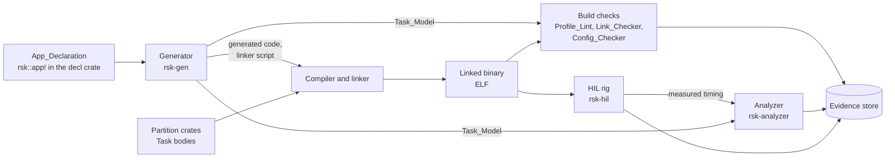
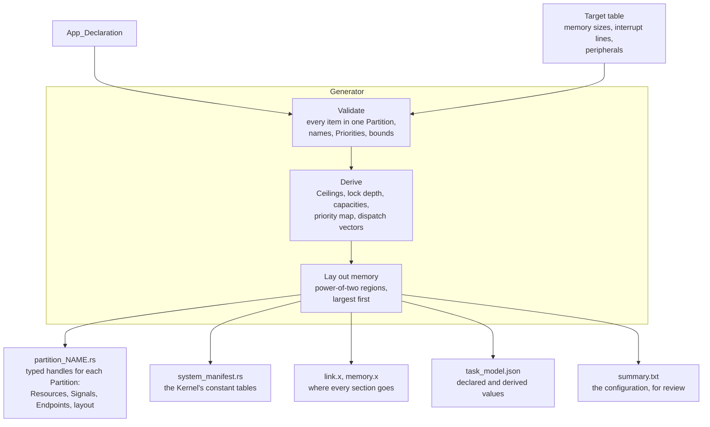
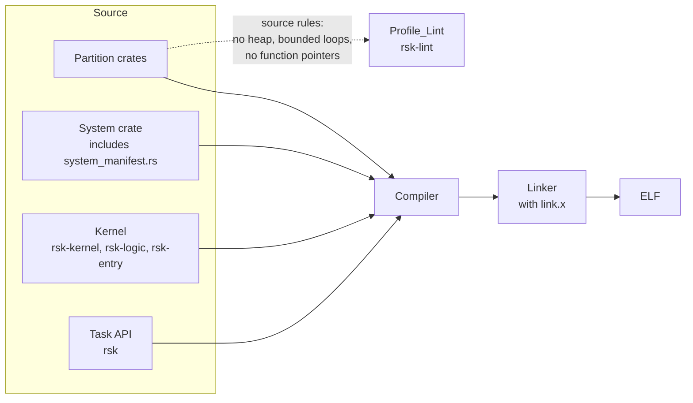
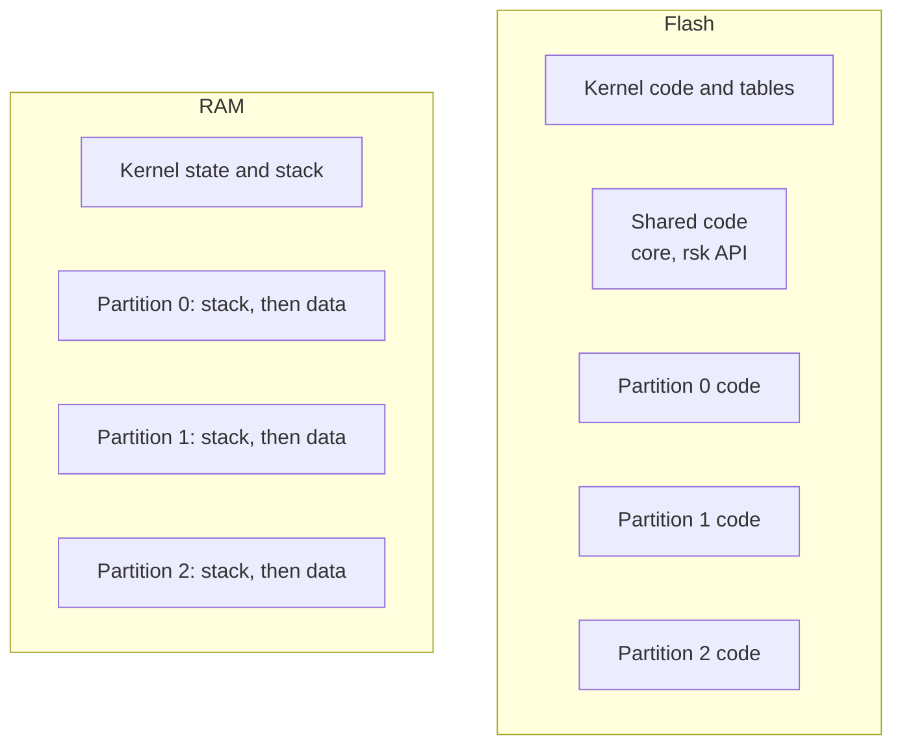
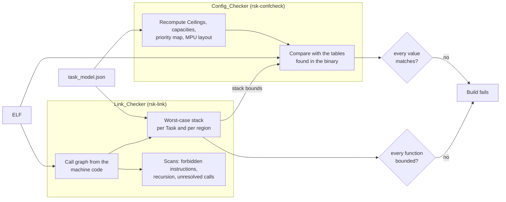
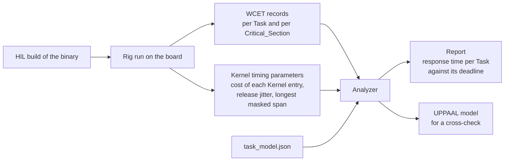
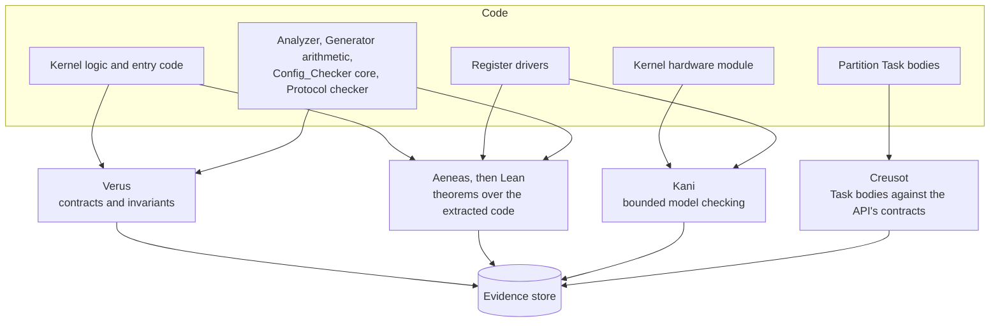
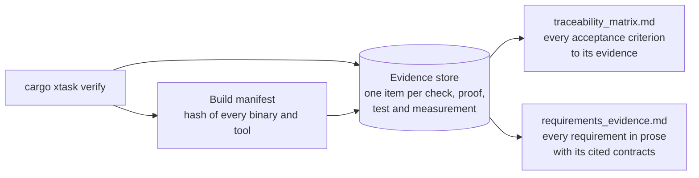

# IronOxide before run time: components and the data between them

Everything about an Application is fixed before it runs: the Tasks, their Priorities, the Resources they share, the memory each Partition gets. This page shows which component produces what, and what data passes between them, from the declaration to a binary that is allowed to fly.

The diagrams use the names of the repository: crates under `crates/`, the demo Application under `apps/p1-demo/`.

## 1. The whole pipeline

One declaration is the source of every artefact. Nothing downstream is written by hand twice.

## 2. What the Generator reads and writes

The Generator validates the declaration, derives every value that must not be maintained by hand, and writes one directory per configuration (for example `apps/p1-demo/gen-nrf52840/`).

| Output | Who uses it | What it carries |
|---|---|---|
| `partition_NAME.rs` | The Partition's crate | The only handles a Task can use: its own Resources, Signals, Endpoint roles, EasyDMA channels |
| `system_manifest.rs` | The Kernel | Task table, Ceilings, Budgets, timer slots, MPU view per Partition, fault responses, a checksum |
| `link.x`, `memory.x` | The linker | One code and one RAM region per Partition, the Kernel's regions, the shared code |
| `task_model.json` | Config_Checker, Analyzer, Link_Checker, rig | Everything declared and derived, marked which is which |

## 3. From source to binary

Each Partition is its own crate, so the linker can place its code and data in that Partition's regions by archive name.

What ends up where in the binary:

## 4. Checks on the linked binary

Two independent tools read the binary. Neither trusts the Generator: each recomputes what it checks.

## 5. Timing: from measurement to a schedulability verdict

The Analyzer never trusts a number it cannot tie to a specific binary: every record carries the hash of the build it was measured on.

## 6. Proof tools and what each one reads

## 7. The verification job

`cargo xtask verify` runs every step above on one revision and writes one item per result. Two documents are generated from the store, so they cannot drift from it.

## Reading the data flow in one sentence each

- The **declaration** is the only thing an engineer writes about the system's structure.
- The **Generator** turns it into code for the compiler, a script for the linker, and a model for the tools.
- The **Link_Checker** and the **Config_Checker** confirm the binary is what the model says.
- The **rig** measures that binary, and the **Analyzer** decides from the model and the measurements whether every deadline is met.
- The **provers** establish that the Kernel does what its contracts say, whatever the Application.
