# IronOxide at run time: what the Kernel and the Tasks can do

At run time nothing is created or destroyed. The Kernel releases Jobs of the declared Tasks, starts the one with the highest Priority that the rules allow, and enforces the limits each Partition was given. This page shows who runs where, what a Task may ask of the Kernel, and what happens when something goes wrong.

Terms: a **Task** is declared once; a **Job** is one execution of it; a **Release** makes a Job ready; a **Partition** is a group of Tasks with its own memory and its own fault policy.

## 1. Who runs where

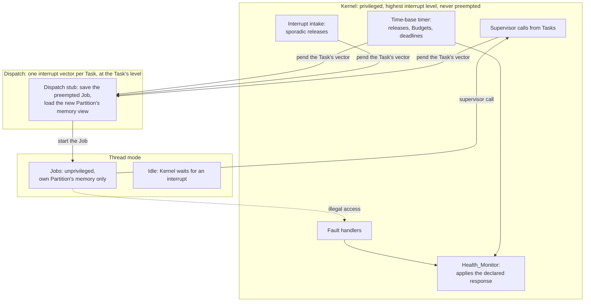

## 2. From reset to the first Job

The Kernel refuses to start if the board is not the one the configuration was built for.

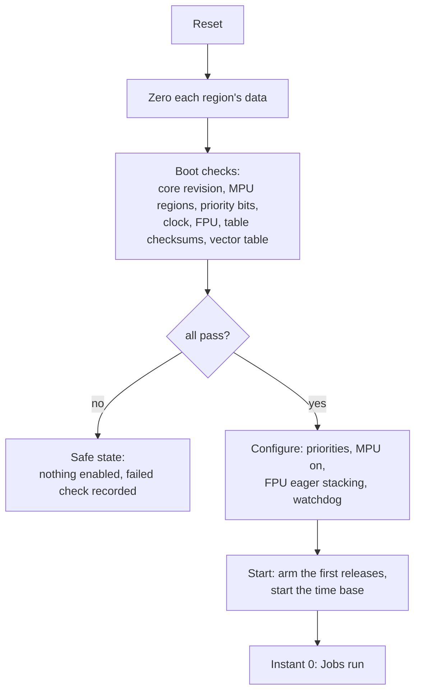

## 3. The life of a Job

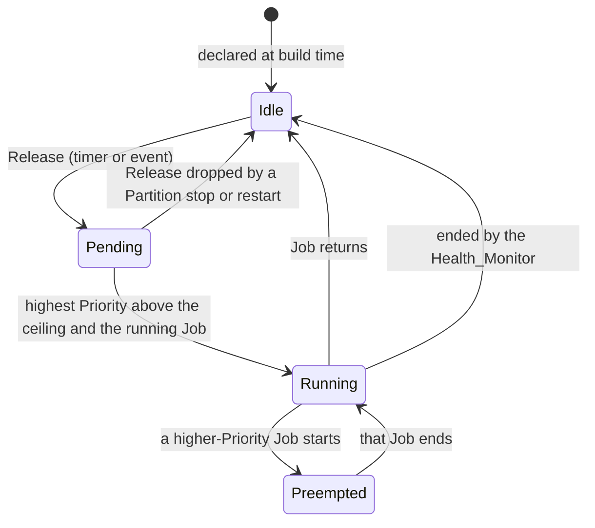

Three things can release a Job:

| Kind | Trigger | Rule the Kernel enforces |
|---|---|---|
| Periodic | The time-base timer | Released at offset + k × period, computed so it never drifts |
| Sporadic, from an interrupt | A peripheral's interrupt bound to the Task | At most one Release per minimum inter-arrival time; early events are deferred or discarded as declared, and the source is masked meanwhile |
| Sporadic, from a Task | A signal raised, or a message sent to an Endpoint | Same spacing rule |

## 4. Which Job runs

A pending Job starts only when its Priority is above both the Job that is running and the system ceiling. The ceiling rises while any Job holds a shared Resource.

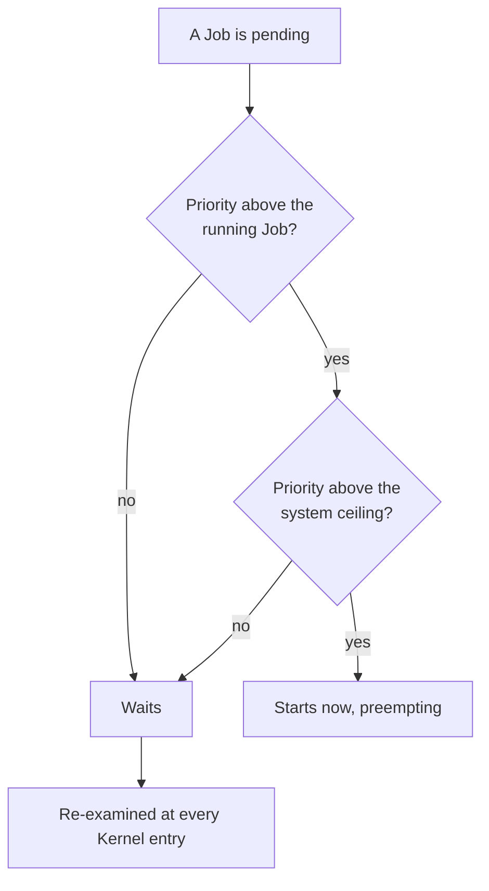

Consequences that hold for every Application:

- A Job that has started is never blocked: every Resource it will need is free.
- A Job waits for a lower-Priority Job at most once, for at most one Critical_Section.
- There is no deadlock.

## 5. A preemption, step by step

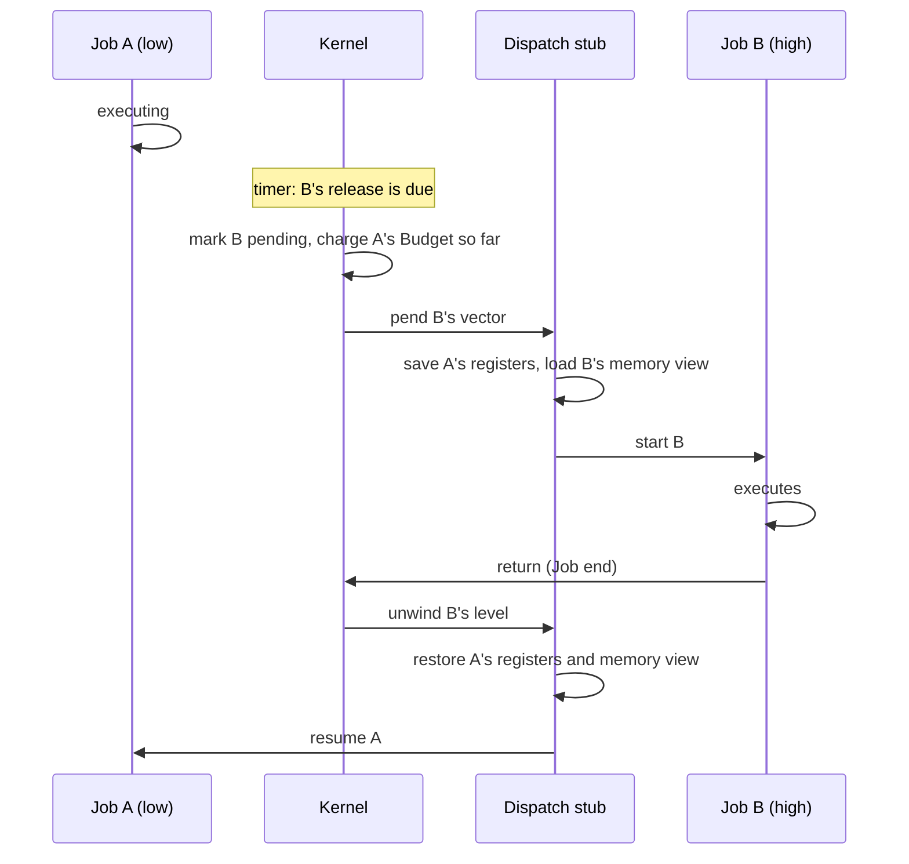

## 6. What a Task can ask the Kernel

A Task has no way to reach the Kernel except these calls. Each is a supervisor call that the Kernel checks before acting.

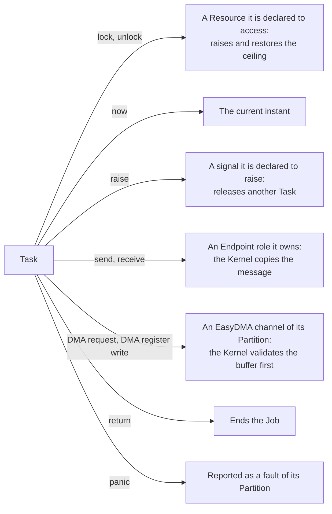

| A Task can | A Task cannot |
|---|---|
| Read and write its own Partition's RAM and the peripherals its Partition owns | Touch another Partition's memory, the Kernel's memory, or a peripheral it does not own |
| Lock a Resource it is declared to access, as often as it likes, one section at a time | Lock a Resource it already holds, or one it is not declared for |
| Run until it returns or its Budget is spent | Wait, sleep or block inside a Critical_Section |
| Raise declared signals and use its declared Endpoint roles | Create Tasks, change Priorities, or mask interrupts |
| Use floating point if declared as an FPU Task | Program a DMA pointer directly: those registers are read-only to it |

## 7. Memory as a running Job sees it

When the Kernel starts a Job it loads that Partition's view into the memory protection unit. Everything outside the view faults.

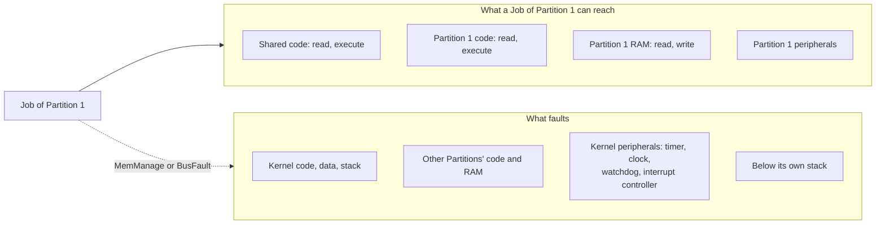

## 8. What the Kernel enforces on every Job

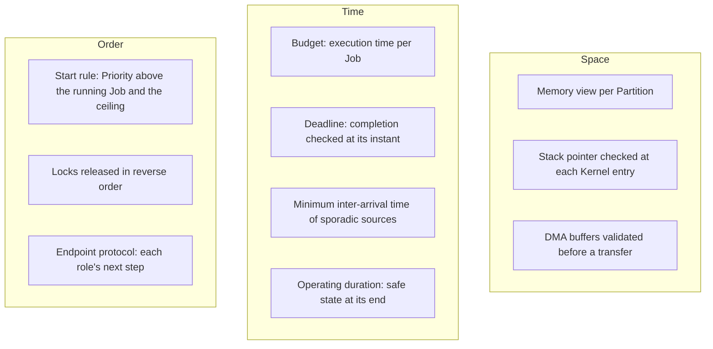

## 9. When something goes wrong

Every violation becomes an event in the Kernel's log, and the Partition's declared response is applied. The set of responses is closed: there are no others.

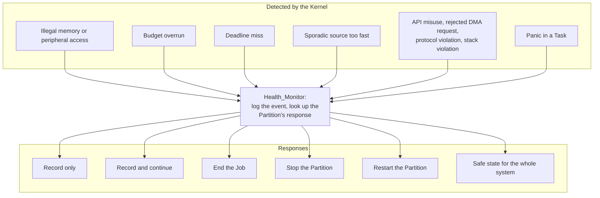

What each response does to the Partition:

| Response | The offending Job | Other Jobs of the Partition | Its Resources and Endpoints | Other Partitions |
|---|---|---|---|---|
| Record only, record and continue | Continues | Unaffected | Unaffected | Unaffected |
| End the Job | Ended; Resources it held are released | Unaffected | Released ones are free | Unaffected |
| Stop the Partition | Ended | Ended; no further releases | Re-initialized; DMA transfers stopped first | Unaffected |
| Restart the Partition | Ended | Ended; releases continue | Re-initialized, RAM zeroed; DMA transfers stopped first | Unaffected |
| Safe state | Ended | Every Job in the system ended | Not used again | Stopped too |

A fault inside the Kernel itself always leads to the safe state.

## 10. What the Kernel can do that a Task cannot

| The Kernel | Why it is acceptable |
|---|---|
| Reads and writes all memory; the memory protection unit does not confine it | Its code is proven, its stack depth is bounded from the binary |
| Masks interrupts while it runs | The longest masked span is measured and charged to every Task's response time |
| Writes the registers of the interrupt controller, the timer, the watchdog and the memory protection unit | These are reserved to it; a Partition cannot be given them |
| Ends Jobs, stops and restarts Partitions | Only as the declared response to a recorded event |
| Copies messages between Partitions | It is the only writer of Endpoint storage |

The Kernel cannot allocate memory, cannot run floating-point arithmetic, and has no call through a function pointer: all three are excluded by build-time checks.

## 11. How Kernel entries queue back to back, and what stays masked

Each Kernel entry is short: 25 to 66 µs in the measured build. The longest time the Kernel runs without returning to a Job is much longer, 330 to 380 µs in three-minute stress runs, because entries run back to back. Sections 11.1 and 11.2 show how the chain forms. Section 11.3 shows what it does and does not block, and what was changed.

### 11.1 Why one entry is followed by another

When an entry returns, the processor does not go back to the Job if something is waiting. It goes straight into the highest pending handler.

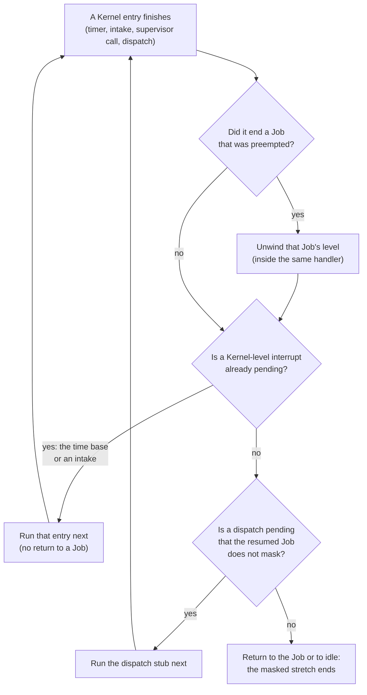

The time base is pending again so often because of how long a timer entry takes. The timer is armed for the next due slot when the entry finishes. If that slot comes due within the 45 to 65 µs the entry itself needs, the timer has already fired by the time the entry returns.

### 11.2 The longest stretch measured

One stretch of 382 µs from a stress run (measured build, 64 MHz). Nine entries ran without a return to a Job. The timer was pending again after each of the first four timer-related entries.

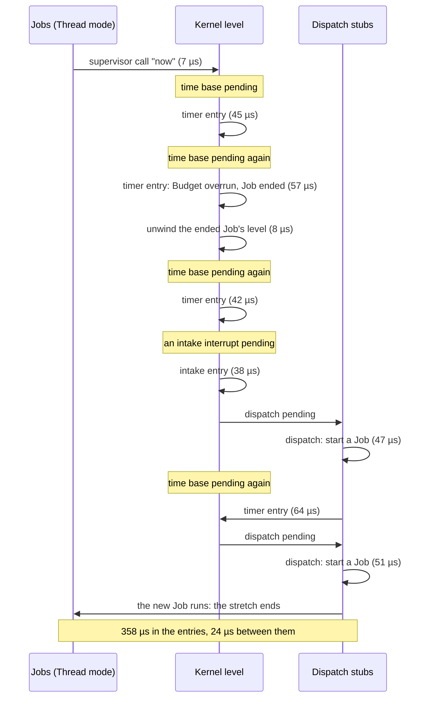

Where the 382 µs went:

| Part of the stretch | Entries | Time |
|---|---|---|
| Timer entries | 4 | 208 µs |
| Dispatches | 2 | 97 µs |
| Intake | 1 | 38 µs |
| Unwind | 1 | 8 µs |
| Supervisor call | 1 | 7 µs |
| Between entries (stubs, exception entry) | | 24 µs |

### 11.3 What the chain does and does not block (measured 2026-11-21)

The chain is how long the Kernel can run back to back. It is not how long an interrupt can be kept waiting. At every arrow below the processor picks the highest pending exception, so a Kernel-level interrupt that arrived during one entry is served at that entry's return, ahead of any queued dispatch. What cannot be interrupted is one handler together with the unwind it runs before it returns: the **hold**.

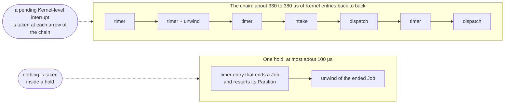

The Kernel now records both. Three-minute stress runs on the board:

| | Chain (entries back to back) | Hold (cannot be interrupted) |
|---|---|---|
| Measured build | 332 µs | 99 µs |
| Instrumented build | 327 to 328 µs | 107 to 109 µs |

The longest hold in every run was a timer entry that ended an overrunning Job and restarted its Partition, followed by that Job's unwind.

The analysis charges every Kernel entry to the event that caused it: each Task's releases, deadlines, Budget events and interrupts, including those of lower-Priority Tasks. Its blocking term, L_kernel, only has to cover the one section already in progress when an event arrives. L_kernel was the chain from 2026-11-07; it is the hold since 2026-11-21, because the chain's entries were being counted twice.

Two changes were tried on a branch:

| Change | Result | Kept |
|---|---|---|
| Let one timer entry also serve the slots that come due while it runs | The timer entry grew from 76 to 110 µs at most and the hold from 108 to 131 µs; the chain did not get shorter | No |
| Record the hold and use it as L_kernel | L_kernel's measured basis fell from about 330 µs to about 100 µs | Yes |

Running the unwind at the ended Job's own level was also considered. It would take the unwind (8 to 34 µs) out of the hold.
