# How global session types work in IronOxide

Tasks in different Partitions talk through Endpoints. An Endpoint can carry a **Protocol**: one description of the whole conversation, written once, from which each participant's allowed moves are derived. This page shows what a Protocol is, what is checked before the system runs, how the compiler holds each Task to its part, and what the Kernel does with the messages.

The examples are the demo Application's own (`apps/p1-demo/decl/src/lib.rs`).

Terms: a **role** is one participant of a Protocol; a **global type** is the Protocol seen from above, every message with its sender and receiver; a **local type** is one role's view of it; **projection** turns the first into the second.

## 1. A Protocol is a global type

```text
protocol PingPong {
    rec Loop {
        choice at ctl {
            Req(u32): ctl -> sink;
            Rep(u32): sink -> ctl;
            continue Loop;
        } or {
            Stop(): ctl -> sink;
            end;
        }
    }
}
```

Read as a conversation:

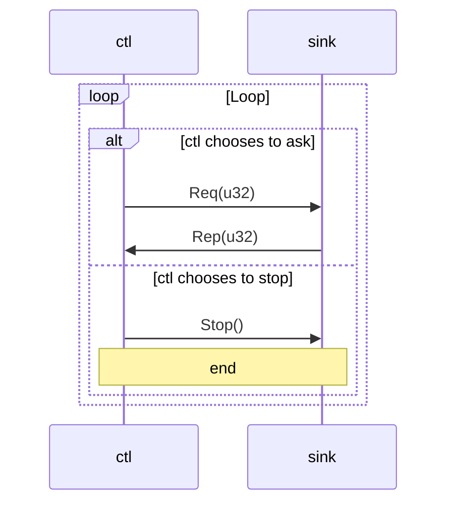

The four constructs:

| Construct | Meaning |
|---|---|
| `Label(Type): a -> b;` | Role `a` sends one message with this label and payload to role `b` |
| `choice at a { .. } or { .. }` | Role `a` decides which branch happens; each branch starts with a message from `a` |
| `rec X { .. }` and `continue X;` | Repetition |
| `end;` | The conversation is over |

An Endpoint binds the Protocol's roles to Tasks:

```text
endpoint pingpong: protocol PingPong {
    ctl => part0.control, sink => part1.log
} capacity = 1, payload = 8;
```

## 2. From one declaration to checked code

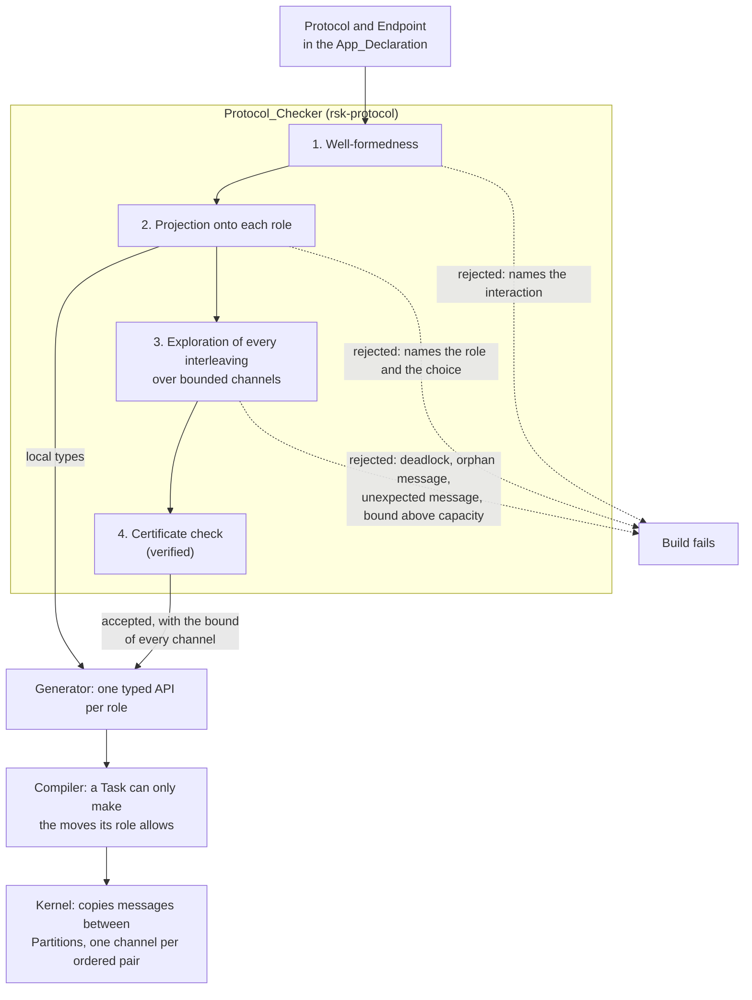

## 3. Well-formedness: what a Protocol may not say

Each rejection names the interaction at fault.

| Rule | Why |
|---|---|
| No message from a role to itself | A role has no channel to itself |
| Every `continue` names an enclosing `rec` and follows at least one message | Otherwise the loop does nothing forever |
| A choice has at least two branches, each opened by a message from the chooser | The chooser must tell someone what it chose |
| The branches' first messages go to the same receiver, with different labels | The receiver learns the choice from the label |
| Every role of the Endpoint appears in some message | A role with nothing to do is a declaration error |

## 4. Projection: each role's own view

Projection keeps the messages a role sends or receives and drops the rest. For `PingPong`:

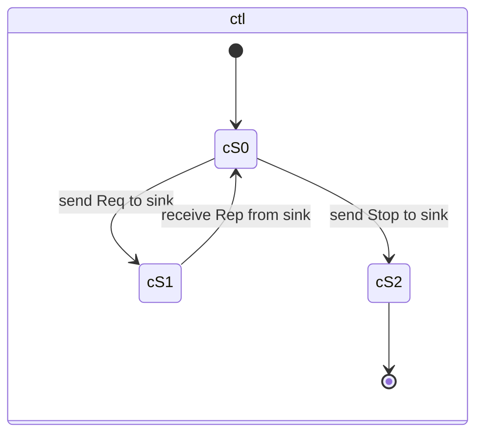

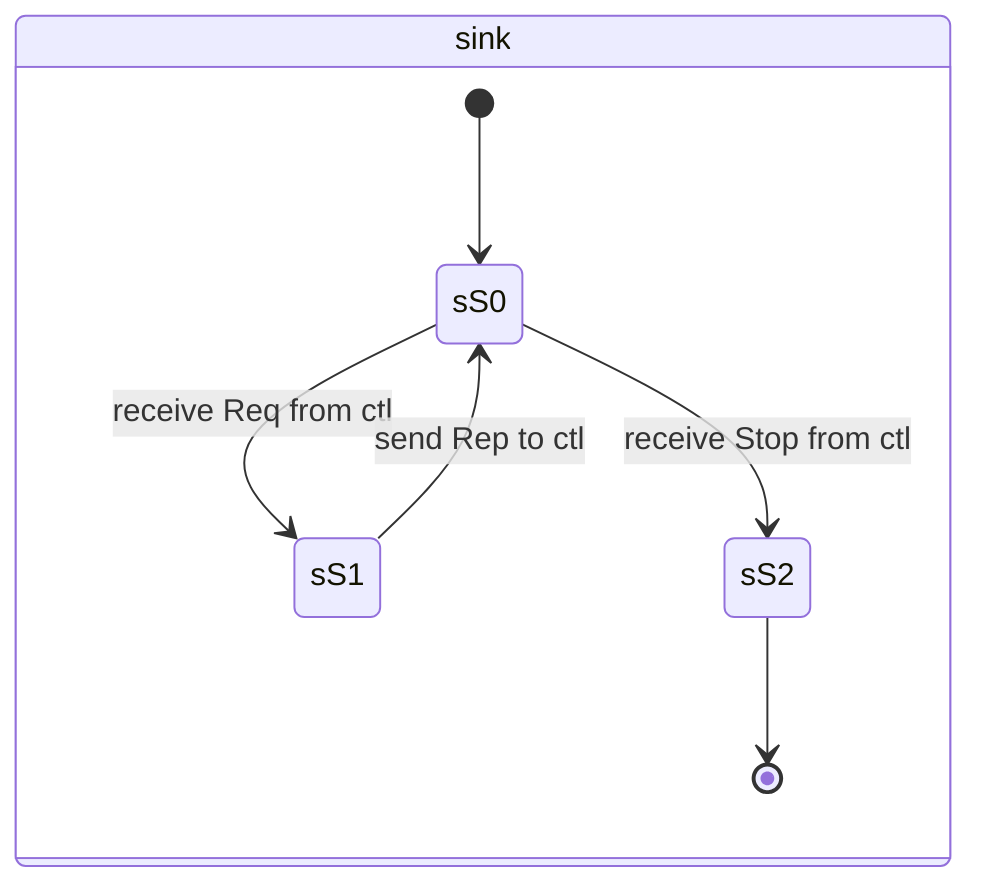

The two are mirror images: where `ctl` chooses by sending, `sink` waits and learns the choice from the label that arrives.

## 5. Three roles: when a role is not told the choice

```text
protocol Triangle {
    rec L {
        choice at ctl {
            Req(u32): ctl -> mid;
            Fwd(u32): mid -> sink;
            Ack(u32): sink -> ctl;
            continue L;
        } or {
            Stop(): ctl -> mid;
            Done(): mid -> sink;
            end;
        }
    }
}
```

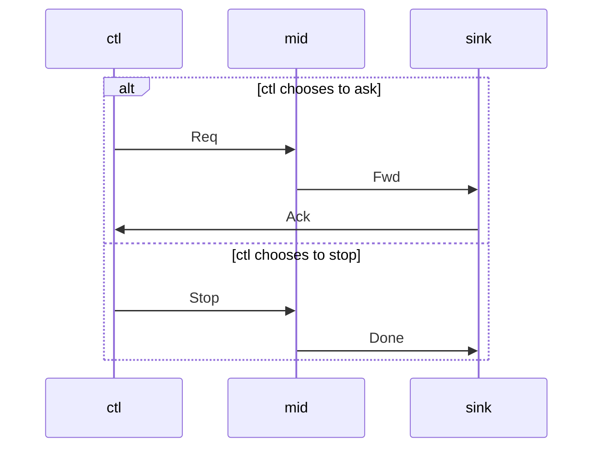

`ctl` tells only `mid`. `sink` is not informed directly, so its two possible futures have to be **merged**: it waits for either `Fwd` or `Done` from `mid`, and the label tells it which branch it is in.

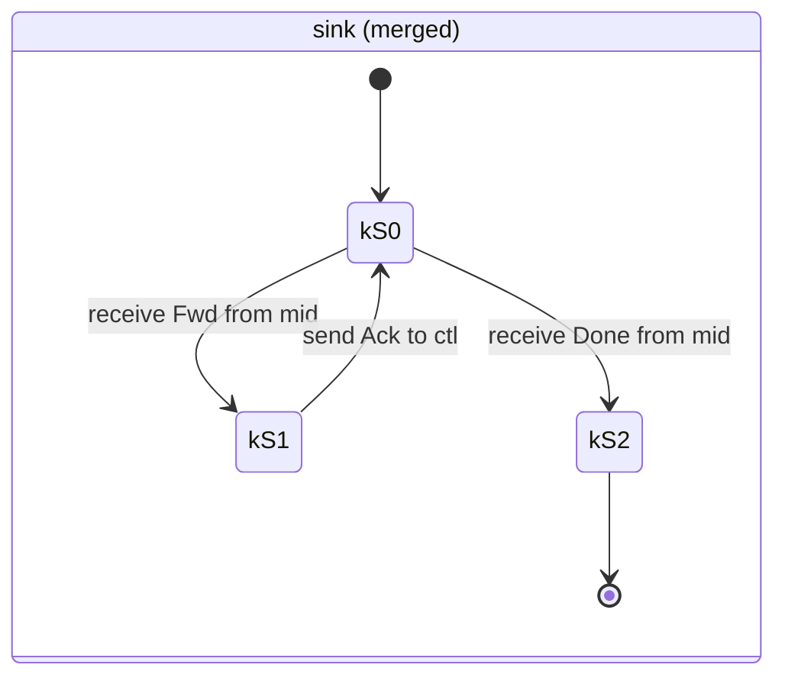

The merge fails, and the Protocol is rejected, when the branches cannot be told apart: for example if `sink` would have to send in one branch and receive in the other without first receiving a label that distinguishes them.

## 6. Exploration: is the conversation safe on real channels?

Messages are not delivered instantly. Each ordered pair of roles has its own first-in-first-out channel of the declared capacity, so the roles can interleave in many ways. The checker explores all of them.

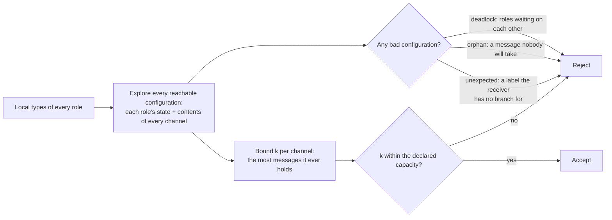

The bound is the worst case over every interleaving, not the best. A sender is never made to wait in this system, so a channel must be large enough for the most unlucky ordering. For `PingPong`, every channel holds at most one message, which the declared capacity of 1 meets.

The explorer itself is not trusted. It hands its set of visited configurations to a small verified checker, which confirms the set is closed under every possible move and contains no deadlocked configuration. For `PingPong` that certificate has 6 configurations.

## 7. The typed API: illegal moves do not compile

For each role the Generator emits one type per state. A method exists only in the state where the Protocol allows that move, and it consumes the old state and returns the new one.

```rust
// Role `ctl` of Endpoint `pingpong`: generated.
impl Ctl<S0> {
    fn send_req(self, m: u32) -> Result<Ctl<S1>, NotSent<S0>>;   // Req, then wait for Rep
    fn send_stop(self)        -> Result<Ctl<S2>, NotSent<S0>>;   // Stop, then end
}
impl Ctl<S1> {
    fn try_recv(self) -> Result<RecvS1, NotReceived<S1>>;        // Rep arrives -> back to S0
}
impl Ctl<S2> {
    fn finish(self) -> State;                                    // end
}
```

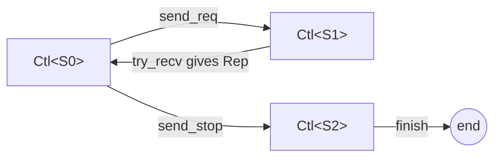

What this rules out at compile time:

- Sending `Req` twice in a row: after `send_req` the value is a `Ctl<S1>`, which has no `send_req`.
- Receiving when it is this role's turn to send: `Ctl<S0>` has no `try_recv`.
- Using a state twice: each method takes `self` by value.

## 8. Across Jobs: the state is kept, and a dropped role is reported

A conversation outlives one Job, and a Job may not block. So each Task keeps its role's current state in a per-Task slot between Jobs.

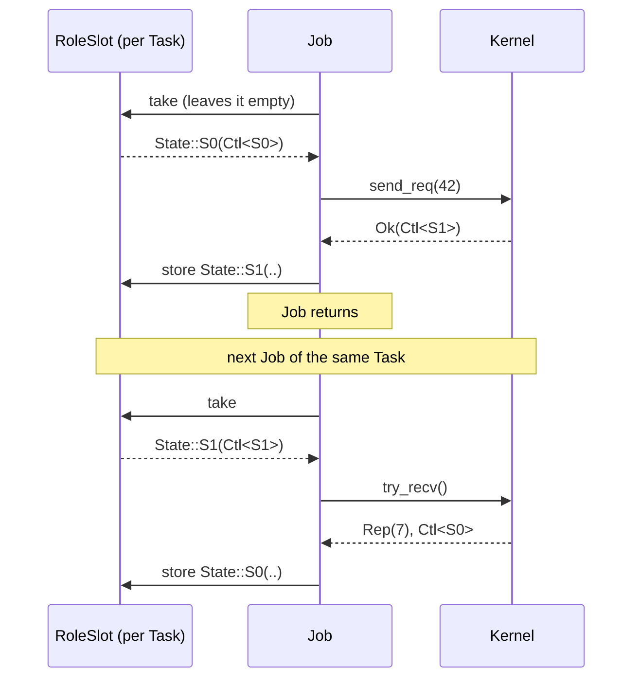

Rust's types cannot force a value to be used, only prevent it being used twice. Two run-time checks cover that gap:

- A Job that returns with its slot empty is a Protocol violation.
- A role value dropped in a state where the Protocol expects it to continue is a Protocol violation.

Both are reported to the Health_Monitor against the Task's Partition.

## 9. At run time: what the Kernel does with a message

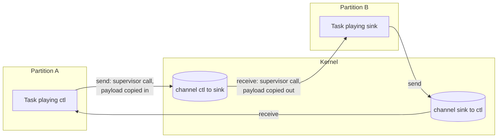

- **One channel per ordered pair of roles**, in Kernel memory. Neither Partition can reach the other's memory; the Kernel copies.
- **Word 0 of every message is the label's index** in the Protocol. The payload follows.
- **The Kernel checks each call**: the caller is the Task bound to that role, the length matches, and the buffer lies in the caller's own RAM. Anything else is API misuse and the Partition's fault response applies.
- **A send never waits.** A full channel is reported as a violation of the bound; the checker has already shown it cannot happen if the roles follow the Protocol.
- **A receive never waits.** An empty channel returns "not yet"; the Task tries again in a later Job. An arriving message can also release a sporadic Task that names the Endpoint as its release source.

Three things can interrupt a conversation, and each has a defined outcome:

| Event | What happens |
|---|---|
| A message crosses from a lower Criticality_Level to a higher one | The receiving role must declare a validation function. A rejected message is consumed, and the fault is charged to the sending Partition |
| A Partition is stopped or restarted | Every role of its Endpoints is re-initialized. The peer's next operation returns "peer changed" and its role goes back to the initial state |
| A Task holds roles on several Endpoints | The declaration can order them (`after = other_endpoint`), so that the deadlock argument covers the Endpoints together and not only one at a time |

## 10. What is proved, and by what

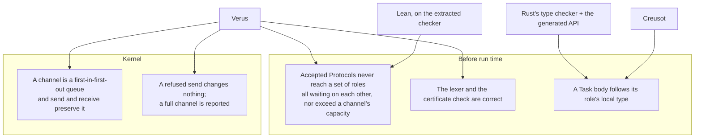

The progress theorem rests on assumptions that are discharged elsewhere or reported when broken: the roles follow their projections (the typed API, with violations reported at run time), sends never wait, a Job never suspends, and re-initialization returns every role of an Endpoint to its initial state.

## In one paragraph

A Protocol is written once as a global type. The Protocol_Checker rejects it unless it is well formed, projects onto every role, and is free of deadlock, orphan messages and unexpected messages over channels of the declared capacity. The Generator turns each role's local type into Rust types in which only the allowed moves exist. At run time the Kernel is a careful courier between Partitions: it copies, checks who is calling, and reports anything that departs from the bound the checker computed.
