# PACEMAKER on rsk: what happens at run time

This page follows the pulse generator (PG) through a beat, a Sense, a programming command and a fault. `diagrams_static.md` shows the parts these diagrams refer to.

Status: these diagrams draw `design.md` Draft 0.2. Nothing is built or measured. Every time shown is a proposal, and the nRF52840 register behaviour is still to be confirmed by the spike.

Terms: a **Pace** is a pulse the PG delivers; a **Sense** is a heartbeat the PG detects; to **arm** a Pace is to write the timer compares that will produce it; the **escape interval** E is the longest time the PG waits for a heartbeat before it paces.

The rule behind every diagram: **hardware makes each edge, a Job only arms it.** A Job has to finish before the instant it arms, and nothing more is asked of scheduling.

## 1. From reset to the first Pace

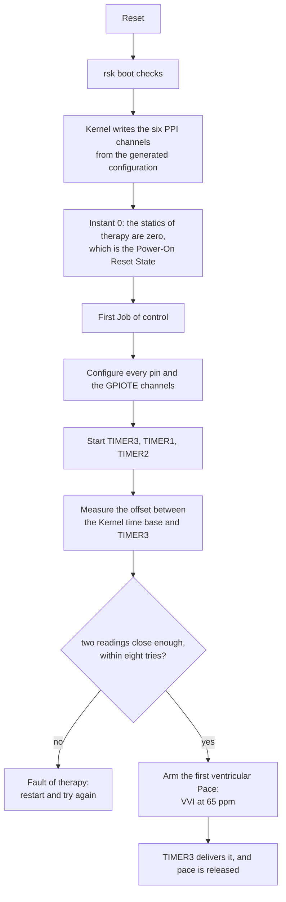

## 2. A paced beat

The Mode is VVI and no heartbeat arrives. The whole pulse is on the pin before any Job runs: the Job is released by the pulse's finish.

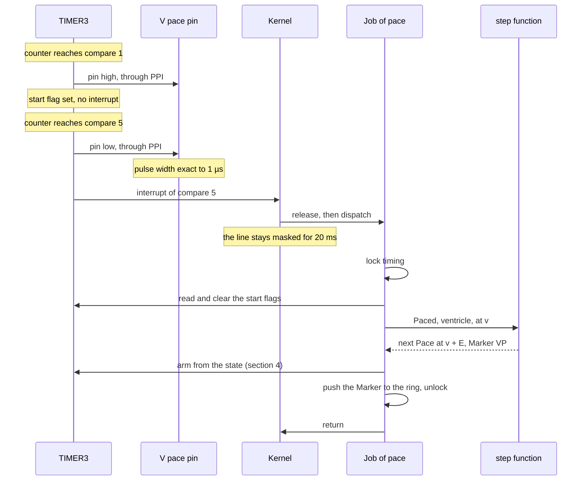

Because `pace` is released by the finish of the pulse, it cannot rewrite the finish compare while the pin is high. Any other Job that wants to arm this Chamber between the start and this Job finds the start flag set and writes nothing (section 4).

## 3. A sensed beat that withdraws the Pace

The heart beats in time, so the pending Pace must not be delivered.

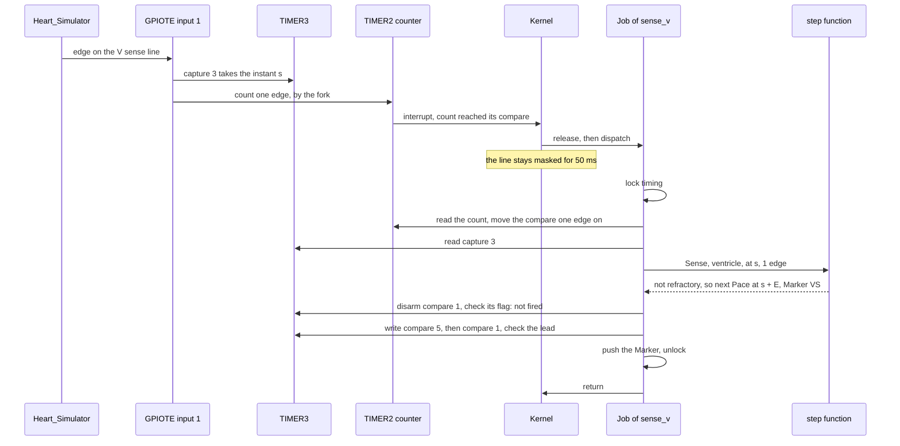

The counter is never cleared, so no edge is lost between a read and a clear.

## 4. Writing a Chamber's compares, and the lead

Two things can go wrong with a compare. Written with a value the counter has already passed, it does not fire until the counter wraps, 71.6 minutes later. And a finish compare rewritten under a pulse leaves the pin high. One sequence, used to arm, move and withdraw, prevents both.

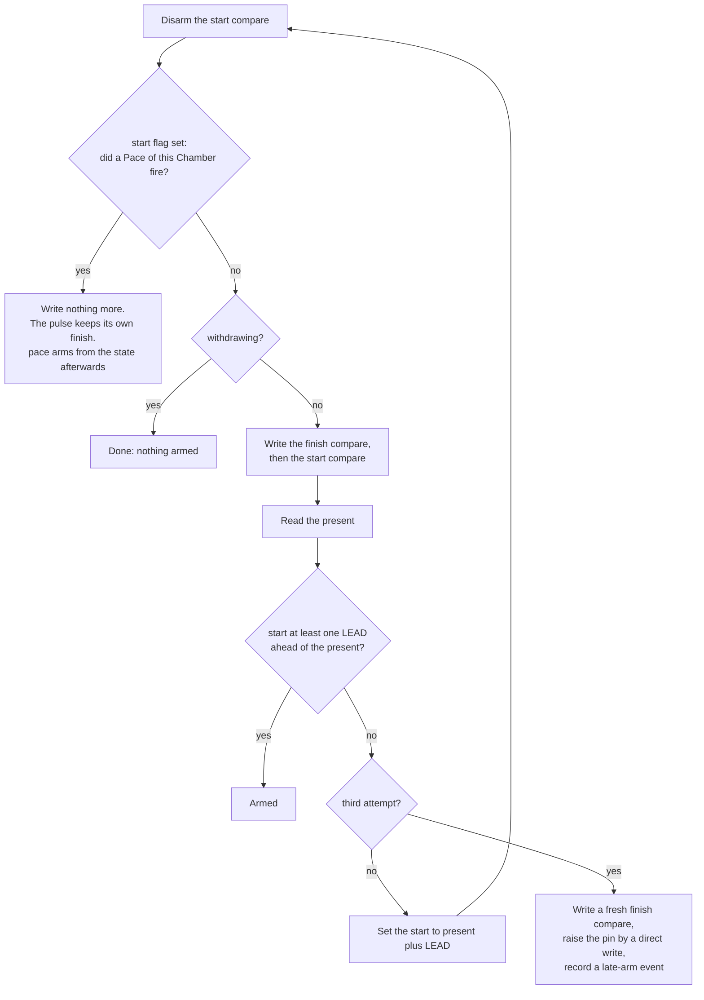

The finish compare is written only while the start is disarmed and no Pace of the Chamber is waiting for its `pace` Job. So a start that fires always has its own finish in force.

`LEAD` is proposed at 500 µs. It has to cover what can interrupt the Job between the check and the compare taking effect. The last box should never be reached; it exists because the alternative is a missed Pace.

## 5. The life of one armed Pace

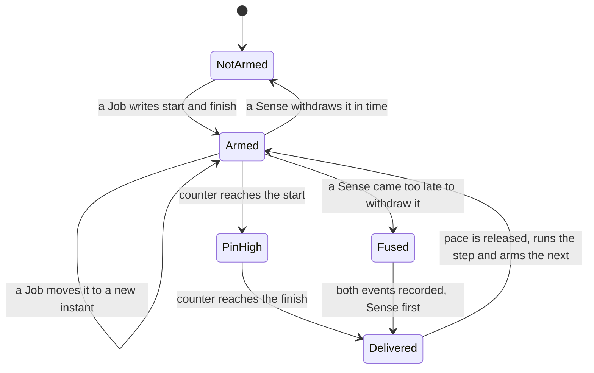

`PinHigh` to `Delivered` needs no software, so a pin cannot stay high across a restart of the Partition, a stop, or the safe state.

## 6. The inhibition window

A Sense withdraws a Pace only when its Job runs. A Sense that comes less than the sense Task's response time before the Pace is too late.

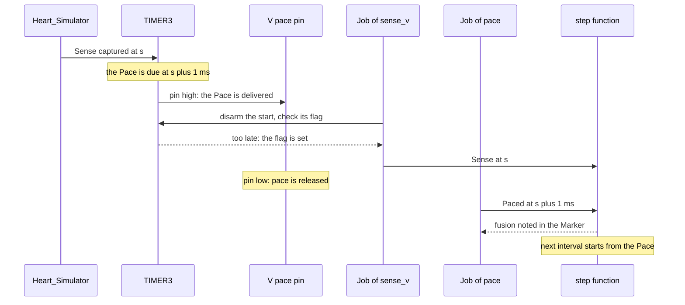

The window is a stated parameter, proposed at 2 ms, and the rig measures it by sweeping a Sense toward a Pace. It is a bounded deviation from the source, which has a Sense always cancel the pending Pace.

## 7. A dual-chamber cycle

DDD, with an atrial heartbeat the PG tracks and no ventricular heartbeat. Timing is ventricular-based: every escape interval starts at a ventricular event.

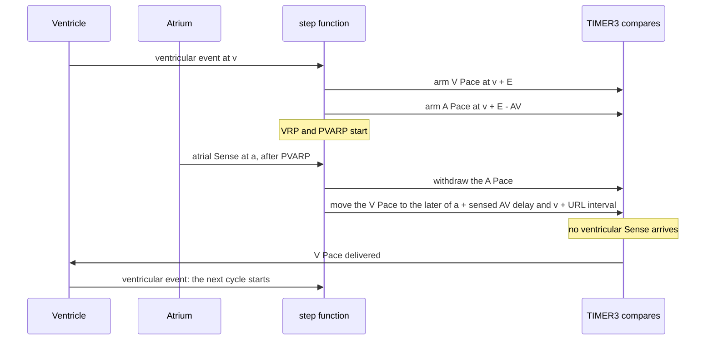

What a non-refractory event does, by the Mode's response letter:

| Event | Inhibited (I) | Tracked (D) | Triggered (T) |
|---|---|---|---|
| Atrial Sense | The atrial Pace is withdrawn | The atrial Pace is withdrawn and the ventricular Pace follows after the sensed AV delay, never above the URL | An atrial Pace one `LEAD` from now |
| Ventricular Sense | The ventricular Pace is withdrawn and a new cycle starts | The same | A ventricular Pace one `LEAD` from now |
| Any Sense in a refractory or blanking period | Nothing is armed or withdrawn | The same | The same |

## 8. A Sense, by where it falls in the cycle

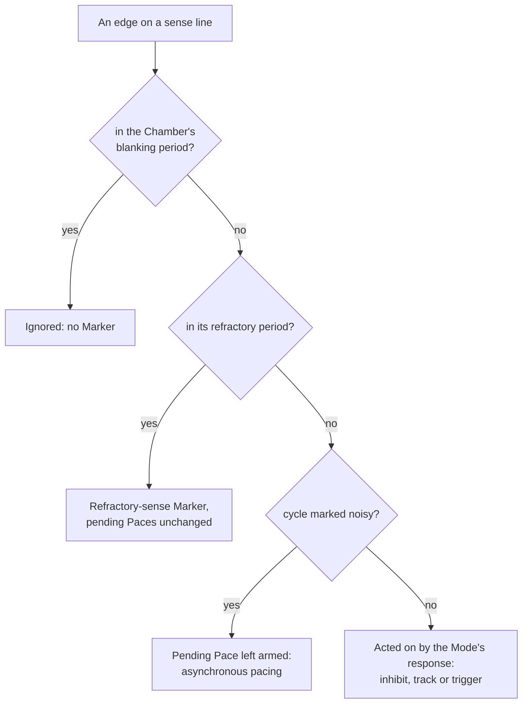

## 9. A sense storm

After each delivered event rsk masks that line for one MIT. Edges that arrive meanwhile are counted by the hardware and cost no Kernel entry.

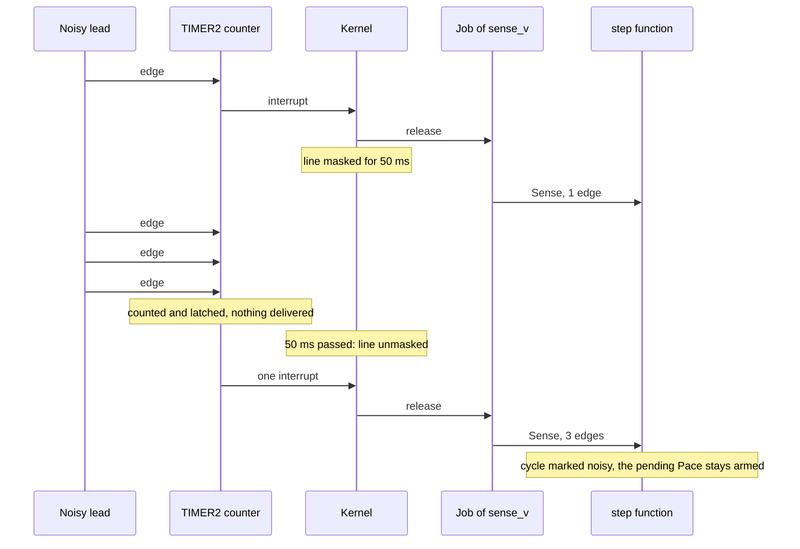

Masked edges are not MIT violations, so a storm does not approach the Partition's violation threshold and cannot restart it. A late Sense within the 50 ms changes no Pace either, because every Mode's refractory period after an event is at least 150 ms. The rig's storm scenario is the demonstration.

## 10. The therapy States

Exactly one State holds at a time.

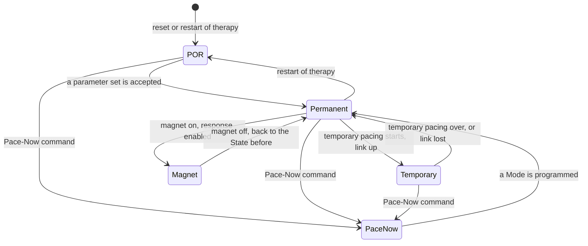

A restart of the Partition enters POR from any State; the diagram draws it from Permanent only. Every transition except into Pace-Now takes effect at the next ventricular event (atrial in the atrial-only Modes). The Magnet State returns to whichever State it interrupted.

## 11. Programming a parameter set

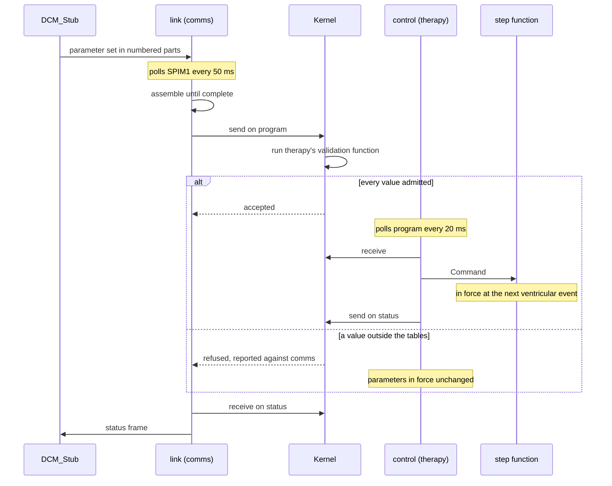

The DCM_Stub holds the same validation function, so a test can assert that the PG answered as predicted.

## 12. Where the time goes for a Pace-Now command

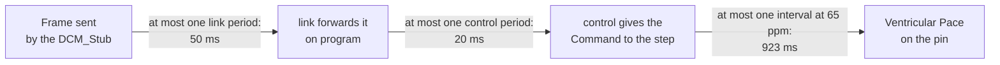

The other slow paths have the same shape:

| Change | Path | Bound with the proposals |
|---|---|---|
| Link loss | Three unanswered polls, then one `control` period | 170 ms |
| Magnet, battery level, a State change | One `control` period, then the next ventricular event | 20 ms plus one cycle |

## 13. Events on their way to the programmer

No therapy Task waits for a lower Partition. The ring absorbs what `history` has not yet taken.

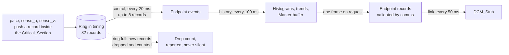

## 14. When something goes wrong

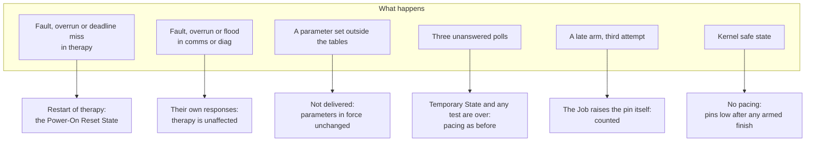

## 15. A restart of the therapy Partition

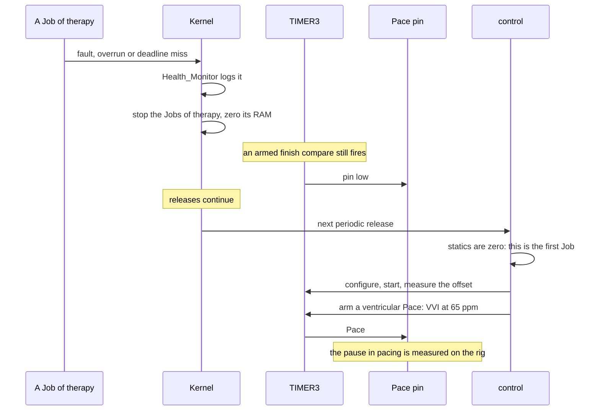

Zeroed statics are the Power-On Reset State, so a restart of the Partition is a power-on reset of the therapy and needs no code of its own.
