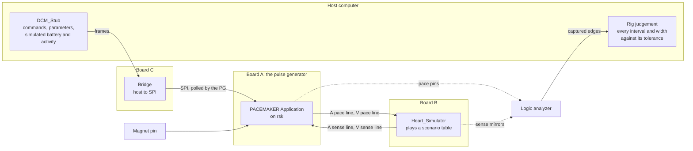
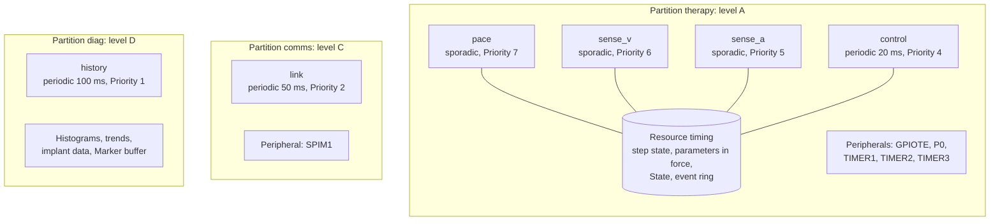
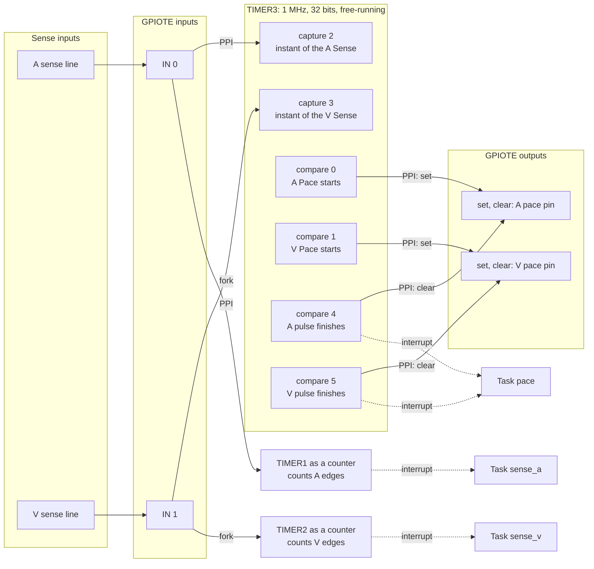
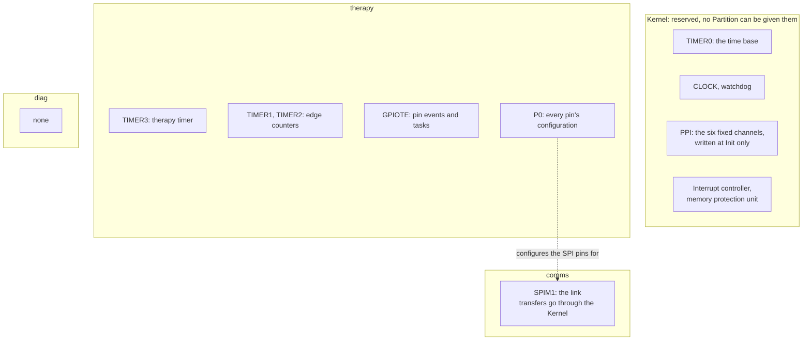
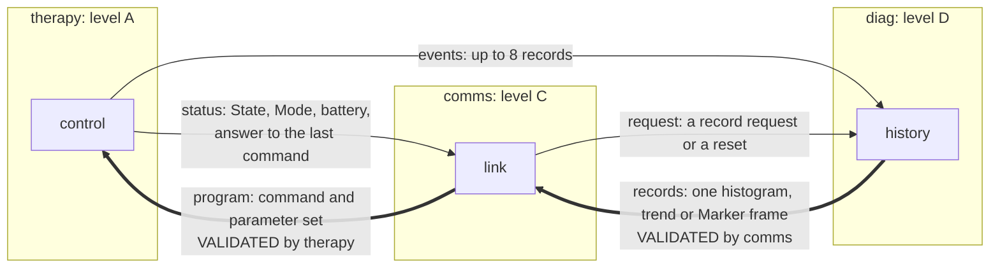
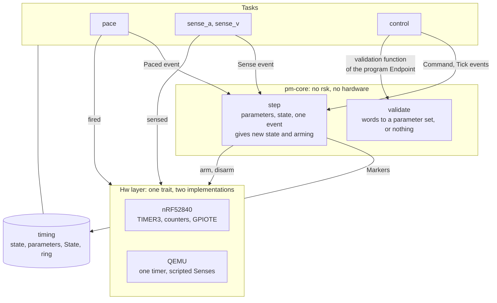
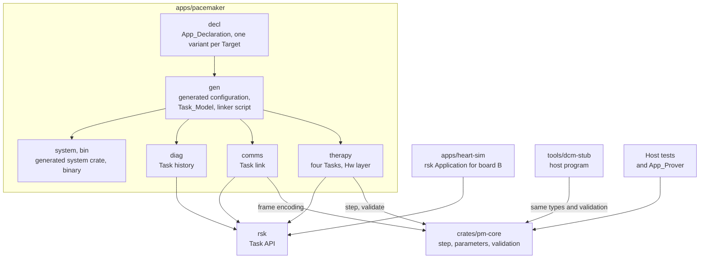
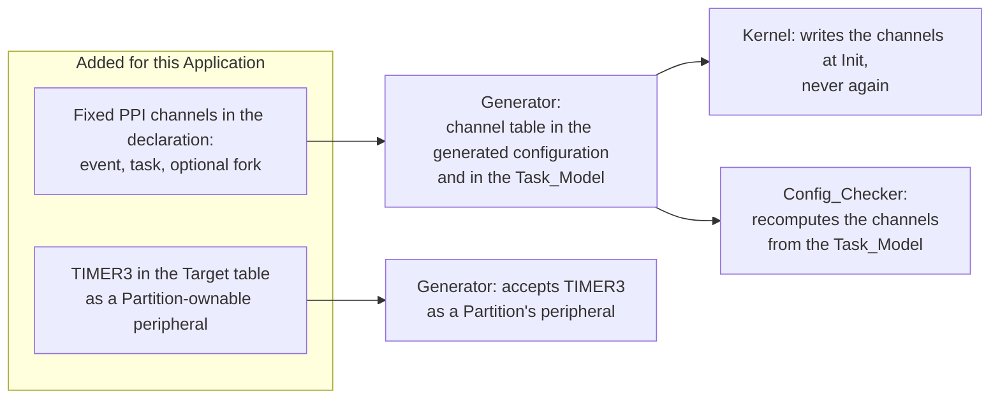
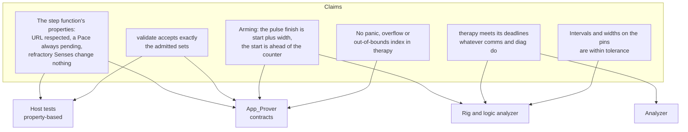

# PACEMAKER on rsk: what the system is made of

The pulse generator (PG) is an rsk Application of three Partitions and six Tasks. This page shows the boards around it, what each Partition owns, how the hardware is wired inside the chip, and which crate holds what. `diagrams_dynamic.md` shows the same system in motion.

Status: these diagrams draw `design.md` Draft 0.2. Nothing is built or measured. Every period, MIT, deadline and Budget is a proposal, and the nRF52840 register behaviour is still to be confirmed by the spike.

Terms: a **Pace** is a pulse the PG delivers; a **Sense** is a heartbeat the PG detects; a **Chamber** is the atrium (A) or the ventricle (V); the **step function** is the pure function that decides the therapy.

## 1. The system and what surrounds it

Nothing here is a real heart or a real programmer. The Heart_Simulator produces sense edges and receives pace pulses; the DCM_Stub stands for the clinician's programmer.

| Part | Where | Role |
|---|---|---|
| PG | Board A | The system under test |
| Heart_Simulator | Board B | Sense edges in, pace pulses back; restarts a Chamber's intrinsic timer on a Pace in the responsive scenarios |
| Bridge | Board C | Carries link frames between the host and the PG's SPI |
| DCM_Stub | Host | Programs the PG, reads status and records, sets the simulated battery level and activity value |
| Logic analyzer | Rig | The only source of timing verdicts |

The wiring is a proposal until it is measured and recorded in `hil-rig.toml` (PD-O4).

## 2. Partitions, Tasks and what each owns

A higher box can lose nothing to a lower one: the lower Partitions reach `therapy` only through Endpoints.

| Task | Partition | Released by | Period or MIT | Deadline | Priority |
|---|---|---|---|---|---|
| `pace` | therapy | TIMER3 compare 4 or 5, the finish of a pulse | MIT 20 ms | 2 ms | 7 |
| `sense_v` | therapy | TIMER2 compare | MIT 50 ms | 2 ms | 6 |
| `sense_a` | therapy | TIMER1 compare | MIT 50 ms | 2 ms | 5 |
| `control` | therapy | The time base | 20 ms | 20 ms | 4 |
| `link` | comms | The time base | 50 ms | 50 ms | 2 |
| `history` | diag | The time base | 100 ms | 100 ms | 1 |

Six Tasks of the seven the Target allows. All four `therapy` Tasks access `timing`, so its Ceiling is 7: no Task preempts a Critical_Section on it.

## 3. Hardware inside the chip: who makes each edge

Every edge on a pace pin is made by a timer compare, and every Sense instant is taken by a timer capture. The dashed arrows are the only places where software is involved.

Six PPI channels, two with a fork. The Kernel writes them once at Init from the generated configuration.

| What must be exact | What makes it so |
|---|---|
| Pulse width | Compare 4 minus compare 0 (or 5 minus 1), written together by one Job while the start is disarmed: exact to 1 µs |
| Interval between two Paces | A difference of two compare values |
| Interval from a Sense to a Pace | A capture and a compare of the same timer |
| The time of a Marker | The capture or compare value, whenever its Job runs |

Compares 0 and 1 and the captures raise no interrupt: `pace` is released when a pulse has finished, so it never runs while the pin is high. Each sense line has its own counter because GPIOTE has one interrupt for all its channels, and rsk masks an interrupt line for one MIT after each event: on a shared line a Sense in one Chamber would hold back the other.

## 4. Who owns which peripheral

`therapy` uses five peripheral windows, the most a Partition can have. P0 has one owner, so `comms` depends on `therapy` to configure its SPI pins: a finding about rsk, recorded in the design.

## 5. Endpoints: the only paths between Partitions

Two of the five are validated, the two that go upward in criticality.

| Endpoint | From | To | Validated | Releases a Task |
|---|---|---|---|---|
| `program` | `comms.link` | `therapy.control` | Yes: exactly the admitted parameter values, limits and command codes | No |
| `status` | `therapy.control` | `comms.link` | Not needed | No |
| `events` | `therapy.control` | `diag.history` | Not needed | No |
| `records` | `diag.history` | `comms.link` | Yes: frame kind and length | No |
| `request` | `comms.link` | `diag.history` | Not needed | No |

No Endpoint releases a Task: every receiver is periodic and polls. A flood from a lower Partition therefore costs the receiver nothing beyond its own Budget. `pace`, `sense_v` and `sense_a` never touch an Endpoint.

## 6. Inside the therapy Partition

The Tasks are thin. Each reads the hardware, calls the step function, and writes the hardware.

The four events the step function accepts:

| Event | Given by | Carries |
|---|---|---|
| `Sense` | `sense_a`, `sense_v` | Chamber, instant, number of edges |
| `Paced` | `pace` | Chamber, instant |
| `Tick` | `control`, every 20 ms | Present instant, activity, magnet, battery level, link state |
| `Command` | `control` | A validated command |

## 7. Crates and who depends on whom

`pm-core` is the only crate that knows the therapy. It is the same code on the board, in QEMU, in the DCM_Stub and in host tests.

## 8. What changes in rsk

Two additions, and nothing else: no Kernel one-shot event, no new EasyDMA class.

A fixed channel may connect only peripherals of one Partition.

## 9. What each kind of evidence covers

The provers and host tests cover the decision; only the rig covers the pins.
