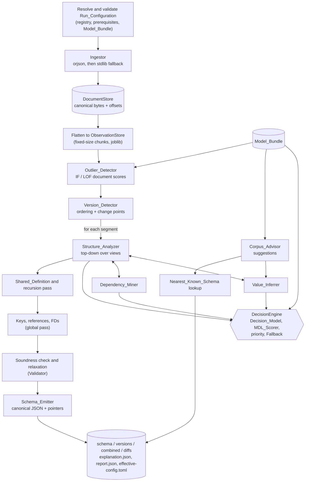
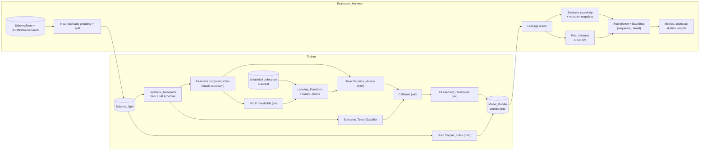
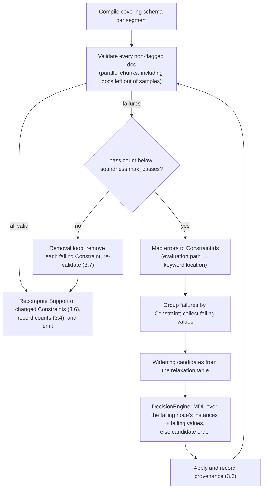

# Design Document: json-schema-inference

## Overview

`jsinfer` is a Python package and CLI that infers a draft 2020-12 JSON Schema from a Document_Collection. It runs top-down over a columnar store of Observations, resolves every Decision_Point through one decision engine (Decision_Model, then MDL, then registry priority, then Fallback_Behavior), enforces soundness with a Validator loop, and emits canonical schemas with a Provenance_Record for every Constraint. A separate subpackage, `jsinfer.bench`, implements the Evaluation_Harness on top of the public API only.

The design targets one student and one semester. It favors standard algorithms with small in-house implementations over heavy frameworks. The Must tier of the Proposed Delivery Priority is the critical path. Should and Could techniques plug into the same Technique registry and are registered (disabled, marked unimplemented) until built.

### Main design decisions

1. **Columnar Observation store with views.** Documents are flattened once into numpy columns keyed by a *shape path*, where every object step is a wildcard `{*}` (with a key column) and every array step is `[*]` (with a position column). Logical Paths such as `$.user.email` are row-index *views* over those columns. Record-or-Map, Variants, Tagged_Union branches, and Tuple positions are all just different views. Map-like objects with 100k distinct keys therefore never create 100k Paths.
2. **One decision engine.** All Decision_Points call `DecisionEngine.resolve`, which applies the resolution order of Requirements 19, 22, and 28 and writes the Provenance_Record and Inference_Report entry. Techniques only generate candidates.
3. **Concrete two-part MDL code.** Model bits use Rissanen's universal integer code and literal costs. Data bits use Krichevsky–Trofimov (KT) categorical codes, which depend only on counts and are therefore order-independent. Rejected Observations pay an exception cost based on a universal value code. Candidates are scored locally, with descendants represented by their Naive_Merge subschemas, which keeps scoring linear.
4. **Exceptions as candidates.** When MDL exception encoding is enabled, candidates that reject a few Observations compete on equal terms with candidates that widen. If a rejecting candidate wins, the rejected values become Flagged_Items.
5. **Soundness by widening only.** After inference, the Validator checks every non-flagged document. Failures trigger only widening edits from a fixed table, so monotonicity holds by construction.
6. **Determinism by construction.** Random streams are derived from `SeedSequence(seed, purpose, path)`. Chunking is fixed and independent of the worker count. Iteration orders are canonical, reductions are exact (integer counts, `math.fsum`), and emitted JSON uses one canonical encoder.
7. **Learning.** A seeded Synthetic_Generator produces labeled collections from corpus schemas. Decision_Models are scikit-learn `HistGradientBoostingClassifier`s, calibrated with sigmoid scaling on the validation split. Weak supervision uses a small in-house Dawid–Skene label model. Learned_Thresholds are fitted by deterministic grid search on validation-split objectives.

### Research findings that shape the design

- **jsonschema-rs** (0.58.x) exposes `validator_for(schema, validate_formats=True)`, draft-specific classes such as `Draft202012Validator`, `iter_errors` (each error carries `instance_path`, `schema_path`, and a typed `kind`), and `meta.is_valid` / `meta.validate` for meta-schema checks. Its default regex engine (fancy-regex) supports lookaround. A linear-time engine is available via `pattern_options`. Integers of any size map to Python `int`. It also ships an experimental canonicalization API with a `covers` containment check, which is a possible secondary Subschema_Checker. It supports CPython 3.10–3.14. ([PyPI](https://pypi.org/project/jsonschema-rs/))
- **orjson** keeps integers up to 2^64−1 exactly, but recent versions return a lossy float for larger integers instead of raising ([discussion](https://discuss.python.org/t/should-python-json-decoders-silently-convert-oversized-integers-to-float/109278)). The Ingestor therefore treats a parse result containing an integral float with magnitude ≥ 2^63 as a rejection and re-parses with stdlib `json`, which preserves big integers. This satisfies Requirement 1.6.
- **jsonsubschema** provides `isSubschema(s1, s2)` and a CLI ([GitHub](https://github.com/IBM/jsonsubschema)). The ISSTA 2021 paper describes its keyword coverage in terms of draft-04 and excludes recursive references. The design uses a 2020-12→draft-04 shim and treats everything else as unsupported (see Open Decisions).
- **datasketch** provides seeded `MinHash` and `MinHashLSH`, where band/row parameters can be set explicitly ([GitHub](https://github.com/ekzhu/datasketch)).
- **scikit-learn** ≥ 1.6 calibrates a pre-fitted model by wrapping it in `FrozenEstimator` and passing it to `CalibratedClassifierCV`, replacing `cv="prefit"` ([docs](https://scikit-learn.org/stable/modules/generated/sklearn.frozen.FrozenEstimator.html)). `HDBSCAN`, `DBSCAN`, `IsolationForest`, and `LocalOutlierFactor` are in core scikit-learn.
- **ruptures** accepts custom costs as `BaseCost` subclasses, which `Pelt(custom_cost=..., min_size=..., jump=...)` can use ([docs](https://centre-borelli.github.io/ruptures-docs/user-guide/costs/costcustom/)).
- **regress** is a Python binding to an ECMA-262 regex engine ([PyPI](https://pypi.org/project/regress/)). It serves as the ECMA oracle in the pattern dialect-agreement tests.
- **JSONoid** is a JVM CLI (`jsonoid [OPTIONS] input.jsonl`) with options for equivalence relation, dynamic-object detection, definitions, and a random seed ([man page](https://github.com/dataunitylab/jsonoid-discovery/blob/main/jsonoid.1.md)).
- **ReCG** is described in PVLDB 17 ([paper](https://vldb.org/pvldb/vol17/p3538-han.pdf)). A quick search found no public implementation, so the Baseline_Adapter supports both an official binary and a labeled reimplementation.

Content from these sources was rephrased for compliance with licensing restrictions.

### Libraries

All dependencies are pinned with `==` in `pyproject.toml` and locked in `uv.lock`. A CI test asserts that the lock file resolves each package to exactly one version (Requirement 29.5).

| Library | Use | Justification |
|---|---|---|
| orjson | Primary parser (29.2) | Required; fastest RFC 8259 parser |
| stdlib `json` | Fallback parser; canonical emitter | Preserves big integers. `parse_constant` rejects NaN and Infinity. Stable output |
| jsonschema-rs | Validator, meta-schema checks, format and pattern checks (29.3) | Required; Rust speed; supports drafts 4–2020-12 |
| joblib (loky) | Process-parallel per-chunk and per-Path work (29.4) | Required; memmaps numpy arrays to workers |
| numpy, scipy | Columnar store, sparse presence matrices, connected components | Standard; no alternative needed |
| scikit-learn ≥ 1.6 | DBSCAN, HDBSCAN, IsolationForest, LOF, HistGradientBoosting, calibration, metrics | Covers seven Techniques with one dependency |
| datasketch | MinHash/LSH for variants, nearest schema, and near-duplicate grouping | Small, seeded, deterministic hashing (SHA-1 based, not `hash()`) |
| ruptures | PELT change-point search with a custom Bernoulli cost | Mature; custom cost API |
| jsonsubschema | Subschema_Checker | Required by the spec. Pinned (0.0.8) in the project environment, whose pins its requirements fit; run in a child process |
| tomli-w | Writing TOML Run_Configurations (stdlib `tomllib` reads) | Tiny; needed for the config round trip |
| psutil | Peak RSS of process trees (29.7, 35.7) | Standard |
| Dev: pytest, hypothesis, regress | Tests and property tests; ECMA oracle | Standard |

Rejected options: **snorkel** (pulls in torch; a Dawid–Skene EM is about 100 lines), **mlxtend** (pulls in pandas and matplotlib for FP-growth, which is about 150 lines in-house), **networkx** (only maximal cliques on tiny graphs are needed), **hypothesis-jsonschema** for production generation (Hypothesis draws are not designed for byte-identical seeded generation; it is still fine inside tests). JSONoid (Java 17 jar, pinned by release and SHA-256) lives outside the Python lock file, and its version is recorded with every result (34.11).

## Architecture

### Inference pipeline



| Stage | Component | Input → Output | Parallel unit | Tier |
|---|---|---|---|---|
| 0 | `config` | CLI flags, TOML, defaults → effective `RunConfiguration` | none | Must |
| 1 | Ingestor | files or iterable → `DocumentStore`, parse errors | file chunk | Must |
| 2 | Flatten | `DocumentStore` → `ObservationStore` | doc chunk | Must |
| 3 | Outlier_Detector (IF/LOF) | features → document flags | none (single fit) | Should |
| 4 | Version_Detector | non-flagged docs → segments | none | Could |
| 5 | Structure_Analyzer + Value_Inferrer + Dependency_Miner | view tree → `SchemaModel` | top-level Paths | Must/Should |
| 6 | Shared definitions | `SchemaModel` → `SchemaModel` with `$defs` | none | Should |
| 7 | Keys, references, FDs | views → annotations | Path | Could |
| 8 | Soundness | `SchemaModel` + docs → relaxed `SchemaModel` | doc chunk | Must |
| 9 | Emitter + nearest schema | model → files, report | none | Must/Should |

Every stage records its wall-clock time under the component name (27.8). A stage that raises an error not covered by a skip, fallback, or record-and-continue rule aborts the run (27.10).

### Training and evaluation flows



### Package layout

```
pyproject.toml, uv.lock
src/jsinfer/
  __init__.py            # public API: infer, infer_files, load_schema, emit_schema
  cli.py                 # infer | explain | list-techniques | list-thresholds | train | split | bench
  config/                # run_config.py, registry.py, thresholds.py, resources.py
  core/                  # paths.py, jsonvalue.py, observations.py, views.py, stats.py,
                         # schema_model.py, provenance.py, report.py, determinism.py, sampling.py
  io/                    # ingest.py, emit.py, load.py, validator.py, subschema.py
  mdl/                   # codes.py (primitive codes), scorer.py (MDL_Scorer)
  decide/                # engine.py (DecisionEngine), relax.py (widening table)
  structure/             # analyzer.py, record_map.py, variants.py, field_groups.py,
                         # arrays.py, shared_defs.py
  deps/                  # presence.py, cooccurrence.py, tagged_unions.py, exclusions.py, keys.py
  values/                # inferrer.py, types.py, latent.py, formats.py, semantic.py,
                         # patterns.py (safe regex AST + induction), enums.py, bounds.py
  robust/                # outliers.py, versions.py
  corpus/                # normalize.py, index.py, advisor.py
  learn/                 # features.py (shared featurizers), decision_models.py, labeling_functions.py,
                         # label_model.py, synth.py, mutations.py, labels.py, trainer.py, bundle.py
  pipeline/              # infer.py (orchestration), soundness.py, naive_merge.py, versions_out.py
  bench/                 # corpus_loader.py, splits.py, leakage.py, synthetic.py, real.py,
                         # baselines/{base,inferrer,naive,jsonoid,recg}.py, measure.py, metrics.py, bootstrap.py,
                         # studies.py, reporting.py, resume.py, runner.py
tests/
  unit/  property/  integration/  bench_smoke/  fixtures/  strategies.py
```

`learn/mutations.py` is shared by the Trainer (outlier and change-point threshold objectives) and the harness (Requirement 32). `learn/features.py` is the single feature implementation used by both the Trainer and the Inferrer (22.10).

### Per-segment inference walk

`Structure_Analyzer.analyze(view)` dispatches on the JSON types present in a view:

1. **Scalars** (rows of type null, boolean, integer, number, string) go to `Value_Inferrer.infer_scalar`.
2. **Objects:**
   1. Resolve Record-or-Map, and the hybrid partition if enabled.
   2. For a Record, resolve Closed-or-Open-Record.
   3. Generate candidate Variant groupings, select one, and resolve Merge-or-Split (all candidate Variants merge, or all stay separate; see Open Decisions).
   4. Detect a Discriminator. If one is selected, its value groups replace the Variant branches.
   5. For each final branch, recurse into the child views, then mine required/optional fields, Field_Groups, Co_Occurrence_Rules, and Exclusion_Rules.
3. **Arrays:** resolve Tuple-or-List, recurse into element views (filtered by position for Tuples), run the array grammar if enabled, and decide the item-count bounds.
4. **Mixed types:** if a view has a single object branch, all type-specific keywords coexist in one schema object, as in Naive_Merge. If a view has two or more object branches, the node becomes an `anyOf` with one branch per object branch plus one branch for the remaining types. A Closed_Enum among the scalars, beside arrays or objects, becomes an `anyOf` branch of its own, after any object branches and before the remaining types (see Open Decisions). A mixed node is always `anyOf`.

Flags raised by MDL exception encoding affect only the subtree of the flagged item, so one top-down pass is consistent. The one exception is the Discriminator search in step 2.4, which uses sibling values before the children's value-level flags are known. This approximation is documented.

## Components and Interfaces

Signatures are Python 3.11 with type hints. `JSON = None | bool | int | float | str | list["JSON"] | dict[str, "JSON"]`. `Ctx` is the per-run `InferenceContext`, which holds the config, registry, bundle, engine, RNG factory, report builder, and Validator.

### Public API and CLI (Requirement 27)

```python
def infer(documents: Iterable[JSON], config: RunConfiguration | None = None) -> InferenceResult: ...
def infer_files(paths: Sequence[os.PathLike], config: RunConfiguration | None = None) -> InferenceResult: ...
def load_schema(source: bytes | str | dict | bool) -> SchemaModel: ...            # Schema_Loader
def emit_schema(model: SchemaModel, *, inline_provenance: bool = False) -> bytes: ...

@dataclass(frozen=True)
class InferenceResult:
    schema: SchemaModel | None             # single schema (no change point accepted)
    provenance: ExplanationFile
    report: InferenceReport
    config: RunConfiguration               # effective
    document: dict | bool                  # emitted schema document (x-provenance iff output.inline_provenance)
    pointers: Mapping[ConstraintId, str]
    schema_bytes: bytes                    # canonical bytes of document
    versions: tuple[SchemaVersion, ...]    # Schema_Versions, when change points are accepted (task 48.2)
    combined: SchemaModel | None           # anyOf over the versions (18.8)
    diffs: tuple[VersionDiff, ...]
    def files(self) -> dict[str, bytes]: ...  # schema.json, explanation.json, report.json, effective-config.toml

class InferenceError(Exception):           # 27.13: carries the stage name and partial report
    stage: str; partial_report: InferenceReport
class NoDocumentsError(InferenceError): ...   # 1.8
class ConfigError(Exception): ...             # 27.11, 28.8, 28.9, 29.11 (raised before ingestion)
```

`infer()` writes the documents as JSONL lines, which the Ingestor parses and re-encodes canonically into the `DocumentStore` as for a `.jsonl` file (Open Decisions, In-memory documents), so the CLI and the API share every later stage. That makes 27.9 hold by construction. The pipeline's Schema_Emitter stage produces every output (`document`, `schema_bytes`, `provenance`), and `InferenceResult.files()` gives each output file's bytes, so the CLI writes them without recomputing anything. CLI commands (stdlib `argparse`):

| Command | Behavior | Requirements |
|---|---|---|
| `jsinfer infer INPUT... [-c FILE] [--set KEY=VALUE]... [--technique ID=on\|off]... [--out DIR]` | Full run. Writes outputs atomically: a temp directory under `--out`, renamed per file on success, deleted on failure | 27.1–27.3, 27.7, 27.10 |
| `jsinfer explain SCHEMA EXPLANATION POINTER` | Prints one Provenance_Record as plain text | 26.9, 26.12 |
| `jsinfer list-techniques` | Prints registry entries; reads no data | 28.10 |
| `jsinfer list-thresholds [--bundle ID]` | Prints Learned_Thresholds and their values | 20.2 |
| `jsinfer train -c train.toml --out DIR` | Trainer | 21 |
| `jsinfer split -c bench.toml` / `jsinfer bench {synthetic,real,ablation,robustness,versioning,calibration} -c bench.toml` | Evaluation_Harness | 30–35 |

Exit codes: 0 for success, 1 for an unrecoverable stage error or outputs that cannot be written, 2 for a configuration or usage error (including rejected input paths, 1.10, an unloadable Model_Bundle, an unusable `--out`, and every `explain` failure, 26.12), and 3 for no valid documents (1.8). What a failed run leaves in `--out`, how `--set` and `--technique` values are read, and standard-input handling are in Open Decisions (CLI failed runs, CLI settings flags, Standard input). `python -m jsinfer` runs the same CLI (`jsinfer/__main__.py`).

### Ingestor (Requirement 1)

```python
@dataclass(frozen=True)
class DocOrigin:
    source: str              # path relative to the supplied directory, or the supplied file path
    line: int | None         # 1-based line for .jsonl/.ndjson
    element: int | None      # position under array unwrapping

class Ingestor:
    def __init__(self, opts: InputOptions, workers: int, chunk_size: int): ...
    def ingest(self, inputs: Sequence[Path]) -> IngestResult: ...
        # IngestResult(store: DocumentStore, origins: list[DocOrigin], errors: list[ParseError], skipped: int)

def parse_document(data: bytes) -> tuple[JSON, Literal["orjson", "stdlib"]]:
    """Strip one UTF-8 BOM. Try orjson. Fall back to stdlib json when orjson raises,
    or when the result contains an integral float with |x| >= 2**63 (lossy big int).
    The stdlib path decodes strict UTF-8 and uses parse_constant to reject NaN/±Infinity."""
```

- **Enumeration.** Input arguments are processed in order. A directory is walked with `os.walk(followlinks=False)`, and symlinked files are skipped. Relative paths are sorted by code point and extensions are compared after `casefold()`. Rejected supplied paths raise `ConfigError` before any document is ingested (1.10).
- **Line splitting.** `.jsonl`/`.ndjson` files are split on `\n`, with a trailing `\r` stripped. Blank lines (empty, or only spaces and tabs) are skipped without consuming an index.
- **Error locations.** The error line comes from stdlib `JSONDecodeError.lineno` (offset by the record's starting line), or from the newline count before the offending byte for invalid UTF-8.
- **DocumentStore.** One `bytes` buffer of canonical re-serializations plus a numpy offsets array. It is memmapped to workers for flattening and validation, which keeps memory near the raw input size.

### Flattening and the ObservationStore

```python
def flatten_chunk(docs: Sequence[JSON], first_index: int) -> PartialStore: ...
def merge_partials(parts: Sequence[PartialStore]) -> ObservationStore: ...  # merged in chunk order
```

Chunks have a fixed size (Resource_Parameter `ingest.chunk_size`), independent of the worker count. Merging re-interns keys and scalar values with ids assigned in canonical sort order, so ids do not depend on chunking or document order.

### Structure_Analyzer (Requirements 4–8)

```python
class StructureAnalyzer:
    def analyze(self, view: View, ctx: Ctx) -> SchemaNode: ...
    def record_or_map(self, view: View, ctx: Ctx) -> RecordMapOutcome: ...           # 4.1, 4.5, 4.10, 4.11
    def closed_or_open(self, view: View, outcome: RecordMapOutcome, ctx: Ctx) -> bool: ...   # 4.7–4.9
    def variant_groupings(self, view: View, ctx: Ctx) -> list[Grouping]: ...         # 5.1, 5.7–5.9
    def merge_or_split(self, view: View, grouping: Grouping, ctx: Ctx) -> list[View]: ...    # 5.2, 5.3, 5.11
    def field_groups(self, variant: View, base: frozenset[str], ctx: Ctx) -> list[FieldGroup]: ...  # 6
    def tuple_or_list(self, view: View, ctx: Ctx) -> ArrayOutcome: ...               # 7.1–7.4, 7.9, 7.10
    def array_pattern(self, view: View, ctx: Ctx) -> ArrayPattern | None: ...        # 7.5–7.8

class SharedDefinitionPass:                                                          # 8
    def run(self, model: SchemaModel, views: ViewIndex, ctx: Ctx) -> SchemaModel: ...
```

Variant grouping techniques (`structure/variants.py`) all operate on the distinct Object_Signatures of a view, weighted by counts:

| Technique | Algorithm | Cut-offs |
|---|---|---|
| `variants.minhash_lsh` | MinHash of each key set, LSH with `params=(bands, perm // bands)`. Candidate pairs whose estimated Jaccard ≥ τ become graph edges, and connected components form the initial groups (`scipy.sparse.csgraph`). Groups are then merged greedily while total DL decreases. The merge candidates are the links of the maximum spanning forest of the LSH-retrieved pairs, weighted by estimated Jaccard (ties by signature pair). Each pass walks the links strongest first and merges the two groups a link joins when that lowers the exact DL of the grouping; passes repeat until one merges nothing. Groups that LSH never links stay separate: trying every pair of groups costs one scoring per pair per merge and is too slow when a strict τ leaves many components. With one band, the candidate pairs are those with equal sketches (datasketch's `MinHashLSH` needs two or more bands) | τ = `lsh.keyset_jaccard` (Learned_Threshold); perm and bands are Resource_Parameters |
| `variants.dbscan` | `DBSCAN(metric="precomputed")` on the Jaccard distance matrix of signatures (sets of `(key, type)` entries), with `sample_weight` = signature counts, so `dbscan.min_samples` counts objects | `dbscan.eps` (recorded as the cut-off), `dbscan.min_samples` (recorded in the grouping's details, since a cut-off holds one Learned_Threshold) |
| `variants.hdbscan` | `HDBSCAN(metric="precomputed")` on the same matrix, unweighted: scikit-learn's `HDBSCAN.fit` takes no `sample_weight`, so each distinct signature is one point and `hdbscan.min_cluster_size` counts signatures. Repeating signatures by count would make the matrix objects × objects | `hdbscan.min_cluster_size` (in signatures) |
| `variants.bernoulli_mixture` | In-house weighted EM for a Bernoulli mixture over key-presence bits, with k = 1…min(#signatures, `variants.max_components`) and BIC selection | BIC (5.2) |

Noise points from DBSCAN/HDBSCAN are grouped by signature, and each signature group joins the existing or new group with the lowest DL (5.9). DBSCAN and HDBSCAN are super-linear in the distinct signatures they cluster. When a Path has more signatures than `sample.dbscan` or `sample.hdbscan`, the Technique clusters a uniform sample of that many signatures drawn with `rng(technique, path)`; every unsampled signature takes the label of its nearest sampled signature (smallest Jaccard distance, ties to the first), so every object still lands in exactly one candidate Variant. The sample is recorded as sampled and total signatures (29.8, 26.4). Signatures are sorted canonically before clustering, so labels do not depend on document order. When `decide.mdl` is enabled, the MDL_Scorer picks among the groupings. Otherwise the registry priority order picks (5.11).

The **hybrid Record/Map partition** (4.5) sorts keys by descending object frequency (ties by name). It evaluates partitions where the top-j keys are Record fields, for j = 1…K−1, plus the partition "keys matching the induced Map-key Pattern versus the rest". The best partition replaces the Record-or-Map outcome only if it beats both pure encodings. Implementation notes (task 37.1): the top-j partitions (j = 1 … min(K−1, 64), `cap_reached` in the entry's details beyond that) are scored as their Naive_Merge encodings (fields under `properties` with `required`, the entries' values under `additionalProperties`); the Pattern partition takes the Pattern the Value_Inferrer induces over the Map entries of the best top-j partition (a side engine, no report entries; candidates scored as the partition's encoding with and without the Pattern), partitions every key by whether it matches, and is encoded under `patternProperties`. The MDL_Scorer codes an extra key matched by a `patternProperties` Pattern under that Pattern's string code (as under `propertyNames`), which is what makes the Pattern form cheaper than listing sparse keys. No partition is the Technique's own candidate at `record_map_partition`, scored as the better pure encoding, and a partition is offered only when strictly below it, so the selected candidate's description length is below both pure encodings whenever a partition is selected. The partitioned node (`_hybrid_part`) lists the fields under `properties` (children inferred by the walk), `required` over the fields, the entries' values at the Map wildcard step (one child inferred from the union of the entries' views), and the Map part under `patternProperties` for the Pattern partition (the run's Value_Inferrer repeats and records the induction; 4.6) or `additionalProperties` for a top-j partition, whose entries admit no such Pattern (the Pattern partition would coincide with it and encode cheaper). Closed-or-Open-Record runs on the partitioned Record in the `patternProperties` form only (4.7). A partitioned Path has one object schema: Variants, Discriminators, Field_Groups, Co_Occurrence_Rules, and Exclusion_Rules do not run on it. Its `properties` and Map-part Constraints carry the partition decision (details `judgment: hybrid`, the partition label, fields, and Pattern); the Record-or-Map decision stays in the report as the replaced judgment, which Property 41 treats as producing no Constraint at a partitioned Path.

**Field groups** (6): `groups.fpgrowth_slim` runs an in-house FP-growth over the distinct non-base key sets (with counts). Krimp-style code-table selection accepts an itemset when total DL drops. `groups.bmf` runs greedy MDL Boolean matrix factorization (tiling from distinct transactions, with k chosen by DL). Both outputs go through the all-or-none filter (6.7) and the disjointness filter (6.8), applied greedily by DL gain. Selection then compares ∅, the FP set, and the BMF set (6.2).

**Array grammar** (7.5) builds candidate grammars over element-kind sequences: `K*`, a fixed prefix plus `K*`, `(K1|K2)*`, a repeated group `(K1 K2…)*` found by a period check, and the exact tuple. The candidate with the lowest DL that matches every array wins. A prefix plus a single repeated kind maps to `prefixItems`, `items`, and `contains`. Anything else is recorded in `x-array-pattern`.

**Shared definitions** (8): subschemas get a canonical hash that ignores provenance. Equal hashes at two or more Paths are compared inlined versus extracted by model bits (data bits are identical). Object subschemas at different Paths that share a property name go through Merge-or-Split, with features computed from the union view. Prefix-related Path pairs produce a self-referencing definition. The merged subschema is inferred from the union of all recursion levels, and at the recursive relative step `analyze` emits a `$ref` instead of recursing. Definition names follow 8.5, with a default name of `def`. Implementation notes (task 36.1): a recursion candidate is a step `S` of one property, or one property's array elements, whose objects share a property name with the Path's; the levels' union is grouped by level (each Object_Signature to the level holding most of its objects) as the only candidate of a `variant_grouping` Decision_Point, and `merge_or_split` judges it. While the definition body is inferred from the union, the recursive step and the Path itself are `{}` placeholders that become `$ref` nodes once the walk ends, so scoring and validation during the walk see an accept-all subschema. The cross-Path merge of 8.3 considers object sites whose property-name sets overlap with Jaccard at least 1/2 (at most 16 merges per model), runs before equivalence extraction (8.1), and definitions whose every `$ref` was replaced by a later merge are pruned. Extraction compares model bits on copies of the root that carry the definitions extracted so far, and considers subschemas of two or more keywords (at most 64 sites per candidate, 32 rounds). Decisions (task 36.2): a recursive definition whose top level is the schema root is the root itself, so the recursive step emits `{"$ref": "#"}` and no `$defs` entry (the root keeps its structure for every reader; `$defs` holds only subschemas below it). Definition names are JSON-Pointer tokens (`~0`, `~1`) percent-encoded in the `$ref` fragment, and an empty property name is a trailing empty token. The cross-Path grouping Decision is built directly (a priority Decision with the one grouping, `technique` naming the origin `structure.recursion` or `structure.shared_defs`), since no grouping Technique chose it. The Trainer's oracle runs (22.6) keep `structure.shared_defs` and `structure.recursion` off: their Judgment_Calls cross Paths and carry no planted label, and a merge would move the per-Path calls off the source schema's Paths (`learn.trainer.CROSS_PATH_TECHNIQUES`). Property tests that read the emitted structure Path by Path (10, 12, 14, 18, 19, 20) run with those two Techniques off; Properties 3, 16, and 41 cover the `$defs` layout, and Property 41 gives a `$defs` body the logical Path of the first site referring to it. Found by the suite: the Discriminator's remaining-types branch (10) took its record from the Merge-or-Split outcome, which may be a merge when the Discriminator replaces one Variant; it now re-supports the Discriminator decision's record. An empty fallback branch records its `properties` and `required` entries, and the `enum` inside a fallback's `not` carries the Discriminator's record. Provenance of a definition (26, Property 41): an extracted definition (8.1) is inferred once more from the union of its sites' views (every analyzed node keeps its view), so its records and their totals count every referencing site, and each `$ref` carries the extraction decision with the site's instances as Support; the sites' own records go with their subschemas, and so do the report entries their analysis recorded: every analyzed node keeps the range of decisions and rejected candidates its analysis produced (recording order, `InferenceReport.mark`), and a replaced node's range is forgotten exactly (`InferenceReport.forget_between`), never by Path, so entries of definitions inferred earlier or later under the same Path stay and the report describes the schema as emitted. The `shared_definition` entry names its sites (`sites` as pointers, `site_paths` rendered), and the cross-Path Merge-or-Split entries carry `origin` and `sites`; `DecisionEngine.resolve` takes such `details` from the caller.

### Dependency_Miner (Requirements 9–12)

```python
class DependencyMiner:
    def presence(self, variant: View) -> Presence: ...                                # 9.1, 9.2 (bitsets per field)
    def cooccurrence(self, variant: View, p: Presence, groups: list[FieldGroup], ctx: Ctx) -> list[Rule]: ...  # 9.3–9.9
    def discriminator(self, view: View, variants: list[View], ctx: Ctx) -> TaggedUnion | None: ...  # 10
    def exclusions(self, view: View, groups: list[FieldGroup], branches: list[SchemaNode], ctx: Ctx) -> list[Exclusion]: ...  # 11
    def keys_refs_fds(self, model: SchemaModel, views: ViewIndex, ctx: Ctx) -> list[Annotation]: ...  # 12
```

- **Co-occurrence.** Antecedent rows ⊆ consequent rows is tested with packed bitsets. The redundancy reduction of 9.5 works on the implication graph: required fields and Field_Group cliques are treated as given, and each strongly connected component collapses to a canonical cycle in code-point order. Edges implied transitively are dropped, which produces a canonical transitive reduction. Each candidate that passes the Support filter is its own Decision_Point, compared against the Variant subschema without it. A rule that every object satisfies changes only the model bits and the Record's presence terms, so each candidate is scored by exchanging those terms (`MDLScorer.presence_bits`), which equals full scoring. A candidate's Confidence is `(count(a) + 1) / (count(a) + 2)` (see Open Decisions).
- **Decision trees** (`rules.decision_trees`) are an in-house categorical tree with binary splits `P == v`, grown greedily while DL decreases and post-pruned when collapsing a split lowers DL (10.2). Each tree is limited by `trees.max_depth`, and only the top `trees.max_values` values of each feature are kept (Resource_Parameters). Value groups are the partition of a property's values induced by its retained splits.
- **Exclusions.** Maximal sets of members that never co-occur are the maximal cliques of the never-co-occur graph (Bron–Kerbosch with pivoting, canonical order). Confidence is `1 − exp(−E)`, where E is the expected number of objects with two or more members under independence (11.2). "Already enforced" (11.3) is tested with the Validator on witness objects built from observed values. If no witness can be built, the rule is kept, which is redundant but sound.
- **Keys, references, and FDs.** These run after structure inference over the final logical Paths. Confidence is `1 − p_chance`, with p depending only on (n, d) so that 12.5 holds:
  - Key: `p = n!/nⁿ`, the chance that n draws from n equally likely values are all distinct.
  - FD: `p = 2^−(n−d)`, where each repeated determinant occurrence is a fair test.
  - Inclusion: `p = 2^−d_A`.

  The Learned_Thresholds calibrate the scale.

### Value_Inferrer (Requirements 13–16)

```python
class ValueInferrer:
    def infer_scalar(self, view: View, ctx: Ctx) -> ScalarNode: ...
    def key_constraint(self, keys: KeyView, ctx: Ctx) -> Constraint | None: ...      # 4.4 propertyNames
    def decide_bound(self, q: np.ndarray, kw: BoundKeyword, ctx: Ctx) -> BoundDecision: ...  # 16.2, 16.7
```

Order at a scalar view:

1. `type` (13.1, 13.2), from the `type` Baseline_Rule, so its record names `baseline:type` (26.13).
2. Closed-or-Open-Enum (15), scored with an open candidate that uses type-only coding.
3. String candidates from latent type (13.3), Format detection (13.4), the Semantic_Type_Classifier (13.5, 13.7), and Corpus_Advisor suggestions (24).
4. Withhold any candidate that rejects a non-flagged string (13.6).
5. MDL selection among the survivors (13.8, 24.7).
6. Pattern induction, if there is no Format and the view is not a Closed_Enum (14).
7. Bounds (16).

Format checks run once per distinct value through cached validators `{"format": f}` with `validate_formats=True`.

**Pattern induction** (`values/patterns.py`) is FlashProfile-style:

- Each string is tokenized into atoms: maximal runs of `[0-9]`, `[a-z]`, `[A-Z]`, and single literal characters. Strings are grouped into profiles by atom-class sequence.
- Each profile yields sub-patterns at increasing generality: exact run lengths, then `{min,max}` ranges, then class widening (`[0-9]` or `[a-z]` → `[A-Za-z]` → `[0-9A-Za-z]`), then `+`.
- Profiles are merged greedily by smallest DL increase until at most `patterns.max_alternatives` remain.
- Every candidate is checked against all distinct values with the Validator (14.7). Induction stops at `patterns.attempt_budget` candidates (14.8).

Patterns are printed from a **safe regex AST**:

- Only the ASCII classes `[0-9]`, `[a-z]`, `[A-Z]`, `[A-Za-z]`, and `[0-9A-Za-z]` appear.
- Literals are escaped only when they are ECMA syntax characters (`^$\.*+?()[]{}|/`). Other characters, including non-ASCII ones, are emitted raw.
- Quantifiers apply only to ASCII classes or to `(?:…)` groups. A repeated astral character is written `(?:😀){2}`, which behaves the same in UTF-16 and code-point engines.
- Every pattern is anchored as `^(?:alt1|…|altk)$(?!\n)`. Python's `$` also matches before a final newline, and the lookahead rules that out, so all three engines require a full-string match (14.4, 14.5). The default fancy-regex engine supports the lookahead.
- Adjacent atoms with overlapping classes are merged, so a string's decomposition under a pattern is unique. The MDL_Scorer computes pattern data bits with its own matcher.

### Outlier_Detector and Version_Detector (Requirements 17–18)

```python
class OutlierDetector:
    def document_scores(self, store: ObservationStore, ctx: Ctx) -> dict[str, np.ndarray]: ...   # 17.1
    def flags_from_scores(self, scores: dict[str, np.ndarray], ctx: Ctx) -> FlagSet: ...
    # 17.2/17.3 run inside DecisionEngine through exception-bearing candidates

class VersionDetector:
    def ordering(self, store: ObservationStore, opts: InputOptions, ctx: Ctx) -> Ordering: ...  # 18.2–18.4, 18.11
    def segment(self, store: ObservationStore, order: Ordering, ctx: Ctx) -> Segmentation: ...  # 18.1, 18.5
```

**Document features** for IF and LOF:

- Raw key-path presence and type bits hashed into `outliers.hash_dims` buckets with BLAKE2b.
- Size, depth, key count, and array count.
- Mean and maximum type rarity, `−log2 P(type | path)`.
- Maximum robust z-score (median/MAD) of numbers and string lengths.

Rows are sorted canonically before fitting, which makes the fit independent of document order. IF uses `random_state` from the seed stream. LOF uses `novelty=True` and is fitted on a sample when the document count exceeds `sample.lof`. Anomaly scores are `−score_samples(X)`.

**Change points** use PELT (ruptures) with a custom Bernoulli cost. Each segment pays the KT code length of its feature bits, so the criterion is MDL plus a learned per-change penalty `changepoint.penalty` and minimum segment length `changepoint.min_segment`. When the document count exceeds `sample.changepoint`, PELT runs on a seeded sample (kept in Ordering_Key order). Each boundary is then refined by a linear scan between the neighboring sampled documents. Dates are compared after normalizing to UTC, with `date` values read as midnight UTC.

**Version outputs** (`pipeline/versions_out.py`). Each Schema_Version is emitted as its own file with `$schema` at its root. To build the combined schema, each version's root is placed under the combined `anyOf` without `$schema`. Its `$defs` entries are hoisted to the combined root with a `v<i>-` name prefix, and its `$ref`s are rewritten to match. Diffs compare (logical Path, keyword) → value maps between consecutive versions.

### MDL_Scorer (Requirement 19)

```python
@dataclass(frozen=True)
class Score:
    model_bits: float; data_bits: float; exception_bits: float
    n_rejected: int; n_scored: int
    @property
    def total(self) -> float: return math.fsum((self.model_bits, self.data_bits))

class MDLScorer:
    def score(self, node: SchemaNode, view: View) -> Score: ...
    def model_bits(self, node: SchemaNode) -> float: ...
    def data_bits(self, node: SchemaNode, view: View) -> tuple[float, float, int]: ...  # data, exceptions, n_rejected
```

The scorer works on per-view statistics such as type counts, value-id histograms, length histograms, and presence bitsets. Per-distinct-value costs are multiplied by counts and summed with `math.fsum`, so results are bit-identical for any multiset order. The encoding is specified in Key Algorithms.

### DecisionEngine

```python
@dataclass(frozen=True)
class Candidate:
    technique: str                 # producing Technique id
    order_key: tuple               # documented candidate order (19.4)
    node: SchemaNode               # partial schema expressing the outcome
    outcome: Any                   # e.g. "record" | "map", grouping id, bound value
    rejects: RowSet = EMPTY        # rows it would reject (exception candidates)
    withheld: Mapping | None = None  # Document_Support facts when the rule refutes it (4.12, 14.9, 15.9, 16.9)

class DecisionEngine:
    def resolve(self, dp: DecisionPoint, candidates: Sequence[Candidate], view: View,
                features: Callable[[], np.ndarray] | None = None) -> Resolution: ...
```

The resolution order is:

1. If an enabled Decision_Model technique serves the Decision_Point kind, use it. The Model_Bundle selects the model as follows: when `decide.weak_supervision` is enabled and a WS-trained model exists, use it. Otherwise use the synthetic-only model (23.8, 23.9). If no model exists for the kind, record the substitution and fall through (22.14).
2. If `decide.mdl` is enabled, use argmin DL. Ties go to fewer model bits, then registry priority, then `order_key` (19.3, 19.4, 28.6).
3. If enabled techniques produced candidates, use registry priority (19.7, 28.7).
4. Otherwise apply the Decision_Point's Fallback_Behavior (28.4).

A winner chosen by step 1 or step 3 then goes through the exception check described below (17.2, 17.3).

A `DecisionPointSpec` can declare a tie rule that a requirement mandates, and the engine applies it before the generic 19.4 chain:

| Decision_Point | DL tie goes to | Req |
|---|---|---|
| Record-or-Map | Record | 4.10 |
| Tuple-or-List | List | 7.10 |
| Array pattern | the schema of 7.2–7.4 | 7.8 |
| Pattern selection | no Pattern, then fewer sub-patterns | 14.2 |
| Closed-or-Open-Enum | open | 15.6 |
| Bounds | the candidate nearest the observed extreme | 16.7 |
| MDL exceptions | widening | 17.2, 17.3 |

Candidates with `rejects ≠ ∅` are offered only when `robust.mdl_exceptions` is enabled. If such a candidate wins, the rejected rows become Flagged_Items (17.2, 17.3). Ties favor the widening candidate.

Candidates with `withheld` set (Document_Support, `decide/support.py`) take part in no step, as if the Technique had not produced them, and the decision's `details["withheld"]` lists each with its label and facts in canonical order. A withheld Judgment_Call candidate removes one of the Decision_Model's classes, so step 1 is skipped at a point with a withheld candidate and steps 2–4 resolve it among the rest; the model's one-candidate-per-class check stays intact. See "Document_Support" under Key Algorithms.

Exception encoding does not depend on `decide.mdl` (17.2, 17.3). When the MDL step runs, exception-bearing candidates compete in its pool as above. When step 1 or step 3 selects a widening winner W and eligible exception-bearing candidates exist, the engine runs an exception check: the best exception-bearing candidate E (lowest DL; ties by the mandated tie rule, fewer model bits, then canonical order) replaces W only when `DL(E) < DL(W)`, so ties go to widening. This is the MDL step's rule restricted to W plus the exception-bearing candidates. W and each exception-bearing candidate are scored by their precomputed score or `MDLScorer.score(node, view)`.

- If E wins, the method is `mdl`. The resolution lists W and the exception-bearing candidates with DL scores, Confidence is the MDL posterior over that set, the cut-off is "MDL comparison" with those scores, and the rejected rows become Flagged_Items. Any fallback indicator from the earlier step is kept (the Decision_Model's, or `decide.mdl` "disabled" for priority among two or more candidates).
- If W survives, the earlier step's method, Confidence, and cut-off stand, and the compared description lengths go in the decision's details.

Step 4 runs no exception check: when no serving Technique can act, the Fallback_Behavior applies to every candidate, exception-bearing ones included (28.4). Keeping the check outside the MDL step keeps the ablations of `decide.mdl` and `robust.mdl_exceptions` independent.

MDL Confidence is the normalized code-length posterior `2^−DL(c) / Σ 2^−DL(c')`. Decision_Model Confidence is the calibrated probability (22.12). The engine writes the method, all candidates with scores, the cut-off source and value (20.7), and any fallback indicator (26.3, 26.10, 28.12). Each cut-off source is one of 20.1's: "MDL comparison" with the compared DLs; "Decision_Model comparison" with the calibrated probabilities of the compared outcomes and the Decision_Model artifact (`dm.<kind>.synthetic` or `dm.<kind>.weak`); a model-selection criterion name with its scores; or a Learned_Threshold name with its value. When a Decision_Model gives equal probabilities and MDL breaks the tie, the source is "MDL comparison" with the tied outcomes' scores (22.12, 20.7). A constant Fallback_Behavior, or a priority selection with no Learned_Threshold applied, records that no cut-off was applied (20.7).

### Decision_Models and Semantic_Type_Classifier (Requirements 21–22)

```python
class DecisionModel:                        # wraps a calibrated sklearn classifier
    kind: JudgmentKind; trained_with: Literal["synthetic", "synthetic+weak"]
    feature_version: str
    def predict_proba(self, x: np.ndarray) -> np.ndarray: ...   # columns ordered by kind.classes

def featurize(kind: JudgmentKind, view: View, candidates: Sequence[Candidate], ctx: Ctx) -> np.ndarray: ...

class SemanticTypeClassifier:
    def predict(self, view: View, name: str | None, parent: str | None) -> tuple[str, float]: ...
    mapping: Mapping[str, FormatOrPattern | None]   # semantic type → Format or Pattern (13.5)
```

Features per Judgment_Call kind (`learn/features.py`, versioned) are listed below. Every kind also includes the MDL difference between its two outcomes, normalized by `n_scored`, and hashed name tokens for the field and its parent.

| Kind | Features |
|---|---|
| Record-or-Map | n objects; distinct keys; keys/object mean and std; key-frequency entropy; singleton-key fraction f1/#keys; Chao1(keys)/#keys; fraction of keys matching integer, UUID, date, or hex patterns; key length mean and std; value-type entropy across keys; mean pairwise key-set Jaccard (seeded sample of pairs) |
| Closed-or-Open-Record | n objects; #keys; f1 and f2 of key occurrences; Good–Turing unseen-key mass; mean optional-key presence; depth; key-set stability between the first and second halves in canonical order |
| Tuple-or-List | length mean, std, and distinct-length ratio; modal-length share; per-position type entropy minus pooled type entropy; distinct element kinds; maximum length |
| Closed-or-Open-Enum | the six statistics of 15.1; S_obs/n; Chao1/S_obs; value JSON type; mean string length; fraction of values that look like identifiers |
| Merge-or-Split | number of candidate groups; min, mean, and max pairwise key-set Jaccard; type agreement on shared keys; group-size entropy; presence of a scalar field whose value predicts the group (max mutual information) |

The model is `HistGradientBoostingClassifier(random_state=seed, early_stopping=False)`, calibrated with `CalibratedClassifierCV(FrozenEstimator(m), method="sigmoid")` on validation examples (21.4). Inside workers, `threadpoolctl` limits OpenMP to one thread for determinism. The Semantic_Type_Classifier is a multiclass HGB over Sherlock-style aggregate features of a seeded value sample (character-class fractions, length statistics, distinct ratio, parse rates for int/float/date, per-Format satisfaction rates, character entropy) plus hashed name and parent tokens. Its classes are the ten Formats, a documented set of Pattern-mapped types (country code, currency, E.164 phone, language tag, hex color, semver), and `none`.

### Corpus_Advisor (Requirements 24–25)

```python
def normalize_name(name: str) -> tuple[str, ...]: ...     # 24.2: split on _, -, lower/digit→upper; casefold

class CorpusIndex:                                         # stored in the Model_Bundle
    def lookup(self, name: tuple[str, ...], parent: tuple[str, ...] | None) -> list[Suggestion]: ...
    def cf_scores(self, siblings: Sequence[tuple[str, ...]]) -> list[Suggestion]: ...
    def nearest(self, paths: frozenset[str], k_next: int, exclude: frozenset[str]) -> list[Neighbor]: ...

class CorpusAdvisor:
    def suggest(self, view: View, ctx: Ctx) -> list[Candidate]: ...                   # 24.3–24.9
    def nearest_known(self, model: SchemaModel, ctx: Ctx) -> NearestReport: ...       # 25
```

The index is a SQLite file holding counts per (name), (parent, name), and (name, constraint), plus a table of normalized Path sets. MinHash signatures are computed from those Path sets at load time with hash functions seeded from the Run_Configuration seed (25.1). The bundle can carry a signature cache for the default seed, which is used only when the run seed matches. Suggestible keywords are `format`, `pattern`, `enum`, `minimum`, `maximum`, `minLength`, and `maxLength`. CF scores are a noisy-OR over `P(constraint | sibling name)` estimated from the training-split co-occurrence counts. The harness passes `corpus.exclude_ids` to filter held-out groups (30.6).

### Schema_Emitter and Schema_Loader (Requirement 2, 26)

```python
class SchemaEmitter:
    def layout(self, model: SchemaModel) -> tuple[dict, dict[ConstraintId, str]]: ...   # JSON + pointer map
    def dumps(self, doc: dict) -> bytes: ...                     # canonical bytes
    def explanation(self, model: SchemaModel, pointers: dict[ConstraintId, str]) -> bytes: ...

class SchemaLoader:
    def load(self, source: bytes | str | dict | bool) -> SchemaModel: ...  # raises SchemaLoadError(check, line, col)
```

**Canonical output.** Keywords appear in a fixed rank order: `$schema`, `$id`, `$ref`, annotations, `type`, `enum`, `const`, `format`, `pattern`, numeric bounds, `properties`, `patternProperties`, `additionalProperties`, `propertyNames`, `required`, `dependentRequired`, object bounds, `prefixItems`, `items`, `contains`, array bounds, `uniqueItems`, `anyOf`, `oneOf`, `allOf`, `not`, `if`/`then`/`else`, `$defs`, `x-*` sorted, and `x-provenance` last.

- `properties`, `patternProperties`, `$defs`, and `dependentRequired` keys are in code-point order, and so are `required` and `dependentRequired` values.
- `type` follows the order null, boolean, integer, number, string, array, object. `enum` follows canonical value order: type rank, then value, with containers ordered by their canonical bytes.
- Bytes are `json.dumps(doc, indent=2, ensure_ascii=False, allow_nan=False) + "\n"` in UTF-8. The stdlib encoder handles big integers and is the only encoder used for schemas and explanation files, so output is byte-stable (2.3, 26.8).
- Integral floats are canonicalized to `int` before layout.

**Loader.** The loader parses with `parse_document` and checks the root kind. It picks the dialect from `$schema`, normalizing http/https and a trailing `#`, and falls back to 2020-12 with `dialect_assumed=True` (2.11). It then meta-validates with `jsonschema_rs.meta.validate` (2.12).

Draft translation (2.5) is a rewrite pass that records a pointer-rewrite map: `definitions`→`$defs`, array-form `items`→`prefixItems`, and so on. Every local `$ref` is rewritten through this map, so refs into renamed locations still resolve. Keywords adjacent to `$ref` in drafts 04–07 are dropped and recorded as ignored. Unsupported constructs are recorded with their pointers, and the model is marked partially supported (2.6). Annotations and `x-*` keywords are kept (2.10).

### Validator (Requirements 29.3, 29.10)

```python
class Validator:
    def compile(self, schema: dict | bool) -> Compiled: ...      # cached by canonical-bytes digest; raises CompileError
    def is_valid(self, c: Compiled, instance: JSON) -> bool: ...
    def errors(self, c: Compiled, instance: JSON) -> list[ErrorInfo]: ...   # (keyword location pointer, instance pointer)
    def meta_errors(self, schema: dict, draft: Draft) -> list[str]: ...
    def satisfies_format(self, fmt: str, s: str) -> bool: ...
    def matches_pattern(self, pattern: str, s: str) -> bool: ...
```

The Validator always passes `validate_formats=True`, uses the default fancy-regex engine, and picks the draft class from the declared or assumed dialect. jsonschema-rs reports `schema_path` as an evaluation path, and `errors()` converts it to an absolute keyword location by following `$ref` hops. Compiled validators are rebuilt in each worker, since they are not shared across processes.

### Subschema_Checker

```python
class SubschemaChecker:
    def relation(self, inferred: dict | bool, truth: dict | bool, timeout_s: float | None = None) -> Relation | Unsupported: ...
```

The checker first scans both documents for keywords outside its supported list (Open Decisions, jsonsubschema keyword coverage). Any finding makes the result `Unsupported` with the keyword list, each use with its schema object's pointer and a reason, and no check runs (31.8). Both documents must then pass the draft 2020-12 meta-schema check. The shim strips annotations and `x-*` keywords and translates to the draft-04 shape: `const`→single `enum`, `prefixItems`→array `items` plus `additionalItems`, `$defs`→`definitions`, numeric exclusive bounds→draft-04 boolean flags, boolean subschemas→`{}`/`{"not": {}}`, and a `$ref` with siblings→an `allOf` entry, with every `$ref` rewritten to the new positions. Each of the two `isSubschema` checks (inferred ⊆ truth, then truth ⊆ inferred) runs in a fresh child process with the `subschema.timeout_s` limit; a check past it has its process group killed. A check that errors, times out, or cannot run makes the result `Unsupported` with that cause and skips the other. The runner is injectable (`runner(lhs, rhs, timeout_s) -> bool | CheckFailure`), so Property 54 uses a stub.

### Trainer, Synthetic_Generator, Weak_Supervision_Module (Requirements 20–23)

```python
class SyntheticGenerator:
    def collection(self, schema: SchemaModel, schema_id: str, k: int, cfg: GeneratorConfig,
                   seed: int) -> GeneratedCollection: ...      # docs, sampled params, labels
    def documents(self, schema: SchemaModel, n: int, seed_key: tuple) -> Iterator[JSON]: ...

def derive_labels(schema: SchemaModel) -> dict[tuple[Path, JudgmentKind], Label]: ...   # 22.4, 22.5; reused by 31.9

class LabelingFunction(Protocol):
    id: str; kind: JudgmentKind; source: str
    def vote(self, view: View, ctx: Ctx) -> int: ...          # class index or ABSTAIN (-1)

class DawidSkene:
    def fit(self, L: np.ndarray, n_classes: int) -> "DawidSkene": ...   # L: examples × LFs, -1 = abstain
    def predict_proba(self, L: np.ndarray) -> np.ndarray: ...           # rows sum to 1; NaN rows when all abstain

class Trainer:
    def run(self, cfg: TrainingConfig, out_dir: Path) -> BundleId: ...
```

**Generator.**

- Seeding: each document's stream is `SeedSequence([seed, blake2b(schema_id), k, doc_index])`, which makes the output independent of the worker count (22.9).
- Value sources follow the order of 22.3. Format generators cover the ten Formats. For source (b), the generator indexes the `examples`, `default`, and `enum` values of every field by normalized field name (21.1) across the training-split and validation-split schemas it is given, never held-out ones. The Corpus_Index cannot serve this lookup, since it holds training-split schemas only (24.1).
- Patterns are sampled by an in-house sampler over `re._parser` output after ECMA→Python translation of `\d`, `\w`, and `\s`. Patterns it cannot handle fall back to rejection sampling.
- `$ref` recursion is capped at `synth.max_depth`. Beyond that depth the generator only picks branches and optional absences that terminate. Breadth is capped by `synth.max_nodes`: once a document holds that many values, optional properties, extra members, and array elements beyond the minimum are left out, so a wide recursive schema (SchemaStore's renovate config, about 1,000 options that recur under `packageRules`) still yields a document in bounded time. A schema whose collections, rejected attempts included, generate more than `synth.max_schema_nodes` values is excluded with that reason (22.8), so one pathological schema cannot stall a training run; the count is deterministic, so the exclusion is too.
- `allOf`, `oneOf`, `not`, and `if` are handled by rejection against the Validator.
- Every emitted document is validated (22.7). The per-document attempt budget enforces 22.8.

**Labels.** Labels are derived on the `$ref`-expanded model with the same Path stepping the Inferrer uses: `properties` adds a Key step, `patternProperties` and schema-valued `additionalProperties` add a MapVal step, and `items` and `prefixItems` add an Elem step. Conflicting labels across branches at one Path become unknown.

**Featurization** runs the real pipeline with an *oracle resolver*. Upstream Judgment_Calls take their ground-truth label when one is known, and MDL otherwise. Features are recorded at each Judgment_Call, and inferred Paths are aligned to schema Paths with `align(schema, path)`. This keeps the training contexts close to the true structure. Feature code is shared with inference (22.10).

**Labeling_Functions.** Each Judgment_Call kind gets at least three LFs; every numeric cut-off is a Learned_Threshold `lf.<id>.*` or an MDL comparison (23.1).

| Kind | LFs |
|---|---|
| Record-or-Map | JXPlain key-entropy rule; key-pattern regularity; JSONoid dynamic-object rule; MDL Record vs Map |
| Closed-or-Open-Record | key-set stability; Good–Turing unseen-key mass; MDL |
| Tuple-or-List | JXPlain fixed-length heterogeneity rule; positional type entropy; MDL |
| Closed-or-Open-Enum | distinct ratio; Chao1/S_obs; JSONoid enum rule; MDL |
| Merge-or-Split | key-set Jaccard; discriminator presence; MDL |

**Dawid–Skene** uses EM with confusion matrices over non-abstain votes and Laplace smoothing. It is initialized from majority vote, and the iteration cap and tolerance are Resource_Parameters. It reads no ground truth (23.3).

**Training order:**

1. Verify the Schema_Split and inputs (21.8).
2. Build the Corpus_Index (train split only).
3. Generate collections.
4. Featurize.
5. Fit LF thresholds on validation data.
6. Run weak supervision on the manifest collections, after leakage filtering (23.6, 23.7).
7. Train Decision_Models on the train split: one per kind, plus a second WS model per kind when weak supervision is enabled.
8. Train the Semantic_Type_Classifier.
9. Calibrate on the validation split.
10. Fit the remaining Learned_Thresholds on validation-split component objectives.
11. Write metrics and the manifest.
12. Write the bundle atomically (temp directory + rename).

Any unrecoverable stage error removes the temp directory and exits non-zero (21.8). Missing classes or examples omit the artifact and record why (20.8, 21.9, 22.11).

### Evaluation_Harness and Baseline_Adapters (Requirements 30–35)

```python
class BaselineAdapter(Protocol):
    name: str; label: str                       # label: "ReCG (reimplementation)" when applicable
    def available(self) -> Availability: ...    # 34.6
    def run(self, docs_jsonl: Path, out: Path, timeout_s: float) -> RunOutcome: ...  # schema | timeout | failure
    def describe(self) -> BaselineInfo: ...     # version/commit, args, runtime version (34.11)

class Harness:
    def build_split(self, cfg: BenchConfig) -> SchemaSplit: ...                          # 30
    def check_leakage(self, split: SchemaSplit, bundle: ModelBundle) -> None: ...        # 30.7, 30.8, 30.11
    def synthetic(self, cfg: BenchConfig) -> ResultSet: ...                              # 31, 32
    def real(self, cfg: BenchConfig) -> ResultSet: ...                                   # 33
    def ablation(self, cfg) -> ResultSet: ...; def robustness(self, cfg) -> ResultSet: ...
    def versioning(self, cfg) -> ResultSet: ...; def calibration(self, cfg) -> ResultSet: ...  # 35
```

- **Runs.** Each system run happens in its own child process (`subprocess` with `start_new_session=True`, so `os.killpg` kills the whole tree on timeout, 34.7), one at a time (34.3). A psutil sampler sums the RSS of the process tree (35.7, 29.7). All systems read the same JSONL file in the same order (34.2).
- **Baselines.** JSONoid runs as `java -jar jsonoid.jar --random-seed S docs.jsonl -w out.json` with default property set and equivalence relation (recorded). ReCG runs from an official command if configured, otherwise from `bench/baselines/recg.py`, an in-house cluster-and-generalize reimplementation labeled in every output (34.10). Naive_Merge calls `pipeline/naive_merge.py`.
- **Results.** Each (system, dataset, configuration) result is written to `results/<hash>.json` via temp file + rename, with a completion marker. A restart skips combinations whose marker exists and recomputes the rest (35.9). Aggregation writes CSV and JSON from the same in-memory rows (35.8).

## Data Models

### Path

```python
@dataclass(frozen=True, order=True)
class Step:
    kind: Literal[0, 1, 2]        # 0 = Key, 1 = Elem ([*]), 2 = MapVal ({*}); orders Key < Elem < MapVal
    key: str = ""                 # only for Key

Path = tuple[Step, ...]           # () is the root
```

Paths render as `$`, `.name` (or `["name"]` when the name is not an identifier), `[*]`, and `{*}`, for example `$.users[*].tags{*}`. They sort by step tuples, with keys in code-point order. Tuple positions are not Path steps. A Tuple's `prefixItems[i]` subschema is inferred from the element view filtered to position i, so the glossary rule "all elements of a List share one wildcard step" holds. An array's length counts every element, flagged ones included, so the prefix spans the longest array; a position whose elements are all flagged gets the subschema of an empty view (`{}` under Naive_Merge), so `items: false` never rejects a non-flagged array.

### Observation store and views

```python
class JType(IntEnum): NULL = 0; BOOLEAN = 1; INTEGER = 2; NUMBER = 3; STRING = 4; ARRAY = 5; OBJECT = 6
# INTEGER = any number with zero fractional part (1, 1.0, 1e3); NUMBER = non-integral

@dataclass
class Column:                     # one per shape path, e.g. ("{*}", "[*]", "{*}")
    parent: np.ndarray            # int64 row in the parent column (-1 at the root)
    doc: np.ndarray               # int32 document index
    jtype: np.ndarray             # uint8 JType
    key: np.ndarray               # int32 interned key id (object children) or -1
    pos: np.ndarray               # int32 array position (array children) or -1
    value: np.ndarray             # int32 interned scalar id or -1
    size: np.ndarray              # int32: code points (string), elements (array), keys (object)
    by_key: dict[int, np.ndarray] # sorted rows per key id (built lazily)

@dataclass(frozen=True)
class ViewPart: column: ShapePath; rows: np.ndarray       # sorted int64, never contains flagged rows

@dataclass(frozen=True)
class View:
    path: Path                    # logical Path (or a representative for union views)
    parts: tuple[ViewPart, ...]   # >1 part only for Shared_Definition / recursion unions
    def child_key(self, k: str) -> "View": ...      # rows with key k whose parent ∈ rows (Record)
    def child_map(self) -> "View": ...              # all object children (Map wildcard)
    def elements(self, pos: int | None = None) -> "View": ...
    def subset(self, mask: np.ndarray) -> "View": ...   # Variants, branches, samples
```

- **Value table.** Each scalar is interned by its canonical key: `(type_rank, value)`, where integral numbers become `int(x)` and booleans are kept apart from numbers. This is JSON Schema instance and `enum` equality (12.1, 15.1). Each id maps to one canonical representative, and integral values are emitted as integers.
- **Child views.** A child view is computed with `np.searchsorted` membership of `parent` in the parent rows, so total work is O(observations · log).
- **Flags.** A `FlagSet` holds flagged documents and flagged `(column, row)` items. A row is excluded from every view when it is flagged, belongs to a flagged document, or has a flagged ancestor (17.4).
- **Stats.** `ViewStats` is computed with vectorized numpy: type counts, value-id counts, length and size histograms, and per-key presence bitsets over the objects. It is cached by `(view digest, flag epoch)`.

### Schema_Model and Constraints

```python
@dataclass
class SchemaNode:
    boolean: bool | None = None                    # boolean schema true/false
    kw: dict[str, Any] = field(default_factory=dict)
    # subschema-valued keywords hold SchemaNode, list[SchemaNode], or dict[str, SchemaNode]
    nid: int = 0                                   # stable id assigned at creation (never reused)

@dataclass
class SchemaModel:
    root: SchemaNode
    dialect_assumed: bool = False
    ignored: list[tuple[str, str]] = ()            # (pointer, keyword)
    unsupported: list[tuple[str, str]] = ()        # (pointer, keyword); non-empty ⇒ partially supported
    provenance: dict["ConstraintId", "ProvenanceRecord"] = ...

@dataclass(frozen=True, order=True)
class ConstraintId:
    nid: int; keyword: str; item: str | int | None = None    # e.g. (17, "required", "email")
```

`SchemaModel.__eq__` implements the equality of 2.7. It compares keywords at equal pointer locations, treats `required`, `enum`, `type`, and `dependentRequired` lists as sets, and ignores `$schema`, provenance, `x-provenance`, `ignored`, and `dialect_assumed`. Constraint granularity, and therefore explanation-file keys (26.5), follows this table:

| Constraint | Keyword(s) | Pointer form |
|---|---|---|
| type | `type` | `…/type` |
| required entry | `required[i]` | `…/required/<i>` (index after canonical sort) |
| object kind (Record-or-Map provenance) | `properties`, `patternProperties`, `additionalProperties` | `…/properties`, … (on `type` if the node has no keys, 4.11) |
| closed record | `additionalProperties: false` | `…/additionalProperties` |
| key constraint | `propertyNames`, and the `format` or `pattern` inside it (one record) | `…/propertyNames`, `…/propertyNames/format` |
| list or tuple | `items`, `prefixItems` | `…/items`, `…/prefixItems` |
| array pattern parts | `contains`, `x-array-pattern` | `…/contains`, `…/x-array-pattern` |
| enum, const, format, pattern | same | `…/enum`, … |
| bound | each of the 12 bound keywords | `…/maximum`, … |
| uniqueness | `uniqueItems` | `…/uniqueItems` |
| branch | each `anyOf` / `oneOf` element | `…/anyOf/<i>` |
| conjunction | `allOf` | `…/allOf` (emitted only by relaxation, when a `oneOf` is converted beside an existing `anyOf`) |
| co-occurrence / Field_Group entry | `dependentRequired[k]` | `…/dependentRequired/<k>` |
| exclusion | `not` | `…/not` (or the `oneOf` branches, 11.5) |
| shared reference | `$ref` | `…/$ref` |
| annotations | `x-latent-type`, `x-key`, `x-references`, `x-functional-dependency` | `…/x-…` |

`$defs`, `$schema`, annotation keywords, and the container keywords themselves (for example `properties/<name>`) are not Constraints.

### Provenance_Record

```python
@dataclass(frozen=True)
class Support: consistent: int; total: int; ratio: float     # ratio = consistent/total (1.0 when total = 0)

@dataclass(frozen=True)
class CandidateScore:
    technique: str | None; outcome: str; score: float | None
    model_bits: float | None = None; data_bits: float | None = None
    exception_bits: float | None = None; n_rejected: int | None = None; n_scored: int | None = None

@dataclass(frozen=True)
class ProvenanceRecord:
    technique: str                       # Technique id, "fallback:<decision point>" (28.12), or "baseline:<rule>" (26.13)
    support: Support
    confidence: float                    # [0, 1]
    fallback: FallbackInfo | None        # technique, reason ("disabled" | "missing-threshold" | "missing-model")
    resolution: Resolution | None        # method, selected, candidates: tuple[CandidateScore, ...]
    cutoff: Cutoff | None                # source ("MDL comparison" | "Decision_Model comparison" | "BIC" | threshold name), value or scores; None = no cut-off applied (20.7)
    sample: SampleInfo | None            # sampled, total (26.4)
    changes: tuple[RelaxationRecord, ...] = ()    # 3.6
    details: Mapping[str, JSON] = {}     # e.g. Good–Turing statistics, expected count, judgment outcome
```

By default, Confidence is the Laplace rule of succession `(consistent + 1) / (total + 2)` for Constraints with no alternative (types, observed `required`). Otherwise it is the MDL posterior, the calibrated Decision_Model probability, the corpus conditional frequency (24.3), or the kind-specific formulas in 11.2 and 12.5.

**Baseline_Rule markers (26.13).** `type` and each `required` entry come from the two Baseline_Rules, which every run applies and no Technique serves. Their records name `baseline:type` or `baseline:required` (`core.provenance.BASELINE_RULES`, built with `baseline_technique(rule)` or `ProvenanceRecord.baseline`), carry the Laplace Confidence, and have no `fallback` and no `resolution`; soundness relaxations still append to `changes`. Neither a baseline nor a fallback marker is a Technique id, so neither may appear in a `FallbackInfo`, a `CandidateScore`, a Learned_Threshold's Techniques, or a report entry that names a Technique.

### Run_Configuration

```toml
# effective-config.toml (written by every run; read by --config)
[run]
seed = 0
model_bundle = "bundles/default"          # identifier or path
workers = 8                               # Resource_Parameter; default = os.cpu_count()

[input]
unwrap_arrays = false
ordering_key = ""                         # Path string, "" = auto (18.3/18.4)

[output]
inline_provenance = false

[corpus]
exclude_ids = []                          # set by the harness (30.6)

[techniques]                              # every registered id; unset ⇒ registry default
"decide.mdl" = true
"values.bounds" = true
# ...

[resources]
"soundness.max_passes" = 5
# ...
```

```python
@dataclass(frozen=True)
class RunConfiguration:
    seed: int; model_bundle: str; workers: int
    input: InputOptions; output: OutputOptions; corpus: CorpusOptions
    techniques: Mapping[str, bool]           # fully resolved (one entry per registered id)
    resources: Mapping[str, int | float]     # fully resolved
    provenance_of: Mapping[str, Literal["default", "file", "flag"]]   # 20.5, 27.3
    @classmethod
    def resolve(cls, flags: Mapping, file: Mapping | None) -> "RunConfiguration": ...   # flag > file > default
    def to_toml(self) -> str: ...
    @classmethod
    def from_toml(cls, text: str) -> "RunConfiguration": ...
```

`resolve` validates against `SettingSpec(name, type, range)` tables. It raises `ConfigError` listing every offending setting (27.11, 29.11), every unknown Technique id along with the registered list (28.9), and every enabled-with-disabled-prerequisite pair (28.8), the default state included: with `structure.hybrid_record_map` built and on by default, disabling `decide.mdl` alone is a `ConfigError` naming both (task 37.1 kept this strict reading; the Evaluation_Harness disables dependents transitively for ablations, 30.10). Enabling a Technique registered as unimplemented is also a `ConfigError`, which lets the registry be complete from day one while techniques are still being built.

### Technique registry

```python
@dataclass(frozen=True)
class TechniqueSpec:
    id: str; area: str; tier: Literal["must", "should", "could"]
    default_enabled: bool; implemented: bool
    serves: tuple[str, ...]                   # Decision_Point kinds
    priority: Mapping[str, int]               # rank per served kind (lower first)
    prerequisites: tuple[str, ...]
    superlinear: bool; sample_param: str | None
    thresholds: tuple[str, ...]               # Learned_Thresholds it reads

@dataclass(frozen=True)
class DecisionPointSpec:
    kind: str; fallback_doc: str
    fallback: Callable[[View], Outcome]       # constant outcome; invokes no Technique (28.3)
```

The 35 Techniques of Table 1 are below. Default state is enabled for every implemented Technique. The only declared prerequisite is `structure.hybrid_record_map` → `decide.mdl`, because 4.5 is defined purely as an MDL comparison. Other Techniques use the MDL_Scorer internally (for example 13.8, 14.2, 15.6, 16.2) and do not depend on the `decide.mdl` toggle, which only governs generic Decision_Point selection (19.3).

| Area | Technique ids | Tier |
|---|---|---|
| Variants | `variants.minhash_lsh`, `variants.dbscan`, `variants.hdbscan`, `variants.bernoulli_mixture` | Must |
| Field groups | `groups.fpgrowth_slim` (Should), `groups.bmf` (Could) | |
| Structure | `structure.hybrid_record_map`, `structure.shared_defs`, `structure.recursion` (Should); `structure.array_grammar` (Could) | |
| Rules | `rules.cooccurrence` (Must); `rules.decision_trees`, `rules.exclusion` (Should); `rules.keys`, `rules.fd_ind` (Could) | |
| Values | `values.latent_type`, `values.format`, `values.enum_estimation`, `values.bounds` (Must); `values.pattern` (Should); `values.semantic_type` (Could) | |
| Robustness | `robust.isolation_forest`, `robust.lof`, `robust.mdl_exceptions` (Should); `robust.change_point` (Could) | |
| Decisions | `decide.mdl`, `decide.dm_record_map`, `decide.dm_closed_record`, `decide.dm_tuple_list`, `decide.dm_closed_enum`, `decide.dm_merge_split` (Must); `decide.weak_supervision` (Should) | |
| Corpus | `corpus.name_suggest`, `corpus.nearest_schema` (Should); `corpus.cf_suggest` (Could) | |

Decision_Point kinds, serving Techniques in priority order, and Fallback_Behaviors:

| Decision_Point kind | Served by (priority) | Fallback_Behavior | Req |
|---|---|---|---|
| `record_or_map` | `decide.dm_record_map`, `decide.mdl` | Record | 4.10 |
| `record_map_partition` | `structure.hybrid_record_map` | no partition | 4.5 |
| `closed_or_open_record` | `decide.dm_closed_record`, `decide.mdl` | open (matches Naive_Merge) | 4.7 |
| `variant_grouping` | `variants.minhash_lsh`, `variants.dbscan`, `variants.hdbscan`, `variants.bernoulli_mixture` (selection by `decide.mdl`) | one Variant | 5.10 |
| `merge_or_split` (at one Path, or across Paths for `$defs`) | `decide.dm_merge_split`, `decide.mdl` | keep separate (split) | 5.11, 8.3 |
| `field_groups` | `groups.fpgrowth_slim`, `groups.bmf` | no Field_Groups | 6.9 |
| `tuple_or_list` | `decide.dm_tuple_list`, `decide.mdl` | List | 7.10 |
| `array_pattern` | `structure.array_grammar` | schema of 7.2–7.4 | 7.5 |
| `shared_definition` | `structure.shared_defs`, `structure.recursion` | inline | 8.7, 8.8 |
| `cooccurrence_rule` | `rules.cooccurrence` (MDL if `decide.mdl`, else Confidence threshold) | no rules | 9.9 |
| `discriminator` | `rules.decision_trees` | none | 10.6 |
| `exclusion_rule` | `rules.exclusion` | none | 11.7 |
| `key` / `reference` / `fd` | `rules.keys` / `rules.fd_ind` | none | 12.9, 12.10 |
| `string_constraint` (Format/Pattern) | `values.latent_type`, `values.format`, `values.semantic_type`, `corpus.name_suggest`, `corpus.cf_suggest`, `values.pattern` | none | 13.9, 14.6 |
| `closed_or_open_enum` | `decide.dm_closed_enum` (only while `values.enum_estimation` is on), `values.enum_estimation` | open | 15.7 |
| `bound` | `values.bounds` | omit | 16.8 |
| `document_outlier` | `robust.isolation_forest`, `robust.lof` | not flagged | 17.7 |
| `value_exception` | `robust.mdl_exceptions` | widen | 17.8 |
| `version_split` | `robust.change_point` | single schema | 18.10 |
| `suggestion` | `corpus.name_suggest`, `corpus.cf_suggest` | no suggestion | 24.8 |
| `relaxation` | `decide.mdl` | documented candidate order (least widening first: add value/type, loosen to next bound candidate, re-induce, then remove) | 3.3 |
| `judgment_model` | `decide.weak_supervision` | synthetic-only Decision_Model | 23.9 |

With every Technique disabled, each fallback reproduces Naive_Merge exactly: Record, open, one Variant, List, no enums, bounds, Formats, or rules, `required` = present in all objects, and the integer rule. `type` and `required` come from the Baseline_Rules, so their records name `baseline:type` and `baseline:required` in this run as in every other (26.13). Requirement 28.5 is checked both structurally and with the Subschema_Checker.

### Learned_Thresholds and Resource_Parameters

```python
@dataclass(frozen=True)
class ThresholdSpec:
    name: str; technique: str; decision_point: str
    objective: str                            # registered objective function name
    admissible: tuple[float, float]; integer: bool
    grid: Callable[[ValidationExamples], np.ndarray]   # candidate values (quantiles of the statistic + range ends)
```

Fitting is a deterministic grid search that maximizes the objective on validation-split examples. Ties go to the smallest value. The fitted value, objective value, example count, and Training_Data id are stored (20.3, 20.4).

| Learned_Threshold | Objective on validation data |
|---|---|
| `lsh.keyset_jaccard`, `dbscan.eps`, `dbscan.min_samples`, `hdbscan.min_cluster_size` | adjusted Rand index of the grouping versus ground-truth branches |
| `cooccur.min_support`, `cooccur.min_confidence` | F1 of emitted `dependentRequired` versus the source schema |
| `tagged.branch_support` | F1 of Tagged_Union branches versus the source schema |
| `exclusion.min_confidence` | F1 of Exclusion_Rules versus the source schema |
| `keys.min_confidence`, `ind.min_confidence`, `fd.min_confidence` | F1 where "true" means the candidate found on one half of a collection still holds on the other half (schemas rarely declare keys or FDs) |
| `semantic.min_probability` | F1 of the emitted Format/Pattern versus the declared Format |
| `iforest.score`, `lof.score`, `lof.n_neighbors` | F1 of flagging mutation-generated corrupt documents injected into validation collections |
| `changepoint.penalty`, `changepoint.min_segment` | boundary F1 (within `train.cp_tolerance` documents) on concatenations of validation schemas and their mutated successors |
| `corpus.suggest_min_confidence` | F1 of accepted suggestions versus source constraints |
| `lf.<id>.<name>` | accuracy of that LF on validation labels |

Resource_Parameters (proposed defaults, confirm during review): `ingest.chunk_size` 2,000; `soundness.max_passes` 5; `minhash.perm` 128; `lsh.bands` 32; `variants.max_components` 10; `variants.em_max_iter` 100 and `variants.em_tol` 1e-6 (Bernoulli-mixture EM); `fpgrowth.min_support` 2 objects; `fpgrowth.max_itemsets` 2,000 (and itemsets of at most 8 fields); `exclusion.max_members` 64 and `exclusion.max_cliques` 2,000 (the maximal cliques of the co-absence graph are exponential in the members; found when the first full training run fitted `exclusion.min_confidence`, task 37.2); `patterns.max_alternatives` 4; `patterns.attempt_budget` 200; `trees.max_depth` 4; `trees.max_values` 32; `outliers.hash_dims` 256; `iforest.n_estimators` 200; sample sizes `sample.dbscan` 5,000 signatures, `sample.hdbscan` 5,000 signatures, `sample.lof` 20,000 documents, `sample.fpgrowth` 50,000 objects, `sample.bmf` 20,000, `sample.trees` 50,000, `sample.fd` 100,000, `sample.patterns` 20,000 distinct values, `sample.changepoint` 20,000; `nearest.ref_depth` 8; `nearest.next` 5; `synth.collections_per_schema` 3; `synth.doc_attempts` 50; `synth.max_depth` 6; `synth.max_nodes` 2,000; `synth.max_schema_nodes` 200,000; `train.max_schemas` 2,000; `ece.bins` 15; `bootstrap.resamples` 2,000; `subschema.timeout_s` 30; `bench.run_timeout_s` 1,800; `ds.max_iter` 100; `ds.tol` 1e-6.

`synth.collections_per_schema`, `synth.doc_attempts`, `synth.max_depth`, and `ece.bins` were confirmed at the M2 checkpoint. `train.max_schemas` caps the training-split and validation-split schemas one training run uses, together; its default is provisional until 29.9 profiles training on the Reference_Laptop. When the splits hold more, the Trainer samples each split's sorted schema ids in proportion to the split's size with `rng("train.subset", split)`, and the manifest lists the schemas used per split (21.2); schemas left out by the cap are not excluded schemas.

### Model_Bundle and training manifest

```
bundle-<uuid>/
  manifest.json            # 20.4, 20.8, 21.2, 21.5, 21.9, 22.2, 22.6, 22.8, 22.11, 23.5, 23.6, 23.7
  thresholds.json          # ThresholdRecord per Learned_Threshold
  feature_spec.json        # featurizer version, dims, class orders (guards 22.10)
  models/
    dm.<kind>.synthetic.joblib, dm.<kind>.weak.joblib
    semantic_type.joblib, semantic_mapping.json
    label_model.<kind>.json
  corpus/
    index.sqlite           # name/context/constraint counts (training split)
    paths.jsonl            # schema id, source, normalized Path set
    minhash.seed-0.npz     # optional signature cache for the default seed
```

Main manifest fields:

- **Identity:** `bundle_id`, `created` (excluded from 21.7 comparison), `trainer_version`, `training_config`, `seed`.
- **Inputs:** `schema_split {id, seed}`, `schemas {train: [...], val: [...]}`, `excluded_schemas [{id, reason}]`, `unlabeled_collections [...]`, `ws_excluded [...]`, `ws_removed_docs`.
- **Generation:** `collections [{schema_id, k, split, sampled_params}]`, `example_exclusions {kind: {cause: count}}`.
- **Artifacts:** `omitted_artifacts [{artifact, reason, class_counts}]`, `metrics {model: {n_val, acc, macro_f1, ece_before, ece_after}}`, `labeling_functions [{id, coverage, conflict, est_acc, measured_acc}]`, `ws_examples {kind: n}`.
- **Integrity:** `artifacts {name: {path, sha256}}` lists every file under `models/` and `corpus/` with the SHA-256 of its bytes.

Joblib files are pickles, and unpickling can run arbitrary code, so only trusted bundles should be loaded; the user documentation says so. The reader verifies an artifact's SHA-256 before it unpickles or reads the file, and treats a missing file or a digest mismatch as a missing artifact: the Fallback_Behavior applies and the substitution is recorded with cause `checksum` (21.10). The digest catches corrupted or swapped files, not a malicious bundle whose manifest matches its files. `thresholds.json` and `feature_spec.json` are plain JSON, validated when read. The loader checks `feature_spec.json` against the running featurizer and treats a mismatch as a missing model (21.10).

### Inference_Report and explanation file

`report.json` is canonical JSON with these top-level sections:

| Section | Contents |
|---|---|
| `run` | effective config, seed, bundle id, jsinfer and CPython versions, locked package versions via `importlib.metadata` |
| `ingestion` | errors, skipped count |
| `thresholds` | Learned_Thresholds read, with value and bundle id |
| `resources` | Resource_Parameters read, with value and default/user origin |
| `substitutions` | missing or invalid models and thresholds, with fallbacks applied |
| `outliers` | Flagged_Items, abandonment |
| `versions` | ordering key choice, change-point criterion values, segments |
| `decisions` | per Decision_Point: kind, Path, method, candidates and scores, cut-off source |
| `rejected` | Field_Groups, rules, enums, Formats, Patterns, suggestions, `$defs`, keys |
| `soundness` | counts per version (3.4), removed Constraints |
| `nearest` | nearest known schema results |
| `timings` | per-stage wall-clock seconds |
| `status` | `ok` or `failed` with stage and error |

`explanation.json` is `{"format": 1, "records": {<JSON Pointer>: ProvenanceRecord}}`, with pointers sorted in code-point order and written by the same canonical encoder (26.5, 26.8).

## Key Algorithms

### MDL encoding

All lengths are in bits. `DL(candidate) = M(node) + D(node, view)`, where D includes the exception bits.

**Primitive codes** (`mdl/codes.py`):

| Code | Definition |
|---|---|
| `LN(n)`, n ≥ 1 | Rissanen universal integer code: `log2(2.865064) + log2 n + log2 log2 n + …` (positive terms only) |
| `LN0(n)`, n ≥ 0 | `LN(n + 1)` |
| `LZ(z)` | `1 + LN0(abs(z))` (sign bit) |
| `UNI(k)` | `log2 k` (0 when k ≤ 1) |
| `SUB(r, p)` | `LN0(r) + log2 C(p, r)`, a subset of size r from p |
| `CAT(c₁…c_k)` | KT/Dirichlet(½) sequence code: `log2 Γ(n + k/2) − log2 Γ(k/2) − Σᵢ [log2 Γ(cᵢ + ½) − log2 Γ(½)]`, computed with `math.lgamma`. It depends only on the counts |
| `STR(s)` | `LN0(b) + 8b`, where b = UTF-8 byte length |
| `NUM(x)` | integer: `LZ(x)`. Non-integral: shortest decimal `m·10^e` with m having no trailing zeros, coded as `LZ(m) + LZ(e)` |
| `BOUND(v)` | `UNI(3)` family flag plus the family part: decimal `LZ(m) + LZ(e)` (the minimal `m·10^e`), zero `0`, or integer limit `UNI(16)`. Round numbers and 0 are cheap |
| `U(v)` (universal value) | `UNI(7)` type tag plus: null 0; boolean 1; number `NUM`; string `STR`; array `LN0(len) + Σ U(e)`; object `LN0(#k) + Σ (STR(k) + U(val))` |

**Model bits.** `M(node) = LN0(#kw) + Σ_kw [UNI(|KW|) + M_kw]`, where |KW| is the size of the supported keyword vocabulary:

| Keyword | `M_kw` |
|---|---|
| `type` | `SUB(k, 7)` |
| `properties` | `LN0(p) + Σ (STR(name) + M(sub))` |
| `required` | `SUB(r, p)` |
| `additionalProperties` | `1 + [M(sub) if schema]` |
| `patternProperties` | `LN0(q) + Σ (M_re + M(sub))` |
| `propertyNames`, `contains`, `not` | `M(sub)` |
| `items` | `1 + [M(sub) if schema]` |
| `prefixItems` | `LN0(len) + Σ M(sub)` |
| `enum` | `LN0(m) + Σ U(v)` |
| `const` | `U(v)` |
| `format` | `UNI(10)` |
| `pattern` | `M_re` |
| any bound | `BOUND(v)` |
| `uniqueItems` | 0 |
| `anyOf` / `oneOf` | `LN0(b) + Σ M(branch)` |
| `dependentRequired` | `LN0(e) + Σ [UNI(p) + SUB(k, p − 1)]` |
| `$ref` | `UNI(D)` |
| `$defs` | `LN0(D) + Σ M(def)` (names are derived, so they cost 0 bits) |
| `x-latent-type` | `UNI(6)` |
| `x-array-pattern` | grammar size |
| other `x-` annotations | constant |

`M_re` for a safe-regex AST is `LN0(#alternatives)` plus, per alternative, `LN0(#tokens)` plus per token `UNI(#token kinds)`, plus `8·bytes` for a literal or `UNI(5)` for a class, plus the quantifier `LN0(min) + LN0(max − min)` (or a 1-bit unbounded flag).

**Data bits** are computed recursively over the view, for accepted rows A and rejected rows R:

- **Exceptions.** `EXC = 1 + [CAT(|A|, |R|) + Σ_{r∈R} U(v_r) if R ≠ ∅]`. Each rejected Observation costs at least `UNI(7) > 0`, which is finite (19.2). These bits are reported as `exception_bits`.
- **Type choice.** `CAT(type counts)` over the listed types, or over all 7 when `type` is absent.
- **enum / const.** `CAT(member counts)` replaces the type-specific value code for those rows. `const` costs 0.
- **integer.** With both bounds, `UNI(max − min + 1)` per value. With only a minimum, `LN0(v − min)`; with only a maximum, `LN0(max − v)`. Unbounded, `LZ(v)`. Exclusive bounds shift the range by 1.
- **number (non-integral).** Per value `LN0(d)` for d decimal places, plus `UNI((max − min)·10^d + 1)` with both bounds, else `LZ(m)`.
- **string.**
  - Length: `UNI(maxLength − minLength + 1)`, one-sided `LN0`, or `LN0(len)` when unbounded.
  - Characters with a `pattern`: the alternative index `UNI(b)` plus, per token, `log2|class|` per character, 0 for literals, and the repetition count as `UNI(max − min + 1)` or `LN0`.
  - Characters with a `format`: `len · log2|Σ_f|`, using a documented per-Format alphabet size (for example 16 for date/time Formats, 17 for `uuid`, 64 for `email`, `hostname`, and `uri`).
  - Otherwise: `8 · utf8len`.

  These alphabet sizes are encoding constants, not decision cut-offs.
- **boolean.** `CAT(true, false)`. **null:** 0.
- **array.** The length is coded like an integer under `minItems`/`maxItems`. A List codes elements under `items`. A Tuple codes position i under `prefixItems[i]`, and positions past the prefix use `items` or become exceptions under `items: false`. `contains` and `uniqueItems` act only as rejection checks.
- **Record.**
  - Each optional property costs `CAT(present, absent)` over the objects. Required properties cost 0.
  - For a `dependentRequired` antecedent → consequent, the consequent's presence is coded only on objects without the antecedent. A Field_Group's presence is coded once.
  - Unknown keys are exceptions when the record is closed. When it is open, `CAT(no extras, extras)` is charged over the objects, plus `LN0(#extra) + Σ (STR(k) + U(v))` for each object that has extras.
  - Child values are coded under their subschemas.
- **Map.** Per object, the key count (bounded uniform or `LN0`), each key under `propertyNames` (as a string) or `STR`, and each value under the value schema.
- **anyOf / oneOf.** `CAT(branch counts)` over the analyzer's assignment of rows to branches (for relaxation scoring: the cheapest accepting branch), plus each branch's data bits.

**Local scoring.** Every candidate at a Decision_Point is scored on the same view (19.3). Descendants a candidate implies are represented by their Naive_Merge subschemas (types and keys, recursively), not by full inference. This keeps scoring O(rows) per candidate while still rewarding child type homogeneity, for example when a Map's values share one type.

**Judgment-call MDL comparisons** (used when the Decision_Model is disabled or missing):

| Judgment_Call | Candidate A | Candidate B |
|---|---|---|
| Record-or-Map | Record: key literals in model bits, presence bits per optional key | Map: one value schema, key literals in data bits |
| Closed-or-Open-Record | closed: +1 model bit plus `f1_keys × mean EXC(singleton-key objects)` (Good–Turing expected unseen keys) | open: `CAT(n, 0)` extras flag |
| Tuple-or-List | `prefixItems` (max length) + `items: false` | single `items` |
| Closed-or-Open-Enum (15.6) | closed: `enum` literals + `CAT(value counts)` + `f1 × mean EXC(singleton values)` | open: type, Format, Pattern, and bound coding only |
| Merge-or-Split | merged: one object schema (union properties, intersection `required`) | `anyOf` of the groups + `CAT(group sizes)` |

The closed candidates charge for expected future exceptions, which models the Good–Turing unseen mass. A collection whose values (or keys) are all singletons therefore rarely closes. 15.5 forces "open" in the extreme case regardless.

### Bound selection (16.2, 16.7)

For one side, the candidates are: omit; the observed extreme; 0; the extreme rounded outward to 1 and to 2 significant digits; and, when all quantities are integers, the 16 signed and unsigned 8/16/32/64-bit limits. Violated candidates are removed, as are negative candidates for lengths and counts. The minimum is decided first with the maximum omitted. The maximum is then decided given the chosen minimum, because the uniform code couples the two. DL ties go to the candidate nearest the extreme, with "omit" treated as farthest.

### Document_Support (4.12, 14.9, 15.9, 16.9)

The real-data benchmark (task 41) showed the closing Constraints over-fitting small Document_Collections: 80 of 187 datasets train on one document per fold and 139 on four or fewer, and two thirds of held-out documents failed their fold's schema, rejected by `additionalProperties: false` on user-keyed objects, enums of every observed value, Patterns synthesized from two strings, and bounds at the observed extremes. Every one of those decisions counts Observations at the Path, which arrays and Maps inflate far beyond the document count; none sees how many documents the evidence came from, and the synthetic training draws collection sizes uniformly from 1 to 40, so the Decision_Models rarely saw the regime.

Document_Support is the one mechanism that addresses all four families: a closing Constraint candidate is withheld unless it survives leave-one-document-out validation on the collection — for every non-flagged document, the Constraint inferred from the other documents' Observations accepts that document's Observations. It is a validation, not a cut-off (nothing is thresholded; a candidate the collection itself refutes is removed), and it needs no re-inference, since each family has a closed form computed from the `doc` field of the Observations (`decide/support.py`):

| Family | Survives iff | Facts recorded |
|---|---|---|
| Closed_Enum (15.9) | every distinct value occurs in ≥ 2 documents | `documents`, `single_document_values` |
| Closed Record (4.12) | every key under `properties` is held in ≥ 2 documents | `documents`, `single_document_keys` |
| Bound rung (16.9) | ≥ 2 documents attain the extreme, or the rung's value recomputed from the extreme over the other documents still covers the observed extreme | `documents`, `leave_one_out_value` |
| Induced Pattern rung (14.9) | for each of ≤ 3 document folds, the Pattern induced at that rung from the other folds matches every string only that fold holds | `documents`, `fold`, `held_out`, `unmatched` |

With one document nothing can be held out, so every closing Constraint is withheld. The Baseline_Rules `type` and `required` are not Decision_Points and are unaffected: a run with every Technique off must still equal Naive_Merge (28.5), which lists `required` from one document as from many. The rule makes the Good–Turing charges of 15.6 and the closed Record inert in practice without changing them: a value or key with Document_Support ≥ 2 occurs ≥ 2 times, so `f1 = 0` whenever the closed candidate is not withheld.

When the only candidates left are structural and no MDL step runs (for example a closed Record withheld with `decide.mdl` off), the Fallback_Behavior resolves the point and the decision records the serving Technique with the fallback reason `withheld`, a fourth `FallbackReason` beside `disabled`, `missing-threshold`, and `missing-model`.

Withholding never adds a Constraint, so soundness (Requirement 3) is unaffected, and results depend only on the documents and their order (27.6). Pattern folds cost at most three extra inductions per string Path.

### Soundness check and relaxation (Requirement 3)



Relaxation table. Every operation only widens the schema:

| Failing keyword | Widening candidates |
|---|---|
| `type` | add the missing types (`integer`→`number` for non-integral values); remove |
| `enum` / `const` | add the values (`const` becomes `enum`); remove |
| `format` | remove |
| `pattern` | re-induce on the union (Validator-checked); remove |
| bounds | next looser candidate from the bound ladder that accepts the values; remove |
| `required[i]`, `dependentRequired[k]`, `uniqueItems`, `contains`, `propertyNames`, `not` | remove |
| `additionalProperties: false` | add the new properties with Naive_Merge subschemas; remove (open) |
| `items: false` | replace with the Naive_Merge `items` of the extra elements; remove |
| `anyOf` (no branch matches) | relax one branch (branch-local errors come from validating each branch separately); add a branch inferred from the failing values; remove |
| `oneOf` (0 or ≥ 2 matches) | convert to `anyOf` (not offered alone when no branch matches, since converting cannot fix that; beside an existing `anyOf`, the converted branches become a new `allOf` entry `{"anyOf": [...]}`); convert plus each `anyOf` candidate; remove |
| boolean `false` subschema (outside `items` and `additionalProperties`) | replace with the Naive_Merge of the failing values; replace with `true` (its removal) |

Two rules keep this monotone (3.5). Constraints inside a `not` or an `if` are never edited; only the whole `not`, or the `if` together with its `then` and `else`, can be removed (widening an `if` condition can narrow the schema). An edit whose node is also reached inside a `not` or an `if` (possible only through a `$defs` entry referenced from both places, which the Inferrer never emits) removes that keyword as part of the candidate rather than withholding the candidate, so the removal loop always has a candidate. Any edit inside a `oneOf` branch also converts that `oneOf` to `anyOf`, since widening one branch can make a previously valid document match two branches. Edits inside a `$defs` entry widen every referencing site, which stays monotone. Failures are processed in target order (the JSON Pointer of the target's node, then keyword, then item, in code-point order), never in document order, so the loop is deterministic and order-insensitive (27.6; Open Decisions, Soundness processing order). Removal is offered last for every failing keyword, `anyOf` and `oneOf` as a whole included, which the removal loop needs; `properties`, `patternProperties`, and `prefixItems` are never removed, because removing them can narrow the schema. A removed subschema that a remaining `$ref` targets moves to the root `$defs` (`relaxed`, `relaxed-2`, …), and its references follow it.

### Determinism and reproducibility (Requirement 27)

- **Seeds.** `rng(purpose, *keys) = np.random.default_rng(SeedSequence(seed, spawn_key=(h(purpose), *map(h, keys))))`, where `h` is a 32-bit BLAKE2b digest of canonical bytes. Streams are keyed by Technique and Path, never by execution order. The default seed is the constant 0 (27.2). sklearn estimators get `random_state` from these streams. Python's `hash()` is never used for anything that reaches output.
- **Ordering.** Sets and dicts are sorted before iteration (keys, Paths, values, signatures, candidates) using code-point and canonical-value orders. A lint test bans iterating a `set` in `src/` without `sorted`.
- **Parallelism.** Work units (document chunks, top-level Paths) are defined by data, not by the worker count. joblib returns results in submission order, and reductions are integer counts or `math.fsum`. Each task (flattening, Ingestor parsing, soundness validation) runs with the OpenMP and BLAS pools that threadpoolctl controls limited to one thread (`core.workers.single_threaded`), with one worker too, where tasks run in the calling process, so a task sees one thread whatever the worker count. The limit is not safe when several host threads run inference at once, and does not reach a library first loaded inside a task (today's task modules load numpy and scikit-learn at import).
- **Canonical output.** Schemas, explanation files, and reports use the canonical stdlib encoder. Timings and timestamps live only in the `timings` and `run` sections, which 27.12 excludes.
- **Order-insensitivity** (27.6). Value and key ids are assigned in sorted order, and every decision depends on multisets. IF and LOF fit on canonically sorted feature rows. The soundness stage processes failing targets in target order (node pointer, keyword, item) and scores relaxations on multisets. Only sampling and change-point detection depend on document order.
- **Checks.** Property 46 runs each example in three subprocesses, `PYTHONHASHSEED` 0 with 1 worker, 1 with 2 workers, and `random` with 4 workers, each writing to a different output directory, so every pair of runs differs in all three respects (a 3×3 grid would help attribute a difference but find no more). The subprocesses are long-lived drivers that call `cli.main` per run and restart after staggered run counts, so cold and warm runs are compared and `random` draws new seeds.

### Sampling for super-linear Techniques (29.8)

`sample_rows(view, k, rng) = sorted(rng.choice(n, size=k, replace=False))` when `n > k`, applied to Observations (rows) for the Technique's view. Techniques marked `superlinear` in the registry are DBSCAN, HDBSCAN, LOF, FP-growth, BMF, decision trees, FD/IND discovery, pattern induction (over distinct values), and change points. Constraints derived from a sample are still checked against all non-flagged Observations (14.7, 3.2). Support always uses all Observations, and the sample counts go into the Provenance_Record (26.4).

### Evaluation harness details

- **Corpus and splits** (30):
  - SchemaStore is loaded from a pinned git commit (`src/schemas/json`, `src/test/<name>`, `src/negative_test/<name>`, catalog versions), and JSONSchemaBench from a pinned dataset revision.
  - Normalized Path sets are MinHashed. Exact Jaccard is computed on LSH candidate pairs.
  - The near-duplicate cut-off comes from a 1–3 component Gaussian mixture on the logit of candidate-pair similarities, selected by BIC. The selected value is where the highest-mean component's posterior reaches 0.5, or 1.0 when BIC picks one component; the effective cut-off is that value capped at `split.max_cutoff` (default 0.9), so pairs at or above the cap always group (Open Decisions).
  - Groups are formed by union-find over catalog versions and over pairs above the cut-off.
  - Forced held-out groups (Real_Dataset schemas) are assigned first. The remaining groups are shuffled by seed, stably sorted by descending size, and each is assigned to the split with the largest deficit relative to its target proportion.
  - The split file stores everything 30.4 lists.
- **Mutations** (32, `learn/mutations.py`) replace one site with a violation form, generate from the mutated schema, and keep distinct candidates that the ground truth rejects:

  | Operator | Violation form at the site |
  |---|---|
  | remove required field | f's property → `false`, f removed from `required` |
  | add undeclared property | new property name added to `properties` and `required` |
  | change type | `type` → a disjoint type set |
  | enum non-member | `enum`/`const` → `const` of a fresh value of the same type |
  | violate Pattern | `pattern: p` → `not: {pattern: p}` |
  | violate Format | `format: f` → `type: string, not: {format: f}` |
  | violate numeric bound | `maximum: m` → `exclusiveMinimum: m`, and so on; `multipleOf: k` → `not: {multipleOf: k}` |
  | violate length or count bound | `maxLength: L` → `minLength: L+1`, and the analogues for items and properties |
  | reorder Tuple positions | swap two differing `prefixItems` entries |
  | pair Discriminator with other fields | branch A's `const` → branch B's value |
  | break Co_Occurrence_Rule | entry `a → [b…]` → `required: [a]` plus `not: {required: [b]}` |
  | combine exclusive fields | `not: {required: [a, b]}` → `required: [a, b]` (for `oneOf`: one branch requiring both groups) |
  | duplicate element | `uniqueItems: true` → `not: {uniqueItems: true}` |
- **Metrics:**
  - Recall, negative rejection rate, and harmonic mean follow 31.3–31.5. Undefined values (`None`) propagate (31.14).
  - Judgment accuracy reuses `derive_labels` on the inferred schema (31.9).
  - Constraint precision and recall align Paths with `align()` (31.10).
  - The inclusion relation (31.7) is reported as a secondary table with its coverage: the Subschema_Checker leaves it unsupported whenever either schema uses `format` or another keyword outside jsonsubschema's coverage, which is common, so recall and negative rejection are the headline metrics and the relation is read on the covered subset (see the jsonsubschema row of Open Decisions).
  - The 95% percentile bootstrap uses `bootstrap.resamples` seeded resamples. The paired test resamples schema or dataset pairs, and its two-sided p-value is `min(1, 2·min(P*(Δ ≤ 0), P*(Δ ≥ 0)))` (35.1, 35.2).
  - ECE is the count-weighted mean absolute gap over non-empty equal-width bins (21.5, 35.6).
- **Real datasets** (33): manifest entries and SchemaStore test sets are cleaned per 33.5. Folds come from a seeded permutation split into min(k, n) parts (33.3). Negatives are generated when none are supplied (33.4).

### Performance budget (29.6, 29.7)

The design point is 100k documents, ≤ 2 KB each, ≤ 1,000 Paths, depth 10, 8 cores.

| Stage | Estimate | Peak memory |
|---|---|---|
| Ingestion and flattening | ~60–120 s across 8 workers (pure-Python walk, about 10M Observations) | columns ~40 B/row → ~0.4 GB; DocumentStore ~0.2 GB; value tables ~0.5–1 GB |
| Inference | vectorized per view; super-linear techniques capped by their samples | small |
| Soundness validation | ~10–20 s (jsonschema-rs plus an orjson re-parse) | small |

The remaining budget is held for MDL scoring and clustering. Worker memory is bounded by memmapped inputs and per-chunk partial stores. A nightly benchmark (`tests/perf`) generates the reference collection and checks the median of 3 runs, plus the summed peak RSS from psutil. Training (29.9) is bounded by `synth.collections_per_schema`, `train.max_schemas`, and sample caps, and is profiled on the Reference_Laptop.

### Delivery plan

| Milestone | Contents (Must unless noted) |
|---|---|
| M1 Core | Paths, store and views, Ingestor, Naive_Merge, Emitter and Loader, Validator, config and registry (all 35 Techniques registered), report, provenance skeleton |
| M2 Decisions | MDL_Scorer, DecisionEngine, Record/Map, closed record, Tuple/List, Variants (all 4 groupings) with Merge/Split, types, latent types, Formats, enums, bounds, co-occurrence, soundness loop |
| M3 Learning | Synthetic_Generator, labels, featurizers, Decision_Models and calibration, Learned_Threshold fitting, bundle |
| M4 Harness | corpus loader, splits, leakage, mutations, synthetic and real benchmarks, Naive_Merge and JSONoid adapters, metrics, bootstrap, ablation, reporting |
| M5 Should | hybrid Record/Map, Field_Groups (FP-growth), `$defs` and recursion, Tagged_Unions, exclusions, patterns, IF/LOF, MDL exceptions, weak supervision, name suggestions, nearest schema, ReCG adapter, robustness, calibration, resume |
| M6 Could | array grammar, keys/FD/IND, Semantic_Type_Classifier, change points and versioning study, CF suggestions, BMF |

## Correctness Properties

*A property is a characteristic or behavior that should hold true across all valid executions of a system-essentially, a formal statement about what the system should do. Properties serve as the bridge between human-readable specifications and machine-verifiable correctness guarantees.*

PBT applies to this feature. Most of the system consists of parsers, serializers, data transformations, and decision logic over generated inputs. The properties below come from the prework analysis, after removing properties that others imply. Configuration-specific fallbacks, CLI wiring, training-run contents, and performance targets are covered by example, integration, and smoke tests (see Testing Strategy).

### Ingestion and schema I/O

### Property 1: Ingestion matches the reference model
*For any* generated input tree of `.json`, `.jsonl`, `.ndjson`, and other files (mixed-case extensions, dotfiles, symlinks, nested directories, LF/CRLF, blank and whitespace-only lines, invalid documents and constructs that RFC 8259 forbids), with array unwrapping on or off, the Ingestor's documents, indices, skipped entries (path, line, reason), and skipped count equal those of a straightforward reference enumerator.
**Validates: Requirements 1.1, 1.2, 1.3, 1.5, 1.7, 1.9, 1.11**

### Property 2: Parsing fidelity
*For any* JSON value, including integers outside the 64-bit range and arbitrary Unicode strings, serialized as UTF-8 with or without a single leading BOM, ingestion yields a value equal to the original with every integer preserved exactly.
**Validates: Requirements 1.4, 1.6**

### Property 3: Schema emit/load round trip
*For any* Schema_Model produced by the Inferrer (including each Schema_Version), *for any* generated Schema_Model in the supported keyword grammar, and *for any* fully supported Schema_Corpus schema loaded once, emitting and then loading yields a fully supported Schema_Model equal to the original under the equality of 2.7.
**Validates: Requirements 2.4, 2.7, 2.8**

### Property 4: Emitted schemas are well-formed and canonical
*For any* Schema_Model, the emitted document validates against the draft 2020-12 meta-schema, carries `$schema` only at the root, uses an `x-` prefix for every keyword outside the 2020-12 vocabularies, and is byte-identical across every permutation of the order in which its Constraints were added.
**Validates: Requirements 2.1, 2.2, 2.3**

### Property 5: Draft translation preserves verdicts
*For any* generated draft-04/06/07/2019-09 schema in the translatable grammar, any generated instance, and every SchemaStore test document of a fully supported schema, the Validator's verdict against the original schema under its declared draft equals its verdict against the emitted form of the loaded schema, with `format` asserted.
**Validates: Requirements 2.5, 2.9, 34.5**

### Property 6: Loader accounting
*For any* supported schema into which unsupported constructs, unknown non-vocabulary keywords, annotations, and `x-` keywords are injected at random pointers, the loaded model omits exactly the unsupported and unknown keywords and records each with its pointer. It retains the annotations and `x-` keywords, is marked partially supported if and only if an unsupported construct was injected, and records an assumed dialect if and only if no recognized `$schema` is declared.
**Validates: Requirements 2.6, 2.10, 2.11**

### Soundness

### Property 7: Soundness on non-flagged documents
*For any* Document_Collection and any valid Run_Configuration (random Technique toggles that respect prerequisites, small `soundness.max_passes`, and sampling enabled), every parsed document that is not a Flagged_Document validates with `format` asserted against the schema of its covering Schema_Version (or the single schema), and against the combined schema when versions are emitted.
**Validates: Requirements 3.1, 3.2, 3.3, 3.7, 8.3**

### Property 8: Relaxation monotonicity
*For any* schema, any set of documents, and any sequence of operations from the relaxation table (including edits inside `oneOf` branches and removals of `not`), every document that validated before an operation still validates after it.
**Validates: Requirements 3.5**

### Property 9: Soundness bookkeeping
*For any* run, including runs where over-tight Constraints are injected before the soundness stage:
- the validated-document count equals the parsed documents minus the Flagged_Documents of each schema;
- the first-pass failure count is at most the validated count;
- the number of change records equals the number of relaxations plus removals;
- every relaxed Constraint's Support is consistent with the post-change data.
**Validates: Requirements 3.4, 3.6**

### Structure

### Property 10: Object nodes match their classification
*For any* collection and any non-flagged object Path:
- If the Path is a Record, `properties` lists exactly the observed keys. If closed, the schema rejects an otherwise valid object with an added unknown key. If open, it accepts that object.
- If the Path is a Map, the node has a single `additionalProperties` value schema, no `properties` or `required`, and any `propertyNames` Constraint accepts every observed key.
- If the Path is a hybrid, the Record fields and Map entries partition the keys, the recorded partition DL is strictly below both pure encodings, and any `patternProperties` Pattern matches every Map key and no Record field.
**Validates: Requirements 4.2, 4.3, 4.4, 4.5, 4.6, 4.8, 4.9**

### Property 11: Variant partition invariant
*For any* object Path with two or more Object_Signatures and every enabled grouping Technique, the candidate Variants partition the non-flagged objects. Objects with equal signatures share a Variant, the Variant count lies in [1, #signatures], and clustering noise never produces Flagged_Items.
**Validates: Requirements 5.1, 5.2, 5.9**

### Property 12: Variant branch emission
*For any* Path emitted with two or more Variants, there is exactly one branch per Variant, and each branch's `properties` ⊆ the fields observed in its Variant. `oneOf` is used if and only if every pair of branches is disjoint under the definition of 5.5. A merged Variant's schema has the union of fields, a `required` set equal to the intersection, and the union of observed types per field.
**Validates: Requirements 5.4, 5.5, 5.6**

### Property 13: Field_Groups are well-formed and hold
*For any* Variant, every selected Field_Group has at least two fields, contains no Base_Field, is disjoint from the other selected groups, and is all-or-none in every non-flagged object of the Variant. It is emitted as a complete `dependentRequired` clique, and every Base_Field is in `required` in every branch of the family.
**Validates: Requirements 6.5, 6.6, 6.7, 6.8**

### Property 14: Array nodes match their classification
*For any* array Path with at least one element:
- A List emits `items` inferred from all elements and no `prefixItems`.
- A Tuple emits `prefixItems` of length equal to the maximum observed length, plus `items: false` when no array is longer.
- A Path with only empty arrays emits neither keyword.
**Validates: Requirements 7.2, 7.3, 7.4, 7.9**

### Property 15: Array_Pattern soundness and precision
*For any* collection of arrays, the selected Array_Pattern matches every non-flagged array. When it is expressible, the constructed `prefixItems`/`items`/`contains` schema accepts every observed array and rejects every generated array whose element-kind sequence the pattern does not match.
**Validates: Requirements 7.5, 7.6**

### Property 16: Shared definitions are faithful
*For any* emitted schema with `$defs`:
- every `$ref` resolves;
- expanding non-recursive refs yields a schema that gives the same verdicts on all observed documents;
- definition names equal those produced by the reference naming rule of 8.5.

*For any* recursive collection inferred from trees of depth ≤ d, generated trees of depth d + k (with the same node shape) validate.
**Validates: Requirements 8.2, 8.4, 8.5**

### Inter-field rules

### Property 17: Mining primitives equal brute-force references
*For any* small generated object set, the following match exhaustive reference implementations (with exact Jaccard in place of MinHash when the permutation count is maximal):
- LSH candidate groups;
- FP-growth frequent itemsets;
- Co_Occurrence_Rule candidates;
- maximal Exclusion_Rule candidates;
- Key_Constraint candidates (collection and array scope);
- Reference_Constraint candidates;
- Functional_Dependency candidates.
**Validates: Requirements 5.7, 6.3, 9.3, 11.1, 12.1, 12.2, 12.3, 12.4**

### Property 18: Required means always present
*For any* Variant, a field is in `required` if and only if it is present (with any value, including `null`) in every non-flagged object of the Variant. This set equals the Variant's Base_Fields.
**Validates: Requirements 6.1, 9.1, 9.2, 9.7**

### Property 19: Emitted rules hold and are irredundant
*For any* collection:
- every emitted `dependentRequired` entry, Exclusion_Rule (`oneOf` or `not` form), `x-key`, `x-references`, and `x-functional-dependency` holds on all non-flagged Observations;
- no emitted rule has Support or Confidence below its Learned_Threshold;
- the emitted Co_Occurrence_Rules derive every selected rule, and none is derivable from the others plus `required`;
- `uniqueItems` appears only on Lists of scalars that carry a selected Key_Constraint;
- an Exclusion_Rule schema rejects a generated object that combines two members.
**Validates: Requirements 9.5, 9.6, 11.5, 11.6, 12.6, 12.7, 12.8**

### Property 20: Tagged unions are exact
*For any* object Path with a selected Discriminator:
- the Discriminator is present in every object and is a string, integer, or boolean;
- every retained tree split lowers DL;
- dedicated branches carry disjoint `const`/`enum` sets and require the Base_Fields plus the fields common to their group;
- the fallback branch exists if and only if 10.5 or 10.8 applies;
- every non-flagged object validates against exactly one branch.
**Validates: Requirements 10.1, 10.2, 10.4, 10.5, 10.7, 10.8**

### Property 21: Confidence functions are monotone
*For any* expected co-presence counts E₁ < E₂ at one Path, the Exclusion_Rule Confidence satisfies c(E₁) < c(E₂) within [0, 1]. *For any* two Key, Reference, or FD candidates of one kind with equal distinct-to-observation ratios, the candidate with more Observations has Confidence ≥ the other's.
**Validates: Requirements 11.2, 12.5**

### Values

### Property 22: Scalar typing
*For any* scalar Path:
- `type` lists exactly the observed JSON types, with `integer` used if and only if every number has a zero fractional part (`1.0` and `1e3` included) and never together with `number`;
- `x-latent-type` equals a reference classifier's common Latent_Type of the strings, with mixed integer and decimal strings reported as decimal;
- the Format candidate set equals the Formats that at least one string satisfies under the Validator.
**Validates: Requirements 13.1, 13.2, 13.3, 13.4**

### Property 23: Value Constraints are sound
*For any* collection and Run_Configuration, every emitted `format`, `pattern` (including `propertyNames` and `patternProperties` keys), `enum`/`const`, bound, and accepted corpus suggestion accepts every non-flagged value at its Path under the Validator with `format` asserted. At most one Format or Pattern from Requirement 13 is emitted per Path, and no induced Pattern appears on a Path with a selected Format or a Closed_Enum.
**Validates: Requirements 13.6, 13.8, 14.1, 14.3, 14.7, 15.3, 16.6, 24.5**

### Property 24: Pattern anchoring and dialect agreement
*For any* pattern from the safe regex AST and any string (including non-ASCII, astral, `\n`, `\r`, and U+2028 characters, and trailing line terminators), Python `re.search`, the ECMA-262 engine (`regress`), and the Validator return the same result. That result is true if and only if the unanchored body matches the entire string.
**Validates: Requirements 14.4, 14.5**

### Property 25: Enum statistics and closure rules
*For any* multiset of scalar values, the computed n, S_obs, f1, f2, Good–Turing, and Chao1 values equal the reference formulas under `enum` equality (`1` equals `1.0`). A Path with f1 = S_obs is judged open, and an emitted `enum` lists each distinct value exactly once (`const` when S_obs = 1).
**Validates: Requirements 15.1, 15.3, 15.5**

### Property 26: Bounds come from the candidate ladder
*For any* set of observed quantities (numbers, string lengths, item counts, key counts), each emitted bound belongs to the candidate set of 16.2, is satisfied by every quantity, and is non-negative for lengths and counts. With a scorer stubbed to produce ties, the selected candidate is the one nearest the observed extreme.
**Validates: Requirements 16.2, 16.3, 16.4, 16.5, 16.7**

### Robustness and versioning

### Property 27: Outlier bookkeeping
*For any* anomaly scores and thresholds, a document is flagged if and only if some enabled detector's score strictly exceeds its threshold. Support totals equal the counts of non-flagged Observations. The report has exactly one entry per Flagged_Item. When flags would cover every document, all flags are dropped and the abandonment is recorded.
**Validates: Requirements 17.1, 17.4, 17.5, 17.9**

### Property 28: Ordering and segmentation
*For any* collection:
- the Ordering_Key is chosen per 18.2–18.4, and falls back to document index when any document breaks the configured timestamp Path;
- the segments are contiguous, cover every document, and number one more than the accepted change points;
- the recorded criterion value of the selected segmentation is ≤ that of zero change points;
- the combined schema has one `anyOf` branch per version in order;
- each diff equals the reference set difference of (Path, keyword) → value maps.
**Validates: Requirements 18.2, 18.3, 18.4, 18.5, 18.6, 18.7, 18.8, 18.11**

### Decisions and learning

### Property 29: MDL_Scorer is well-formed and invariant
*For any* candidate schema node and view:
- model bits, data bits, and their sum are finite and non-negative;
- each rejected Observation adds a positive, finite exception cost;
- the result is bit-identical for every permutation of the view's rows and every chunking of the store.
**Validates: Requirements 19.1, 19.2, 19.6**

### Property 30: DecisionEngine resolution order
*For any* Decision_Point, candidate list (with forced ties), stub Decision_Models, and toggle state, the engine:
- picks the higher calibrated probability when a Decision_Model applies, preferring the weakly supervised model when that Technique is on;
- otherwise picks the minimum DL, breaking ties by the Decision_Point's mandated tie rule if it has one, then model bits, then priority, then candidate order;
- otherwise picks by priority, or else applies the Fallback_Behavior;
- offers exception-bearing candidates only when MDL exception encoding is on; they compete in the MDL step and, even when MDL selection is off, are compared in bits against the winner of a Decision_Model or priority step, with ties going to widening;
- records every candidate with its score, the method, and the resulting Confidence.
**Validates: Requirements 5.3, 6.2, 7.8, 9.4, 10.3, 13.8, 14.2, 17.2, 17.3, 19.3, 19.4, 19.5, 19.7, 22.12, 22.13, 23.8, 23.9, 24.7, 26.3, 28.6, 28.7**

### Property 31: Cut-off provenance
*For any* run, every resolved Decision_Point records either a cut-off source that is "MDL comparison", "Decision_Model comparison" (with the Decision_Model artifact), a model-selection criterion name, or a registered Learned_Threshold, along with the value or the compared scores or probabilities; or, for a constant Fallback_Behavior or a priority selection with no Learned_Threshold applied, that no cut-off was applied. Every Learned_Threshold and Resource_Parameter read is listed in the report with its value and origin.
**Validates: Requirements 20.1, 20.5, 20.7**

### Property 32: Missing artifacts degrade to fallbacks
*For any* Model_Bundle with a random subset of Decision_Models, the Semantic_Type_Classifier, the Corpus_Index, or Learned_Thresholds removed or set out of range, the run completes. Each affected Decision_Point uses its Fallback_Behavior (or MDL for Decision_Models), and each substitution is recorded with the reason.
**Validates: Requirements 20.6, 21.10, 22.14, 24.9**

### Property 33: Generator correctness and determinism
*For any* compilable supported schema, seed, and worker count, every emitted document validates against the source schema. Two runs with the same seed produce byte-identical documents and labels in the same order.
**Validates: Requirements 22.7, 22.9**

### Property 34: Label derivation is consistent
*For any* supported schema, `derive_labels` assigns each (Path, kind) the label dictated by the keyword rules of 22.4, or unknown per 22.5. Evaluating Judgment_Call accuracy of a schema against itself yields 1 for every kind with at least one known label.
**Validates: Requirements 22.4, 22.5, 31.9**

### Property 35: Feature parity
*For any* collection and Judgment_Call, the feature vector computed by the Trainer's featurization pass equals the vector the Inferrer computes at the same view.
**Validates: Requirements 22.10**

### Property 36: Label model and LF statistics are well-formed
*For any* vote matrix with abstentions, Dawid–Skene posteriors lie in [0, 1] and sum to 1 per example, and no label is produced for an example where every LF abstains. LF coverage, conflict rate, and measured accuracy equal their reference definitions.
**Validates: Requirements 23.3, 23.5**

### Property 37: Leakage guards
*For any* manifest of unlabeled collections, Schema_Split, and training manifest:
- Real_Dataset collections and documents equal to Real_Dataset documents never reach weak supervision;
- the benchmark aborts before any run if the training manifest lists a held-out group member, a Real_Dataset collection, or an unknown schema id;
- the benchmark proceeds when none of these is present.
**Validates: Requirements 23.6, 30.7, 30.8, 30.11**

### Schema corpus

### Property 38: Field-name normalization
*For any* token sequence rendered as camelCase, PascalCase, snake_case, kebab-case, or SCREAMING_SNAKE_CASE, all renderings normalize to the same tuple, and normalization is idempotent.
**Validates: Requirements 24.2**

### Property 39: Suggestions are ranked and accounted for
*For any* generated Corpus_Index content and Path, name-based suggestion Confidences equal the conditional frequencies (with the parent context when it matches), in descending order. CF scores lie in [0, 1]. Duplicate suggestions keep the higher Confidence. Every rejected suggestion is reported with the condition it failed, and no suggestion originates from an excluded schema id.
**Validates: Requirements 24.3, 24.4, 24.6, 30.6**

### Property 40: Nearest known schema
*For any* indexed corpus and query Path set:
- reported similarities are exact Jaccard values in (0, 1], ranked descending with ties by source id, and at most `nearest.next` follow the top one;
- shared and only-in lists are the sorted set differences;
- no result comes from an excluded id;
- querying with the Path set of any indexed schema reports a Nearest_Known_Schema with similarity 1.0.
**Validates: Requirements 25.1, 25.2, 25.3, 25.7, 30.6**

### Explainability

### Property 41: Provenance completeness
*For any* run, every Constraint in every emitted schema has exactly one Provenance_Record. Each record names a registered Technique id, a fallback marker, or a Baseline_Rule marker (`baseline:type` on a `type` Constraint, `baseline:required` on a `required` entry, with no fallback indicator and no resolution), consistent ≤ total, ratio = consistent/total, and Confidence in [0, 1]. For Constraints inside `$defs`, totals include the Observations of every referencing Path. Every Judgment_Call outcome and Good–Turing record is present.
**Validates: Requirements 4.1, 4.7, 7.1, 15.8, 26.1, 26.2, 26.13**

### Property 42: Explanation file integrity
*For any* run, every key of the explanation file resolves to exactly one Constraint in the top-level emitted schema and never to `x-provenance`, and every Constraint is the target of exactly one key. Loading the file and writing it again produces identical bytes.
**Validates: Requirements 26.5, 26.7, 26.8**

### Property 43: Annotation and report neutrality
*For any* collection:
- the schemas emitted with inline provenance on and off accept and reject the same generated documents and load to equal Schema_Models;
- each inline record equals its explanation-file entry;
- disabling nearest-schema lookup leaves the schema and explanation bytes unchanged.
**Validates: Requirements 25.5, 26.6, 26.11**

### Operation and configuration

### Property 44: Configuration round trip and precedence
*For any* Run_Configuration, writing it to TOML and reading it back yields an equal configuration. *For any* assignment of each setting to a flag, the file, or neither, the resolved value comes from the flag, otherwise the file, otherwise the default.
**Validates: Requirements 27.3, 27.4**

### Property 45: Invalid configurations stop before ingestion
*For any* configuration containing unknown settings, wrongly typed or out-of-range values (including worker or sample sizes < 1), or unregistered Technique ids, the Inferrer exits non-zero before reading any document. Its error names every offending setting and lists the registered ids when an id is unknown.
**Validates: Requirements 27.11, 28.9, 29.11**

### Property 46: Byte-identical reproducibility
*For any* collection and Run_Configuration, runs with worker counts in {1, 2, 4}, different `PYTHONHASHSEED` values, and different output directories produce byte-identical schemas (or versions, diffs, and combined schema) and explanation files. Their reports are equal after removing timings, timestamps, and the worker count.
**Validates: Requirements 27.5, 27.12**

### Property 47: Order-insensitivity
*For any* collection and any permutation of its documents, with no sampling and change-point detection off, the inferred Schema_Models are equal.
**Validates: Requirements 27.6**

### Property 48: Technique isolation
*For any* subset of Technique toggles that respects prerequisites:
- the effective state of each other Technique is unchanged;
- no Provenance_Record names a disabled Technique;
- every Decision_Point whose serving Techniques are all disabled is resolved by its Fallback_Behavior;
- each such resolution records the Decision_Point, the fallback indicator, and the reason in the Provenance_Record.
**Validates: Requirements 26.10, 28.2, 28.4, 28.11, 28.12**

### Property 49: All Techniques off equals Naive_Merge
*For any* collection, the schema emitted with every Technique disabled is structurally equal to the Naive_Merge output. The Subschema_Checker reports each as a subschema of the other, and Naive_Merge uses only `$schema`, `type`, `properties`, `items`, and `required`, with the integer rule.
**Validates: Requirements 28.5, 34.4**

### Property 50: Seeded uniform sampling
*For any* row count n, sample size k, and seed, the sample has exactly min(n, k) distinct rows, is identical for the same seed and purpose, and is applied only when n > k. Provenance then records the sampled count and the total.
**Validates: Requirements 26.4, 29.8**

### Evaluation harness

### Property 51: Split integrity
*For any* corpus, seed, and valid proportions:
- every near-duplicate group lies in one split;
- every Real_Dataset schema and its group (or similar corpus schemas) are held out;
- two runs with equal inputs produce identical assignments;
- deviation flags mark exactly the splits whose share deviates by more than 0.05.

Invalid proportions are rejected without writing a split.
**Validates: Requirements 30.2, 30.3, 30.4, 30.10**

### Property 52: Evaluation data preparation
*For any* Held_Out_Schema and seed, held-out Positive_Documents are disjoint (as JSON values) from every training collection. *For any* Real_Dataset, the documents that fail parsing, positives the known schema rejects, and negatives it accepts are excluded and recorded. Fold assignment is a deterministic partition into min(k, n) folds that is shared by all systems.
**Validates: Requirements 31.1, 33.3, 33.5**

### Property 53: Metric definitions
*For any* verdict vectors and Constraint sets:
- recall, negative rejection rate, and the harmonic mean follow their formulas, with 0 when R = N = 0;
- a zero denominator yields undefined, and undefined inputs propagate to the harmonic mean;
- aggregates skip undefined values and report their count;
- per-operator rejection rates are "not applicable" for operators with zero negatives;
- Constraint precision and recall of a schema against itself are 1.
**Validates: Requirements 31.3, 31.4, 31.5, 31.10, 31.14, 32.8, 33.7, 33.9**

### Property 54: Inclusion relation mapping
*For any* pair of inclusion outcomes (with a stubbed checker), the reported relation is equivalent, subset, superset, or incomparable as defined. Any schema containing a keyword outside the checker's supported list yields "unsupported" with that keyword listed.
**Validates: Requirements 31.7, 31.8**

### Property 55: Negative correctness and mutation discipline
*For any* supported ground-truth schema and seed:
- each mutated schema differs from the original at exactly one applicable site;
- there is one mutated schema per site, or a seeded subset when the per-operator limit applies;
- every retained Negative_Document is rejected by the ground-truth schema with `format` asserted and is labeled with its operator, schema id, and site pointer;
- reruns produce identical mutated schemas and negatives.
**Validates: Requirements 32.2, 32.3, 32.4, 32.5, 32.9, 32.10**

### Property 56: Statistical summaries
*For any* sample of per-dataset values and seed:
- the bootstrap CI satisfies lower ≤ upper and is reproducible;
- the CI is marked not computable with fewer than two values or pairs;
- the paired-test mean difference equals the mean of the pairwise differences, and its p-value lies in [0, 1];
- *for any* confidence/correctness pairs, the ECE equals the count-weighted mean of |mean confidence − accuracy| over non-empty equal-width bins, with empty bins reported at count zero.
**Validates: Requirements 21.5, 35.1, 35.2, 35.6**

### Property 57: Study construction
*For any* default Run_Configuration, the ablation set contains one configuration per enabled Technique, each disabling that Technique and, transitively, every Technique that would lose a prerequisite (the disabled set is recorded). *For any* contamination rate in (0, 1) and collection, corrupted documents make up the configured fraction of the result (with the documented rounding) and are disjoint from the measurement negatives.
**Validates: Requirements 35.3, 35.4, 35.10**

### Property 58: Results serialization and aggregation
*For any* result set, the CSV and JSON outputs contain identical values. Timeouts, failures, and missing values are excluded from means and counted per system, metric, and Dataset_Group. Paired comparisons use only datasets where both systems returned a schema.
**Validates: Requirements 34.9, 35.8, 35.12**

### Property 59: Benchmark resume
*For any* interruption point in a benchmark run, restarting with the same configuration and seed reuses exactly the combinations whose results were fully written and recomputes the rest. The final results equal those of an uninterrupted run, except the measured `seconds` and `peak_rss_mb` of recomputed combinations, which are new measurements. "The same configuration" includes the code and the Model_Bundle: every resume key carries a digest of the `jsinfer` sources and of the bundle manifest (`bench/resume.py`), so neither a code change nor a retrained bundle reuses a stored result. Results of `unavailable` systems are not stored, since no system ran.
**Validates: Requirements 35.9**

## Error Handling

| Condition | Behavior | Exit / API | Req |
|---|---|---|---|
| Rejected supplied path (missing, unreadable, wrong extension) | Error naming the path and reason; nothing ingested | exit 2 / `ConfigError` | 1.10 |
| Invalid configuration, unknown setting or Technique id, unmet prerequisite, unimplemented Technique enabled, unloadable Model_Bundle | All offending settings reported in one message, before ingestion; no outputs | exit 2 / `ConfigError` | 27.11, 28.8, 28.9, 29.11 |
| Unparseable document or unreadable file under a directory | Skipped, recorded with path, line, and reason; counted; ingestion continues | continue | 1.7, 1.11 |
| Zero parsed documents | No schema; error message | exit 3 / `NoDocumentsError` | 1.8 |
| jsonschema-rs cannot compile a schema | `CompileError` naming the schema and cause. During inference, an emitted pattern that fails to compile is a bug and is caught by the pattern Validator check. In generation, the schema is excluded | per context | 29.10, 22.8 |
| Missing or invalid Learned_Threshold, Decision_Model, Semantic_Type_Classifier, or Corpus_Index | Fallback_Behavior applied; substitution recorded; run continues | continue | 20.6, 21.10, 22.14, 24.9 |
| Soundness failures after `soundness.max_passes` | Removal loop until valid; removals reported | continue | 3.7 |
| All documents would be flagged | Flags discarded; abandonment recorded | continue | 17.9 |
| Unrecoverable stage error (anything not covered above) | Partial report naming the stage, error, and completed stage timings. The temp output directory is deleted, so no schema or explanation file remains | exit 1 / `InferenceError` | 27.10, 27.13 |
| Schema_Loader input not JSON, bad root, or meta-invalid | `SchemaLoadError(check, line, col)`; no model | raise | 2.12 |
| `explain` failures | Message naming the input and cause; no record printed | exit 2 | 26.12 |
| Trainer: held-out or unknown schema, or a stage failure | Bundle temp directory removed; error lists ids or the stage | non-zero | 21.8 |
| Trainer: no examples or a single class for a kind | Artifact omitted with reason and class counts; training continues | continue | 20.8, 21.9, 22.11 |
| Bad weak-supervision manifest entry | Entry excluded with reason | continue | 23.7 |
| Baseline not startable | Marked unavailable everywhere | continue | 34.6 |
| Baseline or Inferrer timeout | Process group killed; timeout recorded | continue | 34.7, 31.13 |
| Baseline failure or invalid output | Exit status and stderr recorded | continue | 34.8, 31.13 |
| Subschema check unsupported, erroring, or timed out | Relation reported as unsupported with cause | continue | 31.8 |
| Leakage or missing training manifest | Benchmark aborts before any run; overlaps listed | non-zero | 30.8, 30.11 |
| Invalid split proportions | Stops without writing a split | non-zero | 30.10 |

Other notes:

- Every file write goes to a temp file or directory under the target location and is then renamed atomically, so an interrupted run never leaves partial outputs (27.10, 35.9).
- Errors raised inside joblib workers are re-raised in the parent with the stage name attached.
- Two RFC 8259 edge cases that the Validator may not accept are treated as parse failures with an explicit reason: number literals that overflow an IEEE double, and strings with unpaired surrogate escapes (see Open Decisions).

## Testing Strategy

### Layers

| Layer | Tooling | Scope |
|---|---|---|
| Unit (example) | pytest | Specific examples, configuration fallbacks (for example 4.10, 5.10, 6.9, 9.9, 15.7, 16.8), error paths, and CLI argument parsing. Kept small, because property tests cover input variety |
| Property-based | Hypothesis | Properties 1–59, each implemented by exactly one property test |
| Data-driven corpus properties | pytest parametrized over the pinned corpus | Properties 3 and 5 for corpus schemas and SchemaStore tests: a fixed random subset in CI, the full corpus nightly |
| Integration | pytest + subprocess | CLI end to end, a tiny training run (`tiny_bundle`), Trainer reproducibility (two runs, 21.7), API/CLI equality (27.9), stdin closed (27.1), worker count (29.4), and the JSONoid adapter (skipped when Java is absent) |
| Benchmark smoke | `jsinfer bench` on a five-schema fixture corpus with stub baselines | Harness wiring, failure, timeout, and unavailable paths, resume, and the CSV/JSON/Markdown/LaTeX outputs |
| Smoke | pytest | Registry completeness (28.1, 28.3), lock file with one version per package (29.5), a lint ensuring no validator other than jsonschema-rs is imported (29.3), and `list-techniques`/`list-thresholds` output |
| Performance (nightly, Reference_Laptop) | `tests/perf` with psutil | 29.6 and 29.7 on the generated 100k-document collection (median of 3); 29.9 run manually |

### Property test configuration

- Every property test runs at least 100 examples: the Hypothesis profile `ci` sets `max_examples=100` and `derandomize=True`, and `nightly` uses 500. Expensive properties (7, 46) keep generated collections small (≤ 50 documents, depth ≤ 4) so that 100 examples stay within CI time. Property 46 runs its configurations as subprocesses.
- Each test carries a tag comment naming the property:

  ```python
  # Feature: json-schema-inference, Property 7: Soundness on non-flagged documents
  @settings(max_examples=100)
  @given(collection=collections(), config=run_configs())
  def test_soundness(collection, config): ...
  ```

- **Shared strategies** in `tests/strategies.py`:
  - JSON values (big integers, Unicode, astral characters, line terminators, `1.0`/`1e3`);
  - document collections with planted structure (Maps, Variants, Tagged_Unions, Field_Groups, Tuples, recursion, and rare outliers), generated from random schemas by the Synthetic_Generator;
  - Schema_Models in the supported grammar;
  - older-draft schemas;
  - safe regex ASTs paired with adversarial strings;
  - Run_Configurations with random toggles that respect prerequisites;
  - file trees;
  - vote matrices;
  - corpus index contents.
- **Fixtures.** `tiny_bundle` is trained once per session from the 30 hand-written fixture schemas in `tests/fixtures/corpus/` (task 23.4; no SchemaStore or JSONSchemaBench content) and cached by content hash. `empty_bundle` has no artifacts and exercises the fallback paths. Tests for components that depend on models use stub Decision_Models with fixed probabilities.
- **Differential tests.** The Inferrer with every Technique off is compared against `naive_merge.py` (Property 49). Mining primitives are compared against brute-force references (Property 17).

### Why some criteria are not property tests

The following are covered by integration, smoke, or example tests rather than PBT:

- training-run contents and timing (20.3, 20.4, 21.1–21.4, 22.1, 22.2, 22.6, 23.4, 24.1, 29.9);
- performance targets (29.6, 29.7);
- environment and installation checks (29.1, 29.5);
- CLI and registry wiring;
- configuration-specific fallbacks.

Their behavior does not vary meaningfully with input, or they are too costly to run 100 times.

## Open Decisions

| Decision | Assumption in this design |
|---|---|
| Official ReCG availability | Not publicly available. The adapter runs an official command if one is configured, otherwise `bench/baselines/recg.py`, labeled "ReCG (reimplementation)" everywhere (34.10). |
| jsonsubschema keyword coverage | Draft-04 semantics through the 2020-12→draft-04 shim; a coverage probe at milestone M4 (25.6) confirms the actual list. Decision (19.2): jsonsubschema 0.0.8 is a pinned runtime dependency whose requirements (jsonschema, jsonref, portion, greenery) resolve with the project's pins, so checks run in a child of the project interpreter and no isolated environment is needed (`SubprocessRunner(python=...)` can point at one). jsinfer never imports it or jsonschema, so the 29.3 lint holds. The supported list is strict: `type`, `enum`, `const`, `allOf`/`anyOf`/`oneOf`, `not`, the numeric, string, array, and object bounds, `multipleOf`, `pattern`, `items`, `prefixItems`, `properties`, `patternProperties`, `additionalProperties`, `required`, `$defs`, local non-recursive `$ref`, and `uniqueItems` over items known to be scalars. Everything else is unsupported: the initial list (`format`, `contains`, `propertyNames`, `if`/`then`/`else`), keywords without a draft-04 counterpart, unknown keywords, earlier-draft keywords (`definitions`, `dependencies`, `additionalItems`), `$schema` or `$id` below the root, and `dependentRequired`/`dependentSchemas`, because jsonsubschema accepts `dependencies` but ignores it (`{"type": "object"}` would wrongly be a subschema of a schema with a dependency). The cost is that an inferred schema with Co_Occurrence_Rules gets no inclusion relation until 25.6 finds a sound translation. The checker needs draft 2020-12 documents, so the harness loads and re-emits truth schemas first (29.1). A fourth cause, `unavailable`, covers an interpreter that cannot start or cannot import jsonsubschema; `None` from `isSubschema` counts as "does not hold", as in jsonsubschema's own `isEquivalent`; jsonsubschema's own unsupported cases (an `enum` of objects, a negated object or array schema) come back as `error`. jsonschema-rs's experimental `covers` could serve as a secondary checker, but would not be used for reported metrics without your approval. |
| Closed-or-Open-Record Judgment_Call (added in requirements) | Kept as a fifth Judgment_Call kind. Labels come from `additionalProperties` (22.4). The resolution order is the Decision_Model, then MDL with the Good–Turing unseen-key charge, then the fallback "open" (so all-off matches Naive_Merge). Decision (M2 checkpoint): MDL never closes a Record on the current test inputs, even at 1,000 documents, so the closed clauses of Properties 10 and 41 do not run until a Decision_Model closes one. This is accepted for M3: 22.4 reports whether the normalized MDL-difference feature carries signal for this kind before the Good–Turing charge is revisited. |
| Performance targets and Reference_Laptop (8 cores, 16 GB, SSD); 100k docs in ≤ 10 min and ≤ 8 GB; training ≤ 6 h | Adopted as stated. Proposed Resource_Parameter defaults are listed in Data Models. The training budget is met by capping `synth.collections_per_schema` and `train.max_schemas`. |
| Scope: draft 2020-12 output, batch, single machine, SchemaStore + JSONSchemaBench | Adopted. |
| RFC 8259 literals outside what the Validator accepts (doubles that overflow, unpaired surrogates) | Treated as parse failures with an explicit reason. The alternative is to keep them as `Decimal` or raw strings if a smoke test at milestone M1 shows that jsonschema-rs accepts them. |
| jsonschema-rs with Python integers beyond 64 bits as instances | Assumed supported (the docs describe arbitrary-precision numbers). This is verified by a smoke test at milestone M1. |
| Default Technique states | Every implemented Technique is enabled by default. The only declared prerequisite is hybrid Record/Map → MDL selection. |
| Confidence null models for keys, FDs, and references (12.5) | `n!/nⁿ`, `2^−(n−d)`, and `2^−d_A`. These depend only on (n, d) so the monotonicity requirement holds, and the Learned_Thresholds absorb their scale. |
| Merge-or-Split across Paths (8.3) | Uses the same Decision_Model kind, trained on per-Path labels (22.4) over a "set of object groups" feature space. A dedicated cross-Path label source would be a requirements change. |
| Merge-or-Split at one Path (5.3) | Binary: every candidate Variant merges into one Variant, or all stay separate. This matches the two Decision_Model classes and the MDL comparison of the merged schema against the `anyOf` of the groups. Partial merges, which 5.3's wording would allow, are left to the grouping step, whose DL-driven merges (the LSH greedy merge, the noise assignment, BIC) decide which signatures share a candidate Variant. |
| Disjoint branches for `oneOf` (5.5) | Read only from the branches' own keywords. A property's value set is its `const` and `enum` (intersected when both appear), compared under JSON Schema equality; a property with neither is unconstrained. A branch does not permit a field when its `properties` entry is `false`, a matching `patternProperties` entry is `false`, the field is unlisted and unmatched under `additionalProperties: false`, or `propertyNames` rejects the name. Anything the test cannot read (a `$ref` branch, a Pattern or `propertyNames` schema the Validator cannot compile) counts as overlapping, so the emitter falls back to `anyOf`, which is always sound. With open branches, `oneOf` therefore needs a common required property with disjoint `const`/`enum` sets. A closed Record puts `additionalProperties: false` inside each branch, because next to an `anyOf` with no `properties` it would reject every key. |
| Tuple positions and flagged elements (7.1, 7.3, 7.4, 7.9) | Array lengths count every element, flagged ones included, so the Tuple prefix spans the longest array and `items: false` is sound. "Elements observed" means non-flagged elements: a Path whose arrays hold only flagged elements resolves no Tuple-or-List, like an empty-only Path. Both `prefixItems` and `items: false` carry the Tuple-or-List record, as separate Constraints. |
| Co_Occurrence_Rule Confidence (9.8) | The Laplace rule of succession over the antecedent's objects, `(count(a) + 1) / (count(a) + 2)`. Every candidate holds on every non-flagged object of the Variant, so the empirical share of `a`-objects that also hold `b` is always 1. Because this Confidence only grows with the Support count, `cooccur.min_confidence` acts as a second minimum Support count while MDL selection is disabled. Under MDL the Confidence is the MDL posterior. |
| Co-occurrence thresholds under MDL (9.4, 20.6) | Both `cooccur.min_support` and `cooccur.min_confidence` are registered at `cooccurrence_rule`, so the Technique is in effect only when the Model_Bundle holds both, even while MDL selects. With a Model_Bundle that lacks them, no Co_Occurrence_Rules are emitted (Fallback_Behavior "no rules"); likewise `variants.minhash_lsh`, `variants.dbscan`, and `variants.hdbscan` offer no grouping, and only `variants.bernoulli_mixture` groups. The Trainer (22.5) fits these thresholds. |
| Independent Co_Occurrence_Rule decisions (9.4) | Each candidate that passes the Support filter is its own `cooccurrence_rule` Decision_Point, compared against the Variant subschema without it, not added one at a time. With no other `dependentRequired` entries in the Record, the rules inside one strongly connected component are therefore selected all or none, so the canonical cycle edges are selected rules. |
| Support of Constraints inside Variant branches (26.2) | The components record `Support(n_variant, n_variant)` over the Variant's own non-flagged objects, matching 9.1's per-Variant classification; the 9.6 Support count of a Co_Occurrence_Rule goes in the record's details. Provenance finalization (17.1) then recomputes every Support over the instances evaluated at the Constraint's node, so a Constraint inside an `anyOf`/`oneOf` branch counts every instance the branch accepts. That equals the Variant's own objects when no object of another Variant satisfies the branch (always under `oneOf`); with overlapping `anyOf` branches it can be more. The final Support is the recomputed one. |
| One antecedent with Field_Group and co-occurrence entries (6.6, 9.4) | They merge into one `dependentRequired[k]` entry, which is one Constraint. Field_Group selection (33.1) combines the two Provenance_Records and passes its cliques to co-occurrence mining as given rules, which are not emitted again. |
| Soundness passes (3.3, 3.7) | One pass is one validation of every validated document. Passes 1 to `soundness.max_passes − 1` are each followed by relaxation; when pass `soundness.max_passes` still finds failures, the removal loop runs instead, so `soundness.max_passes = 1` removes without relaxing. The report's `passes` counts every validation, the removal loop's included. |
| Soundness counts (3.4) | Counted per change record. `relaxations` counts the records written under 3.3 plus the removal loop's guard records that relax rather than remove (a `oneOf` converted so that a removal inside one of its branches stays monotone); `removals` counts the removal loop's removal records. The change records therefore number `relaxations + removals`. |
| What a removal is (3.6, 3.7) | One RemovedConstraint per removal record. Removing a whole `anyOf` or `oneOf` is one entry at `…/anyOf` (or `…/oneOf`), and replacing a `false` subschema with `true` counts as a removal. Pointers come from the emitted layout just before the change, so `…/required/<i>` uses the emitted index. |
| Instances a relaxation is scored on (3.3) | The instances the failing node is evaluated on, found by walking the validated documents along the schema rather than through ObservationStore Path views. `anyOf`/`oneOf` branches, `contains`, `then`, and `else` see only the instances they apply to, `not` contents are skipped, and the failing values are added when the walk misses them. The instances are flattened into a small ObservationStore whose root view each candidate is scored on, by an MDL_Scorer rooted at that candidate's relaxed copy so `$ref` hops see edited `$defs`. The Decision_Point's Path is the node's logical Path (fewest steps, then Path order). |
| Support and Confidence after soundness (3.6, 26.2) | The Support of each Constraint whose record received a change is recomputed once, at the end of the stage, over the final model and the validated documents; `consistent` equals `total` except for `anyOf`/`oneOf` branch Constraints, whose consistent count is the instances the branch accepts. Confidences are not updated by the soundness loop; provenance finalization (17.1) refreshes the Laplace defaults from the recomputed Support. |
| `allOf` created by a relaxation (3.5, 3.6) | Converting a `oneOf` beside an existing `anyOf` puts the converted branches in a new `allOf` entry `{"anyOf": [...]}`. The Change lists the owner's `allOf` Constraint in `after_ids` (and in `before_ids` when the `allOf` already existed), so under 3.3 the soundness loop gives it a Provenance_Record from the relaxation decision. |
| Closed_Enum beside other types (15.3, walk step 4) | `enum` and `const` list only scalar values but apply to every instance type, so in a shared schema object they would reject the Path's arrays and objects. The scalar part then becomes its own `anyOf` branch, after any Variant branches and before the branch of the remaining types. |
| Branches added by the mixed-type rule (5.4, 5.5, 26.3) | A mixed node is always `anyOf`: the remaining-types and Closed_Enum branches require nothing and permit every field, so no pair with them is disjoint under 5.5. Variant branches carry `details.variant`; the added branches carry `details.branch` (`remaining_types` or `closed_enum`) and `details.types`. The remaining-types branch of a split Path takes the Merge-or-Split decision's record, and the branches made for a Closed_Enum take the Closed-or-Open-Enum decision's record. Support counts the branch's rows among every row at the Path, and Variant-branch totals at a mixed Path count every row too; provenance finalization (17.1) recomputes them. |
| Key Constraint inside `propertyNames` (4.4, 26.1) | The `format` (or Pattern) inside a Map's `propertyNames` subschema has its own pointer (`…/propertyNames/format`) and shares the Provenance_Record of the `propertyNames` Constraint, since one decision produced both. Finalization gives that record one Support over the keys: total counts the keys of the non-flagged objects, consistent the keys the subschema accepts (a flagged member's key is part of its Flagged_Item). |
| In-memory documents (27.9) | Python values are ingested as the lines of a virtual `.jsonl` file named `<documents>`: `io.ingest.documents_to_jsonl` writes value k as line k + 1, exactly as `json.dumps(value, ensure_ascii=True, separators=(",", ":"))` writes it, so an in-memory run equals a run on a file holding the same documents. Decision (18.1): non-JSON values are rejected, never converted. Every value at any depth must be a `dict` with `str` keys, a `list`, `str`, `int`, `float`, `bool`, or `None` (the types 27.9 lists; subclasses are written as their base type, as `json` writes them); anything else (tuples, sets, bytes, `Decimal`, non-`str` keys) raises `TypeError`, and a container that contains itself raises `ValueError`, each naming the document's position and the JSON Pointer, before any stage runs. `json.dumps`'s conversions are not applied, since they can merge keys (`{1: "a", "1": "b"}`) and change data without a record. Values inside the domain that a `.jsonl` file cannot carry as JSON jsinfer accepts (NaN and infinities, written as `NaN`/`Infinity`/`-Infinity`; unpaired surrogates, written as escapes; integers past the conversion limit, written in full; nesting past `MAX_NESTING_DEPTH`) fail at parsing exactly as in such a file and are skipped and recorded at their lines (1.7, 1.11), so 27.9 holds for them too. |
| Pipeline stages and run-level hooks (27.8, 28.4) | Stages are timed under the components that run them: `Run_Configuration`, `Model_Bundle`, `Ingestor`, `ObservationStore`, `Outlier_Detector`, `Version_Detector`, `Structure_Analyzer`, `Soundness`, `Schema_Emitter`. While their Techniques are disabled, the `document_outlier` and `version_split` Decision_Points record their Fallback_Behaviors at `$`. A Technique registered as implemented whose pipeline step is missing raises `NotImplementedError` until its task adds the step. |
| Learned_Thresholds of emitted rules (Property 19) | `cooccur.min_support` bounds the Support count of every emitted or selected rule under either selection method (9.6). `cooccur.min_confidence` is the selection cut-off only while MDL selection is disabled (9.8). Under MDL no Learned_Threshold applies to Confidence: the rule's description length is strictly below the subschema's without it, and its Confidence is the MDL posterior of the two (at least 1/2). |
| Annotation payloads (12.1–12.4, Property 19) | Not fixed by the requirements; Property 19 reads `x-key` as a scope string (`collection` or `array`) or an object with `scope`, `x-references` as a Path string or an object with `path` (the referenced Path, which carries an `x-key`), and `x-functional-dependency` as one or more `{"determinant": P, "dependent": Q}` objects with absolute Path strings below the annotated object node, through Key steps only. Task 44.1 emits these shapes or updates the test's readers. |
| Provenance finalization (26.1, 26.2, 26.4) | Runs after the soundness check, inside the `Soundness` stage, and recomputes the Support of every emitted Constraint with the soundness check's walk (`pipeline.soundness.count_instances`): non-flagged documents only, never entering a Flagged_Item or counting a flagged member's key, with verdicts taken modulo Flagged_Items. Constraints inside `$defs` count the instances of every referencing site, and an unreferenced `$defs` entry gets Support (0, 0). `not` contents are not walked, so their Constraints get Support (0, 0), and Constraints inside `if` count every instance they see as consistent. Settled (task 35.1): the Exclusion_Rule's Constraint is the `not` keyword (or each `oneOf` branch), whose Support is the Path's objects; the `required` entries inside the `not` share the rule's record, keep its kind-specific Confidence (`rules.exclusion` is in `KIND_SPECIFIC_CONFIDENCE`), and keep Support (0, 0), which states that no instance is validated *against* them. `sample` is kept, and Support always counts every Observation, never the sample alone. |
| One record per Constraint (26.1, 26.7) | An emitted Constraint without a Provenance_Record, or a record of no emitted Constraint, is an internal error: finalization raises `ProvenanceError`, which fails the run as `InferenceError` at `Soundness`, and the Schema_Emitter refuses to write such a model's explanation file or inline provenance. Constraints inside a subschema that a 3.3 relaxation creates (Naive_Merge properties, elements, or branches, a replaced `false` subschema) get the relaxation decision's record. The one remaining gap is an `allOf` created by a removal-loop guard (3.7), which has no decision behind it; nothing emits the node shape that needs it yet. |
| Default Confidences (26.2) | Finalization refreshes the Laplace default from the final Support when the record resolves no Decision_Point (Baseline_Rule records, annotations such as `x-latent-type`) or was resolved by priority or a Fallback_Behavior, and its Technique is not in `core.provenance.KIND_SPECIFIC_CONFIDENCE`; an untouched record must also hold exactly the Laplace value of its Support. MDL posteriors, Decision_Model probabilities, and the kind-specific Confidences of `rules.cooccurrence`, `rules.exclusion`, `rules.keys`, `rules.fd_ind`, `values.semantic_type`, `corpus.name_suggest`, and `corpus.cf_suggest` are kept, relaxed records included. A Technique that adds a kind-specific Confidence joins that list. |
| Inline provenance (26.6, 26.11) | The Run_Configuration setting `output.inline_provenance` (default off) adds one `x-provenance` keyword, last, to each schema object that holds at least one Constraint. Its value maps each Constraint's JSON Pointer relative to the schema object, with a leading `/` (`/type`, `/required/0`, `/anyOf/1`, `/dependentRequired/a~1b`), to the record, in code-point order, so the object's pointer plus the key is the explanation-file key. Schema objects without Constraints and boolean schemas get none. The pointer map and the validation verdicts are the same either way, the Schema_Loader keeps the keyword as an `x-` annotation that 2.7 equality ignores, and with the setting off the bytes are those of a layout without provenance. |
| `explain` (26.9, 26.12) | `explain(schema, explanation, pointer)` lives in `io/explain.py` (it needs the loaders, which import `core.provenance`) and is re-exported from `core.provenance`. An `os.PathLike` is read as a file and messages name its path; `bytes` and `str` are the document's content, never a path; parsed values and an `ExplanationFile` are accepted too. It returns the text, so the CLI owns the streams. Checks run in order `read`, `parse`, `syntax`, `resolve`, `entry`, each an `ExplainError` naming the input and the cause. A pointer to a schema object (the root, `properties/<name>`, `$defs/<name>`, `prefixItems/<i>`) is an error rather than a listing, and its message lists that object's Constraint pointers; so are `x-provenance` and locations inside it, non-Constraint keywords, a whole `required`/`dependentRequired`/`anyOf`/`oneOf` (whose entries are the Constraints), and locations inside a keyword's value. Fields print as `name: value` in a fixed order, only those the record holds, with numbers exactly as the explanation file writes them. |
| Public API surface (27.9, 27.13) | `jsinfer` exports `infer`, `infer_files`, `load_schema`, `emit_schema`, `explain`, `load_explanation`, `RunConfiguration`, `InferenceResult`, and the exception types, loaded lazily (PEP 562) so `import jsinfer` stays light. The schema file is `schema.json`. `InferenceResult.versions`, `combined`, and `diffs` stay empty until task 48.2. A non-JSON value reaching `run_pipeline` through a value source (not through `infer()`, which checks first) fails the run as `InferenceError` with the `TypeError` as its cause. |
| Invalid configurations (27.11, 28.9, 29.11, Property 45) | `RunConfiguration` validates itself when built, so the API cannot receive an invalid configuration: `RunConfiguration.resolve(flags, file)` raises one `ConfigError` before `infer` or `infer_files` reads a document, and for the API that raise is Property 45's "exits non-zero". The error holds one problem per offending setting, each naming the setting and its source (flag or configuration file), plus the accepted values for a wrong type or an out-of-range value; all unregistered ids share one problem that lists every registered id. Property 45 leaves out unparseable configuration files, unloadable Model_Bundles, prerequisite and unimplemented-Technique problems, and an unusable `--out`; unit tests cover them. |
| CLI failed runs (1.8, 27.10, 27.11) | Exit 1 (a stage error or a failed write) and exit 3 replace only `DIR/report.json`, atomically, with the partial report; the other files of an earlier run in `DIR` are kept, not deleted, and a failed write deletes the temp directory. Exit 2 writes nothing and creates no directory. Problems are reported together, before anything is read: malformed flags, an unreadable configuration file, the problems `RunConfiguration.resolve` finds, then an unusable `--out` (a `ConfigError`). When the file cannot be read, the flags are checked on their own and prerequisite problems, which depend on the file's Technique states, are left out. An unloadable Model_Bundle and rejected input paths are found later by the pipeline's `Model_Bundle` and `Ingestor` stages, still before any document is read. |
| CLI settings flags (27.3, 28.9) | `--set KEY=VALUE` reads VALUE as one TOML value, and keeps it as a string when it is not one, so the type error names it (`--set workers=four`); the string settings `model_bundle` and `input.ordering_key` take VALUE verbatim, so a flag never gives them a wrong type. `--technique ID=on\|off` is `--set techniques.ID=true\|false`, and a setting given more than once takes its last value across both options. A switch other than `on`/`off` is rejected only for a registered id: an unregistered id is reported as unregistered, with every registered id, whatever its switch, as for `--set` (fixed in 18.3). Input paths come before the options; argparse does not take them after. |
| Standard input (27.1) | No command reads standard input or prompts. When descriptor 0 is closed, `cli.main` first opens `os.devnull` on it, inheritable: otherwise the next pipe the process opens takes descriptor 0, and loky workers of a run with more than one worker inherit it and die at interpreter startup (found in 18.4). That fix changes process-wide state, which only the CLI may do. Decision (19.1): the API copes too, with a scoped reservation: `run_pipeline` holds `os.devnull` on a closed descriptor 0 only while a run with `workers > 1` is in progress and closes it when the run ends (`core.workers.reserved_stdin`; shared by concurrent runs, never taking over a descriptor 0 the program opened, a no-op outside POSIX). The integration tests cover a terminal, no descriptor 0, `/dev/null`, and an open pipe that is never written. API/CLI equality (27.9) compares `schema.json`, `explanation.json`, and `effective-config.toml` byte for byte, and `report.json` after removing the 27.12-exempt fields, with `infer_files` only, since an in-memory run names its input `<documents>`. |
| Soundness processing order (3.3, 3.7, 27.6) | Decision (after 19.5, refined in 19.10): within a pass, and in the removal loop, failure groups are processed in target order: the JSON Pointer of the target's node in the layout at the start of the pass, token by token, then keyword, then item, all in code-point order. Each relaxation is still scored against the model as relaxed so far. Node ids are not used, because they are not a function of the model: they come from a process-wide counter in creation order (the analyzer's walk, then every relaxation candidate built, kept or not), and nothing renumbers the model before this stage; pointers are, and `decide.relax` merges the branch-local failures of `relax-branch` in the same order. The earlier order, first failing document index then Constraint id, let the document order decide which target was relaxed first when several failed: 19.5 found a collection of 23 lists with `maxItems: 0` and `minItems: 2` injected at the root whose `maxItems` was removed in one order and loosened to 3 in another. The documents and values a relaxation is scored on are multisets, so this order makes the stage order-insensitive. Rejected: scoring every group of a pass against one snapshot, whose candidates can conflict (two edits of one node, an edit inside an `anyOf` that another candidate removes, `oneOf` conversions) and would need merge rules and new pass counts. The order is a fixed canonical tie-break, so the result stays greedy rather than jointly optimal. Relaxation and removal records still list the triggering document indices (3.6), which change with the order. |
| Normalized Path sets of recursive schemas (25.1, 30.2, task 25.2) | The first real split run (SchemaStore at the pinned commit plus the JSONSchemaBench export, 10,543 schemas) found 48 schemas whose `$ref` expansion to `nearest.ref_depth` 8 is exponential (renovate, kestra, the minecraft schemas, the draft-04 meta-schema): the walk re-expanded the same subschema at the same Path through every branch, and the largest Path set reached 183,188 while the median is 8. Decision: the walk visits each (subschema, Path) pair once, which changes no Path set, and the Resource_Parameter `nearest.max_paths` (default 20,000) stops opening new Paths once a schema's set reaches it, so grouping and the Corpus_Index see a bounded prefix of a pathological schema's Path set. On the same run the candidate-pair similarities have no gap below a spike of 120,051 exact duplicates (pairs at 1.0): BIC selects three components and the highest-mean component's posterior reaches 0.5 only at 0.999999, so only exact duplicates and catalog versions group; fitting without the duplicates gives 0.48, a modal boundary rather than a near-duplicate one. Decision: the BIC-selected cut-off is capped at the Resource_Parameter `split.max_cutoff` (default 0.9; 30.2 amended), so pairs at or above the cap always group. On the real corpus that groups 643 more schemas than exact duplicates alone (6,802 groups, largest still 325), while 0.8 would already fuse 680 schemas into one group and 0.5 would fuse 2,485. The split file records both the selected and the effective cut-off. |
| jsonsubschema keyword coverage (31.7, 31.8, task 25.6) | Probed against jsonsubschema 0.0.8: `dependencies` and `format` are ignored (so `dependentRequired` and `format` stay unsupported); `multipleOf`, negated non-numeric plain types, and integer-valued enums are decided correctly; an `enum`/`const` holding an object or array raises `UnsupportedEnumCanonicalization`, a `not` over a schema with object or array keywords raises `UnsupportedNegatedObject`/`UnsupportedNegatedArray`, and a `not` over a numeric type is decided wrongly (`not integer` and `not number` are reported equivalent). The keyword scan of `io/subschema.py` refuses all three as `keywords` before any check runs, so these pairs are reported `unsupported` with the cause (31.8) rather than wrong. The synthetic benchmark (task 27) should report the share of held-out pairs that are unsupported for these reasons; no workaround inside jsonsubschema is attempted. |
| Corpus manifest and training fixtures (21.2, 21.8, 22.3, M2 checkpoint) | Task 23.2 defines a minimal corpus manifest file model in `bench/splits.py`, next to `SchemaSplit`: per schema its source identifier, its source (`schemastore`, `jsonschemabench`, or `fixture`), and the path of its schema file relative to the manifest. The Trainer reads training-split and validation-split schemas by id from it. Task 25.1 writes the same model from the pinned checkouts, extended with test-file paths and catalog versions. The 30 schemas behind `tiny_bundle` are hand-written in `tests/fixtures/corpus/` (task 23.4), with their own manifest and fixture Schema_Split, rather than a vendored SchemaStore subset, which avoids licensing and attribution obligations. Source (b) of 22.3 uses a value index local to the Synthetic_Generator (Generator, above). |
| Run metadata (27.8, 27.12) | The report's `run` section holds the effective Run_Configuration, the seed, the Model_Bundle id, the jsinfer and CPython versions, the installed version of every package in `pipeline.infer.LOCKED_PACKAGES`, and UTC start and finish timestamps (`YYYY-MM-DDTHH:MM:SS.ffffffZ`): `started` is taken before the `Run_Configuration` stage and `finished` when the run completes or fails, so partial reports carry both. `LOCKED_PACKAGES` is the runtime dependency closure of `uv.lock` under every marker (24 packages with jsonsubschema). It leaves out jsinfer itself (`jsinfer_version`) and the dev group, and a package not installed on the interpreter (typing-extensions from Python 3.13) is left out of the report. The lock file is not shipped with the package, so the tuple is static: `tests/unit/test_run_metadata.py` checks it against `uv.lock`, and every dependency change must update it. `comparable_json` removes exactly `timings`, the two timestamps, and the worker count. |
| Resource_Parameter and Learned_Threshold reads (20.1, 20.5, 20.7, Property 31) | Every Resource_Parameter read goes through `config.resources.ResourceReader`, which lists it in the report with its value and origin (`default`, `file`, or `flag`); `ResourceReader.value` reads without listing. A component lists a read only when the Technique that needs it runs. Today that is the VariantAnalyzer (`minhash.perm`, `lsh.bands`, `sample.dbscan`, `sample.hdbscan`, `variants.*`), besides the pipeline's `workers`, `ingest.chunk_size`, and `soundness.max_passes`. Checking whether the Model_Bundle holds a Learned_Threshold, which decides whether a Technique is in effect (20.6), is not a read, so `cooccur.min_confidence` is not listed while MDL selects co-occurrence rules. BIC (the Bernoulli mixture, 5.2) is the only model-selection criterion used as a cut-off. A priority selection carries the selected Technique's Learned_Threshold cut-off when it reads one at that kind (`lsh.keyset_jaccard`), and no cut-off otherwise. A relaxation that changes an existing Constraint records its resolution in that Constraint's `changes` and its cut-off in the report's `relaxation` entry. "Decision_Model comparison" cut-offs cannot occur until the `decide.dm_*` Techniques are implemented (22.4). |
| Techniques not in effect and fallback indicators (20.6, 26.10, 28.4, 28.11, 28.12, Property 48) | A Technique is in effect at a kind when it is enabled, its serving gate (15.7) is enabled, and the Model_Bundle holds a valid value of every Learned_Threshold it reads there. The DecisionEngine treats an enabled Technique that is not in effect like a disabled one, with fallback reason `missing-threshold` (or `missing-model`) instead of `disabled`; whether a value was missing or invalid is in `Substitution.cause`. When no server of a kind is in effect, the fallback indicator names the kind's first serving Technique in priority order, which need not be the Technique the user toggled: with `decide.mdl` off, Record-or-Map, Tuple-or-List, and Merge-or-Split name their `decide.dm_*` Decision_Model, and with `values.enum_estimation` off, Closed-or-Open-Enum names `decide.dm_closed_enum`. Fallback indicators, including those of decision summaries embedded in `details`, are the only place a Provenance_Record may name a disabled Technique, since 26.10 requires them to. A Fallback_Behavior that produces no Constraint (one Variant, no rules, an open enum, no bound) is recorded only in the report's decision entry (20.7). Decision (M2 checkpoint): 22.1 makes the Substitution for a missing grouping threshold name what actually resolves `variant_grouping` (the grouping Techniques still in effect, or the one-Variant Fallback_Behavior when none is), instead of always "Fallback_Behavior of variant_grouping: one Variant". |

If any of these assumptions is wrong, or the design exposes a gap in the requirements (for example, the cross-Path Merge-or-Split labels), we can return to the requirements before writing tasks.
